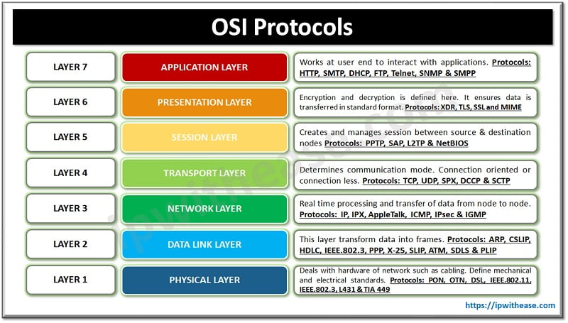
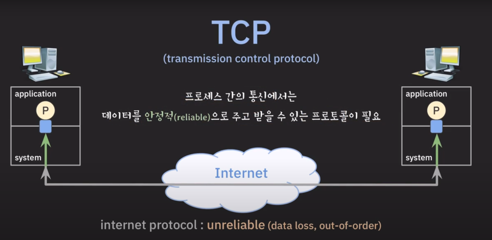
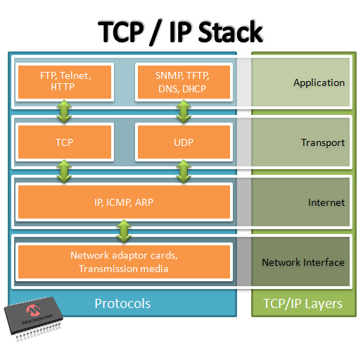
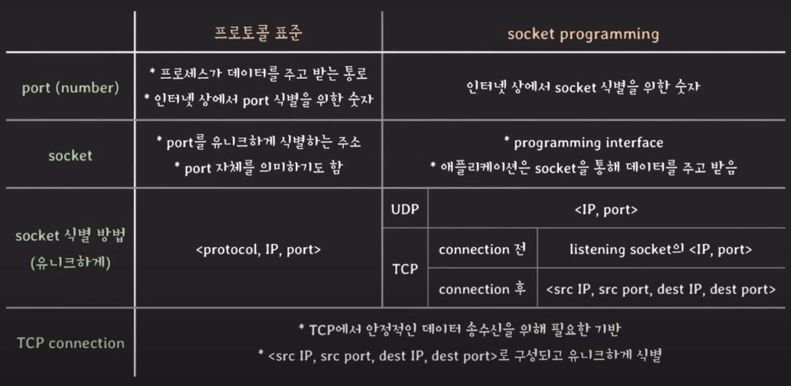
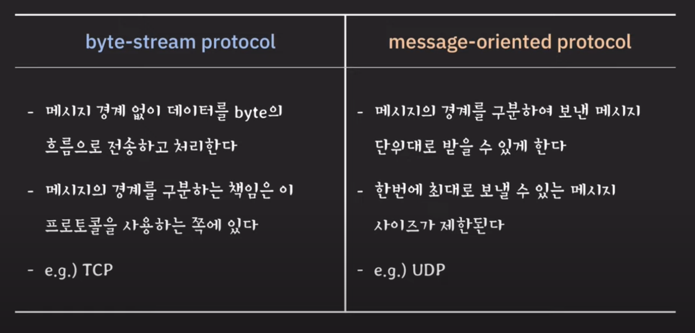

**모뎀(modem)**

  - **역할:** 인터넷 신호(광, 전화선, 케이블 등)를 컴퓨터나 공유기가 이해할 수 있는 디지털 신호로 변환하는 장치.
  - **위치:** 인터넷 회선과 공유기(또는 PC) 사이에 위치
  - 인터넷 회선 → 모뎀 → 공유기 → 주변 장치

**공유기(home router)**

  - 여러 기기들이 인터넷에 연결될 수 있도록 하는 장치
  - **NAT(Network Address Translation)** 
- 하나의 공인(public) IP 주소로도 동시에 인터넷을 사용하는 것이 가능
  - **DHCP**
- 내부 네트워크(집, 사무실 등) 기기들에게 사설 IP(private IP) 자동 할당
  - 공유기에 연결된 기기들은 같은 네트워크 소속
  - **무선 + 유선 기능 모두 포함된 제품도 존재(대부분의 현대 공유기)**
- 무선 엑세스 포인트(Wireless Access Point) 기능 포함
- 유선 신호를 무선 신호로 변환하여 Wi-Fi 제공(유선 → 무선)

**스위치(switch)**

  - 같은 네트워크 내의 기기들이 서로 통신할 수 있도록 하는 장치
  - 보통 공유기의 랜(LAN) 포트 수가 부족한 경우 사용

**네트워크(Network)**

  - 컴퓨터나 기타 기기들이 리소스를 공유하거나 데이터를 주고 받기 위해 유선 혹은 무선으로 연결된 통신 체계

**LAN(local area network)**

  - Ethernet: 유선 통신
  - wireless LAN(wi-fi): 무선 통신

**WAN(wide area network)**

  - ex: internet, wireless WAN(4G, 5G)
  - 여러 LAN이나 다른 종류의 네트워크들을 하나로 묶어서 멀리 떨어진 기기들도 통신이 가능하도록 만든 네트워크

**ISP(internet service provider)**

  - 일반 사용자나 회사, 기관 등이 인터넷을 사용할 수 있도록 인터넷 연결 서비스를 제공하는 존재

```

ICANN으로부터 한국 인터넷 진흥원(KISA)은 IP 대역을 받아오고
ISP(KT, SKT, LG U+)들은 KISA에서 받아온 IP 일부를 통해 
일반 가정집이나 회사 같은곳인 인터넷 가입자들에게 IP를 제공한다
이때 DHCP 서버를 사용하여 자동으로 IP 할당
```

  - **DHCP(Dynamic Host Configuration Protocol)**

**ISP 티어(ISP Tier)**

  - **tier1 ISP**
- 국제 범의의 네트워크 보유
    - 인터넷의 모든 네트워크 접근 가능
    - 인터넷 중추 역할
    - 트래픽 전송 비용이 없다
    - AT&T, NTT, Tata Communications, Lumen
  - **tier2 ISP**
- 국가/지방 범위의 네트워크 보유
    - 일반 사용자나 기업 대상 서비스
    - 인터넷의 모든 영역에 연결되기 위해 tier1 ISP에 비용을 내고 트래픽을 전송
    - ex) SKT, KT, U+
  - **tier3 ISP**
- 작은 지역 범위 서비스 제공
    - 일반 사용자나 기업 대상 서비스
    - 상위 ISP에게 비용을 내고 인터넷 트래픽을 구매해서 이를 통해 서비스
    - ex) 소규모 사업자

즉, 티어1~3 ISP는 네트워크 연결 및 트래픽 비용 구조에 따른 사업자 분류이며, ICANN/KISA는 주소 관리 기관이다. 사업자들은 주소 관리 기관에게 IP 주소 블록을 받고 사업자들은 자신들의 네트워크에 노드(라우터, 스위치 등 네트워크 장비)를 구축한고 최종 사용자(가정, 회사)에게 IP 주소를 배분한다.

**라우터(router)**

  - 목적하는 네트워크에 데이터를 보내는 장치

**end system, 호스트 (host)**

  - 네트워크의 끝에 있는 노드
  - 네트워크를 사용하기 위해 연결된 노드
  - 클라이언트, 서버 
- 클라이언트(client)
- 다른 호스트의 데이터나 리소스를 요청하는 호스트
    - 서버(server)
- 다른 호스트에게 서비스를 제공하는 호스트
      - 요청에 따라 데이터나 리소스를 제공

---

[https://www.youtube.com/watch?v=oFKYzp6gGfc&list=PLcXyemr8ZeoSGlzhlw4gmpNGicIL4kMcX](https://www.youtube.com/watch?v=oFKYzp6gGfc&list=PLcXyemr8ZeoSGlzhlw4gmpNGicIL4kMcX)

**네트워크 프로토콜(network protocol)**

  - 네트워크 통신을 하기 위해서는 통신에 참여하는 주체들이 따라야 하는 형식, 절차, 규약
  - 각 레이어에 맞게 프로토콜이 세분화돼서 구현
  - 각 레이어의 프로토콜은 하위 레이어의 프로토콜이 제공하는 기능을 사용하여 동작



**OSI 7 layer**

  - application layer
- 애플리케이션 목적에 맞는 통신 방법 제공
    - HTTP, DNS, SMTP, FTP
  - presentation layer
- 애플리케이션 간의 통신에서 메시지 포맷 관리
    - 인코딩 ↔ 디코딩
    - 암호화 ↔ 복호화
    - 압축 ↔ 압축 풀기
  - session layer
- 애플리케이션 간의 통신에서 세션을 관리
    - RPC(remote procedure call)
  - transport layer
- 애플리케이션 간의 통신 담당 
    - 목적지 애플리케이션으로 데이터 전송(port)
    - 안정적이고 신뢰할 수 있는 데이터 전송 보장(TCP)
    - 필수 기능만 제공(UDP)
  - network layer
- 호스트 간의 통신 담당(IP)
    - 목적지 호스트로 데이터 전송
    - 네트워크 간의 최적의 경로 결정
  - data link layer
- 직접 연결된 노드 간의 통신 담당
    - MAC 주소 기반 통신 (ARP)
  - physical layer
- bits 단위로 데이터 전송

**encapsulation & decapsulation** 

---

[https://www.youtube.com/watch?v=6l7xP7AnB64&list=PLcXyemr8ZeoSGlzhlw4gmpNGicIL4kMcX&index=2](https://www.youtube.com/watch?v=6l7xP7AnB64&list=PLcXyemr8ZeoSGlzhlw4gmpNGicIL4kMcX&index=2)




### TCP 

**TCP(Transmission Control Protocol) Connection** 

  - 프로세스 간의 안정적이고 **논리적인 통신 경로**
  - **connection을 열고(3-way handshake)** → 데이터를 주고 받고 -> **connection을 닫는다(4-way handshake)**
  - connection-oriented, 연결형 프로토콜

**인터넷 상에서 어떻게 port를 유니크하게 식별할까**

  - port(number) 정의: 16 bits로 이루어진 숫자 (0 ~ 65535)
  - port number 만으로는 유니크하게 식별할 수 없다
  - internet address로 각 host를 유니크하게 식별할 수 있다.
  - **internet address + port number → 유니크하게 식별할 수 있다.**
  - **소켓 = internet address + port number 즉, 유니크하게 식별하기 위한 주소이다.** 

**Connection & Socket** 

  - 각 connection을 유니크하게 식별할 수 있어야 한다
  - 한 쌍의 socket은 connection을 유니크하게 식별한다
  - **<source socket, destination socket>** 
  - **<source internet addr, source port, destination internet addr, destination port>**
  - **하나의 socket은 동시에 여러 connection들에서 사용될 수 있다.**

### UDP 

**UDP(User Datagram Protocol)**

  - connectionless: 연결을 맺지 않고 바로 데이터를 주고 받는다, 비연결형 프로토콜
  - internet protocol을 거의 그대로 사용한다.
  - **마찬가지로 Socket 개념이 사용된다. Socket은 인터넷 주소 + 포트 번호 조합**
  - 최종적으로 <protocol, ip address, port number>로 유니크하게 식별

### 정리 

| **프로토콜** | **전송 계층** | **소켓 종류** | **주요 용도/특징** |
| --- | --- | --- | --- |
| HTTP/1,2 | TCP | TCP 소켓 | 웹, API, 채팅 등 |
| HTTP/3 | UDP(QUIC) | UDP 소켓 | 최신 웹, 실시간성 강화 |
| 일반 소켓통신 | TCP | TCP 소켓 | 채팅, 파일전송 등 신뢰성 중요 서비스 |
| 실시간/스트리밍 | UDP | UDP 소켓 | 게임, 영상/음성 스트리밍 등 |

일반적으로 말하는 소켓통신은 TCP 소켓을 말한다.

---

[https://www.youtube.com/watch?v=X73Jl2nsqiE&list=PLcXyemr8ZeoSGlzhlw4gmpNGicIL4kMcX&index=4](https://www.youtube.com/watch?v=X73Jl2nsqiE&list=PLcXyemr8ZeoSGlzhlw4gmpNGicIL4kMcX&index=4)



### 개요 

Application Layer / System Layer(Transport, Internet, Network Interface) 이렇게 2계층으로 구분할 수 있다. 

Application Layer는 시스템이 제공하는 네트워크 기능을 사용하고, System Layer는 애플리케이션이 사용할 수 있도록 네트워크 기능을 지원한다.

애플리케이션이 시스템의 기능을 함부로 쓸 순 없다

대신 시스템은 애플리케이션이 네트워크 기능을 사용할 수 있도록 프로그래밍 인터페이스를 제공한다.

애플리케이션은 socket을 통해 데이터를 주고 받는다.

개발자는 socket 프로그래밍을 통해 네트워크 상의 다른 프로세스와 데이터를 주고 받을 수 있도록 구현한다

**즉, 네트워크에서 socket은 <protocol, internet address, port number> 개념과 동시에 애플리케이션과 시스템의 네트워크 인터페이스이기도 하다.**

대부분의 시스템(운영체제)은 socket 형태로 시스템의 네트워크 기능을 제공한다.

보통 socket을 직접 조작해서 통신 기능을 구현할 일은 적다. application layer의 프로토콜은 보통 라이브러리나 모듈 형태로 해당 기능이 제공되는데, 이때 내부를 열어보면 소켓을 활용해서 프로토콜을 구현했음을 알 수 있다.

프로토콜 표준과 다르게 TCP socket은 <TCP(protocol), IP address, port number>로 유니크하게 식별되지 않는다. 하지만 UDP socket 같은 경우 <UDP(protocol), IP address, port number> 유니크하게 식별된다.

### TCP socket 동작 방식

listening socket 대기, 클라이언트에서 connection 연결 요청이 오면 서버의 listening socket 은 3-way handshake 이후 새로운 소켓을 만든다. 근데 이때 만들어진 소켓들은 모두 동일한 <IP, port>를 가진다.

그렇다면 어떻게 socket을 식별할까?

connection이 성립된 이후의 요청은 <src IP, src port, des IP, src port>통해서 socket을 식별한다.



---

[https://www.youtube.com/watch?v=WwseO8l8rZc&list=PLcXyemr8ZeoSGlzhlw4gmpNGicIL4kMcX&index=5](https://www.youtube.com/watch?v=WwseO8l8rZc&list=PLcXyemr8ZeoSGlzhlw4gmpNGicIL4kMcX&index=5)

**application layer**

  - data, message

**transport layer**

  - TCP segment / UDP datagram 
  - Sender Port, Receiver Port 추가

**internet layer**

  - IP datagram, IP packet, Packet
  - Sender IP, Receiver IP 추가 
  - 특이하게도 transport layer 프로토콜인 TCP, UDP 정보도 헤더에 추가

**network access layer** 

  - Frame
  - Header, Trailer 추가

**Demultiplexing** 

  - Internet layer로 부터 받은 segment 또는 datagram에 있는 payload를 적절한 socket으로 전달하는 것 


**Multiplexing** 

  - 여러 socket 들로부터 데이터를 수집해서 각각 segment 또는 datagram으로 만든 후 internet layer로 내려보내는 것

**Demultiplexing 과정에서 UDP / TCP 차이**

```

internet layer 헤더에는 특이하게도 transport layer 프로토콜(UDP / TCP) 정보가 들어있다.
그 이유는 TCP, UDP 프로토콜은 서로 socket 스펙이 다르기 때문이다.

그래서 internet layer -> transport layer 계층 이동 시 
프로토콜에 따른 socket 스펙이 달라지기 때문에 internet layer에서 미리 header 정보로 
transport layer protocol을 구분한다.

그렇다면 socket 을 찾아가는 과정을 demultiplexing 이라고 하는데
UDP/ TCP는 어떻게 다를까?
UDP 같은 경우 connectionless 이기 때문에 바로 destination IP, Port 에 해당하는 소켓으로 진입한다
반면 TCP 같은 경우 connection oriented이다.
만약 SYN flag number가 1이라면 아직 3-way hanshake를 통한 커넥션이 생성되지 않은것이기 때문에 
먼저 listening socket으로 간다. 해당 socket은 destination IP/Port UDP와 동일하다.

이후 3-way handshake 즉, connection 연결이 끝나면 listening socket으로부터 
커넥션 socket이 생성되는데 해당 socket의 식별은 
<source IP, source port, destination IP, destination port>로 구성된다. 
즉, UDP는 <destination IP, destination port>로 socket 식별을 하지만 TCP는 좀 더 복잡하다
```

[https://www.youtube.com/watch?v=eveNtda0_yk&list=PLcXyemr8ZeoSGlzhlw4gmpNGicIL4kMcX&index=6](https://www.youtube.com/watch?v=eveNtda0_yk&list=PLcXyemr8ZeoSGlzhlw4gmpNGicIL4kMcX&index=6)

TCP는 byte-stream protocol 이라고 하고 UDP는 message-oriented protocol 이라고 한다

UDP는 메시지 자체를 보낸다. 그래서 message-oriented protocol이라고 부른다.

TCP는 원본 메시지를 byte stream으로 바꿔서 전송한다. TCP는 신뢰할 수 있는(reliable) 데이터 전송을 실현하는 것이 목적이기 때문에, 애플리케이션에서 보낸 메시지와는 독립적으로, 특정 크기가(MSS, Maximum Segmenet Size) 구분되는 별도의 전송 단위를 통해 데이터를 전송하는데 이때 전송 단위를 TCP segment라고 부른다.

**UDP를 통해 max UDP datagram size 보다 큰 메시지를 전송하려고 하면 어떻게 되는가?**

→ 실패하고 에러를 받는다. 에러 처리는 application layer protocol 또는 개발자가 구현한다.

**TCP를 통해 MSS(Max Segment Size) 보다 큰 메시지를 전송하려고 하면 어떻게 되는가?** 

→ TCP가 알아서 MSS에 맞는 TCP setment들로 나워서 전송한다.

**byte-stream protocol을 사용하는 쪽에서 메시지를 구분하는 방법은 어떤 것들이 있나?** 

  1. 메시지 사이즈를 고정한다.
  1. 메시지의 사이즈를 먼저 보낸 후 메시지를 보낸다.
  1. 메시지 사이에 구분자를 넣어서 전송한다. ex) CRLF

**TCP가 byte-stream protocol 이라면 TCP 위에서 동작하는 HTTP는 자체적으로 HTTP message의 경계를 구분하는 방법을 가지고 있다는 말인가?**

→ yes 하지만 버전마다 다르다.



---

[https://www.youtube.com/watch?v=lLb2lMQpKbY&list=PLcXyemr8ZeoSGlzhlw4gmpNGicIL4kMcX&index=7](https://www.youtube.com/watch?v=lLb2lMQpKbY&list=PLcXyemr8ZeoSGlzhlw4gmpNGicIL4kMcX&index=7)

