### Physical Layer 

  - 장치를 연결하기 위한 매체의 물리적인 사항을 정의
- 전압, 주기, 시간, 전선의 규격, 거리 등
  - 주요 단위: Bits
  - 대표 구성 요소 
- 케이블/안테나/허브, 리피터

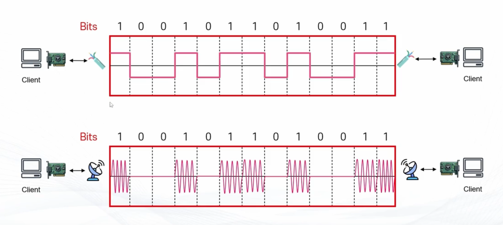

### Hub

  - Physical Layer 단위에서 다수의 기기들을 연결해주는 장치
  - 특징 
- 에러/충돌/디바이스 별 제어 기능 없음
    - 받은 내용을 그대로 전달 → 무조건 Broadcast

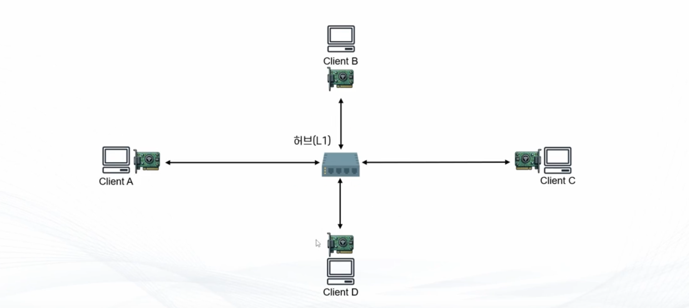

### Physical Layer에서 해결하지 못한 문제

  - 충돌 
  - Broadcast only → 대상을 지정해서 전달 불가능

### Data Link Layer 

  - 물리적인 통신을 제어하여 디바이스와 디바이스간의 통신 및 전송을 안정화 하기 위한 프로토콜
  - 주요 단위: Frame
  - 주요 구성 요소 
- Mac Address, Switch
  - 주요 특징
- CSMA/CD(Carrier-Sense Multiple Access with Collision Detection) 방식을 활용하여 각 디바이스간의 통신을 원활하게 연결
    - 대상을 구별하여 디바이스간의 통신을 지원(Unicast)

### Mac(Media Access Control) Address 

  - 네트워크 인터페이스에 부여된 고유의 주소
- 데이터가 지정한 대상에게 잘 전달될 수 있도록 대상 식별에 사용
  - 2개의 Hexadecimal 단위로 6개를 나열 = 48bits = 6bytes
- ex: 00:1A:2B:3C:4D:5E
  - 두 파트로 구분 
- 첫 3개의 bytes OUI(Organizationally Unique Identifier): 제조사에 부여된 고유 식별자
    - 나머지 3개의 bytes NIC(Network Interface Controller): 네트워크 인터페이스 별 고유 번호
  - 네트워크 인터페이스의 MAC Address는 고유의 값이며 변하지 않음
- IP는 변동

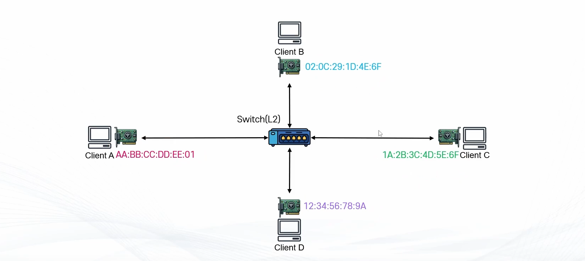

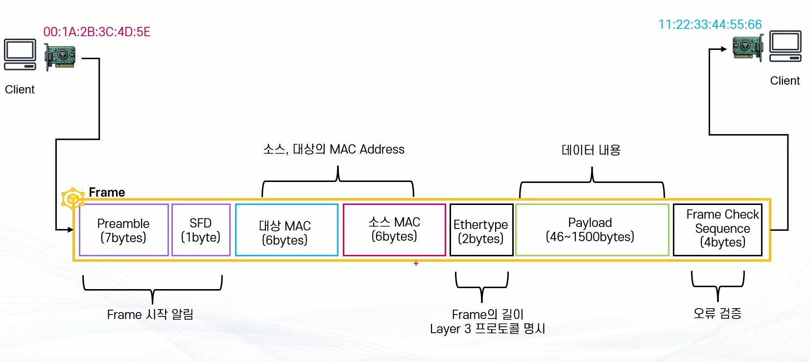

내가 아는 Switch는 CSMA/CD가 필요 없는 걸로 안다.

왜냐하면 각 디바이스와 포트가 1:1로 연결되고 Full Duplex를 사용하기 때문이다.

Full Duplex란 동시에 송수신이 가능한 방식으로, 물리적으로 채널(회선)을 2개 사용하기 때문에 충돌이 발생하지 않는다. 

즉, CSMA/CD는 Half Duplex 사용하는 디바이스나 허브에서 사용된다.

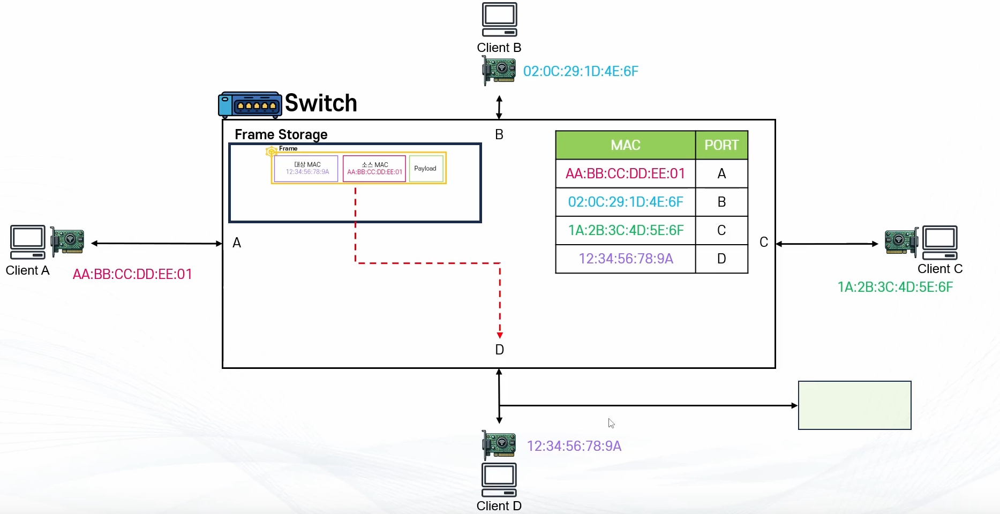

Frame Storage는 Client A ↔ Client B 통신에 있어서 충돌(collision)이 발생할 때 CSMA/CD를 통해 충돌 데이터를 임시로 저장하는 공간이다. 

Frame Storage 기술도 마찬가지로 Full Duplex 기술이 나오기 전에 사용되던 기술이다.

스위치의 MAC : PORT 정보를 가지는 테이블을 Mac Address Table 이라고 한다.

클라이언트 컴퓨터의 IP : MAC 정보를 가지는 테이블은 ARP 테이블이다.

### Data Link Layer 해결하지 못한 문제

  - 로컬 네트워크 외부로 통신 불가능

### Network Layer 

  - 여러 노드의 경로를 찾고 올바르게 전달 될 수 있는 기능과 수단을 정의
  - 주요 단위: 패킷
  - 주요 구성 요소
- Router, IP, ARP
  - 주요 특징 
- 서로 떨어진 LAN 간의 통신 지원
    - 중간중간 Node들을 거쳐서 목적지 까지 도달할 수 있는 방법을 지원

### IP(Internet Protocol) Address

  - Internet Protocol 상에서 통신 주체를 식별하기 위한 아이디
  - 두 가지 종류
- IPv4: 32Bits (약 43억개)
- 아이피를 최대로 활용하기 위해 사설(Private) IP와 공인(Public) IP로 분류
    - IPv6: 128Bits 
- 사설 IP 개념이 불필요하다
  - MAC Address와 다르게 수시로 변경가능(DHCP)

### Classless Inter Domain Routing(CIDR)

  - IP는 주소의 영역을 여러 네트워크 영역으로 나누기 위해 IP를 묶는 방식
  - 여러 개의 사설망을 구축하기 위해 망을 나누는 방법

### CIDR Notation 

  - IP 주소의 집합
  - 네트워크 주소와 호스트 주소로 구성
  - 각 호스트 주소 숫자 만큼의 아이피를 가진 네트워크 망 형성 가능
  - A.B.C.D/E 형식

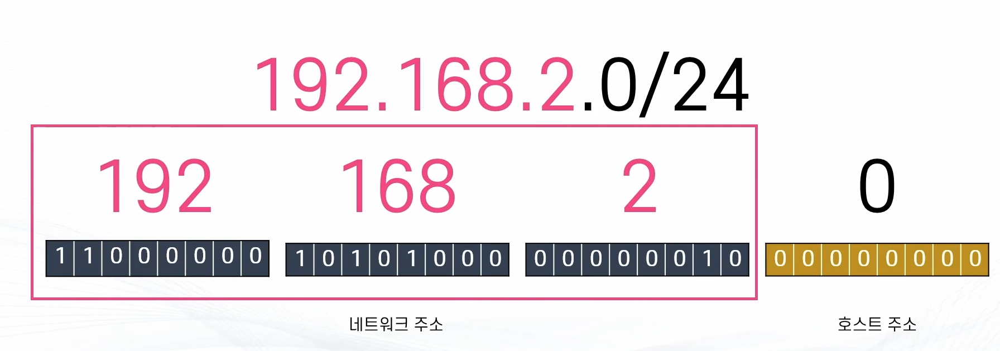

### CIDR Block

  - 호스트 주소 비트만큼 IP 주소를 보유 가능
  - ex: 192.168.2.0 / 24
- 네트워크 비트: 24
    - 호스트 비트: 8
    - 즉 2^8 = 256 - 2 = 254개의 주소 보유 
    - 192.168.2.0: 네트워크 주소
    - 192.168.2.1 ~ 192.168.2.254: 사용 가능한 주소
    - 192.168.2.255: 브로드 캐스트

### Subnet Mask

  - 어느 부분이 호스트 비트인지, 어느 부분이 네트워크 비트인지 구분해주는 Mask
- AND 연산을 활용해 네트워크 주소를 필터링
  - 네트워크 비트 수만큼 1을 보유한 마스크를 IP에 적용하면 네트워크 주소 추출 가능

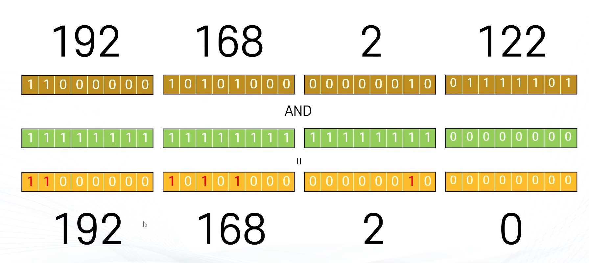

### 라우터(Router)

  - 네트워크간에 패킷을 주고 받는 Layer 3 장치
  - IP 대역별 최적 경로를 수집 및 관리
- 어떤 경로의 노드를 경유해야 가장 효율적으로 대상에 도착하는지 알고 있다(Route Table)
    - 이 경로를 바탕으로 특정 IP 주소가 대상인 패킷의 전당를 요청받을 때 해당 경로로 요청
  - 로컬 네트워크는 자신의 로컬 네트워크 주소가 아니라면 라우터로 전달
- 확인 방법: 네트워크 주소가 같은지 확인(subnet mask)
  - 이후 Router는 패킷을 Frame안에 넣어서 최적 경로에 따른 다른 Router로 전달
- IP 주소에 따른 Frame 확인 방법: ARP

### ARP(Address Resolution Protocol)

  - IP로 MAC 주소를 찾는 프로토콜
  - 순서
- Broadcast (MAC Address FF:FF:FF:FF:FF:FF)로 IP 요청
    - 응답 받은 IP MAC Address를 기반으로 MAC 확정 후 ARP 테이블에 저장

**ARP 요청을 했는데 만약 해당 IP가 같은 LAN이 아니라면 게이트웨이(라우터)는 자신의 MAC 주소를 알려준다.**

| **계층** | **Source** | **Destination** |
| --- | --- | --- |
| 2계층(MAC) | 내 PC의 MAC 주소 | 게이트웨이의 MAC 주소 |
| 3계층(IP) | 내 PC의 IP 주소 | 최종 목적지의 IP 주소 |
| 4계층(Port) | 내 PC의 포트 | 목적지 서비스의 포트 |

### L1 ~ L3 흐름 정리

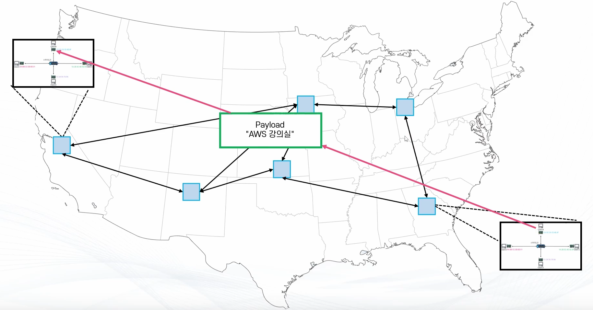

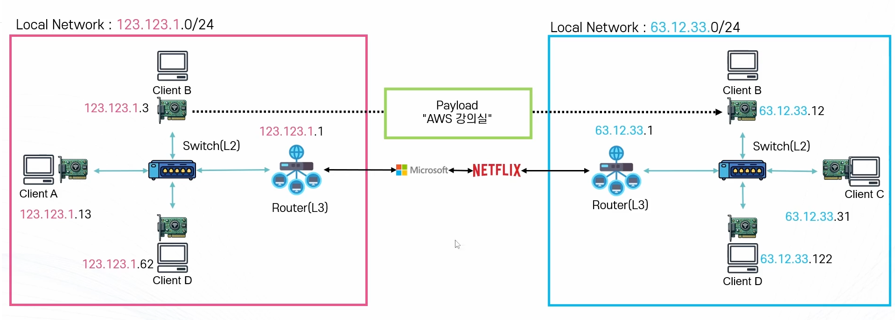

**라우터까지 데이터 전달하기**

  - IP 대상(63.12.33.12)이 로컬이 아닌 것 식별
- 네트워크 주소가 다름
  - 같은 네트워크가 아니라면 라우터로 전달
- 하지만 라우터의 IP는 알지만 MAC 주소를 모름
  - ARP(Address Resolution Protocol) 활용
  - 이후 해당 MAC Address 에 Frame 전달

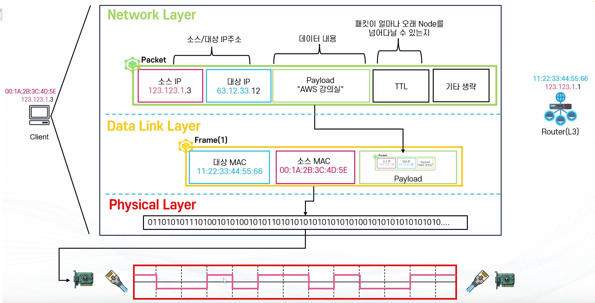

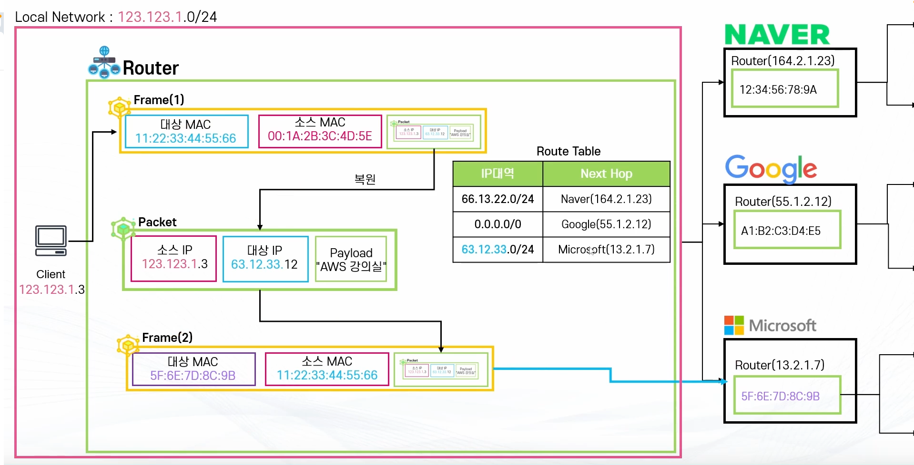

  - **NAT가 없는 일반 라우터 간 이동**: 패킷의 IP/포트 정보는 변하지 않음
  - **NAT가 적용된 라우터를 통과할 때**: IP 주소와 포트 번호가 변환됨
- private  IP/Port → public IP/Port

### Network Layer 해결하지 못한 문제

  - 애플리케이션 구분이 불가능
  - 패킷등의 순서 보장 / 유실에 대한 대응 불가능

### Transport Layer 

  - 통신 주체끼리 데이터 전달의 신뢰성을 확보하는 방법을 정의
  - 주요 단위: 세그먼트(TCP), 데이터 그램(UDP)
  - 주요 구성 요소
- TCP/UDP
  - 주요 특징
- Network Layer로 성립된 통신 위에서 실질적인 활용을 위한 다양한 기능을 정의
- 패킷의 순서 보장, 에러 처리, 포트 기반 분할

### Transmission Control Protocol (TCP)

  - byte stream message 
  - 패킷의 전달 과정에서 순서를 보장하고 유실되지 않도록 보장할 수 있는 통신 규약
  - 연결 지향 connection - oriented
- 지속적으로 채널을 수립하여 전달 여부를 확인하고 무결성을 확인
    - 지속적으로 무결성을 확보하는 과정에서 비교적 느리고 복잡한 과정 필요
  - 주요 사용 사례
- 웹 페이지(HTTP/HTTPS)
    - 이메일
    - 파일 전송 
    - SSH

### Segment(세그먼트)

  - TCP 데이터 전달 단위
  - TCP 세그먼트의 주요 구성 
- Port(Source/Destination)
    - Sequence/Acknowledgement Number: 통신 주체끼리 데이터를 주고 받았는지 확인에 사용
    - Flags: Segment 목적 등을 정의(ACK, SYN, FIN)
    - Window Size: 세그먼트를 만든 주체가 얼마나 많은 데이터를 받을지 전달
    - Urgent Pointer: 세그먼트의 중요도를 설정(먼저 처리해야 하는 세그먼트 등)
    - 기타(checksum)

### TCP 세그먼트 

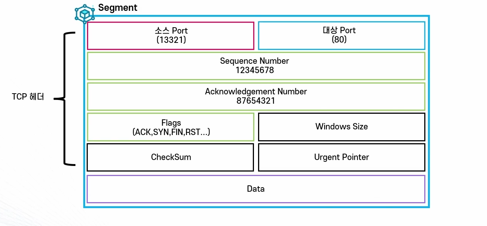

### Port

  - IP 프로토콜에서 패킷을 올바른 프로세스로 라우팅 하기 위한 논리적 단위
  - Well Known Port: 주로 서버에서 사용하는 애플리케이션 / 프로토콜 별로 미리 지정된 포트
- 예:
- 80: HTTP
      - 443: HTTPS
      - 22: SSH
      - 3306: MySQL
  - Ephemeral Port: 클라이언트에서 사용하는 포트로 연결할 때 마다 임의로 지정

### TCP Handshake

  - TCP Protocol에서 통신을 수립하고 서로를 인식하는 첫 과정
  - 보통 3-way Handshake로 부르며 3가지 과정으로 구분 
- Syn(Synchronize): 첫 요청으로 사용할 첫 클라이언트 Sequence Number(CS)를 전달
    - Syn-Ack(Synchronize-Acknowlege): Syn에 대한 응답으로 CS + 1과 서버 Sequence Number(SS)를 전달
    - Ack(Acknowlege): 마지막 단계로 연결이 수립되었음을 알려주며 CS+1, SS+1 전달

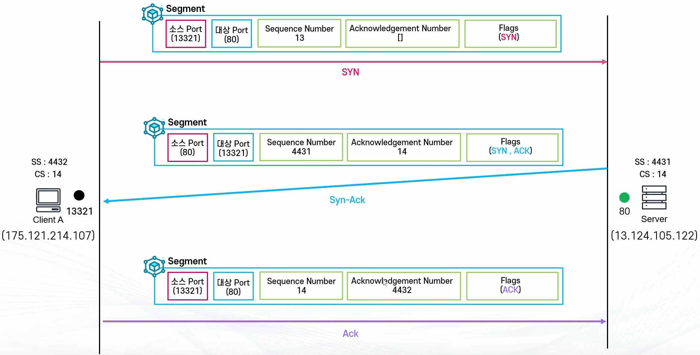

### User Datagram Protocol(UDP)

  - 빠르고 간단하게 데이터를 주고 받을 수 있는 방법을 정의
  - Connectionless
- 연결 지향과는 달리 데이터의 무결성, 순서, 전달여부를 체크하지 않는다
    - 즉 패킷이 순서대로 오지 않거나, 중복되거나, 아예 전달되지 않을 수 있다.
  - 빠르고 간단하다 
  - 주요 사용 사례
- 스트리밍 
    - 보이스톡

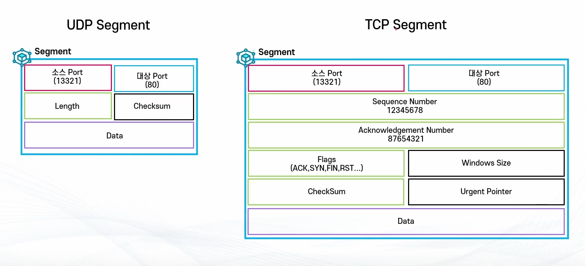

### Session Layer 

  - 통신 주체끼리 연결이 유지할 수 있는 방법을 정의
  - Layer 4 이상의 추가적인 차원에서 지속적인 연결(세션)이 수립할 수 있는 방법을 포함
- 예: HTTP Cookie
  - 몇 몇 프로토콜의 경우 Session Layer 자체를 구현하지 않는다.
- 예: FTP

**HTTP**

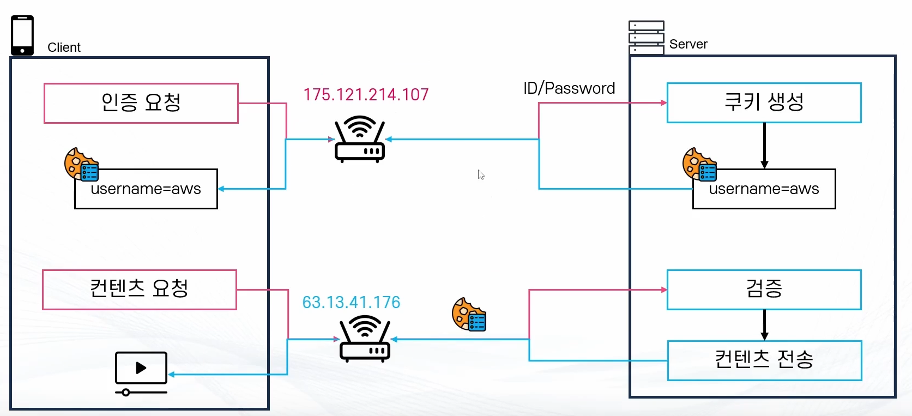

**FTP**

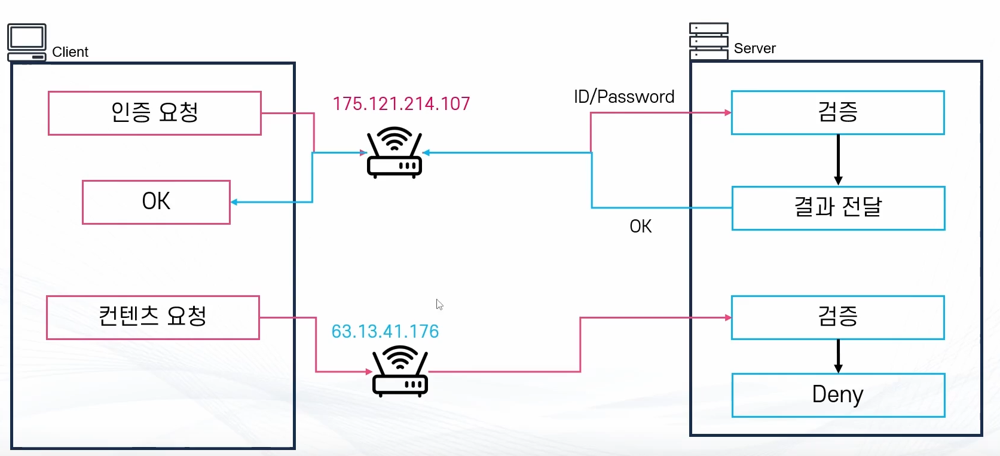

### Presentation Layer 

  - 받은 데이터를 해석하는 방법을 정의
- 파싱, 압축 해제, 복호화 등 Application Layer에서 사용할 수 있는 방식으로 변환을 담당

### Application Layer 

  - 실제 받은 데이터를 처리하는 방법을 정의
- 말 그대로 데이터를 가지고 무엇을 어떻게 처리할지에 관한 레이어

도메인 이름 시스템은 사람이 읽을 수 있는 도메인 이름을(www.amazon.com)을 머신이 읽을 수 있는 IP 주소(192.0.2.44)로 변환한다.

### DNS 주요 개념 

  - DNS(Domain Name System): 사람이 읽을 수 있는 문자열과 Internet 프로토콜 기반 정보를 매칭 시켜주는 시스템
- Internet Corporation for Assgined Names and Numbers (ICANN)에서 관리
  - 도메인(Domain): 대상의 IP 주소등의 정보와 맵핑되는 사람이 알아볼 수 있는 문자열
- 서브도메인: 도메인 중 스트링 앞에 추가 문자열이 붙은 도메인
- ex: **test.example.com**
    - APEX 도메인: 도메인 중 앞에 추가 문자열이 없는 최상위 도메인
- ex: **example.com**
  - 레코드(DNS Record): 도메인이 어떤 방식으로 데이터와 매칭되는지 정의하는 기록
- 다양한 레코드 종류가 있으며 각각 다른 정보와 매칭
    - 예: A 레코드 IPv4 주소, MX 레코드는 메일 서버
  - Domain Zone: 도메인의 정보를 담은 레코드의 집합
  - Zone File: Domain Zone 정보를 저장한 텍스트 파일
  - DNS Query: 주어진 도메인에 해당하는 정보를 요청하는 쿼리
  - Name Server: DNS Query를 Zone File을 기반으로 응답할 수 있는 서버
- Authoritative: DNS 정보의 원본을 가지고 있는 가장 최상위 Name Server 
    - None-Authoritative: Authoritative Name Server를 조회하여 정보를 보관하고 있거나 응답하는 서버(캐시)
  - DNS Resolver: 사용자와 Name Server 사이에 위치한 서버로 실제 유저의 요청에 따라 IP 주소 등의 정보를 확보하는 서버
- 유저의 클라이언트가 제일 먼저 쿼리를 요청하는 대상이며 보통 ISP가 관리

### DNS의 규모 

  - 2024년 기준 약 3억 6천만개의 도메인 존재
- 그리고 거의 모든 HTTP 통신에 매번 활용
  - 매우 큰 규모이며 이를 호스팅하기 위한 서버 구조에 큰 고민 필요

### DNS의 구성 

  - DNS는 계층 구조
- 즉 최상위 도메인부터 차례대로 계층구조로 구성되어 있음
    - 실제 레코드는 가장 마지막 계층에서 보관 및 관리

### 도메인의 구조

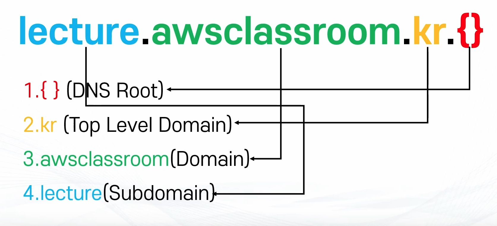

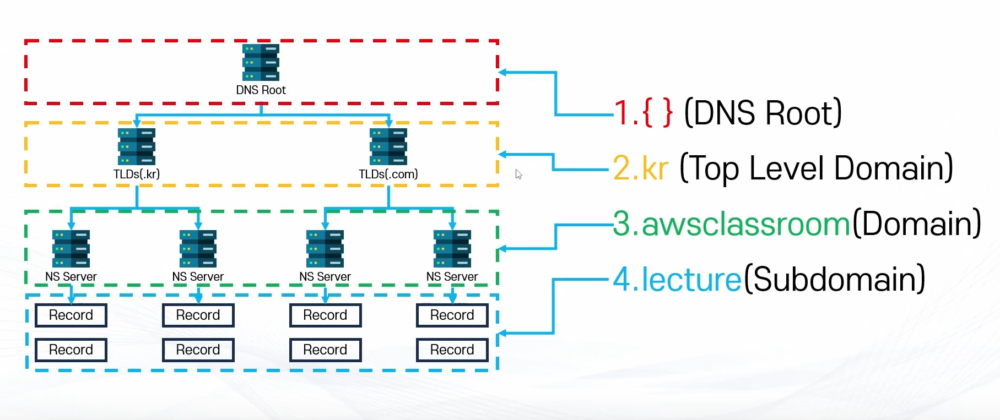

### DNS Root

  - DNS 계층 구조의 최상위 레벨
- 즉 DNS Query 수행 시 최초로 조회하는 거점
    - 다음 단계인 TLDs(Top Level Domain)의 Zone File을 가진 NS 서버의 주소 정보 보유
  - IANA(Internet Assigned Numbers Authority)에서 조율하는 13개의 주체에서 관리
- A~M까지 각 관리 주체별로 다른 서버 주소
  - Root Hints File
- DNS Root의 주소를 담은 파일
    - 각 DNS Resolver에 하드코딩

### Top Level Domains(TLDs)

  - DNS 계층 구조의 두 번째 레벨 
- 실질적으로 정보를 가지고 있는 최상위 레벨 
    - 예: .com / .org / .net/ .info 등등
  - 종류
- Country Code TLDs: 각 나라에 할당된 두 자리 코드
- 예: .kr / .jp / .uk
    - Sponsored TLDs: 사설 조직이나 기관에 할당된 TLDs
- 예: .edu / .gov / .mil
    - New Generic TLDs: 기타 다양한 TLDs
- 예: .app / .tech / .xyz / .blog
  - 관리 주체: TLDs Registry (각 회사/나라 등)
- 예:
- .com / .net → Verisign
      - .kr → Korea Internet & Security Agency (KISA)
  - 실제 도메인의 레코드를 관리하는 NS 서버의 주소 정보를 담은 Zone File 보유

### NS 서버 

  - 실제 도메인의 레코드를 가지고 있는 서버
- 이 NS 서버의 주소를 TLDs에 등록해두면 클라이언트에서 DNS 쿼리에 따라 이쪽으로 도착
  - 해당 도메인 및 서브도메인들이 어떤 프로토콜의 어떤 주소로 맵팽되는지(레코드)에 관한 Zone File 보유

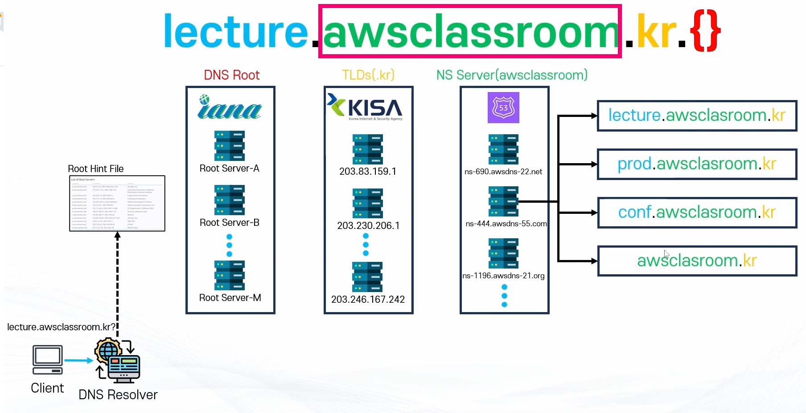

### 도메인 등록 

  - 도메인 등록 대행 (Domain Registrar)을 통해 등록 
- 도메인 등록 대행(Domain Registrar): ICANN에게 인증받고 TLDs Registry와 협의하여 도메인 등록의 권한을 가진 주체
    - 예: 가비아, GoDaddy, Cafe24, AWS Route53
  - 등록할 때 TLDs Registry에 자신이 원하는 NS 서버 주소를 등록
- 일종의 남은 슬롯에 자신의 NS 서버를 예치하는 개념
    - NS 서버는 자신의 개인 NS 서버를 사용하거나, DNS Hosting Service 업체에서 대여 가능
    - DNS Hosting Service: DNS 기능을 제공하는 주체
- 예: 가비아, AWS Route53 
      - 대부분의 Registrar는 DNS Hosting Service를 같이 제공

### 암호화 

  - 암호화: 수학적인 과정으로 어떤 정보를 읽을 수 없는 데이터로 변환하는 행위
- 복원이 가능 ↔ Hash 복원 불가능
  - 암호화의 종류
- 암호화 기술을 사용하는 상황에 따라
- 저장된 데이터 보호(Encryption At Rest)
      - 전송 중 데이터 보호(Encryption At Transit)
    - 암호화 방법에 따라
- 대칭키 암호화
      - 비대칭키 암호화

### 암호화 용어 

  - 평문(Planetext): 암호화 하기 전의 데이터
  - 암호문(Ciphertext): 평문을 암호 키와 알고리즘을 사용해 암호화 한 데이터
  - 암호화(Encryption): 평문에 암호화 알고리즘과 키를 적용하여 키를 소유한 주체가 아니면 알아볼 수 없는 암호문으로 만드는 과정
  - 복호화(Decryption): 암호문에 키와 복호화 알고리즘을 적용하여 평문으로 되돌리는 과정
  - 키(Key): 평문을 암호화하거나 암호문을 평문으로 돌리기 위한 알고리즘에 핵심 가변정보 값
  - 암호 알고리즘: 암호화/복호화를 위해 사용되는 알고리즘
  - AES, DES ..

### 저장된 데이터 보호(Encryption At Rest)

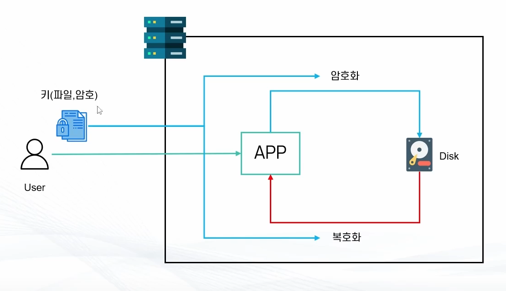

  - 데이터를 저장할 때 암호화하고 필요할 때 복호화 해서 사용하는 방식
  - 주로 하나의 물리적인 기기에 보안을 적용하기 위해 사용
- 예: 기기를 탈취당했을 때 데이터 보호

### 전송 중 데이터 보호(Encryption At Transit)

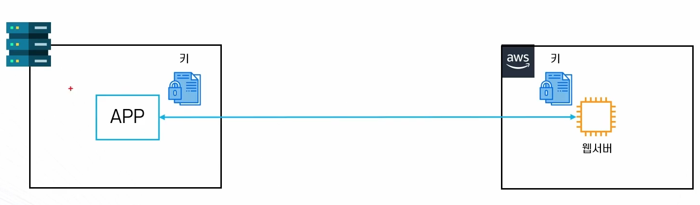

  - 데이터의 전송 중 암호화를 적용하여 데이터가 탈취 당하지 않도록 보호
  - 주로 여러 시스템/기기 간에 보안을 적용하기 위해 사요
- 예: SSH/TLS, HTTPS 등

### 대칭키 암호화(Symmetric Encryption)

  - 하나의 키로 암호화, 복호화를 하는 알고리즘
  - 비교적 연산이 빠름

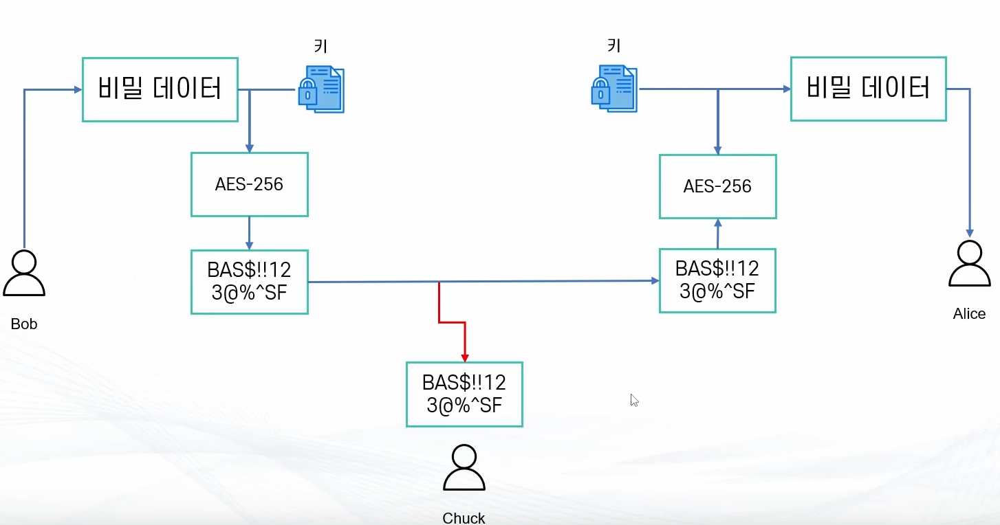

대칭키 암호화 치명적인 단점은 암호화 및 복호화에 사용할 키의 전달이다.

결국 키는 평문으로 전달하는데 이또한 해커에게 탈취당할 수 있다.

### 비대칭키 암호화(Asymmetric Encryption)

  - 한 쌍의 키를 활용한 암호화, 단 하나의 암호는 암호화만 가능하며, 다른 하나는 복호화만 가능
  - 연산이 비교적 복잡하지만 키 전달이 쉽다
  - 공개 키 / 비밀 키: 각각 암호화 복호화만 할 수 있는 키쌍
- 공개키로 암호화하면 비밀 키로 복호화 가능
    - 비밀키로 암호화하면 공개 키로 복호화 가능

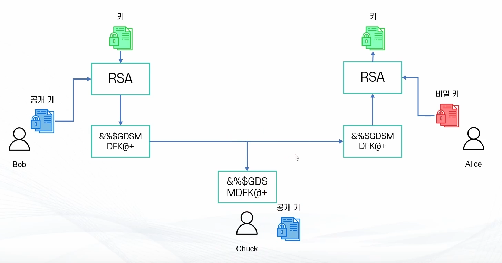

### 암호화 서명(Signing)

  - 키를 사용해서 데이터의 생성자가 데이터를 생성했음을 보장하는 방법
- Private 키를 사용하여 Public 키로 검증 가능한 데이터의 서명(Signature)을 생성
    - Private 키를 가진 주체가 데이터를 생성했음을 보장할 수 있는 방법이다.

**암호화 서명의 2가지 방식**

| **구분** | **목적/원리** | **대표적 사용 예시** |
| --- | --- | --- |
| **무결성/위조 방지 (서명)** | JWT처럼 해시와 비밀키(혹은 개인키)로 서명 생성, 데이터가 변조되지 않았음을 검증 | JWT, 디지털 서명(전자서명) |
| **데이터 암호화/복호화** | 비대칭키(공개키/개인키)로 데이터 암호화 및 복호화, 데이터의 비밀성 보장 | HTTPS, 이메일 암호화, 파일 암호화 |

### SSL(Security Socket Layer)/ TLS(Transport Layer Security)

  - 클라이언트와 서버간에 데이터의 무결성과 기밀성을 보장할 수 있는 프로토콜
- 상호간의 통신은 암호화 되어 전달되며 중간에서 데이터를 탈취당해도 안전하다
  - HTTPS 등 다양한 프로토콜에 활용
- 일반 HTTP의 경우 연결이 안전하지 않기 때문에 보안적으로 취약하다
  - 3단계 과정으로 진행

### 1. Cipher Suites 교환

**Cipher Suites:** TLS에서 활용하는 보안 알고리즘들

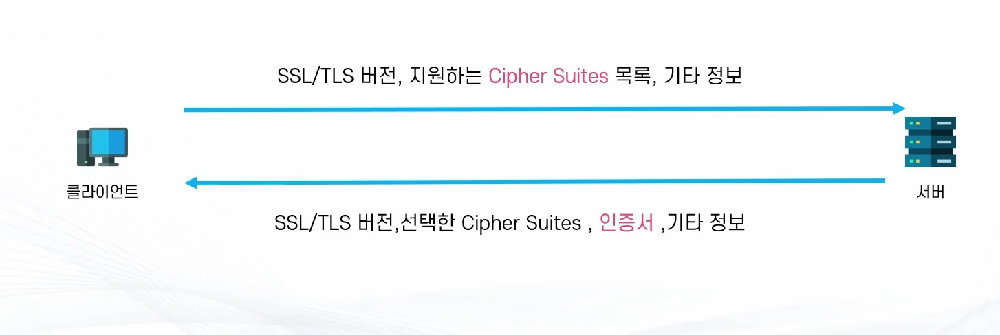

### 2. 인증

인증서: 믿을 수 있는 인증 기관(Certificate Authority, CA)에서 배포하는 서버 신원에 대한 검증 확인

**CA 필요성**

클라이언트가 [google.com](http://google.com/) 접속하려고 하는데 해당 서버가 실제 구글 서버인지 가짜 서버인지 클라이언트는 구별할 방법이 없다. 이런 문제를 해결하기 위해서 인증 기관에서 해당 서버에 대한 인증을 인증서를 통해 보장한다.

**서버 ↔ CA**

서버는 먼저 기관의 인증을 받기 위해서 서버의 공개 키, 비밀 키를 발급하고 공개 키와 함께 서버 정보를 인증 기관에 제공한다. 인증 기관은 해당 서버를 확인하고 인증 기관의 비밀 키를 통해 해당 서버의 공개 키와 정보를 바탕으로 인증서를 만든다. 서버는 해당 인증서를 가진다.

**클라이언트 ↔ 서버** 

먼저 1번 과정을 진행한다 클라이언트는 SSL/TLS 버전 및, 보안 알고리즘 목록을 서버로 보내고 서버는 선택한 보안 알고리즘과 인증서를 보낸다.

**클라이언트** 

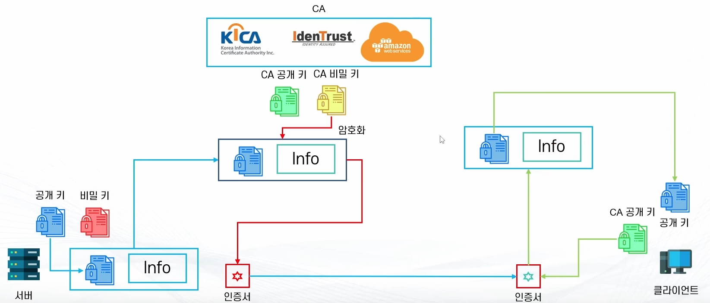

인증서를 받은 클라이언트는 CA에서 제공한 공개 키를 통해 서버의 공개 키와 서버 정보를 획득한다.

이렇게 클라이언트는 서버를 신뢰할 수 있게된다.

### 3. 키 교환

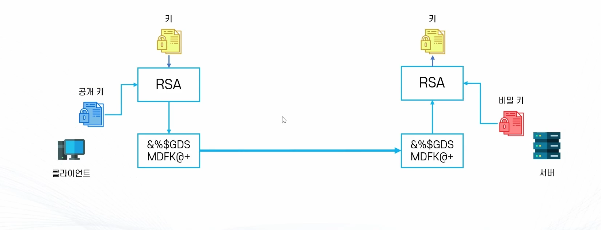

클라이언트는 본인의 키를 서버의 공개키를 통해 암호화하고 서버는 암호화된 클라이언트의 키를 서버의 비밀 키를 통해 뽑아낸다. 이렇게 비대칭키 → 대칭키로 바꾸는 이유는 비대칭키 방식이 너무 느리기 때문이다.

이렇게 키 교환이 끝나면 클라이언트와 서버는 보안 걱정 없이 대칭키(세션키)로 암호화하고 복호화하여 통신이 가능하다.

***참고로 이 과정은 3-way handshake 이후 TLS handshake 과정으로 진행한다***

