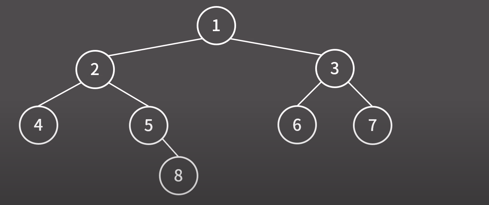
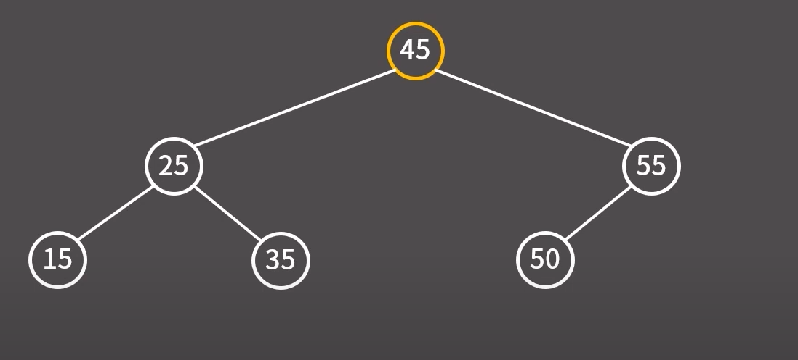
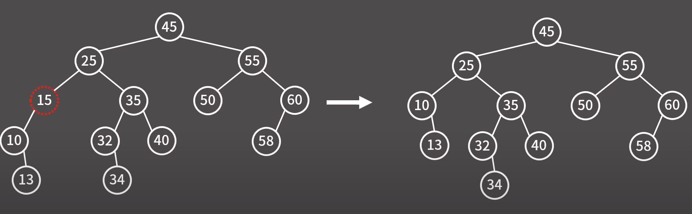
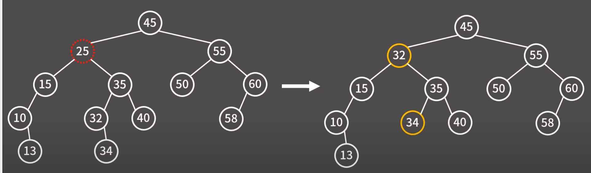
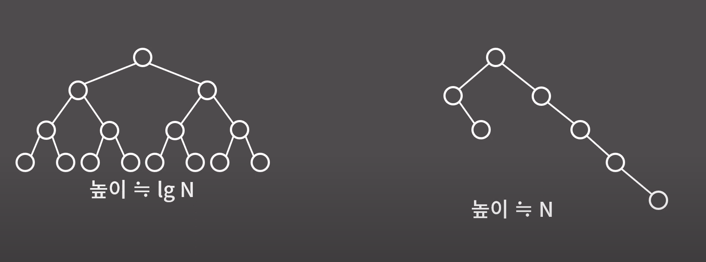

## 목차

- 트리 용어 정리 
- 이진 트리 
- 이진 검색 트리 
- 연산(Insert, Delete, Update, Find) 시뮬레이션
- 이진 검색 트리 - 시간 복잡도 
- 자가 균형 트리 

---

## 용어 정리 

정점 : 트리에서의 각 원소 

루트 : 주어진 트리에서의 1번 정점 

리프 : 제일 말단에 위치해서 아래로 뻗은게 없는 정점 

간선 : 정점을 연결하는 선 

부모 - 자식 관계 : 간선으로 연결된 위 아래의 관계

서브 트리 : 어떤 한 정점에 대해 그 밑에 있는 정점과 간선만을 모은 트리 

트리의 높이 : 위 아래로 뻗어있는 정도 

---

## 이진 트리 (Binary Tree) 

각 노드의 자식이 2개 이하인 트리 

---

## 이진 검색 트리 (Binary Search Tree)

왼쪽 서브트리의 모든 값은 부모의 값보다 작고 오른쪽 서브트리의 모든 값은 부모의 값보다 큰 이진 트리 

왜 이진 검색 트리를 사용하는가?

삽입(insert), 삭제(erase), 검색(find), 변경(update) → O(lgN)

→ 삭제, 검색, 변경이 빈번하다면 이진 검색 트리를 활용할 수 있다!

해시와 비교했을 때 해시는 최선의 경우 모든 연산이 O(1)인데 해시가 더 좋은 자료구조가 아닌가?

→ 이진 검색 트리의 강력한 특성 : 원소가 크기 순으로 정렬된다. 

ex) 1, 3, 5, 7, 9 

5보다 큰 최초의 원소가 무엇인지 알고 싶을 때 해시는 크기 순서대로 저장하는 자료구조가 아니어서 알 방법이 없지만 이진 검색 트리는 가능하다 O(lgN)

---

## BST 연산 시뮬레이션 

**Insert (삽입)**

45 삽입 

25 삽입 

이때 45를 기준으로 25는 왼쪽? 오른쪽 45보다 작으니까 왼쪽이다. 

35 삽입

이때 45를 기준으로 35는 왼쪽? 오른쪽? 45보다 작으니까 왼쪽 

이미 25가 있다. 25를 기준으로 35는 더 크니까 25의 오른쪽에 넣는다.

 

…. 중간 생략 

**Find(검색)**

35 검색 

45에서 35는 45보다 작으니까 왼쪽

25에서 35는 25보다 크니까 오른쪽 

 

**Erase(삭제)**

현재 그림처럼 무작정 삭제를 하면 트리 구조가 깨진다.  어떻게 제거를 수행?

**case 1 - 자식이 없는 정점** 

삭제를 해도 구조를 망가뜨리지 않는다.

**case 2 - 자식이 1개인 정점** 

이 경우엔 자식을 지워진 노드의 자리에 올리면 된다.

**case 3 - 자식이 2개인 정점**

32를 25 자리에 넣으면 된다.

왜 하필 32일까? 

그 이유는 32가 25 보다 크면서 가장 작은 원소이기 때문이다. 

그렇기 때문에 32는 25의 왼쪽 원소들 보다 크고 25의 오른쪽 원소들 보다 작다. 

실제 구현에서 32를 찾는 과정

지우고 싶은 원소(25)에서 일단 오른쪽 자식(35)을 보고 거기서부터 계속 왼쪽으로만 이동하고 

더이상 이동할 원소가 없으면 멈춘다. 

---

## 이진 검색 트리 - 시간 복잡도 

이진 검색 트리의 시간 복잡도는 트리의 높이가 얼마인지에 따라서 정해진다. 

만약 왼쪽 트리처럼 각 정점이 대부분 2개의 자식을 가지고 있다면 높이가 하나 내려갈 때 마다 

자식의 수가 1, 2, 4, 8 .. 이렇게 2배씩 증가하기 때문에 정점이 N개가 있다고 하면 높이가 대략 lg N이다. → O(lg N)

반면 오른쪽 트리처럼 트리가 편향되어 있다면 높이가 N에 가깝기 때문에 시간복잡도가 O(N)이다.

우리는 각 연산을 O(lg N)에 수행하려고 이진 검색 트리를 쓰는건데 그냥 사실상 LinkedList에서 하는 행위와 동일하다. 그래서 이진 검색 트리를 사용하는 의미가 없어진다. 

또한 1,2,3,4… 이렇게 크기 순으로 원소를 삽입하면 원소들이 오른쪽에 일직선으로 연결되는 편향된 트리가 되니 편향된 트리가 만들어지는 상황은 아주 잘 발생할 수 있다. 

그렇기 때문에 이진 검색 트리가 편향되면 그걸 해결해줄 필요가 있다. 이러한 트리를 자가 균형 트리라고 부르고 대표적으로 AVL 트리, Red Black 트리가 있다. 

---

## 자가 균형 트리 

아주 간단하게 설명하면 불균형이 발생하면 트리를 꺾어버린다. 

이렇게 편향성을 해소해주는 자가 균형 트리를 사용할 때 비로소 모든 연산이 O(lg N)에 동작한다. 

자바에서는 이진 검색 트리를 TreeMap 클래스로 구현을 했는데 

TreeMap 클래스는 레드-블랙 트리(Red-Black Tree)라는 특별한 형태의 이진 검색 트리를 내부적으로 사용하여 데이터를 관리한다.

