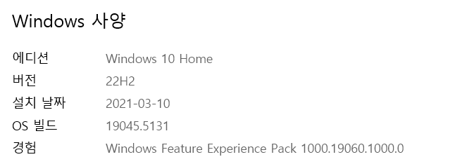
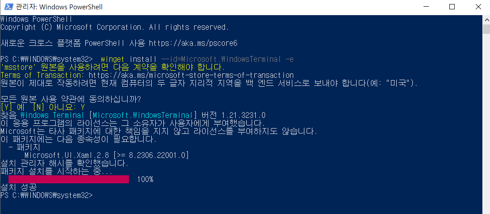
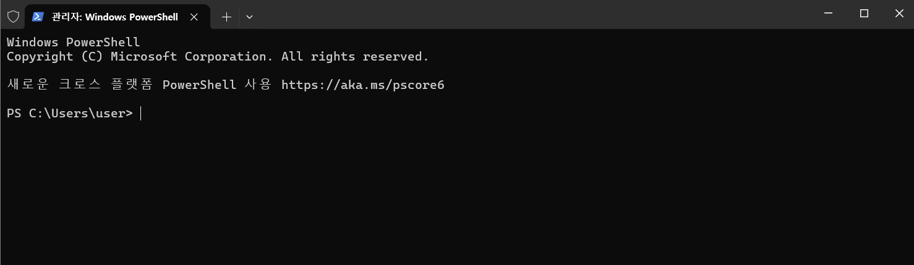
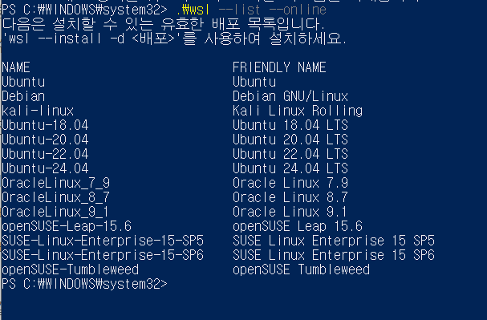

# Windows 에디션 확인하기 

**PC 정보** 



# **Windows Home Edition VS Windows Pro Edition**

`Hyper-V` 기능의 지원 여부

Window Home 버전에서는 `Hyper-V` 기능을 사용할 수 없다. 

[https://learn.microsoft.com/ko-kr/virtualization/hyper-v-on-windows/about/](https://learn.microsoft.com/ko-kr/virtualization/hyper-v-on-windows/about/)

- Windows 10/11 Professional / Education / Enterprise 에디션
- `WSL2` 기반 Docker Engine 사용 가능
  - `Hyper-V` 기반 Docker Engine 사용 가능
- Windows 10/11 Home 에디션
- `WSL2`기반 Docker Engine 사용 가능

### **WSL2?**

Windows Subsystem for Linux 2 줄임말 

윈도우에서 리눅스를 사용할 수 있게 해주는 기능이다. 

# **WSL2를 설치**

WSL(Windows Subsystem for Linux)은 윈도우의 가상화 기능을 사용해, 윈도우에서 리눅스를 사용할 수 있게 도와주는 도구

가상머신을 따로 구성하지 않고도, 윈도우에서 리눅스를 사용할 수 있다. 


WSL2를 설치하기 위해서는 터미널 앱을 사용해야한다. PowerShell을 사용해도 무방하지만 

윈도우 터미널 사용을 추천한다. 

### **윈도우 터미널(Windows Terminal) 설치**

검색창에서 PowerShell 검색하고 관리자 권한으로 실행한다. 

그리고 아래의 명령어를 실행 

```powershell
$ winget install --id=Microsoft.WindowsTerminal -e
```



### **윈도우 터미널(Windows Terminal) 실행**

검색창에서 Terminal을 입력해 애플리케이션을 찾아 실행한다. 

Windows Terminal은 기본적으로 Windows PowerShell로 실행된다.

윈도우 터미널은 명령 프롬프트보다 훨씬 더 나은 사용자 경험을 제공한다.



### WSL2 설치하기 (PowerShell)

PowerShell 관리자 권한으로 실행

아래 2개의 명령어 입력 

```powershell
dism.exe /online /enable-feature /featurename:Microsoft-Windows-Subsystem-Linux /all /norestart
dism.exe /online /enable-feature /featurename:VirtualMachinePlatform /all /norestart
```

컴퓨터 재부팅 이후 아래 명령어 입력 

```powershell
.\wsl --install
```

사용 가능한 목록 확인

```powershell
.\wsl --list --online
```



Ubuntu 설치

```powershell
.\wsl --install -d Ubuntu
```

Docker 설치 

- [Docker Desktop for Mac and Windows | Docker](https://www.docker.com/products/docker-desktop)
- WINDOWS AMD 선택 

**나머지는 Docker 설치 완벽 가이드 Reference 참고** 

# Reference

[https://www.lainyzine.com/ko/article/a-complete-guide-to-how-to-install-docker-desktop-on-windows-10/](https://www.lainyzine.com/ko/article/a-complete-guide-to-how-to-install-docker-desktop-on-windows-10/)

[https://www.lainyzine.com/ko/article/how-to-install-wsl2-and-use-linux-on-windows-10/](https://www.lainyzine.com/ko/article/how-to-install-wsl2-and-use-linux-on-windows-10/)

[https://www.lainyzine.com/ko/article/how-to-install-windows-terminal-powershell-wsl2/](https://www.lainyzine.com/ko/article/how-to-install-windows-terminal-powershell-wsl2/)

[https://cha-coding.tistory.com/entry/Docker-%EC%9C%88%EB%8F%84%EC%9A%B010-Home-Docker-%EC%84%A4%EC%B9%98%ED%95%98%EA%B8%B0](https://cha-coding.tistory.com/entry/Docker-%EC%9C%88%EB%8F%84%EC%9A%B010-Home-Docker-%EC%84%A4%EC%B9%98%ED%95%98%EA%B8%B0)
