# 김영한님 강의 정리 

# *강의 내용* 

# ***persistence.xml***

***resources/META-INF/persistence.xml***

```xml
<?xml version="1.0" encoding="UTF-8"?>
<persistence version="2.2" xmlns="http://xmlns.jcp.org/xml/ns/persistence"
             xmlns:xsi="http://www.w3.org/2001/XMLSchema-instance"
             xsi:schemaLocation="http://xmlns.jcp.org/xml/ns/persistence http://xmlns.jcp.org/xml/ns/persistence/persistence_2_2.xsd">
    <persistence-unit name="hello">
        <properties>
            <!-- 필수 속성 -->
            <property name="jakarta.persistence.jdbc.driver" value="org.h2.Driver"/>
            <property name="jakarta.persistence.jdbc.user" value="sa"/>
            <property name="jakarta.persistence.jdbc.password" value=""/>
            <property name="jakarta.persistence.jdbc.url" value="jdbc:h2:tcp://localhost/~/practice"/>
            <property name="hibernate.dialect" value="org.hibernate.dialect.H2Dialect"/>

            <!-- 옵션 -->
            <property name="hibernate.show_sql" value="true"/>
            <property name="hibernate.format_sql" value="true"/>
            <property name="hibernate.use_sql_comments"  value="true"/>
            <property name="hibernate.hbm2ddl.auto" value="create" />
        </properties>
    </persistence-unit>

</persistence>
```

    - *jakarata → JPA 자바 표준 ORM이고 여러 구현체가 존재하는데 다른 구현체로 바꾸어도 바뀌지 않는 설정*
    - *hibernate → JPA 구현체 즉, 구현체 ex) 이클립스 링크로 바꾸면 바뀌는 설정*

# ***데이터베이스 방언***

*JPA는 특정 데이터베이스에 종속적이지 않다.*

*각각의 데이터베이스가 제공하는 SQL 문법과 함수는 조금씩 다르다.*

*즉, 방언은 SQL 표준을 지키지 않는 특정 데이터베이스만의 고유한 기능 혹은 문법이다.* 

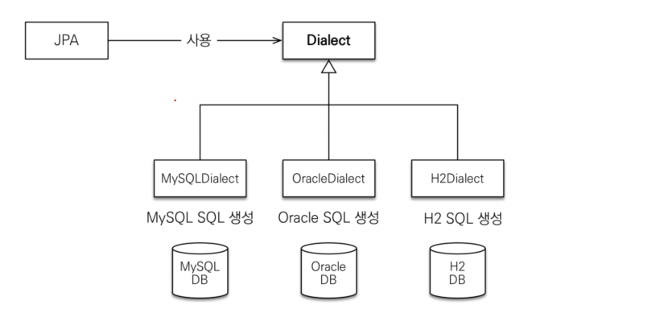

***hibernate.dialect 속성에 지정***

    - *H2 : org.hibernate.dialect.H2Dialect* 
    - *MySQL : org.hibernate.dialect.MySQLDialect*
    - *하이버네이트는 40가지 이상의 데이터베이스 방언 지원*

# ***JPA 구동 방식***

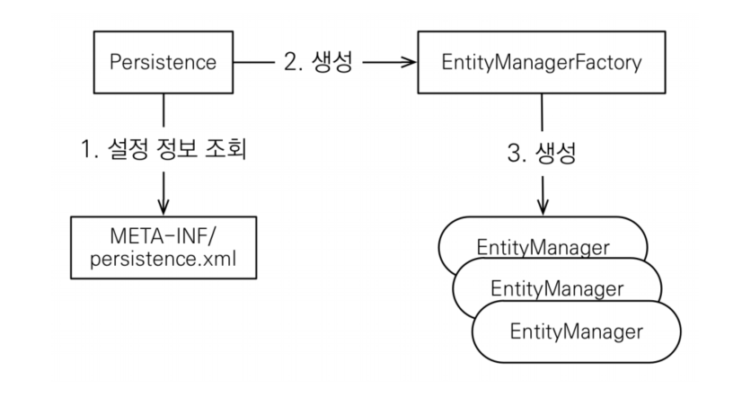

***Member 테이블 생성***

```sql
create table Member ( 
	 id bigint not null, 
	 name varchar(255), 
	 primary key (id) 
);
```

***Member - Entity***

```java
@Entity
public class Member {
    @Id
    private Long id;
    private String name;
    public Long getId() {
        return id;
    }
    public void setId(Long id) {
        this.id = id;
    }
    public String getName() {
        return name;
    }
    public void setName(String name) {
        this.name = name;
    }
}
```

    - *@Entity: JPA가 관리할 객체*
    - *@Id: 데이터베이스 PK와 매핑*

***주의***

    - *엔티티 매니저 팩토리는 하나만 생성해서 애플리케이션 전체에서 공유*
- *싱글톤으로 관리*
    - *엔티티 매니저는 쓰레드간에 공유X*
- *EntityManager em = emf.createEntityManager()→ 데이터베이스 커넥션 획득 작업*
    - ***JPA의 모든 데이터 변경은 트랜잭션 안에서 실행***

***Member insert***

```java
public class JpaMain {
    public static void main(String[] args) {
        EntityManagerFactory emf = Persistence.createEntityManagerFactory("hello");
        EntityManager em = emf.createEntityManager();
        EntityTransaction tx = em.getTransaction();
        tx.begin();
        try {
            Member member = new Member();
            member.setId(1L);
            member.setName("배제우");
            em.persist(member);
            tx.commit();
        }
        catch (Exception e){
            tx.rollback();
        }
        finally {
            em.close();
        }
        emf.close();
    }
}
```

    - *데이터 저장도 데이터 변경 작업이다. 트랜잭션 없이는 동작하지 않는다.*

***Member  select***

```java
Member member = em.find(Member.class, 1L);
```

***Member update***

```java
Member member = em.find(Member.class, 1L);
member.setName("배제우2");
tx.commit();
```

    - *단순히 이름만 setter로 바꿨는데 update 쿼리가 나간다.*

# ***JPQL 소개***

*JPA를 사용하면 엔티티 객체를 중심으로 개발한다.*

*검색을 할 때도 테이블이 아닌 엔티티 객체를 대상으로 검색이 가능하다.*

```java
 List<Member> members = em.createQuery("select m from Member m", Member.class).getResultList();
  for (Member member : members) {
      System.out.println("member.name = " + member.getName());
  }
```

***실행 결과***

```java
Hibernate: 
    /* select
        m 
    from
        Member m */ select
            m1_0.id,
            m1_0.name 
        from
            Member m1_0
member.name = 배제우2
```

    - *보면 JPQL과 실제 데이터베이스에 날라간 쿼리가 모두 보인다.*

*JPA는 SQL을 추상화한 JPQL이라는 객체 지향 쿼리 언어를 제공한다.*

*정리하면 JPQL은 엔티티 객체를 대상으로 쿼리 SQL은 데이터베이스 테이블을 대상으로 쿼리* 

***JPQL 장점***

*엔티티를 대상으로 쿼리를 날린다면 추후에 데이터베이스가 변경되어도 JPA(하이버네이트)가 알아서 방언에 맞게 쿼리를 바꿔서 날려준다.*

*개발자는 SQL을 추상화한 JPQL에만 의존하면 된다.*

  - ***설정, 데이터베이스 방언, JPA 구동 방식, JPQL 소개*** 

***JPA에서 가장 중요한 2가지***

    - *객체와 관계형 데이터베이스 매핑하기 (Object Relational Mapping)*
    - *영속성 컨텍스트*

# *영속성 컨텍스트* 

***엔티티 매니저 팩토리, 엔티티 매니저***

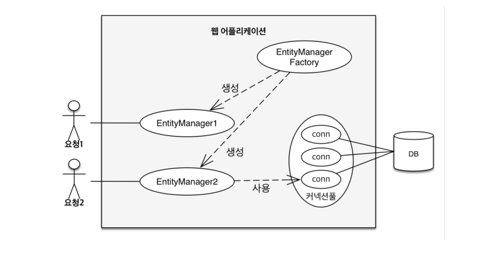

***영속성 컨텍스트***

    - *엔티티를 영구 저장하는 환경?*
    - *엔티티 매니저를 통해서 영속성 컨텍스트에 접근한다.*

# *엔티티 생명주기* 

    - ***비영속 (new/transient)***
- *영속성 컨텍스트와 전혀 관계가 없는 새로운 상태*
    - ***영속 (managed)***
- *영속성 컨텍스트에 관리되는 상태*
    - ***준영속 (detached)***
- *영속성 컨텍스트에 저장되었다가 분리된 상태*
    - ***삭제 (removed)***
- *삭제된 상태*

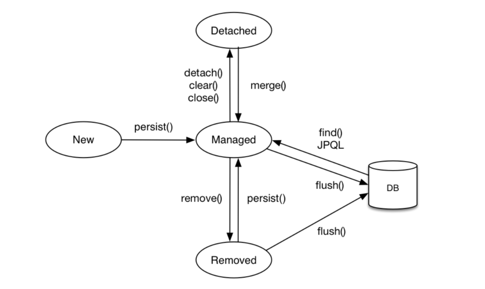

***비영속 상태 (NEW)***

```java
Member member = new Member();
member.setId(10L);
member.setName("10");
```

    - *객체를 단지 생성한 상태*

***영속 상태(managed)***

```java
Member member = new Member();
member.setId(10L);
member.setName("10");

em.persist(member);
```

    - *객체를 생성하고 영속성 컨텍스트에 저장*

# ***영속성 컨텍스트의 동작 원리와 이점*** 

    - *1차 캐시*
    - *동일성(identity) 보장*
    - *트랜잭션을 지원하는 쓰기 지연(transactional write-behind)*
    - *변경 감지(Dirty Checking)*
    - *지연 로딩(Lazy Loading)*

## ***엔티티 조회, 1차 캐시*** 

***1차 캐시에서 조회***

```java
Member member = new Member();
member.setId("member1");
member.setUsername("회원1");

//1차 캐시에 저장
em.persist(member);

//1차 캐시에서 조회
Member findMember = em.find(Member.class, "member1");
```

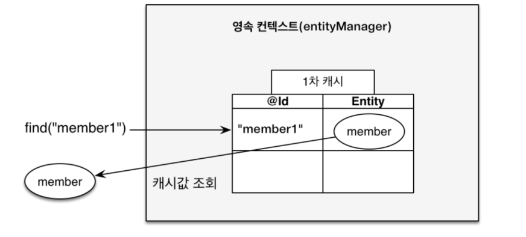

    - *1차 캐시에 “member1”를 key로 가지는 엔티티가 존재하기 때문에 데이터베이스에서 조회하지 않고 1차 캐시에서 조회한다.*

***데이터베이스에서 조회***

```java
Member findMember2 = em.find(Member.class, "member2");
```

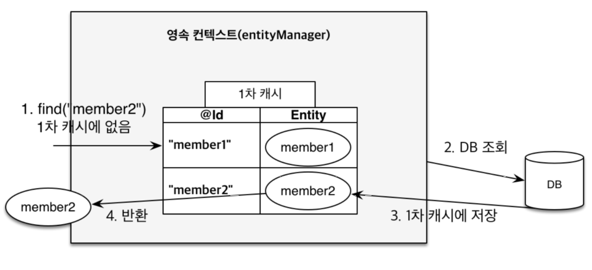

    - *“member2”를 가지는 엔티티는 1차 캐시에 존재하지 않기 때문에 DB에서 조회를 하고 1차 캐시에 저장을 한다.*

***JPA 1차 캐시는 애플리케이션 전반에서 큰 성능 향상을 기대할 수 없다.***

*왜냐하면 영속성 컨텍스트는 보통 각 요청 쓰레드의 트랜잭션 단위로 생성, 삭제되는데 
전체 쓰레드가 공유하는 컨텍스트가 아니기 때문이다.* 

*참고로 전체 쓰레드가 공유하는 캐시는 2차 캐시라고 한다.*

*즉, 1차 캐시의 주된 목적은 같은 트랜잭션 내에서 중복된 엔티티 조회 방지와 일관성 유지(Repeatable Read)이다.*

## ***영속 엔티티의 동일성 보장*** 

```java
Member find1 = em.find(Member.class, 1L);
Member find2 = em.find(Member.class, 1L);
System.out.println(find1 == find2);
```

    - *출력: true*

*처음 em.find를 하면 데이터베이스에서 조회를 하고 1차 캐시에 저장한다.*

*두 번째 em.find를 하면 동일한 key로 조회하기 때문에 1차 캐시에 저장된 Member를 반환한다.*

*이때 find1 == find2 같은 객체이다.*

*이런 메커니즘 때문에 REPEATABLE_READ 등급의 트랜잭션 격리 수준을 데이터베이스가 아닌 애플리케이션 레벨에서 제공한다.*

## *트랜잭션을 지원하는 쓰기 지연(transactional write-behind)*

***쓰기 지연***

```java
EntityManager em = emf.createEntityManager();
EntityTransaction transaction = em.getTransaction();

//엔티티 매니저는 데이터 변경시 트랜잭션을 시작해야 한다.
transaction.begin(); 

em.persist(memberA);
em.persist(memberB);
//여기까지 INSERT SQL을 데이터베이스에 보내지 않는다.

// 커밋하는 순간 데이터베이스에 INSERT SQL을 보낸다.
transaction.commit(); // [트랜잭션] 커밋
```

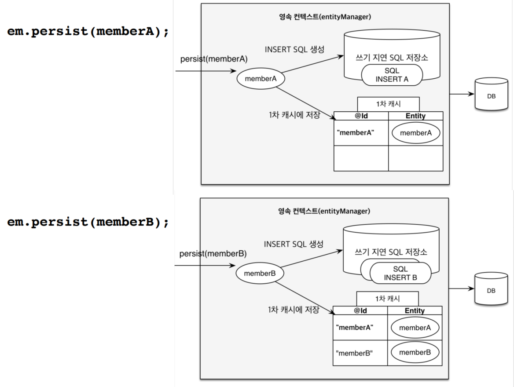

    - *em.persist(엔티티): 1차 캐시에 저장, 쓰기 지연 SQL 저장소에 저장*

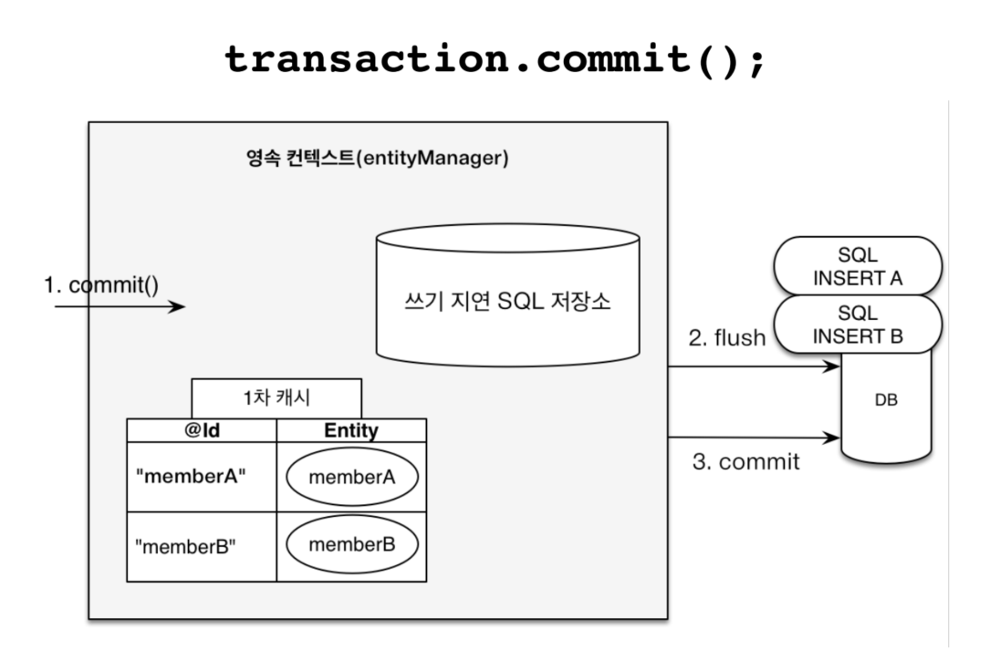

***동작 흐름 정리***

*트랜잭션 커밋 tx.commit()*

*flush() → 쓰기 지연 SQL 저장소에 저장된 INSERT 쿼리 DB로 날아간다.*

*실제 DB 트랜잭션 커밋* 

***호출 시점 테스트***

```java
try {
    Member member1 = new Member(150L, "A");
    Member member2 = new Member(160L, "B");
    em.persist(member1);
    em.persist(member2);

    System.out.println("==============================");

    tx.commit();
}

// 출력 
==============================
Hibernate: 
    /* insert for
        hellojpa.domain.Member */insert 
    into
        Member (name, id) 
    values
        (?, ?)
Hibernate: 
    /* insert for
        hellojpa.domain.Member */insert 
    into
        Member (name, id) 
    values
        (?, ?)
```

    - *2번의 INSERT 쿼리가 === 이후에 날라간다. 즉, 쓰기 지연이 동작*

***쓰기 지연 장점 정리***

    - ***네트워크 요청 감소***
- *개별적으로 실행되는 여러 쓰기 작업이 트랜잭션 내에서 지연되었다가 커밋 시점에 하나의 배치 요청으로 처리되므로 네트워크 오버헤드를 줄일 수 있다.*
    - ***데이터베이스 성능 최적화***
- *데이터베이스가 배치로 작업을 처리할 때, 트랜잭션당 I/O 작업이 줄어들고, 여러 개의 쿼리를 병합하여 효율적으로 실행할 수 있다.*
    - ***쓰기 작업 병합***
- *동일한 키에 여러 번 쓰기 작업이 발생할 경우, 최신 상태만 저장하므로 중복 작업이 제거*

## ***엔티티 수정, 변경 감지(Dirty Checking)***

```java
Member member = em.find(Member.class, 150L);
member.setName("배제우150");
tx.commit();


Hibernate: 
    select
        m1_0.id,
        m1_0.name 
    from
        Member m1_0 
    where
        m1_0.id=?
Hibernate: 
    /* update
        for hellojpa.domain.Member */update Member 
    set
        name=? 
    where
        id=?
```

    - *단지 em.find()를 통해서 엔티티를 조회하고 setter를 통해서 변경만 했는데 update 쿼리가 날라간다. 별도의 persist(), update() 호출이 없다!!*

***변경 감지 메커니즘***

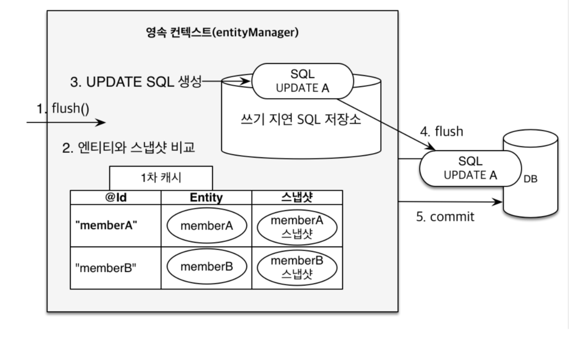

    - *flush() 시점에 1차 캐시와 스냅샷을 비교한다.*
- *스냅샷의 생성 시점은 1차 캐시에 최초 저장 시점과 동일하다.*
    - *스냅샷의 엔티티와 1차 캐시의 엔티티를 비교한다.* 
    - *만약 비교해서 다르면 UPDATE SQL을 쓰기 지연 저장소에 넣는다.*
    - *최종적으로 DB에 UPDATE 쿼리가 날아간다.*

## ***엔티티 삭제*** 

```java
// 삭제 대상 엔티티 조회 
Member member160 = em.find(Member.class, 160L);

// 엔티티 삭제
em.remove(member160);

--------------------------------------------------------------------------------------

Hibernate: 
    select
        m1_0.id,
        m1_0.name 
    from
        Member m1_0 
    where
        m1_0.id=?
Hibernate: 
    /* delete for hellojpa.domain.Member */delete 
    from
        Member 
    where
        id=?
```

# *플러시* 

*영속성 컨텍스트의 변경내용을 데이터베이스에 반영* 

***플러시 발생***

    - *변경 감지*
    - *수정된 엔티티 쓰기 지연 SQL 저장소에 등록* 
    - *쓰기 지연 SQL 저장소의 쿼리를 데이터베이스에 전송(등록, 수정, 삭제 쿼리)*

***영속성 컨텍스트를 플러시하는 방법***

    - *em.flush() - 직접 호출*
    - *트랜잭션 커밋 - 플러시 자동 호출* 
    - *JPQL 쿼리 실행 - 플러시 자동 호출* 

```java
try {
    Member member = new Member(200L, "member200");
    em.persist(member);
    em.flush();
    System.out.println("=============================");
    tx.commit();
}

-------------------------------------------------------------------------------------

Hibernate: 
    /* insert for
        hellojpa.domain.Member */insert 
    into
        Member (name, id) 
    values
        (?, ?)
=============================
```

    - *커밋 이전에 flush()를 호출 하였다.* 
    - *flush() 작업은 쓰기 지연 SQL 저장소(Hibernate의 ActionQueue)에 누적된 SQL을 데이터베이스로 전송*
    - *즉, 영속성 컨텍스트(1차 캐시)와 데이터베이스의 상태를 동기화하려는 작업*

### ***JPQL 쿼리 실행시 플러시가 자동으로 호출되는 이유***

```java
em.persist(memberA);
em.persist(memberB);
em.persist(memberC);

// 중간에 JPQL 실행
query = em.createQuery("select m from Member m", Member.class);
List<Member> members= query.getResultList();
```

*JPA는 애플리케이션에서 같은 트랜잭션의 REPEATABLE_READ를 보장한다고 했었다.*

*만약 예시로 나온 JPQL이 플러시를 호출하지 않는다면 memberA, memberB, memberC 엔티티는 조회에서 누락된다.*

*이런 메커니즘 때문에 항상 JPQL은 플러시 호출을 하여 쓰기 지연 SQL 저장소에 누적된 SQL을 데이터베이스로 전송하고 이후에 동작한다.*

### *플러시 모드 옵션*

    - *FlushModeType.AUTO*
- *커밋이나 쿼리를 실행할 때 플러시 (기본값)*
    - *FlushModeType.COMMIT*
- *커밋할 때만 플러시*

### ***플러시 주의사항***

    - *플러시는 영속성 컨텍스트를 비우지 않음*
    - *플러시는 영속성 컨텍스트의 변경내용을 데이터베이스에 동기화하는 작업이다.*
    - *트랜잭션이라는 작업 단위가 중요하다 → 커밋 직전에만 동기화 하면된다.*

# *준영속 상태*

    - *영속 -> 준영속*
    - *영속 상태의 엔티티가 영속성 컨텍스트에서 분리(detached)*
    - *영속성 컨텍스트가 제공하는 기능을 사용 못함*

***만드는 방법***

    - *em.detach(entity)*
- *특정 엔티티만 준영속 상태로 전환*
    - *em.clear()*
- *영속성 컨텍스트를 완전히 초기화*
    - *em.close()*
- *영속성 컨텍스트를 종료*

```java
try {
    Member member = em.find(Member.class, 150L);
    member.setName("배제우");
    em.detach(member);
    tx.commit();
}
----------------------------------------------------------------------------------------
Hibernate: 
    select
        m1_0.id,
        m1_0.name 
    from
        Member m1_0 
    where
        m1_0.id=?
```

    - *em.detach()로 인해서 변경 감지가 동작하지 않는다.*
    - *그래서 SELECT 쿼리만 날아간다. (Update 쿼리가 없다.)*

```java
try {
    Member member1 = em.find(Member.class, 150L);
    member1.setName("배제우");

    em.clear();
    Member member2 = em.find(Member.class, 150L);
    tx.commit();
}

-------------------------------------------------------------------------------------
Hibernate: 
    select
        m1_0.id,
        m1_0.name 
    from
        Member m1_0 
    where
        m1_0.id=?
Hibernate: 
    select
        m1_0.id,
        m1_0.name 
    from
        Member m1_0 
    where
        m1_0.id=?
```

    - *em.clear()로 영속성 컨텍스트를 완전히 초기화해서 1차 캐시에서 조회하지 못하고 다시 SELECT 쿼리가 날아간다.*

# ***객체와 테이블 매핑***

***엔티티 매핑 소개***

    - *객체와 테이블 매핑: @Entity, @Table* 
    - *필드와 컬럼 매핑: @Column*
    - *기본 키 매핑: @Id*
    - *연관관계 매핑: @ManyToOne, @JoinColumn*

## *@Entity, @Table*

***@Entity***

    - *@Entity가 붙은 클래스는 JPA가 관리하는 클래스, 엔티티라 한다.*
    - *JPA를 사용해서 테이블과 매핑할 클래스는 @Entity가 필수*
    - ***주의***
- *기본 생성자(public, protected) 필수* 
      - *final 클래스, enum, interface, inner 클래스 사용 X*
      - *저장할 필드에 final 사용 X*

***@Entity - 속성(name)***

    - *name*
    - *JPA에서 사용할 엔티티 이름 지정*
    - *기본값: 클래스 이름을 그대로 사용*
    - *같은 클래스 이름이 없으면 기본값을 사용한다.*
    - *그냥 기본값을 사용하자.*

```java
@Entity(name = "Member")
public class Member {
		// 생략 ..
}
```

***@Table***

    - *엔티티와 매핑할 데이터베이스 테이블 지정*
    - ***name***
- *매핑할 테이블 이름*
      - *default: 엔티티 이름을 사용*
    - ***catalog***
- *데이터베이스 catalog 매핑*
    - ***schema***
- *데이터베이스 schema 매핑*
    - ***uniqueConstraints***
- *DDL 생성 시에 유니크 제약 조건 생성*

# ***데이터베이스 스키마 자동 생성***

### ***데이터베이스 스키마 자동 생성?***

    - *DDL을 애플리케이션 실행 시점에 자동 생성*
- *데이터베이스 방언을 활용해서 데이터베이스에 맞는 적절한 DDL 생성*
    - *운영서버에서는 사용하지 않는다.*

### ***데이터베이스 스키마 자동 생성 - 속성***

***persistence.xml***

```xml
<persistence-unit name="hello">
        <properties>
            <property name="hibernate.hbm2ddl.auto" value="create"/> 
        </properties>
</persistence-unit>
```

    - ***hibernate.hbm2ddl.auto***

***속성***

*create: 기존 테이블 삭제 후 다시 생성(DROP + CREATE)*

*create-drop: create와 동일 drop 시점이 종료시점*

*update: 변경분만 반영*

*validate: 엔티티와 테이블이 정상 매핑되었는지만 확인*

*none: 사용하지 않음*

***데이터베이스 스키마 자동 생성 - 주의***

    - *운영 서버에서는 create, create-drop, update 사용 X*

***DDL 생성 기능***

    - *제약조건 추가: 회원 이름은 필수, 10자 초과X*
```java
@Column(unique = true, length = 10, nullable = false)
private String name;
```
    - *DDL 생성 기능은 DDL 자동 생성할 때만 사용되고 JPA의 실행 로직에는 영향을 주지 않는다.*

# ***필드와 컬럼 매핑***

***Member - Entity***

```java
@Entity
public class Member {
    
    public Member() {
    }
    
    @Id
    private Long id;
    
    @Column(name = "name")
    private String username;
    
    @Enumerated(EnumType.STRING)
    private RoleType roleType;
    
    @Temporal(TemporalType.TIMESTAMP)
    private Date createdDate;
    
    @Temporal(TemporalType.TIMESTAMP)
    private Date lastModifiedDate;
    
    @Lob
    private String description;
}

---------------------------------------------------------------------------------------
Hibernate: 
    create table Member (
        createdDate timestamp(6),
        id bigint not null,
        lastModifiedDate timestamp(6),
        name varchar(255),
        roleType varchar(255) check (roleType in ('USER','ADMIN')),
        description clob,
        primary key (id)
    )
```

### ***매핑 애노테이션 정리***

    - *@Column: 컬럼 매핑*
    - *@Temporal: 날짜 타입 매핑*
- *DATE(날짜), TIME(시간), TIMESTAMP(날짜,시간)*
    - *@Enumerated: enum 타입 매핑*
    - *@Lob: BLOB, CLOB 매핑*
    - *@Transient: 특정 필드를 컬럼에 매핑하지 않음(매핑 무시)*

### ***@Column***

    - ***name***
- *필드와 매핑할 테이블의 컬럼 이름* 
      - *default: 객체의 필드 이름*
    - ***insertable, updatable***
- *등록, 변경 가능 여부*
      - *defaut: TRUE*
      - *만약 updatable = false 이면 애플리케이션을 통한 수정은 불가능하다*
    - ***nullable(DDL)***
- *null 값의 허용 여부 설정한다.*
      - *false로 설정하면 DDL 생성 시에 not null 제약조건이 붙는다.*
    - ***unique(DDL)***
- *한 컬럼에 간단히 유니크 제약조건을 걸 때 사용한다.*
      - *unique 제약 조건 이름이 랜덤으로 생성된다, 복합 컬럼에서 사용 불가능 →* ***@Table(uniqueConstraints)*** *사용*
    - ***length(DDL)***
- *문자 길이 제약조건, String 타입에만 사용한다.*
      - *default: 255*
    - ***columnDefinition(DDL)***
- *데이터베이스 컬럼 정보를 직접 줄 수 있다.*
      - *ex) varchar(100) default ‘EMPTY’*
    - ***precision, scale(DDL)***
- *BifDecimal, BigInteger 타입에서 사용*
      - *precision은 소수점을 포함한 전체 자릿수, scale은 소수의 자릿수* 
      - *double, float 타입에는 적용되지 않는다.*
      - *아주 큰 숫자나, 정밀한 소수를 다루어야 할 때만 사용한다.*
      - *default: precision=19, scale=2*

### ***@Enumerated***

    - *자바 enum 타입을 매핑할 때 사용한다*
    - ***EnumType.ORDINAL 사용 금지*** 

```java
@Enumerated(EnumType.STRING)
private RoleType roleType;

public enum RoleType {
    USER, ADMIN
}
```

    - *EnumType.ORDINAL: enum 순서를 데이터베이스에 저장*
- *integet 타입 생성*
      - *default*
    - *EnumType.STRING: enum 이름을 데이터베이스에 저장*
- *String(VARCHAR) 타입 생성*

***왜? EnumType.ORDINAL 사용을 금지?***

    - *enum 순서를 저장하는데 만약, enum 추가가 되거나 순서가 바뀌면 데이터베이스에는 순서(숫자)가 저장되기 때문에 의미가 바뀌어버린다.* 
    - *그러니 EnumType.STRING 사용하자*

### ***@Temporal***

    - *날짜 타입(java.util.Date, java.util.Calendar)을 매핑할 때 사용*
    - ***참고: LocalDate, LocalDateTime을 사용할 때는 생략 가능(최신 하이버네이트 지원)***

### ***@Lob***

    - *데이터베이스 BLOB, CLOB 타입과 매핑*
- *필드 타입이 문자면 CLOB 매핑 나머지는 BLOB 매핑*
    - *지정할 수 있는 속성이 없다.*

| 특징 | CLOB | BLOB |
| --- | --- | --- |
| **데이터 유형** | 문자 데이터 (텍스트) | 바이너리 데이터 (이미지, 동영상 등) |
| **저장 내용** | 텍스트 파일, XML, HTML | 이미지, 오디오, 동영상, 압축 파일 |
| **크기 제한** | 데이터베이스 설정에 따라 다름 | 데이터베이스 설정에 따라 다름 |
| **인코딩** | 문자 인코딩 (UTF-8, ASCII 등) 적용 | 인코딩 없음 |

### *@Transient*

    - *필드 매핑 X*
    - *데이터베이스에 저장, 조회 X*
    - *메모리상에서만 임시로 어떤 값을 보관하고 싶을 때 사용*

# *기본 키 매핑*

### ***직접 할당***

    - *@Id만 사용*

### ***자동 생성***

    - *@Id, @GeneratedValue*
    - ***@GeneratedValue strategy 속성***
- *IDENTITY: 데이터베이스에 위임, MYSQL*
      - *SEQUENCE: 데이터베이스 시퀀스 오브젝트 사용, ORACLE*
- *@SequenceGenerator 필요*
      - *TABLE: 키 생성용 테이블 사용, 모든 DB에서 사용*
- *@TableGenerator 필요*
      - *AUTO: 방언에 따라 자동 지정, 기본값*
- *DB 방언에 따라 IDENTITY, SEQUENCE, TABLE 3개중에 하나가 자동 지정*

### ***IDENTITY 전략 - 특징***

    - *기본 키 생성을 데이터베이스에 위임한다.*
    - *MySQL, PostgreSQL, SQL Server, DB2에서 사용*
- *MySQL: AUTO_INCREMENT*
    - *JPA는 보통 트랜잭션 커밋 시점에 INSERT SQL 실행*
- *중간에 JPQL 실행 or 명시적으로 flush() 호출하지 않는 이상*
    - *AUTO_INCREMENT는 데이터베이스 INSERT SQL 실행 이후에 ID 값을 알 수 있다.*
    - *IDENTITY 전략은 em.persist() 시점에 즉시 INSERT SQL 실행하고 DB에서 식별자를 조회한다.*

```java
@Entity
public class Member {

    public Member() {}
  
    @Id
    @GeneratedValue(strategy = GenerationType.IDENTITY)
    private Long id;
   
    @Column(name = "name")
    private String username;
}    

--------------------------------------------------------------------------------------

Hibernate: 
    create table Member (
        id bigint generated by default as identity,
        name varchar(255),
        primary key (id)
    )
```

```java
Member member = new Member();
member.setUsername("배제우");
em.persist(member);
System.out.println("============================");
tx.commit();

------------------------------------------------------------------------------------

Hibernate: 
    /* insert for
        hellojpa.domain.Member */insert 
    into
        Member (name, id) 
    values
        (?, default)
============================
```


    - *영속성 컨텍스트의 1차 캐시에는 기본 키를 기준으로 Entity가 관리, 저장된다.* 
    - *IDENTITY 전략은 기본 키 값을* ***데이터베이스가 생성하므로, 키 값을 미리 알 수 없다.*** 
    - 그래서 *영속성 컨텍스트의 쓰기 지연이 적용되지 않고 바로 데이터베이스에 INSERT 쿼리가 날아간다.*
    - *IDENTITY 전략은 INSERT 하는 순간 데이터베이스에서 자체적으로 증가 시켜서 키 값을 반환한다.* 
- *즉, 기본 키 조회를 위한 별도의 SELECT 쿼리가 필요하지 않다.*

### ***SEQUENCE 전략 - 특징***

    - *데이터베이스 시퀀스는 유일한 값을 순서대로 생성하는 특별한 데이터베이스 오브젝트*
- *오라클 시퀀스*
    - *오라클, PostgreSQL, DB2, H2 DB에서 사용*

```java
@Entity
public class Member {
    public Member() {
    }
    
    @Id
    @GeneratedValue(strategy = GenerationType.SEQUENCE)
    private Long id;
    
    @Column(name = "name")
    private String username;
}

---------------------------------------------------------------------------------------
Hibernate: 
    create sequence Member_SEQ start with 1 increment by 50
Hibernate: 
    create table Member (
        id bigint not null,
        name varchar(255),
        primary key (id)
    )
```

***SEQUENCE - @SequenceGenerator***

```java
@Entity
@SequenceGenerator(
        name = "MEMBER_SEQ_GENERATOR",
        sequenceName = "MEMBER_SEQ",
        initialValue = 1, allocationSize = 1)
public class Member {
    
    public Member() {
    }
    
    @Id
    @GeneratedValue(strategy = GenerationType.SEQUENCE, 
									  generator = "MEMBER_SEQ_GENERATOR")
    private Long id;
    
    @Column(name = "name")
    private String username;
    
 }   
 
 ------------------------------------------------------------------------------
Hibernate: 
    create sequence MEMBER_SEQ start with 1 increment by 1
Hibernate: 
    create table Member (
        id bigint not null,
        name varchar(255),
        primary key (id)
    )
```

***SEQUENCE - @SequenceGenerator***

    - *name: 식별자 생성기 이름*
- *default: 필수*
    - *sequenceName: 데이터베이스에 등록되는 시퀀스 이름*
- *default: hibernate_sequence*
    - *initialValue*
- *DDL 생성 시에만 사용*
      - *시퀀스 DDL을 생성할 때 처음 시작하는 수를 지정한다.*
      - *default: 1*
    - *allocationSize* 
- *시퀀스 한 번 호출에 증가하는 수(성능 최적화에 사용)*
      - *데이터베이스 시퀀스 값이 하나씩 증가하도록 설정되어 있으면 이 값을 반드시 1로 설정해야 한다*
      - *default: 50*
    - *catalog, schema: 데이터베이스 catalog, schema 이름*

```java
Member member = new Member();
member.setUsername("배제우");
em.persist(member);
System.out.println("============================");
tx.commit();

------------------------------------------------------------------------------------

Hibernate: 
    select
        next value for MEMBER_SEQ
============================
Hibernate: 
    /* insert for
        hellojpa.domain.Member */insert 
    into
        Member (name, id) 
    values
        (?, ?)

```

    - *SEQUENCE OBJECT는 데이터베이스에서 관리하는 객체이다.*
    - *영속성 컨텍스트 1차 캐시에 엔티티를 영속화(저장, 관리)하려면 기본 키가 필요하다.* 
    - *그래서 데이터베이스에 MEMBER_SEQ(Sequence Object)를 조회하고 영속화한다.*
    - *IDENTITY 전략과 다르게 commit() 이후에 INSERT 쿼리가 날아간다. 그 이유는 persist() 시점에는 INSERT 쿼리가 날아가는게 아닌 Sequence Object 만 조회하기 때문이다.* 
    - *즉, 정리하면 SQL 쓰기 지연 저장소에 INSERT 쿼리가 저장되고 commit 시점에 날아간다.* 

***SEQUENCE 전략과 최적화 (feat: allocationSize)***

*allocationSize = 1*

```java
Member member1 = new Member();
member1.setUsername("배제우1");

Member member2 = new Member();
member2.setUsername("배제우2");

Member member3 = new Member();
member3.setUsername("배제우3");

em.persist(member1);
em.persist(member2);
em.persist(member3);

System.out.println("============================");

tx.commit();

------------------------------------------------------------------------------------

Hibernate: 
    select
        next value for MEMBER_SEQ
Hibernate: 
    select
        next value for MEMBER_SEQ
Hibernate: 
    select
        next value for MEMBER_SEQ

============================        
        
Hibernate: 
    /* insert for
        hellojpa.domain.Member */insert 
    into
        Member (name, id) 
    values
        (?, ?)
Hibernate: 
    /* insert for
        hellojpa.domain.Member */insert 
    into
        Member (name, id) 
    values
        (?, ?)
Hibernate: 
    /* insert for
        hellojpa.domain.Member */insert 
    into
        Member (name, id) 
    values
        (?, ?)
```

    - *em.persist() 호출 마다 DB에 sequence object select 쿼리가 날아간다, INSERT 쿼리는 쓰기 지연 적용* 

*allocationSize = 50 동일하게 3개 저장*

```java
Hibernate: 
    select
        next value for MEMBER_SEQ
Hibernate: 
    select
        next value for MEMBER_SEQ
============================
Hibernate: 
    /* insert for
        hellojpa.domain.Member */insert 
    into
        Member (name, id) 
    values
        (?, ?)
Hibernate: 
    /* insert for
        hellojpa.domain.Member */insert 
    into
        Member (name, id) 
    values
        (?, ?)
Hibernate: 
    /* insert for
        hellojpa.domain.Member */insert 
    into
        Member (name, id) 
    values
        (?, ?)
```

    - *DB에서는 allocationSize 만큼 미리 올려두고 애플리케이션에는 캐싱해두는 방식이다.*
    - *즉, allocationSize 만큼 Sequence Object 조회를 하지 않는다. (성능 개선)*
    - *2번 조회의 이유?*
- *처음 시작값이 1인데 조회값도 1이어서 1번 더 호출해서 메모리에 캐싱한다.*
    - *분산 서버의 경우?*
- ***Server A****: 첫 번째 Sequence 요청 → 1~50 캐싱*
      - ***Server B****: 첫 번째 Sequence 요청 → 51~100 캐싱*
      - ***Server A****: 두 번째 요청 → 101~150 캐싱*

*서버가 번갈아 데이터를 저장하면, ID는 다음과 같은 순서로 생성될 수 있다.*

      - ***1, 51, 2, 52, 3, 53****, .….*
      - *정확하게 순서대로 저장하고 싶으면 allocationSize = 1로 지정하자*

### ***TABLE 전략 - 특징***

    - *키 생성 전용 테이블을 하나 만들어서 데이터베이스 시퀀스를 흉내내는 전략*
    - *장점: 모든 데이터베이스에 적용 가능*
    - *단점: 성능*

```java
@Entity
@TableGenerator(
        name = "MEMBER_SEQ_GENERATOR",
        table = "MY_SEQUENCES",
        pkColumnValue = "MEMBER_SEQ", allocationSize = 1
)
public class Member {
    public Member() {
    }
    @Id
    @GeneratedValue(strategy = GenerationType.TABLE, generator = "MEMBER_SEQ_GENERATOR")
    private Long id;
    
    @Column(name = "name")
    private String username;
}    

----------------------------------------------------------------------------------------
Hibernate: 
    create table Member (
        id bigint not null,
        name varchar(255),
        primary key (id)
    )
    
Hibernate: 
    create table MY_SEQUENCES (
        next_val bigint,
        sequence_name varchar(255) not null,
        primary key (sequence_name)
    )    

```

***@TableGenerator - 속성***

| 속성명 | 설명 | 기본값 |
| --- | --- | --- |
| **name** | 식별자 생성기 이름 (필수) | - |
| **table** | 키 생성 테이블명 | hibernate_sequence |
| **pkColumnName** | 시퀀스 컬럼명 | sequence_name |
| **valueColumnName** | 시퀀스 값 컬럼명 | next_val |
| **pkColumnValue** | 키로 사용할 값 이름 | 엔티티 이름 |
| **initialValue** | 초기 값. 마지막으로 생성된 값 기준 | 0 |
| **allocationSize** | 시퀀스를 한 번 호출할 때 증가하는 수 (성능 최적화에 사용됨) | 50 |
| **catalog** | 데이터베이스 **catalog** 이름 | - |
| **schema** | 데이터베이스 **schema** 이름 | - |
| **uniqueConstraints** | 유니크 제약 조건을 지정할 수 있는 옵션 (DDL에 사용됨) | - |

# ***객체를 테이블에 맞추어 모델링***

*회원과 팀이 있다.*

*회원은 하나의 팀에만 소속될 수 있다.*

*즉, 팀과 회원은 1:N 관계이다.*

***객체를 테이블에 맞추어 모델링***

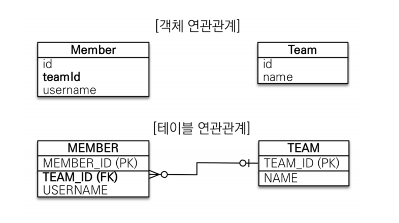

```java
@Entity
public class Member { 
		@Id @GeneratedValue(strategy = GenerationType.IDENTITY)
		private Long id;
		
		@Column(name = "USERNAME")
		private String name;
		
		@Column(name = "TEAM_ID")
		private Long teamId; 
}

@Entity
public class Team {
		@Id @GeneratedValue(strategy = GenerationType.IDENTITY)
		private Long id;
		
		private String name; 
}
```

    - *객체를 테이블에 맞추어 모델링 (외래 키 식별자를 직접 다룬다)*

```java
Member findMember = em.find(Member.class, member.getId());
Team findTeam = em.find(Team.class, findMember.getTeamId());
```

    - *전혀 객체지향스럽지 않다.*

***객체를 테이블에 맞추어 데이터 중심으로 모델링하면, 협력 관계를 만들 수 없다.***

    - *테이블은 외래 키로 조인을 사용해서 연관된 테이블을 찾는다.*
    - *객체는 참조를 사용해서 연관된 객체를 찾는다.*
    - *테이블과 객체 사이에 이런 패러다임 불일치가 존재한다.*

# ***단방향 연관관계***

***객체 지향 모델링***

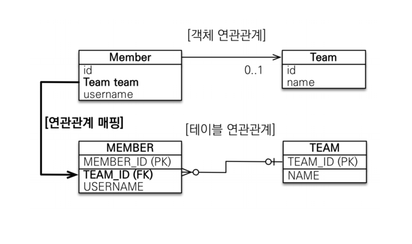

```java
@Entity
@Getter @Setter
public class Member {
    @Id @GeneratedValue(strategy = GenerationType.IDENTITY)
    private Long id;
    @Column(name = "USERNAME")
    private String name;
    @ManyToOne
    @JoinColumn(name = "TEAM_ID")
    private Team team;
}
```

    - *Member(N) : Team(1)*
- *N:1 관계*
    - ***@ManyToOne + @JoinColumn(name = “TEAM_ID”)***
- *@JoinColumn 외래키를 지정하는 역할*

```java
try {
	  // 팀 저장
	  Team team = new Team();
	  team.setName("TeamA");
	  em.persist(team);
	
	  // 회원 저장
	  Member member = new Member();
	  member.setName("member1");
	  member.setTeam(team);
	  em.persist(member);
	
	  em.flush();
	  em.clear();
	
	  Member findMember = em.find(Member.class, member.getId());
	
	  Team findTeam = findMember.getTeam();
	  System.out.println("findTeam = " + findTeam.getName());
	  tx.commit();
}
```

    - *이제야 객체지향스럽다.*

# ***양방향 연관관계와 연관관계의 주인***

***양방향 매핑*** 

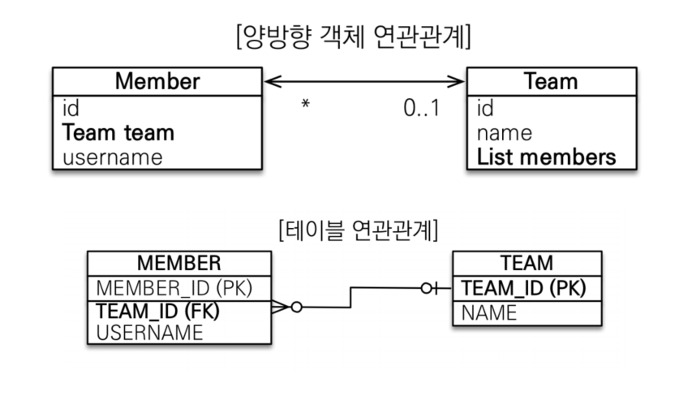

    - *이전 단방향 관계와 데이터베이스 테이블은 달라지는 게 없다.*
    - *데이터베이스 테이블에서는 방향이라는 개념이 존재하지 않는다. 
한 곳의 외래 키 설정으로 Member → Team FK로 조인 또는 Team → Member PK로 조인 
어느 방향이든 조인을 하면 다 데이터를 얻어올 수 있다.*
    - *반면 객체에서는 방향이 존재한다. Team에 속한 Member를 알려면 이전 단방향 매핑만으로는 알 수 없다. → 추가로 매핑이 필요하다.*
    - *즉, 객체지향적 관점에서는 방향성을 명확히 설정해야 하고, 데이터베이스는 외래키를 통한 관계를 설정할 뿐이다.*

```java

@Entity
@Getter @Setter
public class Member {
    @Id @GeneratedValue(strategy = GenerationType.IDENTITY)
    private Long id;
    @Column(name = "USERNAME")
    private String name;
    @ManyToOne
    @JoinColumn(name = "TEAM_ID")
    private Team team;
}

@Entity
@Getter @Setter
public class Team {
    @Id @GeneratedValue(strategy = GenerationType.IDENTITY)
    private Long id;

    private String name;

    @OneToMany(mappedBy = "team")
    private List<Member> members = new ArrayList<>();
}
```

    - *@OneToMany(mappedBy = “team”)*

***양방향 매핑 - 반대 방향으로 객체 그래프 탐색***

```java
Member findMember = em.find(Member.class, member.getId());
List<Member> members = findMember.getTeam().getMembers();
for (Member m : members) {
    System.out.println("m = " + m.getName());
}
```

## *연관관계의 주인과 mappedBy*

***객체와 테이블이 관계를 맺는 차이***


    - ***객체 연관관계 2개***
- *회원 → 팀 1개 (단방향)*
      - *팀 → 회원 1개(단방향)*
    - ***테이블 연관관계 1개***
- *회원 ↔ 팀 연관관계 1개(양방향)*
- *(TEAM_ID)외래키 하나로 연관관계 끝*

***객체의 양방향 관계***

*객체의 양방향 관계는 사실 양방향 관계가 아니라 서로 다른 단방향 2개다.*

*즉, 양방향으로 참조하려면 단방향 연관관계를 2개 만들어야 한다.*

***테이블의 양방향 관계***

*테이블은 외래 키 하나로 두 테이블의 연관관계를 관리*

*MEMBER.TEAM_ID 외래 키 하나로 양방향 관계를 가진다(양쪽으로 조인할 수 있다)*

```sql
SELECT *
FROM MEMBER M
JOIN TEAM T ON M.TEAM_ID = T.TEAM_ID

SELECT *
FROM TEAM T
JOIN MEMBER M ON T.TEAM_ID = O.TEAM_ID
```

***둘 중 하나로 외래 키를 관리해야 한다.***

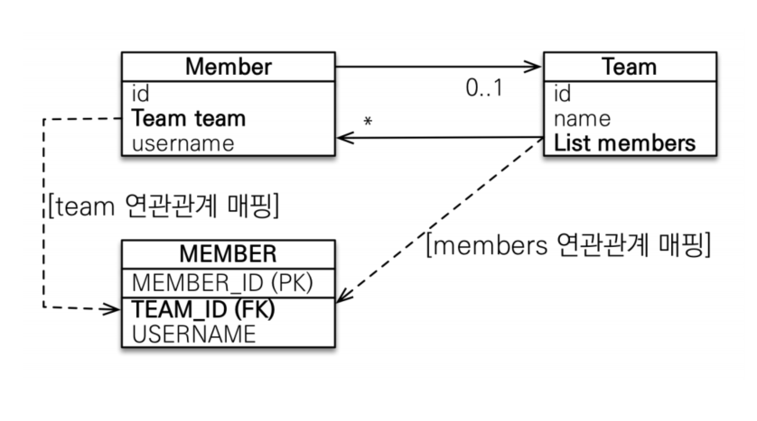

***연관관계의 주인 (Owner) - 양방향 매핑 규칙*** 

    - *객체의 두 관계중 하나를 연관관계의 주인으로 지정*
    - *연관관계의 주인만이 외래 키를 관리(등록, 수정)*
    - *주인이 아닌쪽은 읽기만 가능*
    - *주인은 mappedBy 속성 사용 X*
    - *주인이 아니면 mappedBy 속성으로 주인 지정*

***누구를 주인으로?***

    - ***외래 키가 있는 있는 곳을 주인으로 정해라***
    - *여기서는 Member.team이 연관관계의 주인*

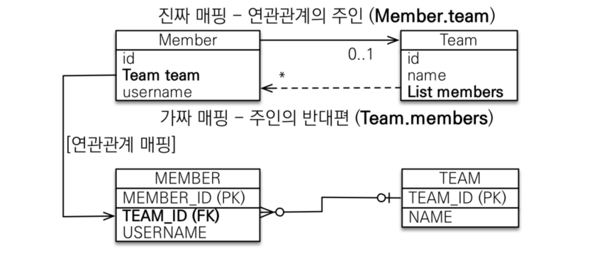

***양방향 매핑시 가장 많이 하는 실수***

    - *연관관계의 주인에 값을 입력하지 않음*

```java
Team team = new Team();
team.setName("TeamA");
em.persist(team);

Member member = new Member();
member.setName("member1");

//역방향(주인이 아닌 방향)만 연관관계 설정
team.getMembers().add(member);
em.persist(member);
```

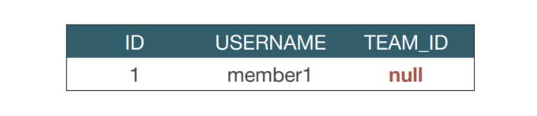

***양방향 매핑시 연관관계의 주인에 값을 입력해야 한다.*** 

    - *순수한 객체 관계를 고려하면 양쪽 다 값을 입력해야 한다.*
    - *하지만 연관관계의 주인에만 값을 입력해도 데이터베이스에 정상적으로 들어간다.*

```java
Team team = new Team();
team.setName("TeamA");
em.persist(team);

Member member = new Member();
member.setName("member1");

// team.getMembers().add(member); *순수한 객체 관계를 고려하면 양쪽 다 값을 입력해야 한다*
member.setTeam(team);

em.persist(member);
```


***양방향 연관관계 주의*** 

    - *순수 객체 상태를 고려해서 항상 양쪽에 값을 설정하자* 

```java
Team team = new Team();
team.setName("TeamA");
em.persist(team);

Member member = new Member();
member.setName("member1");
member.setTeam(team);

em.persist(member);
List<Member> members = team.getMembers();
System.out.println("members = " + members);

tx.commit();

--------------------------------------------------------------------------------------
members = []
```

    - *기대하는값: members = {member1} 이다.*
    - *현재 1차 캐시에 team이 존재하기 때문에 JPA는 데이터베이스에 쿼리를 날리지 않고 연관관계 매핑에서 members에 넣어주지 않았기 때문에 해당 결과가 나온다.*
    - *또한 JPA 없이 테스트를 하는 케이스를 생각하자* 
    - ***연관관계 편의 메소드를 생성하자***

```java
/**
 * 연관관계 편의 메소드
 */
public void changeTeam(Team team){
    this.team = team;
    team.getMembers().add(this);
}
```

    - ***양방향 매핑시에 무한 루프를 조심하자*** 
- ***toString(), lombok, JSON 생성 라이브러리***
- *JSON 생성 라이브러리는 문제가 없는 게 컨트롤러에 엔티티를 직접 반환하지 않으면 된다.*
        - *lombok toString() 사용 XX*

***양방향 매핑 정리***

    - *단방향 매핑만으로도 이미 연관관계 매핑(테이블 설계)은 완료*
    - *양방향 매핑은 반대 방향으로 조회 기능이 추가된 것 뿐*
    - *JPQL에서 역방향으로 탐색할 일이 많음*
    - *단방향 매핑을 잘 하고 양방향은 필요할 때 추가해도 됨(테이블에 전혀 영향을 주지 않는다)*

# ***연관관계 매핑시 고려사항 3가지***

    - ***다중성***
- ***N:1: @ManyToOne***
      - ***1:N: @OneToMany***
      - ***1:1: @OneToOne***
      - ***N:N: @ManyToMany***
    - ***단방향, 양방향***
- *테이블* 
- *외래 키 하나로 양쪽 조인 가능*
        - *사실 방향이라는 개념이 존재하지 않는다.*
      - *객체*
- *참조용 필드가 있는 쪽으로만 참조 가능*
        - *한쪽만 참조하면 단방향* 
        - *양쪽이 서로 참조하면 양방향(단방향 2개 → 양방향)*
    - ***연관관계의 주인***
- *테이블은 외래 키 하나로 두 테이블이 연관관계를 맺는다.*
      - *객체 양방향 관계는 A→B, B→A 참조가 2곳에 존재*
      - *즉, 테이블의 외래 키를 관리할 곳을 지정해야함*
      - *연관관계의 주인 → 외래 키를 관리하는 참조* 
      - *주인의 반대편: 외래 키에 영향을 주지 않는다, read only(단순히 조회만 한다)*

# ***다대일 [N:1]***

***다대일 단방향***

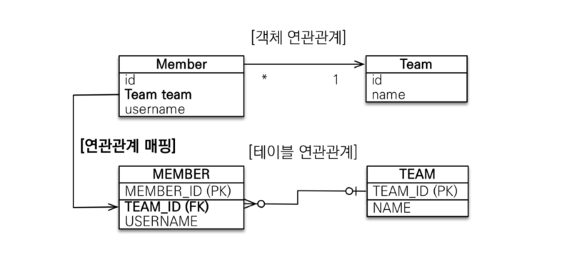

    - *가장 많이 사용하는 연관관계*
    - *반대는 일대다* 

```java
@Entity
@Getter @Setter
public class Member {
    @Id @GeneratedValue(strategy = GenerationType.IDENTITY)
    private Long id;
    @Column(name = "USERNAME")
    private String name;
    @ManyToOne
    @JoinColumn(name = "TEAM_ID")
    private Team team;
}

@Entity
@Getter @Setter
public class Team {
    @Id @GeneratedValue(strategy = GenerationType.IDENTITY)
    private Long id;
    private String name;
}
```

***다대일 양방향*** 

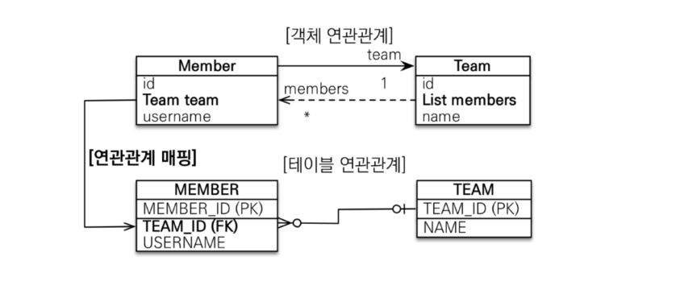

    - *객체에서 단방향 관계에서 양방향 관계로 바꾼다고 해서 테이블은 전혀 바뀌지 않는다.*
    - *데이터베이스 테이블의 외래 키가 있는 쪽이 연관관계의 주인이다.*

```java
@Entity
@Getter @Setter
public class Member {
    @Id @GeneratedValue(strategy = GenerationType.IDENTITY)
    private Long id;
    @Column(name = "USERNAME")
    private String name;
    @ManyToOne
    @JoinColumn(name = "TEAM_ID")
    private Team team;
}

@Entity
@Getter @Setter
public class Team {
    @Id @GeneratedValue(strategy = GenerationType.IDENTITY)
    private Long id;

    private String name;

    @OneToMany(mappedBy = "team")
    private List<Member> members = new ArrayList<>();
}
```

# ***일대다 [1:N]***

***일대다 단방향***

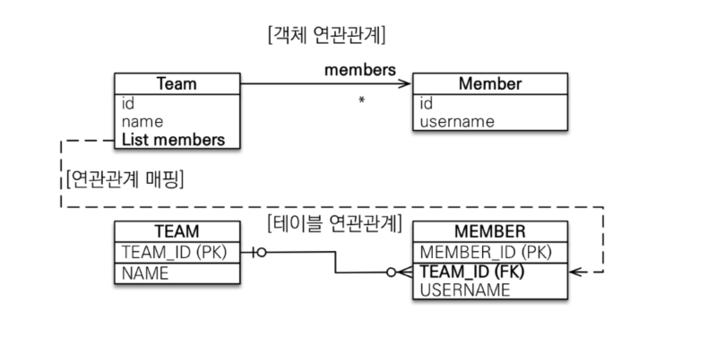

```java
@Entity
@Getter @Setter
public class Member {
    @Id @GeneratedValue(strategy = GenerationType.IDENTITY)
    private Long id;
    @Column(name = "USERNAME")
    private String name;
}

@Entity
@Getter @Setter
public class Team {
    @Id @GeneratedValue(strategy = GenerationType.IDENTITY)
    private Long id;

    private String name;

    @OneToMany
    @JoinColumn(name = "TEAM_ID")
    private List<Member> members = new ArrayList<>();
}
```

***일대다 단방향 - 쿼리 실행*** 

```java
try {
    Member member = new Member();
    member.setName("member1");
    em.persist(member);

    Team team = new Team();
    team.setName("teamA");
    // Member update Query
    team.getMembers().add(member);
    em.persist(team);

    tx.commit();
}
---------------------------------------------------------------------------------

Hibernate: 
    /* insert for
        hellojpa.domain.Member */insert 
    into
        Member (USERNAME, id) 
    values
        (?, default)
Hibernate: 
    /* insert for
        hellojpa.domain.Team */insert 
    into
        Team (name, id) 
    values
        (?, default)
Hibernate: 
    update
        Member 
    set
        TEAM_ID=? 
    where
        id=?
```

    - *TEAM 엔티티가 외래 키를 관리하지만 데이터베이스에 외래 키가 존재하는 테이블은 MEMBER여서 UPDATE 쿼리가 날아간다.* 
    - *이는 UPDATE 쿼리가 추가로 날아가는 문제점도 존재하지만 쿼리 예상을 하기가 어렵다는 게 더 큰 문제이다.*
    - *분명히 TEAM에 대해 변경을 하는데 쿼리는 MEMBER 테이블로 날아간다.*

***일대다 단방향 정리***

    - *일대다 단방향은 1:N에서 일(1)이 연관관계의 주인이다.*
    - *데이터베이스 테이블 일대다 관계는 항상 다(N)쪽에 외래 키가 존재한다.*
    - *객체와 테이블의 차이 때문에 반대편 테이블의 외래 키를 관리하는 특이한 구조이다.*
    - *@JoinColumn을 꼭 사용해야 한다.*
- *그렇지 않으면 조인 테이블 방식을 사용한다(중간에 테이블을 추가)*

***일대다 단방향 매핑의 단점 정리***

    - *엔티티가 관리하는 외래 키가 다른 테이블에 있다*
    - *연관관계 관리를 위해서 추가로 UPDATE SQL 실행*
    - *일대다 단방향 매핑보다는 다대일 양방향 매핑을 사용하자*
- *객체지향적으로 손해?로 볼 수 있지만 ORM을 좀 더 데이터베이스에 맞추는 방식이 더 좋다.*
      - *엔티티 설계로 날아가는 쿼리가 예상이 되지 않는 상황보단 예상이 되는 게 더 좋다*

***일대다 양방향***

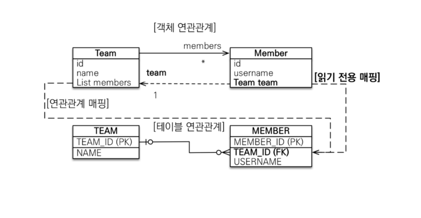

```java
@Entity
@Getter @Setter
public class Member {
    @Id @GeneratedValue(strategy = GenerationType.IDENTITY)
    private Long id;
    @Column(name = "USERNAME")
    private String name;

    @ManyToOne
    @JoinColumn(name = "TEAM_ID", insertable = false, updatable = false)
    private Team team;
}

@Entity
@Getter @Setter
public class Team {
    @Id @GeneratedValue(strategy = GenerationType.IDENTITY)
    private Long id;

    private String name;

    @OneToMany
    @JoinColumn(name = "TEAM_ID")
    private List<Member> members = new ArrayList<>();
}
```

    - *연관관계의 주인은 여전히 TEAM이다.* 
    - *일대다 양방향을 위해서 읽기 전용 필드를 사용한다*
- *@JoinColumn(name = "TEAM_ID", insertable = false, updatable = false)*
    - *JPA 공식적으로 존재하지 않는 매핑이다.*
    - ***그냥 다대일 양방향을 사용하자 ㅋㅋ***

# ***일대일 [1:1]***

***일대일 관계***

    - *주 테이블이나 대상 테이블 중에 외래 키 선택 가능*
    - *외래 키에 데이터베이스 유니크 제약조건 추가* 

***일대일: 주 테이블에 외래 키 단방향***

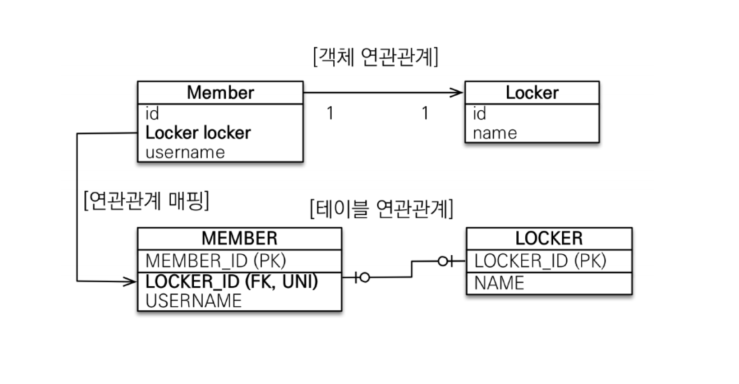

    - *그림은 Member 테이블을 주 테이블이라고 가정* 

```java
@Entity
@Getter @Setter
public class Member {
    @Id @GeneratedValue(strategy = GenerationType.IDENTITY)
    private Long id;
    @Column(name = "USERNAME")
    private String name;

    @ManyToOne
    @JoinColumn(name = "TEAM_ID", insertable = false, updatable = false)
    private Team team;

    @OneToOne
    @JoinColumn(name = "LOCKER_ID", unique = true)
    private Locker locker;
}

@Entity
@Getter @Setter
public class Locker {
    @Id @GeneratedValue(strategy = GenerationType.IDENTITY)
    private Long id;
    private String name;
}
```

***일대일: 주 테이블에 외래 키 양방향***

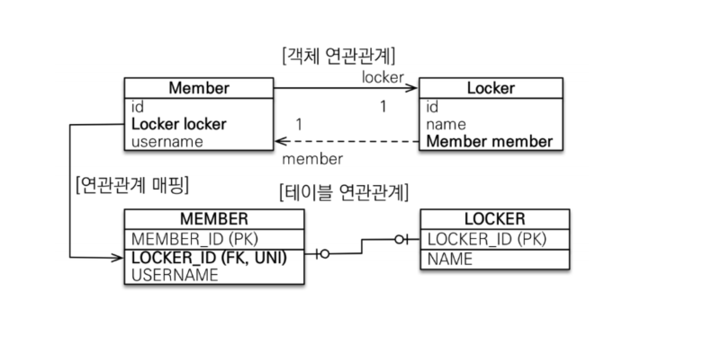

```java
@Entity
@Getter @Setter
public class Member {
    @Id @GeneratedValue(strategy = GenerationType.IDENTITY)
    private Long id;
    @Column(name = "USERNAME")
    private String name;

    @ManyToOne
    @JoinColumn(name = "TEAM_ID", insertable = false, updatable = false)
    private Team team;

    @OneToOne
    @JoinColumn(name = "LOCKER_ID", unique = true)
    private Locker locker;
}

@Entity
@Getter @Setter
public class Locker {
    @Id @GeneratedValue(strategy = GenerationType.IDENTITY)
    private Long id;
    private String name;
    
    @OneToOne(mappedBy = "locker")
    private Member member;
}
```

***일대일: 주 테이블에 외래 키 양방향 정리***

    - *다대일 양방향 매핑처럼 외래 키가 있는 곳이 연관관계의 주인*
    - *반대편은 mappedBy 적용*

***일대일: 대상 테이블에 외래 키 단방향***

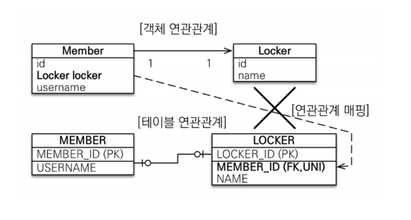

    - *단방향 관계는 JPA에서 지원하지 않는다.*
    - *양방향 관계는 지원한다.*
    - *즉, 일대일 관계에서는 자신의 엔티티에 있는 외래키만 관리가 가능하다.*

***일대일: 대상 테이블에 외래 키 양방향***

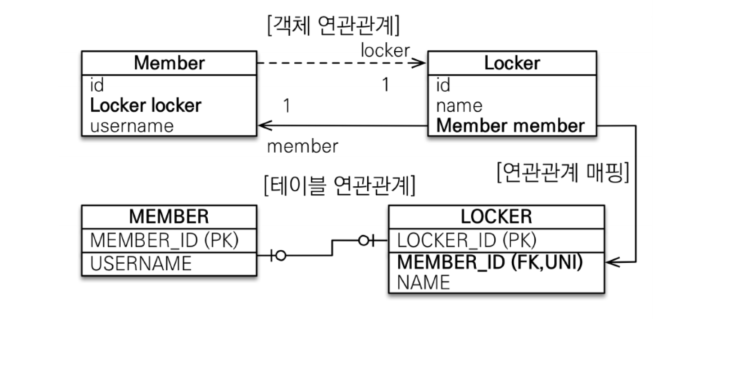

***일대일 정리***

    - *주 테이블에 외래 키*
- *주 객체가 대상 객체의 참조를 가지는 것처럼 주 테이블에 외래 키를 두고 대상 테이블을 찾음*
      - *객체지향 개발자가 선호한다*
      - *JPA 매핑 편리 → 양방향 단방향 모두 가능*
      - *장점: 주 테이블만 조회해도 대상 테이블에 데이터가 있는지 확인 가능*
      - *단점: 값이 없으면 외래 키에 null 허용*
    - *대상 테이블에 외래 키*
- *대상 테이블에 외래 키가 존재*
      - *전통적인 데이터베이스 개발자가 선호한다*
      - *장점: 주 테이블과 대상 테이블을 일대일에서 일대다 관계로 변경할 때 테이블 구조 유지* 
      - *단점: 프록시 기능의 한계로 지연 로딩으로 설정해도 항상 즉시 로딩됨*

# ***다대다 [N:M]***

    - *관계형 데이터베이스는 정규화된 테이블 2개로 다대다 관계를 표현할 수 없다*
    - *연결 테이블을 추가해서 일대다, 다대일 관계로 풀어내야한다*

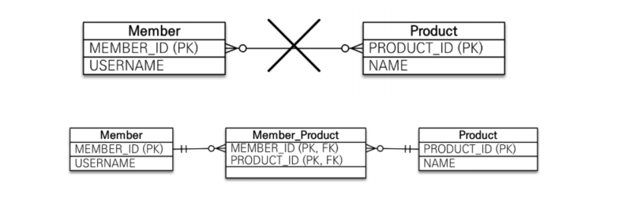

    - *@ManyToMany 사용*
    - *@JoinTable로 연결 테이블 지정*
    - *단방향, 양방향 모두 가능*

***다대다 매핑의 한계***

    - *실무에서 사용 X*
    - *연결 테이블이 단순히 연결만 하고 끝나지 않는다*
    - *비즈니스적으로 만약 중간 테이블에 대한 컬럼이 추가되어야 한다면?*

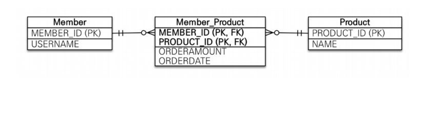

***다대다 한계 극복*** 

    - *연결 테이블용 엔티티 추가(연결 테이블을 엔티티로 승격)*
    - *@ManyToMany → @OneToMany, @ManyToOne*

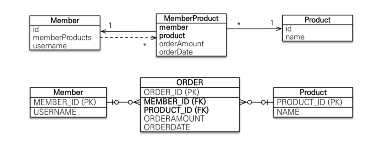

# *상속관계 매핑*

    - *객체에는 상속관계 개념이 존재하지만 관계형 데이터베이스에는 상속관계가 존재하지 않는다.*
    - *관계형 데이터베이스에서는 상속관계와 유사한 슈터타입 서브타입 모델링이 존재한다.*
- *각각 테이블로 변환  → 조인 전략* 
      - *통합 테이블로 변환 → 단일 테이블 전략* 
      - *서브타입 테이블로 변환 → 구현 클래스마다 테이블 전략*

***주요 애노테이션***

    - ***@Inheritance, @DiscriminatorColumn, @DiscriminatorValue***

# ***조인 전략***

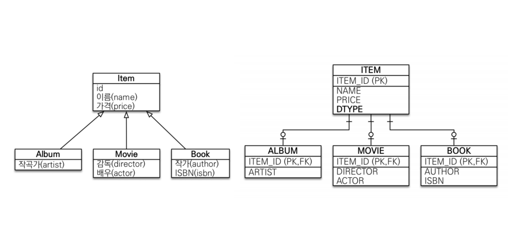

    - ***왼쪽은 논리 모델 오른쪽은 물리 모델***

***조인전략: CREATE, ALTER 쿼리 확인하기*** 

```java
@Entity
@Inheritance(strategy = InheritanceType.JOINED)
public class Item {
    @Id @GeneratedValue(strategy = GenerationType.IDENTITY)
    private Long id;
    private String name;
    private int price;
}

@Entity
public class Album extends Item{
    private String artist;
}

@Entity
public class Movie extends Item{
    private String director;
    private String actor;
}

@Entity
public class Book extends Item{
    private String author;
    private String isbn;
}

----------------------------------------------------------------------------------------
Hibernate: 
    create table Item (
        price integer not null,
        id bigint generated by default as identity,
        name varchar(255),
        primary key (id)
    )
Hibernate: 
    create table Album (
        id bigint not null,
        artist varchar(255),
        primary key (id)
    )    
Hibernate: 
    alter table if exists Album 
       add constraint FKcve1ph6vw9ihye8rbk26h5jm9 
       foreign key (id) 
       references Item    

Hibernate: 
    create table Book (
        id bigint not null,
        author varchar(255),
        isbn varchar(255),
        primary key (id)
    )
Hibernate: 
    alter table if exists Book 
       add constraint FKbwwc3a7ch631uyv1b5o9tvysi 
       foreign key (id) 
       references Item    
    
Hibernate: 
    create table Movie (
        id bigint not null,
        actor varchar(255),
        director varchar(255),
        primary key (id)
    )    
Hibernate: 
    alter table if exists Movie 
       add constraint FK5sq6d5agrc34ithpdfs0umo9g 
       foreign key (id) 
       references Item    
```

    - ***@Inheritance(strategy = InheritanceType.JOINED)***
- *JOINED: 조인 전략 선택*

***INSERT***

```java
Movie movie = new Movie();
movie.setDirector("봉준호");
movie.setActor("조여정");
movie.setName("기생충");
movie.setPrice(10000);

em.persist(movie);
tx.commit();

----------------------------------------------------------------------------------------
Hibernate: 
    /* insert for
        hellojpa.domain.Movie */insert 
    into
        Item (name, price, ITEM_ID) 
    values
        (?, ?, default)
Hibernate: 
    /* insert for
        hellojpa.domain.Movie */insert 
    into
        Movie (actor, director, ITEM_ID) 
    values
        (?, ?, ?)
```

    - *ITEM, MOVIE 테이블 2곳에 INSERT 쿼리가 날아간다.*

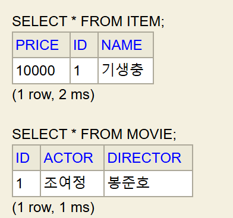

***SELECT***

```java
Movie movie = new Movie();
movie.setDirector("봉준호");
movie.setActor("조여정");
movie.setName("기생충");
movie.setPrice(10000);

em.persist(movie);
em.flush();
em.clear();

Movie findMovie = em.find(Movie.class, movie.getId());

----------------------------------------------------------------------------------------

Hibernate: 
    select
        m1_0.id,
        m1_1.name,
        m1_1.price,
        m1_0.actor,
        m1_0.director 
    from
        Movie m1_0 
    join
        Item m1_1 
            on m1_0.id=m1_1.id 
    where
        m1_0.id=?
```

    - *MOVIE, ITEM 테이블을 INNER 조인해서 가져온다.*

*단순히 상속 관계를 매핑했을 뿐인데 JPA가 데이터 저장 시 INSERT 쿼리를 각각 날리고 데이터 조회 시 조인도 알아서 한다.*

*이번에는 아이템 테이블 컬럼에* ***DTYPE****을 넣어보자*

*객체 입장에서는 어떤 객체를 데이터 저장을 하는지 알지만 애플리케이션이 아닌 데이터베이스에서 조회를 할 때 ITEM 테이블에 있는 컬럼으로만 해당 데이터가 어떤 데이터인지 구분하지 못한다.*

*하지만 DTYPE 컬럼이 있으면 저장된 데이터가 어떤 데이터인지 쉽게 구분이 가능하다.*

***@DiscriminatorColumn***

```java
@Entity
@Getter @Setter
@Inheritance(strategy = InheritanceType.JOINED)
@DiscriminatorColumn(name = "ITEM_TYPE")
public class Item {
    @Id @GeneratedValue(strategy = GenerationType.IDENTITY)
    private Long id;
    private String name;
    private int price;
}
```

    - ***@DiscriminatorColumn default 속성 → DTYPE***

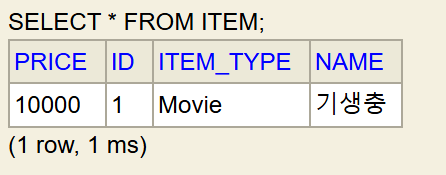

***@DiscriminatorValue***

    - ***@DiscriminatorColumn****에 저장되는 이름*

```java
@Entity
@Setter @Getter
@DiscriminatorValue("M")
public class Movie extends Item{
    private String director;
    private String actor;
}
```

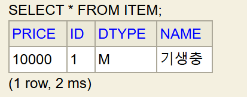

    - ***default: Entity name***

개인적으로***@DiscriminatorColumn****도 기본값인 DTYPE을 사용하고* ***@DiscriminatorValue*** *또한 마찬가지로 기본값인 엔티티 명을 사용하는 게 좋아 보인다.* 

*거의 대부분 간단함보단 모호함을 없애는 편이 좋다고 생각한다.*

***조인 전략 정리***

    - *장점*
- *테이블 정규화* 
      - *외래 키 참조 무결성 제약조건 활용가능*
      - *저장공간 효율화*
    - *단점*
- *조회시 조인을 많이 사용 → 성능 저하* 
      - *데이터 저장시 INSERT SQL 2번 호출*
      - *조회 쿼리가 복잡하다*

# *단일 테이블 전략* 

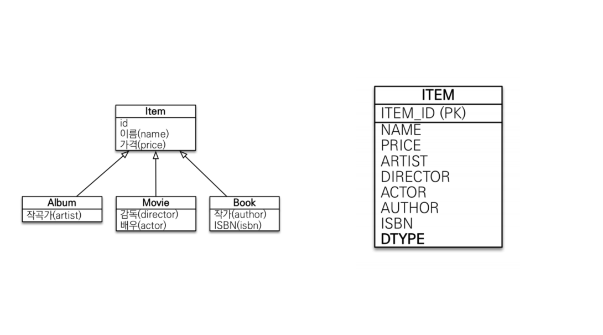

    - ***왼쪽은 논리 모델 오른쪽은 물리 모델***

***단일 테이블 전략: CREATE, ALTER 쿼리 확인하기*** 

```java
@Entity
@Getter @Setter
@Inheritance(strategy = InheritanceType.SINGLE_TABLE)
@DiscriminatorColumn
public class Item {
    @Id @GeneratedValue(strategy = GenerationType.IDENTITY)
    private Long id;
    private String name;
    private int price;
}

// 나머지 Album, Movie, Book Entity: 조인 전략과 동일하다.

----------------------------------------------------------------------------------------
Hibernate: 
    create table Item (
        price integer not null,
        id bigint generated by default as identity,
        DTYPE varchar(31) not null,
        actor varchar(255),
        artist varchar(255),
        author varchar(255),
        director varchar(255),
        isbn varchar(255),
        name varchar(255),
        primary key (id)
    )
```

    - *전략 이름처럼 하나의 테이블에 모든 부모, 자식 테이블의 컬럼들을 넣는다. 구분은 DTYPE 컬럼으로 한다.*
    - ***@Inheritance(strategy = InheritanceType.SINGLE_TABLE)***
- *단일 테이블 전략*

***INSERT, SELECT*** 

```java
Movie movie = new Movie();
movie.setDirector("봉준호");
movie.setActor("조여정");
movie.setName("기생충");
movie.setPrice(10000);

em.persist(movie);
em.flush();
em.clear();

Movie findMovie = em.find(Movie.class, movie.getId());

----------------------------------------------------------------------------------------
Hibernate: 
    /* insert for
        hellojpa.domain.Movie */insert 
    into
        Item (name, price, actor, director, DTYPE, id) 
    values
        (?, ?, ?, ?, 'Movie', default)
Hibernate: 
    select
        m1_0.id,
        m1_0.name,
        m1_0.price,
        m1_0.actor,
        m1_0.director 
    from
        Item m1_0 
    where
        m1_0.DTYPE='Movie' 
        and m1_0.id=?
```

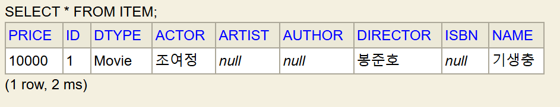

    - *Movie 데이터를 조회하면 Movie에 해당하는 컬럼 데이터만 조회해서 가져온다.* 
    - *WHERE 조건을 보면 DTYPE = ‘Movie’ and ID*  
    - *조인 전략과 다르게 INSERT도 한번 SELECT도 조인 없이 실행한다.*

*단일 테이블 전략은* ***@DiscriminatorColumn****을 생략해도 DTYPE이 들어간다.*

*조인 전략과 다르게 단일 테이블 전략에서 DTYPE 컬럼이 없으면 어떤 데이터인지 구분이 불가능하기 때문이다.*

***단일 테이블 전략 정리***

    - *장점*
- *조인 필요 없다 일반적인 조회 성능이 빠르다* 
      - *조회 쿼리가 단순하다*
    - *단점*
- *자식 엔티티가 매핑한 컬럼은 모두 null 허용*
      - *단일 테이블에 모든 것을 저장하므로 테이블이 커질 수 있다.
상황에 따라서 조회 성능이 오히려 느려질 수 있다.*

# ***구현 클래스마다 테이블 전략***

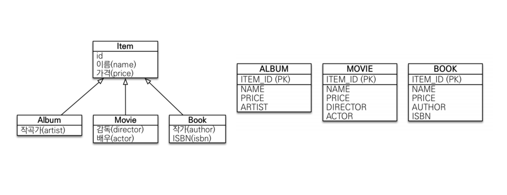

***TABLE CREATE*** 

```java
@Entity
@Getter @Setter
@Inheritance(strategy = InheritanceType.TABLE_PER_CLASS)
public abstract class Item {
    @Id @GeneratedValue
    private Long id;
    private String name;
    private int price;
}

// 나머지 Album, Movie, Book Entity: 조인 전략과 동일하다.
----------------------------------------------------------------------------------------
Hibernate: 
    create table Book (
        price integer not null,
        id bigint not null,
        author varchar(255),
        isbn varchar(255),
        name varchar(255),
        primary key (id)
    )

Hibernate: 
    create table Album (
        price integer not null,
        id bigint not null,
        artist varchar(255),
        name varchar(255),
        primary key (id)
    )
Hibernate: 
    create table Movie (
        price integer not null,
        id bigint not null,
        actor varchar(255),
        director varchar(255),
        name varchar(255),
        primary key (id)
    )    
```

    - *구현 클래스 마다 테이블 전략에서는: @DiscriminatorColumn가 의미가 없다. 그래서 넣어도 동작하지 않는다.*
    - *이전 조인 전략, 단일 테이블 전략에서 Item을 추상 클래스로 만들지 않았는데 추상 클래스로 만드는 편이 좋다.*
- *직접적으로 객체 생성하지 않도록 보장할 수 있다.*
    - ***@Inheritance(strategy = InheritanceType.TABLE_PER_CLASS)***
- ***해당 전략에서는 @GeneratedValue(strategy = GenerationType.IDENTITY) 사용이 불가능하다? → 이유는 모름***

***INSERT, SELECT***

```java
Movie movie = new Movie();
movie.setDirector("봉준호");
movie.setActor("조여정");
movie.setName("기생충");
movie.setPrice(10000);

em.persist(movie);
em.flush();
em.clear();

Movie findMovie = em.find(Movie.class, movie.getId());
----------------------------------------------------------------------------------------
Hibernate: 
    /* insert for
        hellojpa.domain.Movie */insert 
    into
        Movie (name, price, actor, director, id) 
    values
        (?, ?, ?, ?, ?)
Hibernate: 
    select
        m1_0.id,
        m1_0.name,
        m1_0.price,
        m1_0.actor,
        m1_0.director 
    from
        Movie m1_0 
    where
        m1_0.id=?
```

***구현 클래스마다 테이블 전략 정리***

    - *장점*
- *서브 타입을 명확하게 구분해서 처리할 때 효과적*
      - *not null 제약조건 사용 가능*
    - *단점*
- *여러 자식 테이블을 함께 조회할 때 성능이 느리다(UNION SQL 필요)*
      - *자식 테이블을 통합해서 쿼리하기 어렵다*
    - *정리*
- ***사용 금지***

# *단일 테이블 VS 조인 전략* 

*기본은 조인 전략을 사용하자* 

*하지만 너무 단순하면 단일 테이블 전략을 사용하자* 

# *@Mapped Superclass*

*공통 매핑 정보가 필요할 때 사용한다.*

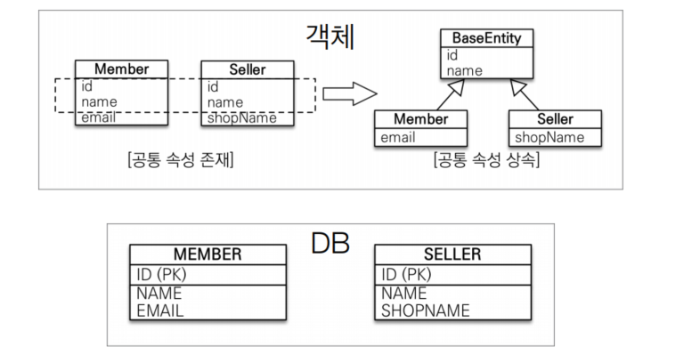

***시나리오***

*회사 DBA가 모든 테이블에 누가 생성했는지 언제 생성했는지 누가 수정했는지 언제 수정했는지에 대한 정보의 기록을 요구한다.*

```java
  private String createdBy;
  private LocalDateTime createdDate;
  private String lastModifiedBy;
  private LocalDateTime lastModifiedDate;
```

    - *하이버네이트 최신 버전부터는 자바 8 LocalDateTime을 지원한다. → @Temporal 필요 X*
    - *이런 모든 정보를 엔티티에 하나하나 넣긴 너무 힘들다 → @MappedSuperclass*
    - ***@MappedSuperclass는 상속 관계 매핑이 아닌 공통 속성 매핑이다.*** 

***BaseEntity, BaseEntity 적용 example***

```java
@MappedSuperclass
@Getter @Setter
public abstract class BaseEntity {
    @Column(name = "CREATE_MEMBER")
    private String createdBy;
    private LocalDateTime createdDate;
    @Column(name = "UPDATE_MEMBER")
    private String lastModifiedBy;
    private LocalDateTime lastModifiedDate;
}

@Entity
@Getter @Setter
public class Member extends BaseEntity{
    @Id @GeneratedValue(strategy = GenerationType.IDENTITY)
    private Long id;
    @Column(name = "USERNAME")
    private String name;

    @ManyToOne
    @JoinColumn(name = "TEAM_ID", insertable = false, updatable = false)
    private Team team;

    @OneToOne
    @JoinColumn(name = "LOCKER_ID", unique = true)
    private Locker locker;
}

@Entity
@Getter @Setter
public class Team extends BaseEntity{
    @Id @GeneratedValue(strategy = GenerationType.IDENTITY)
    private Long id;

    private String name;

    @OneToMany
    @JoinColumn(name = "TEAM_ID")
    private List<Member> members = new ArrayList<>();
}

-------------------------------------------------------------------------------------
Hibernate: 
    create table Member (
        LOCKER_ID bigint unique,
        TEAM_ID bigint,
        createdDate timestamp(6),
        id bigint generated by default as identity,
        lastModifiedDate timestamp(6),
        CREATE_MEMBER varchar(255),
        UPDATE_MEMBER varchar(255),
        USERNAME varchar(255),
        primary key (id)
    )
Hibernate: 
    create table Team (
        createdDate timestamp(6),
        id bigint generated by default as identity,
        lastModifiedDate timestamp(6),
        CREATE_MEMBER varchar(255),
        UPDATE_MEMBER varchar(255),
        name varchar(255),
        primary key (id)
    )    
```

    - *MEMBER, TEAM 모두 BaseEntity에서 매핑 한 공통 컬럼이 생성되었다.*

***사용 example***

```java
Member member = new Member();
member.setName("user1");
member.setCreatedBy("bae");
member.setCreatedDate(LocalDateTime.now());

em.persist(member);

tx.commit();
```

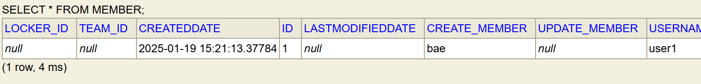

***@MappedSuperclass 정리***

    - ***상속관계 매핑이 아니다. → 단순히 엔티티가 공통으로 사용하는 매핑 정보를 모으는 역할***
    - *엔티티가 아니다, 테이블과 매핑 X*
    - *부모 클래스를 상속 받는 자식 클래스에 매핑 정보만 제공*
    - 당연히 엔티티가 아니기 때문에 조회가 불가능하다 
- *em.find(BaseEntity.class)*
    - *직접 생성해서 사용할 일이 없으므로 추상 클래스를 권장*
    - *주로 등록일, 수정일, 등록자, 수정자 같은 전체 엔티티에서 공통으로 적용하는 정보를 모을 때 사용한다.*
    - ***참고: @Entity 클래스는 엔티티나 @MappedSuperclass로 지정한 클래스만 상속이 가능하다.***

  - ***상속 관계 - 슈퍼 타입 /서브 타입 모델링과 전략들***
  - ***매핑 정보 상속 - @Mapped Superclass, BaseEntity***

# ***프록시*** 

### ***[시나리오] Member를 조회할 때 Team도 함께 조회해야 할까?***

*Member : Team →  N: 1 관계* 

*어떤 비즈니스 로직에서는 Member, Team 정보가 모두 필요할 수 있고,*

*또 다른 비즈니스 로직에서는 Member 정보만 필요할 수 있다.*

*Member 정보만 필요한데 Member Team 테이블을 조회해서 가져오는 방식은 쓸데없는 낭비이다.*

*JPA에서는 이런 문제점을 어떻게 해결할까?*

### ***프록시 기초***

    - ***em.find() VS em.getReference()***
    - ***em.find():*** *데이터베이스를 통해서 실제 엔티티 객체를 조회*
    - ***em.getReference():*** *데이터베이스 조회를 미루는 가짜(프록시) 엔티티 객체 조회*

***em.find()***

```java
Member member = new Member();
member.setName("hello");
em.persist(member);

em.flush();
em.clear();

Member findMember = em.find(Member.class, member.getId());

tx.commit();
---------------------------------------------------------------------------------------

Hibernate: 
    select
        m1_0.id,
        m1_0.CREATE_MEMBER,
        m1_0.createdDate,
        m1_0.UPDATE_MEMBER,
        m1_0.lastModifiedDate,
        m1_0.USERNAME,
        t1_0.id,
        t1_0.CREATE_MEMBER,
        t1_0.createdDate,
        t1_0.UPDATE_MEMBER,
        t1_0.lastModifiedDate,
        t1_0.name 
    from
        Member m1_0 
    left join
        Team t1_0 
            on t1_0.id=m1_0.TEAM_ID 
    where
        m1_0.id=?
```

***em.getReference() - 1***

```java
 Member member = new Member();
 member.setName("hello");
 em.persist(member);

 em.flush();
 em.clear();

 Member findMember = em.getReference(Member.class, member.getId());

 tx.commit();
```

    - *SELECT 쿼리가 DB에 날아가지 않는다.*

***em.getReference() - 2***

```java
Member member = new Member();
member.setName("hello");
em.persist(member);

em.flush();
em.clear();

Member findMember = em.getReference(Member.class, member.getId());
System.out.println("findMember.id = " + findMember.getId());
System.out.println("findMember.name = " + findMember.getName());

tx.commit();
---------------------------------------------------------------------------------------

findMember.id = 1
Hibernate: 
    select
        m1_0.id,
        m1_0.CREATE_MEMBER,
        m1_0.createdDate,
        m1_0.UPDATE_MEMBER,
        m1_0.lastModifiedDate,
        m1_0.USERNAME,
        t1_0.id,
        t1_0.CREATE_MEMBER,
        t1_0.createdDate,
        t1_0.UPDATE_MEMBER,
        t1_0.lastModifiedDate,
        t1_0.name 
    from
        Member m1_0 
    left join
        Team t1_0 
            on t1_0.id=m1_0.TEAM_ID 
    where
        m1_0.id=?
findMember.name = hello
```

    - *findMember.getName(): 호출하는 순간에 데이터베이스에 SELECT 쿼리가 날아간다.*
    - *findMember.getId() → PK로 조회하기 때문에 해당 시점에는 쿼리가 날아가지 않는다.*

***Member Proxy*** 

```java
Member findMember = em.getReference(Member.class, member.getId());
System.out.println("findMember = " + findMember.getClass());

findMember = class hellojpa.domain.Member$HibernateProxy$B5nc3zTW
```

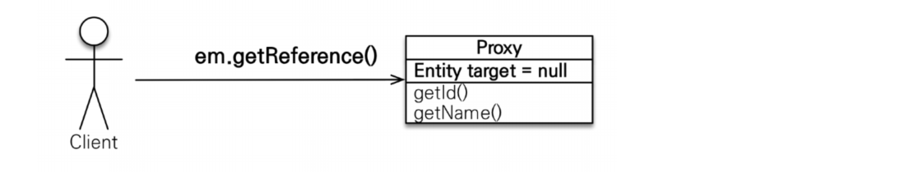

### ***프록시 특징*** 

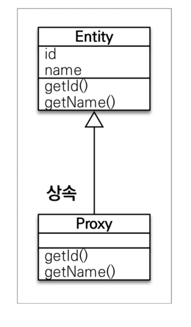

    - *실제 클래스를 상속 받아서 만들어진다. (인터페이스가 아니라서 상속을 통한 프록시 생성)*
    - *사용하는 입장(클라이언트)에서는 진짜 객체인지 프록시 객체인지 구분하지 않고 사용하면 된다.*

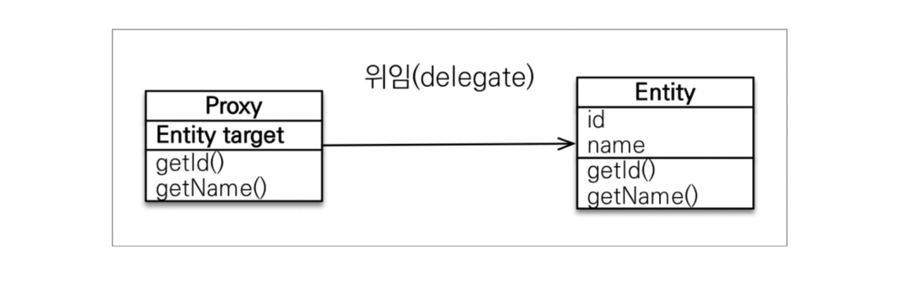

    - *프록시 객체는 실제 객체의 참조(target)를 보관한다*
    - *프록시 객체를 호출하면 프록시 객체는 실제 객체의 메소드를 호출한다*

### ***프록시 객체의 초기화*** 

```java
Member member = em.getReference(Member.class, 1L);
member.getName();
```

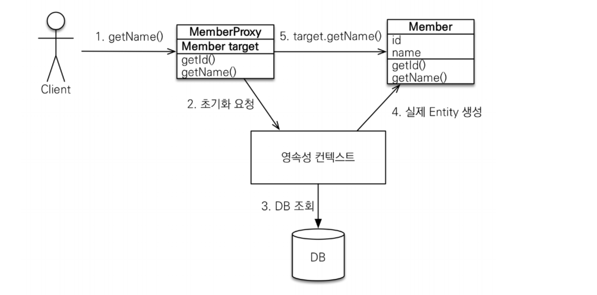

    - *getName(): 호출 시점에는 Member target = null*
    - *초기화 요청 → DB 조회 → 실제 Entity 생성 → Member target = 생성한 Entity*
    - *target.getName() 반환*

### ***프록시 정리***

    - *프록시 객체는 처음 사용할 때 한 번만 초기화* 
    - *프록시 객체를 초기화 할 때, 프록시 객체가 실제 엔티티로 바뀌는 것은 아님, 초기화되면 프록시 객체를 통해서 실제 엔티티에 접근 가능*
    - *프록시 객체는 원본 엔티티를 상속받음, 따라서 타입 체크시 주의해야함*
- *instance of 사용*
    - *영속성 컨텍스트에 찾는 엔티티가 이미 있으면 em.getReference()를 호출해도 프록시가 아닌 실제 엔티티를 반환*
- *반대로 em.getReference() 이후 em.find()를 호출해도 Proxy가 반환된다.*
      - *JPA는 같은 트랜잭션에서 동일성을 보장하기 때문이다.*
      - *그냥 간단하게 PK로 매핑된 1차 캐시의 인스턴스 반환한다고 이해하면 될듯하다.*
    - *영속성 컨텍스트의 도움을 받을 수 없는 준영속 상태일 때, 프록시를 초기화 하면 문제 발생*
- *하이버네이트는* ***org.hibernate.LazyInitializationException*** *예외를 터트림*

```java
try {
      Member member = new Member();
      member.setName("hello");
      em.persist(member);

      em.flush();
      em.clear();

      Member refMember = em.getReference(Member.class, member.getId());
      System.out.println("findMember = " + refMember.getClass());

      em.detach(refMember);
      refMember.getName();

      tx.commit();
  }
  catch (Exception e){
      e.printStackTrace();
      tx.rollback();
  }
  --------------------------------------------------------------------------------------
  
findMember = class hellojpa.domain.Member$HibernateProxy$0WPAmUiO
org.hibernate.LazyInitializationException: could not initialize proxy - no Session

```

### ***프록시 확인***

    - *프록시 인스턴스의 초기화 여부 확인*
- *Persistence.getPersistenceUtil().isLoaded(엔티티) → return boolean*
    - *프록시 클래스 확인 방법*
- *엔티티.getClass().getName()*
    - *프록시 강제 초기화* 
- *Hibernate.initialize(엔티티)*
    - *JPA 표준은 강제 초기화가 존재하지 않는다.*
- *member.getName()*

# ***즉시 로딩과 지연 로딩***

### ***즉시 로딩과 지연 로딩 이해***

*프록시를 공부하면서 시나리오로 적어둔 예제를 생각해 보자*

*Member를 조회할 때 Team도 함께 조회해야 할까?*

*Member를 조회할 때 Team에 대해서 지연 로딩(프록시) 조회를 하고 Team 정보가 필요하면 프록시 초기화(DB에 조회)를 시키면 된다.*

***Member Entity***

```java
@Entity
@Getter @Setter
public class Member extends BaseEntity{
    @Id @GeneratedValue(strategy = GenerationType.IDENTITY)
    private Long id;
    @Column(name = "USERNAME")
    private String name;

    @ManyToOne(fetch = FetchType.LAZY)
    @JoinColumn(name = "TEAM_ID")
    private Team team;
}
```

    - ***@ManyToOne(fetch = FetchType.LAZY)***
- *지연 로딩 전략(LAZY)*

```java
Team team = new Team();
team.setName("teamA");
em.persist(team);

Member member = new Member();
member.setName("hello");
member.setTeam(team);
em.persist(member);

em.flush();
em.clear();

Member findMember = em.find(Member.class, member.getId());
System.out.println("Team = " + findMember.getTeam().getClass());

tx.commit();

----------------------------------------------------------------------------------------
Hibernate: 
    select
        m1_0.id,
        m1_0.CREATE_MEMBER,
        m1_0.createdDate,
        m1_0.UPDATE_MEMBER,
        m1_0.lastModifiedDate,
        m1_0.USERNAME,
        m1_0.TEAM_ID 
    from
        Member m1_0 
    where
        m1_0.id=?
Team = class hellojpa.domain.Team$HibernateProxy$qeGDzCDe
```

    - *em.find(Member.class, ID)를 했을 때 지연(Lazy) 로딩 전략이어서 Team 테이블에 대한 조인 쿼리가 날아가지 않는다.*
    - *또한 Team.getClass()를 통해서 클래스 이름을 조회하면 프록시로 나온다.*
    - *당연히 Team.getName() 같은 메소드 호출 시점에 DB에 Team 쿼리가 날아가면서 Team 프록시가 초기화된다.*

***Member와 Team을 자주 함께 사용한다면?***

*지연 로딩 전략을 사용할 이유가 없다.*

*지연 로딩 전략은 네트워크를 2번 탄다. Member 조회, Team 조회*

*→ fetch = FetchType.EAGER 즉시 로딩 전략*

***Member - Entity***

```java
@Entity
@Getter @Setter
public class Member extends BaseEntity{
    @Id @GeneratedValue(strategy = GenerationType.IDENTITY)
    private Long id;
    @Column(name = "USERNAME")
    private String name;

    @ManyToOne(fetch = FetchType.EAGER)
    @JoinColumn(name = "TEAM_ID")
    private Team team;
}
```

    - ***@ManyToOne(fetch = FetchType.EAGER)***
- *즉시 로딩 전략*

```java
Team team = new Team();
team.setName("teamA");
em.persist(team);

Member member = new Member();
member.setName("hello");
member.setTeam(team);
em.persist(member);

em.flush();
em.clear();

Member findMember = em.find(Member.class, member.getId());
tx.commit();

-------------------------------------------------------------------------------------
Hibernate: 
    select
        m1_0.id,
        m1_0.CREATE_MEMBER,
        m1_0.createdDate,
        m1_0.UPDATE_MEMBER,
        m1_0.lastModifiedDate,
        m1_0.USERNAME,
        t1_0.id,
        t1_0.CREATE_MEMBER,
        t1_0.createdDate,
        t1_0.UPDATE_MEMBER,
        t1_0.lastModifiedDate,
        t1_0.name 
    from
        Member m1_0 
    left join
        Team t1_0 
            on t1_0.id=m1_0.TEAM_ID 
    where
        m1_0.id=?
```

    - *바로 조인 쿼리가 날아간다.*

### ***프록시와 즉시로딩 주의*** ⭐⭐⭐

    - *지연 로딩만 사용하자*
- ***JPQL fetch 조인, 엔티티 그래프 기능을 사용하자***
    - *즉시 로딩을 적용하면 예상하지 못한 SQL이 발생한다*
- *즉시 로딩으로 연관관계가 매핑된 테이블 전부가 조인된다.*
    - ***즉시 로딩은 JPQL에서 N+1 문제를 일으킨다.***
```java
Team team = new Team();
team.setName("teamA");
em.persist(team);

Member member = new Member();
member.setName("hello");
member.setTeam(team);
em.persist(member);

em.flush();
em.clear();

List<Member> members =
        em.createQuery("select m from Member m", Member.class).getResultList();

-------------------------------------------------------------------------------------
Hibernate: 
    /* select
        m 
    from
        Member m */ select
            m1_0.id,
            m1_0.CREATE_MEMBER,
            m1_0.createdDate,
            m1_0.UPDATE_MEMBER,
            m1_0.lastModifiedDate,
            m1_0.USERNAME,
            m1_0.TEAM_ID 
        from
            Member m1_0
Hibernate: 
    select
        t1_0.id,
        t1_0.CREATE_MEMBER,
        t1_0.createdDate,
        t1_0.UPDATE_MEMBER,
        t1_0.lastModifiedDate,
        t1_0.name 
    from
        Team t1_0 
    where
        t1_0.id=?
```

      - *Member만 조회했는데 쿼리가 2개 날아간다.*
      - *JPQL → SQL SELECT * FROM MEMBER; 날아간다.* 
      - *그런데 로딩 전략이 즉시 로딩이기 때문에 MEMBER와 연관관계가 맺어진 TEAM에 대해서 SELECT 쿼리가 추가로 날아간다.*
      - *현재 MEMBER와 연관된 팀이 하나여서 쿼리가 1번 날아가지만 연관된 팀이 N개라면 N개의 추가 쿼리가 날아간다. 그래서 N+1 문제라고 한다.*
    - ***@ManyToOne, @OneToOne은 기본이 즉시 로딩 → LAZY로 사용하자***
    - *@OneToMany, @ManyToMany는 기본이 지연 로딩*

# *영속성 전이(CASCADE)와 고아 객체*

### *영속성 전이(CASCADE)*

***영속성 전이(CASCADE) ?***

    - *특정 엔티티를 영속 상태로 만들 때 연관된 엔티티도 함께 영속 상태로 만들고 싶을 때*
- *ex: 부모 엔티티를 저장할 때 자식 엔티티도 함께 저장*

***Child, Parent Entity***

```java
@Entity
@Getter @Setter
public class Child {
    @Id
    @GeneratedValue(strategy = GenerationType.IDENTITY)
    private Long id;
    private String name;
    @ManyToOne
    @JoinColumn(name = "PARENT_ID")
    private Parent parent;
}

@Entity
@Getter @Setter
public class Parent {
    @Id
    @GeneratedValue(strategy = GenerationType.IDENTITY)
    private Long id;
    private String name;

    @OneToMany(mappedBy = "parent")
    private List<Child> childList = new ArrayList<>();
    public void addChild(Child child){
        this.childList.add(child);
        child.setParent(this);
    }
}
```

***INSERT example***

```java
Child child1 = new Child();
Child child2 = new Child();

Parent parent = new Parent();
parent.addChild(child1);
parent.addChild(child2);

em.persist(child1);
em.persist(child2);
em.persist(parent);

tx.commit();
```

    - *child1, child2, parent 모두 영속화하려면 persist를 3번 호출해야 한다.*

***Parent Entity 수정***

```java
@OneToMany(mappedBy = "parent", cascade = CascadeType.ALL)
private List<Child> childList = new ArrayList<>();
```

    - *cascade 옵션 추가* 

```java
Child child1 = new Child();
Child child2 = new Child();

Parent parent = new Parent();
parent.addChild(child1);
parent.addChild(child2);

em.persist(parent);

tx.commit();
-------------------------------------------------------------------------------------
Hibernate: 
    /* insert for
        hellojpa.domain.Parent */insert 
    into
        Parent (name, id) 
    values
        (?, default)
Hibernate: 
    /* insert for
        hellojpa.domain.Child */insert 
    into
        Child (name, PARENT_ID, id) 
    values
        (?, ?, default)
Hibernate: 
    /* insert for
        hellojpa.domain.Child */insert 
    into
        Child (name, PARENT_ID, id) 
    values
        (?, ?, default)

```

    - *부모 엔티티만 영속화 하였는데 자식 엔티티도 INSERT 쿼리가 날아간다.*

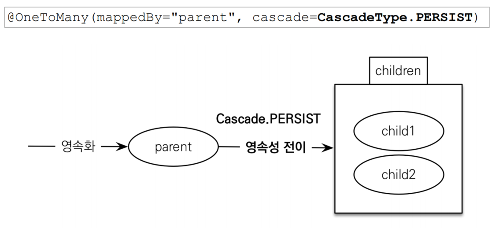

***영속성 전이: CASCADE 주의***

    - *영속성 전이는 연관관계를 매핑하는 것과 아무 관련이 없음*
    - *엔티티를 영속화 할 때 연관된 엔티티도 함께 영속화하는 편리함을 제공할 뿐*

***CASCADE의 종류***

    - *ALL: 모두 적용*
    - *PERSIST: 영속*
    - *REMOVE: 삭제*
    - *MERGE: 병합*
    - *REFRESH: REFRESH*

### ***고아 객체***

    - *고아 객체 제거: 부모 엔티티와 연관관계가 끊어진 자식 엔티티를 자동으로 삭제*
    - ***orphanRemoval = true***

***Parent, Child Entity***

```java
@Entity
@Getter @Setter
public class Parent {
    @Id
    @GeneratedValue(strategy = GenerationType.IDENTITY)
    private Long id;
    private String name;

    @OneToMany(mappedBy = "parent", cascade = CascadeType.ALL, orphanRemoval = true)
    private List<Child> childList = new ArrayList<>();
    public void addChild(Child child){
        this.childList.add(child);
        child.setParent(this);
    }
}

@Entity
@Getter @Setter
public class Child {
    @Id
    @GeneratedValue(strategy = GenerationType.IDENTITY)
    private Long id;
    private String name;
    @ManyToOne
    @JoinColumn(name = "PARENT_ID")
    private Parent parent;
}
```

    - ***@OneToMany(mappedBy = "parent", cascade = CascadeType.ALL, orphanRemoval = true)***

***example***

```java
Child child1 = new Child();
Child child2 = new Child();

Parent parent = new Parent();
parent.addChild(child1);
parent.addChild(child2);

em.persist(parent);
em.flush();
em.clear();

Parent findParent = em.find(Parent.class, parent.getId());
findParent.getChildList().remove(0);

----------------------------------------------------------------------------------------
Hibernate: 
    select
        p1_0.id,
        p1_0.name 
    from
        Parent p1_0 
    where
        p1_0.id=?
Hibernate: 
    select
        cl1_0.PARENT_ID,
        cl1_0.id,
        cl1_0.name 
    from
        Child cl1_0 
    where
        cl1_0.PARENT_ID=?
Hibernate: 
    /* delete for hellojpa.domain.Child */delete 
    from
        Child 
    where
        id=?
```

    - ***orphanRemoval TRUE →****연관관계가 끊긴 Child 엔티티가 삭제된다.*
    - ***CascadeType.REMOVE*** *→ Parent가 삭제될 때 연관된 Child 전부 같이 삭제* 

***고아 객체 주의***

    - *참조가 제거된 엔티티는 다른 곳에서 참조하지 않는 고아 객체로보고 삭제하는 기능*
    - ***참조하는 곳이 하나일 때 사용해야함 (특정 엔티티가 개인 소유할 때 사용)***
- *CascadeType 또한 마찬가지*
    - *@OneToOne, @OneToMany만 가능*
    - *참고: 개념적으로 부모를 제거하면 자식은 고아가 된다. 
따라서 고아 객체 제거 기능을 활성화 하면, 부모를 제거할 때 자식도 함께
제거된다.*
- *CascadeType.REMOVE 처럼 동작*

***영속성 전이 + 고아 객체, 생명주기***

    - *CascadeType.ALL + orphanRemoval=true* 
    - *스스로 생명주기를 관리하는 엔티티는 em.persist()로 영속화, em.remove()로 제거*
    - *두 옵션을 모두 활성화 하면 부모 엔티티를 통해서 자식의 생명주기를 관리할 수 있다.*
    - *도메인 주도 설계(DDD)의 Aggregate Root개념을 구현할 때 유용*

  - ***프록시, 즉시 로딩과 지연 로딩, 영속성 전이(CASCADE)와 고아 객체***

# ***기본값 타입***

### ***JPA의 데이터 타입 분류***

    - ***엔티티 타입***
- *@Entity로 정의하는 객체*
      - *데이터가 변해도 식별자로 지속해서 추적이 가능하다*
      - *ex) 회원 엔티티의 키나 나이 값을 변경해도 식별자로 인식 가능하다*
    - ***값 타입*** 
- *int, Integer, String 처럼 단순히 값으로 사용하는 자바 기본 타입이나 객체*
      - *식별자가 없고 값만 있으므로 변경시 추적이 불가능하다.*
      - *ex) 숫자 100 → 200 변경*

### ***값 타입 분류***

    - ***기본값 타입*** 
- *자바 기본 타입(int , double)*
      - *래퍼 클래스(Integer, Long)*
      - *String*
    - ***임베디드 타입(embedded type, 복합 값 타입)***
    - ***컬렉션 값 타입(collection value type)***

### ***기본값 타입*** 

    - *ex) String name, int age*
    - ***생명주기를 엔티티에 의존한다.***
- *ex) 회원을 삭제하면 이름, 나이 필드도 함께 삭제된다.*
    - *값 타입은 공유하면 안된다.*
- *ex) 회원 이름 변경시 다른 회원의 이름도 함께 변경되면 X*

### ***자바의 기본 타입은 절대 공유 X***

    - *int, double 같은 기본 타입(primitive type)은 절대 공유 X*
    - *기본 타입은 항상 값을 복사한다.*
    - *Integer 같은 래퍼 클래스나 String 같은 특수 클래스는 공유 가능한 객체이지만 변경 X*

```java
int a = 10;
int b = a;
a= 20;
System.out.println("a = " + a);
System.out.println("b = " + b);

------------------------------------------------------------------------------------
a = 20
b = 10
```

    - *기본타입인 a,b는 공유되지 않는다.* 
- *즉, 값을 변경해도 side effect가 없다.*

*Integer 같은 래퍼 클래스나  String 같은 특수한 클래스는 공유 가능한 객체이지만*

*값을 변경할 방법이 없기 때문에 변경되지 않는다. 
→* ***String과 Wrapper 클래스의 불변성 (Immutable)***

```java
String s1 = "Hello";
String s2 = s1; 
s1 = "World";   

System.out.println(s1); 
System.out.println(s2); 
------------------------------------------------------------------------------------
 World
 Hello
```

    - *변경 시 새로운 값을 생성하는 방식이다.*
    - *즉, s1 = “World”는 s1 참조는 “World”를 가리키고 s2는 여전히 “Hello”를 가리킨다.*
    - *당연한 내용이다.*

# ***임베디드 타입(복합 값 타입)***

    - *새로운 값 타입을 직접 정의할 수 있다.*
    - *주로 기본 값 타입을 모아서 만들어서 복합 값 타입이라고도 한다.*
    - *int, String 같은 타입*

### ***임베디드 타입 예시*** 

*회원 엔티티는 이름, 근무 시작일, 근무 종료일, 주소 도시, 주소 번지, 주소 우편번호를 가진다.*

*→ 회원 엔티티는 이름, 근무 기간(근무 시작일, 근무 종료일), 집 주소(주소 도시, 주소 번지, 주소 우편번호)를 가진다.*

*여기서 근무 기간, 집 주소가 임베디드 타입이 된다.*

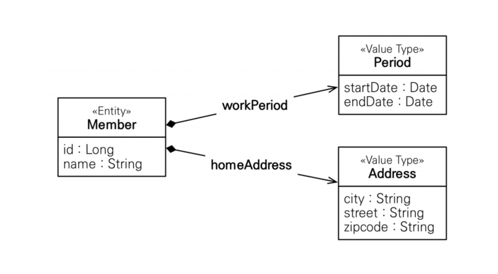

### ***임베디드 타입 사용법***

    - *@Embeddable: 값 타입을 정의하는 곳에 표시 (임베디드 클래스)*
    - *@Embedded: 값 타입을 사용하는 곳에 표시 (엔티티 필드)*
    - ***주의: 기본 생성자 필수***

### ***임베디드 타입 장점***

    - *임베디드 클래스 재사용*
    - *높은 응집도* 
    - *해당 값 타입만 사용하는 의미 있는 메소드를 만들 수 있다.*
- *ex: Period.isWork() → 근무 기간에 속하는지?*
    - *임베디드 타입을 포함한 모든 값 타입은, 값 타입을 소유한 엔티티의 생명주기를 의존한다*

### ***임베디드 타입과 테이블 매핑***

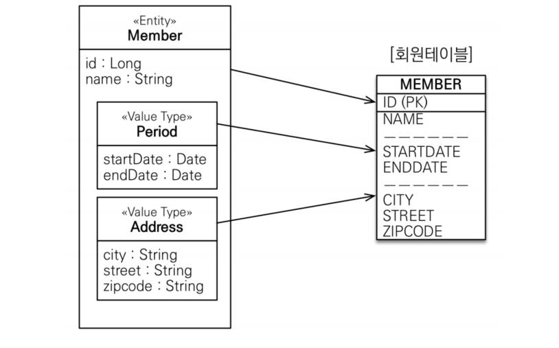

    - *임베디드 타입은 엔티티의 값일 뿐이다.*
    - ***임베디드 타입을 사용하기 전과 후에 매핑하는 테이블은 같다.***
- *데이터베이스 테이블 물리적 구조는 동일하다.*
    - *객체와 테이블을 아주 세밀하게 매핑하는 것이 가능하다.*
    - ***잘 설계한 ORM 애플리케이션은 매핑한 테이블 수보다 클래스의 수가 더 많다***
- *클래스 상속: @Inheritance*
      - *공통 엔티티: BaseEntity - @MappedSuperclass*
      - *임베디드 타입: @Embeddable*

### ***임베디드 타입 적용 예제*** 

***임베디드 타입 Before***

```java
@Entity
@Getter @Setter
public class Member{
    @Id @GeneratedValue(strategy = GenerationType.IDENTITY)
    private Long id;
    @Column(name = "USERNAME")
    private String name;

    @ManyToOne(fetch = FetchType.LAZY)
    @JoinColumn(name = "TEAM_ID")
    private Team team;
		
		// Adress
    private String city;
    private String street;
    private String zipcode;
    
    // Period
    private LocalDateTime startDate;
    private LocalDateTime endDate;
}
```

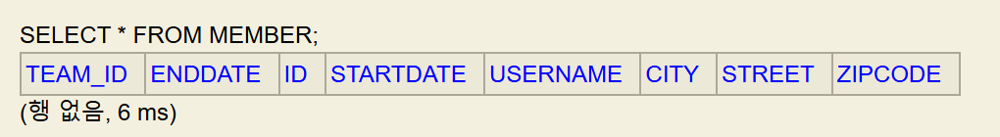

***임베디드 타입 After***

```java
@Entity
@Getter @Setter
public class Member{
    @Id @GeneratedValue(strategy = GenerationType.IDENTITY)
    private Long id;
    @Column(name = "USERNAME")
    private String name;

    @ManyToOne(fetch = FetchType.LAZY)
    @JoinColumn(name = "TEAM_ID")
    private Team team;

    @Embedded
    private Address address;
    @Embedded
    private Period workPeriod;
}

@Getter @Setter
@Embeddable
@NoArgsConstructor(access = AccessLevel.PUBLIC)
public class Period {
    private LocalDateTime startDate;
    private LocalDateTime endDate;
}

@Getter @Setter
@Embeddable
@NoArgsConstructor(access = AccessLevel.PUBLIC)
@AllArgsConstructor
public class Address {
    private String city;
    private String street;
    @Column(name = "ZIP_CODE")
    private String zipcode;
}
```

    - ***Member Entity → @Embedded 적용***
    - ***Embedded Class → @Embeddable 적용***
    - *@Column(name = "ZIP_CODE") → 컬럼명 재정의도 가능하다.*

***임베디드 예제 - 테스트*** 

```java
Member member = new Member();
member.setName("배제우");
member.setAddress(new Address("city", "street", "10000"));
member.setWorkPeriod(new Period());
em.persist(member);
```

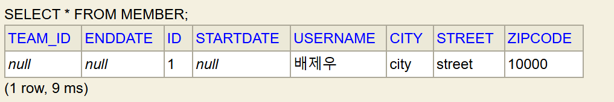

### ***@AttributeOverride: 속성 재정의***

***적용 BEFORE → 에러 발생*** 

```java
@Entity
@Getter @Setter
public class Member{
    @Id @GeneratedValue(strategy = GenerationType.IDENTITY)
    private Long id;
    @Column(name = "USERNAME")
    private String name;

    @ManyToOne(fetch = FetchType.LAZY)
    @JoinColumn(name = "TEAM_ID")
    private Team team;

    @Embedded
    private Address homeAddress;

    @Embedded
    private Address workAddress;

    @Embedded
    private Period workPeriod;
}
```

***한 엔티티에서 이렇게 같은 값 타입을 사용하고 싶을 수 있다.***

*→ adress: 집 주소, 회사 주소*

*이렇게 사용하면 컬럼 명이 중복된다. → 에러 발생* 

***@AttributeOverrides, @AttributeOverride를 사용해서 컬럼 명 속성을 재정의하면 된다.***

***적용 After*** 

```java
@Entity
@Getter @Setter
public class Member{
    @Id @GeneratedValue(strategy = GenerationType.IDENTITY)
    private Long id;
    @Column(name = "USERNAME")
    private String name;

    @ManyToOne(fetch = FetchType.LAZY)
    @JoinColumn(name = "TEAM_ID")
    private Team team;

    @Embedded
    @AttributeOverrides({
            @AttributeOverride(name = "city",    column = @Column(name = "HOME_CITY")),
            @AttributeOverride(name = "street",  column = @Column(name = "HOME_STREET")),
            @AttributeOverride(name = "zipcode", column = @Column(name = "HOME_ZIPCODE"))
    })
    private Address homeAddress;
    @Embedded
    @AttributeOverrides({
        @AttributeOverride(name = "city",    column = @Column(name = "EMP_CITY")),
        @AttributeOverride(name = "street",  column = @Column(name = "EMP_STREET")),
        @AttributeOverride(name = "zipcode", column = @Column(name = "EMP_ZIPCODE"))
    })
    private Address workAddress;

    @Embedded
    private Period workPeriod;
}
```

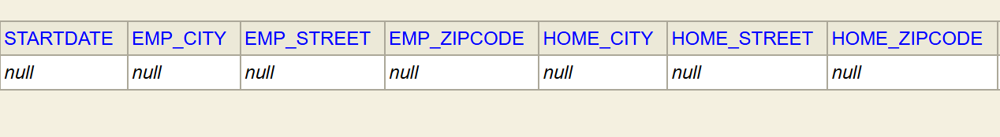

***임베디드 타입과 NULL***

    - *임베디드 타입의 값이 null이면 매핑한 컬럼 값은 모두 null*

# ***값 타입과 불변 객체***

*값 타입은 복잡한 객체 세상을 조금이라도 단순화하려고 만든 개념이다.*

*따라서 값 타입은 단순하고 안전하게 다룰 수 있어야 한다.*

### *값 타입 공유 참조*

    - *임베디드 타입 같은 값 타입을 여러 엔티티에서 공유하면 위험하다*
    - *부작용(side effect) 발생*

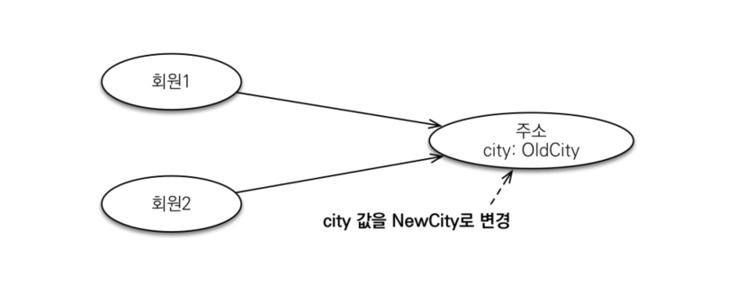

    - *값 타입의 실제 인스턴스인 값을 복사하는 행위는 위험하다*
    - ***대신 값(인스턴스)를 복사해서 사용해야 한다.***

### ***값 타입 side effect 발생 예제***

```java
Address address = new Address("city", "street", "10000");

Member member = new Member();
member.setName("배제우");
member.setHomeAddress(address);
em.persist(member);

Member member2 = new Member();
member2.setName("배제우2");
member2.setHomeAddress(address);
em.persist(member2);

member.getHomeAddress().setCity("newCity");

tx.commit();
```

    - *의도는 member(배제우) 객체만 도시 이름을 “newCity”로 변경*
    - *update 쿼리가 2번 날아가고 member, member2 모두 도시 이름이 “newCity”로 바뀌었다.*
- *값 타입 공유로 인하여 side effect 발생*

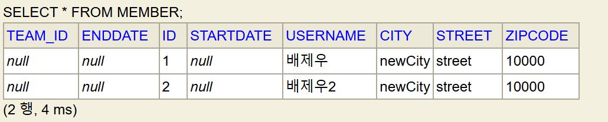

### ***값(인스턴스)를 복사해서 사용하기***

```java
Address address = new Address("city", "street", "10000");

Member member = new Member();
member.setName("배제우");
member.setHomeAddress(address);
em.persist(member);

Address copyAddress = 
		new Address(address.getCity(), address.getStreet(), address.getZipcode());

Member member2 = new Member();
member2.setName("배제우2");
member2.setHomeAddress(copyAddress);
em.persist(member2);

member.getHomeAddress().setCity("newCity");
```

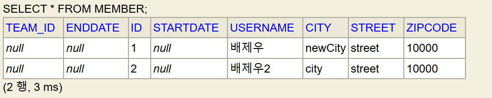

    - *값을 복사해서 사용해서 side effect가 사라졌다.*

### ***객체 타입의 한계***

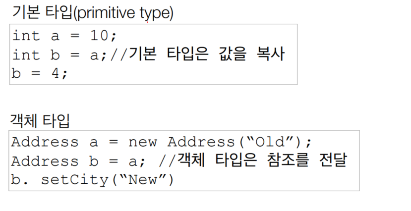

    - *객체 타입은 참조 값을 직접 대입하는 것을 막을 방법이 없다.*
    - *즉, 객체의 공유 참조는 피할 수 없다.*

### ***객체 타입 한계 극복 - 불변 객체***

    - *객체 타입을 수정할 수 없게 만들면 부작용을 원천 차단할 수 있다.*
    - ***값 타입은 불변 객체(immutable object)로 설계해야 한다***
- *생성 시점 이후 절대 값을 변경할 수 없는 객체*
    - ***생성자로만 값을 설정하고 수정자(setter)를 만들지 않으면 된다.***
    - *참고: Integer, String → 자바가 제공하는 대표적인 불변 객체*
- *no setter*

***Address → Setter 삭제***

```java
@Getter
@Embeddable
@NoArgsConstructor(access = AccessLevel.PUBLIC)
@AllArgsConstructor
public class Address {
    private String city;
    private String street;
    private String zipcode;
}
```

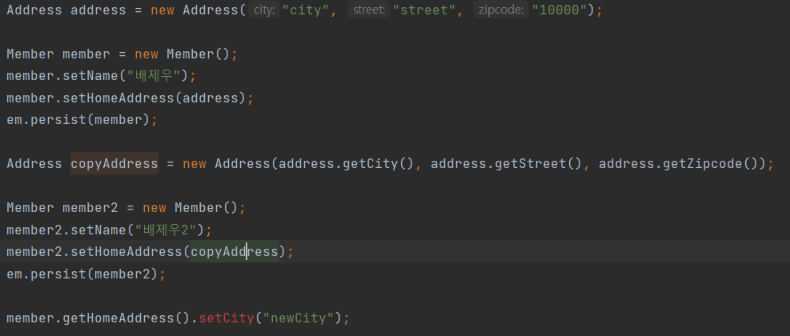

    - *값 변경이 불가능하다.*
    - *member 객체의 Address를 update 하려면* ***새로운*** ***immutable 객체의 생성이 필요하다.***

## ***불변이라는 작은 제약으로 부작용이라는 큰 재앙을 막을 수 있다***

# ***값 타입의 비교***

*값 타입: 인스턴스가 달라도 그 안에 값이 같으면 같은 것으로 봐야 한다*

***동일성(identity) 비교:*** *인스턴스의 참조 값을 비교*

    - *== 사용*

***동등성(equivalence) 비교:*** *인스턴스의 값을 비교*

    - *equals() 사용*

*값 타입은 a.equals(b)를 사용해서 동등성 비교를 해야한다*

*→* ***값 타입의 equals() 메소드를 적절하게 재정의하자, 당연히 hashCode() 또한 재정의***

***@EqualsAndHashCode***

***@EqualsAndHashCode(callSuper = true)****로 설정시 부모 클래스 필드 값들도 동일한지 체크하며, false(기본값)일 경우 자신 클래스의 필드 값만 고려한다.*

# *값 타입 컬렉션*

### ***값 타입 컬렉션?***

    - *값 타입을 하나 이상 저장할 때 사용한다.*
    - *데이터베이스는 컬렉션을 같은 테이블에 저장할 수 없다.* 
*즉, 컬렉션을 저장하기 위한 별도의 테이블이 필요하다*

      - *즉, 1:N 연관관계 매핑*
    - ***@ElementCollection, @CollectionTable 사용***


***Member Entity***

```java
@Entity
@Getter @Setter
public class Member{
    @Id @GeneratedValue(strategy = GenerationType.IDENTITY)
    private Long id;
    @Column(name = "USERNAME")
    private String name;

    @Embedded
    private Address homeAddress;

    @ElementCollection
    @CollectionTable(name = "FAVORITE_FOOD"
            , joinColumns = @JoinColumn(name = "MEMBER_ID"))
    @Column(name = "FOOD_NAME")
    private Set<String> favoriteFoods = new HashSet<>();

    @ElementCollection
    @CollectionTable(name = "ADDRESS",
            joinColumns = @JoinColumn(name = "MEMBER_ID"))
    private List<Address> addressHistory = new ArrayList<>();
}

--------------------------------------------------------------------------------------
Hibernate: 
    create table Member (
        id bigint generated by default as identity,
        USERNAME varchar(255),
        city varchar(255),
        street varchar(255),
        zipcode varchar(255),
        primary key (id)
    )

Hibernate: 
    create table ADDRESS (
        MEMBER_ID bigint not null,
        city varchar(255),
        street varchar(255),
        zipcode varchar(255)
    )
    
Hibernate: 
    create table FAVORITE_FOOD (
        MEMBER_ID bigint not null,
        FOOD_NAME varchar(255)
    )    
    
// FK add constraint 생략     
```

    - ***@JoinColumn: 외래 키(FK) 지정***

### *값 타입 컬렉션 사용, 특성*

***값 타입 컬렉션 INSERT***

```java
Member member = new Member();
member.setName("MEMBER1");
member.setHomeAddress(new Address("homeCity", "street", "10000"));

member.getFavoriteFoods().add("치킨");
member.getFavoriteFoods().add("족발");
member.getFavoriteFoods().add("피자");

member.getAddressHistory().add(new Address("old1", "street", "10000"));
member.getAddressHistory().add(new Address("old2", "street", "10000"));

em.persist(member);

tx.commit();

-------------------------------------------------------------------------------------

Hibernate: 
    /* insert for
        hellojpa.domain.Member */insert 
    into
        Member (city, street, zipcode, USERNAME, id) 
    values
        (?, ?, ?, ?, default)
Hibernate: 
    /* insert for
        hellojpa.domain.Member.addressHistory */insert 
    into
        ADDRESS (MEMBER_ID, city, street, zipcode) 
    values
        (?, ?, ?, ?)
Hibernate: 
    /* insert for
        hellojpa.domain.Member.addressHistory */insert 
    into
        ADDRESS (MEMBER_ID, city, street, zipcode) 
    values
        (?, ?, ?, ?)
Hibernate: 
    /* insert for
        hellojpa.domain.Member.favoriteFoods */insert 
    into
        FAVORITE_FOOD (MEMBER_ID, FOOD_NAME) 
    values
        (?, ?)
Hibernate: 
    /* insert for
        hellojpa.domain.Member.favoriteFoods */insert 
    into
        FAVORITE_FOOD (MEMBER_ID, FOOD_NAME) 
    values
        (?, ?)
Hibernate: 
    /* insert for
        hellojpa.domain.Member.favoriteFoods */insert 
    into
        FAVORITE_FOOD (MEMBER_ID, FOOD_NAME) 
    values
        (?, ?)
```

    - *em.persist(Member(엔티티)) 한번에 값 타입들이 각 테이블에 INSERT 쿼리가 날아간다.*
- ***값 타입 컬렉션도 하나의 값 타입처럼 라이프 사이클이 Member 엔티티에 의존된다.***
      - ***즉, 값 타입 컬렉션은 영속성 전이(Cascade ALL) + 고아 객체 제거 기능을 필수로 가진다.***


***값 타입 컬렉션 조회:*** ***값 타입 컬렉션도 지연 로딩 전략을 사용한다.***

```java
Member member = new Member();
member.setName("MEMBER1");
member.setHomeAddress(new Address("homeCity", "street", "10000"));

member.getFavoriteFoods().add("치킨");
member.getFavoriteFoods().add("족발");
member.getFavoriteFoods().add("피자");

member.getAddressHistory().add(new Address("old1", "street", "10000"));
member.getAddressHistory().add(new Address("old2", "street", "10000"));

em.persist(member);
em.flush();
em.clear();

Member findMember = em.find(Member.class, member.getId());
System.out.println("============START====================");
for (Address address : findMember.getAddressHistory()) {
    System.out.println("address = " + address);
}

tx.commit();
-----------------------------------------------------------------------------------
Hibernate: 
    select
        m1_0.id,
        m1_0.city,
        m1_0.street,
        m1_0.zipcode,
        m1_0.USERNAME 
    from
        Member m1_0 
    where
        m1_0.id=?
============START====================
Hibernate: 
    select
        ah1_0.MEMBER_ID,
        ah1_0.city,
        ah1_0.street,
        ah1_0.zipcode 
    from
        ADDRESS ah1_0 
    where
        ah1_0.MEMBER_ID=?
address = hellojpa.domain.Address@8641327f
address = hellojpa.domain.Address@86414018
```

    - *Member 조회 → “START” 출력 → ADDRESS 조회*
- *→ 지연 로딩*

***값 타입 컬렉션 중간 정리***

    - *값 타입 컬렉션도 지연 로딩 전략 사용*
    - *값 타입 컬렉션은 Cascade.ALL, 고아 객체 제거 기능을 가진다.*

***값 타입 컬렉션 수정 - feat Set 자료구조*** 

```java
Member member = new Member();
member.setName("MEMBER1");
member.setHomeAddress(new Address("homeCity", "street", "10000"));

member.getFavoriteFoods().add("치킨");
member.getFavoriteFoods().add("족발");
member.getFavoriteFoods().add("피자");

member.getAddressHistory().add(new Address("old1", "street", "10000"));
member.getAddressHistory().add(new Address("old2", "street", "10000"));

em.persist(member);
em.flush();
em.clear();

Member findMember = em.find(Member.class, member.getId());
// 치킨 -> 한식
findMember.getFavoriteFoods().remove("치킨");
findMember.getFavoriteFoods().add("한식");

tx.commit();
---------------------------------------------------------------------------------------

Hibernate: 
    select
        m1_0.id,
        m1_0.city,
        m1_0.street,
        m1_0.zipcode,
        m1_0.USERNAME 
    from
        Member m1_0 
    where
        m1_0.id=?
Hibernate: 
    select
        ff1_0.MEMBER_ID,
        ff1_0.FOOD_NAME 
    from
        FAVORITE_FOOD ff1_0 
    where
        ff1_0.MEMBER_ID=?
Hibernate: 
    /* delete for hellojpa.domain.Member.favoriteFoods */delete 
    from
        FAVORITE_FOOD 
    where
        MEMBER_ID=? 
        and FOOD_NAME=?
Hibernate: 
    /* insert for
        hellojpa.domain.Member.favoriteFoods */insert 
    into
        FAVORITE_FOOD (MEMBER_ID, FOOD_NAME) 
    values
        (?, ?)
```

    - *값 타입 컬렉션만 변경했는데 FAVORITE_FOOD 테이블에 DELETE, INSERT 쿼리가 날아간다.*
- *→ 영속성 전이(CASCADE) 같이 동작*

***값 타입 컬렉션 수정 - feat List자료구조*** 

```java
Member member = new Member();
member.setName("MEMBER1");
member.setHomeAddress(new Address("homeCity", "street", "10000"));

member.getFavoriteFoods().add("치킨");
member.getFavoriteFoods().add("족발");
member.getFavoriteFoods().add("피자");

member.getAddressHistory().add(new Address("old1", "street", "10000"));
member.getAddressHistory().add(new Address("old2", "street", "10000"));

em.persist(member);%
em.flush();
em.clear();

Member findMember = em.find(Member.class, member.getId());

findMember.getAddressHistory().remove(new Address("old1", "street", "10000"));
findMember.getAddressHistory().add(new Address("newCity1", "street", "10000"));

tx.commit();

------------------------------------------------------------------------

Hibernate: 
    /* one-shot delete for hellojpa.domain.Member.addressHistory */delete 
    from
        ADDRESS 
    where
        MEMBER_ID=?
Hibernate: 
    /* insert for
        hellojpa.domain.Member.addressHistory */insert 
    into
        ADDRESS (MEMBER_ID, city, street, zipcode) 
    values
        (?, ?, ?, ?)
Hibernate: 
    /* insert for
        hellojpa.domain.Member.addressHistory */insert 
    into
        ADDRESS (MEMBER_ID, city, street, zipcode) 
    values
        (?, ?, ?, ?)

```

    - *MEMBER_ID를 기준으로 ADDRESS 테이블 전체를 삭제를 하고 2개의 값을 넣는다.* 
    - *내가 예상한 쿼리는 1개의 ROW에 대한 DELETE와 INSERT 였다.* 

***값 타입 컬렉션의 제약사항***

    - *값 타입은 엔티티와 다르게 식별자 개념이 없다.*
    - *값은 변경하면 추적이 어렵다.*
    - *값 타입 컬렉션에 변경 사항이 발생하면, 주인 엔티티와 연관된 모든 데이터를 삭제하고, 값 타입 컬렉션에 있는 현재 모든 값을 다시 저장한다.*
- ***이를 해결하려면*** ***값 타입 컬렉션을 매핑하는 테이블은 모든 컬럼을 묶어서 기본키(PK)로 구성해야 한다.***
- *nullable fale, unique true*

***값 타입 컬렉션 자료구조 차이***

    - *SET* 
- *데이터 변경시 새로 추가된 요소는* ***INSERT****되고, 삭제된 요소만* ***DELETE***
    - *LIST* 
- *모든 데이터를 삭제하고 컬렉션에 남아있는 데이터를 다시* ***INSERT***

***값 타입 컬렉션 대안***

    - ***실무에서는 상황에 따라 값 타입 컬렉션 대신에 일대다 관계를 고려***
    - *일대다 관계를 위한 엔티티를 만들고, 여기에 값 타입을 사용한다.*
    - *영속성 전이(Cascade) + 고아 객체 제거를 사용해서 값 타입 컬렉션처럼 엔티티를 사용한다.*

***값 타입 컬렉션 → 엔티티로 승격***

```java
@Entity
@Getter @Setter
public class Member{
    @Id @GeneratedValue(strategy = GenerationType.IDENTITY)
    private Long id;
    @Column(name = "USERNAME")
    private String name;

    @Embedded
    private Address homeAddress;

    @OneToMany(mappedBy = "member", orphanRemoval = true, cascade = CascadeType.ALL)
    private List<AddressHistory> addressHistories = new ArrayList<>();
    
    // 연관관계 편의 메소드 
    public void addHistory(AddressHistory addressHistory){
        addressHistories.add(addressHistory);
        addressHistory.setMember(this);
    }
}

@Entity
@Getter @Setter
@Table(name = "ADDRESS")
public class AddressHistory {
    @Id @GeneratedValue(strategy = GenerationType.IDENTITY)
    private Long id;

    @ManyToOne(fetch = FetchType.LAZY)
    @JoinColumn(name = "MEMBER_ID")
    private Member member;

    @Embedded
    private Address address;
}
```


    - *이제 ADDRESS 엔티티로 승격했기 때문에 식별자로 조회해서 편하게 수정하면 된다.*

  - ***임베디드 타입(컬럼 명 중복 해결), 값 타입 side effect, 값 타입 비교, 값 타입 컬렉션*** 

# ***JPQL 소개***

***JPQL 필요성***

      - *JPA를 사용하면 엔티티 객체를 중심으로 개발*
      - *검색을 할 때도 테이블이 아닌 엔티티 객체를 대상으로 검색*
      - *모든 DB 데이터를 객체로 변환해서 검색하는 것은 불가능*
      - *애플리케이션이 필요한 데이터만 DB에서 불러오려면 결국 검색 조건이 포함된 SQL이 필요*

***JPQL?***

      - *JPA는 SQL을 추상화한 JPQL이라는 객체 지향 쿼리 언어 제공*
      - *SQL과 문법 유사, SELECT, FROM, WHERE, GROUP BY, HAVING, JOIN 지원*
      - *JPQL은 엔티티 객체를 대상으로 쿼리*
- *SQL을 추상화해서 특정 데이터베이스 SQL에 의존 X*
        - *특정 데이터베이스에 의존하는 SQL은 네이티브 쿼리, JDBC Template, MyBatis 사용*
      - *SQL은 데이터베이스 테이블을 대상으로 쿼리*

***JPQL example***

```java
 List<Member> members = 
		 em.createQuery("select m from Member m where m.name like '%kim%'", Member.class)
                    .getResultList();

  for (Member member : members) {
      System.out.println("member = " + member);
  }
  -------------------------------------------------------------------------------
  Hibernate: 
    /* select
        m 
    from
        Member m 
    where
        m.name like '%kim%' */ select
            m1_0.id,
            m1_0.city,
            m1_0.street,
            m1_0.zipcode,
            m1_0.USERNAME 
        from
            Member m1_0 
        where
            m1_0.USERNAME like '%kim%' escape ''
```

***JPQL 문제점 동적 쿼리 작성이 어렵다.***

*개발자가 작성하는 JPQL은 단순 String 이다.*

*만약 동적으로 날라가는 JPQL이 필요하다면?*

*조건이 있으면 WHERE 절 추가 AND 추가 등등..* 

*복잡하기도 하고 실수할 가능성이 너무 많다.*

# ***Criteria 소개***

      - *문자가 아닌 자바코드로 JPQL을 작성할 수 있다*
      - *JPQL 빌더 역할*
      - *JPA 공식 기능 - JPA 표준 스펙* 
      - *너무 복잡하고 실용성이 없다. →* ***Criteria 대신에 QueryDSL 사용을 권장한다***

***Criteria example***

```java
// Criteria 사용 준비
CriteriaBuilder cb = em.getCriteriaBuilder();
CriteriaQuery<Member> query = cb.createQuery(Member.class);

// 루트 클래스 (조회를 시작할 클래스)
Root<Member> m = query.from(Member.class);

// 쿼리 생성
CriteriaQuery<Member> cq = query.select(m).where(cb.equal(m.get("name"), "kim"));
List<Member> members = em.createQuery(cq).getResultList();

tx.commit();

------------------------------------------------------------------------------------
Hibernate: 
    /* <criteria> */ select
        m1_0.id,
        m1_0.city,
        m1_0.street,
        m1_0.zipcode,
        m1_0.USERNAME 
    from
        Member m1_0 
    where
        m1_0.USERNAME=?
```

# *QueryDSL 소개*

      - *문자가 아닌 자바코드로 JPQL을 작성할 수 있다*
      - *JPQL 빌더 역할*
      - *컴파일 시점에 문법 오류를 찾을 수 있다*
      - *동적쿼리 작성 편리하다*
      - *단순하고 쉽다, 순수 JPQL 거의 동일하다*
      - ***실무 사용 권장***

# ***네이티브 SQL 소개***

      - *JPA가 제공하는 SQL을 직접 사용하는 기능*
      - *JPQL로 해결할 수 없는 특정 데이터베이스에 의존적인 기능*
- *특정 DB만 제공하는 SQL 힌트*

    - ***JPQL, Criteria, QueryDSL, 네이티브 SQL 소개***

# ***기본 문법과 쿼리 API***


***JPQL 문법***

    - *엔티티 속성은 대소문자 구분 O*
    - *JPQL 키워드는 대소문자 구분 X (SELECT, from, WHERE)*
    - *엔티티 이름 사용, 테이블 이름이 아니다*
    - *별칭은 필수 당연히 as 생략 가능*
    - ***집계함수(SUM, MAX, MIN, …), GROUP BY HAVING, ORDER BY 모두 지원*** 

### ***TypeQuery, Query***

    - *TypeQuery: 반환 타입이 명확할 때 사용*
```java
TypedQuery<Member> query =
			 em.createQuery("SELECT m FROM Member m", Member.class); 
```
    - *Query: 반환 타입이 명확하지 않을 때 사용*
```java
Query query = 
		 em.createQuery("SELECT m.username, m.age from Member m"); 
```

### ***결과 조회 API***

    - *getResultList(): 결과가 하나 이상일 때, 리스트 반환*
- *결과가 없으면 빈 리스트 반환*
    - *getSingleResult(): 결과가 정확히 하나, 단일 객체 반환*
- *결과가 없으면 → NoResultException*
      - *둘 이상이면 → NonUniqueResultException*
      - ***해당 예외들은 스프링 부트를 사용하면 예외 변환기 어드바이스(AOP)를 통해서 스프링 예외로 바뀐다.***
      - *Spring Data JPA를 사용하면 예외를 try-catch로 잡아서 null 또는 Optional.empty()로 반환한다.*

### ***파라미터 바인딩 - 이름 기준, 위치 기준***

***이름 기준 파라미터 바인딩***

```java
Member findMember = 
		em.createQuery("select m from Member m where m.username = :username", Member.class)
                .setParameter("username", member.getUsername())
                .getSingleResult();
```

    - *메소드 체이닝을 지원한다.*

***위치 기준 파라미터 바인딩***

```java
Member findMember2 = 
		em.createQuery("select m from Member m where m.username =?1", Member.class)
                    .setParameter(1, member.getUsername())
                    .getSingleResult();
```

    - *이름 기준 파라미터 바인딩을 사용하자* 
- *JdbcTemplate 사용할 때 이름 기반 Template를 사용하는 이유랑 동일하다.*

# *프로젝션(SELECT)*

***프로젝션?***

    - *SELECT 절에 조회할 대상을 지정하는 것*
    - ***프로젝션 대상***
- *엔티티* 
      - *임베디드 타입(값 타입)*
      - *스칼라 타입(숫자, 문자등 기본 값 타입)*
    - *`SELECT m FROM Member m`* *→ 엔티티 프로젝션*
    - *`SELECT m.team FROM Member m`* *→ 엔티티 프로젝션*
    - *`SELECT m.address FROM Member m`* *→ 임베디드 타입 프로젝션*
    - *`SELECT m.username, m.age FROM Member m`*  *→ 스칼라 타입 프로젝션*
    - ***DISTINCT로 중복 제거***

***엔티티 프로젝션 Example - 영속성 컨텍스트*** 

```java
Member member = new Member();
member.setUsername("MEMBER1");
member.setAge(10);
em.persist(member);

em.clear();

List<Member> result = em.createQuery("select m from Member m", Member.class)
        .getResultList();

Member findMember = result.get(0);
findMember.setAge(20);
----------------------------------------------------------------------------------
Hibernate: 
    /* update
        for hellojpa.domain.Member */update Member 
    set
        age=?,
        TEAM_ID=?,
        username=? 
    where
        MEMBER_ID=?
```

    - *엔티티 프로젝션의 결과를 가져와서 값을 바꾸니까 update 쿼리가 날아간다 → 엔티티 프로젝션의 결과는 1차 캐시(영속성 컨텍스트에 영속화)저장 된다.* 
- ***Dirty Checking 변경 감지 동작***

***연관관계가 있는 필드 엔티티 프로젝션*** 

```java
Team team = new Team();
team.setName("TEAM1");
em.persist(team);

Member member = new Member();
member.setUsername("MEMBER1");
member.setAge(10);
member.setTeam(team);

em.persist(member);

em.clear();

List<Team> result = em.createQuery("select m.team from Member m", Team.class)
        .getResultList();

Team findTeam = result.get(0);
System.out.println(findTeam.getName());

----------------------------------------------------------------------------------
Hibernate: 
    /* select
        m.team 
    from
        Member m */ select
            t1_0.TEAM_ID,
            t1_0.name 
        from
            Member m1_0 
        join
            Team t1_0 
                on t1_0.TEAM_ID=m1_0.TEAM_ID
TEAM1
```

    - `em.createQuery("select m.team from Member m", Team.class)` 
- *날아가는 쿼리를 보면 Team, Member와 조인을 해서 날아간다.*
      - *묵시적 조인 방식*
    - ***JPA를 잘 아는 사람은 물론 조인 쿼리가 날아간다는 것을 인지하겠지만 JPQL만 봐서는 조인 쿼리를 예상하기 힘들다.***
    - *직접 조인을 하는 방식을 사용하자*

***연관관계가 있는 필드 엔티티 프로젝션 - 직접 조인***

```java
List<Team> result = 
			em.createQuery("select t from Member m join m.team t", Team.class)
            .getResultList();
            
----------------------------------------------------------------------------
Hibernate: 
    /* select
        t 
    from
        Member m 
    join
        m.team t */ select
            t1_0.TEAM_ID,
            t1_0.name 
        from
            Member m1_0 
        join
            Team t1_0 
                on t1_0.TEAM_ID=m1_0.TEAM_ID
TEAM1            
```

    - *명시적 조인 방식을 사용 → 쿼리가 예상이 된다.*

***임베디드 타입 프로젝션 example***

```java
Order order = new Order();
order.setAddress(new Address("city", "street", "12121"));
em.persist(order);
em.clear();

List<Address> resultList = em.createQuery("select o.address from Order o", Address.class)
        .getResultList();
System.out.println(resultList.get(0).getCity());

------------------------------------------------------------------------------
Hibernate: 
    /* select
        o.address 
    from
        
    Order o */ select
        o1_0.city,
        o1_0.street,
        o1_0.zipcode from
            ORDERS o1_0
city

```

    - *특징: 임베디드 타입은 특정 엔티티에 종속적이어서 해당 엔티티로 조회를 해야 한다.*

***스칼라 타입 프로젝션 example***

```java
Member member = new Member();
member.setUsername("MEMBER1");
member.setAge(10);
em.persist(member);
em.clear();

List resultList = em.createQuery("select m.username, m.age from Member m")
        .getResultList();

tx.commit();
------------------------------------------------------------------------------
Hibernate: 
    /* select
        m.username,
        m.age 
    from
        Member m */ select
            m1_0.username,
            m1_0.age 
        from
            Member m1_0
```

    - *스칼라 타입은 정확한 타입 지정이 불가능하다. → TypeQuery가 아닌 Query를 사용한다.*

### *프로젝션 - 여러 값 조회*

```java
"select m.username, m.age from Member m"
```

    - ***이렇게 여러 값 조회는 어떻게 결과를 받아야 할까?***
    1. ***Query 타입으로 조회***

```java
List resultList = em.createQuery("select m.username, m.age from Member m")
        .getResultList();

Object o = resultList.get(0);
Object [] result = (Object[]) o;
System.out.println("username = " + result[0]);
System.out.println("age = " + result[1]);
--------------------------------------------------------------------------------
username = MEMBER1
age = 10
```

    1. ***Object [] 타입으로 조회 → TypeQuery<Object []>*** 

```java
List<Object[]> resultList = 
		em.createQuery("select m.username, m.age from Member m", Object[].class)
        .getResultList();

Object[] objects = resultList.get(0);
System.out.println("username= " + objects[0]);
System.out.println("age= " + objects[1]);
--------------------------------------------------------------------------------
username = MEMBER1
age = 10
```

    1. ***new 명령어로 조회***

```java
@Getter @Setter
@AllArgsConstructor
public class MemberDTO {
    private String username;
    private int age;
}

List<MemberDTO> resultList = 
em.createQuery("select new hellojpa.domain.MemberDTO(m.username, m.age) from Member m", MemberDTO.class)
        .getResultList();

MemberDTO memberDTO = resultList.get(0);
System.out.println("username= " + memberDTO.getUsername());
System.out.println("age= " + memberDTO.getAge());
--------------------------------------------------------------------------------
username = MEMBER1
age = 10

```

    - *값을 DTO로 바로 조회한다.*
- `"select new hellojpa.domain.MemberDTO(m.username, m.age) from Member m"`
    - *패키지 명을 포함한 전체 클래스 명(****FQCN:*** *Fully Qualified Class Name) 필요*
    - ***순서와 타입이 일치하는 생성자가 필요하다 (생성자에 값을 넣는 방식)***

# *페이징*

    - *JPA는 페이징을 다음 두 API로 추상화*
    - ***setFirstResult(int startPosition): 조회 위치 시작 위치***
- *0부터 시작*
    - ***setMaxResult(int maxResult): 조회할 데이터 수*** 

***페이징 example***

```java
for (int i = 0; i < 100; i++) {
    Member member = new Member();
    member.setUsername("MEMBER" + i);
    member.setAge(i);
    em.persist(member);
}
em.clear();
List<Member> result = 
			em.createQuery("select m from Member m order by m.age asc", Member.class)
        .setFirstResult(0)
        .setMaxResults(10)
        .getResultList();

for (Member m : result) {
    System.out.println("member = " + m);
}
```

    - *데이터베이스마다 다른 복잡한 페이징 쿼리에 대해서 직접 작성하지 않아도된다.* 
    - *JPA에서 제공하는 2개의 추상화된 API만으로도 데이터베이스에 존속되지 않게 페이징을 할 수 있다.* 

***MySQL 페이징 쿼리*** 

```sql
SELECT
	 M.ID AS ID,
	 M.AGE AS AGE,
	 M.TEAM_ID AS TEAM_ID,
	 M.NAME AS NAME 
FROM
		 MEMBER M 
ORDER BY
	 M.NAME DESC LIMIT ?, ?
```

# *조인*

### ***JPQL 조인 문법*** 

    - ***내부 조인***
- SELECT m FROM Member m [INNER] JOIN m.team t
    - ***외부 조인***
- SELECT m FROM Member m LEFT [OUTER] m.team t
      - *참고로 JPQL에서 (RIGHT, FULL) OUTER 조인은 지원하지 않는다.*
    - ***세타 조인***
- SELECT count(m) FROM Member m, Team t where m.username = t.name

***inner join***

```java
List<Member> members = 
			em.createQuery("select m from Member m inner join m.team t", Member.class)
                .getResultList();
----------------------------------------------------------------------------------
Hibernate: 
    /* select
        m 
    from
        Member m 
    inner join
        m.team t */ select
            m1_0.MEMBER_ID,
            m1_0.age,
            m1_0.TEAM_ID,
            m1_0.username 
        from
            Member m1_0 
        join
            Team t1_0 
                on t1_0.TEAM_ID=m1_0.TEAM_ID
```

***left outer join example1***

```java
List<Member> members =
		 em.createQuery("select m from Member m left outer join m.team t", Member.class)
     .getResultList();
---------------------------------------------------------------------------------- 

Hibernate: 
    /* select
        m 
    from
        Member m 
    left join
        m.team t */ select
            m1_0.MEMBER_ID,
            m1_0.age,
            m1_0.TEAM_ID,
            m1_0.username 
        from
            Member m1_0
```

    - *left outer join → outer는 생략이 가능하다.*
    - *현재 데이터베이스에 날아간 쿼리를 보면 조인 쿼리가 아니다.
하이버네이트가 버전업이 되면서 자동으로 최적화를 해버려서 그렇다. 
즉, 어차피 Member만 조회하는데 조인할 필요가 없어서 불필요한 left 조인을 제거*

***left outer join example2***

```java
List<Member> members =
    em.createQuery("select m from Member m left outer join m.team t where t.name = :teamname", Member.class)
    .setParameter("teamname", "teamA")
    .getResultList();
    
---------------------------------------------------------------------------------- 
Hibernate: 
    /* select
        m 
    from
        Member m 
    left outer join
        m.team t 
    where
        t.name = :teamname */ select
            m1_0.MEMBER_ID,
            m1_0.age,
            m1_0.TEAM_ID,
            m1_0.username 
        from
            Member m1_0 
        left join
            Team t1_0 
                on t1_0.TEAM_ID=m1_0.TEAM_ID 
        where
            t1_0.name=?

```

### ***조인 - ON 절 (JPA 2.1부터 지원)***

    - *조인 대상 필터링*
    - *연관관계 없는 엔티티 외부 조인 (하이버네이트 5.1부터 지원)*

***조인 대상 필터링*** 

    - *회원과 팀을 조인하면서, 팀 이름이 A인 팀만 조인*

```java
em.createQuery("select m, t from Member m left join m.team t on t.name = :teamName")
              .setParameter("teamName", "teamA")
              .getResultList();
------------------------------------------------------------------------------
 select
        m1_0.MEMBER_ID,
        m1_0.age,
        m1_0.TEAM_ID,
        m1_0.username,
        t1_0.TEAM_ID,
        t1_0.name 
from
    Member m1_0 
left join
    Team t1_0 
        on t1_0.TEAM_ID=m1_0.TEAM_ID 
        and t1_0.name=?         
```

***연관관계 없는 엔티티 외부 조인***

```java
JPQL
SELECT m, t FROM
Member m LEFT JOIN Team t on m.username = t.name

SQL
SELECT m.*, t.* FROM 
Member m LEFT JOIN Team t ON m.username = t.name
```

# *서브 쿼리* 

***example***

    - *나이가 평균보다 많은 회원*
```java
select m from Member m
where m.age > (select avg(m2.age) from Member m2)
```
    - *한 건이라도 주문한 고객* 
```java
select m from Member m
where (select count(o) from Order o where m = o.member) > 0
```

### ***서브 쿼리 지원 함수***

    - *[NOT] EXISTS (subquery): 서브쿼리에 결과가 존재하면 참*
- *{ALL | ANY | SOME} (subquery)*
      - *ALL: 모두 만족하면 참*
      - *ANY, SOME: 조건을 하나라도 만족하면 참*
    - *[NOT] IN (subquery): 서브쿼리의 결과 중 하나라도 같은 것이 존재하면 참*

***example***

    - *팀 A 소속인 회원*
```java
select m from Member m 
where EXISTS(select t from m.team t where t.name = '팀A')
```
    - *전체 상품 각각의 재고보다 주문량이 많은 주문들*
```java
select o from Order o
where o.orderAmount > ALL(select p.stockAmount from Product p)
```
    - *어떤 팀이든 팀에 소속된 회원*
```java
select m from Member m 
where m.team = ANY(select t from Team t)
```

# *JPQL 타입 표현*

    - *문자: ‘HELLO’*
    - *숫자: 10L(Long), 10D(Double)*
    - *Boolean: TRUE, FALSE, true, false*
    - *ENUM: FQCN 필요*
- *setParmeter 방식으로도 가능*
    - *엔티티 타입: TYPE(m) = Member (상속 관계에서 사용)*
- *WHERE DTYPE = ‘???’ 쿼리가 날아간다.*

# ***조건식 - CASE 식***

***기본 CASE 식***

```java
select
	 case 
		 when m.age <= 10 then '학생요금'
		 when m.age >= 60 then '경로요금'
		 else '일반요금'
	 end
from Member m
```

***단순 CASE 식***

```java
select
	 case t.name 
			 when '팀A' then '인센티브110%'
			 when '팀B' then '인센티브120%'
			 else '인센티브105%'
	 end
from Team t
```

### ***조건식 - CASE 식***

    - *COALESCE: 인자를 하나씩 조회해서 NULL이 아니면 반환*
```java
SELECT COALESCE(m.username,'이름 없는 회원') FROM Member m
```

      - *여기서는 m.username이 NULL이면 ‘이름 없는 회원’을 반환한다*
    - *NULLIF: 두 값이 같으면 NULL 반환, 다르면 첫번째 값 반환*
```java
SELECT NULLIF(m.username, '관리자') FROM Member m
```

      - *여기서는 관리자면 m.username = NULL 반환, 아니면 m.username 반환*

# *JPQL 함수*

***기본 함수***

    - *CONCAT*
    - *SUBSTRING*
    - *TRIM*
    - *LOWER, UPPER*
    - *LENGTH*
    - *LOCATE*
    - *ABS, SQRT, MOD*
    - *SIZE*
- *1: N 관계에서 1 입장에서 N(컬렉션 개수)를 반환*

***사용자 정의 함수 호출***

    - *하이버네이트는 사용전 방언에 추가해야 한다.*
- *사용하는 DB 방언을 상속받고, 사용자 정의 함수를 등록한다.*

  - ***기본 문법(TypeQuery / Query), SELECT(프로젝션), 페이징, ….***

# *JPQL - 경로 표현식*

### ***JPQL 경로 표현식이란?***

*.(점)을 찍어 객체 그래프를 탐색하는 것* 

```java
SELECT m.username   // 상태 필드 
FROM Member m
	 JOIN m.team t    // 단일 값 연관 필드 
	 JOIN m.orders o  // 컬렉션 값 연관 필드 
WHERE t.name = '팀A'	 
```

### ***경로 표현식 용어 정리***

    - ***상태 필드(state field): 단순히 값을 저장하기 위한 필드*** 
- *ex: m.username*
    - ***연관 필드(association field): 연관관계를 위한 필드***
- ***단일 값 연관 필드***
- *@ManyToOne, @OneToOne, 대상이 엔티티 ex: m.team*
      - ***컬렉션 값 연관 필드***
- *@OneToMany, @ManyToMany 대상이 컬렉션 ex: m.orders*

### ***경로 표현식 특징*** 

    - *상태 필드(state field): 경로 탐색의 끝, 탐색 X*
    - *단일 값 연관 경로:* ***묵시적 내부 조인(inner join)*** *발생, 탐색 O*
    - *컬렉션 값 연관 경로:  묵시적 내부 조인 발생, 탐색 X*
- *FROM 절에서 명시적 조인을 통해 별칭을 얻으면 별칭을 통해 탐색이 가능하다*

***단일 값 연관 경로 추가 탐색 예제***

```java
String query = "select m.team From Member m";

------------------------------------------------------------------------
Hibernate: 
    /* select
        m.team 
    From
        Member m */ select
            t1_0.TEAM_ID,
            t1_0.name 
        from
            Member m1_0 
        join
            Team t1_0 
                on t1_0.TEAM_ID=m1_0.TEAM_ID
```

    - ***묵시적 내부 조인 발생***

### *명시적 조인, 묵시적 조인*

    - *명시적 조인: join 키워드 직접 사용*
- *select m from Member m join m.team t*
    - *묵시적 조인: 경로 표현식에 의해 묵시적으로 SQL 조인 발생 (inner join만 가능)*
- *select m.team from Member m*
      - ***사용 추천 X***

### ***1: N (Team, Member), 1: N (Member, Order) 경로 표현식 예제***

    - *select o.member.team from Order o* 
- *성공 묵시적 내부 조인: Order inner join Member inner join Team*
    - *select t.members from Team t*
- *성공 묵시적 내부 조인: Team inner join Member*
    - *select t.members.username from Team t*
- *실패 t.members ← 컬렉션 size만 가능*
    - *select m.username from Team t join t.members m*
- *성공 명시적 내부 조인: Team inner join Member*

### ***경로 탐색을 사용한 묵시적 조인 시 주의사항, 실무 조언***

    - *항상 내부 조인*
    - *컬렉션은 경로 탐색의 끝, 명시적 조인을 통해 별칭을 얻어야함*
    - *경로 탐색은 주로 SELECT, WHERE 절에서 사용하지만 묵시적 조인으로 인해 SQL의 FROM (JOIN) 절에 영향을 줌*

***실무 조언***

    - ***가급적 묵시적 조인 대신에 명시적 조인 사용***
    - *조인은 SQL 튜닝에 중요 포인트이다.*
    - *묵시적 조인은 조인이 일어나는 상황을 한눈에 파악하기 어렵다*
    - *실제 날아가는 SQL 쿼리와 JPQL도 유사해야 파악하기 쉽다.*

# *Fetch Join 페치 조인1 - 기본*

### ***페치 조인(Fetch Join)?***

    - *SQL 조인 종류가 아니다.*
    - *JPQL에서 성능 최적화를 위해 제공하는 기능이다.*
    - *연관된 엔티티나 컬렉션을 SQL 한 번에 함께 조회하는 기능*
    - *join fetch 명령어를 사용한다*
    - *페치 조인 = [ LEFT [OUTER | INNER ] JOIN FETCH 조인경로*

### *엔티티 페치 조인*

    - *회원을 조회하면서 연관된 팀도 함께 조회(SQL 한 번에)*
    - ***[JPQL]***
- *select m from Member m join fetch m.team*
    - ***[SQL]***
- *select m.*, t.* from Member m inner join Team t on m.team_id = t.id*

### *엔티티 페치 조인 예제 - 개요* 


***설정이 (EAGER)즉시 로딩 + JPQL: 조인 X조회***
*Member 관련 프로젝션만 조회 했는데도 연관관계가 있는 Team까지 조인해서 조회*

*→ 만약 필요한 데이터가 Member only 였다면 불필요한 데이터 로딩이다.*

***설정이 (LAZY)지연 로딩 + JPQL: 조인 x 조회***
*Member 관련 프로젝션만 조회하면 Member에 대해서만 조회하고
만약 Member.getTeam()을 하면 -> 그때 Team에 대한 조회가 날아간다.*

***실무에서 기본을 (LAZY)지연 로딩으로 설정하는 이유***
*Member에 대한 조회만 원할 때 그냥 JPQL 조인 x를 사용하고*

*Member + Team에 대한 조회가 필요할 때 명시적 조인을 사용하든, fetch 조인을 통해서 가져오면 된다.*

*즉, 불필요한 데이터 로딩을 막을 수 있고 원하는 프로젝션을 쿼리에 따라 가져올 수 있다.*

### *엔티티 페치 조인* ***예제***

***엔티티 페치 조인 예제 그림이랑 똑같은 데이터 준비 코드***

```java
Team teamA = new Team();
teamA.setName("팀A");
Team teamB = new Team();
teamB.setName("팀B");
Team teamC = new Team();
teamC.setName("팀C");
em.persist(teamA);
em.persist(teamB);
em.persist(teamC);

for (int i = 1; i <= 4; i++) {
    Member member = new Member();
    member.setUsername("회원" + i);
    if(i == 1 || i == 2){
        member.setTeam(teamA);
    }
    else if(i == 3){
        member.setTeam(teamB);
    }
    em.persist(member);
}

em.clear();
```

    1. ***지연 로딩 + Member에 대한 프로젝션만 조회***

```java
String query =
         "select m from Member m";

List<Member> members = em.createQuery(query, Member.class).getResultList();

for (Member m : members) {
    if(m.getTeam() != null)
        System.out.println("member = " + m.getUsername() + "," + m.getTeam().getName());
    else
        System.out.println("member = " + m.getUsername());
}
---------------------------------------------------------------------------------------
Hibernate: 
    /* select
        m 
    from
        Member m */ select
            m1_0.MEMBER_ID,
            m1_0.age,
            m1_0.TEAM_ID,
            m1_0.username 
        from
            Member m1_0
Hibernate: 
    select
        t1_0.TEAM_ID,
        t1_0.name 
    from
        Team t1_0 
    where
        t1_0.TEAM_ID=?
member = 회원1,팀A
member = 회원2,팀A
Hibernate: 
    select
        t1_0.TEAM_ID,
        t1_0.name 
    from
        Team t1_0 
    where
        t1_0.TEAM_ID=?
member = 회원3,팀B
member = 회원4
```

    - *맨 처음 Member에 대한 SELECT 쿼리가 날아간다.*
    - *이후 1차 캐시에 존재하지 않는 Team에 대해서 SELECT 쿼리가 날아간다.*
- *→* ***N + 1 problem 발생***
    - ***만약 Member가 속한 Team이 존재하고 모두 달랐다면?***
- *→ N(4: Team) + 1(Member) = 5번의 쿼리가 날아간다.*
    1. ***지연 로딩 + JoinFetch 활용 Member에 대한 프로젝션만 조회***

```java
String query =
         "select m from Member m join fetch m.team";

List<Member> members = em.createQuery(query, Member.class).getResultList();

for (Member m : members) {
    if(m.getTeam() != null)
        System.out.println("member = " + m.getUsername() + "," + m.getTeam().getName());
    else
        System.out.println("member = " + m.getUsername());
}
---------------------------------------------------------------------------------------
Hibernate: 
    /* select
        m 
    from
        Member m 
    join
        
    fetch
        m.team */ select
            m1_0.MEMBER_ID,
            m1_0.age,
            t1_0.TEAM_ID,
            t1_0.name,
            m1_0.username 
        from
            Member m1_0 
        join
            Team t1_0 
                on t1_0.TEAM_ID=m1_0.TEAM_ID
member = 회원1,팀A
member = 회원2,팀A
member = 회원3,팀B
```

    - *SELECT 쿼리 한번에 (내부)조인해서 데이터를 가져온다.* 
    - *이미 조인해서 데이터(Team)를 다 가져왔기 때문에 프록시가 아닌 처음부터 1차 캐시에 엔티티가 존재한다.* 
    - *팀에 속하지 않는 멤버까지 가져오려면 당연히 LEFT FETCH 조인이 필요하다.*

*즉, 지연 로딩 설정보다 fetch join JPQL이 우선권을 가진다.*

### ***컬렉션 패치 조인***

    - *일대다 관계 → 컬렉션 페치 조인*
    - ***[JPQL]***
- *select t from Team t join fetch t.members where t.name = ‘팀A’*
    - ***[SQL]***
- *select t.* m.* from Team t inner join Member m on t.id = m.team_id where t.name = ‘팀A’*

### *엔티티 페치 조인* ***예제*** 


***엔티티 패치 조인이랑 똑같은 데이터 사용***

```java
String query =
         "select t from Team t join fetch t.members";

List<Team> teams = em.createQuery(query, Team.class).getResultList();
for (Team t : teams) {
    System.out.println("team = " + t.getName() + "|members = " + t.getMembers().size());
}
-------------------------------------------------------------------------------------
Hibernate: 
    /* select
        t 
    from
        Team t 
    join
        
    fetch
        t.members */ select
            t1_0.TEAM_ID,
            m1_0.TEAM_ID,
            m1_0.MEMBER_ID,
            m1_0.age,
            m1_0.username,
            t1_0.name 
        from
            Team t1_0 
        join
            Member m1_0 
                on t1_0.TEAM_ID=m1_0.TEAM_ID
team = 팀A|members = 2
team = 팀B|members = 1
```

    - *Member, Team INNER JOIN해서 한 번에 쿼리가 날아간다.*
    - ***하이버네이트 6 이후 버전에서는 DISTINCT 명령어를 사용하지 않아도 애플리케이션에서 중복 제거가 자동으로 적용된다. 아래에서 설명*** 

### *페치 조인과 DISTINCT* 


*Team Member INNER JOIN하면 1: N 관계이기 때문에 팀A에 속한 회원이 2명이어서* 

*Team에 대한 중복된 2개의 ROW를 가진다.*

*그래서 조회하면 List<Team>에도 같은 팀의 데이터가 중복으로 들어가게 된다.* ***하이버네이트6 이전***

*하지만 하이버네이트 6 이후부터는 별도의 DISTINCT 명령어 없이도 자동으로 적용된다.*

***즉. 데이터베이스에서 조인된 테이블 결과는 동일하지만 애플리케이션에서 사용하는 객체는 중복 제거가 된 것이다.***

***JPQL의 DISTINCT***

    - *SQL에 DISTINCT 추가*
    - *애플리케이션에서 엔티티 중복 제거*
- *같은 식별자를 가진 엔티티 제거*

### ***페치 조인과 일반 조인의 차이***

***일반 조인 실행 시 연관된 엔티티를 함께 조회하지 않음***

    - ***[JPQL]***
- *select t from Team t join t.members m*
    - ***[SQL]***
- *select t.* from Team t inner join Member m on t.id=m.team_id*
      - *team 엔티티 관련만 조회*
    - ***페치 조인을 사용할 때만 연관된 엔티티도 함께 조회한다(즉시 로딩)***
    - ***페치 조인은 객체 그래프를 SQL 한번에 조회하는 개념이다***

# *Fetch Join 페치 조인2 - 한계*

### ***Fetch Join 3가지 한계***

    - ***페치 조인 대상에는 별칭을 줄 수 없다.***
    - ***둘 이상의 컬렉션은 페치 조인 할 수 없다.***
    - ***컬렉션을 페치 조인하면 페이징 API(setFirstResult, setMaxResults)를 사용할 수 없다.***
- *일대일, 다대일 같은 단일 값 연관 필드들은 페치 조인해도 페이징 가능*
      - *하이버네이트는 경고 로그를 남기고 메모리에서 페이징(매우 위험)*

***컬렉션 페치 조인 페이징 적용 example***

```java
String query =
         "select t from Team t join fetch t.members";

List<Team> resultList = em.createQuery(query, Team.class)
        .setFirstResult(0)
        .setMaxResults(1)
        .getResultList();
------------------------------------------------------------------------------     
WARN: HHH90003004: firstResult/maxResults specified with collection fetch; applying in memory
Hibernate: 
    /* select
        t 
    from
        Team t 
    join
        
    fetch
        t.members */ select
            t1_0.TEAM_ID,
            m1_0.TEAM_ID,
            m1_0.MEMBER_ID,
            m1_0.age,
            m1_0.username,
            t1_0.name 
        from
            Team t1_0 
        join
            Member m1_0 
                on t1_0.TEAM_ID=m1_0.TEAM_ID
                
팀A[Member(id=1, username=회원1, age=9, team=hellojpa.domain.Team@69a373fd), Member(id=2, username=회원2, age=9, team=hellojpa.domain.Team@69a373fd)]

   
```

    - ***[warn] with collection fetch; applying in memory → 하이버네이트 경고문이 나온다.***
    - *쿼리를 보면 페이징 쿼리가 날아가지 않는다.
즉, 관련 데이터를 모두 애플리케이션으로 가져와서 메모리에서 페이징을 한다. 
만약, 데이터가 1000만 건이라면?? → boom!*
    - ***왜 이렇게 동작할까?***
- ***fetch join의 사용 의미는 객체 그래프 탐색이 가능함이다.*** 
*ex) Team에 대한 페이지 처리를 해서 Team1에 회원1, 회원2가 존재할 때 Team1에 회원 1만 존재하는 결과를 나오게 해서는 안된다.* 
      - *그래서 JPA(하이버네이트)는 모든 데이터를 메모리로 가져와서 페이징을 하면서 객체 그래프 탐색에도 문제가 없게 하려고 이렇게 동작한다*
    - ***사용 금지!***

### ***그럼 어떻게 페이징 해야 할까?***

    1. ***관계 뒤집기***

*Member Team 관계에서 Team → Member 관계는 1:N이지만 반대로*

*Member → Team 관계는 N:1이다. 즉, 관계를 뒤집어서 fetch join + 페이징을 하면된다.*

```java
String query = "select m from Member m join fetch m.team";
```

    1. ***@BetchSize***

*Team에 속한 Member 즉, 컬렉션에 대한 fetch join을 하지 않고 Team에 대해서만 조회를 한다.*

***@BetchSize 적용 before***

```java
String query = "select t from Team t";

List<Team> resultList = em.createQuery(query, Team.class)
        .setFirstResult(0)
        .setMaxResults(2)
        .getResultList();

for (Team team : resultList) {
    System.out.println(team.getName() + team.getMembers());
}
--------------------------------------------------------------------------------
Hibernate: 
    /* select
        t 
    from
        Team t */ select
            t1_0.TEAM_ID,
            t1_0.name 
        from
            Team t1_0 
        offset
            ? rows 
        fetch
            first ? rows only
Hibernate: 
    select
        m1_0.TEAM_ID,
        m1_0.MEMBER_ID,
        m1_0.age,
        m1_0.username 
    from
        Member m1_0 
    where
        m1_0.TEAM_ID=?
팀A[Member(id=1, username=회원1, age=9, team=hellojpa.domain.Team@7159d601), Member(id=2, username=회원2, age=9, team=hellojpa.domain.Team@7159d601)]
Hibernate: 
    select
        m1_0.TEAM_ID,
        m1_0.MEMBER_ID,
        m1_0.age,
        m1_0.username 
    from
        Member m1_0 
    where
        m1_0.TEAM_ID=?
팀B[Member(id=3, username=회원3, age=9, team=hellojpa.domain.Team@4f5c30b1)]


```

    - *문제는 Team에 대한 쿼리 1개 +  N: Team 개수(Team 속한 Member 조회 쿼리) 쿼리가 날아간다.*
- *성능상 좋지 않다. (N + 1) problem*

***@BatchSize 적용***

```java
@Entity
@Getter
@Setter
@NoArgsConstructor
public class Team {
    @Id
    @GeneratedValue(strategy = GenerationType.IDENTITY)
    @Column(name = "TEAM_ID")
    private Long id;
    private String name;

    @BatchSize(size = 100)
    @OneToMany(mappedBy = "team")
    private List<Member> members = new ArrayList<>();
}
```

***@BatchSize 적용 After***

```java
String query = "select t from Team t";

List<Team> resultList = em.createQuery(query, Team.class)
        .setFirstResult(0)
        .setMaxResults(2)
        .getResultList();

for (Team team : resultList) {
    System.out.println(team.getName() + team.getMembers());
}
------------------------------------------------------------------------------------
Hibernate: 
    /* select
        t 
    from
        Team t */ select
            t1_0.TEAM_ID,
            t1_0.name 
        from
            Team t1_0 
        offset
            ? rows 
        fetch
            first ? rows only
Hibernate: 
    select
        m1_0.TEAM_ID,
        m1_0.MEMBER_ID,
        m1_0.age,
        m1_0.username 
    from
        Member m1_0 
    where
        m1_0.TEAM_ID in (?, ?, ?, ?, ?, ?, ?, ?, ?, ?, ?, ?, ?, ?, ?, ?, ?, ?, ?, ?, ?, ?, ?, ?, ?, ?, ?, ?, ?, ?, ?, ?, ?, ?, ?, ?, ?, ?, ?, ?, ?, ?, ?, ?, ?, ?, ?, ?, ?, ?, ?, ?, ?, ?, ?, ?, ?, ?, ?, ?, ?, ?, ?, ?, ?, ?, ?, ?, ?, ?, ?, ?, ?, ?, ?, ?, ?, ?, ?, ?, ?, ?, ?, ?, ?, ?, ?, ?, ?, ?, ?, ?, ?, ?, ?, ?, ?, ?, ?, ?)
팀A[Member(id=1, username=회원1, age=9, team=hellojpa.domain.Team@6d6039df), Member(id=2, username=회원2, age=9, team=hellojpa.domain.Team@6d6039df)]
팀B[Member(id=3, username=회원3, age=9, team=hellojpa.domain.Team@57b9389f)]

```

    - *쿼리 2개만 날아간다.*
    - *팀과 관련된 Members에 대해 Lazy 로딩 되어있지만 @BatchSize(100) 옵션 크기만큼 한번에 가져와서 N+1 문제를 거의 해결한다.* 

[https://www.inflearn.com/community/questions/903628/19-04-%EC%B4%88-where-in-%EC%BF%BC%EB%A6%AC-%EB%8C%80%EC%8B%A0-where-array-conatins-%EC%BF%BC%EB%A6%AC%EA%B0%80-%EB%82%98%EC%99%94%EC%8A%B5%EB%8B%88%EB%8B%A4-%EC%8A%A4%ED%94%84%EB%A7%81-%EB%B6%80%ED%8A%B8-3-1](https://www.inflearn.com/community/questions/903628/19-04-%EC%B4%88-where-in-%EC%BF%BC%EB%A6%AC-%EB%8C%80%EC%8B%A0-where-array-conatins-%EC%BF%BC%EB%A6%AC%EA%B0%80-%EB%82%98%EC%99%94%EC%8A%B5%EB%8B%88%EB%8B%A4-%EC%8A%A4%ED%94%84%EB%A7%81-%EB%B6%80%ED%8A%B8-3-1)

    - ***JPA where in 성능 최적화***

***@BatchSize global 설정 - persistence.xml***

```java
<property name="hibernate.default_batch_fetch_size" value="100"/>
```

    1. ***DTO 생성, new 적용***

### *페치 조인의 특징과 한계*

    - *연관된 엔티티들을 SQL 한 번으로 조회(영속화) - 성능 최적화*
    - *엔티티에 직접 적용되는 글로벌 로딩 전략보다 우선하다*
- *@OneToMany(fetch = FetchType.LAZY)*
    - *실무에서는 글로벌 로딩 전략은 모두 지연 로딩이다.*
    - *최적화, 영속화가 필요한 곳은 페치 조인을 사용한다*

### *페치 조인 - 정리*

    - *모든 것을 페치 조인으로 해결할 수는 없다*
    - *페치 조인은 객체 그래프를 유지할 때 사용하면 효과적이다*
    - *여러 테이블을 조인해서 엔티티가 가진 모양이 아닌 전혀 다른 결과를 내야 하면, 페치 조인 보다는 일반 조인을 사용하고 필요한 데이터들만 조회해서 DTO로 반환하는 것이 효과적이다.*

# *다형성 쿼리* 

### ***type()***

    - *조회 대상을 특정 자식으로 한정*
    - *예) Item 중에 Book, Movie를 조회해라*
    - ***[JPQL]***
- *select i from item i where* ***type(i)*** *IN (Book, Movie)*
    - ***[SQL]***
- *select i from i where i.DTYPE in (’B’, ‘M’)*

***TREAT()***

    - *상속 구조에서 부모 타입을 특정 자식 타입으로 다룰 때 사용*
    - *예) 부모: Item, 자식: Book*
    - ***[JPQL]***
- *select i from Item i where treat(i as Book).author = ‘kim’*
    - ***[SQL]***
- *select i.* from Item where i.DTYPE = ‘B’ and i.author = ‘kim’*
    - ***주의: 상속 관계 테이블 전략에 따라서 쿼리가 달라진다. (조인 전략, 각 테이블 전략, 싱글 테이블 전략)***

# *엔티티 직접 사용*

### *엔티티 직접 사용 - 기본 키 값* 

    - *JPQL에서 엔티티를 직접 사용하면 SQL에서 해당 엔티티의 기본 키(PK)값을 사용한다*
    - ***[JPQL]***
- *select count(m.id) from Member m* 
      - *select count(m) from Member m*
    - ***[SQL] - JPQL 둘다 같은 SQL 실행***
- *select count(m.id) as cnt from Member m*

***example***

```java
// ***엔티티를 파라미터로 전달***
String jpql = “select m from Member m where m = :member”;
List resultList = em.createQuery(jpql) 
		 .setParameter("member", member)
		 .getResultList(); 
		 
// ***식별자를 직접 전달***	 
String jpql = “select m from Member m where m.id = :memberId”;
List resultList = em.createQuery(jpql) 
	 .setParameter("memberId", memberId)
	 .getResultList(); 	 
	 
	 
**// 실행된 SQL**	***동일*** 
select m.* from Member m where m.id=? 
```

### ***엔티티 직접 사용 - 외래 키 값*** 

```java
Team team = em.find(Team.class, 1L);

***// 엔티티 직접 사용***
String qlString = “select m from Member m where m.team = :team”;
List resultList = em.createQuery(qlString)
		 .setParameter("team", team)
		 .getResultList(); 
		 
***// 엔티티 외래 키 사용***		 
String qlString = “select m from Member m where m.team.id = :teamId”;
List resultList = em.createQuery(qlString)
		 .setParameter("teamId", teamId)
		 .getResultList(); 		
		 
**// 실행된 SQL**	***동일*** 
select m.* from Member m where m.team_id=?		  
```

# ***JPQL - Named 쿼리***

### *Named 쿼리 - 정적 쿼리?*

    - *미리 정의해서 이름을 부여해두고 사용하는 SQL*
    - *정적 쿼리*
    - *애노테이션, XML에 정의한다*
    - *애플리케이션 로딩 시점에 초기화 후 재사용 (캐싱)*
    - ***애플리케이션 로딩 시점에 쿼리를 검증한다***
    - ***환경에 따른 설정***
- *XML이 항상 우선권을 가진다.*
      - *애플리케이션 운영 환경에 따라서 다른 XML을 배포할 수 있다.*

### *Named 쿼리 - 정적 쿼리 예제*

```java
@NamedQuery(
        name = "Member.findByUsername",
        query = "select m from Member m where m.username = :username"
)
@Entity
public class Member {
		// 생략 ...
}

List<Member> members = em.createNamedQuery("Member.findByUsername", Member.class)
        .setParameter("username", "회원2")
        .getResultList();
for (Member member : members) {
    System.out.println("member.getUsername() = " + member.getUsername());
}
```

    - *애플리케이션 로딩 시점에 JPA가 쿼리를 파싱하기 때문에 오류가 있으면 에러가 발생한다.*

***XML 정의는 pass ~***

***Spring Data Jpa를 사용하면 @Query가 있는데 해당 쿼리가 NamedQuery이다.***

# ***JPQL - 벌크 연산***

### ***벌크 연산 이해를 위한 시나리오*** 

    - 재고가 10개 미만인 모든 상품의 가격을 10% 상승하려면?
    - ***JPA 변경 감지(Dirty Checking) 기능으로 실행하려면 너무 많은 SQL이 실행된다.***
- *재고가 10개 미만인 상품을 리스트로 조회*
      - *상품 엔티티의 가격을 10% 증가*
      - *트랜잭션 커밋 시점에 변경감지가 동작*
    - *변경된 데이터가 100건이라면 → 100번의 UPDATE SQL 실행*

### ***벌크 연산 예제***

```java
int resultCount = em.createQuery("update Member m set m.age = 20")
					        .executeUpdate();
System.out.println("resultCount = " + resultCount);
```

    - *쿼리 한 번으로 여러 테이블 로우 변경*
    - *executeUpdate()의 결과는 영향받은 엔티티 수를 반환한다*
    - *UPDATE, DELETE 지원*
    - *INSERT(insert into .. select) → 하이버네이트 지원, JPA 표준 스펙은 아니다*

### ***벌크 연산 주의***

    - *벌크 연산은 영속성 컨텍스트를 무시하고 데이터베이스에 직접 쿼리*
- *벌크 연산을 먼저 실행* 
      - *벌크 연산 수행 후 영속성 컨텍스트 초기화*
    - *즉, 중간에 벌크 연산이 있으면* ***Non- RepeatableRead****가 발생할 수 있다.*

***케이스1***

    1. *회원1에 대한 조회  → 영속성 컨텍스트(1차 캐시)에는 회원1 연봉 정보 5000만원* 
    1. *벌크 연산 회원들 연봉 전부 + 1000만원 → 1차 캐시에 있는 연봉은 5000만원 그대로 DB에 저장된 연봉은 6000만원*
    1. *그래서 영속성 컨텍스트를 초기화*

***케이스2***

*처음부터 벌크 연산을 먼저 실행하고 이후에 조회하면된다.*

  - ***경로 표현식(묵시적, 명시적 조인), Fetch Join(@BatchSize, N+1 Problem), 다형성 쿼리, 엔티티 직접 사용, Naemd Query, 벌크 연산*** 

# *나만의 정리*

*Member와 Order가 양방향이 되는건 잘못된 설계이고 단방향으로 끊어내는 게 맞다고 했다.*

*나의 주문 내역은 Member를 통해서 Order를 보는 게 아닐까?라는 생각이 든다.*

```java
@Entity
@Getter @Setter
public class Member {
    @Id @GeneratedValue(strategy = GenerationType.AUTO)
    @Column(name = "MEMBER_ID")
    private Long id;

    @OneToMany(mappedBy = "member")
    private List<Order> orders = new ArrayList<>(); // 잘못된 설계?
    
    private String name;
    private String city;
    private String street;
    private String zipcode;
}

@Entity
@Table(name = "ORDERS")
@Getter @Setter
public class Order {
    @Id @GeneratedValue(strategy = GenerationType.AUTO)
    @Column(name = "ORDER_ID")
    private Long id;

    @ManyToOne
    @JoinColumn(name = "MEMBER_ID")
    private Member member;

    @OneToMany(mappedBy = "order")
    private List<OrderItem> orderItems = new ArrayList<>();

    private LocalDateTime orderDate;

    @Enumerated(EnumType.STRING)
    private OrderStatus status;
}
```

```java
select o from Order o where o.member.id = :memberId
```

    - *주문 내역은 쿼리 자체가 Order만 있어도 충분한다.*
    - *회원이 주문하니까 회원에 뭔가 넣어야지라고 생각할 수 있다. 하지만 이렇게 설계하면 회원이 모든 것을 다 참조해야 한다.*

***@JoinColumn***

    - *외래 키를 매핑할 때 사용*


***@ManyToOne***

    - *다대일 관계 매핑*


***@OneToMany***

    - *일대다 관계 매핑*


# ***값 타입과 불변 객체***

*값 타입은 복잡한 객체 세상을 조금이라도 단순화하려고 만든 개념이다.*

*따라서 값 타입은 단순하고 안전하게 다룰 수 있어야 한다.*

### *값 타입 공유 참조*

    - *임베디드 타입 같은 값 타입을 여러 엔티티에서 공유하면 위험하다*
    - *부작용(side effect) 발생*


    - *값 타입의 실제 인스턴스인 값을 복사하는 행위는 위험하다*
    - ***대신 값(인스턴스)를 복사해서 사용해야 한다.***

### ***값 타입 side effect 발생 예제***

```java
Address address = new Address("city", "street", "10000");

Member member = new Member();
member.setName("배제우");
member.setHomeAddress(address);
em.persist(member);

Member member2 = new Member();
member2.setName("배제우2");
member2.setHomeAddress(address);
em.persist(member2);

member.getHomeAddress().setCity("newCity");

tx.commit();
```

    - *의도는 member(배제우) 객체만 도시 이름을 “newCity”로 변경*
    - *update 쿼리가 2번 날아가고 member, member2 모두 도시 이름이 “newCity”로 바뀌었다.*
- *값 타입 공유로 인하여 side effect 발생*


### ***값(인스턴스)를 복사해서 사용하기***

```java
Address address = new Address("city", "street", "10000");

Member member = new Member();
member.setName("배제우");
member.setHomeAddress(address);
em.persist(member);

Address copyAddress = 
		new Address(address.getCity(), address.getStreet(), address.getZipcode());

Member member2 = new Member();
member2.setName("배제우2");
member2.setHomeAddress(copyAddress);
em.persist(member2);

member.getHomeAddress().setCity("newCity");
```


    - *값을 복사해서 사용해서 side effect가 사라졌다.*

### ***객체 타입의 한계***


    - *객체 타입은 참조 값을 직접 대입하는 것을 막을 방법이 없다.*
    - *즉, 객체의 공유 참조는 피할 수 없다.*

### ***객체 타입 한계 극복 - 불변 객체***

    - *객체 타입을 수정할 수 없게 만들면 부작용을 원천 차단할 수 있다.*
    - ***값 타입은 불변 객체(immutable object)로 설계해야 한다***
- *생성 시점 이후 절대 값을 변경할 수 없는 객체*
    - ***생성자로만 값을 설정하고 수정자(setter)를 만들지 않으면 된다.***
    - *참고: Integer, String → 자바가 제공하는 대표적인 불변 객체*
- *no setter*

***Address → Setter 삭제***

```java
@Getter
@Embeddable
@NoArgsConstructor(access = AccessLevel.PUBLIC)
@AllArgsConstructor
public class Address {
    private String city;
    private String street;
    private String zipcode;
}
```


    - *값 변경이 불가능하다.*
    - *member 객체의 Address를 update 하려면* ***새로운*** ***immutable 객체의 생성이 필요하다.***

## ***불변이라는 작은 제약으로 부작용이라는 큰 재앙을 막을 수 있다***

```java
@Override
public boolean equals(Object o) {
    if (this == o) return true;
    if (o == null || getClass() != o.getClass()) return false;
    Address address = (Address) o;
    return Objects.equals(getCity(), address.getCity()) &&
            Objects.equals(getStreet(), address.getStreet()) &&
            Objects.equals(getZipcode(), address.getZipcode());
}
@Override
public int hashCode() {
    return Objects.hash(getCity(), getStreet(), getZipcode());
}
```

    - *JPA를 사용할 때 equals, hashCode 오버라이딩할 때 이렇게 객체 필드에 직접 접근하는 게 아닌 getter를 통해서 접근하는 방식이 좋다.*
    - *왜냐하면 JPA 지연 로딩이 적용되면 프록시 객체가 생성되는데 프록시 객체의 필드는 null이다. 
그래서 프록시 객체가 가지는 원본 객체(Entity) 필드에 안전하게 접근할 수 있도록 하는 게 좋다.*

### *엔티티 페치 조인 예제* 


***설정이 (EAGER)즉시 로딩 + JPQL: 조인 X조회***
*Member 관련 프로젝션만 조회 했는데도 연관관계가 있는 Team까지 조인해서 조회*

*→ 만약 필요한 데이터가 Member only 였다면 불필요한 데이터 로딩이다.*

***설정이 (LAZY)지연 로딩 + JPQL: 조인 x 조회***
*Member 관련 프로젝션만 조회하면 Member에 대해서만 조회하고
만약 Member.getTeam()을 하면 -> 그때 Team에 대한 조회가 날아간다.*

***실무에서 기본을 (LAZY)지연 로딩으로 설정하는 이유***
*Member에 대한 조회만 원할 때 그냥 JPQL 조인 x를 사용하고*

*Member + Team에 대한 조회가 필요할 때 명시적 조인을 사용하든, fetch 조인을 통해서 가져오면 된다.*

*즉, 불필요한 데이터 로딩을 막을 수 있고 원하는 프로젝션을 쿼리에 따라 가져올 수 있다.*

[https://cobbybb.tistory.com/18](https://cobbybb.tistory.com/18)

  - ***일반 조인 VS Fetch 조인***
- ***일반 조인: 영속화가 필요없는 상태에서 데이터 조회 조건으로 조인을 사용하는 경우 → 일반 조인***
    - ***Fetch 조인: 영속화가 필요한 데이터 전체 조회***

# *프로젝트 생성, 설정*

***Dependency***


***build.gradle***

```groovy
dependencies {
    implementation 'org.springframework.boot:spring-boot-starter-thymeleaf'
    developmentOnly 'org.springframework.boot:spring-boot-devtools'

    implementation 'org.springframework.boot:spring-boot-starter-web'

    implementation 'org.springframework.boot:spring-boot-starter-data-jpa'
    runtimeOnly 'com.h2database:h2'

    testImplementation 'org.springframework.boot:spring-boot-starter-test'
    testRuntimeOnly 'org.junit.platform:junit-platform-launcher'

    annotationProcessor 'org.projectlombok:lombok'
    compileOnly 'org.projectlombok:lombok'
    testImplementation 'org.projectlombok:lombok'
}
```

***application.yaml***

```yaml
spring:
  datasource:
    url: jdbc:h2:tcp://localhost/~/jpashop
    username: sa
    password:
    [REDACTED] org.h2.Driver
  jpa:
    hibernate:
	    ddl-auto: create
    properties:
        hibernate:
          # show_sql: true
          format_sql: true
logging.level:
  org.hibernate.SQL: debug
  org.hibernate.orm.jdbc.bind: trace 
```

    - *org.hibernate.SQL: logger를 통해 하이버네이트 실행 SQL*
    - *show_sql : 옵션은 System.out 에 하이버네이트 실행 SQL*

***쿼리 파라미터 로그 남기기 - 스프링 부트 3.0 build.gradle***

```groovy
implementation 'com.github.gavlyukovskiy:p6spy-spring-boot-starter:1.9.0'
```

    - [https://github.com/gavlyukovskiy/spring-boot-data-source-decorator](https://github.com/gavlyukovskiy/spring-boot-data-source-decorator)
- ***상세한 설정 + 다른 외부 라이브러리***

# *간단한 동작 확인*

```java
@Entity
@Getter @Setter
@NoArgsConstructor(access = AccessLevel.PUBLIC)
public class Member {
    @Id @GeneratedValue(strategy = GenerationType.IDENTITY)
    private Long id;
    private String username;
}

@Repository
public class MemberRepository {
    @PersistenceContext
    private EntityManager em;
    public Long save(Member member){
        em.persist(member);
        return member.getId();
    }
    public Member find(Long id){
        return em.find(Member.class, id);
    }
}

@SpringBootTest
class MemberRepositoryTest {

    @Autowired MemberRepository memberRepository;
    @Test
    @Transactional
    @Commit
    public void test(){
        // given
        Member member = new Member();
        member.setUsername("memberA");

        // when
        Long saveId = memberRepository.save(member);

        // then
        Member findMember = memberRepository.find(saveId);
        assertThat(findMember.getUsername()).isEqualTo(member.getUsername());
        assertThat(findMember).isEqualTo(member);
    }
}
```

  - ***스프링 부트3.0 SQL 로그, 쿼리 파라미터 설정*** 

# *요구사항 분석* 

### *기능 정리*

    - ***회원 기능***
- *회원 등록* 
      - *회원 조회*
    - ***상품 기능***
- *상품 등록* 
      - *상품 수정*
      - *상품 조회*
    - ***주문 기능***
- *상품 주문*
      - *주문 내역 취소*
      - *주문 취소*
    - ***기타 요구사항***
- *상품은 재고 관리가 필요*
      - *상품의 종류는 도서, 음반, 영화가 존재*
      - *상품을 카테고리로 구분할 수 있다*
      - *상품 주문시 배송 정보를 입력할 수 있다*

# ***도메인과 테이블 설계***


### ***엔티티 분석*** 


### ***테이블 분석***


# ***엔티티 클래스 작성***

```java
public enum DeliveryStatus {
    READY, COMP
}

public enum OrderStatus {
    ORDER, CANCEL
}

@Entity
@Getter @Setter
@NoArgsConstructor(access = AccessLevel.PUBLIC)
public class Member {

    @Id @GeneratedValue(strategy = GenerationType.IDENTITY)
    @Column(name = "member_id")
    private Long id;

    private String username;

    @Embedded
    private Address address;

    @OneToMany(mappedBy = "member")
    private List<Order> orders = new ArrayList<>();
}

@Entity
@Table(name = "orders")
@Getter @Setter
@NoArgsConstructor(access = AccessLevel.PUBLIC)
public class Order {
    @Id
    @GeneratedValue(strategy = GenerationType.IDENTITY)
    @Column(name = "order_id")
    private Long id;

    @ManyToOne(fetch = FetchType.LAZY)
    @JoinColumn(name = "member_id")
    private Member member;

    @OneToMany(mappedBy = "order")
    private List<OrderItem> orderItems = new ArrayList<>();

    @OneToOne(fetch = FetchType.LAZY)
    @JoinColumn(name = "delivery_id")
    private Delivery delivery;

    private LocalDateTime orderDate;

    @Enumerated(EnumType.STRING)
    private OrderStatus status;
}

@Entity
@Getter @Setter
@NoArgsConstructor(access = AccessLevel.PUBLIC)
public class Delivery {

    @Id @GeneratedValue(strategy = GenerationType.IDENTITY)
    @Column(name = "delivery_id")
    private Long id;

    @OneToOne(fetch = FetchType.LAZY, mappedBy = "delivery")
    private Order order;

    @Embedded
    private Address address;

    @Enumerated(EnumType.STRING)
    private DeliveryStatus status;
}

@Entity
@Getter @Setter
@NoArgsConstructor(access = AccessLevel.PUBLIC)
public class OrderItem {
    @Id @GeneratedValue(strategy = GenerationType.IDENTITY)
    private Long id;

    @ManyToOne(fetch = FetchType.LAZY)
    @JoinColumn(name = "order_id")
    private Order order;

    @ManyToOne(fetch = FetchType.LAZY)
    @JoinColumn(name = "item_id")
    private Item item;

    private int orderPrice;
    private int count;
}

@Entity
@Getter @Setter
@NoArgsConstructor(access = AccessLevel.PUBLIC)
@Inheritance(strategy = InheritanceType.SINGLE_TABLE)
@DiscriminatorColumn(name = "type")
public abstract class Item {

    @Id @GeneratedValue(strategy = GenerationType.IDENTITY)
    @Column(name = "item_id")
    private Long id;

    private String name;

    private int price;

    private int stockQuantity;

    @ManyToMany(mappedBy = "items")
    private List<Category> categories = new ArrayList<>();
}

@Entity
@Getter
public class Movie extends Item {
    private String director;
    private String actor;
}

@Entity
@Getter
public class Album extends Item {
    private String artist;
    private String etc;
}

@Entity
@Getter
public class Book extends Item {
    private String author;
    private String isbn;
}


@Entity
@Getter @Setter
@NoArgsConstructor(access = AccessLevel.PUBLIC)
public class Category {
    @Id
    @GeneratedValue(strategy = GenerationType.IDENTITY)
    @Column(name = "category_id")
    private Long id;

    private String name;

    @ManyToOne(fetch = FetchType.LAZY)
    @JoinColumn(name = "parent_id")
    private Category parent;

    @OneToMany(mappedBy = "parent")
    private List<Category> child = new ArrayList<>();

    @ManyToMany
    @JoinTable(name = "category_item",
        joinColumns = @JoinColumn(name = "category_id"),
        inverseJoinColumns = @JoinColumn(name = "item_id")
    )
    private List<Item> items = new ArrayList<>();
}

```

    - ***Categoty Entity***
- *Category ↔ Item @ManyToMany 사용(실무에서는 사용 금지)*
      - *Category parent, child self Mapping*
    - ***Item Entity***
- *상속 관계 - abstract class, single table 전략 사용*
    - ***Address***
- *값 타입, immutable 객채로 설계*
    - ***Order*** 
- *Order ↔ Delivery @OneToOne Order에서 외래키 관리*
    - ***나머지는 설명 생략***

# ***엔티티 설계시 주의점***

***엔티티에 Setter를 사용하지 말자***

***모든 연관관계를 지연로딩으로 설정하자***

    - *즉시로딩은 예측이 어렵고, 특히 JPQL 사용할 때 N+1 문제가 자주 발생한다.*
    - *연관된 엔티티를 함께 DB에서 조회해야 하면, fetch join 또는 엔티티 그래프 기능을 사용한다.*
    - *OneToOne, ManyToOne 관계는 default가 즉시로딩이므로 직접 지연로딩으로 설정해야 한다.*

***컬렉션은 필드에서 초기화 하자***

    - *null pointer exception 문제에  안전하다.*
    - *하이버네이트는 엔티티를 영속화 할 때, 컬랙션을 감싸서 하이버네이트가 제공하는 내장 컬렉션으로 변경한다.* 
*만약 임의의 메소드에서 컬렉션을 잘못 생성하면 하이버네이트 내부 메커니즘에 문제가 발생할 수 있다.*
    - *필드레벨에서 생성하는 것이 가장 안전하고 코드도 간결하다*

***테이블, 컬럼명 생성 전략***

    - *엔티티(필드) → 테이블(컬럼)*
    - *카멜케이스 → 언더스코어*
- *memberPoint → member_point*

  - ***엔티티 설계시 주의점***

### ***도메인 모델 패턴***

*주문 서비스의 주문, 주문 취소 메소드를 보면 비즈니스 로직 대부분이 엔티티에 존재한다.*

*서비스 계층은 단순히 엔티티에 필요한 요청을 위임하는 역할을 한다.*

*이처럼 비즈니스 로직을 가지고 객체 지향의 특성을 적극 활용하는 것을* ***도메인 모델 패턴****이라 한다.*

*반대로 엔티티에 비즈니스 로직이 거의 없고 서비스 계층에서 대부분의 비즈니스 로직을 처리하는 것을* ***트랜잭션 스크립트 패턴****이라 한다.*

# *변경 감지와 병합(merge)* 

***현재 업데이트 코드: controller → service → repository(merge)***

```java
// controller
@PostMapping("/items/{itemId}/edit")
public String update(@ModelAttribute BookForm form) {
    Book book = new Book();
    book.setId(form.getId());
    book.setName(form.getName());
    book.setPrice(form.getPrice());
    book.setStockQuantity(form.getStockQuantity());
    book.setAuthor(form.getAuthor());
    book.setIsbn(form.getIsbn());

    itemService.saveItem(book);

    return "redirect:/items";
}

// service
@Transactional
public void saveItem(Item item){
    itemRepository.save(item);
}

// repository
public void save(Item item){
    if(item.getId() == null){
        em.persist(item);
        return;
    }
    em.merge(item);
}
```

### ***준영속 엔티티?***

*준영속 엔티티란 영속성 컨텍스트가 더는 관리하지 않는 엔티티를 말한다.* 

```java
Book book = new Book();
book.setId(form.getId());
```

*Book 객체는 이미 DB에 한번 저장되어서 식별자가 존재한다.*

*이렇게 임의로 만들어낸 엔티티도 기존 식별자를 가지고 있으면 준영속 엔티티로 볼 수 있다.*

*준영속 엔티티를 수정하는 방법은 2가지 존재한다.*

    - *변경 감지 기능 사용* 
    - *병합(merge) 사용*

### ***변경 감지 기능 사용***

```java
@Transactional
void update(Item itemParam) { 
		Item findItem = em.find(Item.class, itemParam.getId()); 
		findItem.setPrice(itemParam.getPrice()); 
}
```

    - *itemParam: 준영속 엔티티* 
    - *트랜잭션 안에서 엔티티를 다시 조회 준영속 엔티티의 id를 통해 데이터베이스에서 조회한다.* 
    - *데이터의 값을 변경하면 트랜잭션 커밋 시점에* ***변경 감지(Dirty Checking)****이 동작해서 update sql 실행된다.*	

### *병합 사용*

```java
public void save(Item item){
    em.merge(item);
}
```

    - *준영속 상태의 엔티티를 병합*


    1. *merge() 실행*
    1. *파라미터로 넘어온 준영속 엔티티의 식별자 값으로 1차 캐시에서 엔티티를 조회 
1차 캐시에 엔티티가 없으면 데이터베이스에서 엔티티를 조회하고, 1차 캐시에 저장한다.*
    1. *조회한 영속 엔티티에 준영속 엔티티의 값을 채워 넣는다.* 
    1. *영속 상태인(조회한) 엔티티를 반환한다.* 
    1. *트랜잭션 커밋 시점에  update sql 실행*

*이렇게 보면 병합 방식과 변경 감지 방식은 거의 똑같아 보인다.*

*심지어 병합 방식은 단순하게 merge() 호출만 하면 끝나서 더 간단해 보인다.*

*하지만 큰 차이점이 존재하고 이 차이점 때문에 병합 방식(merge)는 사용하지 않는다.*

### *차이점* 

*병합은 모든 필드를 변경해 버린다.*

*즉, 준영속 엔티티의 데이터가 없으면 null로 업데이트 해버린다.*

*병합을 사용하면서 이 문제를 해결하려면, 변경 폼(준영속 엔티티)에서 모든 데이터를 항상 유지해야 한다.*

*실무에서는 보통 제한적으로 변경가능한 데이터만 노출하기 때문에 병합을 사용하는 것이 오히려 번거롭다.* 

### ***가장 좋은 해결 방법***

*엔티티를 변경할 때는 항상 변경 감지를 사용하자* 

*setter를 사용하지 말고 엔티티에 변경 메소드를 만들자*

    - *public setter 허용은 데이터가 정확히 어디서 바뀌는지 파악하기 힘들다.* 
    - *엔티티에 변경 메소드가 존재하면 엔티티만 확인하면 끝난다.*

*어설프게 엔티티를 생성하지 말고, 트랜잭션이 있는 서비스 계층에 식별자(id)와 변경할 데이터를 (파라미터, dto)로 전달하자* 

*서비스 계층에서 엔티티를 조회하고, 엔티티의 데이터를 직접 변경하자* 

***example***

    - *사용자가 변경한 값 받아오는 클래스: UpdateForm(dto) 클라이언트 ↔ 컨트롤러* 
    - *변경할 필드만 존재하는 클래스 UpdateDto(dto) 컨트롤러 ↔ 서비스* 
    - *엔티티 변경 메소드 change(UpdateDto dto)* 
- *내부에서 private setter 사용*

*파라미터 개수가 적으면 별도의 UpdateDto 클래스 없이 파라미터만 넘기는 방식도 괜찮아 보인다.*

  - ***매우 중요한 내용, 변경 방법 정리***

# *회원 등록 API* 

***MemberApiController***

```java
@RestController
@RequiredArgsConstructor
public class MemberApiController {
    private final MemberService memberService;

    @PostMapping("/api/v1/members")
    public CreateMemberResponse saveMemberV1(@RequestBody @Valid Member member){
        Long id = memberService.join(member);
        return new CreateMemberResponse(id);
    }

    @PostMapping("/api/v2/members")
    public CreateMemberResponse saveMemberV2(@RequestBody @Valid CreateMemberRequest request){
        Member member = new Member();
        member.setName(request.getName());

        Long id = memberService.join(member);
        return new CreateMemberResponse(id);
    }

    @Data
    static class CreateMemberRequest{
        @NotEmpty
        private String name;
    }

    @Data
    @AllArgsConstructor
    static class CreateMemberResponse{
        private Long id;
    }
}
```

### ***saveMemberV1  문제점 파악*** 

    - *요청 값으로 Member 엔티티를 직접 받는다.*
    - *엔티티에 프레젠테이션 계층을 위한 로직이 추가된다.*
- *엔티티에 API 검증을 위한 로직이 들어간다. → @NotEmpty 등등..* 
      - *실무에서는 엔티티를 위한 API가 다양하게 만들어지는데, 한 엔티티에 각각의 API를 위한 모든 요구사항을 담기는 어렵다.*
    - *엔티티가 변경되면 API 스펙이 변한다.* 

***→ API 요청 스펙에 맞추어 별도의 DTO를 파라미터로 받는다.***

### ***saveMemberV2***

    - *@RequestBody에 엔티티(Member) 대신 DTO인 CreateMemberRequest를 매핑하였다.*
    - *엔티티와 API 스펙을 명확하게 분리했다 → 엔티티가 변해도 API 스펙이 변하지 않는다.* 

# *회원 수정 API* 

***MemberController***

```java
@PutMapping("/api/v2/members/{id}")
public UpdateMemberResponse updateMember(
        @PathVariable("id") Long id,
        @RequestBody @Valid UpdateMemberRequest request
){
    memberService.update(id, request.getName());
    Member findMember = memberService.findOne(id);
    return new UpdateMemberResponse(findMember.getId(), findMember.getName());
}

@Data
static class UpdateMemberRequest{
    private String name;
}

@Data
@AllArgsConstructor
static class UpdateMemberResponse{
    private Long id;
    private String name;
}
```

    - *회원 수정도 DTO를 요청 파라미터에 매핑*

***MemberService***

```java
@Transactional
public void update(Long id, String name) {
    Member member = memberRepository.findOne(id);
    member.setName(name);
}
```

    - 변경 감지를 사용해서 데이터 수정 

### *Rest 스타일* 

    - *현재 회원 수정 API는 회원 정보를 부분 업데이트 한다. 그리고 PUT 방식을 사용하는데 PUT은 전체 업데이트를 사용할 때 사용하는 것이 맞다.*
    - *부분 업데이트를 하려면 PATCH를 사용하거나 POST 사용하는 것이 REST 스타일에 맞다.*

| **HTTP 메서드** | **기능** | **특징** | **사용 예시** |
| --- | --- | --- | --- |
| **GET** | 자원의 조회 | - 서버에서 데이터를 읽기만 함 (변경 없음)  <br>- 캐싱 가능 | `GET /users/1` <br>- 특정 사용자 조회 |
| **POST** | 자원의 생성 | - 서버에 새로운 리소스를 생성  <br>- 서버가 URI를 결정 | `POST /users` <br>- 새로운 사용자 생성 |
| **PUT** | 자원의 전체 업데이트 <br>(교체) | - 자원의 모든 데이터를 교체 <br> - 존재하지 않으면 새로 생성 (일부 경우) | `PUT /users/1` <br>- 사용자 정보 전체 수정 |
| **PATCH** | 자원의 부분 업데이트 | - 자원의 일부 필드만 수정  - 유연한 업데이트에 적합 | `PATCH /users/1` <br>- 특정 필드만 수정 |
| **DELETE** | 자원의 삭제 | - 서버에서 자원을 삭제  <br>- 상태 변경 없이 호출해도 결과가 동일해야 함 (idempotent) | `DELETE /users/1` <br>- 특정 사용자 삭제 |
| **HEAD** | 메타데이터 조회 | - 자원의 헤더만 반환 (본문 없음)  <br>- 캐싱 검증 등에 사용 | `HEAD /users/1` <br>- 사용자 리소스 존재 확인 |
| **OPTIONS** | 허용되는 메서드 조회 | - 리소스가 지원하는 HTTP 메서드 반환 | `OPTIONS /users` <br>- 허용된 메서드 확인 |
| **TRACE** | 요청-응답 경로 확인 | - 네트워크 디버깅용  <br>- 보안 이슈로 인해 일반적으로 비활성화 | `TRACE /users/1` |
| **CONNECT** | 프록시 서버와의 터널링 설정 | - HTTPS 연결 설정에 사용 | `CONNECT example.com:443` |

# *회원 조회 API* 

### ***회원조회*** *V1:* ***응답 값으로 엔티티를 직접 외부에 노출***

```java
@GetMapping("/api/v1/members")
public List<Member> findMembersV1(){
    return memberService.findMembers();
}
```

*v1: 응답 값으로 엔티티를 직접 노출한다.*

    - ***문제점***
- *엔티티에 프레젠테이션 계층을 위한 로직이 추가된다.*
- *@JsonIgnore: 직렬화 무시*
      - *기본적으로 엔티티의 모든 값이 노출*
- *어떤 API에서는 필요하지 않는 필드가 있을 수 있다.*
      - *실무에서는 같은 엔티티에 대해 API가 용도에 따라 다양하게 만들어지는데, 한 엔티티에 각각의 API를 위
한 프레젠테이션 응답 로직을 담기는 어렵다*
      - *엔티티가 변경되면 API 스펙이 변한다. → 사이드 effect* 
      - *컬렉션으로 직접 반환하면 향후 API 스펙을 변경하기 어렵다.*
- *ex) 전체 결과 개수를 count로 반환해 주세요~*
    - ***해결 방법***
- ***API 응답 스펙에 맞추어 별도의 DTO를 반환한다.***

### ***회원조회*** *V2:* ***응답 값으로 엔티티가 아닌 별도의*** *DTO* ***사용***

```java
@GetMapping("/api/v2/members")
public Result findMembersV2(){

    List<MemberDto> collect =
            memberService.findMembers()
            .stream().map(m -> new MemberDto(m.getName()))
            .collect(Collectors.toList());

    return new Result(collect);
}

@Data
@AllArgsConstructor
static class Result<T> {
    private T data;
}

@Data
@AllArgsConstructor
static class MemberDto{
    private String name;
}
```

***정리*** 

    - *엔티티를 DTO를 변환해서 반환한다.*
    - *엔티티가 변해도 API 스펙이 변경되지 않는다.*
    - *추가로 Result 클래스로 컬렉션을 감싸서 향후 필요한 필드를 추가할 수 있다.*

  - ***엔티티 dto 분리***
  - ***rest 스타일***
  - ***컬렉션 + 엔티티 응답 → 응답 클래스 + DTO 응답*** 

# ***샘플 데이터 생성*** 

    - *userA*
- *JPA1 BOOK*
      - *JPA2 BOOK*
    - *userB*
- *SPRING1 BOOK* 
      - *SPRING2 BOOK*

```java
@Component
@RequiredArgsConstructor
public class InitDb {

    private final EntityManager em;

    @Transactional
    @EventListener(ApplicationReadyEvent.class)
    public void init1() {
        Member member = createMember("userA", "서울", "1", "1111");
        em.persist(member);

        Book book1 = createBook("JPA1 BOOK", 10000, 100);
        em.persist(book1);

        Book book2 = createBook("JPA2 BOOK", 20000, 100);
        em.persist(book2);

        OrderItem orderItem1 = OrderItem.createOrderItem(book1, 10000, 1);
        OrderItem orderItem2 = OrderItem.createOrderItem(book2, 20000, 2);

        Delivery delivery = new Delivery();
        delivery.setAddress(member.getAddress());
        Order order = Order.createOrder(member, delivery, orderItem1, orderItem2);
        em.persist(order);
    }

    @Transactional
    @EventListener(ApplicationReadyEvent.class)
    public void init2() {
        Member member = createMember("userB", "진주", "2", "2222");
        em.persist(member);

        Book book1 = createBook("SPRING1 BOOK", 20000, 200);
        em.persist(book1);

        Book book2 = createBook("SPRING2 BOOK", 40000, 300);
        em.persist(book2);

        OrderItem orderItem1 = OrderItem.createOrderItem(book1, 20000, 3);
        OrderItem orderItem2 = OrderItem.createOrderItem(book2, 40000, 4);

        Delivery delivery = new Delivery();
        delivery.setAddress(member.getAddress());
        Order order = Order.createOrder(member, delivery, orderItem1, orderItem2);
        em.persist(order);
    }

    private static Book createBook(String name, int price, int stockQuantity) {
        Book book1 = new Book();
        book1.setName(name);
        book1.setPrice(price);
        book1.setStockQuantity(stockQuantity);
        return book1;
    }

    private static Member createMember(String name, String city, String street, String zipcode) {
        Member member = new Member();
        member.setName(name);
        member.setAddress(new Address(city, street, zipcode));
        return member;
    }
}
```

  - *샘플 데이터 추가* 

### *개요* 

*주문 + 배송정보 + 회원을 조회하는 API를 만들자* 

*v1 ~ v3 까지 발생하는 성능 문제와 엔티티 ↔ 표현 계층 스펙 문제를 단계적으로 해결하자* 

*Order ↔ Delivery (1:1 관계)*

*Order ↔ Member (N:1 관계)*

***이번 챕터는 xToOne 관계 최적화에 대한 내용이다.***

# ***간단한 주문 조회*** *V1:* ***엔티티를 직접 노출***

```java
@RestController
@RequiredArgsConstructor
public class OrderSimpleApiController {
    private final OrderRepository orderRepository;

    @GetMapping("/api/v1/simple-orders")
    public List<Order> ordersV1() {
        return orderRepository.findAllByString(new OrderSearch());
    }
}
```

    - *엔티티를 직접 노출하는 것은 좋지 않다. (앞장에서 설명)*
    - order → member, order → delivery 지연 로딩 

### ***테스트*** 

*order ↔ member, order ↔ delivery 서로 양방향 관계여서 무한 루프에 빠진다.* 

*그래서 양방향 관계에서 한쪽은 @JsonIgnore를 적용해야 한다.*


    - *무한루프에 빠져서 예외가 발생하는데 최신 스프링에서는 해당 예외를 잡아서 처리하고 로그를 남긴다.*


### ***@JsonIgnore 적용*** 

*Order를 기준으로 Order에 대한 참조를 가지는 양방향 관계에 전부 @JsonIgnore를 적용*

*당연하지만 이렇게 엔티티가 현재 개발하는 api 스펙에 의존하게된다.*

*더 큰 문제는 이렇게 @JsonIgnore를 적용해도 jackson 라이브러리는 지연로딩된 프록시 객체를 어떻게 json으로 어떻게 생성해야 하는지 모른다 → 예외가 발생한다.* 

*Hibernate 모듈을 통해서 지연 로딩된 프록시 객체에 대한 문제의 해결이 가능하다.* 

*하지만 엔티티 직접 노출하는 방식은 여전히 다른 문제들은 해결 불가능하다.*

# ***간단한 주문 조회*** *V2:* ***엔티티를*** *DTO****로 변환***

```java
@GetMapping("/api/v2/simple-orders")
public List<SimpleOrderDto> ordersV2(){
    return orderRepository.findAllByString(new OrderSearch())
            .stream()
            .map(SimpleOrderDto::new)
            .collect(Collectors.toList());
}

@Data
static class SimpleOrderDto {
    private Long orderId;
    private String name;
    private LocalDateTime orderDate;
    private OrderStatus orderStatus;
    private Address address;
    public SimpleOrderDto(Order o){
        this.orderId = o.getId();
        this.name = o.getMember().getName();      // 지연 초기화
        this.orderDate = o.getOrderDate();
        this.orderStatus = o.getStatus();
        this.address = o.getDelivery().getAddress();   // 지연 초기화 
    }
}
```

***응답 결과*** 


***실행된 쿼리 개수 → 5개*** 

```java
Hibernate: 
    select
        o1_0.order_id,
        o1_0.delivery_id,
        o1_0.member_id,
        o1_0.order_date,
        o1_0.status 
    from
        orders o1_0 
    join
        member m1_0 
            on m1_0.member_id=o1_0.member_id 
    fetch
        first ? rows only
        
Hibernate: 
    select
        m1_0.member_id,
        m1_0.city,
        m1_0.street,
        m1_0.zipcode,
        m1_0.name 
    from
        member m1_0 
    where
        m1_0.member_id=?   
             
Hibernate: 
    select
        d1_0.delivery_id,
        d1_0.city,
        d1_0.street,
        d1_0.zipcode,
        d1_0.status 
    from
        delivery d1_0 
    where
        d1_0.delivery_id=?     

Hibernate: 
    select
        m1_0.member_id,
        m1_0.city,
        m1_0.street,
        m1_0.zipcode,
        m1_0.name 
    from
        member m1_0 
    where
      m1_0.member_id=?    
      
Hibernate: 
select
    d1_0.delivery_id,
    d1_0.city,
    d1_0.street,
    d1_0.zipcode,
    d1_0.status 
from
    delivery d1_0 
where
    d1_0.delivery_id=?            
```

*처음 쿼리 → 조회된 Order 개수 2개 

Delivery, Member 지연 초기화 시점* 

    - *this.name = o.getMember().getName();*
    - *this.address = o.getDelivery().getAddress();*

### *정리*

    - *쿼리가 1 + N + N번 실행된다.*
- *order → member N번*
      - *order → delivery N번*
    - *엔티티를 직접 노출하는 문제는 Dto로 변환해서 반환하여 해결했지만 쿼리가 너무 많이 날아가서 성능이 떨어진다.*

# ***주문 조회*** *V3:* ***엔티티를*** *DTO****로 변환*** *-* ***페치 조인 최적화***

```java
public List<Order> findAllWithMemberDelivery(){
    return em.createQuery("select o " +
                    "from Order o " +
                    "join fetch o.member m " +
                    "join fetch o.delivery d", Order.class)
            .setMaxResults(1000)
            .getResultList();
}


@GetMapping("/api/v3/simple-orders")
public List<SimpleOrderDto> ordersV3() {
    return orderRepository.findAllWithMemberDelivery()
            .stream()
            .map(SimpleOrderDto::new)
            .collect(Collectors.toList());
}

@Data
static class SimpleOrderDto {
    private Long orderId;
    private String name;
    private LocalDateTime orderDate;
    private OrderStatus orderStatus;
    private Address address;
    public SimpleOrderDto(Order o){
        this.orderId = o.getId();
        this.name = o.getMember().getName();
        this.orderDate = o.getOrderDate();
        this.orderStatus = o.getStatus();
        address = o.getDelivery().getAddress();
    }
}
```

    - ***fetch join 적용*** 
    - *결과도 v2와 동일* 

*만약 fetch join 없이 직접 조인 했으면 필요한 select 프로젝션에 맞는 클래스를 직접 생성해서 가져와야 한다.*

*하지만 Lazy 로딩 + fetch join 조합으로 간단하게 로직 작성이 가능하고 추가로 성능도 좋다*

***실행된 쿼리 개수 → 1개***

```java
  select
      o1_0.order_id,
      d1_0.delivery_id,
      d1_0.city,
      d1_0.street,
      d1_0.zipcode,
      d1_0.status,
      m1_0.member_id,
      m1_0.city,
      m1_0.street,
      m1_0.zipcode,
      m1_0.name,
      o1_0.order_date,
      o1_0.status 
  from
      orders o1_0 
  join
      member m1_0 
          on m1_0.member_id=o1_0.member_id 
  join
      delivery d1_0 
          on d1_0.delivery_id=o1_0.delivery_id 
  fetch
      first ? rows only

```

# ***간단한 주문 조회*** *V4: JPA****에서*** *DTO****로 바로 조회***


***OrderSimpleQueryDto***

```java
@Data
public class OrderSimpleQueryDto {
    private Long orderId;
    private String name;
    private LocalDateTime orderDate;
    private OrderStatus orderStatus;
    private Address address;

    public OrderSimpleQueryDto(Long orderId,
                               String name,
                               LocalDateTime orderDate,
                               OrderStatus orderStatus,
                               Address address) {
        this.orderId = orderId;
        this.name = name;
        this.orderDate = orderDate;
        this.orderStatus = orderStatus;
        this.address = address;
    }
}
```

    - *기존에 사용하던 Dto는 컨트롤러 내부에 있던 클래스였다. 서비스에서 컨트롤러 내부 클래스를 의존하게 되면 의존관계가 꼬인다.*
- *컨트롤러 → 서비스, 서비스 → 컨트롤러(dto)*
    - *그래서 서비스에서 의존하는 리포지토리 패키지에 dto를 만들었다.*
- *서비스 → 리포지토리 , 서비스 → 리포지토리(dto)*

***OrderService - findOrderDto()*** 

```java
public List<OrderSimpleQueryDto> findOrderDto() {
    return em.createQuery("select new jpabook.jpashop.repository.OrderSimpleQueryDto(o.id, m.name, " +
                    "o.orderDate, o.status, d.address)" +
            " from Order o" +
            " join o.member m" +
            " join o.delivery d", OrderSimpleQueryDto.class)
            .getResultList();
}
```

    - *직접 조인 쿼리 작성 (fetch x)*
    - *DTO로 바로 조회를 하려면 FQCN이 필요하다.*
    - *일반적인 SQL을 사용할 때 처럼 원하는 값을 선택해서 조회*
    - *new 명령어를 사용해서 JPQL의 결과를 DTO로 즉시 변환* 

***실행된 쿼리*** 

```java
  
  // v4 쿼리 
  select
      o1_0.order_id,
      m1_0.name,
      o1_0.order_date,
      o1_0.status,
      d1_0.city,
      d1_0.street,
      d1_0.zipcode 
  from
      orders o1_0 
  join
      member m1_0 
          on m1_0.member_id=o1_0.member_id 
  join
      delivery d1_0 
          on d1_0.delivery_id=o1_0.delivery_id
          
          
  // v3 쿼리 - fetch join      
	
  select
    o1_0.order_id,
    d1_0.delivery_id,
    d1_0.city,
    d1_0.street,
    d1_0.zipcode,
    d1_0.status,
    m1_0.member_id,
    m1_0.city,
    m1_0.street,
    m1_0.zipcode,
    m1_0.name,
    o1_0.order_date,
    o1_0.status 
from
    orders o1_0 
join
    member m1_0 
        on m1_0.member_id=o1_0.member_id 
join
    delivery d1_0 
        on d1_0.delivery_id=o1_0.delivery_id 
fetch

```

    - *v3, v4 비교를 하면 실행되는 쿼리의 개수는 동일하지만 가져오는 프로젝션의 개수가 적기 때문에 네트워크 비용이 v4가 더 적다는 걸 확인할 수 있었다.*

### *그렇다면 무조건 v4가 v3보다 좋을까?*

*아니다. v3는 엔티티를 조회하고 v4는 dto를 조회한다.* 

*즉, v3는 여러 api에서 재사용성이 높지만 v4는 특정 api 종속되어서 사용만 가능하다.*

*그리고 애플리케이션 네트워크 용량 최적화는 특수한 케이스가 아닌 이상 생각보다 미비하다.*

*또한 v3는 개발이 단순해진다.*

***그럼 어떻게 해야할까? (권장 방식 순서)*** 

    1. *먼저 엔티티를 dto로 변환하는 방법을 선택한다. → v2*
    1. *필요하면(N+1 problem) 페치 조인을 통해 성능을 최적화 한다. → v3* 
    1. *DTO로 직접 조회 → v4*
    1. *JPA 제공 네이티브 쿼리나 스프링 JDBC Template를 사용해서 직접 SQL을 사용한다.*

  - ***fetch join 최적화, DTO 바로 조회, 권장 방식*** 

### *개요* 

*이번에는 주문내역에서 추가한 주문한 상품 정보를 추가로 조회하자.* 

*Order 기준으로 컬렉션인 OrderItem과 Item이 필요하다.*

*Order → OrderItem (1:N) → Item(N:1)*

***이번에는 일대다 관계(OneToMany)를 조회하고, 최적화하는 방법을 알아보자***

# ***주문 조회*** *V1:* ***엔티티 직접 노출***

*엔티티를 직접 노출하면 양방향 연관관계면 무한 루프에 걸리지 않게 한곳에 @JsonIgnore를 추가한다.*

*또헌 Hibernate5Module 설정을 통해 지연 로딩된 프록시 객체를 반환하지 않도록 한다.* 

*반환하고 싶은 객체는 직접 객체를 초기화한다.*

*하지만 이렇게 엔티티를 직접 노출하는 방식은 많은 단점이 존재한다.*

*그래서 코드는 생략한다.* 

# 
***주문 조회*** *V2:* ***엔티티를*** *DTO****로 변환***

```java
@GetMapping("/api/v2/orders")
public List<OrderDto> ordersV2() {
    List<Order> orders = orderRepository.findAllByString(new OrderSearch());
    return orders.stream()
            .map(OrderDto::new)
            .collect(Collectors.toList());
}

@Data
static class OrderDto {
    private Long orderId;
    private String name;
    private LocalDateTime orderDate;
    private OrderStatus orderStatus;
    private Address address;
    private List<OrderItemDto> orderItems;

    public OrderDto(Order order) {
        orderId = order.getId();
        name = order.getMember().getName();
        orderDate = order.getOrderDate();
        orderStatus = order.getStatus();
        address = order.getDelivery().getAddress();
        orderItems = order.getOrderItems()
                .stream()
                .map(OrderItemDto::new)
                .collect(Collectors.toList());
    }
}

@Data
static class OrderItemDto{
    private String itemName;
    private int orderPrice;
    private int count;
    public OrderItemDto(OrderItem orderItem){
        itemName = orderItem.getItem().getName();
        orderPrice = orderItem.getOrderPrice();
        count = orderItem.getCount();
    }
}
```

*코드를 보면 OrderItem(엔티티) 또한 OrderItemDto(dto)로 변환하고 있다.*

***v2의 문제점*** 

    - ***SQL 실행 수*** 
- *order 1번*
      - *member, delivery N번 (order 조회 수 만큼)*
      - *orderItem N번 (order 조회 수 만큼)*
      - *item N번 (orderItem 조회 수 만큼)*

# ***주문 조회*** *V3:* ***엔티티를*** *DTO****로 변환*** *-* ***페치 조인 최적화***

```java
// OrderRepository
public List<Order> findAllWithItem() {
    return em.createQuery("select distinct o from Order o " +
            "join fetch o.member m " +
            "join fetch o.delivery d " +
            "join fetch o.orderItems oi " +
            "join fetch oi.item i", Order.class).getResultList();
}

// Controller

@GetMapping("/api/v3/orders")
public List<OrderDto> ordersV3() {
    List<Order> orders = orderRepository.findAllWithItem();
    return orders.stream()
            .map(OrderDto::new)
            .collect(Collectors.toList());
}

// OrderDto 부분 v2와 동일 생략 
```

    - *컬렉션 fech 조인으로 SQL이 1번만 실행된다.*
    - distinct를 적용하면 2가지 효과가 적용된다. 
- *database SQL query에 distinct 추가*  
      - *Hibernate가 중복 프로젝션 제거*
    - *DB에 distinct는 적용되지 않지만 List<Order>에는 중복이 없게된다.* 

***Hibernate 6*** 

*Hibernate 6버전은 페치 조인 사용 시 자동으로 중복 제거를 하도록 변경*

*즉, JPQL에 distinct 명시 없이 중복이 제거된다.* 
	

***단점*** 

    - *페이징이 불가능하다.*
    - *하이버네이트는 경고 로그를 남기면서 모든 데이터를 DB에서 읽어오고, 메모리에서 페이징을 해버린다.*
- *이는 매우 위험하다.*
    - *컬렉션 패치 조인은 1개만 사용할 수 있다. 컬렉션 둘 이상에 패치 조인을 사용하면 안된다.* 
- *데이터가 부정합하게 조회될 수 있다.*

***1:N에서 페이징이 불가능한 이유*** 


*아래는 order, order_item 조인 결과이다. - Order, OrderItem 1:N 관계* 

*order를 기준으로 1:N 컬렉션 패치 조인을 하고 페이징 적용 → setFirstResult(1):offset , maxResult(3):limit* 


*그럼 ORDER_ITEM_ID를 기준으로 3개가 2, 3, 4 이렇게 나온다. 
이건 Order를 기준으로 하는 페이징이 아니다. (DB 결과 반환: OrderItem 기준으로 페이징 적용)* 

*그래서 하이버네이트는 조인된 모든 결과를 페이징 적용 없이 가져와서 메모리에서 페이징을 적용한다.*

*→ 이는 매우 위험하다. 하이버네이트는 로그로 경고를 남긴다.* 

# ***주문 조회*** *V3+ :****엔티티를*** *DTO****로 변환*** *-* ***페이징과 한계 돌파***

*그렇다면 1:N 관계에서 페이징을 어떻게 해야 할까?*

*대부분의 페이징 + 컬렉션 엔티티 조회 문제를 이 방법으로 해결이 가능하다.*

    - *toOne 관계는 페치 조인을 적용한다.  N:1, 1:1* 
    - *컬렉션은 지연 로딩으로 조회한다.*
    - *지연 로딩 성능 최적화를 위해* ***hibernate.default_batch_fetch_size****,* ***@BatchSize****를 적용하다.*
- ***hibernate.default_batch_fetch_size: 글로벌 설정*** 
      - *@BatchSize: 개별 최적화*
      - *해당 옵션을 사용하면 컬렉션이나, 프록시 객체를 한꺼번에 설정한 size 만큼 IN 쿼리로 조회한다.*
- *IN 쿼리 → array contains*

```java
public List<Order> findAllWithMemberDelivery(int offset, int limit) {
    return em.createQuery("select o " +
                    "from Order o " +
                    "join fetch o.member m " +
                    "join fetch o.delivery d", Order.class)
            .setFirstResult(offset)
            .setMaxResults(limit)
            .getResultList();
}
```

    - ***toOne 관계 fetch 조인 + 페이징 적용*** 

```java
@GetMapping("/api/v3_page/orders")
public List<OrderDto> ordersV3_page() {
    List<Order> orders = orderRepository.findAllWithMemberDelivery(0, 2);
    System.out.println("orders.size() = " + orders.size());
    return orders.stream()
            .map(OrderDto::new)
            .collect(Collectors.toList());
}
```

    - *findAllWithMemberDelivery 사용* 
    - *N + 1 문제 발생한다.* 
- *Order 1:N OrderItem* 
      - *OrderItem N:1 Item* 
      - *OrderItem 개수만큼 쿼리가 날아간다*

***application.yaml***

```yaml
spring:
  datasource:
    url: jdbc:h2:tcp://localhost/~/jpashop
    username: sa
    password:
    [REDACTED] org.h2.Driver
  jpa:
    hibernate:
      ddl-auto: create
    properties:
        hibernate:
          # show_sql: true
          format_sql: true
          default_batch_fetch_size: 100

logging:
  level:
    org.hibernate.SQL: debug
  # org.hibernate.orm.jdbc.bind: trace

```

    - ***spring.jpa.properties.hibernate.default_batch_fetch_size: 100 추가*** 
- *글로벌 설정*

***실행된 쿼리*** 

```java
 select
      o1_0.order_id,
      d1_0.delivery_id,
      d1_0.city,
      d1_0.street,
      d1_0.zipcode,
      d1_0.status,
      m1_0.member_id,
      m1_0.city,
      m1_0.street,
      m1_0.zipcode,
      m1_0.name,
      o1_0.order_date,
      o1_0.status 
  from
      orders o1_0 
  join
      member m1_0 
          on m1_0.member_id=o1_0.member_id 
  join
      delivery d1_0 
          on d1_0.delivery_id=o1_0.delivery_id 
  offset
      ? rows 
  fetch
      first ? rows only

select
    oi1_0.order_id,
    oi1_0.id,
    oi1_0.count,
    oi1_0.item_id,
    oi1_0.order_price 
from
    order_item oi1_0 
where
    oi1_0.order_id in (?, ?, ?, ?, ?, ?, ?, ?, ?, ?, ?, ?, ?, ?, ?, ?, ?, ?, ? ..

select
    i1_0.item_id,
    i1_0.type,
    i1_0.name,
    i1_0.price,
    i1_0.stock_quantity,
    i1_0.artist,
    i1_0.etc,
    i1_0.author,
    i1_0.isbn,
    i1_0.actor,
    i1_0.director 
from
    item i1_0 
where
    i1_0.item_id in (?, ?, ?, ?, ?, ?, ?, ?, ?, ?, ?, ?, ?, ?, ?, ?, ?, ?, ?, ..
```

    - *먼저 Order, Member, Delivery에 대한 쿼리가 날아간다.* 
- *Order N:1 Member*
      - *Order 1:1 Delivery*
      - *toOne 관계여서 페이징 쿼리를 날려도 문제없다.*
    - *이후 지연로딩된 OrderItem, Item 쿼리가 날아간다.* 
    - *즉, 총 3개의 쿼리가 날아간다.* 

*개별로 설정하려면 @BatchSize를 적용하면 된다.* 

    - *컬렉션은 컬렉션 필드* 
    - *엔티티는 엔티티 클래스에 적용* 

### ***정리*** 👍

***장점***

    - *N + 1 문제 해결* 
    - *조인보다 DB 데이터 전송량이 최적화 된다. (Order, OrderItem을 조인하면 Order가 OrderItem만큼 중복해서 조회된다.)* 
    - *페치 조인 방식과 비교해서 쿼리 호출 수가 약간 증가하지만, 데이터 전송량은 줄어든다.*
    - *컬렉션 페치 조인은 페이징이 불가능 하지만 이 방법은 페이징이 가능하다.*

***결론***

    - *toOne 관계는 페치 조인해도 페이징에 영향을 주지 않는다. 따라서 페치 조인으로 쿼리 수를 줄여서 해결하고 
나머지는 hibernate_default_batch_fetch_size로 최적화 하자.* 

***default_batch_fetch_size 적당한 크기?*** 

*100 ~ 1000 사이를 선택하는 것을 권장한다.*

*IN 파라미터를 데이터베이스에 따라 1000으로 제한하기도 한다.*

*1000으로 설정하는 것이 성능상 가장 좋지만 애플리케이션과 DB 모두 순간 부하가 커지기 때문에* 

*어디까지 견딜 수 있는지로 결정하면 된다.*

### ***참고*** *-* ***스프링 부트*** *3.1 -* ***하이버네이트*** *6.2* ***변경사항*** *- array_contains*

*스프링 부트 3.1 부터는 하이버네이트 6.2를 사용한다.*  	

*하이버네이트 6.2부터는 where in 문법 대신에 array_contains를 사용한다.* 

***where in 문법*** 

```java
where item.item_id in(?,?,?,?)
```

***array_contains 문법*** 

```java
where array_contains(?,item.item_id)
```

*where in, array_contains를 사용하도록 변경해도 결과는 완전히 동일하다.* 

*이렇게 변경한 이유는 성능 최적화 때문이다.* 

`select  … where item.item_id in (?)`

*이러한 SQL을 실행할 때 데이터베이스는 SQL 구문을 이해하기 위해 SQL을 파싱하고 분석하는 등 여러가지 복잡한 일을 처리해야 한다. (SQL 파서 모듈, 실행 계획)*

*그래서 성능을 최적화하기 위해 이미 실행된 SQL 구문은 파싱된 결과를 내부에 캐싱하고 있다* 

*이렇게 해두면 이후에 같은 모양의 SQL이 실행되어도 이미 파싱된 결과를 그대로 사용해서 성능을 최적화 할 수 있다.*

*SQL 구문 차제를 캐싱하기 때문에 여기서 ?에 바인딩 되는 데이터는 변경되어도 캐싱된 SQL 결과(구문 파싱 결과)를 그대로 사용할 수 있다.*

*where in 쿼리는 동적으로 데이터가 변하는 것을 넘어서 SQL구문 자체가 변해버리는 문제가 발생한다.*

```java
where item.item_id in(?)
where item.item_id in(?,?)
where item.item_id in(?,?,?,?)
```

    - *in에 들어가는 데이터 숫자에 따라서 3개의 다른 SQL 구문이 생성된다.*
    - *즉, 캐싱도 3개를 따로한다. → 성능 관점에서 좋지않다.*

*array_contains를 사용하면 이런 문제를 깔끔하게 해결할 수 있다*

```java
*i1_0.item_id in (?, ?, ?, ?)*
```

    - *글로벌 배치 사이즈를 4로 줄였다.*
    - *데이터가 동적으로 늘어나도 항상 같은 SQL 구문을 사용해서 성능을 최적화 할 수 있다.*
    - *또한 특정 데이터베이스에서는 배열의 데이터 숫자가 같아야 최적화가 되기 때문에 null 값을 추가한다.*

# 
***주문 조회*** *V4: JPA****에서*** *DTO* ***직접 조회***

***조회 목록*** 

Order 1:N OrderItem 

Order 1:1 Delivery

Order N:1 Member

OrderItem N:1 Item  

***Dto***

```java
@Data
@AllArgsConstructor
public class OrderItemQueryDto {
    @JsonIgnore
    private Long orderId;
    private String itemName;
    private int orderPrice;
    private int count;
}

@Data
public class OrderQueryDto {
     private Long orderId;
     private String name;
     private LocalDateTime orderDate;
     private OrderStatus orderStatus;
     private Address address;
     private List<OrderItemQueryDto> orderItems;

     public OrderQueryDto(Long orderId, String name, LocalDateTime orderDate, OrderStatus orderStatus, Address address) {
         this.orderId = orderId;
         this.name = name;
         this.orderDate = orderDate;
         this.orderStatus = orderStatus;
         this.address = address;
     }
}
```

    - *OrderQueryDto → Member, Delivery, Order 정보* 
    - *OrderItemQueryDto → OrderItem, Item 정보* 

***Repository***

```java
@Repository
@RequiredArgsConstructor
public class OrderQueryRepository {

    private final EntityManager em;

    public List<OrderQueryDto> findOrderQueryDto(){
        List<OrderQueryDto> result = findOrders();

        result.forEach(o -> {
            List<OrderItemQueryDto> orderItems = findOrderItems(o.getOrderId());
            o.setOrderItems(orderItems);
        });

        return result;
    }
    private List<OrderItemQueryDto> findOrderItems(Long orderId) {
        return em.createQuery("select new jpabook.jpashop.repository.order.query.OrderItemQueryDto(oi.order.id, i.name, oi.orderPrice, oi.count) " +
                " from OrderItem oi " +
                " join oi.item i" +
                " where oi.order.id = :orderId", OrderItemQueryDto.class)
                .setParameter("orderId", orderId)
                .getResultList();
    }

    private List<OrderQueryDto> findOrders() {
        return em.createQuery("select new" +
                        " jpabook.jpashop.repository.order.query.OrderQueryDto(o.id, m.name, o.orderDate, o.status, d.address)" +
                        " from Order o" +
                        " join o.member m" +
                        " join o.delivery d", OrderQueryDto.class)
                .getResultList();
    }
}
```

    - *findOrders를 통해서 toOne(N:1, 1:1) 관계들을 먼저 조회한다.* 
    - *findOrderItems()를 통해서 Order를 기준으로 1:N 관계를 조회한다.*
    - *총 findOrders에서 쿼리 1번 findOrderItems()에서 쿼리 N번(order 개수) 실행된다.* 
- *N+1 문제 발생*

***Controller***

```java
@GetMapping("/api/v4/orders")
public List<OrderQueryDto> ordersV4() {
    return orderQueryRepository.findOrderQueryDto();
}
```

# ***주문 조회*** *V5: JPA****에서*** *DTO* ***직접 조회*** *-* ***컬렉션 조회 최적화***

***DTO - v4와 동일*** 

    - OrderItemQueryDto, OrderQueryDto

***findOrders()***

```java
private List<OrderQueryDto> findOrders() {
      return em.createQuery("select new" +
          " jpabook.jpashop.repository.order.query.OrderQueryDto(o.id, m.name, o.orderDate, o.status, d.address)" +
          " from Order o" +
          " join o.member m" +
          " join o.delivery d", OrderQueryDto.class)
          .getResultList();
 }
 
  
```

    - *v4와 동일 findOrders()*

***findOrderQueryDtoOptimization()***

```java
public List<OrderQueryDto> findOrderQueryDtoOptimization(){
    List<OrderQueryDto> result = findOrders();

    List<Long> orderIds = result
            .stream()
            .map(OrderQueryDto::getOrderId)
            .collect(Collectors.toList());

    List<OrderItemQueryDto> orderItems = findOrderItems(orderIds);

    Map<Long, List<OrderItemQueryDto>> orderItemMap = orderItems.stream()
            .collect(Collectors.groupingBy(OrderItemQueryDto::getOrderId));

    result.forEach(o -> {
         o.setOrderItems(orderItemMap.get(o.getOrderId()));
    });

    return result;
}

private List<OrderItemQueryDto> findOrderItems(List<Long> orderIds) {
    return em.createQuery("select new jpabook.jpashop.repository.order.query.OrderItemQueryDto(oi.order.id, i.name, oi.orderPrice, oi.count) " +
                    " from OrderItem oi " +
                    " join oi.item i" +
                    " where oi.order.id in :orderIds", OrderItemQueryDto.class)
            .setParameter("orderIds", orderIds)
            .getResultList();
}
```

    - *v4의 최적화 버전* 
    - *v4에서는 Order를 조회하고 Order 개수(N) 만큼 추가로 쿼리가 날아가는 N+1 문제가 있었다.*
    - *v5는 batch_size in 문법처럼 where in을 통해 쿼리 2개로 해결하는 방법이다.* 

```java
List<Long> orderIds = result
            .stream()
            .map(OrderQueryDto::getOrderId)
            .collect(Collectors.toList());
```

    - *orderIds → 조회된 Order Id만 collect* 

```java
List<OrderItemQueryDto> orderItems = findOrderItems(orderIds);

private List<OrderItemQueryDto> findOrderItems(List<Long> orderIds) {
    return em.createQuery("select new jpabook.jpashop.repository.order.query.OrderItemQueryDto(oi.order.id, i.name, oi.orderPrice, oi.count) " +
                    " from OrderItem oi " +
                    " join oi.item i" +
                    " where oi.order.id in :orderIds", OrderItemQueryDto.class)
            .setParameter("orderIds", orderIds)
            .getResultList();
}
```

    - *orderIds where 조건에 넣어서 조회한다.* 
- *oi1_0.order_id in (?, ?)*

```java
List<OrderItemQueryDto> orderItems = findOrderItems(orderIds);

Map<Long, List<OrderItemQueryDto>> orderItemMap = orderItems.stream()
        .collect(Collectors.groupingBy(OrderItemQueryDto::getOrderId));
```

    - *where in 조건으로 최적화하여 가져온 orderItems를 List에서 Map으로 바꾼다.*
- *key: orderId value: List<OrderItemQueryDto>*

```java
result.forEach(o -> {
       o.setOrderItems(orderItemMap.get(o.getOrderId()));
  });
```

    - *orderId = result를 기준으로 OrderQueryDto에 List<OrderItemQueryDto>를 set 한다.*
    - *이전에 Map으로 바꿔놔서 매칭에 걸리는 시간이 O(1)이다.*

# ***주문 조회*** *V6: JPA****에서*** *DTO****로 직접 조회****,* ***플랫 데이터 최적화***

 ***OrderFlatDto*** 

```java
@Data
public class OrderFlatDto {
    private Long orderId;
    private String name;
    private LocalDateTime orderDate;
    private OrderStatus orderStatus;
    private Address address;

    private String itemName;
    private int orderPrice;
    private int count;

    public OrderFlatDto(Long orderId, String name, LocalDateTime orderDate, OrderStatus orderStatus, Address address, String itemName, int orderPrice, int count) {
        this.orderId = orderId;
        this.name = name;
        this.orderDate = orderDate;
        this.orderStatus = orderStatus;
        this.address = address;
        this.itemName = itemName;
        this.orderPrice = orderPrice;
        this.count = count;
    }
}

```

***OrderQueryRepository - findOrderFlatDto()***

```java
public List<OrderFlatDto> findOrderFlatDto() {
    return em.createQuery("select new jpabook.jpashop.repository.order.query.OrderFlatDto" +
            "(o.id, m.name, o.orderDate, o.status, d.address, i.name, oi.orderPrice, oi.count) " +
            " from Order o " +
            " join o.member m " +
            " join o.delivery d " +
            " join o.orderItems oi " +
            " join oi.item i ", OrderFlatDto.class).getResultList();
}	

```

***OrderQueryDto***

```java
@Data
@EqualsAndHashCode(of = "orderId")
public class OrderQueryDto {
     private Long orderId;
     private String name;
     private LocalDateTime orderDate;
     private OrderStatus orderStatus;
     private Address address;
     private List<OrderItemQueryDto> orderItems;
```

    - *@EqualsAndHashCode(of = "orderId") 추가* 

***ordersV6()***

```java
@GetMapping("/api/v6/orders")
public List<OrderQueryDto> ordersV6() {
    List<OrderFlatDto> result = orderQueryRepository.findOrderFlatDto();
    return result.stream().collect(
		Collectors.groupingBy(o -> 
                new OrderQueryDto(
                      o.getOrderId(), 
                      o.getName(), 
                      o.getOrderDate(), 
                      o.getOrderStatus(), 
                      o.getAddress()),
        Collectors.mapping(o -> 
                new OrderItemQueryDto(
                        o.getOrderId(), 
                        o.getItemName(), 
                        o.getOrderPrice(), 
                        o.getCount()), 
                Collectors.toList())))
            .entrySet().stream()
            .map(o -> {
                OrderQueryDto orderQueryDto = o.getKey();
                orderQueryDto.setOrderItems(o.getValue());
                return orderQueryDto;
            })
            .collect(Collectors.toList());
}
```

### ***(1) 데이터 조회***

```java
List<OrderFlatDto> result = orderQueryRepository.findOrderFlatDto();
```

    - *findOrderFlatDto() 메서드를 통해* ***플랫한 데이터****를 조회.*
- *예: 동일한 orderId를 가진 행이 주문 상품 개수만큼 중복되어 나타남.*
      - ***데이터 예시***
```java
orderId | name | orderDate  | status   | address | itemName | orderPrice | 
	1     | A    | 2025-01-01 | ORDERED  | addr1   | Item1    | 100        | 
  1     | A    | 2025-01-01 | ORDERED  | addr1   | Item2    | 200        | 
  2     | B    | 2025-01-02 | SHIPPED  | addr2   | Item3    | 150        | 
```

---

### ***(2) 데이터 그룹화***

```java
result.stream().collect(
Collectors.groupingBy(o -> 
                new OrderQueryDto(
                      o.getOrderId(), 
                      o.getName(), 
                      o.getOrderDate(), 
                      o.getOrderStatus(), 
                      o.getAddress()),
        Collectors.mapping(o -> 
                new OrderItemQueryDto(
                        o.getOrderId(), 
                        o.getItemName(), 
                        o.getOrderPrice(), 
                        o.getCount()), 
                Collectors.toList())))
```

    1. ***groupingBy***
- *OrderFlatDto 리스트를* ***orderId를 기준으로 그룹화****.*
      - *그룹화 키는 OrderQueryDto 객체를 생성하여 만들었다.*
      - *OrderQueryDto는 @EqualsAndHashCode(of = "orderId")를 사용해 orderId로만 비교되므로, 
동일한 주문 ID의 데이터가 같은 그룹으로 묶인다.*
    1. ***mapping****:*
- *그룹화된 데이터에서 각 주문의 상품 정보를 추출.*
      - *OrderItemQueryDto 객체로 변환하여 List<OrderItemQueryDto> 형태로 저장.*
      - *그룹화 벨류가 된다.*

---

### ***(3) Map<OrderQueryDto, List<OrderItemQueryDto>>을 List<OrderQueryDto>로 변환***

```java
.entrySet()
.stream()
.map(o -> {
    OrderQueryDto orderQueryDto = o.getKey();
    orderQueryDto.setOrderItems(o.getValue());
    return orderQueryDto;
})
.collect(Collectors.toList());
```

    - *groupingBy의 결과는 Map<OrderQueryDto, List<OrderItemQueryDto>> 형태*
- *key: OrderQueryDto (주문 메타 정보)*
      - *value: List<OrderItemQueryDto> (상품 정보)*
    - ***map***
- *각 Map.Entry를 처리하여 OrderQueryDto에 orderItems를 추가(set)*
      - *최종적으로 완전한 OrderQueryDto 리스트 생성.*

### *예시 출력*

```json
[
    {
        "orderId": 1,
        "name": "A",
        "orderDate": "2025-01-01",
        "orderStatus": "ORDERED",
        "address": "addr1",
        "orderItems": [
            {
                "itemName": "Item1",
                "orderPrice": 100,
                "count": 1
            },
            {
                "itemName": "Item2",
                "orderPrice": 200,
                "count": 2
            }
        ]
    },
    {
        "orderId": 2,
        "name": "B",
        "orderDate": "2025-01-02",
        "orderStatus": "SHIPPED",
        "address": "addr2",
        "orderItems": [
            {
                "itemName": "Item3",
                "orderPrice": 150,
                "count": 1
            }
        ]
    }
]
```

### ***정리***

    - *장점: 쿼리 1번*
    - *단점*
- *쿼리는 한번이지만 조인으로 인해 DB에서 애플리케이션에 전달하는 데이터에 중복 데이터가 추가되고 애플리케이션 추가 작업이 커서 v5보다 더 느릴 수도 있다.* 
      - *페이징이 불가능하다.*

  - ***hibernate6 fetch join distinct***
  - ***컬렉션 패치 조인 페이징 불가능 이유 정리*** 
  - ***new + Dto로 직접 조회해서 성능 향상 시키기*** 
- *stream 활용으로 성능 향상*

*Open Session In View: 하이버네이트*

*Open EntityManager In View: JPA*

# ***OSIV on***


    - ***spring.jpa.open-in-view: true 기본값***

***스프링 부트 경고***

```java
spring.jpa.open-in-view is enabled by default. Therefore, database queries may be performed during view rendering. Explicitly configure spring.jpa.open-in-view to disable this warning
```

***OSIV ON?***

*OSIV on 전략은 데이터베이스 커넥션과 영속성 컨텍스트를 서비스 계층에서 획득하여 트랜잭션 시작부터 클라이언트에게 화면 또는 API 응답까지 유지하는 전략이다.*

*그래서 지금까지 View Template이나 API 컨트롤러에서 지연 로딩이 가능했던 것이다.* 

*지연 로딩은 영속성 컨텍스트가 살아있어야 가능하고, 영속성 컨텍스트는 기본적으로 데이터베이스 커넥션을 유지한다.*

*만약 OSIV off 상태에서 트랜잭션 이후에 지연 로딩된 객체를 초기화 시도하면 초기화 예외가 발생한다.*

*문제는 이 전략은 너무 오랫시간동안 데이터베이스 커넥션 리소스를 사용하기 때문에, 실시간 트래픽이 중요한 애플리케이션에서는 커넥션이 모자랄 수 있다. → 장애 발생* 

# *OSIV OFF*


    - *spring.jpa.open-in-view: false OSIV 종료*

*OSIV를 끄면 트랜잭션을 종료할 때 영속성 컨텍스트를 닫고, 데이터베이스 커넥션도 반환한다.* 

*따라서 커넥션 리소스를 낭비하지 않는다.
문제는 OSIV를 끄면 모든 지연로딩을 트랜잭션 안에서 처리해야 한다.* 

*따라서 지금까지 작성한 많은 지연 로딩 코드를 트랜잭션 안으로 넣어야 하는 단점이 있다.* 

# ***커멘드와 쿼리 분리***

*실무에서* ***OSIV를 끈 상태****로 복잡성을 관리하는 좋은 방법이 있다. 
바로 Command와 Query를 분리하는 것이다.*

*보통 비즈니스 로직은 특정 엔티티를 몇 개 등록하거나 수정하는 것이므로 성능이 크게 문제가 되지 않는다.* 

*하지만 복잡한 화면을 출력하기 위한 쿼리는 화면에 맞추어 성능을 최적화 하는 것이 중요하다.*

*하지만 그 복잡성에 비해 핵심 비즈니스에 큰 영향을 주는 것은 아니다.* 

*그래서 둘의 관심사를 명확하게 분리하는 선택은 유지보수 관점에서 충분히 의미가 있다.* 

***OrderService***

    - ***OrderService: 핵심 비즈니스 로직***
    - ***OrderQueryService: 화면이나 API에 맞춘 서비스(주로 읽기 전용 트랜잭션)***

  - ***OSIV 성능 최적화***

### ***엔티티***

*Member*

    - *id*
    - *username*
    - *age*
    - *Team team*

*Team*

    - *id*
    - *name*
    - *List<Member> mebers*

```java
@Entity
@Getter @Setter
@NoArgsConstructor(access = AccessLevel.PROTECTED)
@ToString(of = {"id", "username", "age"})
public class Member {
    @Id @GeneratedValue(strategy = GenerationType.IDENTITY)
    @Column(name = "member_id")
    private Long id;

    private String username;

    private int age;

    @ManyToOne(fetch = FetchType.LAZY)
    @JoinColumn(name = "team_id")
    private Team team;

    public Member(String username) {
        this.username = username;
    }

    // 연관관계 편의 메소드
    public void changeTeam(Team team) {
        this.team = team;
        team.getMembers().add(this);
    }
}

@Entity
@Getter @Setter
@NoArgsConstructor(access = AccessLevel.PROTECTED)
@ToString(of = {"id", "name"})
public class Team {
    @Id @GeneratedValue(strategy = GenerationType.IDENTITY)
    @Column(name = "team_id")
    private Long id;

    private String name;

    @OneToMany(mappedBy = "team")
    private List<Member> members = new ArrayList<>();

    public Team(String name) {
        this.name = name;
    }
}

```

# ***순수*** *JPA* ***기반 리포지토리 만들기***

***MemberJpaRepository***

```java
@Repository
@RequiredArgsConstructor
public class MemberJpaRepository {

    private final EntityManager em;

    public Member save(Member member) {
        em.persist(member);
        return member;
    }

    public Member find(Long id){
        return em.find(Member.class, id);
    }

    public void delete(Member member) {
        em.remove(member);
    }

    public List<Member> findAll() {
        return em.createQuery("select m from Member m", Member.class)
                .getResultList();
    }

    public Optional<Member> findById(Long id) {
        Member member = em.find(Member.class, id);
        return Optional.ofNullable(member);
    }
    public long count(){
        return em.createQuery("select count(m) from Member m", Long.class)
                .getSingleResult();
    }
}
```

***TeamJpaRepository***

```java
@Repository
@RequiredArgsConstructor
public class TeamRepository {

    private final EntityManager em;

    public Team save(Team team) {
        em.persist(team);
        return team;
    }
    public void delete(Team team) {
        em.remove(team);
    }

    public List<Team> findAll() {
        return em.createQuery("select t from Team t", Team.class)
                .getResultList();
    }

    public Optional<Team> findById(Long id) {
        return Optional.ofNullable(em.find(Team.class, id));
    }

    public long count(){
        return em.createQuery("select count(t) from Team t", Long.class)
                .getSingleResult();
    }
}
```

***기본 CRUD***

    - *저장*
    - *변경 → 변경감지 사용*
- *merge: 모두 null로 대체하기 때문에 위험하다.*
    - *삭제*
    - *전체 조회* 
    - *단건 조회 (Optional)* 
    - *카운트* 

# ***공통 인터페이스 설정***

***스프링 부트 사용시 생략 가능한 설정*** 

```java
@Configuration
@EnableJpaRepositories(basePackages = "jpabook.jpashop.repository")
public class AppConfig {}
```

    - *스프링 부트 사용시 @SpringBootApplication 위치를 지정(해당 패키지와 하위 패키지 인식)*
    - *만약 위치가 달라지면 @EnableJpaRepositories 필요하다* 
- *`org.springframework.data.repository.Repository`* *를 구현(상속받는)한 클래스는 스캔 대상*

***스프링 부트 JPA가 구현 클래스를 대신 생성*** 


    - *`org.springframework.data.repository.Repository`* *를 구현(상속받는)한 클래스는 스캔 대상*
- *스프링 데이터 JPA가 프록시 객체를 생성해서 스프링 컨테이너에 자동 주입한다.*
      - *MemberRepository가 인터페이스가 동작하는 이유*
```java
public interface MemberRepository extends JpaRepository<Member, Long> {}
```

```java
@SpringBootTest
@Transactional
class MemberRepositoryTest {
    @Autowired
    private MemberRepository memberRepository;

    @Test
    void proxy(){
        System.out.println(AopUtils.isAopProxy(memberRepository));
        System.out.println("memberRepository = " + memberRepository.getClass());
    }
```

        - *true 출력* 
        - *memberRepository = class jdk.proxy3.$Proxy129*
      - *인터페이스 기반 프록시 → JDK 동적 프록시를 적용한다.*
    - ***@Repository 애노테이션 생략 가능*** 
- *컴포넌트 스캔을 스프링 데이터 JPA가 자동으로 처리한다.*
      - *JPA 예외를 스프링의 추상화된 예외인 DataAccessException으로 변환하는 과정도 자동으로 처리*

# *공통 인터페이스 분석* 


***JpaRepository - 공통 기능 인터페이스*** 

    - *공통 CRUD 제공* 
    - *제네릭: <엔티티 타입, 식별자 타입> 설정* 


***제네릭 타입***

    - *T: 엔티티*
    - *ID: 엔티티의 식별자 타입* 
    - *S: 엔티티와 그 자식 타입* 

***주요 메소드*** 

    - *save(S): 새로운 엔티티는 저장(persist) 이미 식별자가 존재하는 엔티티는 병합(merge)*
    - *delete(T): 엔티티 하나를 삭제 → em.remove(T) 호출* 
    - *findById(ID): 엔티티 하나를 조회 → em.find() 호출* 
- *Optional<T> 반환*
    - *getOne(ID): 엔티티를 프록시로 조회한다. →em.getReference() 호출*
    - *findAll(…): 모든 엔티티를 조회한다.*
- *정렬(sort),페이징(Pageable) 조건을 파라미터로 제공할 수 있다.*

***스프링 데이터 JPA가 제공하는 마법 같은 기능 - 쿼리 메소드*** 

    - *메소드 이름으로 쿼리 생성* 
    - *메소드 이름으로 JPA NamedQuery 호출* 
    - *@Query 애노테이션을 사용해서 리포지토리 인터페이스에 쿼리 직접 정의* 

# ***메소드 이름으로 쿼리 생성***

*메소드 이름을 분석해서 JQPL 쿼리 실행* 

*ex) 이름과 나이를 기준으로 회원을 조회하려면?*

***직접 JPQL 작성한다면?***

```java
public List<Member> findByUsernameAndAgeGreaterThen(String username, int age) {
     return em.createQuery("select m from Member m where m.username = :username and age > :age", Member.class)
             .setParameter("username", username)
             .setParameter("age", age)
             .getResultList();
}

```

***순수 JpaRepository test***

```java
@Test
public void findByUsernameAndAgeGreaterThen(){
    Member member1 = new Member("memberA", 10);
    Member member2 = new Member("memberA", 20);
    memberJpaRepository.save(member1);
    memberJpaRepository.save(member2);

    List<Member> result = memberJpaRepository
            .findByUsernameAndAgeGreaterThen("memberA", 15);

    assertThat(result.size()).isEqualTo(1);
    assertThat(result.get(0).getAge()).isEqualTo(20);
    assertThat(result.get(0).getUsername()).isEqualTo("memberA");
}
```

	
***메소드 이름으로 쿼리 생성 적용*** 

```java
public interface MemberRepository extends JpaRepository<Member, Long> {
    List<Member> findByUsernameAndAgeIsGreaterThan(String username, int age);
}
```

***동일한 테스트 적용*** 

```java
@Test
public void findByUsernameAndAgeGreaterThen(){
    Member member1 = new Member("memberA", 10);
    Member member2 = new Member("memberA", 20);
    memberRepository.save(member1);
    memberRepository.save(member2);

    List<Member> result = memberRepository
            .findByUsernameAndAgeIsGreaterThan("memberA", 15);

    assertThat(result.size()).isEqualTo(1);
    assertThat(result.get(0).getAge()).isEqualTo(20);
    assertThat(result.get(0).getUsername()).isEqualTo("memberA");
}
```

*스프링 데이터 JPA는 메소드 이름을 분석해서 JPQL을 생성하고 실행한다.*

***쿼리 메소드 필터 조건***

    - [https://docs.spring.io/spring-data/jpa/reference/jpa/query-methods.html](https://docs.spring.io/spring-data/jpa/reference/jpa/query-methods.html)


***스프링 데이터 JPA가 제공하는 쿼리 메소드 기능***	

    - *조회*
- *find...By ,read...By ,query...By get...By*
      - *By이후 조건이 없으면 findAll()로 동작한다.* 
      - *즉, 메소드 이름에 식별하기 위한 설명이 들어가도 된다.*

```java
public interface MemberRepository extends JpaRepository<Member, Long> {
    List<Member> findZeusBy();
}

select
    m1_0.member_id,
    m1_0.age,
    m1_0.team_id,
    m1_0.username 
from
    member m1_0
	
```
    - *COUNT*
- *count...By* 
      - *반환타입: long*
    - *EXISTS*
- *exists…By*
      - *반환타입: boolean*
    - *DELETE*
- *delete…By, remove…By*
      - *반환타입: long → 적용된 row 수*
    - *DISTINCT*
- *findDistinct, findMemberDistinctBy*
    - *LIMIT*
- *findFirst3, findFirst, findTop, findTop3*

***참고*** 

*해당 기능은 엔티티 필드명이 변경되면 인터페이스에 정의한 메소드 이름도 꼭 함께 변경해야 한다.*

*그렇지 않으면 애플리케이션 시작하는 시점에 오류가 발생한다.* 

*이렇게 애플리케이션 로딩 시점에 오류를 인지할 수 있는 것이 스프링 데이터 JPA의 매우 큰 장점이다.*

*ex) 순수 JPA로 직접 JQPL 작성은 클라이언트가 호출 전까지 인지하지 못한다.*

# ***JPA NamedQuery***

***Member entity***

```java
@Entity
@Getter @Setter
@NoArgsConstructor(access = AccessLevel.PROTECTED)
@ToString(of = {"id", "username", "age"})
@NamedQuery(
      name = "Member.findByUsername",
      query = "select m from Member m where m.username = :username"
)
public class Member {
		  // 생략 ...
}
```

    - ***@NamedQuery 적용*** 

***순수 JPA 리포지토리 named query 사용*** 

```java
public List<Member> findByUsername(String username){
    return em.createNamedQuery("Member.findByUsername", Member.class)
            .setParameter("username", username)
            .getResultList();
}
```

***JpaRepository에서 NamedQuery 사용*** 

```java
public interface MemberRepository extends JpaRepository<Member, Long> {
    
    @Query(name = "Member.findByUsername")
    List<Member> findNameQueryByUsername(@Param("username") String username);
}
```

***장점***

    - *NamedQuery는 애플리케이션 로딩 시점에 파싱하기 때문에 문제가 있으면 예외를 던진다.*
    - *JPA는 내부적으로 NamedQuery를 캐싱하여 재사용한다. → 성능 최적화*
    - *JPA가 캐싱하는 방식과 옵티마이저가 캐싱은 다르다.* 

| **캐싱 레벨** | **캐싱 주체** | **캐싱 대상** | **주요 특징** |
| --- | --- | --- | --- |
| **NamedQuery 캐싱** | JPA 구현체 (Hibernate) | JPQL -> SQL 변환 결과 | 애플리케이션 레벨 캐싱<br>**SQL 재생성 방지** |
| **DB 옵티마이저 캐싱** | 데이터베이스 엔진 | SQL 실행 계획 (Execution Plan) | 동일한 SQL 텍스트일 경우 <br>**실행 계획 재사용** |

***참고*** 

*Spring Data Jpa는 메소드 이름으로 쿼리를 생성할 때 먼저 엔티티이름.메소드이름 형식으로* 
***매핑된 NameQuery가 먼저 존재하는지 찾고 없으면 메소드 이름을 기반으로 쿼리를 생성한다.***

*즉, 엔티티에 정의된 NameQuery 이름이 Member.findByUsername 이면* 

```java
List<Member> findByUsername(@Param("username") String username);
```

*이렇게만 정의해도 네임드 쿼리로 동작한다.*

***참고*** 

*@Param은 JPQL setParameter() 같이 동작을 한다.* 

*직접 JPQL 작성 또는 NameQuery를 사용할 때 필요하다.*

*메소드 이름으로 쿼리를 생성하는 경우에는 생략이 가능하다.*

```java
List<Member> findByUsername(String username); 
```

    - *@Param 생략* 

***참고***

*스프링 데이터 JPA를 사용하면 실무에서 NameQuery를 엔티티,xml에 직접 등록해서 사용하는 일은 드물다.*

*대신에 @Query를 사용해서 리포지토리 메소드에 쿼리를 직접 정의한다.*

# *@Query,* ***리포지토리 메소드에 쿼리 정의하기***

```java
public interface MemberRepository extends JpaRepository<Member, Long> {
    @Query("select m from Member m where m.username = :username and m.age = :age")
    List<Member> findUser(@Param("username") String username, @Param("age") int age);
}

```

    - *NameQuery 장점을 모두 가지면서 엔티티, xml에 직접 정의해야 하는 불편함이 없다.*
    - *참고로 파라미터 이름은 오류 감지를 못한다.*

# *@Query,* ***값****, DTO* ***조회하기***

### ***단순히 값 하나를 조회*** 

```java
 @Query("select m.username from Member m")
 List<String> findUsernameList();
```

    - *JPA 값 타입(@Embedded)도 해당 방식으로 조회할 수 있다.*

*test* 

```java
@Test
public void testUsername(){
    Member member1 = new Member("memberA", 10);
    Member member2 = new Member("memberB", 20);
    memberRepository.save(member1);
    memberRepository.save(member2);

    List<String> result = memberRepository.findUsernameList();
    assertThat(result).containsExactly("memberA", "memberB");
}
```

### ***DTO로 직접 조회***

```java
@Data
@AllArgsConstructor
public class MemberDto {
    private Long id;
    private String username;
    private String teamName;
}

@Query("select new study.datajpa.dto.MemberDto(m.id, m.username, t.name) from Member m join m.team t")
List<MemberDto> findMemberDto();

```

    - *JPA가 제공하는 new 명령어와 함께 FQCN을 적어준다.* 

*test*

```java
@Test
public void testMemberDto(){
    Team teamA = new Team("teamA");
    Team teamB = new Team("teamB");
    teamRepository.save(teamA);
    teamRepository.save(teamB);

    Member member1 = new Member("memberA", 10, teamA);
    Member member2 = new Member("memberB", 20, teamB);
    memberRepository.save(member1);
    memberRepository.save(member2);

    List<MemberDto> result = memberRepository.findMemberDto();
    assertThat(result.get(0).getTeamName()).isEqualTo("teamA");
    assertThat(result.get(1).getTeamName()).isEqualTo("teamB");
}
```

# ***파라미터 바인딩***

### ***위치 기반 vs 이름 기반*** 

    - *위치 기반 파라미터 바인딩*  
    - *이름 기반 파라미터 바인딩* 

```java
select m from Member m where m.username = ?0 //위치 기반 
select m from Member m where m.username = :name //이름 기반
```

***코드 가독성과 유지 보수를 위해 이름 기반 파라미터 바인딩을 사용하자***

*→ 위치 기반 파라미터 바인딩에서 순서가 틀려지는 상황을 상상해 보자*

```java
public interface MemberRepository extends JpaRepository<Member, Long> {
     @Query("select m from Member m where m.username = :name")
     Member findMembers(@Param("name") String username);
 }
```

### ***컬렉션 파라미터 바인딩***

*Collection 타입으로 in절 지원한다.*

```java
@Query("select m from Member m where m.username in :names")
List<Member> findByNames(@Param("names") List<String> names);
```

    - *JPA가 리스트 크기에 맞게 동적으로 in절을 만들어준다.* 

*test*

```java
@Test
public void parameterBindingTest(){
    Member member1 = new Member("memberA", 10);
    Member member2 = new Member("memberB", 20);
    Member member3 = new Member("memberC", 30);
    memberRepository.save(member1);
    memberRepository.save(member2);
    memberRepository.save(member3);

    List<Member> result = memberRepository
            .findByNames((List.of("memberA", "memberB")));

    assertThat(result.size()).isEqualTo(2);
}

select
    m1_0.member_id,
    m1_0.age,
    m1_0.team_id,
    m1_0.username 
from
    member m1_0 
where
    m1_0.username in (?, ?)
```

# ***반환 타입***

*스프링 데이터 JPA는 유연한 반환 타입을 지원한다.*

```java
List<Member> findListByUsername(String username);

Member findMemberByUsername(String username);

Optional<Member> findOptionalMemberByUsername(String username);
```

***조회 결과가 많거나 적으면?***

    - *컬렉션*
- *결과 없음 → 빈 컬렉션 반환*
    - *단건 조회*
- *결과 없음 → null 반환*
      - *결과가 2건 이상:* ***jakarta.persistence.NonUniqueResultException*** *예외 발생*
- ***IncorrectResultSizeDataAccessException*** *스프링 예외 변환기가 변환해서 올리는 예외*

```java
@Test
public void returnTypeTest(){
    Member member1 = new Member("memberA", 10);
    Member member2 = new Member("memberA", 20);
    memberRepository.save(member1);
    memberRepository.save(member2);

    assertThatThrownBy(() -> memberRepository.findMemberByUsername("memberA"))
            .isInstanceOf(IncorrectResultSizeDataAccessException.class);
}
```

    - *스프링의 예외 추상화*

***참고***

*단건으로 지정한 메소드를 호출하면 스프링 데이터 JPA는 내부에서 JPQL의* ***Query.getSingleResult()*** *메소드를 호출한다.*

*이 메소드를 호출했을 때 결과가 없으면* ***jakarta.persistence.NoResultException*** *예외가 발생하는데 
스프링 데이터 JPA는 이 예외가 발생하면 catch해서* ***null을 반환한다.***

[https://docs.spring.io/spring-data/jpa/reference/repositories/query-return-types-reference.html#page-title](https://docs.spring.io/spring-data/jpa/reference/repositories/query-return-types-reference.html#page-title)

    - *Future<T>, CompletableFuture<T> 또한 받을 수 있다.*

# ***순수*** *JPA* ***페이징과 정렬***

*다음 조건으로 페이징과 정렬을 사용하는 예제 코드를 보자*

    - *검색 조건: 나이가 10살* 
    - *정렬 조건: 이름으로 내림차순* 
    - *페이징 조건: 첫 번째 페이지, 페이지당 보여줄 데이터는 3건*  

```java
public List<Member> findByPage(int age, int offset, int limit){
    return em.createQuery("select m from Member m where m.age = :age order by m.username desc",
            Member.class)
            .setParameter("age", age)
            .setFirstResult(offset)
            .setMaxResults(limit)
            .getResultList();
}

public long totalCount(int age){
    return em.createQuery("select count(m) from Member m where m.age = :age", Long.class)
            .setParameter("age", age)
            .getSingleResult();
}
```

    - *페이징은 현재 몇 번째 페이지인지 보여줘야하기 때문에 count 쿼리가 추가로 필요하다.*

```java
@Test
public void pageTest(){
    // given
    Member member1 = memberJpaRepository.save(new Member("member1", 10));
    Member member2 = memberJpaRepository.save(new Member("member2", 10));
    Member member3 = memberJpaRepository.save(new Member("member3", 10));
    Member member4 = memberJpaRepository.save(new Member("member4", 10));
    Member member5 = memberJpaRepository.save(new Member("member5", 10));
    Member member6 = memberJpaRepository.save(new Member("member6", 10));

    int age = 10;
    int offset = 3;
    int limit = 3;

    // when
    List<Member> members = memberJpaRepository.findByPage(age, offset, limit);
    long totalCount = memberJpaRepository.totalCount(age);

    // then
    assertThat(members.size()).isEqualTo(3);
    assertThat(totalCount).isEqualTo(6);
    assertThat(members).containsExactly(member3, member2, member1);
}
```

# ***스프링 데이터*** *JPA* ***페이징과 정렬***

### ***페이징과 정렬 파라미터***

    - *org.springframework.data.domain.****Sort*** *: 정렬 기능*
    - *org.springframework.data.domain.****Pageable****: 페이징 기능*
- *내부에 Sort 포함*

### ***특별한 반환 타입***

    - *org.springframework.data.domain.****Page****: 추가 count 쿼리 결과를 포함하는 페이징*	
    - *org.springframework.data.domain.****Slice****: 추가 count 쿼리 없이 다음 페이지만 확인 가능(내부적으로 limit + 1조회)*
    - ***List(자바 컬렉션)****: 추가 count 쿼리 없이 결과만 반환* 

### ***페이징과 정렬 사용 예제***

```java
Page<Member> findByUsername(String name, Pageable pageable); 

Slice<Member> findByUsername(String name, Pageable pageable); 

List<Member> findByUsername(String name, Pageable pageable); 
 
List<Member> findByUsername(String name, Sort sort);
```

*다음 조건으로 페이징과 정렬을 사용하는 예제 코드를 보자*

    - *검색 조건: 나이가 10살* 
    - *정렬 조건: 이름으로 내림차순* 
    - *페이징 조건: 첫 번째 페이지, 페이지당 보여줄 데이터는 3건*  

### *Page*

```java
Page<Member> findByAge(int age, Pageable pageable);

----------------------------------------------------------------------

@Test
public void pageTest(){
    // given
    Member member1 = memberRepository.save(new Member("member1", 10));
    Member member2 = memberRepository.save(new Member("member2", 10));
    Member member3 = memberRepository.save(new Member("member3", 10));
    Member member4 = memberRepository.save(new Member("member4", 10));
    Member member5 = memberRepository.save(new Member("member5", 10));
    Member member6 = memberRepository.save(new Member("member6", 10));

    int age = 10;
    PageRequest pageRequest = PageRequest.of(1, 3,
                    Sort.by(Sort.Direction.DESC, "username"));

    // when
    Page<Member> result = memberRepository.findByAge(age, pageRequest);

    // then
    List<Member> content = result.getContent();
    long totalElements = result.getTotalElements();
    int totalPages = result.getTotalPages();

    assertThat(content.size()).isEqualTo(3);
    assertThat(totalElements).isEqualTo(6);
    assertThat(totalPages).isEqualTo(2);
    assertThat(content).containsExactly(member3, member2, member1);
}
```

    - *PageRequest: Pageable<interface>구현체*
    - *PageRequest(페이지 번호(0부터 시작), 페이지 데이터 크기, 정렬 조건(생략 가능))*
    - *반환타입: Page<T>*
- *getContent(): List<T>*
      - *getElements(): 전체 row 수*
      - *getTotalPages(): 페이지 데이터 크기로 계산한 전체 페이지 개수* 
      - *getNumber(): 현재 페이지 번호 (0부터 시작)*
      - *isFirst(), isLast(), hasNext() …*

```java
 select
      m1_0.member_id,
      m1_0.age,
      m1_0.team_id,
      m1_0.username 
  from
      member m1_0 
  where
      m1_0.age=? 
  order by
      m1_0.username desc 
  offset
      ? rows 
  fetch
      first ? rows only
      
 ---------------------------------------------     
      
 select
      count(m1_0.member_id) 
  from
      member m1_0 
  where
      m1_0.age=?    
```

    - *추가로 count 쿼리가 날아간다.*

### *Slice*

***Page extends Slice***

```java
public interface Page<T> extends Slice<T> {
   
    static <T> Page<T> empty() {
        return empty(Pageable.unpaged());
    }

    static <T> Page<T> empty(Pageable pageable) {
        return new PageImpl(Collections.emptyList(), pageable, 0L);
    }

    int getTotalPages();

    long getTotalElements();

    <U> Page<U> map(Function<? super T, ? extends U> converter);
}
```

    - *Page는 Slice와 다르게 count 쿼리가 추가로 날아가기 때문에 getTotalPages(), getTotalElements() 같은 API를 사용할 수 있다.*

```java
Slice<Member>findSliceByAge(int age, Pageable pageable);

-------------------------------------------------------------------------

@Test
public void sliceTest(){
    // given
    Member member1 = memberRepository.save(new Member("member1", 10));
    Member member2 = memberRepository.save(new Member("member2", 10));
    Member member3 = memberRepository.save(new Member("member3", 10));
    Member member4 = memberRepository.save(new Member("member4", 10));
    Member member5 = memberRepository.save(new Member("member5", 10));
    Member member6 = memberRepository.save(new Member("member6", 10));
    Member member7 = memberRepository.save(new Member("member7", 10));

    int age = 10;
    PageRequest pageRequest = PageRequest.of(1, 3,
                    Sort.by(Sort.Direction.DESC, "username"));

    // when
    Slice<Member> result = memberRepository.findSliceByAge(age, pageRequest);

    // then
    List<Member> content = result.getContent();
    int number = result.getNumber();

    assertThat(number).isEqualTo(1);
    assertThat(content.size()).isEqualTo(3);
    assertThat(content).containsExactly(member4, member3, member2);
    assertThat(result.isFirst()).isFalse();
    assertThat(result.isLast()).isFalse();
    assertThat(result.hasNext()).isTrue();
}
```

    - *count 쿼리가 날아가지 않는다.*
    - *추가로 limit + 1을 조회한다.* 
- *다음 페이지 여부 확인(모바일 리스트)*

```java
select
    m1_0.member_id,
    m1_0.age,
    m1_0.team_id,
    m1_0.username 
from
    member m1_0 
where
    m1_0.age=? 
order by
    m1_0.username desc 
offset
    ? rows 
fetch
    first ? rows only
```

### ***Count 쿼리 분리*** 👍

*전체 데이터 개수 조회(count)는 DB에 부하가 많이 가는 작업이다.* 

*그래서 JPA가 직접 날려주는 페이징 + totalCount 쿼리를 사용하는 게 아닌 분리할 필요가 있다.* 

    - *Page: count + 페이징* 

***ex) Member, Team left join 예시*** 

*count 쿼리에서는 Member Team left join을 해서 전체 개수를 count 할 필요 없다.*

*그냥 Member만 count 하면된다.*

*하지만 spring data jpa에서 생성하는 count 쿼리는 그렇지 않다.* 

*불필요한 조인을 하여 성능에 부하를 줄 수 있다.*

***Count 쿼리 분리*** 

```java
@Query(value = "select m from Member m left join m.team t",
        countQuery = "select count(m) from Member m")
Page<Member> findOptimize(Pageable pageable);
```

### *Page.map*

*실무에서는 절대로 엔티티를 노출시키면 안 된다.* 

*반드시 DTO를 노출시키자*

*Page.map를 사용하면 페이지를 유지하면서 쉽게 DTO로 변환이 가능하다.*

```java
@Test
public void pageMapTest(){
    // given
    Member member1 = memberRepository.save(new Member("member1", 10));
    Member member2 = memberRepository.save(new Member("member2", 10));
    Member member3 = memberRepository.save(new Member("member3", 10));
    Member member4 = memberRepository.save(new Member("member4", 10));
    Member member5 = memberRepository.save(new Member("member5", 10));
    Member member6 = memberRepository.save(new Member("member6", 10));
    Member member7 = memberRepository.save(new Member("member7", 10));

    PageRequest pageRequest = PageRequest.of(0, 3,
            Sort.by(Sort.Direction.DESC, "username"));

    Page<Member> result = memberRepository.findOptimize(pageRequest);

    assertThat(result.getContent()).containsExactly(member7, member6, member5);
    assertThat(result.isFirst()).isTrue();

    Page<MemberDto> toMap = 
            result.map(m -> 
                    new MemberDto(m.getId(), m.getUsername(), m.getTeam().getName()));

}
```

# ***벌크성 수정 쿼리***

### 
*순수 JPA* 

```java
public int bulkAgePlus(int age){
    return em.createQuery("update Member m set m.age = m.age + 1" +
            " where m.age >= :age")
            .setParameter("age", age)
            .executeUpdate();
}
```

***테스트 코드*** 

```java
@Test
@Rollback(false)
public void bulkUpdateTest(){
    // given
    Member member1 = memberJpaRepository.save(new Member("member1", 10));
    Member member2 = memberJpaRepository.save(new Member("member2", 19));
    Member member3 = memberJpaRepository.save(new Member("member3", 20));
    Member member4 = memberJpaRepository.save(new Member("member4", 21));
    Member member5 = memberJpaRepository.save(new Member("member5", 40));

    // when
    int resultCount = memberJpaRepository.bulkAgePlus(20);

    // then
    assertThat(resultCount).isEqualTo(3);
}
```

### *Spring Data JPA*

```java
@Modifying
@Query("update Member m set m.age = m.age + 1 where m.age >= :age")
int bulkAgePlus(@Param("age") int age);
```

    - ***@Modifying***
- *Spring Data JPA를 사용하고 벌크성 쿼리를 사용할 때 해당 애노테이션이 필요하다.
해당 애노테이션이 있어야  executeUpdate() 실행* 
      - *해당 애노테이션이 없으면 반환 타입에 따라서 getSingleResult(), getResultList()가 동작한다.* 
      - ***update JPQL인데 @Modifying이 없으면 예외가 발생한다.***

***테스트 코드 동일*** 

### 👍 *벌크성 쿼리 주의사항* 

```java
@Test
@Rollback(false)
public void bulkUpdateTest(){
    // given
    Member member1 = memberRepository.save(new Member("member1", 10));
    Member member2 = memberRepository.save(new Member("member2", 19));
    Member member3 = memberRepository.save(new Member("member3", 20));
    Member member4 = memberRepository.save(new Member("member4", 21));
    Member member5 = memberRepository.save(new Member("member5", 40));

    // when
    int resultCount = memberRepository.bulkAgePlus(20);

    Member findMember5 = memberRepository.findById(member5.getId()).get();
    assertThat(findMember5.getAge()).isEqualTo(40);

    // then
    assertThat(resultCount).isEqualTo(3);
}
```

*update를 했지만 update 대상인 member3, member4, member5의 영속성 컨텍스트에서의 나이는 그대로
Spring Data Jpa도 결국 Jpa를 사용한다.* 

*즉, Jpa의 벌크성 쿼리는 영속성 컨텍스트(1차 캐시)의 상태를 변경하지 않는다.*

*물론 update 쿼리도 JPQL 이니까 flush() 호출 이후 동작하지만 update로 인한 변경은 영속성 컨텍스트에 반영되지 않는다.* 

*즉, JPA의 벌크성 쿼리는 같은 트랜잭션에서 애플리케이션 레벨의 Repeatable Read 보장은 되지 않는다.*

*이를 막을려면 벌크성 쿼리 이후 영속성 컨텍스트 초기화가 필요하다.*

```java
@SpringBootTest
@Transactional
class MemberRepositoryTest {

    @Autowired
    private MemberRepository memberRepository;

    @Autowired
    private EntityManager em;

		@Test
		@Rollback(false)
		public void bulkUpdateTest(){
		    // given
		    Member member1 = memberRepository.save(new Member("member1", 10));
		    Member member2 = memberRepository.save(new Member("member2", 19));
		    Member member3 = memberRepository.save(new Member("member3", 20));
		    Member member4 = memberRepository.save(new Member("member4", 21));
		    Member member5 = memberRepository.save(new Member("member5", 40));
		
		    // when
		    int resultCount = memberRepository.bulkAgePlus(20);
		    em.clear();
		
		    Member findMember5 = memberRepository.findById(member5.getId()).get();
		    assertThat(findMember5.getAge()).isEqualTo(41);
		
		    // then
		    assertThat(resultCount).isEqualTo(3);
}
```

    - *엔티티 매니저를 통해서 영속성 컨텍스트(1차 캐시)를 비웠기 때문에 다시 select 쿼리가 findById에서 날아간다.*
    - *DB에서 직접 조회했기 때문에 update된 정상적인 나이 41이 나온다.*
    - *참고로 같은 트랜잭션에서는 같은 엔티티 매니저를 사용한다.*
- *트랜잭션 매니저(JpaTransactionalManager)에서 트랜잭션 동기화 매니저를 통해 스레드 로컬에 엔티티 매니저를 보관해서 그렇다.*

### *Modifying - clearAutomatically*

```java
@Modifying(clearAutomatically = true)
@Query("update Member m set m.age = m.age + 1 where m.age >= :age")
int bulkAgePlus(@Param("age") int age);
```

    - *해당 옵션을 사용하면 update 쿼리 이후에 영속성 컨텍스트 초기화를 한다.*
    - *이제 이전 테스트는 em.clear()를 호출하지 않아도 정상 동작*

# *@EntityGraph*

*연관된 엔티티들을 SQL 한번에 조회하는 방법이다.*

### *지연 로딩 & N+1 문제* 

```java
@Test
public void findMemberLazy(){
    // given
    Team teamA = new Team("teamA");
    Team teamB = new Team("teamB");
    teamRepository.save(teamA);
    teamRepository.save(teamB);
    memberRepository.save(new Member("member1", 10, teamA));
    memberRepository.save(new Member("member2", 10, teamB));

    em.clear();
    // when
    List<Member> members = memberRepository.findAll();

    for (Member member : members) {
        System.out.println("member = " + member);
        System.out.println("member.team = " + member.getTeam().getName());
    }
}
```

    - *현재 Member Team → N:1 관계 & fetchType=Lazy*
    - *N+1 문제 발생*
- *Member 전체 조회 1번* 
      - *지연 로딩된 프록시 Team 객체 조회 2번*

### *fetch join 적용* 

```java
@Query("select m from Member m join fetch m.team t")
List<Member> findMemberFetchJoin();
```

***동일한 테스트*** 

```java
  select
      m1_0.member_id,
      m1_0.age,
      t1_0.team_id,
      t1_0.name,
      m1_0.username 
  from
      member m1_0 
  join
      team t1_0 
          on t1_0.team_id=m1_0.team_id
```

    - *fetch join으로 동일한 테스트 쿼리 1번 실행* 

### *@EntityGraph*

***Spring Data JPA에서는 @EntityGraph를 통해서 간편하게 fetch join을 사용 가능하다***


***상위 인터페이스 메소드 + @EnitityGraph***

```java
@Override
@EntityGraph(attributePaths = {"team"})
List<Member> findAll();

select
    m1_0.member_id,
    m1_0.age,
    t1_0.team_id,
    t1_0.name,
    m1_0.username 
from
    member m1_0 
left join
    team t1_0 
        on t1_0.team_id=m1_0.team_id
```

    - *참고: findAll() 메소드는 본래 ListCrudRepository에 있다.*

***JPQL + @EntityGraph***

```java
@EntityGraph(attributePaths = {"team"})
@Query("select m from Member m")
List<Member> findMemberEntityGraph();

select
    m1_0.member_id,
    m1_0.age,
    t1_0.team_id,
    t1_0.name,
    m1_0.username 
from
    member m1_0 
left join
    team t1_0 
        on t1_0.team_id=m1_0.team_id
```

***메소드 이름 기반  + @EntityGraph***

```java
@EntityGraph(attributePaths = {"team"})
List<Member> findEntityGraphByUsername(@Param("username") String username);


select
    m1_0.member_id,
    m1_0.age,
    t1_0.team_id,
    t1_0.name,
    m1_0.username 
from
    member m1_0 
left join
    team t1_0 
        on t1_0.team_id=m1_0.team_id 
where
    m1_0.username=?
```

### *정리*

    - *페치 조인의 간편 버전* 
    - *LEFT OUTER JOIN*

# *JPA Hint & Lock*

## *JPA Hint ?*

*SQL 힌트가 아니라 JPA 구현체에게 제공하는 힌트이다.*

### *변경 감지 Dirty Checking* 

```java
@Test
public void queryHint(){
    // given
    Member member1 = memberRepository.save(new Member("member1", 10));
    em.clear();

    // when
    Member findMember = memberRepository.findById(member1.getId()).get();
    findMember.setUsername("member2");
}
```

    - *@GeneratedValue(strategy = GenerationType.IDENTITY)*
- *해당 전략을 사용하고 있어서 em.flush() 하지 않아도 insert 쿼리가 날아간다.*
    - *em.clear() 이후 다시 조회하고 값을 변경했기 때문에 트랜잭션 커밋 시점에 원본 데이터(스냅샷)와 1차 캐시에 있는 데이터를 비교했는데 달라서 update 쿼리가 날아간다.*

### ***만약 조회만 한다면?***

*변경 감지의 동작을 위해서는 영속성 컨텍스트(1차 캐시)에 영속화되었을 때(DB 조회, em.persist())
원본 데이터를 1차 캐시 이외에 다른곳에 저장한다. (스냅샷)*

*내가 DB에서 조회(Read-only)만 한다고 하면 변경 감지를 위한 원본 데이터 저장(스냅샷)은 리소스 낭비이다.* 

*물론 내부에서 최적화를 많이 하겠지만..?*

### *@QueryHints, @QueryHint 적용*

```java
@QueryHints(value = @QueryHint(name = "org.hibernate.readOnly", value = "true"))
Member findReadOnlyByUsername(String username);
```

***테스트, 쿼리 확인*** 

```java
@Test
public void queryHint(){
    // given
    Member member1 = memberRepository.save(new Member("member1", 10));
    em.clear();

    // when
    Member findMember = memberRepository.findReadOnlyByUsername("member1");
    findMember.setUsername("member2");
}

select
    m1_0.member_id,
    m1_0.age,
    m1_0.team_id,
    m1_0.username 
from
    member m1_0 
where
    m1_0.username=?
```

    - *쿼리 힌트를 통해서 스냅샷을 생성하지 않았기 때문에 변경 감지가 동작하지 않는다.*

### ***Lock***

```java
@Lock(LockModeType.PESSIMISTIC_WRITE)
List<Member> findLockByUsername(String username);
```

    - *비관적 락(데이터베이스 베타 락(쓰기 락))*

***쿼리 확인*** 

```java
@Test
public void lock(){
    // given
    Member member1 = memberRepository.save(new Member("member1", 10));
    em.clear();

    // when
    List<Member> result = memberRepository.findLockByUsername("member1");
}

select
    m1_0.member_id,
    m1_0.age,
    m1_0.team_id,
    m1_0.username 
from
    member m1_0 
where
    m1_0.username=? for update
```

  - ***메소드 이름 기반 쿼리 생성*** 
  - ***JPA NamedQuery + 실행 계획 캐싱 vs NameQuery 캐싱 차이점 비교*** 
  - ***@Query + Dto 조회***
  - ***파라미터 바인딩, 컬렉션 파라미터 바인딩(in 절)***
  - ***반환 타입*** 
  - ***페이징과 정렬, 페이징 count 쿼리 분리, DTO 변환*** 
  - ***벌크성 수정 쿼리 (주의사항), @Modifying, 옵션*** 
  - ***@EntityGraph***
  - ***JPA Hint***

# ***사용자 정의 리포지토리 구현***

### *사용자 정의 리포지토리 구현이 왜 필요할까?*

    - *스프링 데이터 JPA 리포지토리는 인터페이스만 정의하고 구현체는 스프링이 자동 생성한다. (프록시)*
    - *스프링 데이터 JPA가 제공하는 인터페이스를 직접 구현하면 구현해야 하는 기능이 너무 많다.*
- *오버라이딩*
    - *다양한 이유로 인터페이스의 메소드를 직접 구현하고 싶다면?*
- *JPA 직접 사용 - 엔티티 매니저를 직접 사용*
      - *스프링 JDBC Template, Mybatis, QueryDSL 사용* 
      - *데이터베이스 커넥션 직접 사용*

### *사용자 정의 인터페이스 구현* 

***사용자 정의 인터페이스 + 구현체*** 

```java
public interface MemberRepositoryCustom {
    List<Member> findMemberCustom();
}

@Repository
@RequiredArgsConstructor
public class MemberRepositoryImpl implements MemberRepositoryCustom {

    private final EntityManager em;

    @Override
    public List<Member> findMemberCustom() {
        return em.createQuery("select m from Member m", Member.class)
                .getResultList();
    }
}
```

    - *MemberRepositoryCustom<interface>*
    - *MemberRepositoryImpl implements MemberRepositoryCustom*

***사용자 정의 인터페이스 상속*** 

```java
public interface MemberRepository extends 
			JpaRepository<Member, Long>, MemberRepositoryCustom {			
}
```

***테스트 코드  - findMemberCustom()***

```java
@Test
public void callCustom(){
    List<Member> members = memberRepository.findMemberCustom();
}
```

    - ***정상 동작***

***사용자 정의 구현 클래스 규칙*** 

    - *리포지토리 인터페이스 이름 + Impl*
    - *스프링 데이터 JPA가 인식해서 스프링 빈으로 등록한다*
    - ***스프링 부트 2.0 이상***
- *사용자 정의 인터페이스명 + Impl 방식도 지원한다.*
      - ***ex) MemberRepositoryImpl → MemberRepositoryCustomImpl***
      - *참고로 해당 방식은 여러 사용자 정의 인터페이스를 분리해서 구현이 가능하니 이 방식을 권장한다.*

***Impl 대신 다른 이름으로 변경하고 싶으면?***

    - ***XML 설정***
```java
<repositories base-package="study.datajpa.repository"
               repository-impl-postfix="Impl" />
```
    - ***JavaConfig 설정*** 
```java
 @EnableJpaRepositories(basePackages = "study.datajpa.repository",
                        repositoryImplementationPostfix = "Impl")
```

### *참고* 

    - *실무에서는 주로 QueryDSL이나 SpringJdbcTemplate을 함께 사용할 때 사용자 정의 리포지토리 가능을 자주 사용한다*
    - *항상 사용자 정의 리포지토리가 필요한 것은 아니다. 그냥 임의의 리포지토리를 만들어도 된다. 
예를들어 MemberQueryRepository를 인터페이스가 아닌 클래스로 만들고 스프링 빈으로 등록해서 직접 사용해도 된다.
물론 해당 경우는 Spring Data JPA와는 아무런 관계 없이 별도로 동작한다.* 
***핵심 비즈니스에 필요한 쿼리와 특정 화면(API)에 필요한 쿼리를 분리해서 사용하자***

# *Auditing*

### ***엔티티를 생성, 변경할 때 변경한 사람과 시간을 추적하고 싶다면?***

    - *등록일*
    - *수정일*
    - *등록자*
    - *수정자*

## *순수 JPA 사용* 

***JpaBaseEntity***

```java
@MappedSuperclass
public class JpaBaseEntity {

    @Column(updatable = false)
    private LocalDateTime createdDate;
    private LocalDateTime updatedDate;

    @PrePersist
    public void prePersist() {
        LocalDateTime now = LocalDateTime.now();
        this.createdDate = now;
        this.updatedDate = now;
    }
    
    @PreUpdate
    public void preUpdate() {
        updatedDate = LocalDateTime.now();
    }
}
```

***Member 엔티티 추가*** 

```java
public class Member extends JpaBaseEntity {}

create table member (
    age integer not null,
    created_date timestamp(6),
    member_id bigint generated by default as identity,
    team_id bigint,
    updated_date timestamp(6),
    username varchar(255),
    primary key (member_id)
);

```

    - ***애노테이션, 필드 생략*** 
    - *쿼리를 보면 create_date, updated_date 컬럼이 존재한다.*

***테스트 코드***

```java
@Test
public void JpaEventBaseEntity() throws Exception {
    // given
    Member member = new Member("member1");
    memberRepository.save(member); // @PrePersist

    Thread.sleep(100);
    member.setUsername("member2");

    em.flush(); // @PreUpdate
    em.clear();

    // when
    Member findMember = memberRepository.findById(member.getId()).get();
    
    // then
    System.out.println("findMember.created_date = " + findMember.getCreatedDate());
    System.out.println("findMember.updated_date = " + findMember.getUpdatedDate());
}

findMember.created_date = 2025-01-28T16:48:31.374386
findMember.updated_date = 2025-01-28T16:48:31.508190

```

***JPA 주요 애노테이션*** 

    - *@PrePersist, @PostPersist, @PreUpdate, @PostUpdate*

## ***스프링 데이터*** *JPA* ***사용***

***@EnableJpaAuditing 적용*** 

```java
@EnableJpaAuditing
@SpringBootApplication
public class SpringDataJpaApplication {
    public static void main(String[] args) {
        SpringApplication.run(SpringDataJpaApplication.class, args);
    }
}
```

    - *스프링 부트 설정 클래스에 적용해야 한다*

***@MappedSuperclass, @EntityListeners(AuditingEntityListener.class)***

*→ 엔티티에 적용* 

***사용 애노테이션*** 

    - ***@CreatedDate***
    - ***@LastModifiedDate*** 
    - ***@CreatedBy*** 
    - ***@LastModifiedBy***

```java
@MappedSuperclass
@Getter
@EntityListeners(AuditingEntityListener.class)
public class BaseEntity {

    @CreatedDate
    @Column(updatable = false)
    private LocalDateTime createdDate;

    @LastModifiedDate
    private LocalDateTime lastModifiedDate;

    @CreatedBy
    @Column(updatable = false)
    private String createdBy;

    @LastModifiedBy
    private String lastModifiedBy;
}
```

***@CreatedBy(등록자), @LastModifiedBy(수정자) 같은 경우 처리해주는 별도의 스프링 빈이 필요하다***

***AuditorAware***

```java
@EnableJpaAuditing
@SpringBootApplication
public class SpringDataJpaApplication {

    public static void main(String[] args) {
        SpringApplication.run(SpringDataJpaApplication.class, args);
    }
    @Bean
    public AuditorAware<String> auditorProvider() {
        return () -> Optional.of(UUID.randomUUID().toString());
    }
}
```

    - *실무에서는 세션 정보 또는 시큐리티 로그인 정보에서 ID를 받는다.* 
- *SecurityContextHolder*

***테스트, 출력*** 

```java
@Test
@Rollback(false)
public void JpaEventBaseEntity() throws Exception {
    // given
    Member member = new Member("member1");
    memberRepository.save(member); 

    Thread.sleep(100);
    member.setUsername("member2");

    em.flush(); 
    em.clear();

    // when
    Member findMember = memberRepository.findById(member.getId()).get();
    
    // then
    System.out.println("findMember.created_date = " + findMember.getCreatedDate());
    System.out.println("findMember.updated_date = " + findMember.getLastModifiedDate());
    System.out.println("findMember.createdBy = " + findMember.getCreatedBy());
    System.out.println("findMember.modifiedBy= " + findMember.getLastModifiedBy());
}
    
findMember.created_date = 2025-01-29T19:29:10.318869
findMember.updated_date = 2025-01-29T19:29:10.455145
findMember.createdBy = 64161f4a-f3b2-46c8-85d6-61e9273a6f30
findMember.modifiedBy= cd390596-1bed-4d67-9784-53cab2b90ff5    
    
```

***참고*** 

    - *실무에서는 대부분의 엔티티는 등록시간, 수정시간이 필요하지만, 등록자, 수정자는 없을 수도 있다.* 
    - *BaseEntity 타입을 분리하고, 원하는 타입을 선택해서 상속한다.*

```java
public class BaseTimeEntity {
     @CreatedDate
     @Column(updatable = false)
     private LocalDateTime createdDate;
     @LastModifiedDate
     private LocalDateTime lastModifiedDate;
}

public class BaseEntity extends BaseTimeEntity {
    @CreatedBy
    @Column(updatable = false)
    private String createdBy;
    @LastModifiedBy
    private String lastModifiedBy;
}     
```

    - *주의: @MappedSuperclass, @EntityListeners(AuditingEntityListener.class) 필요* 

*저장시점에 등록일, 등록자는 물론이고 수정일, 수정자도 같은 데이터가 저장된다.*

*데이터가 중복 저장되지만, 이렇게 해두면 변경 컬럼만 확인해도 마지막에 업데이트한 유저를 확인할 수 있다.*

# *Web* ***확장*** *-* ***도메인 클래스 컨버터***

```java
@RestController
@RequiredArgsConstructor
public class MemberController {
    private final MemberRepository memberRepository;

    @GetMapping("/members/{id}")
    public String findMember(@PathVariable Long id) {
        Member member = memberRepository.findById(id).get();
        return member.getUsername();
    }

    @GetMapping("/members2/{id}")
    public String findMember2(@PathVariable("id") Member member) {
       return member.getUsername();
    }

    @PostConstruct
    public void init() {
        memberRepository.save(new Member("userA"));
    }
}
```

*HTTP 요청은 회원 id를 받지만 도메인 클래스 컨버터가 중간에 동작해서 회원 엔티티 객체를 반환한다*

*도메인 클래스 컨버터도 리포지토리를 사용해서 엔티티를 조회한다* 

***주의*** 
*도메인 클래스 컨버터로 엔티티를 파라미터로 받으면, 이 엔티티는 단순히 조회용으로만 사용해야 한다.* 

*트랜잭션이 없는 범위에서 엔티티를 조회했으므로, 엔티티를 변경해도 DB에 반영되지 않는다.*

# *Web* ***확장*** *-* ***페이징과 정렬***

*스프링 데이터가 제공하는 페이징과 정렬 기능을 스프링 MVC에서 편리하게 사용할 수 있다.* 

```java
@GetMapping("/members")
public Page<Member> list(Pageable pageable){
    return memberRepository.findAll(pageable);
}

@PostConstruct
public void init() {
    for (int i = 1; i <= 100; i++) {
        memberRepository.save(new Member("user" + i, i));
    }
}
```

    - *파라미터로 Pageable을 받을 수 있다.*
    - *Pageable 은 인터페이스, 실제는 org.springframework.data.domain.PageRequest 객체 생성*
- ***페이징 + 정렬***

***요청 파라미터*** 

    - *ex) /members?page=0&size=3&sort=id,desc&sort=username,desc*	
    - *page: 현재 페이지, 0부터 시작한다*
    - *size: 한 페이지에 노출할 데이터 건수* 
    - *sort: 정렬 조건을 정의* 
- *default: asc(생략 가능)*
      - *asc, desc 모두 설정 가능*

***글로벌 설정: 스프링 부트 application.yaml(properties)***

```yaml
spring:
  data:
    web:
      pageable:
        default-page-size: 20
        max-page-size: 2000
```

    - *기본 페이지 사이즈: 20* 
    - *최대 페이지 사이즈: 2000* 

***개별 설정  - @PageableDefault***

```java
@GetMapping("/members")
public Page<Member> list(@PageableDefault(size = 5, sort = "username") Pageable pageable){
    return memberRepository.findAll(pageable);
}
```

    - ***개별 설정 > 글로벌 설정*** 

***접두사*** 

    - *페이징 정보가 둘 이상이라면 접두사로 구분* 
    - ***@Qualifier***
    - *ex) /members?member_page=0&order_page=1*
```java
public String list(
     @Qualifier("member") Pageable memberPageable,
     @Qualifier("order") Pageable orderPageable, ...
```

### *Page* ***내용을*** *DTO****로 변환하기***

    - *엔티티를 API로 노출하면 다양한 문제가 발생한다. 엔티티를 꼭 DTO로 변환해서 반환해야 한다.*
    - *Page는* ***map()****을 지원해서 내부 데이터를 다른 것으로 변경할 수 있다.*

***MemberDTO***

```java
@Data
@AllArgsConstructor
public class MemberDto {
    private Long id;
    private String username;
    private String teamName;
}
```

***page.map() 적용*** 

```java
@GetMapping("/members")
public Page<MemberDto> list(@PageableDefault(size = 5, sort = "username") Pageable pageable){
    return memberRepository.findAll(pageable)
            .map(m -> new MemberDto(m.getId(), m.getUsername(), null));
}
```

    - *team 생략* 
    - *Member(엔티티) → MemberDto(DTO)*

### ***Page를 1부터 시작하기***

    - *스프링 데이터는 Page를 0부터 시작한다.* 
    - *1부터 시작하려면?*

*방법1* 

*Pageable, Page를 파라미터, 응답 값으로 사용하지 않고, 직접 클래스를 만들어서 처리한다.* 

*직접 Pageable 구현체(PageRequest)를 생성해서 리포지토리에 넘긴다.* 

*방법2*

***spring.data.web.pageable.one-indexed-parameters****를 true로 설정한다.*

*해당 방법은 web에서 pageable 파라미터를 -1 처리 할 뿐이다.*

  - ***사용자 정의 리포지토리***
  - ***Auditing (JPA, Spring Data JPA)***
  - ***Web 확장 - 페이징과 정렬***

# ***스프링 데이터*** *JPA* ***구현체 분석***

*스프링 데이터 JPA가 제공하는 공통 인터페이스의 구현체* 

*→ org.springframework.data.jpa.repository.support.SimpleJpaRepository*

```java
@Repository
@Transactional(readOnly = true)
public class SimpleJpaRepository<T, ID> 
			implements JpaRepositoryImplementation<T, ID> {
		
		 @Transactional
		 public <S extends T> S save(S entity) {
			    Assert.notNull(entity, "Entity must not be null");
			    if (this.entityInformation.isNew(entity)) {
			        this.entityManager.persist(entity);
			        return entity;
			    } 
			    else {
			        return (S)this.entityManager.merge(entity);
			    }
			}
}			
```

    - *@Repository 적용 →  JPA 예외를 스프링이 추상화한 예외(DataAccessException)로 변환*
    - *@Transactional 트랜잭션 적용*
- *JPA의 모든 변경은 트랜잭션 안에서 동작* 
      - *Spring Data Jpa가 제공하는 기본 crud 기능을 사용하면 트랜잭션 처리를 서비스나 컨트롤러에서 하지 않아도 동작하는 이유*
    - *@Transactional(readOnly = true)*
- *본래 커밋 시점에 플러시 호출을 하지만 플러시 호출을 생략해서 약간의 성능 향상을 얻을 수 있다.*
      - *JPA 쿼리 힌트는 스냅샷 생성을 하지 않음*

***매우 중요!!!***

    - *save() 메소드* 
- *새로운 엔티티면 저장 → persist*
      - *새로운 엔티티가 아니면 병합 → merge*

```java
@Transactional
public <S extends T> S save(S entity) {
    Assert.notNull(entity, "Entity must not be null");
    if (this.entityInformation.isNew(entity)) {
        this.entityManager.persist(entity);
        return entity;
    } 
    else {
        return (S)this.entityManager.merge(entity);
    }
}
```

# ***새로운 엔티티를 구별하는 방법***

***새로운 엔티티를 판단하는 기본 전략*** 

    - *식별자가 객체일 때 null로 판단*
    - *식별자가 자바 기본 타입일 때 기본값으로 판단*
    - ***Persistable 인터페이스를 구현해서 판단 로직 변경 가능*** 

***Persistable - interface*** 

```java
public interface Persistable<ID> {
     ID getId();
     boolean isNew();
}
```

### ***JPA 식별자 생성 전략*** 

*JPA 식별자 생성 전략이 @GeneratedValue면 save() 호출 시점에 식별자가 없으므로 새로운 엔티티로 인식해서 정상 동작한다.*

*하지만 JPA 식별자 생성 전략이 @Id만 사용해서 직접 할당이면 이미 식별자 값이 있는 상태로 save()를 호출한다. 그럼 merge()가 호출된다.*

*merge()는 우선 DB를 호출해서 값을 확인하고, DB에 값이 없으면 새로운 엔티티로 인지하므로 매우 비효율적이다.  따라서 Persistable를 사용해서 새로운 엔티티 확인 여부를 직접 구현하는 방식아 효과적이다.* 

***Item Entity, Repository*** 

```java
@Entity
@Getter @Setter
public class Item {
    @Id 
    private String id;
}

public interface ItemRepository extends JpaRepository<Item, String> {
}
```

***@Id - test*** 

```java

@SpringBootTest
class ItemRepositoryTest {

    @Autowired ItemRepository itemRepository;

    @Test
    public void save() {
        Item item = new Item();
        item.setId("A");
        itemRepository.save(item);
    }
}

------------------------------------------------------------------------------

select
    i1_0.id 
from
    item i1_0 
where
    i1_0.id='A'

insert 
into
    item
    (id) 
values
    ('A')
```

    - *이미 식별자가 할당되어서 merge()가 호출된다.*
- *데이터베이스에 존재하는지 확인 쿼리 1번* 
      - *insert 쿼리 1번*

### ***Persistable 인터페이스 + @CreatedDate 적용하기*** 

*@CreatedDate에 값이 없으면 새로운 엔티티로 판단하여 바로 persist()를 호출하도록 해보자*

***Item Entity 적용*** 

```java
@Entity
@EntityListeners(AuditingEntityListener.class)
@NoArgsConstructor(access = AccessLevel.PROTECTED)
@Getter
public class Item implements Persistable<String> {
    @Id
    private String id;

    public Item(String id) {
        this.id = id;
    }

    @CreatedDate
    @Column(updatable = false)
    private LocalDateTime createdDate;

    @Override
    public boolean isNew() {
        return getCreatedDate() == null;
    }
}
```

***test*** 

```
insert
into
    item
    (created_date, id)
values
    (?, ?)

```

    - *이제 쿼리가 1번만 날아간다. 불필요한 쿼리 실행을 줄였다.*

  - ***Persistable 인터페이스 - 식별자 생성 전략에 따른 성능 최적화*** 
  - *SpringDataJPA - 구현체 @Repository, @Transactional 적용* 

# *Specifications (****명세****)*

    - *pass*

# ***Query By Example***

    - *pass*

# ***Projections***

*엔티티 대신에 DTO를 편리하게 조회할 때 사용*

*전체 엔티티가 아니라 회원의 이름만 딱 조회하고 싶으면?* 

### *인터페이스 기반 Closed Projections*

***UsernameOnly - interface***

```java
public interface UsernameOnly {
    String getUsername();
}
```

    - *조회할 엔티티의 필드를 getter 형식으로 지정하면 해당 필드만 선택해서 조회(Projection)*

***MemberRepository - extends JpaRepository***

```java
public interface MemberRepository extends JpaRepository<Member, Long> {
			List<UsernameOnly> findProjectionsByUsername(@Param("username") String username);
```

    - *메소드 이름은 자유, 반환 타입으로 인지한다.*

***test*** 

```java
@Test
public void projections(){
    // given
    Team teamA = new Team("teamA");
    em.persist(teamA);

    Member m1 = new Member("m1", 0, teamA);
    Member m2 = new Member("m2", 0, teamA);
    em.persist(m1);
    em.persist(m2);

    em.clear();

    // when
    List<UsernameOnly> result = memberRepository.findProjectionsByUsername("m1");
    
    // then
    for (UsernameOnly usernameOnly : result) {
        System.out.println("usernameOnly = " + usernameOnly);
    }
    
    assertThat(result.size()).isEqualTo(1);
}

-----------------------------------------------------------------------------
select
    m1_0.username 
from
    member m1_0 
where
    m1_0.username=?
    
    
```

    - *select 절에서 username만 조회(Projection)하는 것을 확인*
    - *스프링 데이터 JPA가 구현체인 동적 프록시(JdkDynamicProxy)객체를 넣어준다.*

### *인터페이스 기반 Open Projections*

```java
public interface UsernameOnly {
    @Value("#{target.username + ' ' + target.age + ' ' + target.team.name}")
    String getUsername();
}
```

    - *스프링의 SpEL 문법도 지원한다.*
    - *이렇게 SpEL 문법을 사용하면, DB에서 엔티티 필드를 다 조회해온 다음에 계산한다. 
따라서 JPQL SELECT 최적화가 안된다.* 

***테스트*** 

```java
@Test
public void projections(){
    // given
    Team teamA = new Team("teamA");
    em.persist(teamA);

    Member m1 = new Member("m1", 0, teamA);
    Member m2 = new Member("m2", 0, teamA);
    em.persist(m1);
    em.persist(m2);

    em.clear();

    // when
    List<UsernameOnly> result = memberRepository.findProjectionsByUsername("m1");
    for (UsernameOnly usernameOnly : result) {
        System.out.println("usernameOnly = " + usernameOnly);
        System.out.println("usernameOnly.username = " + usernameOnly.getUsername());
    }

    assertThat(result.size()).isEqualTo(1);
}

-----------------------------------------------------------------------------
select
    m1_0.member_id,
    m1_0.age,
    m1_0.created_by,
    m1_0.created_date,
    m1_0.last_modified_by,
    m1_0.last_modified_date,
    m1_0.team_id,
    m1_0.username 
from
    member m1_0 
where
    m1_0.username=?
    
select
    t1_0.team_id,
    t1_0.name 
from
    team t1_0 
where
    t1_0.team_id=?    

```

    - *Projections 최적화 X*
    - *N+1 문제 발생* 

### ***클래스 기반 Projection***


```java
public class UsernameOnlyDto {
    private final String username;
    
    public UsernameOnlyDto(String username) {
        this.username = username;
    }
    public String getUsername() {
        return username;
    }
}
```

### *동적 Projections*

```java
<T> List<T> findProjectionsByUsername(String username, Class<T> type);

// 사용 코드 
List<UsernameOnlyDto> result = memberRepository
				.findProjectionsClassByUsername("m1", UsernameOnlyDto.class);
```

    - *Generic type을 주면, 동적으로 프로젝션 데이터 변경이 가능하다* 

### ***중첩 구조 처리***

```java
public interface NestedClosedProjection {
    String getUsername();

    TeamInfo getTeam();

    interface  TeamInfo {
        String getName();
    }
}


// Repository method
List<NestedClosedProjection> findNestedProjectionsByUsername(@Param("username") String username);
```

***테스트*** 

```java
@Test
public void projections(){
    // given
    Team teamA = new Team("teamA");
    em.persist(teamA);

    Member m1 = new Member("m1", 0, teamA);
    Member m2 = new Member("m2", 0, teamA);
    em.persist(m1);
    em.persist(m2);

    em.clear();

    // when
    List<NestedClosedProjection> result = memberRepository.findNestedProjectionsByUsername("m1");
    for (NestedClosedProjection target : result) {
        System.out.println("target.getUsername() = " + target.getUsername());
        System.out.println("target.getTeam().getName() = " + target.getTeam().getName());
    }
    assertThat(result.size()).isEqualTo(1);
}
-----------------------------------------------------------------------------

select
    m1_0.username,
    t1_0.team_id,
    t1_0.name 
from
    member m1_0 
left join
    team t1_0 
        on t1_0.team_id=m1_0.team_id 
where
    m1_0.username=?
```

***주의*** 

    - *프로젝션 대상이 root 엔티티면, JPQL SELECT 절 최적화 가능* 
    - 프로젝션 대상이 root가 아니라면 
- *LEFT OUTER JOIN 처리*
      - *모든 필드를 SELECT해서 엔티티로 조회한 다음에 계산*

***정리***

    - *프로젝션 대상이 root 엔티티면 유용하지만 아니라면 최적화가 안된다*
    - *단순할 때만 사용하고, 복잡해지면 QueryDSL을 사용하자* 

# ***네이티브 쿼리***

***스프링 데이터 JPA 기반 네이티브 쿼리*** 

    - *페이징 지원*
    - *반환타입* 
- *Object[]*
      - *Tuple*
      - *DTO(스프링 데이터 인터페이스 Projections 지원)*
    - *제약*
- *Sort 파라미터를 통한 정렬이 정상 동작하지 않을 수 있다(직접 처리)*
      - *JPQL 처럼 애플리케이션 로딩 시점에 문법 확인 불가* 
      - *동적 쿼리 불가*

```java
@Query(value = "select * from member where username = ?", nativeQuery = true)
Member findByNativeQuery(String username);


@Test
public void nativeQuery(){
    // given
    Team teamA = new Team("teamA");
    em.persist(teamA);

    Member m1 = new Member("m1", 0, teamA);
    Member m2 = new Member("m2", 0, teamA);
    em.persist(m1);
    em.persist(m2);

    em.clear();

    // when
    Member result = memberRepository.findByNativeQuery("m1");
    System.out.println("result = " + result);
}

select
    * 
from
    member 
where
    username = ?
```

    - *@Query + nativeQuery = true 옵션을 준다.*

# *Querydsl* ***설정과 검증***

***build.gradle 설정*** 

```java
// Querydsl 추가
implementation 'com.querydsl:querydsl-jpa:5.0.0:jakarta'
annotationProcessor "com.querydsl:querydsl-apt:${dependencyManagement.importedProperties['querydsl.version']}:jakarta"
annotationProcessor "jakarta.annotation:jakarta.annotation-api"
annotationProcessor "jakarta.persistence:jakarta.persistence-api"
```

### *Querydsl* ***환경설정 검증***

***검증용 엔티티*** 

```java
@Entity
@Getter @Setter
public class Hello {
    @Id @GeneratedValue(strategy = GenerationType.IDENTITY)
    private Long id;
}

```

***검증용 Q 타입 생성*** 

    - *Gradle  → Tasks →  build  → clean*
    - *Gradle → Tasks → build → build*


    - ***같은 경로에 Q엔티티명 파일 생성 확인하면 끝*** 

***테스트로 실행 검증*** 

```java
@SpringBootTest
@Transactional
class QuerydslApplicationTests {

    @Autowired EntityManager em;

    @Test
    void contextLoads() {
        Hello hello = new Hello();
        em.persist(hello);

        JPAQueryFactory query = new JPAQueryFactory(em);
        QHello qHello = QHello.hello;

        Hello result = query
                .selectFrom(qHello)
                .fetchOne();

        assertThat(result).isEqualTo(hello);
        assertThat(result.getId()).isEqualTo(hello.getId());
    }
}
```

# *H2 데이터베이스* 

    - *권한 주기: chmod 755 h2.sh*
    - *데이터베이스 파일 생성* 
- *jdbc:h2:~/querydsl(최소 한번)*
      - *~/querydsl.mv.db 파일 생성 확인*
      - *접속 방법: jdbc:h2:tcp://localhost/~/querydsl*

# ***스프링 부트 설정*** *- JPA, DB*

*application.yaml*

```yaml
spring:
  datasource:
    url: jdbc:h2:tcp://localhost/~/querydsl
    username: sa
    password:
    [REDACTED] org.h2.Driver
  jpa:
    hibernate:
      ddl-auto: create
    properties:
      hibernate:
        format_sql: true
      # show_sql: true
      
logging.level:
  org.hibernate.SQL: debug
#  org.hibernate.type: trace
```

    - *show_sql : 옵션은 System.out에 하이버네이트 실행 SQL을 남긴다.* 
    - *org.hibernate.SQL : 옵션은 logger를 통해 하이버네이트 실행 SQL을 남긴다.*

***쿼리 파라미터 로그 남기기***

```groovy
implementation 'com.github.gavlyukovskiy:p6spy-spring-boot-starter:1.9.0'
```

    - *org.hibernate.type : SQL 실행 파라미터를 로그로 남긴다*

***Querydsl - JPQL 확인 방법*** 

```java
spring.jpa.properties.hibernate.use_sql_comments: true
```

  - *스프링 부트 3.0 Querydsl 설정*
  - *스프링 부트 - JPA, DB 설정 - yaml 설정* 

***Member Entity***

```java
@Entity
@Getter @Setter
@NoArgsConstructor(access = AccessLevel.PROTECTED)
@ToString(of = {"id", "username", "age"})
public class Member {
    @Id @GeneratedValue(strategy = GenerationType.IDENTITY)
    @Column(name = "member_id")
    private Long id;

    private String username;
    private int age;

    @ManyToOne(fetch = FetchType.LAZY)
    @JoinColumn(name = "team_id")
    private Team team;
    
    public Member(String username) {
        this(username, 0);
    }
    
    public Member(String username, int age) {
        this(username, age, null);
    }
    
    public Member(String username, int age, Team team) {
        this.username = username;
        this.age = age;
        if(team != null){
            changeTeam(team);
        }
    }

    public void changeTeam(Team team) {
        this.team = team;
        team.getMembers().add(this);
    }
}
```


***Team Entity***

```java
@Entity
@NoArgsConstructor(access = AccessLevel.PROTECTED)
@Getter @Setter
@ToString(of = {"id", "name"})
public class Team {
    @Id @GeneratedValue(strategy = GenerationType.IDENTITY)
    @Column(name = "team_id")
    private Long id;

    private String name;

    @OneToMany(mappedBy = "team")
    List<Member> members = new ArrayList<>();

    public Team(String name) {
        this.name = name;
    }
}
```

# *기본 문법* 

***init data*** 

```java
@Transactional
@SpringBootTest
public class QuerydslBasicTest {

    @Autowired
    EntityManager em;

    @BeforeEach
    public void setUp() {
        Team teamA = new Team("teamA");
        Team teamB = new Team("teamB");
        em.persist(teamA);
        em.persist(teamB);

        Member member1 = new Member("member1", 10, teamA);
        Member member2 = new Member("member2", 20, teamA);
        Member member3 = new Member("member3", 30, teamB);
        Member member4 = new Member("member4", 40, teamB);
        em.persist(member1);
        em.persist(member2);
        em.persist(member3);
        em.persist(member4);

        em.clear();
    }
```

***JPQL***

```java
@Test
public void startJPQL(){
    Member findMember = em.createQuery("select m from Member m where m.username = :username"
                    , Member.class)
            .setParameter("username", "member1")
            .getSingleResult();

    assertThat(findMember.getUsername()).isEqualTo("member1");
}
```

***Querydsl***

```java
@Test
public void startQuerydsl(){
    JPAQueryFactory queryFactory = new JPAQueryFactory(em);
    QMember m = new QMember("m");

    Member findMember = queryFactory
            .select(m)
            .from(m)
            .where(m.username.eq("member1"))
            .fetchOne();

    assertThat(findMember.getUsername()).isEqualTo("member1");
}
```

### ***정리*** 

    - *EntityManager 로 JPAQueryFactory 생성*
    - *Querydsl은 JPQL 빌더이다.*
    - *JPQL: 문자(실행 시점 오류), Querydsl: 코드(컴파일 시점 오류)*
    - *JPQL: 파라미터 직접 바인딩, Querydsl: 파라미터 바인딩 자동 처리*

### *JPAQueryFactory****를 필드로***

```java
@Transactional
@SpringBootTest
public class QuerydslBasicTest {

    @Autowired
    EntityManager em;

    JPAQueryFactory queryFactory;
    
		@BeforeEach
    public void setUp() {
		    queryFactory = new JPAQueryFactory(em);
    }	
}
```

*JPAQueryFactory를 필드로 제공하면 동시성 문제는 어떻게 될까?*

*동시성 문제는 JPAQueryFactory를 생성할 때 제공하는 EntityManager(em)에 달려있다.* 

*스프링 프레임워크는 여러 쓰레드에서 동시에 같은 EntityManager에 접근해도, 트랜잭션 마다 별도의 영속성 컨텍스트를 제공하기 때문에, 동시성 문제는 걱정하지 않아도 된다.*

### ***Q클래스 인스턴스를 사용하는 2가지 방법***


```java
QMember qMember = new QMember("m"); // 별칭 직접 지정 
QMember qMember = QMember.member;   // 기본 인스턴스 사용
```

### ***기본 인스턴스를 static import와 함께 사용*** 

```java
import static study.querydsl.entity.QMember.*;

@Test
public void startQuerydsl(){
    Member findMember = queryFactory
            .select(member)
            .from(member)
            .where(member.username.eq("member1"))
            .fetchOne();

    assertThat(findMember.getUsername()).isEqualTo("member1");
}
```

***실행되는 JPQL 확인 방법***  

```java
spring.jpa.properties.hibernate.use_sql_comments: true
```

    - *application.properties, yaml*

***참고*** 

    - *같은 테이블을 조인해야 하는 경우가 아니면 static import 한 Qtype인 기본 인스턴스를 사용하자*

### ***기본 검색 쿼리*** 

```java
@Test
public void search(){
    Member findMember = queryFactory
            .selectFrom(member)
            .where(member.username.eq("member1")
                    .and(member.age.eq(10)))
            .fetchOne();

    assertThat(findMember.getUsername()).isEqualTo("member1");
}
```

    - *검색 조건은 .and(), .or()를 메소드 체인으로 연결할 수 있다.*
    - *selectFrom → select + from* 

### *JPQL****이 제공하는 모든 검색 조건 제공***

```java
member.username.eq("member1") // username = 'member1'

member.username.ne("member1") //username != 'member1'

member.username.eq("member1").not() // username != 'member1'

member.username.isNotNull() //이름이 is not null

member.age.in(10, 20)    // age in (10,20)

member.age.notIn(10, 20) // age not in (10, 20)

member.age.between(10,30) //between 10, 30

member.age.goe(30) // age >= 30

member.age.gt(30)  // age > 30

member.age.loe(30) // age <= 30

member.age.lt(30) // age < 30

member.username.like("member%") // like 검색 

member.username.contains("member") // like ‘%member%’ 검색 

member.username.startsWith("member") //like ‘member%’ 검색
```

### *AND* ***조건을 파라미터로 처리***

```java
@Test
public void searchAndParam(){
    Member findMember = queryFactory
            .selectFrom(member)
            .where(
                    member.username.eq("member1"),
                    member.age.eq(10)
            )
            .fetchOne();
    
    assertThat(findMember.getUsername()).isEqualTo("member1");
}
```

    - *where()에 파라미터로 검색 조건을 추가하면 AND 조건이 추가된다*
    - *이 경우 null 값은 무시한다 → 메소드 추출을 통해서 동적 쿼리를 깔끔하게 만들 수 있다.*

- *fetch(): 리스트 조회, 데이터 없으면 빈 리스트 반환*
    - *fetchOne(): 단 건 조회* 
- *결과가 없으면: null* 
      - *결과가 둘 이상이면: com.querydsl.core.NonUniqueResultException*
    - *fetchFirtst(): limit(1).fetchOne()*
    - *fetchResults(): 페이징 정보 포함, total count 쿼리 추가 실행* 
    - *fetchCount(): count 쿼리로 변경해서 count 수 조회* 

```java
**@Test**
public void resultFetch(){
    // List
    List<Member> fetch = queryFactory
            .selectFrom(member)
            .fetch();

    // 단 건
    Member fetchOne = queryFactory
            .selectFrom(member)
            .where(member.username.eq("member6"))
            .fetchOne();

    // limit(1) + fetchOne
    Member fetchFirst = queryFactory
            .selectFrom(member)
            .fetchFirst();

    // 페이징 쿼리
    QueryResults<Member> results = queryFactory
            .selectFrom(member)
            .fetchResults();

    long count = results.getTotal();
    List<Member> content = results.getResults();

    // count 쿼리로 변경
    long cnt = queryFactory
            .selectFrom(member)
            .fetchCount();
}
```

*fetchResults(), fetchCount() → Deprecated* 


```java
/**
 * 회원 정렬 순서
 * 1. 회원 나이 desc
 * 2. 회원 이름 asc
 * -> 회원 이름이 없으면 nulls last
 */
 @Test
 public void sort(){
     em.persist(new Member(null, 100));
     em.persist(new Member("member5", 100));
     em.persist(new Member("member6", 100));


     List<Member> result = queryFactory
             .selectFrom(member)
             .where(member.age.eq(100))
             .orderBy(member.age.desc(), member.username.asc().nullsLast())
             .fetch();

     assertThat(result.stream().map(Member::getUsername)
					     .collect(Collectors.toList()))
	             .containsExactly("member5", "member6", null);

 }
 
 ------------------------------------------------------------------------------
select
    m1_0.member_id,
    m1_0.age,
    m1_0.team_id,
    m1_0.username 
from
    member m1_0 
where
    m1_0.age=? 
order by
    m1_0.age desc,
    m1_0.username asc nulls last
```

    - *desc(), asc() : 일반 정렬*
    - *nullsLast() , nullsFirst() : null 데이터 순서 부여*

```java
@Test
public void paging(){
   Long count = queryFactory
           .select(member.count())
           .from(member)
           .fetchOne();

   List<Member> result = queryFactory
           .selectFrom(member)
           .orderBy(member.username.desc())
           .offset(1)
           .limit(2)
           .fetch();

   assertThat(count).isEqualTo(4);
   assertThat(result).hasSize(2);
}
```

*fetchResults(), fetchCount() → Deprecated*

*count 쿼리, 조회 건수 제한 쿼리를 각각 사용하자*


### *집합 함수*

```java
@Test
public void aggregation(){
	   Tuple tuple = queryFactory
	           .select(
	                   member.count(),
	                   member.age.sum(),
	                   member.age.avg(),
	                   member.age.max(),
	                   member.age.min()
	           )
	           .from(member)
	           .fetchOne();
	
	   assertThat(tuple.get(member.count())).isEqualTo(4);
	   assertThat(tuple.get(member.age.sum())).isEqualTo(100);
	   assertThat(tuple.get(member.age.avg())).isEqualTo(25);
	   assertThat(tuple.get(member.age.max())).isEqualTo(40);
	   assertThat(tuple.get(member.age.min())).isEqualTo(10);
}
```

    - *JPQL이 제공하는 모든 집합 함수를 제공한다.*

### *GroupBy* ***사용***

    - *팀의 이름과 각 팀의 평균 연령을 구해라.*	

```java
@Test
public void groupBy(){

    List<Tuple> result = queryFactory
            .select(team.name, member.age.avg())
            .from(member)
            .join(member.team, team)
            .groupBy(team.name)
            .fetch();

    Tuple teamA = result.get(0);
    Tuple teamB = result.get(1);

    assertThat(teamA.get(team.name)).isEqualTo("teamA");
    assertThat(teamB.get(team.name)).isEqualTo("teamB");
    assertThat(teamA.get(member.age.avg())).isEqualTo(15);
    assertThat(teamB.get(member.age.avg())).isEqualTo(35);
}

select
    t1_0.name,
    avg(cast(m1_0.age as float(53))) 
from
    member m1_0 
join
    team t1_0 
        on t1_0.team_id=m1_0.team_id 
group by
    t1_0.name 
```

    - ***team → QTeam***

*groupBy, 그룹화된 결과를 제한하려면 having*

```java
@Test
public void groupByHaving() {

    List<Tuple> result = queryFactory
            .select(team.name, member.age.avg())
            .from(member).join(member.team, team)
            .groupBy(team.name)
            .having(team.name.eq("teamA"))
            .fetch();

    Tuple teamA = result.get(0);

    assertThat(teamA.get(team.name)).isEqualTo("teamA");
    assertThat(teamA.get(member.age.avg())).isEqualTo(15);
}

select
    t1_0.name,
    avg(cast(m1_0.age as float(53))) 
from
    member m1_0 
join
    team t1_0 
        on t1_0.team_id=m1_0.team_id 
group by
    t1_0.name 
having
    t1_0.name=?
```

### 기본 조인

*조인의 기본 문법은 첫 번째 파라미터에 조인 대상을 지정하고, 
두 번째 파라미터에 별칭(alias)으로 사용할 Q 타입을 지정하면 된다.*

```java
join(조인 대상, 별칭으로 사용할 Q타입)
join(member.team, QTeam.team)
```

***팀 A에 속한 모든 회원*** 

```java
@Test
public void join(){
    List<Member> result = queryFactory
            .select(member)
            .from(member)
            .join(member.team, team)
            .where(team.name.eq("teamA"))
            .fetch();

    assertThat(result.stream().map(Member::getUsername))
            .containsExactly("member1", "member2");

    assertThat(result)
            .extracting("username")
            .containsExactly("member1", "member2");
}
```

    - *join(), innerJoin() → 내부 조인(inner join)*
    - *leftJoin() → left outer join*
    - *rightJoin() → right outer join*

### *세타 조인*

    - *연관관계가 없는 필드로 조인* 

```java
/**
 * 회원의 이름이 팀 이름과 같은 회원 조회
 */
@Test
public void theta_join(){
    em.persist(new Member("teamA", 100));
    em.persist(new Member("teamB", 200));

    List<Member> result = queryFactory
            .select(member)
            .from(member, team)
            .where(member.username.eq(team.name))
            .fetch();

    assertThat(result).extracting("age")
            .containsExactly(100, 200);
}
```

    - *카르테시안 곱(Cartesian Product)을 발생 → 성능이 떨어진다.* 

***on 절을 활용*** 

```java
@Test
public void theta_join2(){
    em.persist(new Member("teamA", 100));
    em.persist(new Member("teamB", 200));

    List<Member> result = queryFactory
            .select(member)
            .from(member)
            .join(team).on(member.username.eq(team.name))
            .fetch();

    assertThat(result).extracting("age")
            .containsExactly(100, 200);
}
```

    - *필요한 데이터만 조합해서 INNER JOIN하기 때문에 성능이 더 좋다.*

| 테스트 | 조인 방식 | 성능 |
| --- | --- | --- |
| theta_join() | **암시적 조인 (카르테시안 곱)** | ❌ 성능 나쁨 |
| theta_join2() | **명시적 조인 (INNER JOIN)** | ✅ 성능 좋음 |

### *개요*

*ON절을 활용한 조인*

    - *조인 대상을 필터링* 
    - *연관관계 없는 엔티티 외부 조인*

### ***조인 대상을 필터링*** 

*ex) 회원과 팀을 조인하면서, 팀 이름이 teamA인 팀만 조인, 회원은 모두 조회* 

```java
@Test
public void join_on_filtering(){
    List<Tuple> result = queryFactory
            .select(member, team)
            .from(member)
            .leftJoin(member.team, team).on(team.name.eq("teamA"))
            .fetch();

    for (Tuple tuple : result) {
        System.out.println("tuple = " + tuple);
    }
}

tuple = [Member(id=1, username=member1, age=10), Team(id=1, name=teamA)]
tuple = [Member(id=2, username=member2, age=20), Team(id=1, name=teamA)]
tuple = [Member(id=3, username=member3, age=30), null]
tuple = [Member(id=4, username=member4, age=40), null]


select
    m1_0.member_id,
    m1_0.age,
    m1_0.team_id,
    m1_0.username,
    t1_0.team_id,
    t1_0.name 
from
    member m1_0 
left join
    team t1_0 
        on t1_0.team_id=m1_0.team_id 
        and t1_0.name=?
```

### *연관관계 없는 엔티티 외부 조인*

*회원의 이름과 팀의 이름이 같은 대상 외부 조인* 

```java
@Test
public void theta_join2(){
    em.persist(new Member("teamA", 100));
    em.persist(new Member("teamB", 200));

    List<Member> result = queryFactory
            .select(member)
            .from(member)
            .join(team).on(member.username.eq(team.name))
            .fetch();

    assertThat(result).extracting("age")
            .containsExactly(100, 200);
}
```

***문법을 주의하자*** 

    - *일반조인 → from(member).leftJoin(member.team, team)* 
- *member.team_id = team.id O*
    - *on 조인 → from(member).leftJoin(team).on(xxx)*
- *member.team_id = team.id X*

  - ***join(member) vs join(member.team, team)*** 

*페치 조인은 SQL에서 제공하는 기능은 아니다.*

*SQL 조인을 활용해서 연관된 엔티티를 SQL한번에 조회하는 기능이다.*

→ 주로 성능 최적화에 사용하는 방법 

***페치 조인 미적용***

```java
@Test
public void fetchJoinNo(){
    em.clear();

    Member findMember = queryFactory
            .selectFrom(member)
            .where(member.username.eq("member1"))
            .fetchOne();

    boolean loaded = em.getEntityManagerFactory()
                            .getPersistenceUnitUtil()
                            .isLoaded(findMember.getTeam());
    assertThat(loaded).isFalse();
}

select
    m1_0.member_id,
    m1_0.age,
    m1_0.team_id,
    m1_0.username 
from
    member m1_0 
where
    m1_0.username=?

```

    - *지연 로딩 → isLoaded → False*

***페지 조인 적용*** 

```java
@Test
public void fetchJoin(){
    em.clear();

    Member findMember = queryFactory
            .select(member)
            .from(member)
            .join(member.team, team).fetchJoin()
            .where(member.username.eq("member1"))
            .fetchOne();

    boolean loaded = em.getEntityManagerFactory()
            .getPersistenceUnitUtil()
            .isLoaded(findMember.getTeam());
    assertThat(loaded).isTrue();

}

select
    m1_0.member_id,
    m1_0.age,
    t1_0.team_id,
    t1_0.name,
    m1_0.username 
from
    member m1_0 
join
    team t1_0 
        on t1_0.team_id=m1_0.team_id 
where
    m1_0.username=?
```

    - *Member, Team 조인으로 한번에 조회 → isLoaded → True*

*사용 방법* 

    - *join(), leftJoin() 조인 기능 뒤에 fetchJoin()이라고 추가한다.*

***com.querydsl.jpa.JPAExpressions*** *사용*

***나이가 가장 많은 회원 조회*** 

```java
@Test
public void subQuery(){
    QMember memberSub = new QMember("memberSub");

    List<Member> result = queryFactory
            .selectFrom(member)
            .where(member.age.eq(
                    JPAExpressions.
                            select(memberSub.age.max())
                            .from(memberSub)
            )).fetch();

    assertThat(result).extracting("age")
            .containsExactly(40);
}
```

    - *QMember memberSub = new QMember("memberSub");*
- *동일한 별칭을 사용하지 않도록 새로운 QMember를 만들어준다.*
    - *서브 쿼리에서는 JPAExpressions를 사용*

***나이가 평균 나이 이상인 회원*** 

```java
@Test
public void subQuery2(){
    QMember memberSub = new QMember("memberSub");

    List<Member> result = queryFactory
            .selectFrom(member)
            .where(member.age.goe(
                    JPAExpressions.
                            select(memberSub.age.avg())
                            .from(memberSub)
            )).fetch();

    assertThat(result).extracting("age")
            .containsExactly(30, 40);
}
```

***서브 쿼리 - in 사용*** 

```java
@Test
public void subQuery3(){
    QMember memberSub = new QMember("memberSub");

    List<Member> result = queryFactory
            .selectFrom(member)
            .where(member.age.in(
                    JPAExpressions.
                            select(memberSub.age)
                            .from(memberSub)
                            .where(memberSub.age.gt(10))
            )).fetch();

    assertThat(result).extracting("age")
            .containsExactly(20, 30, 40);
}
```

***스칼라 서브 쿼리 - select 서브 쿼리*** 

```java
@Test
public void subQuery4(){
    QMember memberSub = new QMember("memberSub");

    List<Tuple> result = queryFactory
            .select(member.username,
                    JPAExpressions
                            .select(memberSub.age.avg())
                            .from(memberSub))
            .from(member)
            .fetch();

    for (Tuple tuple : result) {
        System.out.println("tuple = " + tuple);
    }
}

tuple = [member1, 25.0]
tuple = [member2, 25.0]
tuple = [member3, 25.0]
tuple = [member4, 25.0]
```

| 서브 쿼리 위치 | 명칭 | 설명 |
| --- | --- | --- |
| **SELECT 절** | **스칼라 서브쿼리 (Scalar Subquery)** | 하나의 값을 반환하는 서브쿼리 |
| **FROM 절** | **인라인 뷰 (Inline View)** | 테이블처럼 동작하는 서브쿼리 |
| **WHERE 절** | **서브쿼리 (Subquery) 또는 서브셀렉트 (Subselect)** | 특정 조건을 필터링하는 서브쿼리 |

*from 절 서브쿼리 한계*

*JPA JPQL 서브쿼리 한계점으로 from 절의 서브쿼리(인라인 뷰)는 지원하지 않는다.*

→ 해결방안

    - *서브쿼리를 → join으로 변경*
    - *애플리케이션에서 쿼리를 2번 분리해서 실행*
    - *nativeSQL을 사용한다.*

*select, 조건절(where), order by에서 사용 가능* 

***단순한 조건***

```java
@Test
public void basicCase(){
    List<Tuple> result = queryFactory
            .select(member, member.age
                    .when(10).then("열살")
                    .when(20).then("스무살")
                    .otherwise("기타"))
            .from(member)
            .fetch();

    for (Tuple tuple : result) {
        System.out.println("tuple = " + tuple);
    }
}

tuple = [Member(id=1, username=member1, age=10), 열살]
tuple = [Member(id=2, username=member2, age=20), 스무살]
tuple = [Member(id=3, username=member3, age=30), 기타]
tuple = [Member(id=4, username=member4, age=40), 기타]
```

***복잡한 조건***

```java
@Test
public void complexCase(){
    List<String> result = queryFactory
            .select(new CaseBuilder()
                    .when(member.age.between(0, 20)).then("0~20살")
                    .when(member.age.between(21, 30)).then("21~30살")
                    .otherwise("기타")
            )
            .from(member)
            .fetch();
    System.out.println("result = " + result);
}
```

    - ***CaseBuilder 사용*** 

```java
/**
 * 0~30살이 아닌 회원을 가장 먼저 출력
 * 0~20살 회원 출력
 * 1~30살 회원 출력
 */
@Test
public void complexCase2(){
    NumberExpression<Integer> rank = new CaseBuilder()
            .when(member.age.between(0, 20)).then(2)
            .when(member.age.between(21, 30)).then(3)
            .otherwise(1);

    List<Tuple> result = queryFactory
            .select(member, rank)
            .from(member)
            .orderBy(rank.asc())
            .fetch();
    for (Tuple tuple : result) {
        System.out.println("tuple = " + tuple);
    }
}
```

    - *select, orderBy 함께 사용*

***상수가 필요하면 Expressions.constant(xxx) 사용*** 

```java
@Test
public void constant(){
    List<Tuple> result = queryFactory
            .select(member.username, Expressions.constant("A"))
            .from(member)
            .fetch();
    for (Tuple tuple : result) {
        System.out.println("tuple = " + tuple);
    }
}
```

    - *참고: 위와 같이 최적화가 가능하면 SQL에 constant 값을 넘기지 않는다. 
상수를 더하는 것 처럼 최적화가 어려우면 SQL에 constant 값을 넘긴다.* 

***문자 더하기 concat***

```java
@Test
public void concat(){
    List<String> result = queryFactory
            .select(member.username.concat("_").concat(member.age.stringValue()))
            .from(member)
            .where(member.username.eq("member1"))
            .fetch();
    for (String s : result) {
        System.out.println("s = " + s);
    }
}

member1_10
```

    - *member.age.string.Value() → 문자가 아닌 다른 타입들은 해당 메소드를 통해서 문자로 변환할 수 있다.*
- *해당 방법은 ENUM을 처리할 때도 자주 사용한다.*

# *중급 문법* 

### *프로젝션 대상이 하나*

```java
@Test
public void singleProjection(){
    List<String> result = queryFactory
            .select(member.username)
            .from(member)
            .fetch();

    for (String s : result) {
        System.out.println("s = " + s);
    }
}
```

    - *프로젝션 대상이 하나면 타입을 명확하게 지정할 수 있다*
- *엔티티 1개 → 프로젝션 대상 하나*
    - *프로젝션 대상이 둘 이상이면 튜플이나 DTO로 조회*

### *튜플 조회* 

```java
@Test
public void tupleProjection(){
    List<Tuple> result = queryFactory
            .select(member.username, member.age)
            .from(member)
            .fetch();

    for (Tuple tuple : result) {
        String username = tuple.get(member.username);
        Integer age = tuple.get(member.age);
    }
}
```

    - *프로젝션 대상이 둘 이상일 때 사용*
    - *com.querydsl.core.Tuple*

*Tuple은 패키지명에서 보이듯이 Querydsl 기술에 종속적인 자료구조이다.* 

*데이터 접근 계층인 Repository Layer에서 Tuple을 사용하는 것은 괜찮지만, 
Service, Controller에 Tuple을 반환하면 해당 계층에서 Querydsl이라는 기술에 종속적이게 된다.* 

***그러니 DTO로 반환하자***

### *MemberDto*

```java
@Data
public class MemberDto {
    private String username;
    private int age;
    
    public MemberDto(){
    }

    public MemberDto(String username, int age) {
        this.username = username;
        this.age = age;
    }
}
```

### *순수 JPA DTO 조회* 

```java
@Test
public void findDtoByJPQL(){
    List<MemberDto> result = 
            em.createQuery("select new study.querydsl.dto.MemberDto(m.username, m.age) " +
                    "from Member m", MemberDto.class)
            .getResultList();
    
    for (MemberDto memberDto : result) {
        System.out.println("memberDto = " + memberDto);
    }
}
```

    - *순수 JPA에서 DTO를 조회할 때는 new 명령어를 사용해야함*
    - *DTO의 FQCN을 다 적어줘야해서 지저분함*
    - *생성자 방식만 지원*

# *Querydsl* ***빈 생성****(Bean population)*

*3가지 방법을 지원한다*

    - *프로퍼티 접근* 
    - *필드 직접 접근* 
    - *생성자 사용* 

### *프로퍼티 접근 - Setter* 

```java
List<MemberDto> result = queryFactory
            .select(Projections.bean(MemberDto.class,
                    member.username,
                    member.age))
            .from(member)
            .fetch();
```

    - *setter, default Constructor 필요* 
    - *Projections.bean*

### ***필드 직접 접근***

```java
List<MemberDto> result = queryFactory
            .select(Projections.fields(MemberDto.class,
                    member.username,
                    member.age))
            .from(member)
            .fetch();
```

    - *default Constructor 필요* 
    - *Projections.fields*

### ***생성자 접근***

```java
List<MemberDto> result = queryFactory
            .select(Projections.constructor(MemberDto.class,
                    member.username,
                    member.age))
            .from(member)
            .fetch();
```

    - *프로젝션 대상에 맞는 생성자가 필요하다*
    - *Projections.constructor*

### *별칭이 다를 때*

```java
@Data
@NoArgsConstructor(access = AccessLevel.PUBLIC)
public class UserDto {
    private String name;
    private int age;
}

@Test
public void findUserDto(){
    List<UserDto> result = queryFactory
            .select(Projections.fields(UserDto.class,
                    member.username,
                    member.age))
            .from(member)
            .fetch();

    for (UserDto userDto : result) {
        System.out.println("userDto = " + userDto);
    }
}

userDto = UserDto(name=null, age=10)
userDto = UserDto(name=null, age=20)
userDto = UserDto(name=null, age=30)
userDto = UserDto(name=null, age=40)
```

    - *현재 조회된 결과를 보면 name = null 이다.* 
    - *이유는 Member 엔티티의 필드 이름은 username인데 프로젝션 타입인 UserDto에는 username이 아닌 name 필드만 가지고 있기 때문이다.*

***별칭 적용*** 

```java
 List<UserDto> result = queryFactory
            .select(Projections.fields(UserDto.class,
                    member.username.as("name"),
                    member.age))
            .from(member)
            .fetch();
            
userDto = UserDto(name=member1, age=10)
userDto = UserDto(name=member2, age=20)
userDto = UserDto(name=member3, age=30)
userDto = UserDto(name=member4, age=40)        
```

### *별칭이 다를 때 - 서브 쿼리 별칭 주기* 

```java
@Test
public void findUserDtoSubQuery(){

    QMember memberSub = new QMember("memberSub");

    JPQLQuery<Integer> subQuery = JPAExpressions
            .select(memberSub.age.max())
            .from(memberSub);

    List<UserDto> result = queryFactory
            .select(Projections.fields(UserDto.class,
                    member.username.as("name"),
                    ExpressionUtils.as(subQuery, "age")))
            .from(member)
            .fetch();

    for (UserDto userDto : result) {
        System.out.println("userDto = " + userDto);
    }
}
```

    - 프로퍼티나, 필드 접근 생성 방식에서 이름이 다를 때 해결 방안 
    - ***ExpressionUtils.as(source, alias): 필드나, 서브 쿼리에 별칭 적용*** 
    - ***username.as(”memberName”): 필드에 별칭 적용*** 

### ***별칭이 다를 때 생성자 방식*** 

```java
@Data
@NoArgsConstructor(access = AccessLevel.PUBLIC)
public class UserDto {
    private String name;
    private int age;

    public UserDto(String name, int age) {
        this.name = name;
        this.age = age;
    }
}


@Test
public void findUserDtoConstructor(){
    List<UserDto> result = queryFactory
            .select(Projections.constructor(UserDto.class,
                    member.username,
                    member.age))
            .from(member)
            .fetch();

    for (UserDto userDto : result) {
        System.out.println("userDto = " + userDto);
    }
}
```

    - *생성자의 타입, 순서를 보고 변환되기 때문에 별칭이 필요없다.*

***MemberDto***

```java
@Data
@NoArgsConstructor(access = AccessLevel.PUBLIC)
public class MemberDto {
    private String username;
    private int age;

    @QueryProjection
    public MemberDto(String username, int age) {
        this.username = username;
        this.age = age;
    }
}
```

    - ***생성자에 @QueryProjection 적용*** 
    - *gradle clean, build QMemberDto 생성 확인* 

***테스트*** 

```java
@Test
public void findDtoByQueryProjection(){
    List<MemberDto> result = queryFactory
            .select(new QMemberDto(member.username, member.age))
            .from(member)
            .fetch();

    for (MemberDto memberDto : result) {
        System.out.println("memberDto = " + memberDto);
    }
}
```

### *@QueryProjection 정리*

*해당 방법은 컴파일러로 타입을 체크할 수 있으므로 가장 안전한 방법이다.*

*하지만 DTO가 Querydsl 애노테이션을 사용하여 DTO까지 Q파일을 생성해야 하고* 

*해당 DTO를 사용하는 모든 layer 또한 Querydsl 기술에 종송적이게 된다는 단점이 존재한다.*

### *동적 쿼리를 해결하는 두가지 방식* 

    - *BooleanBuilder* 
    - *Where 다중 파라미터 사용*

```java
@Test
public void dynamicQuery_BooleanBuilder(){
    String usernameParam = "member1";
    Integer ageParam = 10;

    List<Member> result = searchMember1(usernameParam, ageParam);
    assertThat(result.size()).isEqualTo(1);
}

private List<Member> searchMember1(String usernameParam, Integer ageParam) {
    BooleanBuilder builder = new BooleanBuilder();
    
    if(StringUtils.hasText(usernameParam)) {
        builder.and(member.username.eq(usernameParam));
    }

    if(ageParam != null) {
        builder.and(member.age.eq(ageParam));
    }

    return queryFactory
            .selectFrom(member)
            .where(builder)
            .fetch();
}
```

    - *BooleanBuilder 생성자에 default 조건을 넣을 수 있다.*
    - *builder + builder and(), or() 가능*

```java
@Test
public void dynamicQuery_WhereParam(){
    String usernameParam = "member1";
    Integer ageParam = 10;

    List<Member> result = searchMember2(usernameParam, ageParam);
    assertThat(result.size()).isEqualTo(1);

}
private List<Member> searchMember2(String usernameParam, Integer ageParam) {
       return queryFactory
               .selectFrom(member)
               .where(usernameEq(usernameParam), ageEq(ageParam))
               .fetch();
}
private BooleanExpression ageEq(Integer ageParam) {
    if(ageParam != null) {
        return member.age.eq(ageParam);
    }
    return null;
}
private BooleanExpression usernameEq(String usernameParam) {
    if(StringUtils.hasText(usernameParam)){
        return member.username.eq(usernameParam);
    }
    return null;
}
```

    - *where 조건에서 null 값은 무시된다.*
    - *메소드를 다른 쿼리에서도 재활용 할 수 있다.*
    - *쿼리 자체의 가독성이 높아진다.*

### *조합 가능* 

    - *null 체크는 주의해서 처리해야한다*

***Expressions.allOf***

```java
@Test
public void dynamicQuery_WhereParam(){
    String usernameParam = null;
    Integer ageParam = 10;

    List<Member> result = searchMember2(usernameParam, ageParam);
    assertThat(result.size()).isEqualTo(1);

}
private List<Member> searchMember2(String usernameParam, Integer ageParam) {
       return queryFactory
               .selectFrom(member)
               .where(allEq(usernameParam, ageParam))
               .fetch();
}
private BooleanExpression ageEq(Integer ageParam) {
    if(ageParam != null) {
        return member.age.eq(ageParam);
    }
    return null;
}
private BooleanExpression usernameEq(String usernameParam) {
    if(StringUtils.hasText(usernameParam)){
        return member.username.eq(usernameParam);
    }
    return null;
}

private BooleanExpression allEq(String usernameParam, Integer ageParam) {
    return Expressions.allOf(usernameEq(usernameParam), ageEq(ageParam));
}
```

    - *Expressions.allOf(…)가 내부적으로 null이 아닌 조건만 포함하여 and 연산을 수행하므로, 
null 체크 로직을 없앨 수 있다.* 

***eq() 자체가 null을 받으면 예외가 발생한다.***

*→ throw IllegalArgumentException*

  - ***BooleanBuilder << Where 다중 파라미터 - 재사용성, 가독성***  

### ***쿼리 한번으로 대량 데이터 수정***

```java
long count = queryFactory
          .update(member)
          .set(member.username, "비회원")
          .where(member.age.lt(28))
          .execute();
```

### ***기존 숫자에 1 더하기*** 

```java
@Test
public void bulkAdd(){
    long count = queryFactory
            .update(member)
            .set(member.age, member.age.add(2))
            .execute();
}
```

    - *곱하기: multiply(x)*

### *대량 데이터 삭제*

```java
@Test
public void bulkDelete(){
    long count = queryFactory
            .delete(member)
            .where(member.age.gt(18))
            .execute();
}
```

### *주의*

*JPQL 배치와 마찬가지로, 영속성 컨테스트에 있는 엔티티를 무시하고 실행되기 때문에 배치 쿼리를 실행하고 나면 영속성 컨텍스트를 초기화 하는 것이 안전하다.*

*SQL function은 JPA와 같이 Dialect에 등록된 내용만 호출할 수 있다.*

### ***member → M으로 변경하는 replace 함수 사용***

```java
public void sqlFunction(){
    List<String> result = 
				    queryFactory
            .select(
	           Expressions.stringTemplate("function('replace', {0}, {1}, {2})",
                      member.username, "member", "M"))
            .from(member)
            .fetch();
    for (String s : result) {
        System.out.println("s = " + s);
    }
}
```

### *소문자로 변경해서 비교*

```java
@Test
public void sqlFunction2(){
    em.persist(new Member("AA123"));

    List<Member> result = queryFactory
            .select(member)
            .from(member)
            .where(member.username.eq(
                    Expressions.stringTemplate("function('lower', {0})", member.username)))
            .fetch();

    assertThat(result.size()).isEqualTo(4);
}
```

***lower() 같은 ansi 표준 함수들은 querydsl이 상당부분 내장하고 있다.***

```java
.selectFrom(member)
.where(member.username.eq(member.username.lower()))
.fetch();
```

    - *이렇게 처리해도 결과는 동일하다*

# *실무 활용 - 순수 JPA와 Querydsl*

### *JPAQueryFactory* ***스프링 빈 등록***

```java
@Configuration
public class SpringConfig {
    @Bean
    public JPAQueryFactory queryFactory(EntityManager em) {
        return new JPAQueryFactory(em);
    }
}
```

### *동시성 문제*

*스프링이 주입해주는 엔티티 매니저는 실제 동작 시점에 진짜 엔티티 매니저를 찾아주는 프록시용 가짜 엔티티 매니저다.*

*이 가짜 엔티티 매니저는 실제 사용 시점에 트랜잭션 단위로 엔티티 매니저(영속성 컨텍스트)를 할당해준다.*

```java
@Repository
@RequiredArgsConstructor
public class MemberJpaRepository {
    private final EntityManager em;
    private final JPAQueryFactory queryFactory;

    public void save(Member member) {
        em.persist(member);
    }

    public Optional<Member> findById(Long id) {
        return Optional.ofNullable(em.find(Member.class, id));
    }

    public List<Member> findAll() {
        return em.createQuery("select m from Member m", Member.class).
                getResultList();
    }

    public List<Member> findAll_Querydsl(){
        return queryFactory
                .selectFrom(member)
                .fetch();
    }

    public List<Member> findByUsername(String username) {
        return em.createQuery("select m from Member m where m.username = :username",
                Member.class)
                .setParameter("username", username)
                .getResultList();
    }

    public List<Member> findByUsername_Querydsl(String username) {
        return queryFactory
                .selectFrom(member)
                .where(member.username.eq(username))
                .fetch();
    }

}
```

### ***MemberTeamDto - 조회 최적화용 DTO 추가***

```java
@Data
@AllArgsConstructor
@NoArgsConstructor
public class MemberTeamDto {
    private Long memberId;
    private String username;
    private int age;
    private Long teamId;
    private String teamName;
}
```

    - *강의에서는 @QueryProjection을 사용했지만 DTO가 Querydsl을 의존하는게 싫어서 Projections 방식을 사용하겠다.*

### *회원 검색 조건*

```java
@Data
public class MemberSearchCondition {
    // 회원명, 팀명, 나이
    private String username;
    private String teamName;
    private Integer ageGoe;
    private Integer ageLoe;
}
```

### *동적쿼리 - Builder 사용* 

```java
public List<MemberTeamDto> searchByBuilder(MemberSearchCondition condition){
    BooleanBuilder builder = new BooleanBuilder();

    if(StringUtils.hasText(condition.getUsername())){
        builder.and(member.username.eq(condition.getUsername()));
    }
    if(StringUtils.hasText(condition.getTeamName())){
        builder.and(team.name.eq(condition.getTeamName()));
    }
    if(condition.getAgeGoe() != null){
        builder.and(member.age.goe(condition.getAgeGoe()));
    }
    if(condition.getAgeLoe() != null){
        builder.and(member.age.loe(condition.getAgeLoe()));
    }

    return queryFactory
            .select(Projections.constructor(MemberTeamDto.class,
                      member.id.as("memberId"),
                      member.username,
                      member.age,
                      team.id.as("teamId"),
                      team.name.as("teamName")
                    ))
            .from(member)
            .leftJoin(member.team, team)
            .where(builder)
            .fetch();
}
```

    - *참고로 생성자 사용 방식은 별칭을 맞추지 않아도 된다.*

```java
public List<MemberTeamDto> search(MemberSearchCondition condition){
    return queryFactory
            .select(Projections.constructor(MemberTeamDto.class,
                    member.id.as("memberId"),
                    member.username,
                    member.age,
                    team.id.as("teamId"),
                    team.name.as("teamName")
            ))
            .from(member)
            .leftJoin(member.team, team)
            .where(
                    ageGoe(condition.getAgeGoe()),
                    ageLoe(condition.getAgeLoe()),
                    usernameEq(condition.getUsername()),
                    teamNameEq(condition.getTeamName())
            )
            .fetch();
}
private BooleanExpression teamNameEq(String teamName){
    if(StringUtils.hasText(teamName)){
        return team.name.eq(teamName);
    }
    return null;
}
private BooleanExpression usernameEq(String username){
    if(StringUtils.hasText(username)){
        return member.username.eq(username);
    }
    return null;
}
private BooleanExpression ageLoe(Integer age){
    if(age != null){
        return member.age.loe(age);
    }
    return null;
}
private BooleanExpression ageGoe(Integer age){
    if(age != null){
        return member.age.goe(age);
    }
    return null;
}
```

### BooleanBuilder VS BooleanExpression

*BooleanExpression을 사용하는 방식은 이렇게 재사용, 조합이 가능하다.*

```java
private BooleanExpression ageBetween(int ageLoe, int ageGoe) {
    return Expressions.allOf(ageLoe(ageLoe), ageLoe(ageGoe));
}
```

*만약 프로젝션이 DTO → Entity로 바뀌더라도 where 조건의 메소드를 그대로 재사용 가능하다.*

# *샘플 데이터 추가* 

*샘플 데이터 추가가 테스트 케이스 실행에 영향을 주지 않도록 프로필을 설정하자* 

***프로필 설정 - src/main/resources/application.yml***

```yaml
 spring:
   profiles:
			active: local
```

***프로필 설정 - src/test/resources/application.yml***

```yaml
 spring:
   profiles:
			active: test
```

### *샘플 데이터 추가* 

```java
@Component
@Profile("local")
@RequiredArgsConstructor
public class InitSampleData {

    @PersistenceContext
    private final EntityManager em;

    @Transactional
    @EventListener(ApplicationReadyEvent.class)
    public void init() {
        Team teamA = new Team("teamA");
        Team teamB = new Team("teamB");
        em.persist(teamA);
        em.persist(teamB);

        for (int i = 1; i <= 100; i++) {
            Team selectedTeam = i % 2 == 1 ? teamA : teamB;
            em.persist(new Member("member"+i, i, selectedTeam));
        }
    }
}
```

### *조회 컨트롤러*

```java
@RestController
@RequiredArgsConstructor
public class MemberController {
    private final MemberJpaRepository memberJpaRepository;

    @GetMapping("/v1/members")
    public List<MemberTeamDto> searchMemberV1(MemberSearchCondition condition){
        return memberJpaRepository.search(condition);
    }

}
```

# *실무 활용 - 스프링 데이터 JPA와 Querydsl*

### ***스프링 데이터 JPA - MemberRepository 생성***

```java
public interface MemberRepository extends JpaRepository<Member, Long> {
    List<Member> findByUsername(String username);
}
```

*Querydsl 전용 기능인 회원 search를 작성할 수 없다.* 

*→ 사용자 정의 리포지토리 필요*

### *사용자 정의 리포지토리 사용법* 

    1. *사용자 정의 인터페이스 작성*
    1. *사용자 정의 인터페이스 구현* 
    1. *스프링 데이터 리포지토리에 사용자 정의 인터페이스 상속* 

***사용자 정의 리포지토리 구성*** 


***사용자 정의 인터페이스 작성*** 

```java
public interface MemberRepositoryCustom {
    List<MemberTeamDto> search(MemberSearchCondition condition);
}
```

***사용자 정의 인터페이스 구현*** 

```java
@RequiredArgsConstructor
public class MemberRepositoryCustomImpl implements MemberRepositoryCustom {

    private final JPAQueryFactory queryFactory;

    @Override
    public List<MemberTeamDto> search(MemberSearchCondition condition) {
        return queryFactory
                .select(Projections.constructor(MemberTeamDto.class,
                        member.id.as("memberId"),
                        member.username,
                        member.age,
                        team.id.as("teamId"),
                        team.name.as("teamName")
                ))
                .from(member)
                .leftJoin(member.team, team)
                .where(
                        ageGoe(condition.getAgeGoe()),
                        ageLoe(condition.getAgeLoe()),
                        usernameEq(condition.getUsername()),
                        teamNameEq(condition.getTeamName())
                )
                .fetch();
    }

    private BooleanExpression teamNameEq(String teamName){
        if(StringUtils.hasText(teamName)){
            return team.name.eq(teamName);
        }
        return null;
    }
    private BooleanExpression usernameEq(String username){
        if(StringUtils.hasText(username)){
            return member.username.eq(username);
        }
        return null;
    }
    private BooleanExpression ageLoe(Integer age){
        if(age != null){
            return member.age.loe(age);
        }
        return null;
    }
    private BooleanExpression ageGoe(Integer age){
        if(age != null){
            return member.age.goe(age);
        }
        return null;
    }
}
```

***스프링 데이터 리포지토리에 사용자 정의 인터페이스 상속*** 

```java
public interface MemberRepository extends 
							JpaRepository<Member, Long>, MemberRepositoryCustom {
							
    List<Member> findByUsername(String username);
}
```

### *개요*

    - *스프링 데이터의 Page, Pageable 활용하기* 
    - *전체 카운트를 한번에 조회하는 단순한 방법* 
    - *데이터 내용과 전체 카운트를 별도로 조회하는 방법* 

### *사용자 정의 인터페이스에 페이징 2가지 추가* 

```java
public interface MemberRepositoryCustom {
    List<MemberTeamDto> search(MemberSearchCondition condition);
    
    Page<MemberTeamDto> searchPageSimple(MemberSearchCondition condition, Pageable pageable);
    
    Page<MemberTeamDto> searchPageComplex(MemberSearchCondition condition, Pageable pageable);
}

```

    - ***searchPageSimple, searchPageComplex 추가*** 
    - *Simple → 페이징 쿼리, 카운트 쿼리 분리 X*
    - *Complex → 페이징 쿼리, 카운트 쿼리 분리 O*

### ***전체 카운트를 한번에 조회하는 단순한 방법***

```java
@Override
public Page<MemberTeamDto> searchPageSimple(MemberSearchCondition condition, Pageable pageable) {
    QueryResults<MemberTeamDto> result = queryFactory
            .select(Projections.constructor(MemberTeamDto.class,
                    member.id.as("memberId"),
                    member.username,
                    member.age,
                    team.id.as("teamId"),
                    team.name.as("teamName")
            ))
            .from(member)
            .leftJoin(member.team, team)
            .where(
                    ageGoe(condition.getAgeGoe()),
                    ageLoe(condition.getAgeLoe()),
                    usernameEq(condition.getUsername()),
                    teamNameEq(condition.getTeamName())
            )
            .offset(pageable.getOffset())
            .limit(pageable.getPageSize())
            .fetchResults();

    List<MemberTeamDto> content = result.getResults();
    long total = result.getTotal();

    return new PageImpl<>(content, pageable, total);
}
```

    - *return new PageImpl<>(content, pageable, total)*
    - ***fetchResults(): @Deprecated*** 
    - *fetchResults()는 카운트 쿼리와 페이징 쿼리가 2번 날아간다.*
    - *페이징 쿼리는 left join이 필요하지만 카운트 쿼리는 member.count()면 충분한다.
즉, 불필요한 join이 들어간다.* 

### ***데이터 내용과 전체 카운트를 별도로 조회하는 방법***

```java
@Override
public Page<MemberTeamDto> searchPageComplex(MemberSearchCondition condition, Pageable pageable) {
    List<MemberTeamDto> content = queryFactory
            .select(Projections.constructor(MemberTeamDto.class,
                    member.id.as("memberId"),
                    member.username,
                    member.age,
                    team.id.as("teamId"),
                    team.name.as("teamName")
            ))
            .from(member)
            .leftJoin(member.team, team)
            .where(
                    ageGoe(condition.getAgeGoe()),
                    ageLoe(condition.getAgeLoe()),
                    usernameEq(condition.getUsername()),
                    teamNameEq(condition.getTeamName())
            )
            .offset(pageable.getOffset())
            .limit(pageable.getPageSize())
            .fetch();

    Long total = queryFactory
            .select(member.count())
            .from(member)
            .where(
                    ageGoe(condition.getAgeGoe()),
                    ageLoe(condition.getAgeLoe()),
                    usernameEq(condition.getUsername()),
                    teamNameEq(condition.getTeamName())
            )
            .fetchOne();

    return new PageImpl<>(content, pageable, total);
}

```

    - *이제 fetchResults(), fetchCount() → @Deprecated*
    - *Querydsl로 페이징 쿼리를 작성한다면 무조건 분리해야 한다.*
    - *그리고 이렇게 전체 카운트를 분리하면 최적화 할 수 있다.*

```java
@Override
public Page<MemberTeamDto> searchPageComplex(MemberSearchCondition condition, Pageable pageable) {
    List<MemberTeamDto> content = queryFactory
            .select(Projections.constructor(MemberTeamDto.class,
                    member.id.as("memberId"),
                    member.username,
                    member.age,
                    team.id.as("teamId"),
                    team.name.as("teamName")
            ))
            .from(member)
            .leftJoin(member.team, team)
            .where(
                    ageGoe(condition.getAgeGoe()),
                    ageLoe(condition.getAgeLoe()),
                    usernameEq(condition.getUsername()),
                    teamNameEq(condition.getTeamName())
            )
            .offset(pageable.getOffset())
            .limit(pageable.getPageSize())
            .fetch();

    JPAQuery<Long> countQuery = queryFactory
            .select(member.count())
            .from(member)
            .where(
                    ageGoe(condition.getAgeGoe()),
                    ageLoe(condition.getAgeLoe()),
                    usernameEq(condition.getUsername()),
                    teamNameEq(condition.getTeamName())
            );

    // return new PageImpl<>(content, pageable, total);
    return PageableExecutionUtils.getPage(content, pageable, countQuery::fetchOne);
}
```

    - *스프링 데이터 라이브러리가 제공한다.*
- ***PageableExecutionUtils.getPage()***
    - *count 쿼리가 생략 가능한 경우 생략해서 처리한다.*
- *페이지 시작이면서 컨텐츠 사이즈가 페이지 사이즈보다 작을 때* 
      - *마지막 페이지 일 때(offset + 컨텐츠 사이즈를 더해서 전체 사이즈를 구한다)*

```java
@RestController
@RequiredArgsConstructor
public class MemberController {

    private final MemberJpaRepository memberJpaRepository;
    private final MemberRepository memberRepository

    @GetMapping("/v1/members")
    public List<MemberTeamDto> searchMemberV1(MemberSearchCondition condition){
        return memberJpaRepository.search(condition);
    }

    @GetMapping("/v2/members")
    public Page<MemberTeamDto> searchMemberV2(MemberSearchCondition condition, Pageable pageable){
        return memberRepository.searchPageSimple(condition, pageable);
    }

    @GetMapping("/v3/members")
    public Page<MemberTeamDto> searchMemberV3(MemberSearchCondition condition, Pageable pageable){
        return memberRepository.searchPageComplex(condition, pageable);
    }
}
```

### ***스프링 데이터 정렬****(Sort)*

*정렬(Sort)은 조건이 조금만 복잡해져도 Pageable의 Sort 기능을 사용하기 어렵다.* 

*루트 엔티티 범위를 넘어가는 동적 정렬 기능이 필요하면 스프링 데이터 페이징이 제공하는 Sort를 사용하기 보다는 파라미터 를 받아서 직접 처리하는 것을 권장한다.*

  - ***스프링 데이터 정렬(Sort)***

---

# Querydsl 이슈 정리

# 문제 상황

```java
@Override
public List<ActiveGroup> readMostActiveGroups(
	@Nullable Long lastGroupId,
	@Nullable Long meetingCount,
	int size
)
{
	return queryFactory.select(Projections.constructor(
			ActiveGroup.class,
			group.id,
			meeting.count()
		))
		.from(group)
		.leftJoin(meeting).on(
			group.id.eq(meeting.group.id),
			meeting.startAt.gt(LocalDateTime.now()))
		.where(group.deletedDate.isNull())
		.groupBy(group.id)
		.having(activeReadCondition(lastGroupId, meetingCount))
		.orderBy(meeting.count().desc(), group.id.asc())
		.limit(size + 1)
		.fetch();
}

private BooleanExpression activeReadCondition(
	@Nullable Long lastGroupId,
	@Nullable Long meetingCount
)
{
	return meetingCountLt(meetingCount)
		.or(meetingCountEq(meetingCount).and(groupIdGt(lastGroupId)));
}

private BooleanExpression meetingCountLt(@Nullable Long meetingCount) {
	return meeting.count().lt(meetingCount);
}

private BooleanExpression meetingCountEq(@Nullable Long meetingCount) {
	return meeting.count().eq(meetingCount);
}
```

readMostActiveGroups 메서드에 lastGroupId, meetingCount 파라미터는 nullable 하다.

그 이유는 커서 기반 조회를 구현했기 때문인데 처음 조회를 하면 해당 조건(파라미터)들은 존재하지 않는다.

**테스트**

```java
List<ActiveGroup> groups1 = groupQueryService
																.readMostActiveGroups(null, null, 100);
																
java.lang.NullPointerException: Cannot invoke "Object.getClass()" because "constant" is null															
```

이렇게 NPE 예외가 발생한다

천천히 분석해 보자.

---

# 분석하기

###  ***eq(), lt() 같은 비교 메서드 파라미터를 넘기지 말자***

```java
public BooleanExpression eq(T right) {
    if (right == null) {
        throw new IllegalArgumentException("eq(null) is not allowed. Use isNull() instead");
    } else {
        return this.eq(ConstantImpl.create(right));
    }
}
```

해당 메서드는 BooleanExpression을 반환하는 eq() 메서드이다.

만약 파라미터가 null 이라면 IllegalArgumentException을 발생시킨다.

즉, 아래와 같이 사용해야 한다.

```java
private BooleanExpression meetingCountLt(@Nullable Long meetingCount) {
	return meetingCount != null ? meeting.count().lt(meetingCount) : null;
}

private BooleanExpression meetingCountEq(@Nullable Long meetingCount) {
	return meetingCount != null ? meeting.count().eq(meetingCount) : null;
}
```

### *Nullalbe한 BooleanExpression 조합은 NPE를 발생시킨다.*

```java
private BooleanExpression activeReadCondition(
	@Nullable Long lastGroupId,
	@Nullable Long meetingCount
)
{
	return meetingCountLt(meetingCount)
		.or(meetingCountEq(meetingCount).and(lastGroupIdGt(lastGroupId)));
}
```

lastGroupId, meetingCount 파라미터는 nullable 하다.

즉, meetingCountLt 같은 메서드에서 파라미터가 null 이라면 BooleanExpression이 아닌 null 이 반환된다.

그런 경우 null.or(BooleanExpression) 같이 동작하여 마찬가지로 NPE가 발생한다.

```java
private BooleanBuilder activeReadCondition(
	@Nullable Long lastGroupId,
	@Nullable Long meetingCount
)
{
	return meetingCountLt(meetingCount)
		.or(meetingCountEq(meetingCount).and(lastGroupIdGt(lastGroupId)));
}

private BooleanBuilder meetingCountLt(@Nullable Long meetingCount) {
	return meetingCount != null ?
		new BooleanBuilder(meeting.count().lt(meetingCount)) : new BooleanBuilder();
}

private BooleanBuilder meetingCountEq(@Nullable Long meetingCount) {
	return meetingCount != null ?
		new BooleanBuilder(meeting.count().eq(meetingCount)) : new BooleanBuilder();
}
```

해결 방법은 BooleanBuilder를 사용하는 것이다. 

meetingCountLt, meetingCountEq, lastGroupIdGt 메서드의 경우 모두 BooleanBuilder를 반환한다.

이전 방식과의 차이점은 파라미터가 null 이어도 빈 BooleanBuilder를 반환하기 때문에 null-safe 하다.

### *Null-Safe BooleanBuilder 코드 리팩토링하기*

```java
private BooleanBuilder meetingCountEq(@Nullable Long meetingCount) {
	return nullSafeBuilder(() -> meeting.count().eq(meetingCount));
}

private BooleanBuilder nullSafeBuilder(Supplier<BooleanExpression> sp) {
	try {
		return new BooleanBuilder(sp.get());
	}
	catch (IllegalArgumentException e) {
		return new BooleanBuilder();
	}
}
```

이렇게 자바8 함수형 인터페이스인 Supplier를 활용하면 훨씬 더 간단하게 Null-Safe 하게 사용할 수 있다. 

---

# 참고 자료

[https://velog.io/@balparang/Querydsl-BooleanExpression-%EB%A5%BC-%EC%A1%B0%ED%95%A9%ED%95%A0-%EB%95%8C-%EB%B0%9C%EC%83%9D%ED%95%98%EB%8A%94-NPE-%EB%8C%80%EC%B2%98%ED%95%98%EA%B8%B0](https://velog.io/@balparang/Querydsl-BooleanExpression-%EB%A5%BC-%EC%A1%B0%ED%95%A9%ED%95%A0-%EB%95%8C-%EB%B0%9C%EC%83%9D%ED%95%98%EB%8A%94-NPE-%EB%8C%80%EC%B2%98%ED%95%98%EA%B8%B0)

[https://www.inflearn.com/community/questions/94056/%EA%B0%95%EC%82%AC%EB%8B%98-where-%EB%8B%A4%EC%A4%91-%ED%8C%8C%EB%9D%BC%EB%AF%B8%ED%84%B0%EB%A5%BC-%EC%9D%B4%EC%9A%A9%ED%95%9C-%EB%8F%99%EC%A0%81-%EC%BF%BC%EB%A6%AC-%EC%82%AC%EC%9A%A9%EC%97%90-%EB%8C%80%ED%95%9C-%EC%A7%88%EB%AC%B8%EC%9E%85%EB%8B%88%EB%8B%A4](https://www.inflearn.com/community/questions/94056/%EA%B0%95%EC%82%AC%EB%8B%98-where-%EB%8B%A4%EC%A4%91-%ED%8C%8C%EB%9D%BC%EB%AF%B8%ED%84%B0%EB%A5%BC-%EC%9D%B4%EC%9A%A9%ED%95%9C-%EB%8F%99%EC%A0%81-%EC%BF%BC%EB%A6%AC-%EC%82%AC%EC%9A%A9%EC%97%90-%EB%8C%80%ED%95%9C-%EC%A7%88%EB%AC%B8%EC%9E%85%EB%8B%88%EB%8B%A4)

# 문제점 분석

이전 BooleanExpression NPE 문제 해결하기 제일 마지막에 null-safe BooleanBuilder를 도입했었다.

이번엔  NumberExpression 같은 xxxExpression NPE 문제를 해결해 보겠다.

자세한 내용은 아래를 참고하자.

[Untitled](https://app.notion.com/p/2347d6692ca880319f42d626025d83bd) 

```java
private void description() {
	NumberPath<Long> id = meeting.id;
	NumberExpression<Long> count = meeting.count();
}
```

Meeting 엔티티 Q-Type인 meeting은 static import 되어있는 상태이다.

meeting.id → 엔티티 Long 타입 칼럼 → NumberPath 타입

meeting.count() → 엔티티 카운트 메서드 → NumberExpression 타입

meeting.id.eq(param) 같은 경우 param이 null 이면 IllegalArgumentException 이 발생한다.

```java
Long param = null;
BooleanExpression eq = meeting.id.eq(param);

------------------------------------------------------------------------------------------------------------

public BooleanExpression eq(T right) {
    if (right == null) {
        throw new IllegalArgumentException("eq(null) is not allowed. Use isNull() instead");
    } else {
        return this.eq(ConstantImpl.create(right));
    }
}

// IllegalArgumentException 발생
```

NumberExpression

```java
Long param = null;
BooleanExpression eq2 = meeting.count().eq(param);

------------------------------------------------------------------------------------------------------------
// NumberExpression class
public final <A extends Number & Comparable<?>> BooleanExpression lt(A right) {
    return this.lt(ConstantImpl.create(this.cast(right)));
}

// NumberExpression class
private T cast(Number number) {
		// number: null this.getType(): Long
    return (T)MathUtils.cast(number, this.getType()); 
}

// MathUtils class 
public static <D extends Number> D cast(Number num, Class<D> type) {
		D rv;
		if (num != null && !type.isInstance(num)) {
		    if (type.equals(Byte.class)) {
		        rv = (D)(type.cast(num.byteValue()));
		    } else if (type.equals(Double.class)) {
		        rv = (D)(type.cast(num.doubleValue()));
		    } else if (type.equals(Float.class)) {
		        rv = (D)(type.cast(num.floatValue()));
		    } else if (type.equals(Integer.class)) {
		        rv = (D)(type.cast(num.intValue()));
		    } else if (type.equals(Long.class)) {
		        rv = (D)(type.cast(num.longValue()));
		    } else if (type.equals(Short.class)) {
		        rv = (D)(type.cast(num.shortValue()));
		    } else if (type.equals(BigDecimal.class)) {
		        rv = (D)(type.cast(new BigDecimal(num.toString())));
		    } else {
		        if (!type.equals(BigInteger.class)) {
		            throw new IllegalArgumentException(String.format("Unsupported target type : %s", type.getSimpleName()));
		        }

// 여기서	NullPointerException 발생
// null.longValue()
```

즉, meeting.count().eq(param) 같은 경우 param이 null 이면 IllegalArgumentException이 아닌 

NullPointerException이 발생한다.

# 문제 해결하기

```java
private BooleanBuilder nullSafeBuilder(Supplier<BooleanExpression> sp)
{
	try {
		return new BooleanBuilder(sp.get());
	}
	catch (IllegalArgumentException | NullPointerException e) {
		return new BooleanBuilder();
	}
}
```

마찬가지로 NullPointerException이 발생하는 경우 빈 boolean builder를 반환한다.

---

