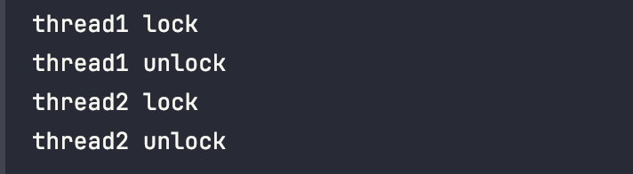
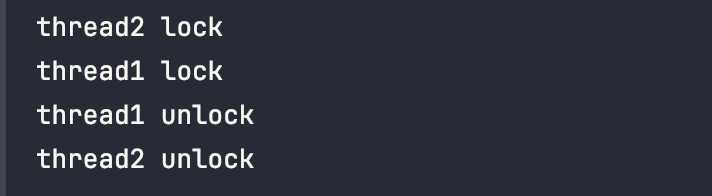
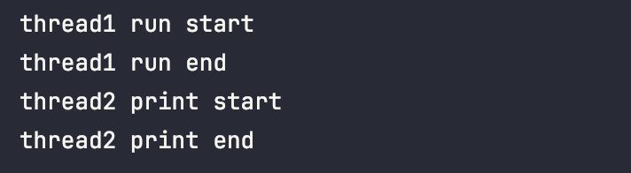
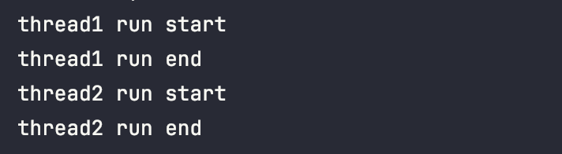
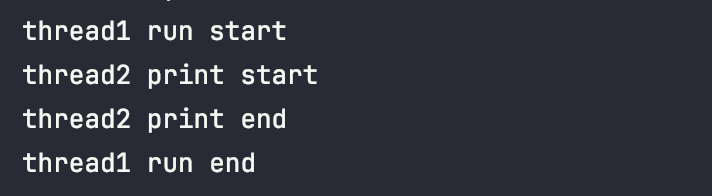
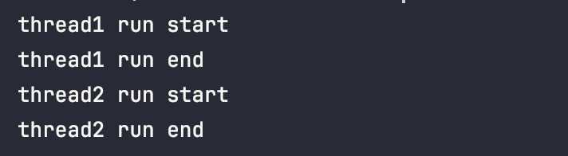
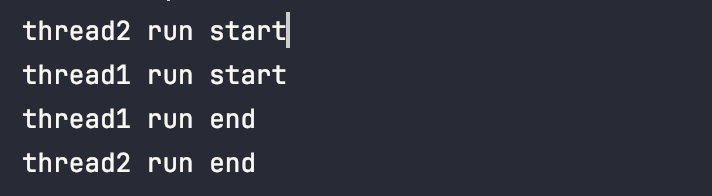
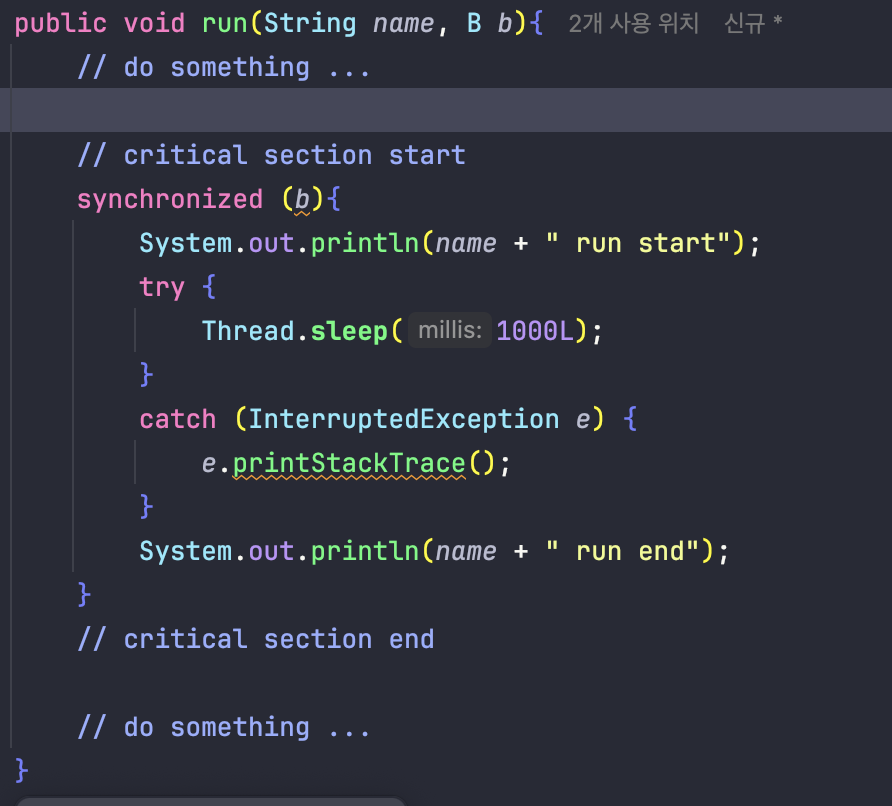
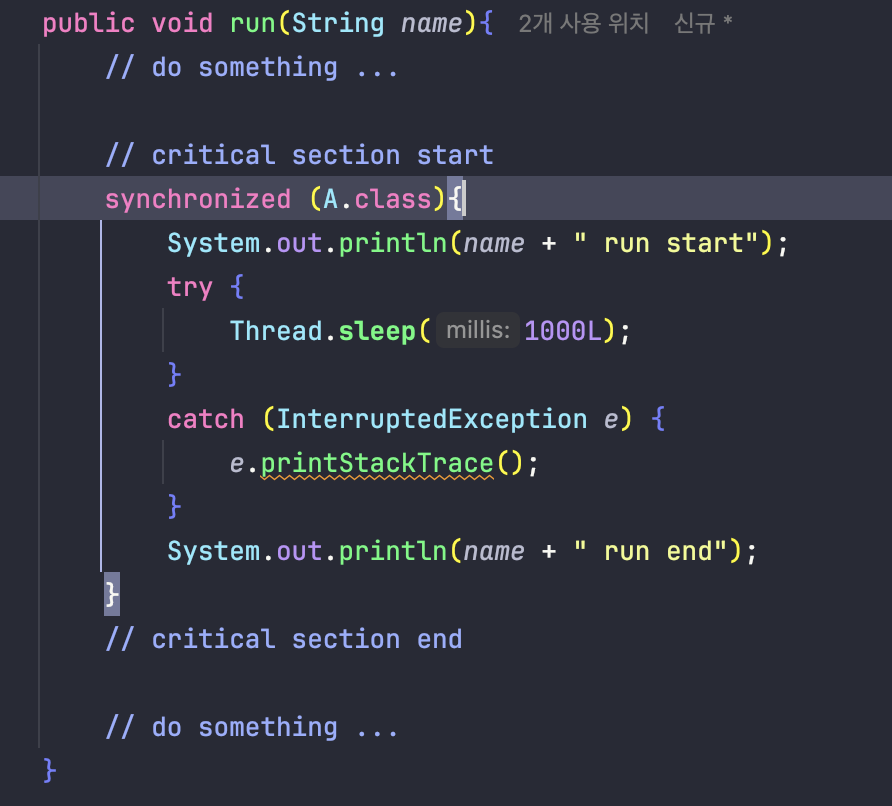
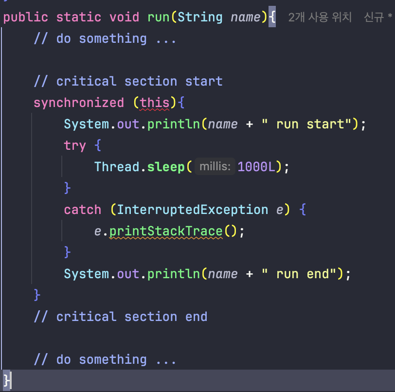

## 목표

synchronized 4가지 사용법을 학습하고 이해

- synchronized method
- static synchronized method
- synchronized block
- static synchronized block

**핵심 사전 지식** 

Java에서 synchronized는 객체의 모니터(Monitor Lock)를 사용하여 객체 단위로 동기화를 수행한다. 

## synchronized method

synchronized method는 인스턴스 수준에서 잠금을 건다. 

```java
public class Main {
	public static void main(String[] args) {
		A a = new A();
		Thread thread1 = new Thread(() -> {
			a.run("thread1");
		});
		Thread thread2 = new Thread(() -> {
			a.run("thread2");
		});
		thread1.start();
		thread2.start();
	}
}
class A{
	 public synchronized void run(String name){
		 System.out.println(name + " lock");
		 try {
			 Thread.sleep(1000L);
		 }
		 catch (InterruptedException e) {
			 e.printStackTrace();
		 }
		 System.out.println(name + " unlock");
	 }
}
```

현재 코드는 하나의 인스턴스(객체) “a”를 2개의 스레드가 실행한다.

즉, 1개의 스레드만 메서드에 진입이 가능하다.



```java
public class Main {
	public static void main(String[] args) {
		A a1 = new A();
		A a2 = new A();
		Thread thread1 = new Thread(() -> {
			a1.run("thread1");
		});
		Thread thread2 = new Thread(() -> {
			a2.run("thread2");
		});
		thread1.start();
		thread2.start();
	}
}
class A{
	 public synchronized void run(String name){
		 System.out.println(name + " lock");
		 try {
			 Thread.sleep(1000L);
		 }
		 catch (InterruptedException e) {
			 e.printStackTrace();
		 }
		 System.out.println(name + " unlock");
	 }
}
```

이번에는 thread1, thread2가 서로 다른 인스턴스에서 메서드를 실행한다.



이 상황에서는 lock을 공유하지 않기 때문에 동기화가 발생하지 않는다. 

```java
public class Main {
	public static void main(String[] args) {
		A a = new A();
		Thread thread1 = new Thread(() -> {
			a.run("thread1");
		});
		Thread thread2 = new Thread(() -> {
			a.print("thread2");
		});
		thread1.start();
		thread2.start();
	}
}
class A{
	 public synchronized void print(String name){
		 System.out.println(name + " print start");
		 try {
			 Thread.sleep(1000L);
		 }
		 catch (InterruptedException e) {
			 e.printStackTrace();
		 }
		 System.out.println(name + " print end");
	 }
	 public synchronized void run(String name){
		 System.out.println(name + " run start");
		 try {
			 Thread.sleep(1000L);
		 }
		 catch (InterruptedException e) {
			 e.printStackTrace();
		 }
		 System.out.println(name + " run end");
	 }
}
```



이번에는 동기화가 발생 

즉, synchronized 메서드는 인스턴스 단위로 lock을 건다. 

이때 synchronized가 적용된 같은 객체에 대해서 락을 공유한다. 

## **static synchronized method**

```java
public class Main {
	public static void main(String[] args) {
		A a1 = new A();
		A a2 = new A();
		Thread thread1 = new Thread(() -> {
			a1.run("thread1");
		});
		Thread thread2 = new Thread(() -> {
			a2.run("thread2");
		});
		thread1.start();
		thread2.start();
	}
}
class A{
	 public static synchronized void run(String name){
		 System.out.println(name + " run start");
		 try {
			 Thread.sleep(1000L);
		 }
		 catch (InterruptedException e) {
			 e.printStackTrace();
		 }
		 System.out.println(name + " run end");
	 }
}
```



a1, a2는 서로 다른 인스턴스지만 클래스 단위로 lock이 발생했다. 

```java
public class Main {
	public static void main(String[] args) {
		A a = new A();
		Thread thread1 = new Thread(() -> {
			a.run("thread1");
		});
		Thread thread2 = new Thread(() -> {
			a.print("thread2");
		});
		thread1.start();
		thread2.start();
	}
}
class A{
	 public synchronized void print(String name){
		 System.out.println(name + " print start");
		 try {
			 Thread.sleep(1000L);
		 }
		 catch (InterruptedException e) {
			 e.printStackTrace();
		 }
		 System.out.println(name + " print end");
	 }
	 public static synchronized void run(String name){
		 System.out.println(name + " run start");
		 try {
			 Thread.sleep(1000L);
		 }
		 catch (InterruptedException e) {
			 e.printStackTrace();
		 }
		 System.out.println(name + " run end");
	 }
}
```



같은 인스턴스에 static synchronized method와 synchronized method를 동시에 실행했지만 동기화는 발생하지 않았다. 

즉, 클래스 단위의 lock과 인스턴스 단위의 lock은 공유하지 않는다.

| 선언 | 락의 대상 (모니터) |
| --- | --- |
| `synchronized` 인스턴스 메서드 | `this` (인스턴스 객체) |
| `static synchronized` 메서드 | `A.class` (클래스 객체) |

즉, synchronized 인스턴스 메서드는 특정 인스턴스에 대한 락

static synchronized 인스턴스 메서드는 클래스 객체에 대한 락

따라서 동기화는 별도로 적용된다. 

```
자바에서는 모든 객체가 monior 락을 가진다.
이때 핵심은 A.class 도 JVM 내에서 Class 타입의 객체라는 사실이다.
그래서 동기화는 별도로 적용된다. 
```

## synchronized block

synchronized block은 synchronized method와 마찬가지로 인스턴스에 대해서 적용된다. 

하지만 synchronized method와 다르게 메서드 내에서 더 세밀하게 **임계 구역(critical section)**을 구분할 수 있다는 장점이 존재한다. 

```java
public class Main {
	public static void main(String[] args) {
		A a = new A();
		Thread thread1 = new Thread(() -> {
			a.run("thread1");
		});
		Thread thread2 = new Thread(() -> {
			a.run("thread2");
		});
		thread1.start();
		thread2.start();
	}
}
class A{
	 public void run(String name){
		 // do something ...

		 // critical section start
		 synchronized (this){
			 System.out.println(name + " run start");
			 try {
				 Thread.sleep(1000L);
			 }
			 catch (InterruptedException e) {
				 e.printStackTrace();
			 }
			 System.out.println(name + " run end");
		 }
		 // critical section end

		 // do something ...
	 }
}
```



```java
public class Main {
	public static void main(String[] args) {
		A a1 = new A();
		A a2 = new A();
		Thread thread1 = new Thread(() -> {
			a1.run("thread1");
		});
		Thread thread2 = new Thread(() -> {
			a2.run("thread2");
		});
		thread1.start();
		thread2.start();
	}
}
class A{
	 public void run(String name){
		 // do something ...

		 // critical section start
		 synchronized (this){
			 System.out.println(name + " run start");
			 try {
				 Thread.sleep(1000L);
			 }
			 catch (InterruptedException e) {
				 e.printStackTrace();
			 }
			 System.out.println(name + " run end");
		 }
		 // critical section end

		 // do something ...
	 }
}
```







**synchonized block 락 대상은 모든 타입이 가능하다.**

this / 다른 클래스 인스턴스 / 본인 클래스(A.Class) / 다른 클래스(B.class)

락 적용은 앞에서 학습한 방식과 동일하게 적용된다. 

## static synchronized block

static의 특성상 this 같이 현재 객체를 가리키는 표현을 사용할 수 없지만 Class 타입 객체는 가능하다.

이것은 static synchronized와 비슷하지만, 락 대상(다른 클래스: Class)을 유연하게 바꿀 수 있다는 장점이 있다.



## 정리 

- **method vs block**
→ synchronized block은 synchronized method보다 **임계 구역을 더 세밀하게 정의 가능**
- **static synchronized method**
→ **락 대상**: 해당 클래스의 Class 객체 (A.class)
- **synchronized method**
→ **락 대상**: 해당 **인스턴스** (this 객체)
- **static synchronized block**
→ **락 대상**: 지정한 **클래스의 Class 객체** (예: A.class, Other.class, 등 **모든 클래스 가능**)
- **synchronized block**
→ **락 대상**: 지정한 **모든 객체** 가능

→ 즉, **모든 인스턴스 객체** 또는 **모든 클래스 객체 (Class)** 대상 가능

## 참고 자료 

[https://jgrammer.tistory.com/entry/Java-%ED%98%BC%EB%8F%99%EB%90%98%EB%8A%94-synchronized-%EB%8F%99%EA%B8%B0%ED%99%94-%EC%A0%95%EB%A6%AC](https://jgrammer.tistory.com/entry/Java-%ED%98%BC%EB%8F%99%EB%90%98%EB%8A%94-synchronized-%EB%8F%99%EA%B8%B0%ED%99%94-%EC%A0%95%EB%A6%AC)

