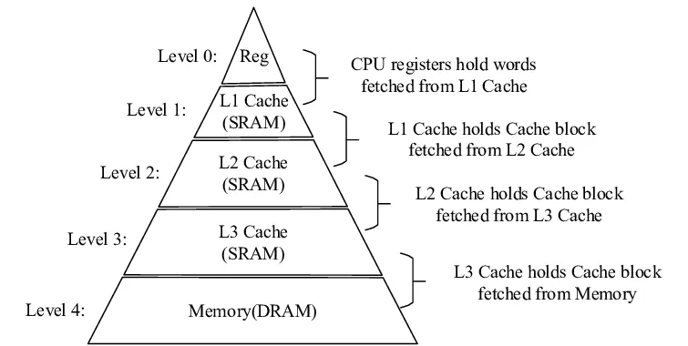
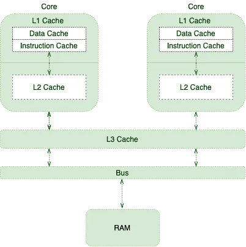
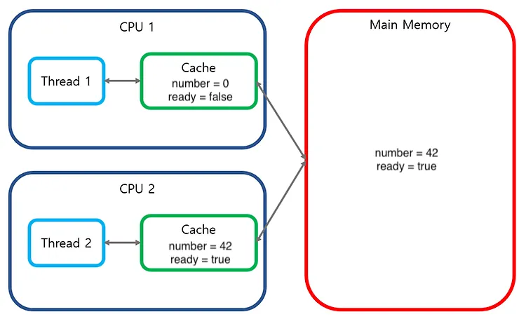

### 시스템의 성능에 대한 이해, 성능은 어디에서 오는가? 

**트랜지스터?** 

컴퓨터와 전자기기의 핵심 부품으로, 주로 두 가지 역할을 한다. 신호의 증폭과 스위치(on/off) 역할을 한다.

- 증폭 기능: 입력 전기 신호를 더 크게 만들어주는 역할 예를 들어, 소리의 크기를 키우는 오디오 장치 등에 사용
- 스위치 기능: 전기의 흐름을 조절하여 0과 1 신호를 만든다. 컴퓨터에서는 수많은 트랜지스터가 논리 회로(게이트)로 연결되어 연산과 데이터 처리를 가능하게 한다.

**수백만 개의 트랜지스터가 집적된 칩의 성능 향상**

더 많은 트랜지스터를 사용하면 병렬 처리, 고속 연산, 다양한 기능을 동시에 수행할 수 있어 데이터 처리 속도가 크게 빨라진다.

**무어의 법칙과(Moore’s law)과 컴퓨터 구조 (Computer Architecture)**

무어의 법칙은 인텔의 창업자 중 한명인 고든 무어가 명명한 것으로, 경제적으로 생산 가능한 칩 위의 트랜지스터 수의 대략 2년마다 거의 2배로 증가함을 뜻한다.

**무어의 법칙이 성능이 아닌 트랜지스터 수를 기준으로 한다는 것은, 소프트웨어 엔지니어가 하드웨어 엔지니어로부터 얻어 낼 수 있는 성능이 2배가 아님을 의미**한다.

성능에는 여러 가지 복합적인 요소가 적용한다. 많은 요소중에서 **성능에 결정적인 요인 하나를 뽑으라면 “다음에 실행할 명령과 관련된 데이터를 얼마나 빠르게 찾을 수 있는가?”**이다.

명령어 실행 주기는 Fetch → Memory Access(필요하다면) → Execute 과정이 반복이다. CPU가 처리할 명령어를 기다리며 대기하는 시간(지연, latency)이 길면 아무리 트랜지스터가 많아도 전체 속도는 빨라지지 않는다.

사용자가 프로그램을 실행하면, 운영체제가 메모리에 처리할 명령어들과 다음에 실행할 명령어의 주소(프로그램 카운터, PC) 등을 올려둔다. 그러면 CPU가 PC에 해당하는 명령어를 캐시 또는 메모리에서 인출하는데 필요한 명령어가 어디에 위치하는가는 당연히 성능을 결정짓는 요인 중 하나이다.

**캐시 계층 구조(Cache Hierarchy)**

Level 0에 가까울수록 조회 속도는 빠른 반면, 저장 공간이 적다.



CPU는 명령어를 찾기 위해 CPU 내의 임시 저장 공간인(Register)에서부터 시작하여 없으면 다음 저장 공간에서 데이터 조회를 시도한다. 레지스터 이후에 데이터를 조회하는 공간은 코어 내부의 캐시에 해당하는데, L1/L2/L3 캐시라고 볼 수 있다.

- L1캐시: 가장 빠르고 작은 캐시, 각 CPU 코어에 존재한다.
- L2캐시: L1 캐시보다 크고 약간 느리며 각 CPU 코어에 존재한다.
- L3캐시: 가장 크고 느린 캐시로, CPU의 모든 코어가 공유한다. 



Register -> L1 → L2 → L3 → Memory

캐시에서 까지 데이터를 조회할 수 없다면 메모리(RAM)에서 데이터를 가져와야 하는데, 캐시에서 가져오는 속도와 다르게 메모리에서 데이터를 가져오는 속도는 많이 느리다. 메모리에서 가져오는 속도가 느린 이유는 애초에 가상 주소 → 물리 주소로 변환하는 작업이 추가적으로 필요하다. 물론 이 과정도 TLB라는 캐시가 존재한다. TLB Miss가 발생하면 커널 영역의 프로세스 페이지 테이블 엔트리로 접근하여 유저 영역의 페이지 주소를 찾아야 한다.

이 과정은 추가적인 메모리 접근(페이지 테이블 조회)이 필요하므로 더 느려진다.

그리고 메모리에 접근하고 조회 한다. 최악의 경우 메모리 주소가 담긴 페이지 테이블 엔트리가 디스크 영역으로 스왑 아웃 상태이거나 메모리 자체가 스왑 아웃인 경우 I/O 작업이 동반되기 때문에 더욱 느리다.

정리하면 메모리의 접근 속도의 개선은 트랜지스터 추가보다 더 느리게 개선됐다. 즉, 코어의 성능 처리 능력은 빠르지만 필요한 데이터를 처리할 수 없어서 작업이 중단되어 성능 저하가 오게되는 것이다.

**캐싱 여부에 따른 성능 차이 (L1 캐시 미스)**

int → 4byte 

아래의 예제는 8MB 배열에 대해 루프를 반복하는 데 걸리는 시간을 출력한다.

두 루프 중 “touchEveryItem”는 배열의 모든 데이터에 직접 접근하여 데이터를 조회한다.

반면에 “touchEveryLine”는 16개 항목마다 1개씩만 데이터에 접근한다.

```java
public class Caching {
	private final int SIZE = 2 * 1024 * 1024;
	private final int [] testData  = new int [SIZE];
	private void touchEveryItem(){
		for (int i = 0; i < SIZE; i++) {
			testData[i] = testData[i] + 1; // 모든 항목을 엑세스
		}
	}
	private void touchEveryLine(){
		for (int i = 0; i < SIZE; i += 16) {
			testData[i] = testData[i] + 1; // 각 캐시 라인을 엑세스
		}
	}
	private void run () {
		for (int i = 0; i < 100; i++) {
			long t0 = System.nanoTime();
			touchEveryLine();
			long t1 = System.nanoTime();
			touchEveryItem();
			long t2 = System.nanoTime();
			System.out.println("Line: " + (t1 - t0) + "ns Item: " + (t2 - t1) + "ns");
		}
	}
	public static void main(String[] args) {
		new Caching().run();
	}
}
```

**결과** 

“touvhEveryItem”은 배열 내의 모든 원소를 증가시키므로 “touchEveryLine” 보다 16배 더 많은 증가 작업을 수행하지만, 실행 결과를 확인해보면 둘 사이에 작업량 만큼의 큰 차이는 존재하지 않음을 확인할 수 있다

```java
Line: 1110166ns Item: 4236959ns
Line: 247500ns  Item: 3452958ns
Line: 149416ns  Item: 214542ns
Line: 123291ns  Item: 209667ns
Line: 125375ns  Item: 247292ns
Line: 128625ns  Item: 221208ns
Line: 122416ns  Item: 206292ns
Line: 122792ns  Item: 178708ns
Line: 130833ns  Item: 186542ns
Line: 133875ns  Item: 176542ns
Line: 127833ns  Item: 174667ns
Line: 128000ns  Item: 228958ns
Line: 139875ns  Item: 171583ns
Line: 126875ns  Item: 172375ns
Line: 122125ns  Item: 169208ns
Line: 121584ns  Item: 166875ns
Line: 122500ns  Item: 166375ns
Line: 124500ns  Item: 167291ns
Line: 121209ns  Item: 166166ns
Line: 121000ns  Item: 165958ns
```

성능적으로 차이가 크게 나지 않는 이유는 전반적인 성능에서 주요한 역할을 하는 것은 데이터의 조회이고, 둘은 동일한 수의 캐시 라인 읽기를 수행하기 때문이다. L1 캐시 라인은 일반적으로 64바이트에 해당하며, 자바에서 int 4바이트이므로 L1 캐시 라인 하나에는 16개의 int가 포함될 수 있다. 따라서 한 번에 16개의 데이터를 조회하여 L1 캐시에 데이터가 적재되고, 이후에 연산들은 캐시를 통해 처리하기 때문에 성능적으로 기대보다 큰 차이는 존재하지 않는 것이다. 따라서 CPU가 실제로 시간을 어떻게 소비하는지, 적어도 작동 수준에 대한 이해가 필요하다는 것을 알고 있어야 한다.

---

### 메모리 가시성 문제 (Memory Visibility Problem)

현재 우리의 컴퓨터는 성능을 위해 캐시를 적극적으로 활용하고 있는데, 문제는 현대의 컴퓨터 구조는 1개의 코어(Single Core)가 아닌 2개 이상의 다중 코어(Multi Core)이다.

먼저 마주할 수 있는 문제는 메모리 가시성(Memory Visibility)문제이다. 한 코어의 스레드에서 변경한 특정 메모리의 값이, 다른 코어의 스레드에서 제대로 읽혀지지 않는 문제라고 볼 수 있다. 멀티스레드 환경에서 스레드들은 각자의 캐시(L1, L2 캐시)를 가지는 코어에 할당되어 병렬 실행될 수 있는데, 스레드들이 하나의 변수를 공유하면 각각의 코어가 개별 캐시를 소유하게 되고, 이로 인해 한 코어의 스레드에서 변경한 값이 다른 코어 스레드의 값과 불일치(Cache inconsistency)하는 것이다.

```java
public class TaskRunner {
	private static int number;
	private static boolean ready;

	private static class Reader extends Thread {
		@Override
		public void run() {
			while (!ready) {
				Thread.yield();
			}
			System.out.println(number);
		}
	}

	public static void main(String[] args) {
		new Reader().start();
		number = 42;
		ready = true;
	}
}
```

해당 출력의 결과는 예측할 수 없어야 한다. 또는 무한 루프에 빠질 수도 있다. 왜냐하면 메인 쓰레드가 실행되는 코어에서 number → 42, ready → true로 변경한다고 하더라도, Reader 쓰레드를 실행시킨 2번 코어에서 캐싱된 데이터로 인해 변경 전의 데이터인 0과 false를 만날 수 있기 때문이다.



하지만 내가 실험하면 항상 42로 빠르게 나온다. 추측이지만 메인 쓰레드와 Reader 쓰레드가 동일한 코어에서 돌아가지 않을까 싶다. 

---

### Volatile 키워드

메모리 가시성 문제를 해결하는 데 도움을 주는 키워드가 바로 volatile이다. volatile은 모든 스레드가 항상 메인 메모리로부터 최신의 값을 읽도록 하여 volatile로 선언된 변수의 값이 바뀌어도 다른 스레드에서 항상 최신 값을 읽어갈 수 있도록 해준다.

volatile 키워드를 지정하면, 프로세서의 레지스터에 캐시되지도 않고, 프로세서 외부의 캐시에도 들어가지 않기 때문에 volatile 변수의 값을 읽으면 항상 다른 스레드가 보관해둔 최신의 값을 읽어갈 수 있다.

따라서 volatile을 올바르게 사용하는 것은 미묘한 버그를 방지하는데 필수적이라고 볼 수 있다.

하지만 이는 성능적인 이점을 포기하는 부분이 있으므로, 올바르게 인지하고 사용하는 것이 필요하다.

---

### 참고 자료

[https://mangkyu.tistory.com/415](https://mangkyu.tistory.com/415)

