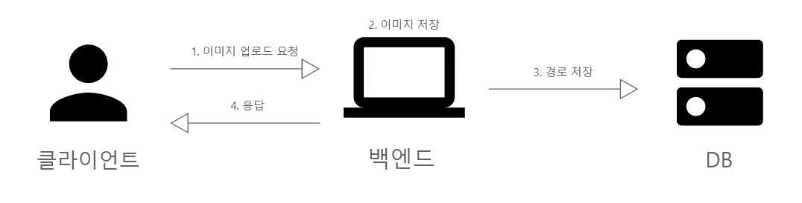
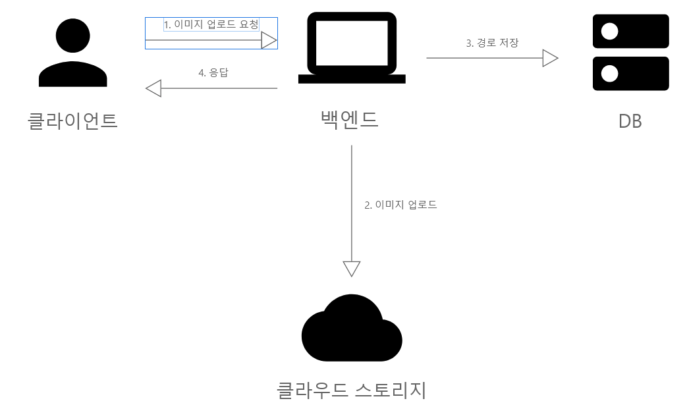

# 사전 지식 

### 상황1:  게시글 + 이미지 → 한번에 JSON 

- **인코딩 필요:** ✅ (이미지를 base64로 인코딩)
- **전송 타입:** **application/json** 

### 상황2: 게시글 등록 API / 이미지 업로드 API 분리 

- **인코딩 필요:  ❌** (이미지를 그대로 전송)
- **전송 타입** 
- 게시글: **JSON** 
  - 파일/이미지 전송: **multipart/form-data** 또는 **application/octet-stream**

### 상황3: Form-data API 한 번에 전송 (이미지 + 게시글)

- **인코딩 필요:  ❌** (이미지를 그대로 전송)
- **전송 타입: multipart/form-data**

---

# 이미지 업로드 방식 5가지 

### 1. BLOB 데이터타입으로 DB에 저장 

**BLOB: Binary Large Object** 

```
이미지, 동영상, 파일, 바이너리 데이터와 같은 큰 데이터를 저장할 수 있는 데이터 타입 
```

**BLOB 종류**

MySQL에는 4가지 BLOB 타입 존재 

| 타입 | 최대 크기 | 설명 |
| --- | --- | --- |
| `TINYBLOB` | 255 바이트 | 아주 작은 바이너리 데이터 |
| `BLOB` | 65KB (2^16) | 일반적인 크기의 바이너리 데이터 |
| `MEDIUMBLOB` | 16MB (2^24) | 중간 크기의 바이너리 데이터 |
| `LONGBLOB` | 4GB (2^32) | 아주 큰 바이너리 데이터 (파일 등) |

**단점** 

- **I/O 부하:** DB에 큰 바이너리 데이터를 read/write 하면 디스크 I/O와 네트워크 사용량이 커진다. 
- **쿼리 성능 부하:** 일반적인 텍스트/숫자 컬럼보다 인덱싱이나 검색이 느려지고, 전체 테이블 처리 속도가 떨어질 수 있다. 
- **캐싱 비효율:** DB의 캐시(InnoDB Buffer Pool) BLOB 데이터까지 캐싱하게 되어 메모리 자원을 낭비 
- **DB 백업/복구 시간 증가:** 큰 바이너리 데이터를 DB에 저장하면 백업 파일의 크기가 커지고, 복구 시간도 오래 걸린다.
- **스토리지 비용 증가:** 클라우드 DB에서는 저장 용량에 따라 요금이 부과되는데, BLOB 데이터를 DB에 저장하면 불필요하게 저장 공간 요금이 많이 나올 수 있다.

---

### 2. Base 64 형태로 DB에 저장 

**Base64** 

```
base64: 64진법 
이미지의 이진 데이터를 text 형태로 바꾸는 encoding 방법
이미지를 인코딩 -> base 64 결과물을 데이터베이스에 저장 
```

**Base64는 3바이트(24비트)를 가져와서 6비트씩 나눠서 4개의 문자로 표현** 

| 저장 방식 | 설명 | 최종 저장 용량 |
| --- | --- | --- |
| Base64 + ASCII (1문자 = 1바이트) | 보통 네트워크 전송 시 | 3바이트 → **4바이트** |
| Base64 + UTF-16 (1문자 = 2바이트) | 예: Java 내부 메모리 등 | 3바이트 → **8바이트**  |

**단점** 

- 바이너리 데이터를 base64로 인코딩하여 변환하면 원래의 이미지 용량보다 더 큰 용량을 가진다. 
- 바이너리 데이터 ↔ 텍스트 (인코딩/디코딩) 작업이 필요 

---

### 3. 백엔드에서 파일을 저장하고 경로를 DB에 저장 



**장점**

- 백엔드 단에서 파일을 저장 → 이미지의 업로드/다운로드가 빠르다. 
- 외부 서비스에 대한 의존성 X
- base64, blob과 다르게 경로만 저장하기 때문에 db에 부담이 없다. 

**단점** 

- 저장 공간의 제약을 받는다. 
- 보안 및 백업 처리 
- 서버에 요청이 많아지면 업로드 및 다운로드의 속도에 영향이 미친다. 
- I/O bound 프로그램이 되어버림 → 응답 지연 

---

### 4. Cloud Storage에 이미지를 업로드하고 경로를 db에 저장 



```json
이미지를 백엔드/DB에 저장하지 않고 AWS, GCP, Firebase 같은 Cloud Storage에 업로드하는 방식 
Cloud Storage에 업로드된 경로는 DB에 저장 
```

**장점** 

- CloudStorage 제공하는 편의 기능
- 복제, 백업 기능 
  - 스토리지 확장이 자동으로 이루어지기 때문에, 로컬 저장처럼 용량 걱정이 없다. 
  - **CDN(Content Delivery Network)** 연동 편의
- **이미지 서버를 따로 둠 → 백엔드 서버의 I/O bound 문제 해결**

**단점** 

- 추가 네트워크 비용 발생 
- 클라우드 스토리지 상태에 따라 추가 대역폭 및 시간 소요 
- 사용량에 따른 비용 발생 
- 초기 아키텍처 설계에 대한 어려움 
- 나의 AWS 지식 부족 

---

# 참고 자료 

[https://seungyong20.tistory.com/entry/%EB%B0%B1%EC%97%94%EB%93%9C%EC%97%90%EC%84%9C-%EC%9D%B4%EB%AF%B8%EC%A7%80-%EC%97%85%EB%A1%9C%EB%93%9C%EB%8A%94-%EC%96%B4%EB%96%BB%EA%B2%8C-%ED%95%98%EB%A9%B4-%EC%A2%8B%EC%9D%84%EA%B9%8C](https://seungyong20.tistory.com/entry/%EB%B0%B1%EC%97%94%EB%93%9C%EC%97%90%EC%84%9C-%EC%9D%B4%EB%AF%B8%EC%A7%80-%EC%97%85%EB%A1%9C%EB%93%9C%EB%8A%94-%EC%96%B4%EB%96%BB%EA%B2%8C-%ED%95%98%EB%A9%B4-%EC%A2%8B%EC%9D%84%EA%B9%8C)
