---

## 신장 트리 

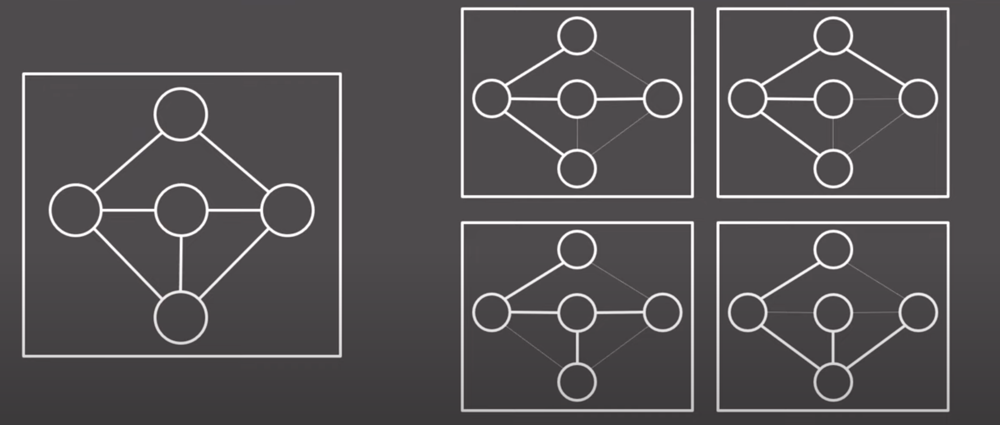

**신장 트리** 

주어진 방향성이 없는 그래프에서 부분 그래프(Subgraph)들 중에서 모든 정점을 포함하는 트리를 의미한다. 

→ 무방향이면서 사이클이 없는 → 트리

신장 트리는 v개의 정점을 가질때 v-1개의 정점을 가진다. (트리의 성질) 

**부분 그래프**

일부 정점과 간선만을 선택해서 구성한 새로운 그래프 

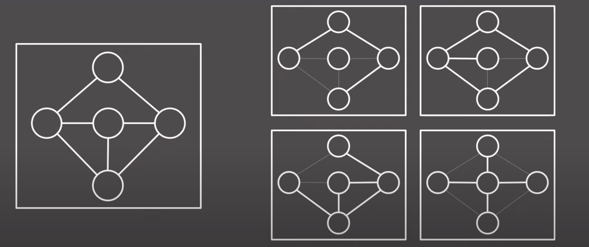

신장 트리가 아닌 그래프 예시 

---

## 최소 신장 트리 

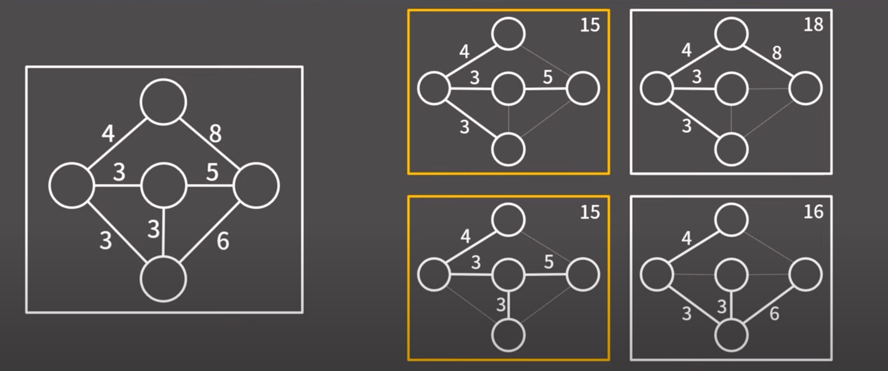

신장 트리 중에서 간선의 합이 최소인 트리를 의미 

최소 신장 트리는 동일한 그래프에서 한 개로 정해지지 않고 여러 개일 수 있다. 

---

## 유니온 파인드(Union - Find) 알고리즘 

- 그래프/트리의 대표적 알고리즘 
- 서로소인 부분집합의 표현 
- 여러 노드가 있을 때, 두 노드가 같은 그래프에 속해있는지 알 수 있음 
- union(x, y) / find(x) 연산 
- union(x, y) : x와 y그래프를 합친다. 
  - find(x) : x가 어느 그래프에 속하는지 연산한다.

```java
// 유니온 파인드 알고리즘 구현 하기
public class UnionFind {
    public static int [] parent = new int[11];

    public static int find(int x){
        if(x == parent[x]){
            return x;
        }
        else return parent[x] = find(parent[x]);
    }

    public static void union(int x, int y){
        x = find(x);
        y = find(y);
        if(x < y) group[y] = x;
        else group[x] = y;
    }

    public static boolean isSameParent(int x, int y){
        x = find(x);
        y = find(y);
        if(x == y) return true;
        return false;
    }

    public static void main(String[] args) {
        for (int i = 1; i <= 8; i++) {
            parent[i] = i;
        }
        union(1, 2);
        union(2, 3);
        System.out.println(isSameParent(1, 3)); // 그래프 연결?
    }
}
```

---

## 크루스칼(Kruskal) 알고리즘 

크루스칼 알고리즘은 **Union Find 알고리즘**을 알고 있다고 가정할 때 

뒤에 나올 프림 알고리즘보다 구현이 쉽다. 

1. 간선의 크기를 오름차순으로 정렬하고 제일 낮은 비용의 간선을 선택 
1. 현재 선택한 간선이 정점 u,v를 연결하는 간선이라고 할 때 만약 u와 v가 같은 그룹이라면 아무 것도 하지 않고 넘어감, u, v가 다른 그룹이라면 같은 그룹으로 만들고 현재 선택한 간선을 최소 신장 트리에 추가 
1. 최소 신장 트리에 v-1개의 간선을 추가시켰다면 과정을 종료, 그렇지 않다면 그 다음으로 비용이 작은 간선을 선택한 후  2번 과정을 반복 

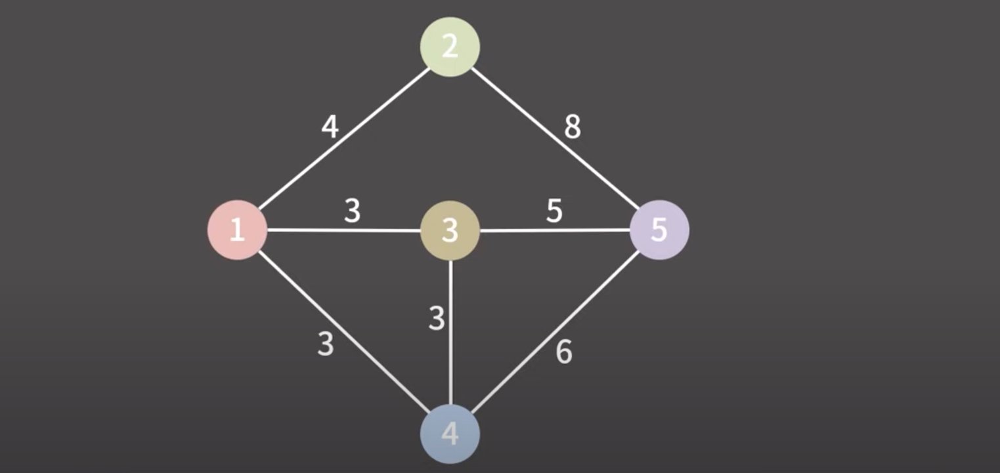

맨 처음에는 모든 정점이 서로 다른 그룹에 속해 있는 상태로 시작 

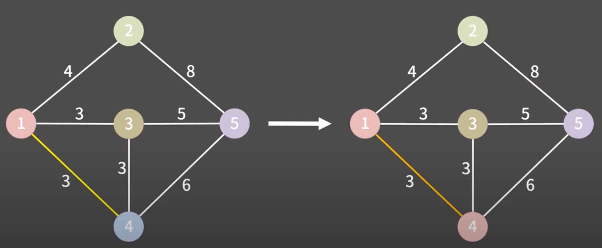

간선을 오름차순으로 정렬하고 제일 낮은 비용의 간선을 선택 

1과 4를 연결하는 간선을 선택 

1과 4는 다른 그룹이다 그렇기 때문에 같은 그룹으로 만들고 1과 4를 연결하는 간선을 최소 신장 트리에 추가한다. 

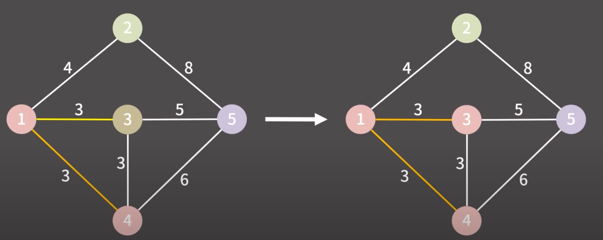

제일 낮은 비용의 간선 선택 

1 → 3 간선 마찬가지로 다른 그룹이다 같은 그룹으로 만들고 간선을 최소 신장 트리에 추가 

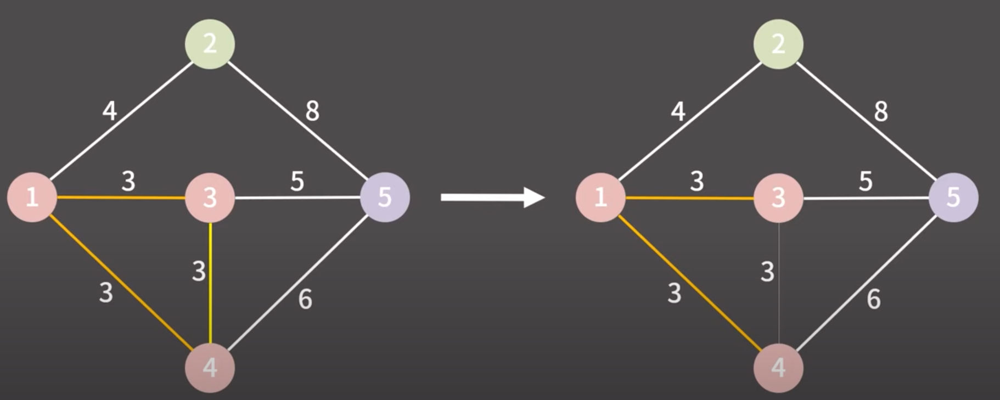

제일 낮은 비용의 간선 선택 

3 → 4 간선 이번 case는 같은 그룹이다. 그렇기 때문에 아무 것도 하지 않는다. 

당연히 이 간선은 최소 신장 트리에 추가하지 않는다. 

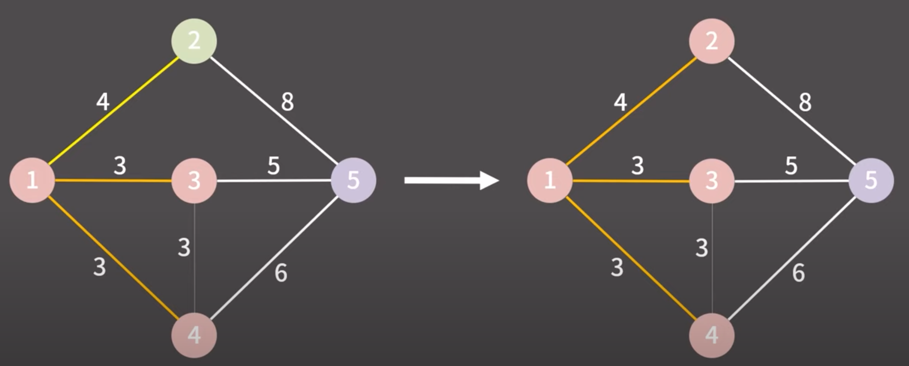

제일 낮은 비용의 간선 선택 

1 → 4 마찬가지로 다른 그룹이다 같은 그룹으로 만들고 간선을 최소 신장 트리에 추가 

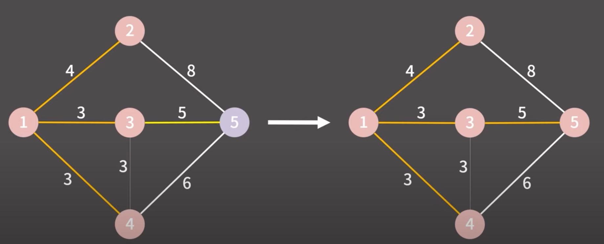

제일 낮은 비용의 간선 선택 

3 → 5 마찬가지로 다른 그룹이다 같은 그룹으로 만들고 간선을 최소 신장 트리에 추가 

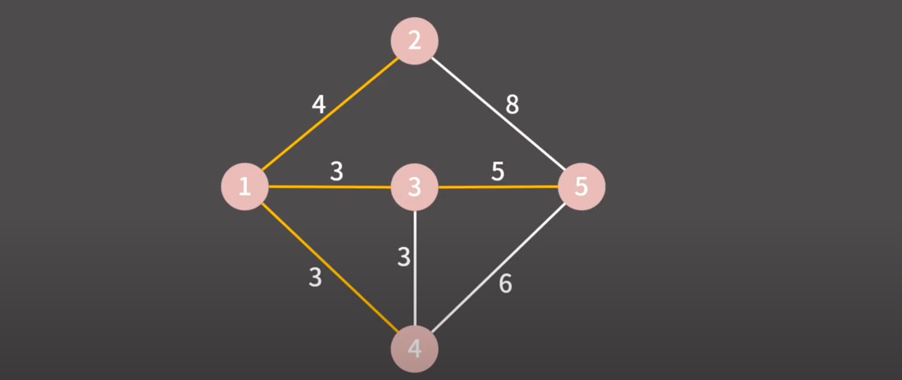

정점이 총 5개인데 4개의 간선을 최소 신장 트리에 추가했다. 

최소 신장 트리를 만들어내는데 성공했고 알고리즘이 종료된다. 

이 알고리즘은 그냥 사이클을 만들어내지 않는 선에서 비용이 작은 간선부터 최소 신장 트리에 편입시키는 그리디 알고리즘이다. 

같은 그룹의 정점을 최소 신장 트리에 넣지 않는 이유는 해당 간선으로 인해 사이클이 생기기 때문이다.

그런데 특정 두 정점이 같은 그룹인지 다른 그룹인지를 어떻게 판단할 수 있을까? 

→ Union Find 

---

## 백준 1197 최소 스패닝 트리 [골드4] - 크루스칼 

```java
import java.io.*;
import java.util.*;
public class Main  {
    static int [] parent = new int[10001]; // 정점의 최대 개수 10000
    static int n, e; // 정점, 간선의 개수
    public static void main(String[] args) throws IOException{
        BufferedReader br = new BufferedReader(new InputStreamReader(System.in));
        StringTokenizer st;
        st = new StringTokenizer(br.readLine());
        n = Integer.parseInt(st.nextToken());
        e = Integer.parseInt(st.nextToken());

        List<int []> edges = new ArrayList<>();
        for (int i = 0; i < e ; i++) {
            st = new StringTokenizer(br.readLine());
            int a = Integer.parseInt(st.nextToken()); // 정점
            int b = Integer.parseInt(st.nextToken()); // 정점
            int c = Integer.parseInt(st.nextToken()); // 가중치  // -1000000 ~ 1000000
            edges.add(new int[]{a,b,c});
        }
        // Collections.sort(edges, Comparator.comparingInt(o -> o[2]));
        Collections.sort(edges, (o1, o2)->{
            return o1[2] - o2[2];
        });

        for (int i = 1; i <= n; i++) {
            parent[i] = i;
        }

        int cnt = 0;
        int ans = 0;
        for (int[] edge : edges) {
            if(cnt == n - 1) break;
            if(isSameGroup(edge[0], edge[1])) continue;
            ans += edge[2];
            cnt++;
            union(edge[0], edge[1]);
        }
        System.out.println(ans);

    }
    public static void union(int x, int y){
        x = find(x);
        y = find(y);
        if(x < y){
            parent[y] = x;
        }
        else{
            parent[x] = y;
        }
    }
    public static int find(int x){
        if(x == parent[x]) return x;
        return parent[x] = find(parent[x]);
    }

    public static boolean isSameGroup(int x, int y){
        x = find(x);
        y = find(y);
        if(x == y) return true;
        return false;
    }
}
```

---

## 프림(Prim) 알고리즘 

1. 임의의 정점을 선택해 최소 신장 트리에 추가 
1. 최소 신장 트리에 포함된 정점과 최소 신장 트리에 포함되지 않은 정점을 연결하는 간선 중 비용이 가장 적은 것을 최소 신장 트리에 추가 
1. 최소 신장 트리에 v-1개의 간선이 추가될 때 까지 2번 과정을 반복 

**Kruskal vs prim**

**크루스칼 알고리즘**은 가장 비용이 낮은 간선부터 시작해 서로 떨어져 있던 정점들을 합쳐나가며 총 v-1 개의 간선을 택하는 알고리즘 

**프림 알고리즘**은 한 정점에서 시작해 확장해 나가는 알고리즘이다. 

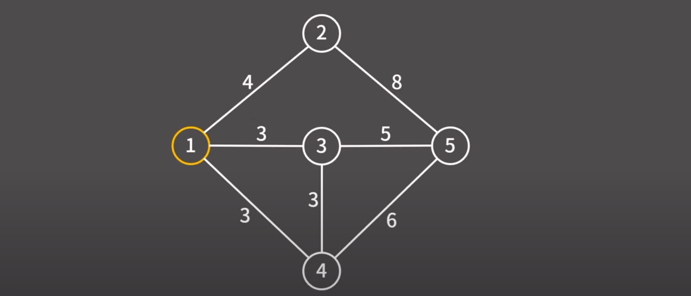

우선 하나의 정점을 잡아 최소 신장 트리에 추가 → 1번 선택 

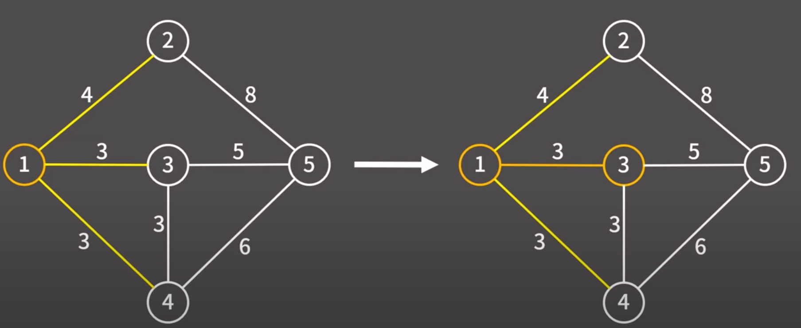

현재 최소 신장 트리에 포함된 정점과 최소 신장 트리에 포함되지 않은 정점을 연결하는 간선은

1 → 2 /  1 → 3 / 1 → 4  총 3개가 있다. 

여기서 비용이 가장 낮은 간선은 1 → 3 (3) / 1 → 4 (3) 인데 

1 → 3 간선을 택하겠다. 해당 간선을 택했기 때문에 해당 간선과 정점을 최소 신장 트리에 추가 

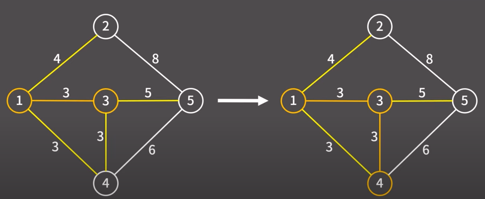

현재 최소 신장 트리에 포함된 정점과 최소 신장 트리에 포함되지 않은 정점을 연결하는 간선은

1 → 2 (4) / 1 → 4 (3) / 3 → 4(3) / 3 → 5 (5) 총 4개이다. 

이들 중에서 비용이 가장 낮은 간선은 1 → 4 (3) / 3 → 4(3) 2개이다. 

3 → 4 간선을 택하겠다. 해당 간선을 택했기 때문에 해당 간선과 정점을 최소 신장 트리에 추가 

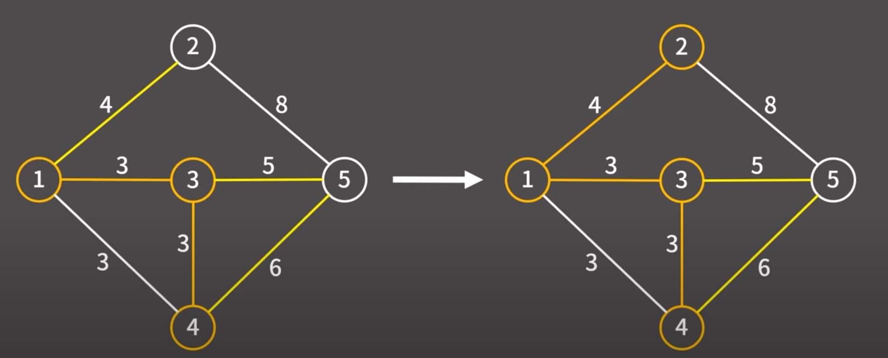

현재 최소 신장 트리에 포함된 정점과 최소 신장 트리에 포함되지 않은 정점을 연결하는 간선은

1 → 2 (4) / 3 → 5 (5) / 4 → 5 (6) 총 3개이다.

이들 중에서 비용이 가장 낮은 간선은 1 → 2 이다. 

해당 간선을 택했기 때문에 해당 간선과 정점을 최소 신장 트리에 추가 

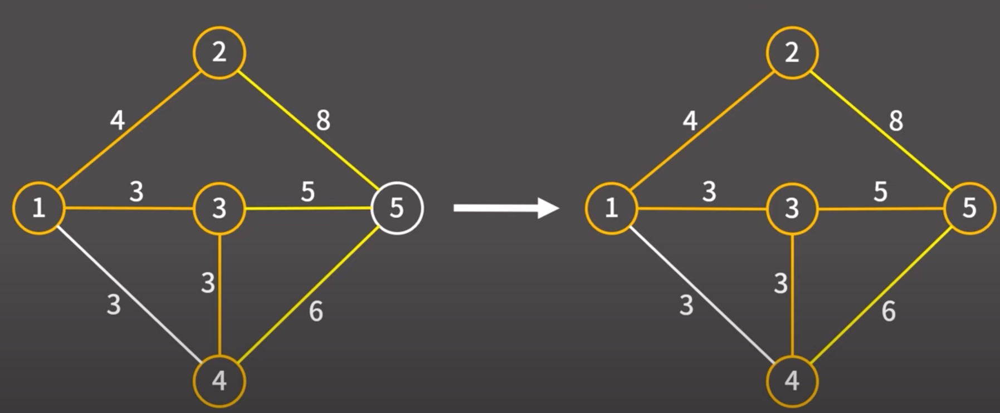

현재 최소 신장 트리에 포함된 정점과 최소 신장 트리에 포함되지 않은 정점을 연결하는 간선은

2 → 5 (8) / 3 → 5 (5) / 4 → 5 (6) 총 3개이다. 

이들 중에서 비용이 가장 낮은 간선은 3 → 5이다. 

3 → 5 간선을 택하겠다. 해당 간선을 택했기 때문에 해당 간선과 정점을 최소 신장 트리에 추가 

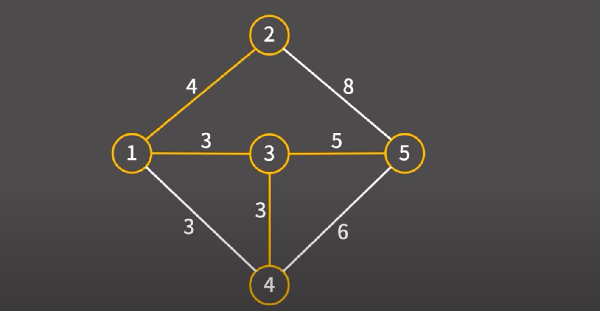

정점이 총 5개인데 4개의 간선을 최소 신장 트리에 추가했다.

이제 알고리즘은 종료한다. (트리 : 간선의 개수 = 정점 - 1) 

프림 알고리즘을 효율적으로 구현하기 위해서는 우선순위 큐가 필요하다. 

우선순위 큐에 적절히 간선을 넣어두면 매 순간마다 최소 신장 트리에 포함된 정점과 최소 신장 트리에 포함되지 않은 정점을 연결하는 간선 중에서 최소를 효율적으로 알아낼 수 있다. 

---

## 백준 1197 최소 스패닝 트리 [골드4] - 프림 

```java
public class Main {
    public static void main(String[] args) throws IOException{
        BufferedReader br = new BufferedReader(new InputStreamReader(System.in));
        StringTokenizer st;
        st = new StringTokenizer(br.readLine());
        int n = Integer.parseInt(st.nextToken()); // 정점의 개수
        int m = Integer.parseInt(st.nextToken()); // 간선의 개수
        ArrayList<int []>[] graph = new ArrayList[n+1];
        for (int i = 0; i <= n; i++) {
            graph[i] = new ArrayList<>();
        }
        while (m-->0){
            st = new StringTokenizer(br.readLine());
            int v1 = Integer.parseInt(st.nextToken());
            int v2 = Integer.parseInt(st.nextToken());
            int c = Integer.parseInt(st.nextToken());
            graph[v1].add(new int[]{v2, c});
            graph[v2].add(new int[]{v1, c});
        }

        PriorityQueue<int[]> pq = new PriorityQueue<>(Comparator.comparingInt(o -> o[1])); // o[2]가 낮은 순서대로
        boolean [] visited = new boolean[n+1];
        visited[1] = true;
        int cnt = 0;
        int ans = 0;

        for (int[] ints : graph[1]) {
            pq.add(ints);
        }

        while (cnt < n - 1){
            int [] temp = pq.poll();
            if(visited[temp[0]]) continue; // 방문한 정점과 방문하지 않은 정점
            visited[temp[0]] = true;
            cnt++;
            ans += temp[1];
            for (int i = 0; i < graph[temp[0]].size(); i++) {
                int [] next = graph[temp[0]].get(i);
                if(visited[next[0]]) continue;
                pq.add(next);
            }
        }
        System.out.println(ans);

    }
}
```

---

## 참고 자료 

Union - Find : [유니온 파인드 알고리즘 참고 자료](https://velog.io/@suk13574/%EC%95%8C%EA%B3%A0%EB%A6%AC%EC%A6%98Java-%EC%9C%A0%EB%8B%88%EC%98%A8-%ED%8C%8C%EC%9D%B8%EB%93%9CUnion-Find-%EC%95%8C%EA%B3%A0%EB%A6%AC%EC%A6%98)

최소 신장 트리 강의 : [바킹독: MST 강의](https://www.youtube.com/watch?v=4wA3bncb64E&list=PLtqbFd2VIQv4O6D6l9HcD732hdrnYb6CY&index=29)

---

