## Redis vs HashMap?

L1, L2: local 캐시 

L3: shared 캐시 

- 불필요하게 여러 서버가 똑같은 캐시 데이터를 Local Cache에 저장할 필요가 있을까? 
- Local Cache 공간 확보를 위해, 얼마나 많은 램을 추가?

→ 동기화 문제 

## Memcached vs Redis? 

Hazlecast? → 조회 성능은 Redis 보다 좋다

## 서비스가 레디스에 의존적이라면? 

ex) 세션 스토리지 활용 → 레디스 장애  → 서비스 망함 

## 레디스는 싱글 코어 

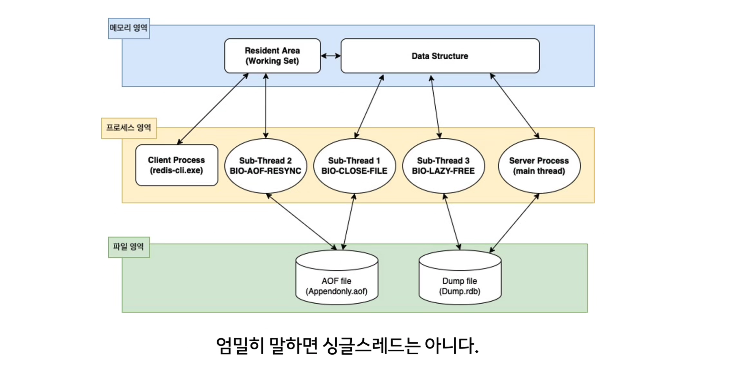

## I/O Multiplexing?

리눅스는 모든게 파일 → 소켓도 파일? 

소켓을 파일로 간주하면 하나의 스레드가 여러 파일을 관리할 수 있다?

## 레디스 자료구조 

메모리 산정이 필수 

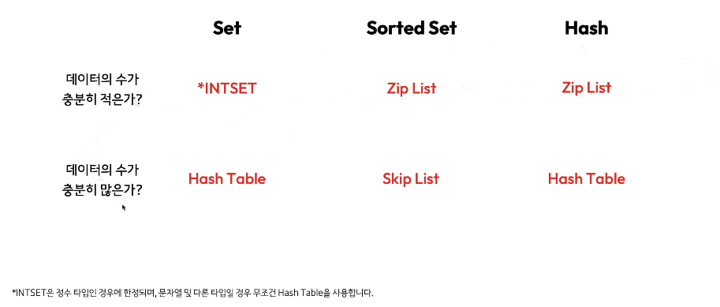

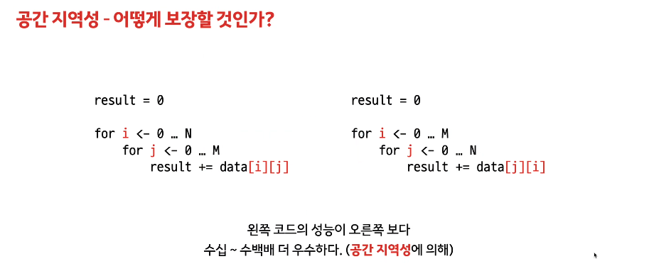

페이지 캐싱: 리눅스 4KB

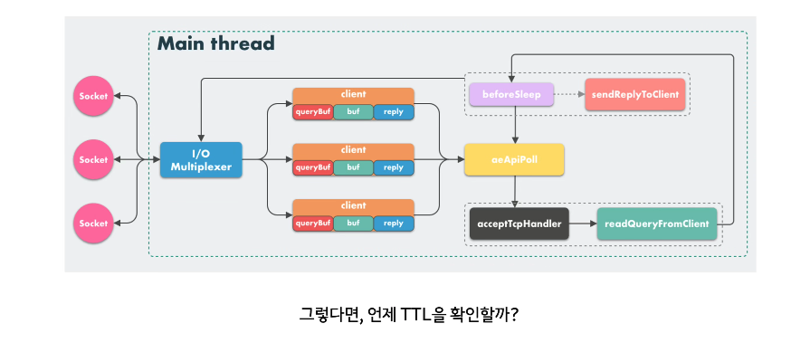

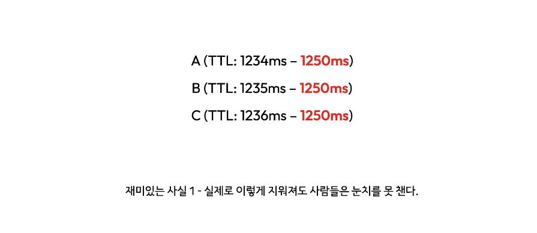

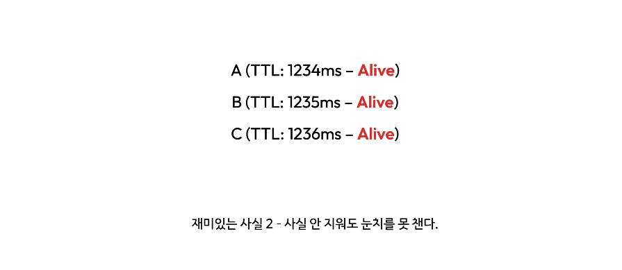

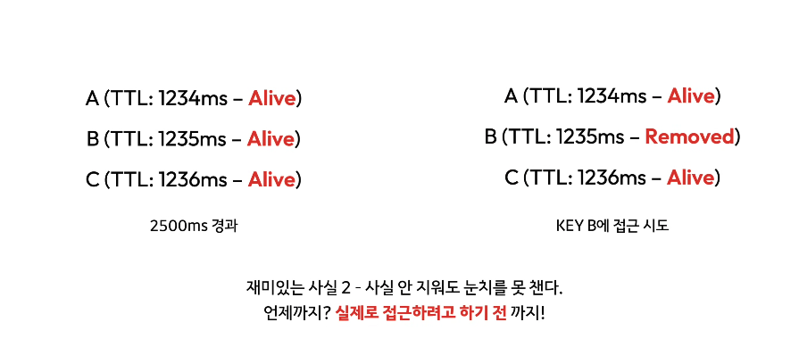

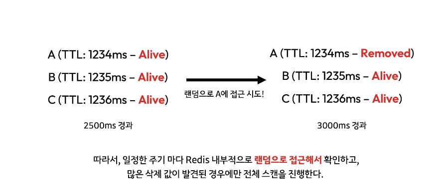

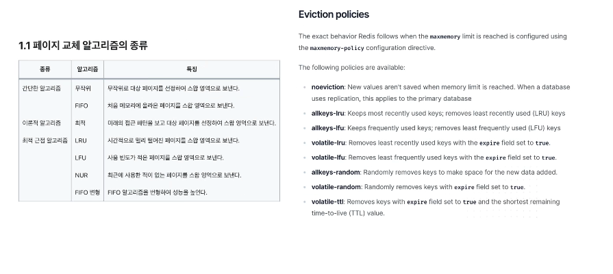

→ 개발에 적용 가능 

공식 문서 시간 복잡도를 꼭 확인 

## 불안전한 메모리 기반의 레디스 (Redis Persistence)

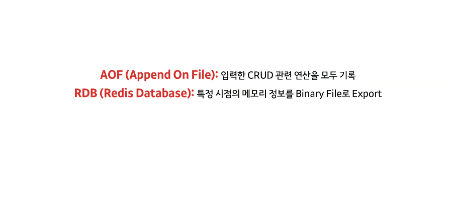

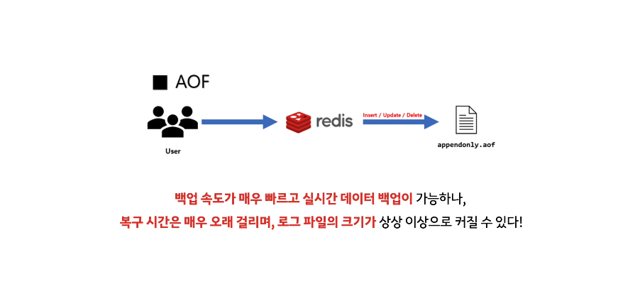

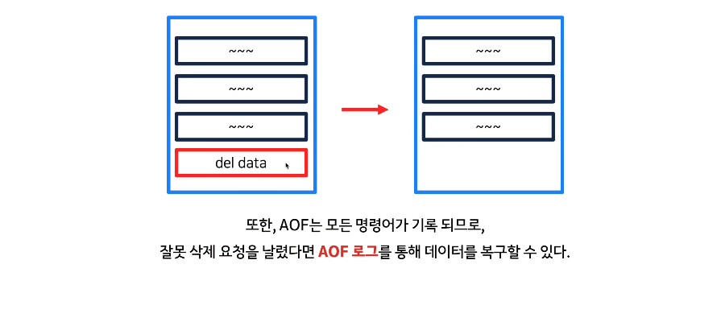

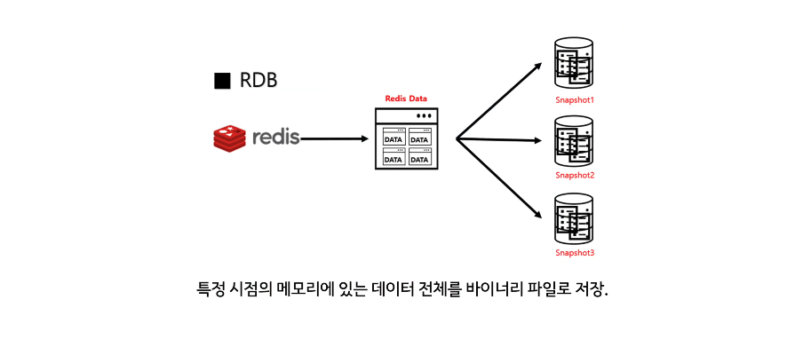

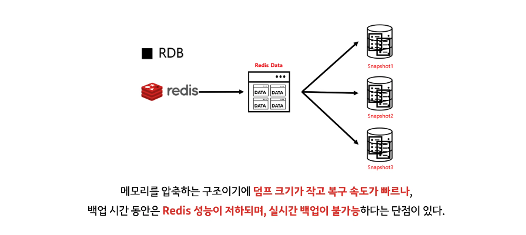

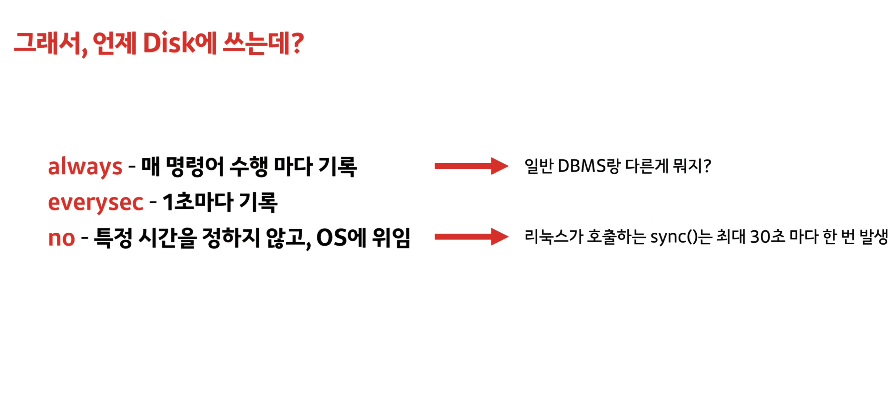

**AOF VS RDB 보류 …**

## **단일 장애 지점 문제 해결 가능?**

**Replication**

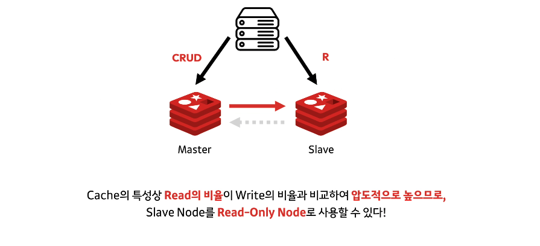

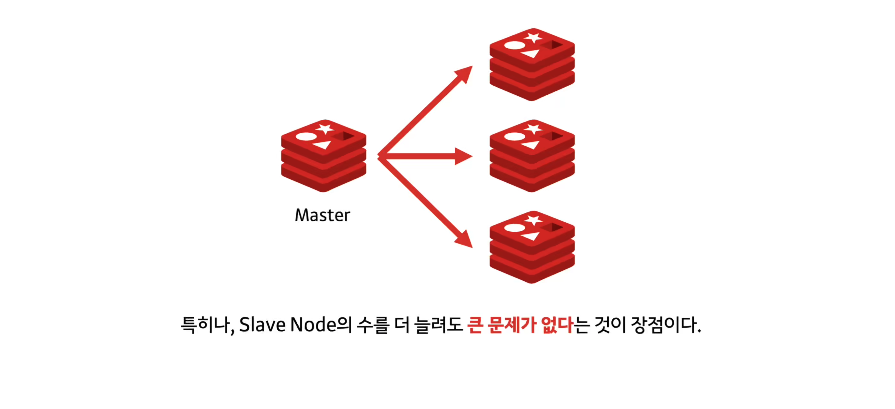

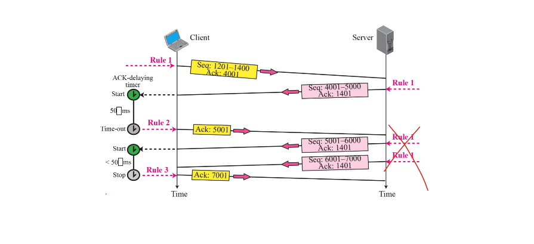

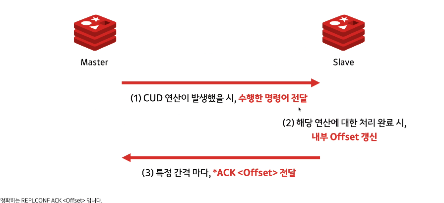

