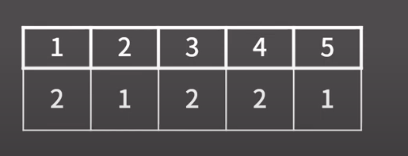

# Counting Sort

표의 의미는?

1 5 4 2 3 1 4 3 수열 에서 

1 2 3 4 5 가 각각 몇번 나왔는지 count한 테이블이다. 

이게 바로 Counting Sort 이다. 

하지만 Counting Sort는 만능이 아니다.

각 수의 등장 횟수를 저장해야 하니까 미리 큰 테이블을 만들고 count 하면서 1씩 증가하는 방법인데
만약 수의 범위가 100억 이렇다면 100억 크기의 테이블을 만들고 

count 배열에 넣고 100억 크기의 테이블 전체를 돌면서 정렬된 수열을 만들어야 하니

너무 비효율적이다. 

> 💡 메모리 제한이 512MB 면 int 기준 대략 1.2억인 배열밖에 잡을 수 없다.

결론적으로 말해서 수의 범위가 어느정도 한정적일 때에만 카운팅 소트를 쓸 수 있다.

# Raix Sort(기수 정렬) 

- 라딕스 소트는 자릿수를 이용해서 정렬을 수행하는 알고리즘으로 카운팅 소트를 응용한 알고리즘이라고도 생각할 수 있다. 

처음에는 수열에서 수를 하나씩 읽으면서 1의 자리에 따라 수를 넣는다.

즉 012는 1의 자리가 2니까 2번 리스트에 넣는다. 

이렇게 차례대로 수를 넣어준다. 이제 0번 리스트에서부터 보면서 수를 꺼내서 수열을 재배열 한다.

1의 자리의 크기에 따라서 재배열을 한 수열 

이제 10의 자리도 반복해서 진행 

100의 자리


