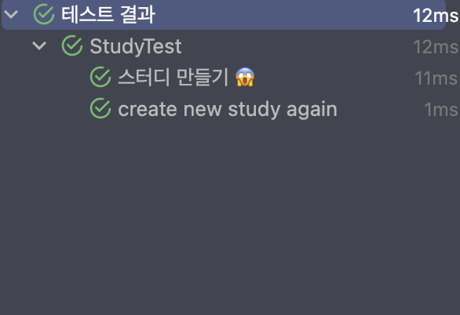
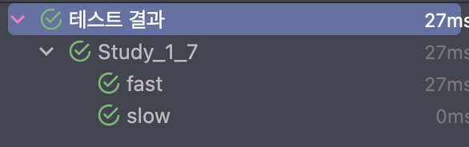
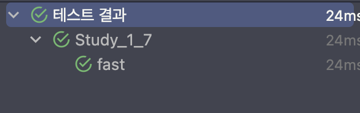

# 트러블 슈팅

### 문제점

WebLayer 계층만 @WebMvcTest를 통해서 테스트 + 시큐리티 관련은 경로별 권한 검사만 진행하기 위해서 @TestConfiguration + @Import를 통해 테스트 환경에서의 SecurityFilterChain만 등록하려고 시도했는데 

자꾸 시큐리티 관련 의존성(Custom Filter)이 주입되었다. 분명히 SecurityConfig @Profile(!test) 설정을 추가했는데도 내가 인지하지 못하는 경로에서 빈 주입이 시도되었다.

---

### **@WebMvcTest**

Spring Web Layer 전용 슬라이스 테스트

@WebMvcTest는 @AutoConfigureMockMvc가 포함되어 있어서 MockMvc 사용 가능

@ComponentScan을 통해 아래와 같은 MVC 관련 빈을 등록한다.

@Controller, @ControllerAdvice, @JsonComponent, Converter, WebMvcConfigurer, HandlerMethodArgumentResolver 등의 빈만 로드.

또한 내부적으로 @ImportAutoConfiguration을 통해 여러 자동 구성 클래스들을 등록하는데,

이 중에 스프링 시큐리티 자동 구성도 포함되어 있다.

  - SecurityAutoConfiguration
  - SecurityFilterAutoConfiguration
  - SecurityConfigurerAdapter 

그래서 시큐리티 자동구성 설정으로 main 패키지에 존재하는 SecurityConfig, Filter 클래스도 해당되고

해당 클래스에서 주입받는 빈들도 당연히 포함된다.

하지만 해당 빈들은 @Service, @Component, @Repository

@WebMvcTest는 해당 애노테이션들로 생성되는 빈들은 주입을 하지 않아서 테스트에 빈 주입 에러가 발생한다. 

해당 의존성이 필요하다면 @MockBean 또는 직접 주입이 필요하다.

---

### 방법1: @ContextConfiguration

직접 테스트 설정을 구성한다.

지정한 클래스들만 ApplicationContext 빈으로 로드된다.

```java
@TestConfiguration
@EnableWebSecurity
public class TestSecurityConfig {
	@Bean
	public SecurityFilterChain filterChain(HttpSecurity http) throws Exception {
		http
			.csrf(AbstractHttpConfigurer::disable)
			.authorizeHttpRequests(authorize -> authorize
				.requestMatchers("/api/v1/auth/**", "/api/v1/user/signup").permitAll()
				.requestMatchers("/api/v1/location", "api/v1/category").permitAll()
				.anyRequest().authenticated());
		return http.build();
	}
}
```

간단한 권한 검사 테스트를 위한 main 패키지의 SecurityConfig와 인증/인가 경로가 동일한 테스트 SecurityFilterChain 생성

```java
@WebMvcTest
@ContextConfiguration(classes = {GroupController.class, GlobalExceptionHandler.class, TestSecurityConfig.class})
class GroupControllerTest {
	@Autowired
	private MockMvc mvc;
	
	@MockBean
	private GroupService groupService;

  // 생략 ...
```

@ContextConfiguration 통해서 필요한 클래스들만 주입한다.

문제는 @WebMvcTest에 @ContextConfiguration을 같이 쓰면, @WebMvcTest의 기본 자동 구성 기능들이 부분적으로 무시된다.

**그 결과, 원래 자동으로 주입되던 @ControllerAdvice, HandlerMethodArgumentResolver, MessageConverter 같은 Web Layer 빈들이 컨텍스트에 포함되지 않게 된다.**

**이유는 @ContextConfiguration은 수동 구성 방식이기 때문**

@WebMvcTest는 내부적으로 다음과 같이 자동 구성을 한다.

  - @AutoConfigureMockMvc → MockMvc 자동 주입
  - @ImportAutoConfiguration → WebMvc 관련 자동 구성 클래스 포함
  - @ComponentScan → @Controller, @ControllerAdvice 등 포함

하지만, @ContextConfiguration을 추가하면 다음과 같은 일이 발생한다.

 @ContextConfiguration은 테스트 컨텍스트를 직접 구성하는 선언

Spring은 @WebMvcTest의 자동 구성 대신 @ContextConfiguration에서 지정한 클래스들만 사용한다.

따라서 @WebMvcTest의 기본 스캔 기능 (예: @ControllerAdvice 자동 포함)이 적용되지 않는다.

즉, @WebMvcTest가 Web 계층 슬라이스 테스트를 위한 자동 구성을 하려다가, @ContextConfiguration이 직접 구성하겠다고 선언하니 자동 구성이 빠지는 것이다.

**그래서 자동 구성으로 주입되던 클래스들을 @ContextConfiguration 에 직접 명시해야 한다.**

---

### 방법2: exclude Filters

@WebMvcTest 에서는 SecurityAutoConfiguration 도 포함 

이때 SecurityAutoConfiguration은 

```java
@Component
@RequiredArgsConstructor
public class JwtAuthenticationFilter extends OncePerRequestFilter {

		private final JwtProvider jwtProvider;
```

해당 클래스도 빈으로 주입한다.

하지만 JwtProvider는 Custom @Component 시큐리티 관련 X → 빈 주입 에러가 발생한다.

```java
@WebMvcTest(
	controllers = GroupController.class,
	excludeFilters = {
		@ComponentScan.Filter(type = FilterType.ASSIGNABLE_TYPE, classes = JwtAuthenticationFilter.class)
	}
)
@Import(TestSecurityConfig.class)
class GroupControllerTest {
	@Autowired
	private MockMvc mvc;

	@MockBean
	private GroupService groupService;

```

기본적인 @WebMvcTest WebLayer 자동 구성을 사용하면서 테스트를 위한 TestSecurityConfig를 통한 

필터 체인을 등록하고 테스트에는 필요없는 JwtAuthenticationFilter는 제외한다.

---

### 정리

@ContextConfiguration + @WebMvcTest 조합은 @WebMvcTest 자동 구성을 날려버린다.

앞으로 WebLayer에 많은 custom 기능을 추가할 예정이어서 @ContextConfiguration 기능은 사용하기가 꺼려진다.


**기능 추가 example** 

컨트롤러 쪽에서 커스텀 HandlerMethodArgumentResolver를 통한 사용자 정보를 ThreadLocal(SecurityContext)에서 꺼내어 컨트롤러 파라미터로 받는 기능을 추가한다면WebMvcConfigurer를 간단하게 적용이 가능한 방법2를 통한 @WebMvcTest + ExcludeFilters 가 좋을듯하다. 

이런 이슈가 스프링 부트 자동 구성의 단점이다. 자동으로 구성해 준다는 것이 편리하고 좋지만 정확히 알지 못하면 해결하는데 오랜 시간이 걸리는듯하다..! 하지만 덕분에 @WebMvcTest 자동 구성 클래스들이 무엇인지 알게 된듯하다.

---

[https://docs.spring.io/spring-boot/api/java/org/springframework/boot/test/autoconfigure/web/servlet/WebMvcTest.html?utm_source=chatgpt.com](https://docs.spring.io/spring-boot/api/java/org/springframework/boot/test/autoconfigure/web/servlet/WebMvcTest.html?utm_source=chatgpt.com)

@Mock와 @MockBean은 둘 다 테스트에서 의존성 객체를 가짜(Mock) 객체로 대체하기 위해 사용되지만, 사용되는 컨텍스트와 목적에 차이가 있다.

---

### @Mock (from Mockito)

  - **출처**: org.mockito.Mock
  - **용도**: Mockito 단위 테스트에서 사용
  - **기능**: Mock 객체를 생성하고 주입은 **직접** 해야 함 (@InjectMocks 또는 수동 주입)
  - **Spring 컨테이너와 무관**: Spring ApplicationContext에는 영향을 주지 않음

### 예시

```java
@ExtendWith(MockitoExtension.class)
class MyServiceTest {
    @Mock
    private UserRepository userRepository;

    @InjectMocks
    private UserService userService;

    // userService 내부에서 userRepository가 mock으로 주입됨
}
```

---

### @MockBean (from Spring Boot Test)

  - 출처: org.springframework.boot.test.mock.mockito.MockBean
  - 용도: Spring Boot 통합 테스트에서 사용
  - 기능: Spring ApplicationContext의 빈을 대체(mock) 함
  - 자동 주입: 해당 타입의 빈이 존재하면 해당 빈을 mock 객체로 교체함

### 예시:

```java
@SpringBootTest
class MyServiceIntegrationTest {
    @MockBean
    private UserRepository userRepository; // 실제 빈이 mock으로 교체됨

    @Autowired
    private UserService userService;

    // userService는 Spring 컨테이너에 의해 주입되고,
    // 내부의 userRepository는 mock으로 대체됨
}
```

---

### 요약 비교

| 항목 | `@Mock` | `@MockBean` |
| --- | --- | --- |
| 출처 | Mockito | Spring Boot Test |
| 테스트 종류 | 단위 테스트 (unit test) | 통합 테스트 (Spring context 필요) |
| Spring과 연동 | ❌ Spring과 무관 | ✅ Spring context의 빈을 교체 |
| Mock 대상 사용처 | 수동 또는 `@InjectMocks`로 주입 | 자동으로 Spring 빈으로 주입됨 |

---

### 언제 무엇을 써야 할까?

| 상황 | 추천 어노테이션 |
| --- | --- |
| 순수 단위 테스트 (Spring 없이) | `@Mock` |
| Spring 컨텍스트를 사용하는 테스트 | `@MockBean` |

| 어노테이션 | 목적 | 컨텍스트 |
| --- | --- | --- |
| `@Mock` | 가짜 객체 생성 | Mockito (단위 테스트) |
| `@InjectMocks` | Mock 객체를 테스트 대상 클래스에 주입 | Mockito |
| `@Spy` | 실제 객체를 감싸서 부분 mocking | Mockito |
| `@Captor` | 전달된 인자를 캡처하기 위해 사용 | Mockito |
| `@MockBean` | Spring 컨테이너의 Bean을 Mock으로 교체 | Spring Boot 테스트 |
| `@SpyBean` | Spring Bean을 감싸서 부분 mocking | Spring Boot 테스트 |

---

---

# 학습 정리

### 더 자바, 애플리케이션 테스트하는 다양한 방법 정리

[https://20240228.tistory.com/427](https://20240228.tistory.com/427)

```java
class StudyTest {
    @Test
    void create(){
        var study = new Study();
        assertNotNull(study);
        System.out.println("create");
    }
    @BeforeAll
    static void beforeAll(){
        System.out.println("before all");
    }
    @AfterAll
    static void afterAll(){
        System.out.println("after all");
    }
    @BeforeEach
    void beforeEach(){
        System.out.println("before each");
    }
    @AfterEach
    void afterEach(){
        System.out.println("after each");
    }
}
```

    - `@BeforeAll` , `@AfterAll` 
- 모든 테스트를 시작하기 전/후에 동작 
      - **must static 메서드**
    - `@Disabled` 
- 실행하지 않을 테스트에 적용

## **@DisplayNameGeneration**

```java
@DisplayNameGeneration(DisplayNameGenerator.ReplaceUnderscores.class)
class StudyTest {
    @Test
    void create_new_study(){
        var study = new Study();
        assertNotNull(study);
        System.out.println("create1");
    }
    @Test
    void create_new_study_again(){
        System.out.println("create2");
    }
}
```

    - JUnit5에서 테스트 메서드 이름을 자동으로 변환해주는 어노테이션 
    - **클래스 레벨, 메서드 레벨 전부 적용 가능** 
    - @DisplayNameGeneration(DisplayNameGenerator.ReplaceUnderscores.class)
- **언더스코어(_)를 공백문자( )로 치환** 
      - create_new_study → create new study
      - create_new_study_again → create new study again

## **@DisplayName**

```java
@DisplayNameGeneration(DisplayNameGenerator.ReplaceUnderscores.class)
class StudyTest {
    @Test
    @DisplayName("스터디 만들기 \uD83D\uDE31")
    void create_new_study(){
        var study = new Study();
        assertNotNull(study);
        System.out.println("create1");
    }
    @Test
    void create_new_study_again(){
        System.out.println("create2");
    }
}
```

    - **@DisplayNameGeneration 보다 우선순위가 높다** 



    - cute ㅋㅋ

# Supplier 성능 최적화 

```java
@Test
@DisplayName("스터디 만들기 \uD83D\uDE31")
void create_new_study(){
    var study = new Study();
    assertNotNull(study);
    // expected, actual
    assertEquals(StudyStatus.DRAFT, study.getStatus(),
            () -> "스터디를 처음 만들면 상태값이 " + StudyStatus.DRAFT);
    System.out.println("create1");
}
```

    - `import static org.junit.jupiter.api.Assertions.*;`

**assertEquals 메소드를 보면 expected, actual, Supplier<String>을 넘기고 있다.** 

**assertEquals 메소드는 다양한 형태로 오버로딩**  

    - `assertEquals(expected, actual, message)`
    - `assertEquals(expected, actual, Supplier<String> messageSupplier)`

하지만 왜 Supplier<String>으로 넘길 수 있게 만들었을까?

**이는 성능과 관련이 있다.** 

에러 메시지를 만드는 데 비용이 크다면? ex) 문자열 + 연산이 여러 번 존재 

그냥 String으로 넘기면 에러가 발생하지 않더라도 바로 연산을 해서 넘긴다. 

하지만 이렇게 Supplier를 통해서 람다식으로 넘기면 에러가 발생했을 때만 문자열 연산이 동작한다.

# AssertAll

```java
@Test
@DisplayName("스터디 만들기 \uD83D\uDE31")
void create_new_study(){
    var study = new Study(10);
    assertAll(
            () -> assertNotNull(study),
            () -> assertTrue(study.getLimit() > 0, "스터디 최대 참석 가능 인원은 0보다 커야함"),
            () -> assertEquals(StudyStatus.DRAFT, study.getStatus(),
                    () -> "스터디를 처음 만들면 상태값이 " + StudyStatus.DRAFT)
    );
}
```

assertAll을 사용하지 않고 assertNotNull, assertTrue, assertEquals 테스트가 있으면

순서에 따라서 앞에서 실행된 테스트가 실패하면 테스트는 더 이상 실행되지 않고 멈추게 된다. 

하지만 이렇게 assertAll을 사용하여 각 테스트를 executable(functional interface)로 넘겨주면 

하나의 테스트가 실패해도 나머지 테스트도 동작하고 최종적으로 어떤 테스트가 실패했는지 알려준다. 

**즉, 여러 개의 assertion을 한 번에 실행할 수 있으며, 하나의 assertion이 실패해도 나머지 assertion이 계속 실행된다.** 

# assertThrows

```java
@Test
@DisplayName("스터디 만들기 assertThrows")
void create_new_study_again(){
    IllegalArgumentException exception =
            assertThrows(IllegalArgumentException.class, () -> new Study(-10));
    assertEquals("limit은 0보다 커야한다.", exception.getMessage());
}
```

**예외 검증** 

# **assertTimeout**

```java
@Test
@DisplayName("스터디 만들기 assertTimeout")
void create_new_study_assertTimeout(){
    assertTimeout(Duration.ofMillis(100), () -> {
         new Study(10);
         Thread.sleep(300);
    });
}
```

**테스트 시간을 검증** 

현재 0.1초 이내에 동작해야 하는 데 0.3이상이 걸려서 테스트가 실패하게 된다. 

# 
**assertTimeoutPreemptively**

```java
@Test
@DisplayName("스터디 만들기 assertTimeoutPreemptively")
void create_new_study_assertTimeoutPreemptively(){
    assertTimeoutPreemptively(Duration.ofMillis(100), () -> {
         new Study(10);
         Thread.sleep(10000);
    }, () -> "스터디 생성은 0.1초 이내에 동작");
}
```

**테스트 시간을 검증** 

0.1초 이내에 동작해야 하는데 현재 Thread.sleep을 보면 10초다.

assertTimeout 메소드를 통한 검증이었다면 10초를 기다리고 테스트가 실패하겠지만

**assertTimeoutPreemptively 같은 경우 지정한 Duration인 0.1초를 넘기면 바로 실패한다.** 

**주의점** 

**ThreadLocal을 사용하는 SpringSecurity(context holder), Spring Transaction case** 

assertTimeoutPreemptively는 다른 스레드에서 동작한다.

# **assumingTrue**

```java
@Test
@DisplayName("assumeTrue")
void test(){
    String testEnv = System.getenv("TEST_ENV");
    assumeTrue("LOCAL2".equalsIgnoreCase(testEnv));
    var study = new Study(10);
    assertThat(study.getLimit()).isGreaterThan(5);
}
```

**조건에 맞으면 테스트 진행** 

# **assumingThat**

```java
@Test
@DisplayName("assumingThat")
void test2(){
    String testEnv = System.getenv("TEST_ENV");
    assumingThat("LOCAL2".equalsIgnoreCase(testEnv), () -> {
        var study = new Study(10);
        assertThat(study.getLimit()).isGreaterThan(5);
    });
}
```

```java
@Test
@DisplayName("@EnabledIfEnvironmentVariable")
@EnabledIfEnvironmentVariable(named = "TEST_ENV", matches = "LOCAL2")
void test4(){
    var study = new Study(10);
    assertThat(study.getLimit()).isGreaterThan(5);
}
```

**@EnabledIfEnvironmentVariable**: assumingThat, assumingTrue 조건을 애노테이션으로 해결 

# 
**@EnabledOnOs**

```java
@Test
@DisplayName("@EnabledOnOS")
@EnabledOnOs({OS.MAC, OS.LINUX})
void test3(){
    var study = new Study(10);
    assertThat(study.getLimit()).isGreaterThan(5);
}
```

**OS에 해당하면 테스트 진행**

```java
/**
 * JUnit 5 태깅과 필터링
 */
public class Study_1_7 {
    @Test
    @DisplayName("fast")
    @Tag("fast")
    void fast() {
        var study = new Study(100);
        assertThat(study).isNotNull();
    }
    @Test
    @DisplayName("slow")
    @Tag("slow")
    void slow() {
        var study = new Study(100);
        assertThat(study).isNotNull();
    }
}
```

**build.gradle → excludeTags 적용** 

```java
tasks.named('test') {
	useJUnitPlatform{
		// excludeTags("slow")
	}
}
```



```java
tasks.named('test') {
	useJUnitPlatform{
		 excludeTags("slow")
	}
}
```



```java
/**
 * JUnit5 테스트 반복하기
 */
public class Study_1_9 {
    @DisplayName("반복 테스트 연습1")
    @RepeatedTest(value = 10, name = "{currentRepetition}/{totalRepetitions} {displayName}")
    void repeatedTest(RepetitionInfo repetitionInfo) {
        System.out.println(
        "test " + repetitionInfo.getCurrentRepetition() + "/" + repetitionInfo.getTotalRepetitions());
    }

    @DisplayName("반복 테스트 연습2")
    @ParameterizedTest(name = "{index} {displayName} message={0}")
    @ValueSource(strings = {"날씨가", "많이", "추워지고", "있네요"})
    void repeatedTest2(String message) {
        System.out.println(message);
    }

    @DisplayName("반복 테스트 연습3")
    @ParameterizedTest(name = "{index} {displayName} message={0}")
    @ValueSource(strings = {"날씨가", "많이", "추워지고", "있네요"})
    @NullAndEmptySource // @NullSource + @EmptySource
    void repeatedTest3(String message) {
        System.out.println(message);
    }

    @DisplayName("반복 테스트 연습4")
    @ParameterizedTest(name = "{index} {displayName} message={0}")
    @ValueSource(ints = {1, 2, 3, 4, 5})
    void repeatedTest4(@ConvertWith(StudyConverter.class) Study study) {
        System.out.println(study.getLimit());
    }

    static class StudyConverter extends SimpleArgumentConverter{
        @Override
        protected Object convert(Object source, Class<?> targetType) throws ArgumentConversionException {
            assertEquals(Study.class, targetType, "Cant only convert to Study");
            return new Study(Integer.parseInt(source.toString()));
        }
    }

    @DisplayName("반복 테스트 연습5")
    @ParameterizedTest(name = "{index} {displayName} message={0} {1}")
    @CsvSource({"10, 자바 스터디", "20, 스프링"})
    void repeatedTest5(Integer limit, String name) {
        var study = new Study(limit, name);
        System.out.println(study);
    }

    @DisplayName("반복 테스트 연습6")
    @ParameterizedTest(name = "{index} {displayName} message={0} {1}")
    @CsvSource({"10, 자바 스터디", "20, 스프링"})
    void repeatedTest6(ArgumentsAccessor argumentsAccessor) {
        var study = new Study(argumentsAccessor.getInteger(0), argumentsAccessor.getString(1));
        System.out.println(study);
    }
    
    @DisplayName("반복 테스트 연습7")
    @ParameterizedTest(name = "{index} {displayName} message={0} {1}")
    @CsvSource({"10, 자바 스터디", "20, 스프링"})
    void repeatedTest6(@AggregateWith(StudyAggregator.class) Study study) {
        System.out.println(study);
    }
    
    static class StudyAggregator implements ArgumentsAggregator{
        @Override
        public Object aggregateArguments(ArgumentsAccessor accessor, ParameterContext context) throws ArgumentsAggregationException {
           return new Study(accessor.getInteger(0), accessor.getString(1));
        }
    }
}
```

**JUnit은 테스트 메서드 마다 테스트 인스턴스를 새로 만든다.**

    - 이것이 기본 전략이다. 
    - 테스트 메서드를 독립적으로 실행하여 예상치 못한 부작용을 방지하기 위함이다.
    - 이 전략을 JUnit 5에서 변경할 수 있다.

```java
public class Study_1_10 {
    @Test
    public void test1() {
        System.out.println(this);
    }
    @Test
    public void test2() {
        System.out.println(this);
    }
}
```

    - **spring.studytest.Study_1_10@6c7a164b**
    - **spring.studytest.Study_1_10@dc9876b**
    - **인스턴스가 서로 다르다.  → 테스트 메서드마다 새로운 테스트 인스턴스를 만든다.** 

### TestInstance.PER_CLASS

```java
@TestInstance(TestInstance.Lifecycle.PER_CLASS)
public class Study_1_10 {
    @Test
    public void test1() {
        System.out.println(this);
    }
    @Test
    public void test2() {
        System.out.println(this);
    }
}
```

    - **spring.studytest.Study_1_10@4c2bb6e0**
    - **spring.studytest.Study_1_10@4c2bb6e0**
    - **인스턴스가 같다. → 테스트 메서드마다 새로운 인스턴스를 만들지 않고 하나의 인스턴스를 재사용한다.**

[https://20240228.tistory.com/428](https://20240228.tistory.com/428)

```java
@ExtendWith(MockitoExtension.class)
class StudyServiceTest {

    @Mock MemberService memberService;
    @Mock StudyRepository studyRepository;

    @Test
    @DisplayName("Mockito.mock")
    void createStudyService(){
        var memberService = mock(MemberService.class);
        var studyRepository = mock(StudyRepository.class);
        var studyService = new StudyService(memberService, studyRepository);
        assertNotNull(studyService);
    }

    @Test
    @DisplayName("@Mock")
    void createStudyService2(){
        var studyService = new StudyService(memberService, studyRepository);
        assertNotNull(studyService);
    }

    @Test
    @DisplayName("@Mock parameter")
    void createStudyService3(@Mock MemberService memberService, @Mock StudyRepository studyRepository){
        var studyService = new StudyService(memberService, studyRepository);
        assertNotNull(studyService);
    }
    
    @Test
    @DisplayName("@InjectMocks")
    void createStudyService4(){
        StudyService studyService = this.studyService;
        assertNotNull(studyService);
    }
}

```

**Mockito.mock() 방식은 @ExtendWith(MockitoExtension.class) 확장 설정을 하지 않아도 된다.**

# **Mock 객체 기본동작** 

```java
@ExtendWith(MockitoExtension.class)
class StudyServiceTest {

    @Mock MemberService memberService;
    @Mock StudyRepository studyRepository;
    @InjectMocks StudyService studyService;

    @Test
    @DisplayName("main test")
    void main(){
        // optional -> empty
        Optional<Member> optional = memberService.findById(1L);
        assertThat(optional.isEmpty()).isTrue();

        // void
        memberService.validate(1L);
    }
```

    - Optional 타입 → Optional.empty 
    - void → 아무런 일도 발생하지 않는다. 
    - 컬렉션 → 비어있는 컬렉션 
- Collections.emptyList()
      - Collections.emptySet()
    - Primitive 타입 → 기본 Primitive 값 
- boolean: false 
      - int: 0
    - Object → Null

# Stub (가짜 구현)

**Mockito 기본 Mock 동작은 기본값 반환 (Default Stubbing) 규칙을 따른다.** 

**기본 동작을 원하는 값으로 변경하려면 when(), thenReturn(), doThrow()를 사용해야 한다.** 

### when()

```java
@Test
@DisplayName("main test")
void main(){
    var member = new Member();
    member.setId(1L);
    member.setEmail("test@test.com");

    when(memberService.findById(1L)).thenReturn(Optional.of(member));

    Optional<Member> findMember = memberService.findById(1L);
    assertThat(findMember).isPresent();
    assertThat(findMember.get().getEmail()).isEqualTo("test@test.com");
}
```

### **Mockito ArgumentMatcher** 

Mockito에서 ArgumentMatcher는 **특정 메서드의 인자로 들어오는 값이 특정 조건을 만족하는지 검사**하는 기능을 제공한다. 

**기본 동작** 

```java
// MemberService.findById()가 어떤 Long 값을 받더라도 Optional.empty() 반환
when(memberService.findById(any(Long.class))).thenReturn(Optional.empty());

// 특정 값(1L)과 정확히 일치해야 동작함
when(memberService.findById(eq(1L))).thenReturn(Optional.of(new Member(1L, "John")));
```

    - `any(Class<T>)` → 어떤 값이든 상관없이 해당 타입이면 매칭된다.
    - `eq(value)` → 특정 값과 **정확히 일치**할 때만 매칭된다.

**argThat()을 이용한 커스텀 조건** 

```java
when(memberService.findById(argThat(id -> id >= 20))).thenReturn(Optional.of(member));

Optional<Member> result1 = memberService.findById(10L);
Optional<Member> result2 = memberService.findById(20L);

assertThat(result1).isEmpty();
assertThat(result2).isPresent();
```

**여러 개의 인자에 Matcher 사용 시 주의점**

```java
// 하나는 eq(), 다른 하나는 일반 값 → MockitoException 발생
when(memberService.update(eq(1L), "John")).thenReturn(true);

// 모든 인자를 Matcher로 감싸야 함
when(memberService.update(eq(1L), eq("John"))).thenReturn(true);
```

### 예외 던지기 

```java
when(memberService.findById(any())).thenThrow(RuntimeException.class);

// void 예외 던지기
doThrow(new IllegalArgumentException()).when(memberService).validate(anyLong());

assertAll(
        () -> assertThatThrownBy(()-> memberService.findById(10L)),
        () -> assertThatThrownBy(() -> memberService.validate(20L))
);
```

**findById → return 값 존재 O** 

**validate → return 값 존재 X** 

### **여러 번 호출될 때 다른 값을 반환하는 Stub 설정** 

```java
@Test
@DisplayName("main test")
void main(){
    var member = new Member();
    member.setId(1L);
    member.setEmail("test@test.com");

    when(memberService.findById(any()))
            .thenReturn(Optional.of(member))    // 1
            .thenThrow(RuntimeException.class)  // 2
            .thenReturn(Optional.empty());      // 3

    assertAll(
            () -> assertThat(memberService.findById(1L)).isPresent(),
            () -> assertThatThrownBy(() -> memberService.findById(1L))
                    .isInstanceOf(RuntimeException.class),
            () -> assertThat(memberService.findById(1L)).isEmpty(),
            () -> assertThat(memberService.findById(1L)).isEmpty()
    );
}
```

**4번째 호출 이후 → 계속 Optional.empty() 반환 → 마지막 동작이 반복된다.**

**StudyService의 createNewStudy 동작** 

```java
public Study createNewStudy(Long memberId, Study study){
	  Optional<Member> member = memberService.findById(memberId);
	  study.setOwnerId(member.orElseThrow(() ->
	          new IllegalArgumentException("Member doesn't exist for id: '" + memberId + "'")).getId());
	
	  var newStudy = repository.save(study);
	  memberService.notify(study);
	  memberService.notify(member.get());
	  return newStudy;
}
```

**memberService.notify() 메서드가 호출되었는지 검증해 보자** 

### **verify 통해서 호출 횟수,여부 검증** 

```java
@Test
@DisplayName("main test")
void main(){
    var member = new Member();
    member.setId(1L);
    member.setEmail("test@test.com");

    var study = new Study(10, "테스트");

    when(memberService.findById(1L)).thenReturn(Optional.of(member));
    when(studyRepository.save(any(Study.class)))
            .thenReturn(study);

    studyService.createNewStudy(1L, study);
    verify(memberService, times(1)).notify(study);
    verify(memberService, never()).validate(any());
}
```

    - **notify 메서드가 1번 호출되었는지 검증** 
    - **validate 메서드가 호출되지 않았는지 검증** 

### **호출 순서 검증** 

```java
@Test
@DisplayName("main test")
void main(){
    var member = new Member();
    member.setId(1L);
    member.setEmail("test@test.com");

    var study = new Study(10, "테스트");

    when(memberService.findById(1L)).thenReturn(Optional.of(member));
    when(studyRepository.save(any(Study.class)))
            .thenReturn(study);

    studyService.createNewStudy(1L, study);

    InOrder inOrder = inOrder(memberService);
    inOrder.verify(memberService).findById(any());
    inOrder.verify(memberService).notify(any(Study.class));
    inOrder.verify(memberService).notify(any(Member.class));
    verifyNoMoreInteractions(memberService);
}
```

    - **findById → notify → notify**
    - **verifyNoMoreInteractions(mock);**
- **특정 Mock 객체가 추가적인 호출을 받지 않았는지 검증할 수 있다.**

테스트에서 도커 컨테이너를 실행할 수 있는 라이브러리

    - [https://www.testcontainers.org/](https://www.testcontainers.org/)
    - 테스트 실행시 DB를 설정하거나 별도의 프로그램 또는 스크립트를 실행할 필요 없다.
    - 보다 Production에 가까운 테스트를 만들 수 있다.
    - 테스트가 느려진다.

**build.gradle - testcontainers 관련 의존성** 

```groovy
testImplementation 'org.springframework.boot:spring-boot-testcontainers'
testImplementation 'org.testcontainers:mysql'
testImplementation 'org.testcontainers:junit-jupiter'
```

**테스트 적용** 

```java
@DataJpaTest
@ExtendWith(MockitoExtension.class)
@ActiveProfiles("test")
@Testcontainers
public class StudyServiceTest {
    @Mock MemberService memberService;
    @Autowired MemberRepository memberRepository;
    @Autowired  StudyRepository studyRepository;

    @Container
    @ServiceConnection
    static MySQLContainer<?> mySQLContainer =
            new MySQLContainer<>(DockerImageName.parse("mysql:latest"))
                    .withDatabaseName("study_test");

    @BeforeEach
    void setUp() {
        var member = new Member();
        member.setEmail("me@email.com");
        memberRepository.save(member);
        studyRepository.deleteAll();
    }

    @Test
    void createStudy() {
        // given
        var studyService = new StudyService(memberService, studyRepository);
        var study = new Study(10, "container");

        var member = memberRepository.findById(1L).get();

        given(memberService.findById(1L)).willReturn(Optional.of(member));

        // when
        studyService.createNewStudy(member.getId(), study);

        // then
        then(memberService).should(times(1)).findById(1L);
        then(memberService).should(times(1)).notify(any(Member.class));
        then(memberService).should(times(1)).notify(any(Study.class));

        Optional<Study> findStudy = studyRepository.findById(study.getId());
        assertThat(findStudy.isPresent()).isTrue();
        assertThat(findStudy.get().getId()).isEqualTo(study.getId());
        assertThat(findStudy.get().getName()).isEqualTo(study.getName());
        assertThat(findStudy.get().getStatus()).isEqualTo(StudyStatus.DRAFT);
    }

}

```

# **TestContainers (static 필드 vs instance 필드)**

static 필드면 1개의 테스트 클레스 전체 테스트에 동일한 컨테이너를 사용한다. 

instance 필드면 1개의 테스트 메서드마다 새로운 컨테이너를 사용한다. 

테스트 메서드 단위로 컨테이너의 라이프 사이클을 관리하게 되면 시간이 오래걸린다. 

컨테이너를 띄우고 내리는데 꽤 시간이 소요되기 때문이다.

그래서 나는 static 필드로 사용하고 서로 다른 테스트 메서드의 데이터 격리를 시키는 방식으로 하려고 한다.

@Transactional(MySQL) 테스트 데이터 롤백 / Redis 같은 경우 매번 @BeforeEach 통해서 데이터 삭제 

# **JDBC Testcontainers 설정** 

[https://java.testcontainers.org/modules/databases/jdbc/](https://java.testcontainers.org/modules/databases/jdbc/)

클래스 경로에 Testcontainers와 적절한 JDBC 드라이버가 있는 한, 애플리케이션이 시작될 때마다 일반 

JDBC 연결 URL을 수정하여 새로운 컨테이너화된 데이터베이스 인스턴스를 가져올 수 있다. 

**MySql 기준 url(application.properties)**

```plain text
// 기존 jdbc url 
spring.datasource.url = jdbc:mysql:8.0.36://localhost:3306/databasename

// Testcontainers jdbc url 
spring.datasource.url = jdbct:tc:mysql:8.0.36:///databasename
```

**datasource driver class**

```plain text
spring.datasource.driver-class-name=org.testcontainers.jdbc.ContainerDatabaseDriver
```

    - **spring boot 2.3.0 이하 버전은 드라이버를 수동으로 지정해야 한다.** 

**url 확인** 

```java
@BeforeAll
static void beforeAll() {
    System.out.println(mySQLContainer.getJdbcUrl());
}
```

    1. jdbc:mysql://localhost:58238/study_test
    1. jdbc:mysql://localhost:58334/study_test

**경로가 계속 달라진다.** 

# @TestContainers, @Container 

**@TestContainers, @Container 애노테이션 없이 직접 컨테이너 라이프 사이클을 관리 가능** 

**@BeforeAll, @AfrerAll 애노테이션을 통해 컨테이너 start(), stop()을 통해서** 

**컨테이너를 올리고 내리고가 가능하다.**

하지만 굳이 개발자가 직접 애노테이션을 통해 start(), stop()으로 라이프 사이클을 관리하는 것보다 

2개의 애노테이션을 통해 테스트 시작 시점과 끝날 때 자동으로 컨테이너를 올리고 내리는게 편하니 

나는 2개의 애노테이션을 통해 테스트 컨테이너 라이프 사이클을 관리하려고 한다. 

# @ServiceConnetcion

Spring Boot 3.1 이상에서 지원 

컨테이너를 통해 테스트를 하면 매번 포트가 다니나믹 즉, 동적으로 할당된다. 

그래서 SpringBoot 3.0 이하 버전에서는 애플리케이션의 데이터베이스 데이터 소스에 데이터베이스 url(port 포함) 정보를 등록하려면 @DynamicPropertySource 활용했지만 

@ServiceConnetcion을 통해서 간단하게 적용이 가능하다.

  - **테스트 컨테이너 관련 편의 애노테이션 정리** 

# 컨테이너 만들기 (GenericContainer)

**Testcontainers 에서 지원하지 않는 module 있다면 어떻게 컨테이너를 생성할까?**

직접 컨테이너 생성이 가능하다. **Docker image만 존재한다면** 

**GenericContainer**  

```java
@Container
static GenericContainer<?> mysqlContainer =
            new GenericContainer<>(DockerImageName.parse("mysql:latest"));
```

# **GenericContainer 설정** 

```java
@Container
    static GenericContainer<?> mysqlContainer =
		      new GenericContainer<>(DockerImageName.parse("mysql:latest"))
		              .withExposedPorts(5432)                // 컨테이너 port
		              .withEnv("MYSQL_DB", "study_test");    // 컨테이너 사용 환경변수
		              .waitingFor(Wait.forListeningPort()    // 사용할 준비가 됐는지
```

    - **withExposedPorts() 컨테이너 port 지정** 
    - **host port 지정은 불가능하다. Testcontainers가 자동으로 할당**
- Testcontainers는 Docker를 기반으로 동작하며, 여러 테스트에서 충돌을 방지해야 한다.
      - 여러 테스트가 동시에 실행될 경우, 특정 호스트 포트에 바인딩하면 **포트 충돌 가능성이 높아진다.**
      - 따라서 **사용하지 않는 포트 중 하나를 랜덤하게 선택**하여 매핑한다.
    - **withEnv(KEY, VALUE) 컨테이너 사용 환경변수 지정** 
    - **waitingFor(WAIT) 컨테이너를 사용할 준비가 됐는지 확인**  
- Wait.forLogMessage(String message)
      - Wait.forHttp(String url)

**getMappedPort**

```java
@BeforeAll
static void setUp() {
    System.out.println(mysqlContainer.getMappedPort(5432)); // host port
}
```

    - **바인딩 된 host port 출력하기** 

# **로그 살펴보기** 

**로그 스트리밍 방법 - withLogConsumer**

```java
@Slf4j
@Testcontainers
class TestContainersPractice {

	 @Container
	 static GenericContainer<?> mysqlContainer =
	        new GenericContainer<>(DockerImageName.parse("mysql:latest"));
	           
   @BeforeAll
   static void setUp() {
        Slf4jLogConsumer logConsumer = new Slf4jLogConsumer(log);
        mysqlContainer.withLogConsumer(logConsumer); // 로그 스트리밍
   }
```

    - Slf4jLogConsumer logConsumer = new Slf4jLogConsumer(log);

**로그 보기 - getLogs()**

```java
@Testcontainers
class TestContainersPractice {

	 @Container
	 static GenericContainer<?> mysqlContainer =
	        new GenericContainer<>(DockerImageName.parse("mysql:latest"));
	           
   @BeforeEach
    void beforeEach() {
        mysqlContainer.getLogs(); // 로그 살펴보기
    }
```

```yaml
version: '3.8'

services:
  study-db:
    image: mysql:latest
    environment:
      MYSQL_ROOT_PASSWORD: [REDACTED]
      MYSQL_DATABASE: test_db
      MYSQL_USER: test_user
      MYSQL_PASSWORD: [REDACTED]
```

```java
@DataJpaTest
@ExtendWith(MockitoExtension.class)
@ActiveProfiles("test")
@Testcontainers
public class DockerComposePractice {

    @Mock MemberService memberService;
    @Autowired MemberRepository memberRepository;
    @Autowired StudyRepository studyRepository;

    @Container
    static DockerComposeContainer composeContainer =
            new DockerComposeContainer(new File("src/test/resources/docker-compose.yml"))
                    .withExposedService("study-db", 3306);

    @BeforeEach
    void setUp() {
        var host = composeContainer.getServicePort("study-db", 3306);
        System.out.println("host = " + host);
        var member = new Member();
        member.setEmail("me@email.com");
        memberRepository.save(member);
    }

    @Test
    void createStudy() {
        // given
        var studyService = new StudyService(memberService, studyRepository);
        var study = new Study(10, "container");

        var member = memberRepository.findById(1L).get();

        given(memberService.findById(1L)).willReturn(Optional.of(member));

        // when
        studyService.createNewStudy(member.getId(), study);

        // then
        then(memberService).should(times(1)).findById(1L);
        then(memberService).should(times(1)).notify(any(Member.class));
        then(memberService).should(times(1)).notify(any(Study.class));
        then(memberService).shouldHaveNoMoreInteractions();

        Optional<Study> findStudy = studyRepository.findById(study.getId());
        assertThat(findStudy.isPresent()).isTrue();
        assertThat(findStudy.get().getId()).isEqualTo(study.getId());
        assertThat(findStudy.get().getName()).isEqualTo(study.getName());
        assertThat(findStudy.get().getStatus()).isEqualTo(StudyStatus.DRAFT);
    }

}
```

---

### 코딩하는 오후 스프링 테스트 시리즈 정리 

[https://www.youtube.com/watch?v=-RIr5JyPCn8&list=PLeMeDIV7bypssYJ4ezUDEru-39G1gwXvr&index=1](https://www.youtube.com/watch?v=-RIr5JyPCn8&list=PLeMeDIV7bypssYJ4ezUDEru-39G1gwXvr&index=1)

# TDD에 대한 오해 

오해: **TDD는 테스트를 하는 것이다**

진실: **TDD는 설계와 개발 하는 것이다** 

# TDD와 SW테스팅의 차이 

**SW 테스팅 VS TDD**

  - SW테스팅: 품질 검증 활동 
  - TDD: 설계 개발 활동 

# TDD의 Activity 목표 

기능성: 요구사항의 구현 가능섬 검토 

신뢰성: 신뢰있는 응답 구현 

효율성: 언더 엔지니어링 유지 

유지보수성: 사이드 이펙트 배제 

사용성: 개발 편의성 유지 

이식성: 다양한 배포환경 설정 설계

# Spring의 TDD 지원 도구들 

Runner: JUnit

Matcher: Hamcrest

Fluent api: AssertJ

Double, Mock, Sub: Mockito

Json Object: Json Object

[https://www.youtube.com/watch?v=FW1BOIQb2oQ&list=PLeMeDIV7bypssYJ4ezUDEru-39G1gwXvr&index=3](https://www.youtube.com/watch?v=FW1BOIQb2oQ&list=PLeMeDIV7bypssYJ4ezUDEru-39G1gwXvr&index=3)

### **JUnit?**

**→ TestRunner** 

**record Note** 

```java
public record Note (
    UUID noteId,
    String title,
    String contents,
    boolean isNes
)
{ }
```

**기본적인 테스트** 

```java
@Test
public void basicUseJunitTest(){
    var note = new Note(
            UUID.randomUUID(),
            "title",
            "content",
            true);

    assertEquals("title", note.title());
    assertTrue(note.isNew());
}
```

  - `import static org.junit.jupiter.api.Assertions.*;`
- **assertEquals()**
    - **assertTrue()**
  - **@Test** `import org.junit.jupiter.api.`*`Test`*`;`

**Enum, Function을 활용한 에러 메시지** 

```java
@Test
@DisplayName("에러 메시지 with supplier")
public void messageSupplierTest(){
    var note = new Note(
            UUID.randomUUID(),
            "title",
            "content",
            false);

    assertFalse(note.isNew(), errorMessage.apply(NotNewNote));
}

private final Function<Code, Supplier<String>> errorMessage = code -> {
    return () -> code + " : " + code.getMessage();
};

enum Code {
    NotNewNote("새로운 노트가 아닙니다."),
    NotFound("노트가 없습니다.");
    private final String message;
    private Code(String message) {
        this.message = message;
    }
    public String getMessage() {
        return message;
    }
}
```

**Note 수정** 

```java
public record Note (
    UUID noteId,
    String title,
    String contents,
    boolean isNew
)
{ 
    public int removeNote(UUID noteId){
        if(!this.noteId.equals(noteId)){
            throw new RuntimeException("노트가 없습니다.");
        }
        return 1;
    }
}
```

**예외 검증 테스트** 

```java
@Test
@DisplayName("throw Exception")
public void exceptionTest(){
    var note = new Note(
            UUID.randomUUID(),
            "title",
            "content",
            false);
    assertThrows(RuntimeException.class, () -> note.removeNote(UUID.randomUUID()));
}
```

**반복 테스트, 매개변수** 

```java
@ParameterizedTest(name = "{0}")
@ValueSource(ints = {2025, 2026, 2027})
public void parameterizedTest(int year){
    System.out.println(year);
}
```

  - **@MethodSource 추가로 공부하기**

[https://www.youtube.com/watch?v=NVdgt3b0Iwg&list=PLeMeDIV7bypssYJ4ezUDEru-39G1gwXvr&index=4](https://www.youtube.com/watch?v=NVdgt3b0Iwg&list=PLeMeDIV7bypssYJ4ezUDEru-39G1gwXvr&index=4)

**Note** 

```java
public record Note (
    UUID noteId,
    String title,
    String contents,
    boolean isNew
)
{
    public int removeNote(UUID noteId){
        if(!this.noteId.equals(noteId)){
            throw new RuntimeException("노트가 없습니다.");
        }
        return 1;
    }
}
```

**Hamcrest MatcherAssert.assertThat**

  - `import static org.hamcrest.MatcherAssert.*;`
  - AssertJ assertThat()을 더 많이 사용하다. 

**Hamcrest assertThat, Matchers**

```java
@Test
public void basic_hamcrest(){
    assertThat(note.title(), equalTo("title"));
}

@Test
public void coreMatchers(){
    assertThat(note.title(), anything());
}
```

  - Matchers: `import static org.hamcrest.Matchers.*;`
- **equalTo()**
    - **anything()**

**Matcher: hasProperty()**

```java
static class Person {
    private final String name;
    public Person(String name) {
        this.name = name;
    }
    public String getName() {
        return name;
    }
}

@Test
public void beanPropertyTest(){
    Person person = new Person("John");
    assertThat(person, hasProperty("name"));
    assertThat(note, not(hasProperty("title")));
}
```

  - 특정 필드가 Bean 규칙을 따르는지 확인
  - Note 클래스는 record 타입 record의 getter 메서드 네이밍은 필드명과 동일 
  - **hasProperty() 테스트 실패 → Matcher not()으로 중첩**

**Matcher: equalTo == is**

```java
@Test
public void sugar(){
    assertThat(note.title(), equalTo("title"));
    assertThat(note.title(), is("title"));
}
```

[https://www.youtube.com/watch?v=umivXuaW0Cc&list=PLeMeDIV7bypssYJ4ezUDEru-39G1gwXvr&index=5](https://www.youtube.com/watch?v=umivXuaW0Cc&list=PLeMeDIV7bypssYJ4ezUDEru-39G1gwXvr&index=5)

**이미 다 사용해 봤던 내용**

# 테스트 Double

  - 외부 환경에 의해 영향을 받는 코드를 테스트 하려면 가짜 객체를 이용하는 것이 효율적이다
  - **Double: 대신 수행하는 것을 말한다.** 
- stunt man을 stunt double 이라고도 한다.
  - **Mockito는 Double을 다루는 프레임워크**이다. 

# Double 용어 정리 

**Double** 

  - **Dummy: 단순히 자리만 채워넣는 것 ex) JUnit** **`anything()`**
  - **Spy: Mock + Stub**
- **Mock: 행위를 검증** 
    - **Stub: 결과값을 정해놓고 검증**
  - **Fake: 가짜객체를 실제와 가깝게 구현하여 검증** 

# Mockito 실습 

### **Note, NoteService, NoteRepositoryPort**

```java
public record Note (
    UUID noteId,
    String title,
    String contents,
    boolean isNew
)
{
    public int removeNote(UUID noteId){
        if(!this.noteId.equals(noteId)){
            throw new RuntimeException("노트가 없습니다.");
        }
        return 1;
    }
    
    public interface NoteCase {
        public void addNote(Note emptyIdNote, UUID noteId);
        public Note getNote();
    }
}

public interface NoteRepositoryPort {
    void addNote(Note emptyIdNote, UUID noteId);
}

@Service
public class NoteService implements NoteCase {
		
    private final NoteRepositoryPort repositoryPort;

    public NoteService(NoteRepositoryPort repositoryPort) {
        this.repositoryPort = repositoryPort;
    }
    
    @Override
    public void addNote(Note emptyIdNote, UUID noteId) {
        repositoryPort.addNote(emptyIdNote, noteId);
    }

    @Override
    public Note getNote() {
        return null;
    }
}
```

### **반환값이 없는 mock 검증 - verify** 

```java
// mockito 확장
@ExtendWith(MockitoExtension.class)
public class MockitoTest {

    // Mock 객체를 주입할 대상 객체
    @InjectMocks
    NoteService noteService;

    // 대상 객체에 mock 처리할 DI된 객체
    @Mock
    NoteRepositoryPort repositoryPort;

    @Test
    public void noteTest(){
        var noteId = UUID.randomUUID();
        var note = new Note(
            null,
            "title",
        "content",
            true
        );

        noteService.addNote(note, noteId);

        // mock 검증
        verify(repositoryPort, times(1))
                .addNote(any(Note.class), any(UUID.class));

    }
}
```

  - `@InjectMocks` 
- **Mock 객체를 주입할 대상 객체**
  - `@ExtendWith(MockitoExtension.class)` 
- **Mockito 확장**
  - `@Mock` 
- **대상 객체에 mock 처리할 DI된 객체**

**현재 NoteService addNote() 메서드는 반환값이 존재하지 않는다.** 

이럴 때는 `org.mockito.Mockito.`**`verify`** **를 통해서 해당 메서드가 호출되었는지 검증해야 한다.** 
`org.mockito.Mockito.`**`times`** **를 통해서 호출 횟수와** `org.mockito.ArgumentMatchers.`**`any`**

**를 통해서 메서드 파라미터를 검증하였다.** 

### **반환값이 있도록 변경, 테스트 구성**  

```java
@Test
public void noteTest(){
    // given
    var noteId = UUID.randomUUID();
    var note = new Note(
        null,
        "title",
    "content",
        true
    );

    // when
    var findNote = new Note(
            noteId,
            "title",
            "content",
            true
    );

    // when: stub
    when(repositoryPort.getNote(any(UUID.class)))
            .thenReturn(Optional.of(findNote));

    // then
    var createdNote = noteService.addNote(note, noteId);
    assertThat(createdNote.get()).isInstanceOf(Note.class);
    assertThat(createdNote.get().noteId()).isEqualTo(noteId);

    // then: mock(행위)
    verify(repositoryPort, times(1))
            .addNote(any(Note.class), any(UUID.class));

}
```

  - `org.mockito.Mockito.`**`when`** **: return 값 정의**

# 실습 준비 Json Data 가져오기

**구글 → json placeholder 검색** 

**posts.json data** 

[https://jsonplaceholder.typicode.com/posts](https://jsonplaceholder.typicode.com/posts)

**users.json data**

[https://jsonplaceholder.typicode.com/users/1](https://jsonplaceholder.typicode.com/users/1)

**프로젝트 main resource**

posts.json, users.json 2개의 파일 생성, 붙여넣기 

# 실습 

```java
record Post(
    Integer userId,
    Integer id,
    String title,
    String body
)
{}

@Test
public void parseJsonTest() throws IOException {
    var portsStream = new ClassPathResource("posts.json");
    var docCtx = JsonPath.parse(portsStream.getInputStream());
    List<Post> posts = docCtx.json();
    assertThat(posts).hasSize(100);
}

@Test
public void parseFilterJsonTest() throws IOException {
    var portsStream = new ClassPathResource("posts.json");
    var docCtx = JsonPath.parse(portsStream.getInputStream());
    List<Post> posts = docCtx.read("$[?(@.userId == 9)]");
    assertThat(posts).hasSize(10);
}
```

```java
@Test
public void hasPropertyTest() throws IOException {
    var usersStream = new ClassPathResource("users.json");
    var docCtx = JsonPath.parse(usersStream.getInputStream());

    String bs = docCtx.read("$.company.bs");
    assertThat(bs).isNotNull();
    assertThat(bs).contains("real-time");
}
```

# **JsonPath 표기법 연습하자!**

[https://jsonpath.com/](https://jsonpath.com/)

[https://www.youtube.com/watch?v=viL5iHwy2bY](https://www.youtube.com/watch?v=viL5iHwy2bY)

[https://github.com/jeus1998/SpringTest/tree/main/testcontainers](https://github.com/jeus1998/SpringTest/tree/main/testcontainers)

  - **연습 코드** 

# dependencies

  - **spring web**
  - **jdbc API**
  - **test containers**
  - **mysql driver** 

```groovy
dependencies {
		implementation 'org.springframework.boot:spring-boot-starter-jdbc'
		implementation 'org.springframework.boot:spring-boot-starter-web'
		runtimeOnly 'com.mysql:mysql-connector-j'
		testImplementation 'org.springframework.boot:spring-boot-starter-test'
		testImplementation 'org.springframework.boot:spring-boot-testcontainers'
		testImplementation 'org.testcontainers:junit-jupiter'
		testImplementation 'org.testcontainers:mysql'
		testRuntimeOnly 'org.junit.platform:junit-platform-launcher'
}
```

# TestContainers?(Mysql)

**H2 같은 임베디드 DB 또는 운영 DB 처럼 별도의 테스트용으로 구축한 DB가 아닌 MySQL 컨테이너를 사용하여** 

**실제 환경과 유사하게 동작하도록 구성하였다.** 

**임베디드 DB 장단점** 

  - 빠른 실행 속도 인메모리로 실행 
  - 추가적인 환경 설정이 필요없다. 
  - 운영에서 사용할(MySQL), H2은 분명한 차이점 존재
- SQL 문법이 다르다. → MySQL 특화 기능 테스트가 어렵다. 
    - 트랜잭션 격리 수준이 다르다.

**운영 DB와 동일한 별도 테스트용 DB 구축 장단점** 

  - 운영 환경과 완전히 동일한 DB 사용 가능
  - 서버 재시작 없이 지속적으로 사용 가능
  - 초기 설정이 필요하다 
- 별도의 테스트 DB 구축 필요
    - 데이터 정리가 필요하다
  - 테스트 속도가 임베디드 DB와 비교하면 떨어진다. 
  - 병렬 테스트가 어렵다. 공유 DB를 사용하면 동시에 여러 테스트가 실행될 때 데이터 충돌 가능성이 있다. 

**Testcontainers를 활용한 MySQL 컨테이너 방식**

  - Testcontainers를 사용하여 **테스트 실행 시마다 새로운 MySQL 컨테이너를 띄우고 종료한다.** 
  - **운영 환경과 거의 동일한 환경 제공** –> 실제 MySQL에서 테스트 가능하다.
  - **자동화 용이** – 테스트 실행 시 자동으로 컨테이너를 띄우고 종료하므로 별도 DB 구축 필요 없다.
  - **테스트 격리 보장** – 각 테스트마다 새로운 MySQL 인스턴스가 생성되므로 **다른 테스트의 데이터와 충돌 X**
  - **CI/CD 환경에서도 활용 가능** – GitHub Actions, Jenkins 등에서 Testcontainers 지원한다. 
  - **실행 속도가 상대적으로 느림** – 컨테이너 생성 및 MySQL 실행 시간이 추가된다.
  - **Docker 의존성** – 로컬 및 CI 환경에 Docker가 설치되어 있어야 함

# 테스트 분석 

```java
@JdbcTest
@Import(NoteRepository.class)
@AutoConfigureTestDatabase(replace = AutoConfigureTestDatabase.Replace.NONE)
@Testcontainers
class NoteRepositoryTest {

    @Container
    @ServiceConnection
    private static MySQLContainer<?> mysql =
            new MySQLContainer<>(DockerImageName.parse("mysql:latest"));

    @Autowired
    private NoteRepository noteRepository;

    @Test
    public void noteTest(){
        var newNote = new Note(
            null,
            "java",
            "grammar",
            null
        );
        var newId = UUID.randomUUID();
        noteRepository.addNote(newNote, newId);

        Optional<Note> finedNote = noteRepository.getNote(new Note(newId));
        assertThat(finedNote.isPresent()).isTrue();
        assertThat(finedNote.get()).isInstanceOf(Note.class);
        assertThat(finedNote.get().noteId()).isEqualTo(newId);
        assertThat(finedNote.get().title()).isEqualTo("java");
    }
}
```

**@JdbcTest**

Spring Boot @DataJdbcTest와 유사, JDBC 관련 빈만 로드 

즉, 테스트에 필요한 빈만 로드 

트랜잭션이 기본 적용되어 테스트 종료 후 롤백됨 

기본적으로 임베디드 DB를 사용

**@Import(NoteRepository.class)**

**@JdbcTes**t 는 기본적으로 레포지토리는 물론 서비스, 컨트롤러 빈을 스캔하지 않는다. 

명시적으로 NoteRepository를 테스트 컨텍스트에 등록 

**@AutoConfigureTestDatabase(replace = AutoConfigureTestDatabase.Replace.NONE)**

테스트 컨테이너를 사용하여 테스트를 진행하기 때문에 내장 DB 자동 설정을 비활성화 

**@Testcontainers**

Testcontainers 라이브러리를 활성화하는 애노테이션

클래스에서 정의한 컨테이너 **@Container**를 자동으로 관리 

JUnit 테스트 실행 시 @Container 필드의 라이프사이클을 관리한다. 

**@Container**

Testcontainers에서 컨테이너를 선언하는 방법

MySQLContainer<?>를 생성하고, 이 컨테이너를 테스트 환경에서 사용하도록 설정

@Container를 사용하면, JUnit 실행 시 컨테이너가 자동으로 시작되고, 테스트 종료 시 종료된다.

정적(static) 필드이므로 테스트 클래스 내 모든 테스트에서 공유된다. 

**@ServiceConnection**

Spring Boot 3.1+ 에서 지원하는 **Testcontainers 통합 기능**

@ServiceConnection을 사용하면 **해당 컨테이너(MySQL)를 자동으로 애플리케이션의 데이터베이스 연결로 설정**

즉, application.properties에서 따로 설정하지 않아도, **컨테이너의 연결 정보가 자동으로 DataSource에 반영된다.**

