# S3 (Simple Storage Service) 개념 

Amazon S3는 **Amazon Simple Storage Service**의 약자로 데이터를 객체 단위로 관리하는 오브젝트 스토리지 서비스이다.

S3 = 파일 저장 서비스, 데이터를 온라인으로 오브젝트 형태로 저장하는 서비스 

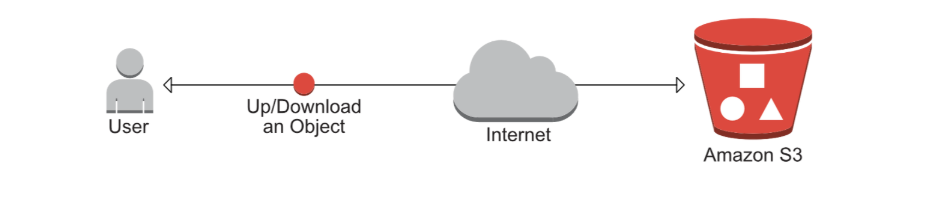

- HTTP/HTTPS 통한 API 사용 

S3 = elastic한 성질 때문에 별도의 스토리지 확장, 축소에 신경쓰지 않아도 된다. 

**S3 기능** 

- 파일 저장 공간으로 사용 
- AWS 서비스 사용 로그 저장 
- 정적 웹 사이트 호스팅 

---

# S3 객체 스토리지 특징 

객체 스토리지 = 객체로 된 파일을 다루는 저장소 

S3에 파일을 설치하는 행위는 불가능, 그냥 이미지나 동영상 파일 등만을 저장할 수 있다. 

### S3 장점 

- S3는 저장 용량이 무한대이고 파일 저장에 최적화, 용량을 추가하거나 성능을 높이는 작업이 필요없다. 
- 비용은 EC2, EBS로 구축하는 것보다 훨씬 저렴하다 
- **EBS(Elastic Block Store) → SSD/HDD 같은 보조 기억 장치 서비스** 
  - EBS = 블록 저장소, EC2에 붙여서 **OS, DB, 애플리케이션 데이터 저장소**로 사용
- 별도의 클라이언트 설치없이 HTTP 프로토콜을 통해 파일 업로드/다운로드 처리가 가능 
- S3 자체로 정적 웹서비스 가능 (html 파일을 스토리지에 저장하고, html 파일에 접근 → 홈페이지) 
- 동적 웹페이지는 EC2에서 서비스, 정적 웹페이지는 S3를 이용하면 성능도 높이고 비용도 절감할 수 있다. 

### S3 사용 example

- 클라우드 저장소 (개인 파일 보관, 구글 드라이브처럼 사용) 
- 서비스의 대용량 파일 저장소 → 이미지, 동영상 (넷플릭스) 
- 서비스 로그 저장 및 분석 

---

# S3 버킷 / 객체 개념 

```json
객체(Object)는 데이터와 메타데이터를 구성하고 있는 저장 단위 

버킷(Bucket)은 이런 객체를 저장하고 관리하는 역할 

버킷 = 디렉토리 / 폴더 개념으로 키는 파일명으로 이해해도 된다. 
```

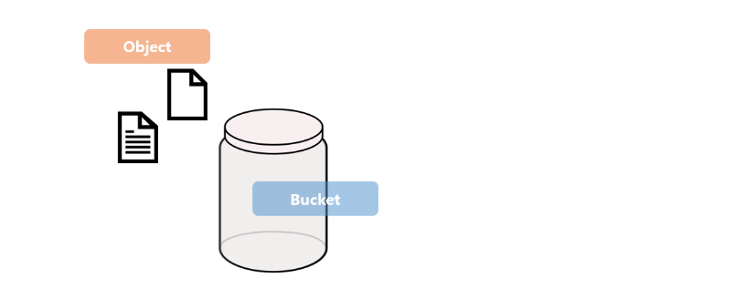

```json
버킷: User
객체: profile.png

-> http://User.s3.amazonaws.com/profile.png
```

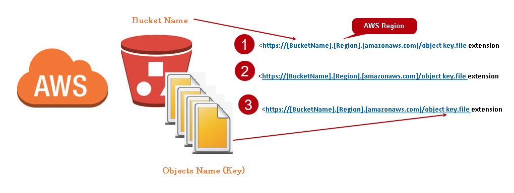

```json
S3를 구성할 때, 버킷(Bucket)이라는 컨테이너를 놓을 리전을 선택
컨테이너 내부에 객체(Object)라는 형태로 데이터를 저장하는 스토리지를 구축한다.

한 계정 당 Bucket은 100개까지 사용 가능 
Bucket 단위로 접근 제한을 설정할 수도 있다. 

S3에 저장되는 데이터는 모두 객체라고 부른다. 
객체는 하나 당 1Byte에서 최대 5TB까지 저장이 가능하며 저장할 수 있는 객체 수는 제한이 없다. 

각 객체는 데이터/메타데이터를 가진다. 
S3에 올리는 데이터 →  객체
최종 수정일, 파일 타입 등의 데이터 → 메타 데이터 

객체는 키를 통해서 버킷에서 유일한 것으로 식별될 수 있으며, 버킷에 존재하는 모든 객체는 단 하나의 키를 가진다. 
→ S3 내에서 버전, 키, 버전ID를 통해 특정 객체를 파악할 수 있다.
```

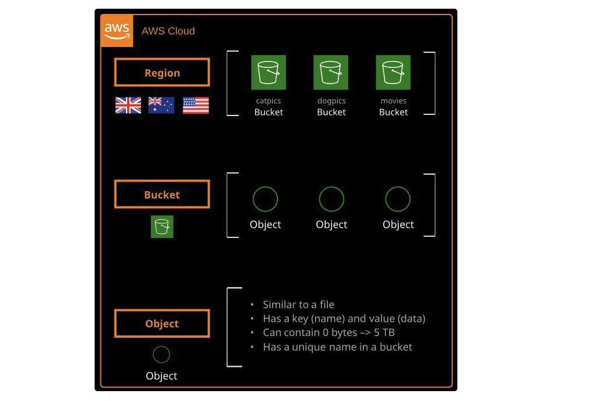

### S3 리전(region) 

- S3가 생성할 버킷을 저장할 위치를 결정 
- 리전 간 객체 공유는 불가능 
- 버킷 위치(리전)을 어디에 지정하냐에 따라 지연 시간, 비용 등이 결정

### S3 버킷(bucket)

- Amazon S3에서 생성되는 최상위 디렉토리, Amazon S3에 저장된 객체의 컨테이너 
- 버킷의 이름은 S3에서 유일해야 한다. 
- 버킷 주소는 https://**bucketname**.s3.**Region**.amazonaws.com 형태 
- 버킷을 생성하면 default → private 
- 버킷 소유권은 이전할 수 없고, 버킷 안에 다른 버킷을 둘 수 없다. 

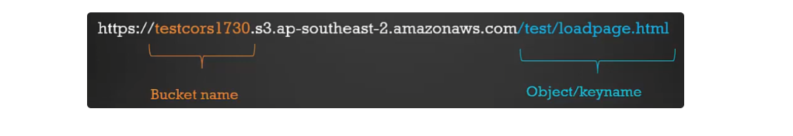

### S3 객체(object) 

```json
S3 Object 구성요소 
- Key
- Value
- Version ID
- Metadata
- CORS(Cross Origin Resource Sharing)
```

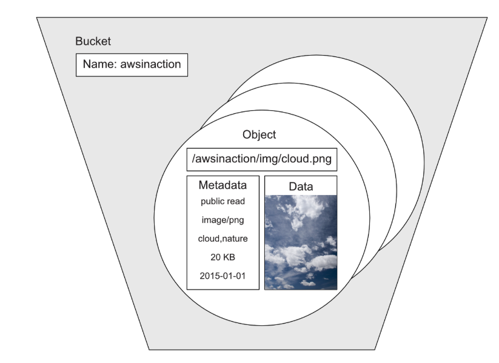

**Key: 파일 이름** 

- 버킷 내 객체의 고유 식별자, 버킷 내 모든 객체는 정확하게 하나의 키를 갖는다. 
- 버킷, 키 및 버전ID 조합은 각 객체를 고유하게 식별 

**Value: 파일 데이터** 

- S3는 Key-Value 형태로 저장
- Key의 접두어 및 슬래시를 이용하여 폴더 개념 같이 사용 가능하다. 

**Version Id: 파일의 버전 아이디**

- Version ID는 S3 고유 특징 
- 같은 파일이지만 다른 버전으로 올릴 수 있게 돕는 인식표
- 이전 버전으로 돌아가고 싶다면, Version ID를 통해 쉽게 복원시킬 수 있다. 

**MetaData: 파일의 정보를 담은 데이터** 

- 최종 수정일, 파일 타입, 파일 소유자, 사이즈 … 

**ACL: 파일의 권한을 담은 데이터** 

**Torrents: 토렌토 공유를 위한 데이터** 

**CORS(Cross Origin Resource Sharing): 한 버켓의 파일을 지역을 무시하고 다른 버켓에서 접근 가능하게 해주는 기능** 

### S3 객체(Object) 특징 

```json
객체 하나의 크기는 1Byte ~ 5TB

저장 가능한 객체 갯수 무제한

객체마다 각각의 접근 권한 설정 가능

객체 metadata는 객체가 업로드 된 후에는 수정될 수 없고, 복사해서 수정해야 한다.

객체의 metadata는 response header에 반환된다.

객체를 그룹화하는 디렉터리를 생성할 수 있다. 
따라서 폴더, 파일 처럼 디렉터리를 계층화해서 객체를 저장할 수도 있다.
```

---

# S3 버저닝(Versioning)

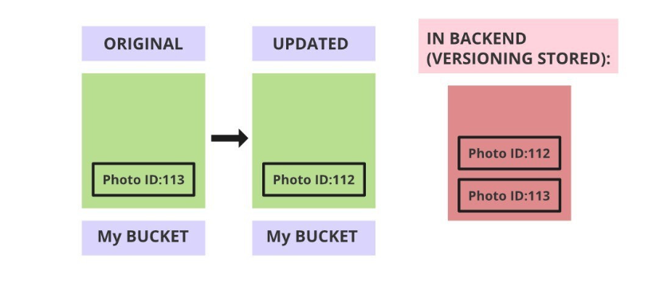

```json
파일을 실수로 삭제하고 저장을 해버렸을 경우
S3는 이를 위해 자동화된 백업 관리 기법인 버전 관리 및 생애주기 관리 기법을 제공한다.
 
버저닝(Versioning)은 특정 객체에 여러 버전을 유지하는 수단이다.

파일에 버젼 아이디를 붙임으로서, 
버전 관리를 사용하여 S3 버킷에 저장된 모든 객체의 버전을 보존, 검색 및 복원할 수 있다. 

또한 의도하지 않은 사용자 작업과 응용 프로그램 오류 모두 쉽게 복구할 수 있다.
변경내용을 추적할 수 있으므로 매우 편리하지만 비용을 조심해야한다.
 
aws 매니저에서 버킷을 만들때 기본적으로 비활성화 라서, 직접 활성화 해야한다. 
단, 버킷에서 버전을 사용하도록 설정한 후에는 비활성화 상태로 돌아갈 수 없다. 
대신 버전 관리 일시 중지 설정은 가능하다.
```

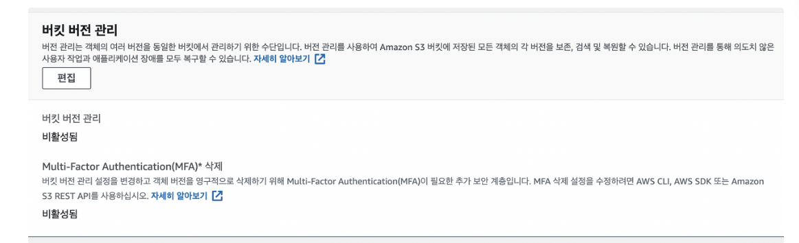

### 객체 버전 ID 수정 / 삭제 / 조회 동작 

버킷에 대한 버전 관리를 활성화 하면 저장되는 객체에 대해 고유한 버전 ID가 자동으로 생성되어진다. 

즉, 키값은 동일하지만 버전 ID가 다른 두 객체를 보유할 수 있게 된다. 

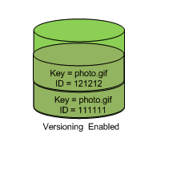

**파일 수정 동작** 

버전 관리를 사용하는 버킷에 객체를 **PUT**할 때 파일을 덮어쓰지 않는다. 

동일한 이름의 객체를 이미 보유하고 있는 버킷에 새 버전의 객체를 PUT할 때 원래 객체는 버킷에 남아 있으며 S3가 새 버전ID를 만들어 버킷에 추가해 위로 올리게 된다. (맨 위에 올려진게 최신 데이터로 인식)

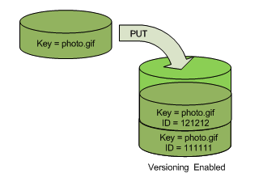

이 기능을 통해 객체를 덮어쓰거나 삭제하는 것을 방지하고, 객체 이전 버전을 검색할 수 있다.

**파일 삭제 동작**

객체를 **DELETE** 하면, 버킷에 삭제 마커(Delete Marker)를 삽입하게 된다. 

파일을 삭제한 것이 아니다. 삭제 마커를 최상단에 올림으로서 마치 파일이 삭제된 것처럼 효과를 주는 것

→ soft delete 

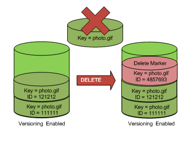

버전 관리되는 객체를 영구적으로 삭제하려면 버전 ID 자체를 삭제해야 한다. 

**파일 조회 동작** 

기본적으로 **GET** 요청은 가장 최근에 저장된 버전을 검색한다.

만약 최신 버전이 삭제 마커일 때 요청을 하면 **404 Not Found 오류가 반환된다.** 

이때 특정 버전 ID를 지정하여 특정 객체에 대해 GET을 실행할 수 있다.

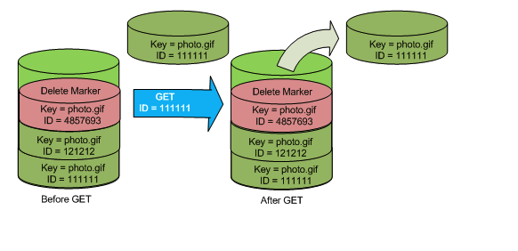

---

# S3 보안 / 권한 (접근 제어)

```json
S3는 누군가 접속해 내용물을 변조할 수 있기 때문에 S3 버킷의 기본 정책은 private으로 설정되어 있다. 

만일 외부에서 접속해 S3의 버킷을 제어할 필요가 있다면 어떻게 할까?
이때는 버킷을 통째로 public으로 개방하는 것이 아닌 S3 권한 제어를 통해 접근 제어를 설정할 수 있다. 
```

### S3 권한 설정 

- 사용자를 생성하고 사용자의 버킷 권한 엑세스를 관리하는 **IAM**
- 권한 있는 사용자에 대해 간단한 개별 객체(오브젝트)를 액세스 가능하게 만드는 **액세스 제어 목록(ACL)**
- 단일 S3 버킷 내 모든 객체에 대한 권한을 세부적으로 구성하는 **버킷 정책(bucket policy)**
- 임시 URL을 사용하여 다른 사용자에게 기간 제한 엑세스를 부여하는 **쿼리 문자열 인증(pre-sigined URL)**

### Public Access 

```json
퍼블릭 액세스 권한은 말 그대로 모두에게 액세스 권한을 오픈할 것인지 
아니면 임의의 사용자에게는 접근 권한을 제한할 것인지 설정하는 것
```

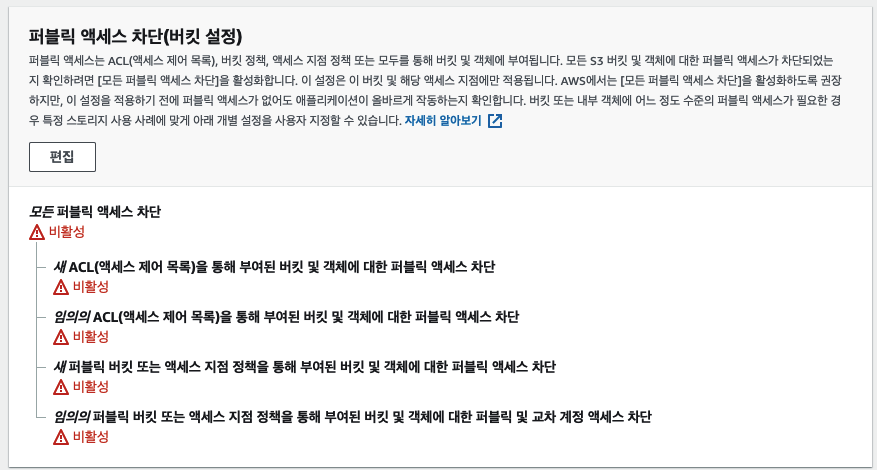

```json
모든 퍼블릭 엑세스 차단을 설정 한 경우 어떤 경우에도 모든 퍼블릭 접속을 차단하게 된다.

4가지 옵션으로 특수한 경우에 퍼블릭 엑세스가 허용되도록 설정이 가능하다.

실무에서는 모든 퍼블릭 엑세스 차단 혹은 ACL을 이용하여 퍼블릭 엑세스 차단해주는 것이 보안에 좋다. 
```

### ACL(Access Control List)

```json
ACL은 버킷이나 객체에 대해 요청자의 권한 허용 범위를 어디까지 설정할 것인가에 대해 간단하게 설정할 수 있다.

여기서 요청자는 일반 퍼블릭한 사용자가 될 수도 있고
계정의 owner, resouce group, 특정 사용자가 될 수 있다.

버켓 주인과 오브젝트 주인이 다를 경우의 권한 설정,
log 저장용 버킷에 대한 권한 설정 등을 설정 할 수 있다.
 
각각의 버킷과 그 속에 포함된 객체는 ACL과 연동된다. 
따라서 ACL로 S3 버킷이나 객체의 접근을 제어하는게 가능하다.

ACL은 IAM이나 버킷 정책에 비해 더 넓은 범위에서 제어할 수 있지만, 
단지 접근 승인을 한 곳과 접근 승인을 받은 곳으로만 나타낼 수 있다. (간단한 것만 설정 가능)
```

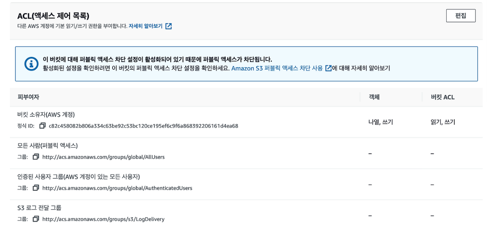

### 버킷 정책(Bucket Policy)

```json
Bucket Policy는 버킷을 사용할 권한을 가진 여러 명의 사용자 별로 
각각의 행위에 대한 권한 범위를 설정할 수 있다.

예를 들어 누군가는 읽기만 가능하고 누군가는 읽기, 쓰기 모두 가능한 상태 같이 말이다.

즉, Bucket에 대한 전반적인 권한 설정은 Bucket Policy를 통해 설정된다.
단, 버킷 안의 파일 하나하나의 권한 설정은 불가능하다.
```

**ACL VS Bucket Policy** 

- ACL과 버킷 정책 모두 버킷에 대한 엑세스를 제한하거나 허용하는 권한 설정이다. 
- **설정 범위:** 버킷정책은 버킷에 대해서만 권한을 설정할 수 있지만, ACL은 버킷 뿐만 아니라 개별 객체에도 가능하다. 
- **세분화된 설정:** 버킷정책은 JSON을 통해 세분화된 권한을 설정할 수 있지만, ACL은 버킷 정책만큼 세분화된 엑세스 모드를 제공하지 않는다.  

**Bucket Policy example** 

```json
{
    "Version": "2012-10-17", // Bucket Policy의 문법이 언제 날짜 기준으로 확정된 문법을 사용하는지 → 2008-10-17 버전 후 2012-10-17 버전이 있는데, 그 뒤로는 업데이트가 안됐음
    "Id": "S3PolicyId1", // Bucket Policy의 고유 아이디, 자동으로 부여되는 경우가 많음
    "Statement": [
        {
            "Sid": "IPAllow", // 각 Statement의 고유 아이디. 무슨 역할을 하는 policy인가
            "Effect": "Allow", // 버킷에 대한 명령을 허락(allow)하거나 거부(deny). 특정 사용자에 대해 명령을 제한하거나, 허용하는 식으로 사용
            "Principal": {"AWS": "arn:aws:iam::spark323:user/spark"}, // Bucket Policy의 적용대상 (spark323 아이디의 유저에 대해서)
            "Action": [ // Bucket Policy에서 허용한 Action
                "s3:GetObject", // 객체 가져오는 행동
                "s3:GetBucketLocation", // 버켓 위치를 확인하는 행동
                "s3:ListBucket", // 버켓 리스트를 확인하는 행동
            ],
            "Resource": "arn:aws:s3:::bucketname/*", // 대상이 대는 Bucket에 대한 명세
            "Condition": { // 어떤 조건 하에
                "NotIpAddress": { // 이 IP비허용
                    "aws:SourceIp": "1.1.1.1/32"
                },
                "IpAddress": { // 이 IP허용
                    "aws:SourceIp": [
                        "192.168.1.1",
                        "192.168.1.2/32",
                    ]
                }
            }
        }
    ]
}
```

---

# S3 요금 정책 

S3는 사용한 만큼만 요금을 지불한다. 

**동일한 리전의 EC2와는 데이터 전송 요금이 발생하지 않으므로 S3와 EC2 리전은 동일하게 설계한다.**

- 스토리지 요금: 객체 저장 비용(객체 크기, 월에 객체 저장한 기간, 스토리지 클래스에 따라 다르다)
- 요청 및 데이터 검색: GET, LIST 및 기타 요청에 대한 비용 발생(DELETE 및 CANCEL 요청 무료)
- 데이터 전송: 특정 케이스를 제외하고 모든 송수신 데이터에 요금 지불 

---

# S3 버킷 생성하기 

```json
모든 퍼블릭 엑세스 차단을 설정
S3 버킷/객체에 대해 익명 사용자 또는 퍼블릭 권한이 무조건 차단
즉, 버킷 정책이나 ACL을 통해서 Everyone에게 권한을 주려고 해도 → 무시 
 
IAM 사용자/역할로 접근
퍼블릭이 아닌 인증된 AWS 사용자이기 때문에, 퍼블릭 엑세스 차단과 무관하게 접근 가능
```

### IAM 사용자 

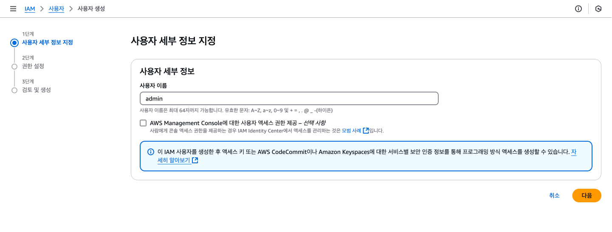

권한 설정: 직접 정책 연결, **AmozonS3FullAccess** 

### 엑세스 키 생성 

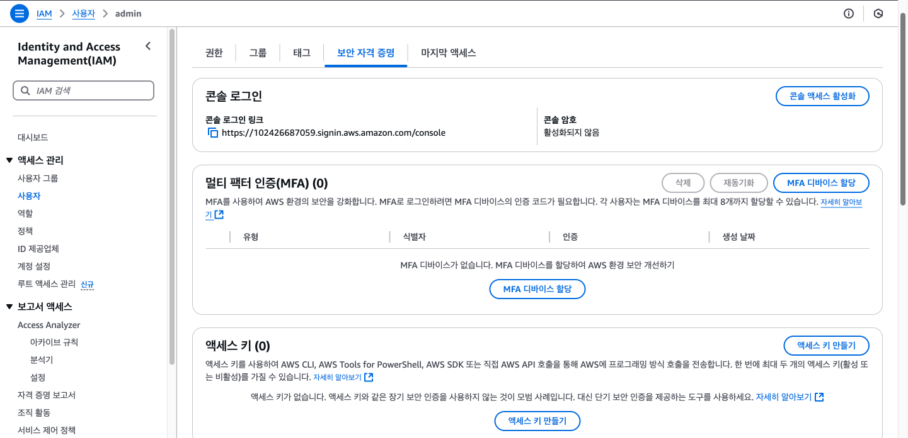

엑세스 키: [REDACTED AWS ACCESS KEY]

비밀 엑세스 키: lW4Jisb2wSmL4FgFn8RFM5ZU5wzo2NeW4UvXM0vE

---

# 참고 자료 

[https://inpa.tistory.com/entry/AWS-%F0%9F%93%9A-S3-%EB%B2%84%ED%82%B7-%EC%83%9D%EC%84%B1-%EC%82%AC%EC%9A%A9%EB%B2%95-%EC%8B%A4%EC%A0%84-%EA%B5%AC%EC%B6%95](https://inpa.tistory.com/entry/AWS-%F0%9F%93%9A-S3-%EB%B2%84%ED%82%B7-%EC%83%9D%EC%84%B1-%EC%82%AC%EC%9A%A9%EB%B2%95-%EC%8B%A4%EC%A0%84-%EA%B5%AC%EC%B6%95)

[https://gaeggu.tistory.com/33](https://gaeggu.tistory.com/33)
