# ***객체 지향의 특징*** 

    - *추상화*
    - *캡슐화* 
    - *상속* 
    - *다형성* 

## ***스프링의 추상화 예시*** 

### *JDBC*

***JDBC(Java Database Connectivity) 등장 배경*** 

    - *오라클, MySQL, SQL Server 등 각 DBMS마다 제공하는 드라이버 엔진과 API가 다르다.*
    - *서로 다른 API 때문에 데이터베이스를 변경할 때 코드 전체를 수정해야 하는 문제가 발생* 
    - *각 데이터베이스마다 다른 코드 작성을 해야 했기 때문에 코드 중복이 많았다.* 

***JDBC의 추상화*** 

    - *JDBC는 데이터베이스와 상호작용하는* ***표준 인터페이스****를 제공하고, 이를 통해 애플리케이션 코드가 특정 DBMS에 의존하지 않도록 추상화*
    - *추상화 인터페이스:* *`Connection`**,* *`Statement`**,* *`ResultSet`**,* *`PreparedStatement`*

### *스프링 AOP*

*스프링은* ***AspectOrientedProgramming****을 지원하는데 런타임 환경에서의 프록시 패턴을 활용* 

*개발자가 직접 프록시 패턴을 적용하려면 직접 클래스를 작성해야 하지만 이는 너무 불편하다.* 

*이 불편함을 없애기 위해서 동적 프록시 기술을 사용하고 스프링에서 사용하는 동적 프록시 기술은* 

*JdkDynamicProxy(자바 제공), CGLIB 기술을 사용한다.* 

*하지만 인터페이스 기반은 JDK 동적 프록시 클래스 상속 기반은 CGLIB를 사용하는데* 

*각각 부가 기능을 추가할 때 사용하는 클래스가 다르다. MethodInvocation / MethodInterceptor*

*스프링은 이를* ***advice 인터페이스****를 제공으로 개발자는 해당 인터페이스를 구현만 하기만 하면* 

*ProxyFactory는 내부에서 알아서 MethodInvocation or  MethodInterceptor 사용한다.* 

[https://20240228.tistory.com/429](https://20240228.tistory.com/429)

## ***스프링의 캡슐화 예시*** 

***AOP를 통한 부가 기능을 캡슐화*** 

    - *필수 비즈니스 로직만 노출* 
- *메소드 호출 ↔ 반환 시간*
      - *보안: 메소드 호출 인가  @PreAuthorize*
      - *트랜잭션 관리: @Transactional*

***스프링 빈, DI를 통한 controller ↔ service ↔ repository layer 간 구현을 캡슐화*** 

## ***스프링의 다형성 활용 예시***

 

***인터페이스를 구현한 객체 인스턴스를 실행 시점에 유연하게 변경할 수 있다.*** 

    - *프록시 객체* 
    - *함수형 인터페이스 → 람다* 
    - *스프링 컨테이너* ***ApplicationContext***
- *애노테이션 기반*
      - *XML 기반*

# *SOLID*

*클린코드로 유명한 로버트 마틴이 좋은 객체 지향 설계의 5가지 원칙을 정리*

*SRP: 단일 책임 원칙(single responsibility principle)*

*OCP 개방-폐쇄 원칙(Open/closed principle)*

*LSP 리스코프 치환 원칙(Liskov substitution principle)*

*ISP 인터페이스 분리 원칙(Interface segregation principle)*

*DIP 의존관계 역전 원칙(Dependency inversion principle)*

*객체 지향의 핵심은 다형성인데 다형성만으로는 쉽게 SOLID를 지킬 수 없다.* 

    - *스프링은 스프링 컨테이너를 통한 DI로 OCP, DIP 한계를 해결한다.* 

# ***트레이드 오프*** 

*인터페이스를 도입하면 추상화 비용이 발생한다.* 

    - *인터페이스가 없는 단일 클래스 보다 구조 파악이 힘들다. - 구조 파악 비용* 
    - *인터페이스 - 구현체 설계에 대한 비용* 
    - *작성에 대한 비용* 

*정답은 없다. (내 주관적인 의견) -* ***토론 포인트*** 

    - *확장 가능성이 많고 구체 프로덕트가 많다면 나는 인터페이스를 사용하여 추상화하겠다.* 
- *인터페이스 기반이면 다양한 GOF 디자인 패턴이 활용 가능해진다.*
      - *인터페이스를 통해 추상화 도입을 하고 반복적인 코드 반복을 줄이고 클래스의 역할 의도 전달을 추상 클래스를 통해 가능하다.* ***ex) 데코레이터 패턴의 추상 클래스 추가 버전***
    - *현재 시점에서 확장 가능성이 없는 프로덕트라면 일단 인터페이스 없이 구현하고 추후에 리팩토링하자*

# ***스프링 빈 조회*** 

***빈 이름 직접 부여하기*** 

```java
@Bean(name = "customBeanName")
```

    - *빈 이름은 항상 다른 이름을 부여하자* 
    - *직접 부여하지 않으면 메소드 이름을 사용한다.* 

***스프링 컨테이너에 등록된 모든 빈 조회***

```java
class BeanDefinitionTest {
    AnnotationConfigApplicationContext ac = new AnnotationConfigApplicationContext(AppConfig.class);
   
    @Test
    @DisplayName("빈 설정 메타정보 확인")
    void findApplicationBean() {
        String[] beanDefinitionNames = ac.getBeanDefinitionNames();
        for (String beanDefinitionName : beanDefinitionNames) {
            BeanDefinition beanDefinition = ac.getBeanDefinition(beanDefinitionName);
            if (beanDefinition.getRole() == BeanDefinition.ROLE_APPLICATION) {
                System.out.println("beanDefinitionName" + beanDefinitionName +
                        " beanDefinition = " + beanDefinition);
            }
        }
    }
}
```

    - *`ac.getBeanDefinitionNames()`* *: 스프링에 등록된 모든 빈 이름을 조회*
    - *`ac.getBean()`* *: 빈 이름으로 빈 객체(인스턴스)를 조회*
    - *`ac.getRole()`* *: 스프링 빈 역할 조회하기* 
- *`ROLE_APPLICATION`**: 사용자가 정의한 빈* 
      - *`ROLE_INFRASTRUCTURE`* *: 스프링이 내부에서 사용하는 빈*

***스프링 빈 조회***

    - *`ac.getBean(String name, Class<T> requiredType)`*
    - *`ac.getBean(Class<T> requiredType)`*
    - *조회 대상 스프링 빈이 없으면 예외 발생*
- *`NoSuchBeanDefinitionException`*

***스프링 빈 조회 - 동일한 타입이 둘 이상***

    - *타입으로 조회시 같은 타입의 스프링 빈이 둘 이상이면 오류가 발생*
- *`NoUniqueBeanDefinitionException`*
      - *빈 이름을 지정하자*
    - *`ac.getBeansOfType()`* *: 해당 타입의 모든 빈을 조회*
- *return:* ***Map<key: String name | value: Class<T>>***

***스프링 빈 조회 - 상속 관계***

    - *부모 타입으로 조회하면, 자식 타입도 함께 조회*

# *스프링 컨테이너 구조* 


***BeanFactory***

    - *스프링 컨테이너의 최상위 인터페이스*
    - *스프링 빈을 관리하고 조회하는 역할을 담당*
    - *`getBean()`**을 제공*

***ApplicationContext***

    - *빈을 관리하고 검색하는 기능을 BeanFactory가 제공해주는데, 그러면 둘의 차이가 뭘까?*
    - *애플리케이션을 개발할 때는 빈을 관리하고 조회하는 기능은 물론이고, 수 많은 부가기능이 필요*


    - *메시지소스를 활용한 국제화 기능* 
    - *환경변수*
- *로컬, 개발, 운영등을 구분해서 처리*
    - *애플리케이션 이벤트*
- *이벤트를 발행하고 구독하는 모델을 편리하게 지원*
    - *편리한 리소스 조회*
- *파일, 클래스패스, 외부 등에서 리소스를 편리하게 조회*

***ApplicationContext 구현체***

    - *AnnotationConfigApplicationContext*
- *애노테이션 기반 자바 코드 설정 사용*
    - *GenericXmlApplicationContext*
- *xml 설정 파일*

*스프링 컨테이너는 다양한 형식의 설정을 사용할 수 있게 유연하게 설계* 

***스프링 빈 설정 메타 정보 - BeanDefinition***

    - *다양한 설정 형식을 BeanDefinition 이라는 추상화를 통해 한다.* 
- *XML →  BeanDefinition*
      - *자바 코드 →  BeanDefinition*
      - *스프링 컨테이너 → BeanDefinition (의존)*


***BeanDefinition 정보***

    - *`BeanClassName`**: 생성할 빈의 클래스 명*
- *@Bean으로 등록되는 빈 → 존재 X / @Component → 존재 O*
    - *`factoryBeanName`**: 팩토리 역할의 빈을 사용할 경우 이름*
- *AppConfig*
    - *`factoryMethodName`**: 빈을 생성할 팩토리 메서드 지정*
- *@Bean 메소드 이름*
    - *`Scope`**: default: singleton*
    - *`lazyInit`**: 스프링 컨테이너를 생성할 때 빈을 생성하는 것이 아니라, 실제 빈을 사용할 때 까지 최대한 생성을 지연 처리 하는지 여부*
- *default: null → 즉시 초기화*
    - *`InitMethodName`**: 빈을 생성하고, 의존관계를 적용한 뒤에 호출되는 초기화 메서드 명*
- ***@PostCustruct***
    - *`DestroyMethodName`**: 빈의 생명주기가 끝나서 제거하기 직전에 호출되는 메서드 명*
- ***@PreDestory***
    - *`Constructor arguments, Properties`**: 의존관계 주입에서 사용한다. (자바 설정 처럼 팩토리 역할의 빈을 사용하면 없음)*

# *싱글톤* 

[https://20240228.tistory.com/341](https://20240228.tistory.com/341)

***싱글톤 방식의 주의점***

    - *여러 클라이언트가 하나의 같은 객체 인스턴스를 공유하기 때문에 싱글톤 객체는 상태를 유지(stateful) 하게 설계하면 안된다*
    - *만약 stateful하게 설계하여 race condition이 발생한다면 멀티 스레딩 환경에서 concurrency problem 발생 →  데이터 정합성 문제가 발생한다.* 
    - *결론은 stateless하게 설계해야 한다* 

# ***@Configuration과 바이트코드 조작의 마법***

*@Configuration이 붙은 클래스는 CGLIB 기술을 사용해서 클래스를 상속해서 컨테이너에 개발자가 작성한 객체가 아닌 다른 객체(프록시)를 넣는다.* 

***CGLIB 기술이란?***

*javac 컴파일러가 컴파일하여 .java → .class 변환(컴파일 시점) 이후 jvm 클래스 로딩 시점에 동적으로 바이트 코드를 조작하여 클래스를 생성하거나 확장하는 방식으로 동작한다. 이를 로드 타임* ***위빙(Weaving)****이라고 부른다.* 

*즉, 클래스가 JVM에 의해 로드될 때 바이트 코드를 조작하여 @Bean으로 정의된 빈이 이미 스프링 컨테이너에 있으면 해당 객체를 반환하여 생성 로직 호출을 하지 않는다.* 

*이런 메커니즘을 통해 싱글톤을 지킨다.*

# ***@ComponentScan***

    - *@Component가 붙은 클래스를 자동으로 스프링 컨테이너에 스프링 빈으로 등록한다.* 
    - ***@SpringBootApplication***
- *애플리케이션의 시작 지점* 
      - *내부에 @ComponentScan 포함*
    - *빈 이름 전략* 
- *빈 이름 기본 전략: MemberServiceImpl → memberServiceImpl*
      - *빈 이름 직접 지정: @Component("memberService2")*
    - *탐색할 패키지의 시작 위치 지정* 
```java
@ComponentScan(basePackages = {"hello.core", "hello.service"})
```

      - *모든 자바 클래스를 다 컴포넌트 스캔하면 시간이 오래 걸린다.*
      - *`basePackages`* *: 탐색할 패키지의 시작 위치를 지정한다. 이 패키지를 포함해서 하위 패키지를 모두 탐색한다.*
      - *default(생략): @ComponentScan 이 붙은 설정 정보 클래스의 패키지가 시작 위치가 된다.*
    - *스캔 대상* 
- *includeFilters : 컴포넌트 스캔 대상을 추가로 지정*
      - *excludeFilters : 컴포넌트 스캔에서 제외할 대상을 지정*

# ***@Autowired***

    - *의존이 필요한 객체를 자동 주입 받도록 설정하는 애노테이션이다.* 
    - *클래스에 생성자가 1개면 생략이 가능하다.*
    - *보통 @RequiredArgsConstructor를 사용*  
    - *조회 전략* 
- *조회 기본 전략:* *`getBean(Class<T> type)`*

# ***중복 등록과 충돌 (이름 충돌)***

***자동 빈 등록 vs 자동 빈 등록***

*→* *`ConflictingBeanDefinitionException`* 

***수동 빈 등록 vs 자동 빈 등록***

```java
@Component
public class MemoryMemberRepository implements MemberRepository {}

@Configuration
public class AutoAppConfig {
	 @Bean(name = "memoryMemberRepository")
	 public MemberRepository memberRepository() {
			 return new MemoryMemberRepository();
	 }
}
```

*→ 수동 빈 등록이 우선권을 가진다*

*수동 빈 등록시 남는 로그*

```java
Overriding bean definition for bean 'memoryMemberRepository' with a different 
definition: replacing
```

***최근 스프링 부트 수동 빈 등록 vs 자동 빈 등록*** 

*→ 오류 발생* 

```java
Consider renaming one of the beans or enabling overriding by setting 
spring.main.allow-bean-definition-overriding=true
```

# ***다양한 의존관계 주입 방법***

    - *생성자 주입*
    - *수정자 주입 - setter*
    - *필드 주입*
- *DI 프레임워크가 없으면 테스트 불가능* 
      - *설정이 목적인 @Configuration 같은 곳에서만 사용*
    - *일반 메소드 주입* 

*→ 생성자 주입을 사용하자 (불변성: 초기화 시점 1번 호출)*

# ***옵션 처리***

*언제 사용?: 주입할 스프링 빈이 없어도 동작해야 할 때* 

***@Autowired***

    - *required 옵션은 default: true*
    - *자동 주입 대상이 없으면 오류가 발생한다.* 

***옵션 처리하는 방법***

    - *@Autowired(required=false)*
    - *@Nullable*
    - *Optional<T>*
- *자동 주입할 대상이 없으면 Optional.empty()*

# ***생성자 주입을 선택해라!***

    - *대부분의 의존관계 주입은 한번 일어나면 애플리케이션 종료시점까지 의존관계를 변경할 일이 없다.*
    - *의존관계는 애플리케이션 종료 전까지 변하면 안된다. → 불변성* 
    - *수정자 주입을 사용하면, setXxx 메서드를 public으로 열어두어야 한다.*
- *의존관계 뿐만 아니라 항상 setter 사용을 지양하자 또는 private 접근 제어자로 외부 접근을 제어하자* 
      - [*https://20240228.tistory.com/390*](https://20240228.tistory.com/390)
    - *프레임워크에 의존하지 않고, 순수한 자바 언어의 특징을 잘 살리는 방법*


***final 키워드*** 

    - *생성자 주입을 사용하면 필드에 final 키워드를 사용할 수 있다.* 
- *오직 생성자 주입만 final 키워드를 사용할 수 있다.*
    - *그래서 생성자에서 혹시라도 값이 설정되지 않는 오류를 컴파일 시점에 막아준다.*
- *제일 좋은 오류는 컴파일 시점 오류*
    - *`@RequiredArgsConstructor`* *사용하지 않을 이유가 없다.*
-  *`final`* *필드나* *`@NonNull`**이 붙은 필드에 대해 자동으로 생성자를 생성*

***롬복 설정 - build.gradle***

```groovy
configurations {
	 compileOnly {
	 extendsFrom annotationProcessor
	 }
}
dependencies {
	 compileOnly 'org.projectlombok:lombok'
	 annotationProcessor 'org.projectlombok:lombok'
	 testCompileOnly 'org.projectlombok:lombok'
	 testAnnotationProcessor 'org.projectlombok:lombok'
}
```

# ***조회 빈이 2개 이상 - 문제***

*→ DI 상황 같은 타입(Class<T>) 2개 이상 존재 →* *`NoUniqueBeanDefinitionException`* 

*그렇다고 인터페이스가 아닌 하위 타입(구체 타입)을 지정하는 것은 DIP 즉, 추상화에 의존하라는 SOLID 원칙을 위배하고 유연성이 떨어진다.* 

# ***@Autowired 필드 명, @Qualifier, @Primary***

*조회 빈이 2개 이상일 때 생기는 문제를 해결해 보자* 

## ***@Autowired 필드 명 매칭***

*@Autowired는 먼저 타입 매칭을 시도하고, 이때 여러 같은 타입의 빈이 있으면 필드 이름, 파라미터 이름으로 빈 이름을 추가로 매칭한다.* 

```java
@Autowired
private DiscountPolicy discountPolicy

@Autowired
private DiscountPolicy rateDiscountPolicy
```

## ***@Qualifier 사용***

*주의: 빈 이름을 변경하지 않는다. 단지 구분하는 역할을 한다.* 

***@Qualifier 적용***

```java
@Component
@Qualifier("mainDiscountPolicy")
public class RateDiscountPolicy implements DiscountPolicy {}

@Component
@Qualifier("fixDiscountPolicy")
public class FixDiscountPolicy implements DiscountPolicy {}
```

***생성자 자동 주입 예시***

```java
@Autowired
public OrderServiceImpl(MemberRepository memberRepository, 
							@Qualifier("mainDiscountPolicy") DiscountPolicy discountPolicy) {
		 this.memberRepository = memberRepository;
		 this.discountPolicy = discountPolicy;
}
```

***만약 @Qualifier를 못찾으면 어떻게 동작할까?***

    1. *@Qualifier 로 주입할 때 @Qualifier("mainDiscountPolicy") 를 못찾으면 어떻게 될까?*
    1. *mainDiscountPolicy라는 이름의 스프링 빈을 추가로 찾는다*
    1. *→* *`NoSuchBeanDefinitionException`* *예외 발생*

***내가 생각하는 @Qualifier의 문제점과 해결법***

*@Qualifier의 value는 개발자가 직접 문자열 값을 입력하는 방식이어서 안정성 측면에 문제가 있다.* 

*ex) @Qualifier(”main”) → @Qualifier(”mai”)* 

*이런 오류는 컴파일 타임에 잡지 못하는 오류이다.* 

*이런 문제점은 abstract 클래스를 활용하여 상수로 정의하여 해결하면 문자열을 직접 입력하는 것보다 안전하다고 생각한다.* 

```java
abstract public class Policy {
    private Policy(){}
    public static final String RATE_DISCOUNT = "rate_discount";
    public static final String FIX_DISCOUNT = "fix_discount";
}

@Component
@Qualifier(Policy.FIX_DISCOUNT)
public class FixDiscountPolicy implements DiscountPolicy{}
```

## ***@Primary 사용***

*@Primary 는 우선순위를 정하는 방법이다.* 

*@Autowired 시에 여러 빈이 매칭되면 @Primary가 우선권을 가진다.*

```java
@Component
@Primary
public class RateDiscountPolicy implements DiscountPolicy {}

@Component
public class FixDiscountPolicy implements DiscountPolicy {}
```

***사용코드***

```java
@Autowired
public OrderServiceImpl(MemberRepository memberRepository, DiscountPolicy discountPolicy) {
		 this.memberRepository = memberRepository;
		 this.discountPolicy = discountPolicy;
}
```

## ***@Qualifier vs @Primary 우선 순위***

*@Primary는 기본값 처럼 동작하는 것이고, @Qualifier는 매우 상세하게 동작*

*스프링은 항상 자동보다는 수동이, 넓은 범위보다 좁은 범위의 선택권이 우선 순위가 높다.*

*→ @Qualifier > @Primary*

# ***애노테이션 직접 만들기***

*강사님은 @Qualifier 타입 체크의 문제점을 애노테이션을 만들어서 해결하는 방법으로 제시하셨다.*

*애노테이션 방식은 필요한 애노테이션이 n개 라면 애노테이션 클래스 또한 n개가 필요하다.* 

*반면에 추상 클래스 하나면 여러 상수를 정의할 수 있기 때문에 해당 방식이 유지 보수, 확장성 측면에서 더 좋다고 생각한다. (다른 사람들 의견이 궁금)*

# ***조회한 빈이 모두 필요할 때, List, Map***

    - *의도적으로 정말 해당 타입의 스프링 빈이 다 필요한 경우가 존재* 
    - *스프링을 사용하면 전략 패턴을 매우 간단하게 구현*
- [*https://20240228.tistory.com/425*](https://20240228.tistory.com/425)
    - *해당하는 타입의 스프링 빈이 없으면, 빈 컬렉션이나 Map을 주입*

# *컴포넌트 스캔 VS @Configuration 수동 등록* 

    - *Controller, Service, Repository → 컴포넌트 스캔 활용* 
    - *부가 서비스 (aop) → 수동 등록*

# ***빈 생명주기 콜백?***

*애플리케이션 시작 시점과 종료 시점에 필요한 객체의 초기화/종료 작업이 있다.* 

*→ 데이터베이스 커넥션 풀(히카리 풀), 요청 스레드 풀, 네트워크 소켓 …*

*→ 스프링은 어떻게 초기화 작업과 종료 작업을 할까?*

***스프링 빈의 라이프 사이클*** 

*객체 생성 → 의존관계 주입(DI)*

*개발자가 어떻게 의존관계 주입이 모두 완료된 시점을 알 수 있을까?*

*→ 스프링은 스프링 빈에게 콜백 메소드를 통해서 초기화 시점과 스프링 컨테이너가 종료되기 직전에 소멸 콜백을 준다.* 

***스프링 빈의 이벤트 라이프 사이클***

*스프링 컨테이너 생성 → 스프링 빈 생성 → 의존관계 주입 → 초기화 콜백 → 사용 → 소멸전 콜백 → 스프링 종료* 

*초기화 콜백: 빈이 생성되고, 빈의 의존관계 주입이 완료된 후 호출*

*소멸전 콜백: 빈이 소멸되기 직전에 호출*

## ***스프링 AOP 초기화를 포함한 전체 라이프 사이클*** 

***스프링 컨테이너 생성 → 스프링 빈 생성 → 의존관계 주입 → PostProceesor before 메소드 →*** 

***초기화 콜백 →  PostProceesor after 메소드 → 사용 → 소멸전 콜백 → 스프링 종료*** 

***테스트 코드*** 

```java
@Slf4j
public class TimeAdvice implements MethodInterceptor {
    @Override
    public Object invoke(MethodInvocation invocation) throws Throwable {
        log.info("start={}", System.currentTimeMillis());
        Object result = invocation.proceed();
        log.info("end={}", System.currentTimeMillis());
        return result;
    }
}

@Component
@Slf4j
public class MyPostProcessor implements BeanPostProcessor {
    @Override
    public Object postProcessBeforeInitialization(Object bean, String beanName) throws BeansException {
        if(beanName.equals("example")){
            log.info("[START POST PROCESSOR]");
            ProxyFactory proxyFactory = new ProxyFactory(new Example());
            DefaultPointcutAdvisor advisor = new DefaultPointcutAdvisor(new TimeAdvice());
            advisor.setPointcut(Pointcut.TRUE);
            proxyFactory.addAdvisor(advisor);
            log.info("[END POST PROCESSOR]");
            return proxyFactory.getProxy();
        }
        return bean;
    }
}

@Component
@Slf4j
public class Example {
    public void call(){
        log.info("call");
    }
    @PostConstruct
    public void init(){
        log.info("init");
    }
    @PreDestroy
    public void destroy(){
        log.info("destroy");
    }
}

@Aspect
@Slf4j
@Component
public class TimeAspect {
    @Around("execution(* hello.core.aop.Example..*(..))")
    public Object time(ProceedingJoinPoint joinPoint) throws Throwable{
        log.info("start={}", System.currentTimeMillis());
        Object result = joinPoint.proceed();
        log.info("end={}", System.currentTimeMillis());
        return result;
    }
}
```

    - ***스프링 AOP 사용 →  MyPostProcessor @Component 주석 처리*** 
    - ***custom AOP 사용 → TimeAspect @Component 주석 처리*** 

***테스트 결과 및 결론*** 

```plain text
*직접 포스트 프로세서를 구현하고 ProxyFactory 사용해서 대체하니까
포스트 프로세서의 어떤 메소드를 구현하냐고 프록시를 적용하냐에 따라서 콜백 메소드에 AOP 적용이 달라진다
초기화 콜백 이전에 AOP를 적용하면 초기화 콜백에도 부가 로그가 찍히고
초기화 콜백 이후에 AOP를 적용하면 초기화 콜백에는 부가 로직이 안 찍히는걸 확인
커스텀 말고 @Aspect를 통해서 적용하니까 콜백 메소드에 부가 로그가 안 찍히는걸로 봐서는 
스프링 AOP는 postProcessAfterInitialization 메소드를 구현한다.*
```

***스프링은 크게 3가지 방법으로 빈 생명주기 콜백을 지원한다.***

    - *인터페이스(InitializingBean, DisposableBean)*
    - *설정 정보에 초기화 메서드, 종료 메서드 지정*
    - *@PostConstruct, @PreDestroy 애노테이션 지원*

# ***인터페이스 InitializingBean, DisposableBean***

    - *`InitializingBean`**은* *`afterPropertiesSet()`* *메서드로 초기화를 지원*
    - *`DisposableBean`**은* *`destroy()`* *메서드로 소멸을 지원*

***InitializingBean(초기화), DisposableBean(소멸) 인터페이스 단점***

    - *이 인터페이스는 스프링 전용 인터페이스다. 해당 코드가 스프링 전용 인터페이스에 의존한다.*
    - *초기화, 소멸 메서드의 이름을 변경할 수 없다*
    - *내가 코드를 고칠 수 없는 외부 라이브러리에 적용할 수 없다.*
    - *현재는 거의 사용하지 않는다.* 

# ***빈 등록 초기화, 소멸 메서드 지정- @Bean***

```java
@Configuration
static class LifeCycleConfig {
		@Bean(initMethod = "init", destroyMethod = "close")
		public NetworkClient networkClient() {
				NetworkClient networkClient = new NetworkClient();
				networkClient.setUrl("http://hello-spring.dev");
				return networkClient;
		}
}
```

    - *`@Bean(initMethod = "init", destroyMethod = "close")`* 
    - *메소드 이름의 자유*
    - *스프링 빈이 스프링 코드에 의존하지 않는다.* 
    - *코드가 아니라 설정 정보를 사용하기 때문에 코드를 고칠 수 없는 외부 라이브러리에도 초기화, 종료 메소드를 적용할 수 있다.*
    - *종료 메소드* 
- *`destroyMethod`* *close , shutdown라는 이름의 메소드를 자동으로 호출*
      - *즉, 특별한 지정이 없고 close, shutdown 메소드가 존재하면 소멸 메소드로 동작한다.*

# ***애노테이션 @PostConstruct, @PreDestroy***

    - *최신 스프링에서 가장 권장하는 방법*
    - *JSR-250(자바 표준) → 스프링이 아닌 다른 컨테이너에서도 동작*
    - *외부 라이브러리에는 적용하지 못한다* 
- *외부 라이브러리를 초기화, 종료 해야 하면 @Bean의 기능을 사용*

# ***다양한 스코프*** 

***스프링의 다양한 스코프*** 

    - ***싱글톤: 스프링 컨테이너의 시작과 종료*** 
    - ***프로토타입:*** *스프링 컨테이너는 프로토타입 빈의 생성과 의존관계 주입까지만 관여하고 더는 관리하지 않는다.* 
    - ***웹 관련 스코프***
- *request: 웹 요청이 들어오고 나갈때 까지 유지되는 스코프*
      - *session: 웹 세션이 생성되고 종료될 때 까지 유지되는 스코프*
      - *application: 웹의 서블릿 컨텍스트와 같은 범위로 유지되는 스코프*

***빈 스코프 지정*** 

```java
@Scope("prototype") 
@Component
public class HelloBean {}

@Scope("prototype")
@Bean
PrototypeBean HelloBean() {
		 return new HelloBean();
}
```

# ***프로토타입 스코프***

***싱글톤 스코프의 빈****을 조회하면 스프링 컨테이너는 항상 같은 인스턴스의 스프링 빈을 반환*

***프로토타입 스코프 빈****을* *스프링 컨테이너에 조회하면 스프링 컨테이너는 항상 새로운 인스턴스를 생성해서 반환* 

    - *스프링 컨테이너는 (생성, 의존관계 주입, 초기화) 까지만 처리* 
- *→ @PreDestroy 같은 종료 메서드가 호출 X*
      - *→ 프로토타입 빈은 클라이언트가 관리해야 한다. (종료 메소드 호출)*

# *프로토타입 스코프 - 싱글톤 빈과 함께 사용시 Provider로 문제 해결*

*싱글톤 빈이 프로토타입 빈을 DI 받아서 사용하면 해당 프로토타입 빈은 계속 재생성되지 않는다.* 

*즉, 싱글톤 빈이 가지는 프로토타입 빈은 싱글톤 빈의 생명주기와 동일하다.* 

*이는* ***Provider****를 통해서 해결이 가능하다.* 

### ***가장 간단한 방법 스프링 컨테이너에 요청 (DL 방식)***

```java
static class ClientBean { 
		@Autowired
		private ApplicationContext ac;
		
		public int logic() {
				PrototypeBean prototypeBean = ac.getBean(PrototypeBean.class);
				prototypeBean.addCount();
				int count = prototypeBean.getCount();
				return count;
		}
}
```

*의존관계를 외부에서 주입(DI) 받는게 아니라 이렇게 직접 필요한 의존관계를 찾는 것을* ***Dependency Lookup(DL)*** *의존관계 조회(탐색) 이라한다*

*→ 스프링 컨테이너에 종속적이다 → 단위 테스트가 어렵다 → 다른 방법 없을까..?*

### ***ObjectFactory, ObjectProvider***

*지정된 빈을 컨테이너에서 대신 찾아주는 DL 서비스를 제공하는 것이 바로* *`ObjectProvider`* *이다.* 

*과거에는* *`ObjectFactory`* *를 사용 했지만 현재는 편의 기능이 더 많은* *`ObjectProvider`* *사용* 

```java
@Autowired
private ObjectProvider<PrototypeBean> prototypeBeanProvider;

public int logic() {
		PrototypeBean prototypeBean = prototypeBeanProvider.getObject();
		prototypeBean.addCount();
		int count = prototypeBean.getCount();
		return count;
}
```

    - ***ObjectProvider<T>***
    - *getObject() → 호출하면 내부에서 스프링 컨테이너를 통해서 해당 빈을 찾아서 반환 (DL)*
    - *스프링이 제공하는 기능을 사용하지만, 기능이 단순하므로 단위테스트를 만들거나 mock 코드를 만들기는 훨씬 쉬워진다.*

### ***JSR-330 Provider***

***build.gradle 설정*** 

```java
// 스프링부트 3.0 미만
javax.inject:javax.inject:1

// 스프링부트 3.0 이상
jakarta.inject:jakarta.inject-api:2.0.1
```

***스프링 부트 3.0***

```java
@Autowired
private Provider<PrototypeBean> provider;
public int logic() {
		 PrototypeBean prototypeBean = provider.get();
		 prototypeBean.addCount();
		 int count = prototypeBean.getCount();
		 return count;
}
```

    - `jakarta.inject.Provider`

*정리*

    - *get() 메소드 하나로 기능이 매우 단순*
    - *별도의 라이브러리가 필요*
    - *자바 표준이므로 스프링이 아닌 다른 컨테이너에서도 사용할 수 있다*

# ***웹 스코프***

    - *웹 스코프는 웹 환경에서만 동작*
    - *웹 스코프는 프로토타입과 다르게 스프링이 해당 스코프의 종료시점까지 관리*
-  *따라서 종료 메서드가 호출 -* *`@PreDestroy`*

***웹 스코프 종류***

    - *request: HTTP 요청 하나가 들어오고 나갈 때 까지 유지되는 스코프, 각각의 HTTP 요청마다 별도의 빈 인스턴스가 생성되고, 관리*
    - *session: HTTP Session과 동일한 생명주기를 가지는 스코프*
    - *application: 서블릿 컨텍스트( ServletContext )와 동일한 생명주기를 가지는 스코프*
    - *websocket: 웹 소켓과 동일한 생명주기를 가지는 스코프*

***build.gradle 추가***

```java
implementation 'org.springframework.boot:spring-boot-starter-web'
```

    - *web 라이브러리 추가* 
    - *스프링 부트는 웹 라이브러리가 없으면* *`AnnotationConfigApplicationContext`**을 기반으로 애플리케이션을 구동*
    - *웹 라이브러리가 있으면* *`AnnotationConfigServletWebServerApplicationContext`**를 기반으로 애플리케이션을 구동*

***request 스코프 지정*** 

```java
@Component
@Scope(value = "request")
public class MyLogger {}
```

# *웹 서버 vs 웹 애플리케이션 서버*

*웹 서버(Web Server) & 웹 애플리케이션 서버(Web Application Server) 모두* 

*HTTP 기반으로 동작* 

    - *웹 서버: NGINX, APACHE*
    - *웹 애플리케이션 서버: Tomcat, Undertow*

*웹 서버와 웹 애플리케이션 서버의 큰 차이점은 웹 서버는 단순히 존재하는 View 파일을 서빙하는 역할만 하지만 웹 애플리케이션 서버 웹서버의 기능을 포함하고 클라이언트의 요청에 대해 동적으로 판단하여 특정 로직을 수행하거나 View 또한 동적으로 랜더링 할 수 있다.* 

*현대의 웹 애플리케이션 서버(WAS)는 조합해서 사용한다.* 

*→ Nginx + 스프링 부트(내장 Tomcat)*

*→ 효율적인 리소스 관리(정적 리소스 서빙이 많이 필요하면 Web 서버 스케일 아웃, 애플리케이션 부하가 심해지면 WAS 스케일 아웃)*

# *서블릿* 

```java
@WebServlet(name = "helloServlet", urlPatterns = "/hello") 
public class HelloServlet extends HttpServlet { 
		 @Override 
		 protected void service(HttpServletRequest request, HttpServletResponse response){ 
		 //애플리케이션 로직
		 } 
}
```

    - *HTTP 요청 정보를 편리하게 사용할 수 있는 HttpServletRequest*
    - *HTTP 응답 정보를 편리하게 제공할 수 있는 HttpServletResponse*
    - *개발자는 HTTP 스펙을 매우 편리하게 사용*


***요청 흐름*** 

*Client HTTP Request →* *WAS(Tomcat) → Servlet Filter* *→* *DispatcherServlet →  HandlerMapping → Spring Interceptor(preHandle) → HandlerAdapter → Controller(Spring MVC)* 

    - *빨간색: 서블릿 컨테이너(톰캣) 영역* 
    - *파란색: 스프링 컨테이너 관여 영역*

# ***스프링 부트 서블릿 환경 구성*** 

***@ServletComponentScan***

    - *스프링 부트가 지원하는 서블릿을 직접 등록해서 사용할 수 있도록 하는 애노테이션* 

```java
@ServletComponentScan 
@SpringBootApplication
public class ServletApplication {
		public static void main(String[] args) {
				SpringApplication.run(ServletApplication.class, args);
		}
}
```

***@WebServlet*** 

```java
@WebServlet(name = "helloServlet", urlPatterns = "/hello")
public class HelloServlet extends HttpServlet {
    @Override
    protected void service(HttpServletRequest request, HttpServletResponse response) throws ServletException, IOException {
        System.out.println("HelloServlet.service");
        System.out.println("request = " + request);
        System.out.println("response = " + response);

        String username = request.getParameter("username");
        System.out.println("username = " + username);

        response.setContentType("text/plain");
        response.setCharacterEncoding("utf-8");
        response.getWriter().write("hello " + username);

    }
}
```

    - ***@WebServlet(name = "helloServlet", urlPatterns = "/hello")***
- *서블릿 애노테이션*
      - *name: 서블릿 이름* 
      - *urlPatterns: URL 매핑*
    - ***HttpServletResponse***
- *WAS가 Content-Length 자동으로 생성*

***HTTP 메시지 로그로 확인하기 - application.properties*** 

```java
logging.level.org.apache.coyote.http11=trace
```

***스프링 부트가 내장 톰켓 서버를 올린다.***


# ***HttpServletRequest*** 

*서블릿: 클라이언트의 HTTP 요청 메시지 개발자 대신 파싱 → HttpServletRequest 제공* 

### ***HttpServeltRequest 기능*** 

    - ***START LINE***
- *HTTP 메소드:* *`request.getMethod()`* 
      - *URL*
- *`request.getRequestURL()`* *→* *`http://localhost:8080/request-header`*
        - *`request.getRequestURI()`* *→* *`/request-header`*
      - *쿼리 스트링* 
- *`request.getQueryString()`*
      - *스키마, 프로토콜 (HTTP / HTTPS)*
- *`request.isSecure()`* *: HTTP → false / HTTPS → true*
    - ***헤더 조회  & 편의 조회*** 
- *`request.getHeaderNames()`* *: 전체 헤더 이름 조회* 
      - *`request.getHeader(String name)`* *: 헤더 이름으로 내용 조회* 

```java
request.getHeaderNames().asIterator().forEachRemaining(
      headerName -> System.out.println( headerName + "= " + request.getHeader(headerName)));  
```

      - *`request.getServerName()`* *: 서버 도메인 이름 → localhost, google.com*
      - *`request.getServerPort()`* *: 서버 포트* 
      - *`request.getLocales()`* *: Accept Languages* 
      - *`request.getLocale()`* *: 우선순위가 가장 높은 언어(Locales)*
      - *`reqeust.getCookies()`* *: 쿠키 조회* 
      - *`request.getContentType()`* *: 요청 본문(body)의 콘텐트 타입 → appication/json*
      - *`request.getContentLength()`* *: 요청 본문(body)의 길이*
      - *`request.getCharacterEncoding()`* *: 요청 본문(body)의 문자 인코딩 → UTF-8*
    - ***바디***
- *form 파라미터* 
      - *message body 직접 조회*
    - ***임시 저장소 Attribute***
- *HTTP 요청이 시작부터 끝날 때 까지 유지되는 임시 저장소* 
      - *`request.setAttribute(name, value)`* 
      - *`request.getAttribute(name)`*
      - *HttpServletRequest는 클라이언트의 요청 마다 생성되기 때문에 동시성 이슈 없이 사용이 가능하다.*
    - ***세션 관리 기능***
- *`request.getSession(create: true)`*

# ***HTTP 요청 데이터 - GET 쿼리 파라미터***

*ex) http://localhost:8080/request-param****?****username=hello&age=20*

    - *username = hello*
    - *age = 20*

***쿼리 파라미터 조회 메서드***

    - *단일 파라미터 조회*
- *`String username = request.getParameter("username");`* 
- *중복이면 getParameterValues() 첫 번째 값 반환*
    - *파라미터 이름 전체 조회*
- *`Enumeration<String> parameterNames = request.getParameterNames();`*
    - *파라미터 Map 조회*
- *`Map<String, String[]> parameterMap = request.getParameterMap();`*
    - *복수 파라미터 조회*
- *`String[] usernames = request.getParameterValues("username");`*

# ***HTTP 요청 데이터 - POST HTML Form***

***특징***

    - *content-type:* ***application/x-www-form-urlencoded***
- *쿼리 파라미터 형식과 같다 → 쿼리 파라미터 조회 메소드를 그대로 사용*
    - *메시지 바디에 쿼리 파리미터 형식으로 데이터를 전달.* 
- *username=hello&age=20*

# ***HTTP 요청 데이터 - API 메시지 바디 - 단순 텍스트***

*HTTP message body에 데이터를 직접 담아서 요청*

    - *HTTP API에서 주로 사용,* ***JSON****, XML, TEXT*
    - *POST, PUT, PATCH*
    - *HTTP 메시지 바디의 데이터를 InputStream을 사용해서 직접 읽을 수 있다*
- *`ServletInputStream inputStream = request.getInputStream();`*

```java
@WebServlet(name = "requestBodyStringServlet", urlPatterns = "/request-body-string")
public class RequestBodyStringServlet extends HttpServlet {
    @Override
    protected void service(HttpServletRequest request, HttpServletResponse response) throws ServletException, IOException {
        ServletInputStream inputStream = request.getInputStream();
        String messageBody = StreamUtils.copyToString(inputStream, StandardCharsets.UTF_8);
        System.out.println("messageBody = " + messageBody);
        response.getWriter().write("ok");
    }
}
```

    - *inputStream은 byte code 즉, 인코딩된 코드를 반환한다.* 
    - *byte 코드 → 디코딩(UTF_8 Charset) → 문자(String)*
- `String messageBody = StreamUtils.copyToString(inputStream, StandardCharsets.UTF_8);`

**문자 전송**

    - *content-type:* ***text/plain***

# ***HTTP 요청 데이터 - API 메시지 바디 - JSON***

***JSON 형식 전송***

    - *content-type:* ***application/json***
    - *message body: {"username": "hello", "age": 20}*

***JSON 형식 파싱***

```java
@Setter @Getter
public class HelloData {
    private String username;
    private int age;
}
```

***byte code → 디코딩 작업(StreamUtils)***

```java
 ServletInputStream inputStream = request.getInputStream();
 String messageBody = StreamUtils.copyToString(inputStream, StandardCharsets.UTF_8);
```

***String → 파싱(ObjectMapper)***

```java
private ObjectMapper objectMapper = new ObjectMapper();

HelloData helloData = objectMapper.readValue(messageBody, HelloData.class);
```

    - ***Jackson 라이브러리(Object Mapper)****: 스프링 부트 기본 제공 라이브러리*

***JSON 결과 파싱*** 

    - *JSON 결과를 파싱해서 사용할 수 있는 자바 객체로 변환하려면* ***Jackson, Gson*** *같은 JSON 변환 라이브러리를 추가해서 사용*

# ***HttpServletResponse***

***헤더 직접 설정*** 

```java
response.setHeader("Content-Type", "text/plain;charset=utf-8");
```

***Status - 상태 코드*** 

```java
response.setStatus(HttpServletResponse.SC_OK); //200
```

    - *HttpServletResponse 인터페이스에 - 상수로 존재* 


***Content 편의 메서드***

```java
response.setContentType("text/plain");
response.setCharacterEncoding("utf-8");
```

***쿠키 편의 메소드*** 

```java
Cookie cookie = new Cookie("myCookie", "good");
cookie.setMaxAge(600); 
response.addCookie(cookie);
```

***redirect 편의 메서드***

```java
response.sendRedirect("/basic/hello-form.html");
```

# ***HTTP 응답 데이터 - 단순 텍스트, HTML***

***HTTP 응답 메시지 종류***

    - 단순 텍스트 응답
- `writer.println("ok");`
    - HTML 응답
- **content-type: text/html**
    - HTTP API - MessageBody JSON 응답
```java
response.setContentType("application/json");
response.setCharacterEncoding("utf-8");

HelloData helloData = new HelloData();
helloData.setUsername("김영한");
helloData.setAge(30);

String result = objectMapper.writeValueAsString(helloData);

response.getWriter().write(result);
```

      - **content-type: application/json**
      - `String result = objectMapper.writeValueAsString(helloData);` 
- 객체 → JSON

# ***템플릿 엔진*** 

*서블릿 & 자바 코드만으로 HTML을 만들면 너무 불편하다.* 

*HTML 문서에 동적으로 변경해야 하는 부분만 자바 코드를 넣을 수 있다면?* 

*→ 템플릿 엔진* 

***템플릿 엔진 종류***

    - *JSP, Thymeleaf, Freemarker, Velocity*

# ***JSP***

***JSP 라이브러리 추가  build.gradle - 스프링 부트 3.0 이상*** 

```java
implementation 'org.apache.tomcat.embed:tomcat-embed-jasper'
implementation 'jakarta.servlet:jakarta.servlet-api'
implementation 'jakarta.servlet.jsp.jstl:jakarta.servlet.jsp.jstl-api' 
implementation 'org.glassfish.web:jakarta.servlet.jsp.jstl'
```

***회원 등록 폼 - JSP - main/webapp/jsp/members/new-form.jsp***

```java
<%@ page contentType="text/html;charset=UTF-8" language="java" %>
<html>
<head>
 <meta charset="UTF-8">
 <title>Title</title>
</head>
<body>
<form action="save" method="post">
     username: <input type="text" name="username"/>
     age: <input type="text" name="age"/>
     <button type="submit">전송</button>
</form>
</body>
</html>
```

    - **<%@ page contentType="text/html;charset=UTF-8" language="java" %>**
- *JSP 문서를 의미*
    - *실행 - http://localhost:8080/jsp/members/new-form.jsp*
- *현재 JSP 문서는 브라우저에서 직접 접근이 가능하다 쉽게 말해서 서블릿을 통해서 실행하는게 아닌 직접 접근이 가능하다는 뜻이다.* 
      - *하지만* ***WEB-INF*** *하위 디렉토리에 위치하는 JSP 파일은 서블릿을 통해서만 실행이 가능하다.* 
      - *보안이 필요한 JSP 파일은 WEB-INF 디렉토리를 WEBAPP 디렉토리 밑에 만들어서 넣자.*
- */webapp/WEB-INF/views/example.jsp*

***회원 저장 JSP - main/webapp/jsp/members/save.jsp***

```java
<%@ page import="spring.servlet.domain.member.MemberRepository" %>
<%@ page import="spring.servlet.domain.member.Member" %>
<%@ page contentType="text/html;charset=UTF-8" language="java" %>
<%
    MemberRepository memberRepository = MemberRepository.getInstance();

    String username = request.getParameter("username");
    int age = Integer.parseInt(request.getParameter("age"));

    Member member = new Member(username, age);
    memberRepository.save(member);
%>
<html>
<head>
    <title>Title</title>
</head>
<body>
성공
<ul>
    <li>id=<%=member.getId()%></li>
    <li>username=<%=member.getUsername()%></li>
    <li>age=<%=member.getAge()%></li>
</ul>
<a href="/index.html"></a>
</body>
</html>

```

*JSP는 자바 코드를 그대로 다 사용할 수 있다*

    - **<%@ page import="hello.servlet.domain.member.MemberRepository" %>**
- *자바의 import 문과 동일*
    - *<% %>*
- *자바 코드 입력 가능*
    - *<%= %>*
- *자바 코드 출력 가능*

# *서블릿과 JSP의 한계*

*JSP를 보면 비즈니스 로직(자바 코드)과 VIEW 로직(HTML)이 함께 있다.*

*JSP가 너무 많은 역할을 한다.  → 유지보수 지옥 (SRP, OCP 박살)*

###  ***MVC 패턴의 등장 - Mode View Controller***

***컨트롤러***

*HTTP 요청을 받아서 파라미터를 검증하고, 비즈니스 로직을 실행*

*뷰에 전달할 결과 데이터를 조회해서 모델에 담는다*

***모델***

*뷰에 출력할 데이터를 담아둔다*

*뷰가 필요한 데이터를 모두 모델에 담아서 전달해주는 덕분에 뷰는 비즈니스 로직이나 데이터 접근을 몰라도 되고, 화면을 렌더링 하는 일에 집중할 수 있다*

***뷰***

*모델에 담겨있는 데이터를 사용해서 화면을 그리는 일에 집중*

 *HTML을 생성하는 부분*

# ***MVC 패턴 - 적용***

*서블릿 → 컨트롤러* 

*JSP → 뷰*

*HttpServletRequest → 모델* 

***회원 등록 폼 - 컨트롤러***

```java
@WebServlet(name = "mvcMemberFormServlet", urlPatterns = "/servlet-mvc/members/new-form")
public class MvcMemberFormServlet extends HttpServlet {
    @Override
    protected void service(HttpServletRequest request, HttpServletResponse response) throws ServletException, IOException {
        String viewPath = "/WEB-INF/views/new-form.jsp";

        RequestDispatcher dispatcher = request.getRequestDispatcher(viewPath);
        dispatcher.forward(request, response); // 서블릿 -> JSP
    }
}
```

    - ***dispatcher.forward(HttpServletRequest req, HttpServletResponse res)*** 
- *다른 서블릿이나 JSP로 이동할 수 있는 기능, 서버 내부에서 다시 호출 발생* 
      - ***forward:*** *리다이렉트 개념이 아니다. → 클라이언트가 인지 X*

***회원 등록 폼 - 뷰 - main/webapp/WEB-INF/views/new-form.jsp***

```java
<%@ page contentType="text/html;charset=UTF-8" language="java" %>
<html>
<head>
 <meta charset="UTF-8">
 <title>Title</title>
</head>
<body>
<form action="save" method="post">
     username: <input type="text" name="username" />
     age: <input type="text" name="age" />
     <button type="submit">전송</button>
</form>
</body>
</html>

```

    - ***절대 경로 vs 상대 경로*** 
- `/` *로 시작하면 절대 경로* 
      - *절대 경로는 전체 경로를 넣어줘야 한다.* 
      - *상대 경로는 현재 클라이언트 요청 URL이 속한 계층 경로 + save 호출*
    - ***WEB -INF***
- *브라우저가 직접 접근 불가능한 경로* 
      - *항상 서블릿을 통해서 접근이 가능*

# ***MVC 패턴 - 한계***

***1. 각 URL 마다 서블릿 생성이 필요*** 

***2. 포워드 중복*** 

```java
RequestDispatcher dispatcher = request.getRequestDispatcher(viewPath);
dispatcher.forward(request, response);
```

***3. ViewPath에 중복***

```java
String viewPath = "/WEB-INF/views/new-form.jsp";
```

    - *prefix: /WEB-INF/views/*
    - *suffix: .jsp*

***4. 사용하지 않는 코드***

    - *HttpServletRequest request, HttpServletResponse response*
    - *HttpServletRequest , HttpServletResponse를 사용하는 코드는 테스트 케이스를 작성의 어려움*
- *mock 프레임워크를 통해서 서빙해야한다. ex) mockito*

***5. 컨트롤러 공통 처리가 어렵다.***

→ *프론트 컨트롤러 패턴(Front Controller) 패턴*

# ***FrontController 패턴***

***GoF(Gang of Four) 디자인 패턴****에는 포함되지 않는다.* 

*웹 애플리케이션에서 사용되는 아키텍처 패턴* 

***특징***

    - *프론트 컨트롤러 서블릿 하나로 클라이언트의 요청을 받음*
    - *프론트 컨트롤러가 요청에 맞는 컨트롤러를 찾아서 호출*
    - *공통 처리 가능*
    - *프론트 컨트롤러를 제외한 나머지 컨트롤러는 서블릿을 사용하지 않아도 됨*

***스프링 웹 MVC와 프론트 컨트롤러***

    - ***Spring Web MVC DispatcherServlet - FrontController***
- *모든 경로에 mapping → 입구가 하나* 
      - *DispatcherServlet 또한 하나의 Servlet 이다. → HttpServlet 상속*

# *Front Controller 도입 - V1*


***ControllerV1 - <인터페이스>***

```java
public interface ControllerV1 {
    void process(HttpServletRequest request, HttpServletResponse response) throws ServletException, IOException;
}
```

    - *JSP 파트(섹션3) 서블릿들을 ControllerV1 인터페이스를 구현하도록 변경* 
    - *컨트롤러 로직(forward) 그대로* 

***MemberFormControllerV1 - ControllerV1 구현체*** 

```java
public class MemberFormControllerV1 implements ControllerV1 {
    @Override
    public void process(HttpServletRequest request, HttpServletResponse response) throws ServletException, IOException {
          String viewPath = "/WEB-INF/views/new-form.jsp";
          RequestDispatcher dispatcher = request.getRequestDispatcher(viewPath);
          dispatcher.forward(request, response); // 서블릿 -> JSP
    }
}
```

***FrontControllerServletV1 - <서블릿, FrontController>***

```java
@WebServlet(name = "frontControllerServletV1" , urlPatterns = "/front-controller/v1/*")
public class FrontControllerServletV1 extends HttpServlet {
    private Map<String, ControllerV1> controllerMap = new HashMap<>();
    public FrontControllerServletV1(){
        controllerMap.put("/front-controller/v1/members/new-form", new MemberFormControllerV1());
        controllerMap.put("/front-controller/v1/members/save" , new MemberSaveControllerV1());
        controllerMap.put("/front-controller/v1/members", new MemberListControllerV1());
    }
    @Override
    protected void service(HttpServletRequest request, HttpServletResponse response) throws ServletException, IOException {
        String requestURI = request.getRequestURI();
        ControllerV1 controller = controllerMap.get(requestURI);
        if(controller == null){
            response.setStatus(HttpServletResponse.SC_NOT_FOUND);
            return;
        }
        controller.process(request, response);
    }
}
```

    - ***controllerMap***
- *key: 매핑 URL*
      - *value: 호출될 컨트롤러*
    - ***service()***
- *requestURI를 조회해서 실제 호출할 컨트롤러를 controllerMap에서 찾는다.* 
      - *없으면 → 404 상태 코드 반환* 
      - *있으면 → 컨트롤러 호출 → forward*

# ***View 분리 - v2***

*모든 컨트롤러에서 뷰로 이동하는 부분에 중복이 있고, 깔끔하지 않다*

```java
String viewPath = "/WEB-INF/views/new-form.jsp";
RequestDispatcher dispatcher = request.getRequestDispatcher(viewPath);
dispatcher.forward(request, response);
```


***MyView - Controller 반환 타입***

```java
public class MyView {
    private String viewPath;
    public MyView(String viewPath) {
        this.viewPath = viewPath;
    }
    public void render(HttpServletRequest request, HttpServletResponse response) throws ServletException, IOException {
        RequestDispatcher dispatcher = request.getRequestDispatcher(viewPath);
        dispatcher.forward(request, response);
    }
}    
```

***ControllerV2 - <인터페이스>***

```java
public interface ControllerV2 {
    MyView process(HttpServletRequest request, HttpServletResponse response) throws ServletException, IOException;
}
```

***MemberFormControllerV2 - ControllerV2 구현체*** 

```java
public class MemberFormControllerV2 implements ControllerV2 {
    @Override
    public MyView process(HttpServletRequest request, HttpServletResponse response) throws ServletException, IOException {
        return new MyView("/WEB-INF/views/new-form.jsp");
    }
}
```

    - *각 컨트롤러는 이제 dispatcher.forward()를 직접 생성해서 호출하지 않아도 된다*
    - *단순히 MyView 객체를 뷰이름만 넣어서 생성하고 반환하면 된다.* 

***FrontControllerServletV2 - <서블릿, FrontController>***

```java
@WebServlet(name = "frontControllerServletV2" , urlPatterns = "/front-controller/v2/*")
public class FrontControllerServletV2 extends HttpServlet {
    private Map<String, ControllerV2> controllerMap = new HashMap<>();
    public FrontControllerServletV2(){
        controllerMap.put("/front-controller/v2/members/new-form", new MemberFormControllerV2());
        controllerMap.put("/front-controller/v2/members/save" , new MemberSaveControllerV2());
        controllerMap.put("/front-controller/v2/members", new MemberListControllerV2());
    }
    @Override
    protected void service(HttpServletRequest request, HttpServletResponse response) throws ServletException, IOException {
        String requestURI = request.getRequestURI();

        ControllerV2 controller = controllerMap.get(requestURI);
        if(controller == null){
            response.setStatus(HttpServletResponse.SC_FOUND);
            return;
        }

        MyView view = controller.process(request, response);

        // JSP forward
        view.render(request, response);
    }
}
```

    - *FrontControllerV1과 다르게 controller에서 MyView를 받는다.*
    - *view.render()를 통해 forward 로직을 수행하고 JSP가 실행*

***정리***

    - *프론트 컨트롤러 도입으로 각각의 컨트롤러는 forward 로직 중복이 사라지고 단순히 MyView만 반환한다.*

# ***Model 추가 - v3***

***서블릿 종속성을 제거하자*** 

    - *요청 파라미터 정보는 자바의 Map으로 대신 넘기도록 하면 현재 구조에서 컨트롤러가 서블릿 기술에 의존하지 않을 수 있다.*
    - *request 객체를 Model로 사용하는 대신 Model 객체를 만들어서 반환하면 된다.* 

***뷰 이름 중복 제거***

    - *컨트롤러에서 지정하는 뷰 이름에 중복이 있다.* 
- *prefix: /WEB-INF/view/*
      - *suffix: .jsp*
    - *컨트롤러는 뷰 논리 이름을 반환하고 실제 물리 위치의 이름을 프론트 컨트롤러에서 처리하도록 단순화 하자* 
- */WEB-INF/views/new-form.jsp →  new-form*


***ModelView***

```java
@Setter @Getter
public class ModelView {
    private String viewName;
    private Map<String, Object> model = new HashMap<>();
    public ModelView(String viewName) {
        this.viewName = viewName;
    }
}
```

    - *model은 단순하게 map이다.* 
    - *뷰에서 필요한 데이터를 key, value로 넣어주면 된다.* 

***ControllerV3 - <인터페이스>***

```java
public interface ControllerV3 {
    ModelView process(Map<String, String> paramMap);
}
```

    - *해당 컨트롤러는 서블릿 기술(HttpServletRequest)을 전혀 사용하지 않는다.*
- *→ 테스트 코드 작성시 테스트 하기 쉽다.* 
      - *서블릿 기술을 사용한다면 mock 객체가 필요하다.*

***MemberListControllerV3- ControllerV3 구현체*** 

```java
public class MemberListControllerV3 implements ControllerV3 {
    MemberRepository memberRepository = MemberRepository.getInstance();
    @Override
    public ModelView process(Map<String, String> paramMap) {
        List<Member> members = memberRepository.findAll();
        ModelView mv = new ModelView("members");
        mv.getModel().put("members", members);
        return mv;
    }
}
```

    - *ModelView 생성자로 뷰 논리 이름을 전달한다.* 
    - *ModelView.getModel() → map → map.put(String, Object) 데이터 추가* 
- *key: “members” value: List<Member>*

***MyView***

```java
public class MyView {
    private String viewPath;

    public MyView(String viewPath) {
        this.viewPath = viewPath;
    }
    public void render(HttpServletRequest request, HttpServletResponse response) throws ServletException, IOException {
        RequestDispatcher dispatcher = request.getRequestDispatcher(viewPath);
        dispatcher.forward(request, response);
    }
    public void render(Map<String, Object> model, HttpServletRequest request, HttpServletResponse response) throws IOException, ServletException{
        modelToRequestAttribute(model, request);

        RequestDispatcher dispatcher = request.getRequestDispatcher(viewPath);
          dispatcher.forward(request, response);
    }

    private static void modelToRequestAttribute(Map<String, Object> model, HttpServletRequest request) {
        model.entrySet().iterator()
                .forEachRemaining(o -> request.setAttribute(o.getKey(), o.getValue()));
    }
}
```

***FrontControllerServletV3 - <서블릿, FrontController>***

```java
@WebServlet(name = "frontControllerServletV3" , urlPatterns = "/front-controller/v3/*")
public class FrontControllerServletV3 extends HttpServlet {
    private Map<String, ControllerV3> controllerMap = new HashMap<>();
    public FrontControllerServletV3(){
        controllerMap.put("/front-controller/v3/members/new-form", new MemberFormControllerV3());
        controllerMap.put("/front-controller/v3/members/save" , new MemberSaveControllerV3());
        controllerMap.put("/front-controller/v3/members", new MemberListControllerV3());
    }
    @Override
    protected void service(HttpServletRequest request, HttpServletResponse response) throws ServletException, IOException {
        String requestURI = request.getRequestURI();

        ControllerV3 controller = controllerMap.get(requestURI);
        if(controller == null){
            response.setStatus(HttpServletResponse.SC_FOUND);
            return;
        }
        HashMap<String, String> paramMap = creteParamMap(request);

        ModelView mv = controller.process(paramMap);

        MyView view = viewResolver(mv);

        // JSP forward
        view.render(mv.getModel(), request, response);
    }

    private static MyView viewResolver(ModelView mv) {
        return new MyView("/WEB-INF/views/" + mv.getViewName() + ".jsp");
    }

    private static HashMap<String, String> creteParamMap(HttpServletRequest request) {
        HashMap<String, String> paramMap = new HashMap<>();
        request.getParameterNames().asIterator().
                forEachRemaining(paramName -> paramMap.put(paramName, request.getParameter(paramName)));
        return paramMap;
    }
}
```

    - **createParamMap()**
- *컨트롤러에 매개변수로 넘겨줄 map을 생성하고 해당 map에 파라미터를 넣는다.*
    - **뷰 리졸버(ViewResovler)**
-  *prefix(WEB-INF/views/) + 컨트롤러가 넣어준 뷰 논리 이름 + suffix(.jsp)*

# ***단순하고 실용적인 컨트롤러 - v4***


    - *V3 버전에서는 매번 ModelView를 개발자가 생성해서 넘겨야 했지만 V4에서는 ViewName만 반환한다.*

***ControllerV4 - <인터페이스>***

```java
public interface ControllerV4 {
    String process(Map<String , String> paramMap, Map<String, Object> model );
}
```

    - *ModelView를 반환하지 않는다.* 
    - *model 객체를 프론트 컨트롤러에서 생성해서 전달한다. 그냥 사용하고 결과로 뷰의 이름만 반환해주면 된다.* 

***MemberListControllerV4- ControllerV4 구현체*** 

```java
public class MemberListControllerV4 implements ControllerV4 {
    MemberRepository memberRepository = MemberRepository.getInstance();
    @Override
    public String process(Map<String, String> paramMap, Map<String, Object> model) {
        List<Member> members = memberRepository.findAll();
        model.put("members", members);
        return "members";
    }
}
```

    - *모델이 파라미터로 전달되기 때문에, 모델을 직접 생성하지 않아도 된다.*

***FrontControllerServletV4 - <서블릿, FrontController>***

```java
@WebServlet(name = "frontControllerServletV4" , urlPatterns = "/front-controller/v4/*")
public class FrontControllerServletV4 extends HttpServlet {
    private Map<String, ControllerV4> controllerMap = new HashMap<>();
    public FrontControllerServletV4(){
        controllerMap.put("/front-controller/v4/members/new-form", new MemberFormControllerV4());
        controllerMap.put("/front-controller/v4/members/save" , new MemberSaveControllerV4());
        controllerMap.put("/front-controller/v4/members", new MemberListControllerV4());
    }
    @Override
    protected void service(HttpServletRequest request, HttpServletResponse response) throws ServletException, IOException {
        String requestURI = request.getRequestURI();

        ControllerV4 controller = controllerMap.get(requestURI);
        if(controller == null){
            response.setStatus(HttpServletResponse.SC_FOUND);
            return;
        }
        HashMap<String, String> paramMap = creteParamMap(request);
        HashMap<String, Object> model = new HashMap<>();

        String viewName = controller.process(paramMap, model);

        MyView view = viewResolver(viewName);

        // JSP forward
        view.render(model, request, response);
    }
     private static MyView viewResolver(String viewName) {
        return new MyView("/WEB-INF/views/" + viewName + ".jsp");
     }

    private static HashMap<String, String> creteParamMap(HttpServletRequest request) {
        HashMap<String, String> paramMap = new HashMap<>();
        request.getParameterNames().asIterator().
                forEachRemaining(paramName -> paramMap.put(paramName, request.getParameter(paramName)));
        return paramMap;
    }
}
```

    - *단순히 모델을 프론트 컨트롤러에서 생성해서 파라미터로 넘겨주는 아이디어만 적용했는데 깔끔하다.*

# ***유연한 컨트롤러1,2 - v5***

*만약 어떤 개발자는 ControllerV3 방식으로 개발하고 싶고, 어떤 개발자는 ControllerV4 방식으로 개발하고 싶다면 어떻게 해야할까?*

*→ 어댑터 패턴을 적용한다.* 

[*https://20240228.tistory.com/354*](https://20240228.tistory.com/354)


    - *핸들러 어댑터: 중간에 어댑터 역할을 하는 핸들러 어댑터를 추가 핸들러 어댑터 덕분에 다양한 종류의 컨트롤러를 호출할 수 있다.* 

***MyHandlerAdapter - <인터페이스>***

```java
public interface MyHandlerAdapter {
    boolean supports(Object handler);
    ModelView handle(HttpServletRequest request, HttpServletResponse response, Object handler) throws ServletException, IOException;
}
```

    - *boolean supports(Object handler)*
- *어댑터가 해당 컨트롤러를 처리할 수 있는지 판단하는 메소드*
    -  *ModelView handle(HttpServletRequest request, HttpServletResponse response, Object handler)*
- *어댑터는 실제 컨트롤러를 호출하고 그 결과로 ModeView 반환* 
      - *프론트 컨트롤러 → 어댑터 → 컨트롤러*

***ControllerV3HandlerAdapter - ControllerV3 지원하는 어댑터***

```java
public class ControllerV3HandlerAdapter implements MyHandlerAdapter {
    @Override
    public boolean supports(Object handler) {
        return (handler instanceof ControllerV3);
    }
    @Override
    public ModelView handle(HttpServletRequest request, HttpServletResponse response, Object handler) throws ServletException, IOException {
        ControllerV3 controller = (ControllerV3) handler;
        HashMap<String ,String> paramMap = new HashMap<>();
        createParamMap(request, paramMap);

        return controller.process(paramMap);
    }
    private static void createParamMap(HttpServletRequest request, HashMap<String, String> paramMap) {
        request.getParameterNames().asIterator()
                .forEachRemaining(paramName -> paramMap.put(paramName, request.getParameter(paramName)));
    }
}
```

    - *V3 형식에 맞게 컨트롤러를 호출한다.* 
    - *V3는 ModelView 반환* 

***ControllerV4HandlerAdapter - ControllerV4 지원하는 어댑터***

```java
public class ControllerV4HandlerAdapter implements MyHandlerAdapter {
    @Override
    public boolean supports(Object handler) {
        return (handler instanceof ControllerV4);
    }

    @Override
    public ModelView handle(HttpServletRequest request, HttpServletResponse response, Object handler) throws ServletException, IOException {
        ControllerV4 controller = (ControllerV4) handler;
        HashMap<String, String> paramMap = new HashMap<>();
        createParamMap(request, paramMap);

        HashMap<String, Object> model = new HashMap<>();
        String viewName = controller.process(paramMap, model);

        ModelView mv = new ModelView(viewName);
        mv.setModel(model);
        return mv;
    }
    private static void createParamMap(HttpServletRequest request, HashMap<String, String> paramMap) {
        request.getParameterNames().asIterator()
                .forEachRemaining(paramName -> paramMap.put(paramName, request.getParameter(paramName)));
    }
}
```

    - *V4 형식에 맞게 컨트롤러를 호출한다.* 
    - *V4 뷰 논리 이름만 반환, 파라미터로 model을 넘긴다.* 
    - *ModeView 생성해서 생성자 파라미터에 뷰 논리 이름을 넣고 모델 또한 set 한다.* 

***FrontControllerServletV5 - <서블릿, FrontController>***

```java
@WebServlet(name = "frontControllerServletV5", urlPatterns = "/front-controller/v5/*")
public class FrontControllerServletV5 extends HttpServlet {
    private final Map<String , Object> handlerMappingMap = new HashMap<>();
    private final List<MyHandlerAdapter> handlerAdapters = new ArrayList<>();

    public FrontControllerServletV5() {
        initHandlerMappingMap();
        initHandlerAdapters();
    }
    @Override
    protected void service(HttpServletRequest request, HttpServletResponse response) throws ServletException, IOException {

        Object handler = getHandler(request);
        if(handler == null){
            response.setStatus(HttpServletResponse.SC_NOT_FOUND);
            return;
        }

        MyHandlerAdapter adapter =  getHandlerAdapter(handler);

        ModelView mv = adapter.handle(request, response, handler);
        MyView myView = new MyView(viewResolver(mv));
        myView.render(mv.getModel(), request, response);
    }

    private static String viewResolver(ModelView mv) {
        return "/WEB-INF/views/" + mv.getViewName() + ".jsp";
    }

    private MyHandlerAdapter getHandlerAdapter(Object handler) {
        for (MyHandlerAdapter handlerAdapter : handlerAdapters) {
              if(handlerAdapter.supports(handler)){
                  return handlerAdapter;
              }
        }
        throw new IllegalArgumentException("handler adapter not found. handler=" + handler);
    }

    private Object getHandler(HttpServletRequest request) {
        String requestURI = request.getRequestURI();
        return handlerMappingMap.get(requestURI);
    }

    private void initHandlerAdapters() {
        handlerAdapters.add(new ControllerV3HandlerAdapter());
        handlerAdapters.add(new ControllerV4HandlerAdapter());
    }

    private void initHandlerMappingMap() {
        handlerMappingMap.put("/front-controller/v5/v3/members/new-form", new MemberFormControllerV3());
        handlerMappingMap.put("/front-controller/v5/v3/members/save" , new MemberSaveControllerV3());
        handlerMappingMap.put("/front-controller/v5/v3/members", new MemberListControllerV3());

        handlerMappingMap.put("/front-controller/v5/v4/members/new-form", new MemberFormControllerV4());
        handlerMappingMap.put("/front-controller/v5/v4/members/save" , new MemberSaveControllerV4());
        handlerMappingMap.put("/front-controller/v5/v4/members", new MemberListControllerV4());
    }
}
```

    - ***핸들러 매핑 정보***

```java
private final Map<String, Object> handlerMappingMap = new HashMap<>();
```

    - ***핸들러 매핑*** 

```java
Object handler = getHandler(request)

private Object getHandler(HttpServletRequest request) {
	 String requestURI = request.getRequestURI();
	 return handlerMappingMap.get(requestURI);
}
```

    - ***핸들러를 처리할 수 있는 어댑터 조회***

```java
MyHandlerAdapter adapter = getHandlerAdapter(handler)

for (MyHandlerAdapter adapter : handlerAdapters) {
		 if (adapter.supports(handler)) {
				 return adapter;
		 }
}
```

    - **어댑터 호출**

```java
ModelView mv = adapter.handle(request, response, handler);
```

# **정리**

*지금까지 v1 ~ v5로 점진적으로 프레임워크를 발전*

    - *v1: 프론트 컨트롤러를 도입*
    - *v2: View 분류*
    - *v3: Model 추가*
- *서블릿 종속성 제거*
      - *뷰 이름 중복 제거*
- *prefix, suffix*
    - *v4: 단순하고 실용적인 컨트롤러*
- *구현 입장에서 ModelView를 직접 생성해서 반환하지 않도록 편리한 인터페이스 제공*
    - *v5: 유연한 컨트롤러*
- *어댑터 도입*
      - *어댑터를 추가해서 프레임워크를 유연하고 확장성 있게 설계*
- *OCP, SRP*

*스프링 MVC는 거의 같은 구조를 가지고 있다.*

# ***스프링 MVC 구조 정리*** 

***Spring MVC***


***DistpatcherServlet 흐름***


*HttpServlet service() 호출*

*FrameworkServlet service() 오버라이드* 

*FrameworkServlet.service()를 시작으로 여러 메서드가 호출 → DispatcherServlet.doDispatch()*

***DispatcherServlet.doDispatch()  뷰 랜더링 흐름 분석***

```java
// 1. handler(controller) 조회 
mappedHandler = getHandler(processedRequest);
if (mappedHandler == null) {
		noHandlerFound(processedRequest, response);
		return;
}

// 2. adapter 조회 
HandlerAdapter ha = getHandlerAdapter(mappedHandler.getHandler());

// 3. 핸들러 어댑터 실행 -> 4. 핸들러 어댑터에서 핸들러 실행 -> 5. ModelAndView 반환
mv = ha.handle(processedRequest, response, mappedHandler.getHandler());

// ***DispatcherServlet.doDispatch() -> DispatcherServlet.processingDispatchResult()***

// 6. 뷰 렌더링 호출 
render(mv, request, response);

// ***DispatcherServlet.processingDispatchResult() -> DispatcherServlet.render()***

// 7. 뷰 리졸버 뷰 찾기, View 반환 
view = resolveViewName(viewName, mv.getModelInternal(), locale, request);

// 8. 뷰 랜더링
view.render(mv.getModelInternal(), request, response);
```


***동작 순서 정리*** 

    1. *핸들러 조회: 핸들러 매핑을 통해 요청 URL에 매핑된 핸들러(컨트롤러)를 조회*
    1. *핸들러 어댑터 조회: 핸들러를 실행할 수 있는 핸들러 어댑터를 조회*
    1. *핸들러 어댑터 실행: 핸들러 어댑터를 실행*
    1. *핸들러 실행: 핸들러 어댑터가 실제 핸들러를 실행*
    1. *ModelAndView 반환: 핸들러 어댑터는 핸들러가 반환하는 정보를 ModelAndView로 변환해서 반환*
    1. *viewResolver 호출: 뷰 리졸버를 찾고 실행*
    1. *View 반환: 뷰 리졸버는 뷰의 논리 이름을 물리 이름으로 바꾸고, 렌더링 역할을 담당하는 뷰 객체를 반환*
    1. *뷰 렌더링: 뷰를 통해서 뷰를 렌더링*

***DispatcherServlet 확장*** 

*DispatcherServlet이 사용하는 핸들러 매핑(HandlerMapping), 핸들러 어댑터(HandlerAdapter), 뷰 리졸버(ViewResolver), 뷰(View) 모두 인터페이스 기반이다.* 

*클라이언트(DispatcherServlet)의 코드 변경 없이 인터페이스를 구현해서 제공하여 기능을 추가할 수 있다.* 

*이는 Spring MVC 구조가 OCP가 잘 지켜지고 있다고 볼 수 있다. 또한 각 인터페이스들은 역할과 책임이 명확하고 잘 분리되어 있다. 이는 SRP 관점에서도 좋은 아키텍처이다.* 

# ***핸들러 매핑과 핸들러 어댑터***

***과거 버전의 스프링 컨트롤러*** 

```java
public interface Controller {
		ModelAndView handleRequest(HttpServletRequest request, HttpServletResponse response) throws Exception;
}

@Component("/springmvc/old-controller")
public class OldController implements Controller {
    @Override
    public ModelAndView handleRequest(HttpServletRequest request, HttpServletResponse response) throws Exception {
        System.out.println("OldController.handleRequest");
        return new ModelAndView("new-form");
    }
}
```

    - `@Component("/springmvc/old-controller")` 
- *빈의 이름으로 URL 매핑*

*해당 인터페이스를 구현한 컨트롤러가 존재한다면?*

*스프링 DispatcherServlet은 어떻게 해당 컨트롤러를 실행할까?*

    - *HandlerMapping*
- *핸들러 매핑에서 해당 컨트롤러가 존재*
    - *HandlerAdapter*
- *핸들러 매핑을 통해서 찾은 컨트롤러를 실행할 수 있는 핸들러 어댑터가 존재*

## ***스프링 부트가 자동 등록하는 핸들러 매핑과 핸들러 어댑터***

***HandlerMapping***

```java
0 = RequestMappingHandlerMapping : 애노테이션 기반의 컨트롤러인 @RequestMapping
1 = BeanNameUrlHandlerMapping : 스프링 빈의 이름으로 핸들러
```

***HandlerAdapter***

```java
0 = RequestMappingHandlerAdapter : 애노테이션 기반의 컨트롤러인 @RequestMapping
1 = HttpRequestHandlerAdapter : HttpRequestHandler 처리
2 = SimpleControllerHandlerAdapter : Controller 인터페이스(애노테이션X, 과거에 사용) 처리
```

***OldController - Controller 인터페이스 구현체***

    - *HandlerMapping = BeanNameUrlHandlerMapping*
    - *HandlerAdapter = SimpleControllerHandlerAdapter*

***HttpRequestHandler***

```java
public interface HttpRequestHandler {
		void handleRequest(HttpServletRequest request, HttpServletResponse response) throws ServletException, IOException;
}

@Component("/springmvc/request-handler")
public class MyHttpRequestHandler implements HttpRequestHandler {
    @Override
    public void handleRequest(HttpServletRequest request, HttpServletResponse response) throws ServletException, IOException {
        System.out.println("MyHttpRequestHandler.handleRequest");
    }
}
```

    - *HandlerMapping = BeanNameUrlHandlerMapping*
    - *HandlerAdapter = HttpRequestHandlerAdapter*

***@RequestMapping - 가장 우선순위가 높다***

    - *HandlerMapping = RequestMappingHandlerMapping*
    - *HandlerAdapter = RequestMappingHandlerAdapter*

# ***뷰 리졸버***

 ***InternalResourceViewResolver - 뷰 리졸버 설정*** 

    - *application.properties/yaml에 등록한 spring.mvc.view.prefix , spring.mvc.view.suffix 설정 정
보를 사용해서 등록*
```java
spring.mvc.view.prefix=/WEB-INF/views/
spring.mvc.view.suffix=.jsp
```
    - *설정하지 않는다면 전체 경로를 주자*
- `return new ModelAndView("/WEB-INF/views/뷰 이름.jsp");`

***스프링 부트가 자동 등록하는 뷰 리졸버***

```java
1 = BeanNameViewResolver : 빈 이름으로 뷰를 찾아서 반환. (엑셀 파일 생성 기능에 사용)
2 = InternalResourceViewResolver : JSP를 처리할 수 있는 뷰를 반환 (forward)
```

    - *타임리프: ThymeleafViewResolver*

# ***스프링 MVC - 시작하기***

***@RequestMapping***

    - *RequestMappingHandlerMapping*
    - *RequestMappingHandlerAdapter*
    - *가장 우선순위가 높은 핸들러 매핑, 핸들러 어댑터 List에 첫 번째로 들어간다.*
```java
// DispatcherServlet

@Nullable
private List<HandlerMapping> handlerMappings;

@Nullable
private List<HandlerAdapter> handlerAdapters;
```

***스프링 부트 3.0 이상 vs 미만***

    - *스프링 부트 3.0 이상에서는 @Controller 애노테이션이 있어야지 스프링 컨트롤러로 인식* 
    - *스프링 부트 3.0 미만은 @RequestMapping 존재해도 컨트롤러로 인식* 

***요약*** 

    - *@RequestParam - 요청 파라미터를 받을 수 있다.*
- *QueryString*
      - *application/x-www-form-urlencoded: POST HTML Form*
    - *Model - 메소드 요청 매개변수로 받을 수 있다.* 
    - *여러가지 HttpMethod 제공* 
    - *@Controller + String → view 논리 이름 반환* 
    - *메소드 단위로 @RequestMapping 적용 가능* 
- *공통 경로는 클래스 레벨에 @RequestMapping 적용*

*이런 여러가지 컨트롤러의 메소드 파라미터를 어떻게 처리?*

*→* ***HandlerMethodArgumentResolver - 인터페이스*** 

**흐름**

***DispatcherServlet*** → ***HandlerMapping → HandlerAdapter → HandlerMethodArgumentResolver***

***→ Controller(Handler)***

### Welcome Page

    - *환경: SpringBoot + 배포 방식(Jar)*
    - */resources/static/index.html → 자동으로 Welcome 페이지* 

# ***로깅***

***개요***

    - *스프링 부트 라이브러리를 사용하면 스프링 부트 로깅 라이브러리가 함께 포함된다.*
- *spring-boot-starter-logging*

***스프링 부트 로깅 라이브러리*** 

    - *SLF4J, Logback*
    - *실무에서는 Logback 대부분 사용* 

***로그 라이브러리*** 

    - *Logback, Log4J, Log4J2 등등 많은 라이브러리 존재* 
    - *많은 로깅 라이브러리를 통합해서 인터페이스(SLF4J)로 제공* 

***로그 생성 방법 2가지***

```java
public class LogTestController {
		 private final Logger log = LoggerFactory.getLogger(getClass());
		 // 생략 ..
}

@Slf4j
public class LogTestController {
	   // 생략 ..
}  
```

    1. *LoggerFactory.getLogger(Class<?> clazz)* 
    1. *@Slf4j* 

***로그 레벨*** 

    - *LEVEL: TRACE > DEBUG > INFO > WARN > ERROR*

```java
@GetMapping("/log-test")
public String logTest(){
    String name = "spring";
    log.trace("trace log={}", name);
    log.debug("debug log={}", name);
    log.info("info log={}", name);
    log.warn("warn log={}", name);
    log.error("error log={}", name);
    return "ok";
}
```


    - ***출력 포멧:*** *시간, 로그 레벨, 프로세스 ID, 스레드 명, 클래스명, 로그 메시지* 

***로그 레벨 설정 예시 - application.properties***

```java
logging.level.root=info

logging.level.spring.mvc=trace
```

    - *logging.level.root=info → 전체 로그 레벨 설정 default: info level*
    - *logging.level.spring.mvc=trace → spring.mvc 패키지 및 하위 패키지 로그 레벨 trace 설정* 

***로그 사용시 장점***

    - *쓰레드 정보, 클래스 이름 같은 부가 정보를 함께 볼 수 있고, 출력 모양을 조정할 수 있다*
    - *상황에 맞게 로그 레벨이 조정 가능하다.* 
    - *콘솔에만 출력하는 것이 아닌, 파일이나 네트워크 등 별도의 위치에 남길 수 있다.* 
    - *성능도 일반 System.out 보다 좋다*

# ***요청 매핑***

### *@RequestMapping*

***스프링 부트 3.0 이후***

    - *매핑: /hello-basic  → URL 요청: /hello-basic*
    - *매핑: /hello-basic/ → URL 요청: /hello-basic/*

***HTTP 메서드 매핑***

```java
@RequestMapping(value = "/mapping-get-v1", method = RequestMethod.GET)
public String mappingGetV1() {
		 return "ok";
}
```

 

***HTTP 405 상태코드(Method Not Allowed)를 반환***

    - *매핑된 HTTP 메소드가 아닌 HTTP 요청을 하면 405 반환* 

***HTTP 메서드 매핑 축약***

    - *@GetMapping*
    - *@PostMapping*
    - *@PutMapping*
    - *@DeleteMapping*
    - *@PatchMapping*

### ***PathVariable - 경로 변수*** 

***data ≠ userId***

```java
@GetMapping("/mapping/{userId}")
public String mappingPath(@PathVariable("userId") String data) {
		 return "ok";
}
```

    - *@PathVariable 이름: userId와 파라미터 data가 달라서 생략이 불가능하다* 

***생략 버전*** 

```java
@GetMapping("/mapping/{userId}")
public String mappingPath(@PathVariable("userId") String userId) {
		 return "ok";
}
```

***PathVariable 사용 - 다중***

```java
@GetMapping("/mapping/users/{userId}/orders/{orderId}")
public String mappingPath(@PathVariable String userId, @PathVariable Long orderId) {
		 return "ok";
}
```

### ***특정 파라미터 조건 매핑*** 

```java
@GetMapping(value = "/mapping-param", params = "mode=debug")
public String mappingParam() {
     log.info("mappingParam");
     return "ok";
}
```

    - *GET http://localhost:8080/mapping-param?mode=debug → 200 status*
    - *GET http://localhost:8080/mapping-param?mode=debugs → 400 status Bad Request*
- *UnsatisfiedServletRequestParameterException: Parameter conditions "mode=debug" not met for actual request parameters: mode={debugs}*

### ***특정 헤더 조건 매핑*** 

```java
@GetMapping(value = "/mapping-header", headers = "mode=debug")
public String mappingHeader(){
    return "ok";
}
```

    - *요청 파라미터와 똑같은 메커니즘이다.* 

***인텔리제이 HTTP Client 테스트*** 

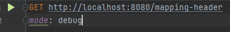

    - *200 status return body → ok*


    - *404 status NOT FOUND*
    - *Header 값 자체가 없다.* 

### ***미디어 타입 조건 매핑 - HTTP 요청 Content-Type, consume***

```java
@PostMapping(value = "/mapping-consume", consumes = "application/json")
public String mappingConsumes() {
	  return "ok";
}
```

    - *여러가지 표현식이 적용 가능하다.* 
- `consumes="application/*"` 
      - `consumes="!application/json"`


    - 200 status

***MediaType 상수 사용하기*** 

```java
@PostMapping(value = "/test", consumes = MediaType.APPLICATION_JSON_VALUE)
public String jsonConsumes(){
	  return "ok";
}
```

***Unsupported Media Type***

    - *HTTP 요청의 Content-Type 헤더를 기반으로 미디어 타입으로 매핑*
    - *맞지 않으면 HTTP 415 상태코드(Unsupported Media Type)을 반환*

### ***미디어 타입 조건 매핑 - HTTP 요청 Accept, produce***


***HTTP 요청에서 Accept 헤더는 클라이언트가 서버에 요청할 때 원하는 응답 데이터의 타입(Media Type)을 지정하는 데 사용***


```java
@PostMapping(value = "/mapping-produce", produces = "text/html")
public String mappingProduces() {
    return "ok";
}
```

    - *HTTP 요청의 Accept 헤더를 기반으로 미디어 타입으로 매핑*

***Not Acceptable***

    - *클라이언트가 원하는 응답 데이터 타입에 맞는 매핑이 없으면 HTTP 406 상태코드(Not Acceptable)을 반환한다.*

# ***HTTP 요청 - 기본, 헤더 조회***

### ***헤더 조회***

```java
@RequestMapping("/headers")
public String headers(HttpServletRequest request,
                      HttpServletResponse response,
                      HttpMethod httpMethod,
                      Locale locale,
                      @RequestHeader MultiValueMap<String , String> headerMap,
                      @RequestHeader("host") String host,
                      @CookieValue(value = "myCookie", required = false) String cookie){

    log.info("request={}", request);
    log.info("response={}", response);
    log.info("httpMethod={}", httpMethod);
    log.info("locale={}", locale);
    log.info("headerMap={}", headerMap);
    log.info("header host={}", host);
    log.info("myCookie={}", cookie);

    return "ok";
}
```

    - *HttpMethod : HTTP 메서드를 조회*
    - *Locale*
- ***Accept-Language****: ko-KR, en-US;q=0.8, ja;q=0.6*
      - *ko-KR이 가장 우선순위가 높다.* 
      - *Locale → ko-KR*
    - *@RequestHeader MultiValueMap<String, String> headerMap*
- *모든 HTTP 헤더를* ***MultiValueMap*** *형식으로 조회*
    - *@RequestHeader("host") String host*
- *특정 HTTP 헤더를 조회*
      - *속성*
- *필수 값 여부: required*
        - *기본 값 속성: defaultValue*
    - *@CookieValue(value = "myCookie", required = false) String cookie*
- *특정 쿠키를 조회*
      - *속성은 @RequestHeader와 동일*

# ***HTTP 요청 파라미터 - 쿼리 파라미터, HTML Form***

### ***요청 파라미터 조회*** 

```java
@Controller
public class RequestParamController {
    @RequestMapping("/request-param-v1")
    public void requestParamV1(HttpServletRequest request, HttpServletResponse response) throws IOException{
        String username = request.getParameter("username");
        int age = Integer.parseInt(request.getParameter("age"));
        log.info("username = {}, age= {}", username, age);
        response.getWriter().write("ok");
    }
```

    - *@Controller & 반환타입 void → VIEW 조회를 하지 않는다.* 
    - *HttpServletRequest  직접 가져오기* 

### ***HTTP 요청 파라미터 - @RequestParam***

```java
@RequestMapping("/request-param-v2")
public String requestParamV2(
		 @RequestParam("username") String username,
		 @RequestParam("age") int memberAge) {
		 
		 log.info("username={}, age={}", username, memberAge);
		 return "ok";
}
```

    - *@RequestParam : 파라미터 이름으로 바인딩*
    -  *@RequestParam("username") String username →  @RequestParam String username*
- *HTTP 파라미터 이름이 변수 이름과 같으면 생략 가능*
    - *String, Integer, int 같은 단순 값 타입이면 @RequestParam도 생략 가능하다.* 
- *생략하면 스프링 MVC는 내부에서 required=false를 적용*
      - *나는 과하다고 생각한다. → @RequestParam 까지는 있어야 한다고 생각*

### ***파라미터를 Map으로 조회하기 - requestParamMap***

```java
@ResponseBody
@RequestMapping("/request-param-map")
public String requestParamMap(@RequestParam Map<String, Object> paramMap){
        log.info("username = {}, age = {}", paramMap.get("username"), paramMap.get("age"));
        return "ok";
}
```

    - *파라미터를 Map, MultiValueMap으로 조회할 수 있다*

# ***HTTP 요청 파라미터 - @ModelAttribute***

***요청 파라미터를 바인딩 받을 객체***

```java
@Data
public class HelloData {
    private String username;
    private int age;
}
```

***@Data***

    - ***@Getter*** 
    - ***@Setter*** 
    - ***@ToString*** 
    - ***@EqualsAndHashCode*** 
    - ***@RequiredArgsConstructor***

```java
@ResponseBody
@RequestMapping("/model-attribute-v1")
public String modelAttributeV1(@ModelAttribute HelloData helloData){
    log.info("hello data = {}", helloData);
    log.info("username = {}, age = {}", helloData.getUsername(), helloData.getAge());
    return "ok";
}
```

    - *@ModelAttribute 또한 생략이 가능하다.*

***스프링MVC는 @ModelAttribute 동작 방식*** 

    1. *HelloData 객체를 생성*
    1. *요청 파라미터의 이름으로 HelloData 객체의 프로퍼티를 찾는다*
    1. *해당 프로퍼티의 setter를 호출해서 파라미터의 값을 입력(바인딩) 한다*

# ***HTTP 요청 메시지 - 단순 텍스트***

    - *요청 파라미터와 다르게, HTTP 메시지 바디를 통해 데이터가 직접 넘어오는 경우는 @RequestParam ,@ModelAttribute를 사용할 수 없다.*
    -  *HTML Form 형식으로 전달되는 경우는 요청 파라미터로 인정*

### *HttpServletRequest, HttpServletResponse*

```java
@PostMapping("/request-body-string-v1")
public void requestBodyString(HttpServletRequest request, HttpServletResponse response) throws IOException{
    ServletInputStream inputStream = request.getInputStream();
    String message = StreamUtils.copyToString(inputStream, StandardCharsets.UTF_8);
    response.getWriter().write("ok");
}
```

    1. *HttpServletRequest: getInputStream() → ServeletInputStream*
    1. *StreamUtils.copyToString(inputStream, StandardCharsets.UTF_8) → String*
- *인코딩된 바이트 코드를 UTF-8로 디코딩 작업*

### ***InputStream, Writer***

```java
@PostMapping("/request-body-string-v2")
public void requestBodyStringV2(InputStream inputStream, Writer responseWriter) throws IOException{
    String message = StreamUtils.copyToString(inputStream, StandardCharsets.UTF_8);
    responseWriter.write("ok");
}
```

    - *InputStream(Reader): HTTP 요청 메시지 바디의 내용을 직접 조회*
    - *OutputStream(Writer): HTTP 응답 메시지의 바디에 직접 결과 출력*

### ***HttpEntity - (RequestEntity, ResponseEntity)***

```java
`@PostMapping("/request-body-string-v3")
  public HttpEntity<String> requestBodyStringV3(HttpEntity<String> httpEntity) throws IOException{
      String message = httpEntity.getBody();
      log.info("message = {}", message);
      return new HttpEntity<>("ok");
  }
```

    - *HttpEntity는 요청 파라미터로 받을 수 있고 응답으로도 사용이 가능하다.*
    - *클라이언트 요청 메시지 바디를 getBody()를 통해 가져올 수 있다.* 

***RequestEntity***

    - *HttpEntity를 상속받은 클래스*
    - *HttpMethod, url 정보가 추가, 요청에서 사용*

***ResponseEntity***

    - *HttpEntity를 상속받은 클래스*
    - *HTTP 상태 코드 설정 가능, 응답에서 사용*

### *@RequestBody, @ResponseBody*

```java
@ResponseBody
@PostMapping("/request-body-string-v4")
public String requestBodyStringV4(@RequestBody String message){
    log.info("message = {}", message);
    return "ok";
}
```

***@RequestBody***

    - HTTP 메시지 바디 정보를 편리하게 조회할 수 있다. 
    - 요청 헤더 정보가 필요하면 HttpEntity, RequestEntity, @RequestHeader를 사용하자

***@ResponseBody***

    - *@ResponseBody를 사용하면 응답 결과를 HTTP 메시지 바디에 직접 담아서 전달할 수 있다*

***요청 파라미터 vs HTTP 메시지 바디***

    - *요청 파라미터를 조회하는 기능: @RequestParam , @ModelAttribute*
    - *HTTP 메시지 바디를 직접 조회하는 기능: @RequestBody*

# ***HTTP 요청 메시지 - JSON***

### ***ObjectMapper***

```java
private ObjectMapper objectMapper = new ObjectMapper();
```

    - *스프링 부트 기본 제공 ObjectMapper (Jackson 라이브러리)*

### ***HttpServletRequest, HttpServletResponse***

```java
@PostMapping("/request-body-json-v1")
public void requestBodyJsonV1(HttpServletRequest request, HttpServletResponse response) throws IOException{
    ServletInputStream inputStream = request.getInputStream();
    String messageBody = StreamUtils.copyToString(inputStream, StandardCharsets.UTF_8);

    log.info("messageBody = {}", messageBody);

    HelloData helloData = objectMapper.readValue(messageBody, HelloData.class);
    log.info("username = {}, age = {}", helloData.getUsername(), helloData.getAge());

    response.getWriter().write("ok");
}
```

### ***@RequestBody - String & ObjectMapper***

```java
@ResponseBody
@PostMapping("/request-body-json-v2")
public String requestBodyJsonV2(@RequestBody String messageBody) throws IOException{
    log.info("messageBody = {}", messageBody);
    HelloData helloData = objectMapper.readValue(messageBody, HelloData.class);
    log.info("username = {}, age = {}", helloData.getUsername(), helloData.getAge());
    return "ok";
}
```

### ***@RequestBody - Object***

```java
@ResponseBody
@PostMapping("/request-body-json-v3")
public String requestBodyJsonV3(@RequestBody HelloData helloData){
    log.info("username = {}, age = {}", helloData.getUsername(), helloData.getAge());
    return "ok";
}
```

    - *@RequestBody 생략이 불가능하다. 생략하면 자동으로 @ModeAttribute가 적용*

###  ***HttpEntity***

```java
@PostMapping("/request-body-json-v4")
public HttpEntity<String> requestBodyJsonV4(HttpEntity<HelloData> httpEntity){
    HelloData helloData = httpEntity.getBody();
    log.info("username = {}, age = {}", helloData.getUsername(), helloData.getAge());
    return new HttpEntity<>("ok");
}
```

### ***@ResponseBody***

```java
@ResponseBody
@PostMapping("/request-body-json-v5")
public HelloData requestBodyJsonV5(@RequestBody HelloData helloData){
    log.info("username = {}, age = {}", helloData.getUsername(), helloData.getAge());
    return helloData;
}
```

### ***주의***

*HTTP 요청시에 content-type 헤더가 application/json인지 꼭 확인해야 한다.* 

*→ 그래야 JSON을 처리할 수 있는 HTTP 메시지 컨버터가 실행된다.*

# ***HTTP 응답 - 정적 리소스, 뷰 템플릿***

### ***리소스 경로***

*src/main/resources 는 리소스를 보관하는 곳이고, 또 클래스패스의 시작 경로*

***정적 리소스 경로***

*src/main/resources/static*

***뷰 템플릿 경로***

*src/main/resources/templates*

### ***Thymeleaf 스프링 부트 설정***

***build.gradle***

```java
`implementation 'org.springframework.boot:spring-boot-starter-thymeleaf`
```

    - *스프링 부트가 자동으로 ThymeleafViewResolver와 필요한 스프링 빈들을 등록한다.* 

***application.properties***

```java
spring.thymeleaf.prefix=classpath:/templates/
spring.thymeleaf.suffix=.html
```

    - *default 설정이다.*

# *⭐HTTP 메시지 컨버터* 

### ***@ResponseBody 사용***

    - *HTTP의 BODY에 문자 내용을 직접 반환*
    - *viewResolver 대신에 HttpMessageConverter가 동작*
    - *기본 문자처리: StringHttpMessageConverter*
    - *기본 객체처리: MappingJackson2HttpMessageConverter*
    - *byte 처리 등등 기타 여러 HttpMessageConverter가 기본으로 등록되어 있음*

*클라이언트의 HTTP Accept 헤더와 서버의 컨트롤러 반환 타입 정보 둘을 조합해서* 

*HttpMessageConverter가 선택된다.*

### ***HttpMessageConverter - interface***

```java
public interface HttpMessageConverter<T> {
		boolean canRead(Class<?> clazz, @Nullable MediaType mediaType);
		
		boolean canWrite(Class<?> clazz, @Nullable MediaType mediaType);
		
		List<MediaType> getSupportedMediaTypes();
		
		T read(Class<? extends T> clazz, HttpInputMessage inputMessage) throws IOException, HttpMessageNotReadableException;
		
		void write(T t, @Nullable MediaType contentType, HttpOutputMessage outputMessage) throws IOException, HttpMessageNotWritableException;
}
```

***HTTP 메시지 컨버터는 HTTP 요청, HTTP 응답 둘 다 사용된다.***

    - *canRead() , canWrite() : 메시지 컨버터가 해당 클래스, 미디어타입을 지원하는지 체크*
    - *read() , write() : 메시지 컨버터를 통해서 메시지를 읽고 쓰는 기능*

***스프링 부트 기본 메시지 컨버터***

```java
0 = ByteArrayHttpMessageConverter
1 = StringHttpMessageConverter 
2 = MappingJackson2HttpMessageConverter
```

### ***ByteArrayHttpMessageConverter***

    - *byte[] 데이터를 처리*
    - *요청 예) @RequestBody byte[] data*
    - *응답 예) @ResponseBody return byte[] / 쓰기 / 미디어타입* ***application/octet-stream***

### ***StringHttpMessageConverter***

    - *String 문자로 데이터를 처리*
    - *클래스 타입: String*
    - *요청 예) @RequestBody String data*
    - *응답 예) @ResponseBody return "ok" 쓰기  /미디어타입* ***text/plain***

### ***MappingJackson2HttpMessageConverter***

    - *클래스 타입: 객체 또는 HashMap , 미디어타입* ***application/json 관련***
    - *요청 예) @RequestBody HelloData data*
    - *응답 예) @ResponseBody return helloData 쓰기 / 미디어타입* ***application/json 관련***

# ***요청 매핑 헨들러 어뎁터 구조***


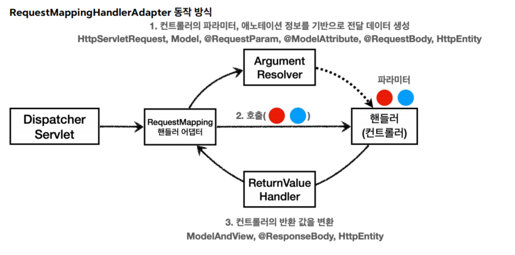

### ***ArgumentResolver***

*애노테이션 기반의 컨트롤러는 매우 다양한 파라미터를 사용할 수 있다.*

*이렇게 파라미터를 유연하게 처리할 수 있는 이유가 바로 ArgumentResolver 덕분이다.*

*애노테이션 기반 컨트롤러를 처리하는* ***RequestMappingHandlerAdapter****는 ArgumentResolver를 호출해서 컨트롤러(핸들러)가 필요로 하는 다양한 파라미터의 값(객체)을 생성한다.*

*그리고 파리미터의 값이 모두 준비되면 컨트롤러를 호출하면서 값을 넘겨준다.*

*스프링은 30개가 넘는 ArgumentResolver를 기본으로 제공한다*

*정확히는 HandlerMethodArgumentResolver인데 줄여서 ArgumentResolver라고 부른다.*

### ***HandlerMethodArgumentResolver - interface***

```java
public interface HandlerMethodArgumentResolver {
		boolean supportsParameter(MethodParameter parameter);
		
		@Nullable
		Object resolveArgument(MethodParameter parameter, @Nullable ModelAndViewContainer mavContainer,
			      NativeWebRequest webRequest, @Nullable WebDataBinderFactory binderFactory) throws Exception;
}
```

***동작 설명***

*ArgumentResolver의 supportParameter()를 호출해서 해당 파라미터를 지원하는지 체크하고, 지원하면 resolveArgument()를 호출해서 실제 객체를 생성한다. 생성된 객체는 핸들러 어뎁터가 컨트롤러 호출시 넘어간다.*

***ReturnValueHandler***

***HandlerMethodReturnValueHandler****를 줄여서 ReturnValueHandler 라 부른다*

*ArgumentResolver 와 비슷한데, 이것은 응답 값을 변환하고 처리한다.*

# ***HTTP 메시지 컨버터***

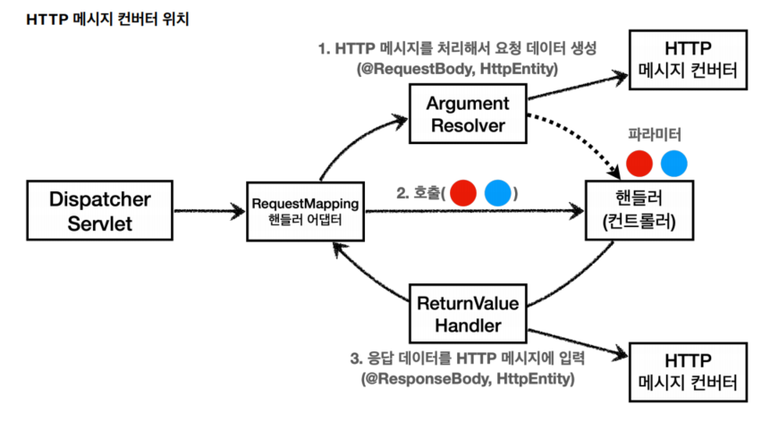

***요청을 예시***

    1. *@RequestBody가 필요한 컨트롤러에 요청이 온다.*
    1. *해당 파라미터 처리가 가능한 ArgumentResolver는 요청 파라미터 객체 생성을 위해 HTTP 메시지 컨버터를 사용한다.*
    1. *메시지 컨버터가 객체를 생성해서 반환한다.*
    1. *HandlerAdapter는 필요한 파라미터 객체가 모두 생성되면 핸들러를 호출한다.*

# ***확장***

*스프링은 다음을 모두 인터페이스로 제공한다. 따라서 필요하면 언제든지 기능을 확장할 수 있다*

    - *HandlerMethodArgumentResolver*
    - *HandlerMethodReturnValueHandler*
    - *HttpMessageConverter*

***WebMvcConfigurer 확장***

```java
@Bean
public WebMvcConfigurer webMvcConfigurer() {
		 return new WebMvcConfigurer() {
					 @Override
					 public void addArgumentResolvers(List<HandlerMethodArgumentResolver> resolvers) {
							 //...
					 }
					 @Override
					 public void extendMessageConverters(List<HttpMessageConverter<?>> converters) {
					 //...
					 }
		 };
}
```

# ***ObjectMapper***

*JSON 데이터를 Java 객체로 변환하거나 그 반대로 변환하는 데 사용*

*JSON ↔ Java 객체 간 직렬화 및 역직렬화*

*Spring Boot의 기본 Jackson 라이브러리에서 제공하며 REST API에서 JSON 데이터를 처리하는 데 자주 사용*

***주요 메소드***

    - *`readValue()`* *- JSON 데이터를 Java 객체로 변환*
    - *`writeValueAsString()`* *- Java 객체를 JSON 문자열로 변환*
    - *`writeValueAsBytes()`* *- Java 객체를 JSON 바이트 배열로 변환*

# ***ModelMapper***

*서로 다른 Java 객체 간의 변환에 사용*

*ex) DTO(Data Transfer Object)를 Entity로 변환하거나 그 반대의 작업을 수행할 때 사용*

*객체 간 매핑을 간단하고 자동화된 방식으로 수행*

*필드 이름이 유사하거나 규칙적으로 연결되어 있을 때 유용*

***특징***

    - *복잡한 매핑 규칙도 커스터마이징 가능*
    - *필드와 필드 간의 타입 변환도 지원*

# ***ObjectMapper vs ModelMapper***

| **특징** | **ObjectMapper** | **ModelMapper** |
| --- | --- | --- |
| **주요 목적** | JSON ↔ Java 객체 변환 | Java 객체 ↔ Java 객체 변환 |
| **주요 사용 시점** | REST API에서 JSON 데이터 처리 | DTO ↔ Entity 변환 |
| **의존성** | Jackson (Spring Boot 기본 포함) | 별도 라이브러리 추가 필요 |
| **유연성** | JSON 구조에 강하게 의존 | 필드 이름이 비슷할 때 매핑 간단 |
| **커스터마이징** | JsonSerializer/Deserializer 사용 가능 | 커스터마이징 매핑 규칙 정의 가능 |

```java
@PostMapping("/add")
public String addItemV2(@ModelAttribute("item") Item item) {
		 itemRepository.save(item);
		 return "basic/item";
}
```

***@ModelAttribute - 요청 파라미터 처리***

*@ModelAttribute는 Item 객체를 생성하고, 요청 파라미터의 값을 프로퍼티 접근법(setXxx)으로 입력해준다*

***@ModelAttribute - Model 추가***

*@ModelAttribute 는 중요한 한가지 기능이 더 있는데, 바로 모델(Model)에 @ModelAttribute로 지정한 객체를 자동으로 넣어준다*

***ModelAttribute 이름 생략***

```java
@PostMapping("/add")
public String addItemV3(@ModelAttribute Item item) {
		 itemRepository.save(item);
		 return "basic/item";
}
```

*@ModelAttribute 의 이름을 생략하면 모델에 저장될 때 클래스명을 사용한다.* 

*이때 클래스의 첫글자만 소문자로 변경해서 등록한다*

*Item → item*

***ModelAttribute 전체 생략***

```java
@PostMapping("/add")
public String addItemV4(Item item) {
		 itemRepository.save(item);
		 return "basic/item";
}
```

*@ModelAttribute 자체도 생략가능하다. 대상 객체는 모델에 자동 등록된다.* 

*나머지 사항은 기존과 동일*

# ***PRG Before***

***웹 브라우저의 새로 고침***

*→ 마지막에 서버에 전송한 데이터를 다시 전송한다.*

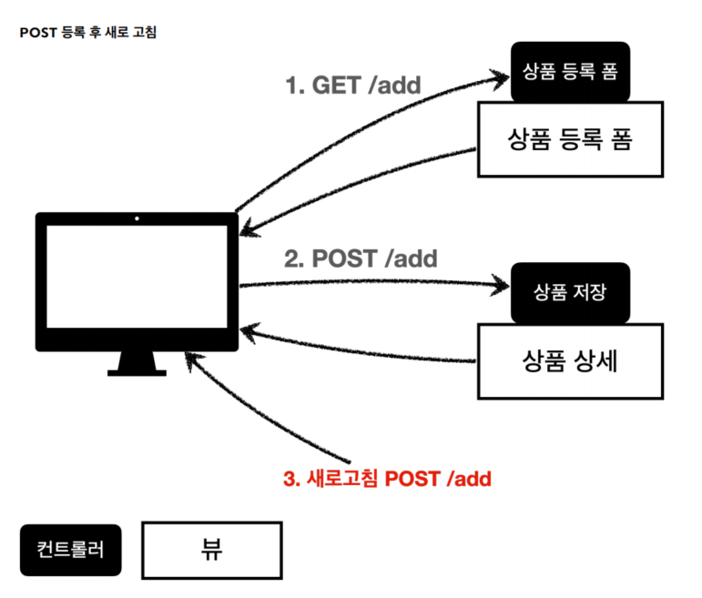

    1. *GET /add → 상품 등록 view return*
    1. *POST / add → 상품 저장 & 상품 상세 view return* 
    1. *새로고침 → POST /add* 

*마지막 요청이 POST /add 여서 ID만 다른 상품 데이터가 계속 쌓이게 된다.* 

# ***PRG After***

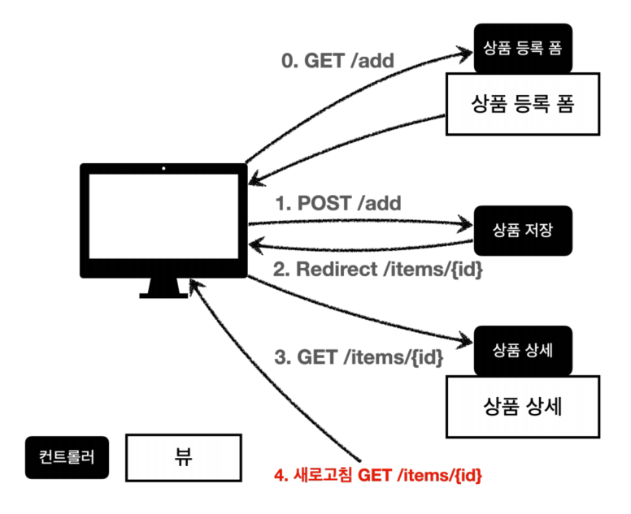

    1. *GET /add → 상품 등록 view return*
    1. *POST / add → 상품 저장 & redirect 상품 상세* 
    1. *GET /items{id} → 상품 상세 view return* 
    1. *새로고침 → GET /items{id}*

*마지막 새로 고침은 GET /items{id}로서 이제 새로 고침을 반복해도 데이터 저장 문제는 없다.*

*이런 문제 해결 방식을* ***PRG - Post/Redirect/Get****라 한다.*

# ***남은 문제점***

```java
@PostMapping("/add")
public String addItemV5(Item item) {
		 itemRepository.save(item);
		 return "redirect:/basic/items/" + item.getId();
}
```

*현재 redirect URL 변수를 보면 문자열을 직접 더해서 사용하고 있다.* 

*이런 방식은 URL 인코딩이 되지 않기 때문에 안전하지 않을 수 있다.* 
*특히,* *`item.getId()`**에 특수 문자나 공백 등이 포함되어 있는 경우, URL 형식이 깨지거나 보안 문제가 발생할 수 있다.*

***URL 인코딩***

특수 문자를 안전하게 표현하기 위해 사용하는 표준화된 방식 

ex) & 같은 문자는 URL에서 특정한 의미(쿼리 파라미터의 구분자)를 가지므로 URL에 그대로 사용하면 오류를 초래할 수 있다.

    - `&` → `%26` (인코딩 결과)

# ***RedirectAttributes***

```java
@PostMapping("/add")
public String addItemV6(Item item, RedirectAttributes redirectAttributes) {
		 Item savedItem = itemRepository.save(item);
		 redirectAttributes.addAttribute("itemId", savedItem.getId()); // PathVariable 
		 redirectAttributes.addAttribute("status", true); // Query String 추가 
		 return "redirect:/basic/items/{itemId}";
}
```

→ `http://localhost:8080/basic/items/3?status=true`

***RedirectAttributes 기능***

    - *URL 인코딩 기능*
    - *PathVariable 처리* 
    - *쿼리 파라미터(스트링) 처리*

# ***기본 표현식***

| **분류** | **표현식/연산자** | **설명** |
| --- | --- | --- |
| **간단한 표현** | `${...}` | 변수 표현식 |
|  | `*{...}` | 선택 변수 표현식 |
|  | `#{...}` | 메시지 표현식 |
|  | `@{...}` | 링크 URL 표현식 |
|  | `~{...}` | 조각 표현식 |
| **리터럴** | `'one text'` | 텍스트 리터럴 |
|  | `0, 34, 3.0, 12.3` | 숫자 리터럴 |
|  | `true, false` | 불린 리터럴 |
|  | `null` | 널 리터럴 |
|  | `one, sometext, main` | 리터럴 토큰 |
| **문자 연산** | `+` | 문자 합치기 |
|  | `\|The name is ${name}\|`  | 리터럴 대체 |
| **산술 연산** | `+`, `-`, `*`, `/`, `%` | 이항 산술 연산 |
|  | `-` | 단항 부호 (음수) 연산 |
| **불린 연산** | `and`, `or` | 이항 불린 연산 |
|  | `!`, `not` | 단항 불린 부정 |
| **비교와 동등** | `>`, `<`, `>=`, `<=` (`gt`, `lt`, `ge`, `le`) | 비교 연산 |
|  | `==`, `!=` (`eq`, `ne`) | 동등 연산 |
| **조건 연산** | `(if) ? (then)` | If-then 조건 |
|  | `(if) ? (then) : (else)` | If-then-else 조건 |
|  | `(value) ?: (defaultvalue)` | 기본값 연산 |
| **특별한 토큰** | `_` | No-Operation (특별한 토큰) |

# ***텍스트 - text, utext***

*타임리프는 기본적으로 HTML 테그의 속성에 기능을 정의해서 동작한다.*

*HTML의 콘텐츠(content)에 데이터를 출력할 때는 다음과 같이* ***th:text****를 사용하면 된다.*

*HTML 테그의 속성이 아니라 HTML 콘텐츠 영역 안에서 직접 데이터를 출력하고 싶으면 다음과 같이* ***[[...]]*** *를 사용하면 된다.*

```html
<ul>
		 <li>th:text 사용 <span th:text="${data}"></span></li>
		 <li>컨텐츠 안에서 직접 출력하기 = [[${data}]]</li>
</ul>
```

## ***Escape***

*HTML 문서는 < , > 같은 특수 문자를 기반으로 정의된다.* 

*따라서 뷰 템플릿으로 HTML 화면을 생성할 때는 출력하는 데이터에 이러한 특수 문자가 있는 것을 주의해서 사용해야 한다.*

***HTML 엔티티***

*웹 브라우저는 < 를 HTML 테그의 시작으로 인식한다.*

*따라서 < 를 테그의 시작이 아니라 문자로 표현할 수 있는 방법이 필요한데, 이것을 HTML 엔티티라 한다.*

*이렇게 HTML에서 사용하는 특수 문자를 HTML 엔티티로 변경하는 것을* ***이스케이프(escape)****라 한다.*

    - `<` → `&lt;` 
    - `>` → `&gt;` 

***th:text → escape***

***th:utext → unescape***

***[[…]] → escape***

***[(…)] → unescape***

# ***변수 - SpringEL***

*타임리프에서 변수를 사용할 때는 변수 표현식을 사용한다.*

*변수 표현식 :* *`${...}`*

| **대상** | **표현식** | **설명** | **직접 호출 대응** |
| --- | --- | --- | --- |
| **Object** | `user.username` | `user` 객체의 `username` 프로퍼티 접근 (`user.getUsername()`) | `user.getUsername()` |
|  | `user['username']` | `username` 프로퍼티 접근 (`user.getUsername()`) | `user.getUsername()` |
|  | `user.getUsername()` | `user` 객체의 `getUsername()` 메서드 직접 호출 | `user.getUsername()` |
| **List** | `users[0].username` | `List`의 첫 번째 요소에서 `username` 프로퍼티 접근 | `list.get(0)<br>.getUsername()` |
|  | `users[0]['username']` | `List`의 첫 번째 요소에서 `username` 프로퍼티 접근 | `list.get(0)<br>.getUsername()` |
|  | `users[0].getUsername()` | `List`의 첫 번째 요소에서 `getUsername()` 메서드 직접 호출 | `list.get(0)<br>.getUsername()` |
| **Map** | `userMap['userA'].username` | `Map`에서 `userA` 키로 객체를 찾아 `username` 프로퍼티 접근 | `map.get("userA")<br>.getUsername()` |
|  | `userMap['userA']['username']` | `Map`에서 `userA` 키로 객체를 찾아 `username` 프로퍼티 접근 | `map.get("userA")<br>.getUsername()` |
|  | `userMap['userA'].getUsername()` | `Map`에서 `userA` 키로 객체를 찾아 `getUsername()` 메서드 직접 호출 | `map.get("userA")<br>.getUsername()` |

```html
 <span th:text="${user.username}"></span>
 <span th:text="${users[0].username}"></span>
 <span th:text="${userMap['userA'].username}"></span>
```

### *지역 변수 선언*

***th:with****를 사용하면 지역 변수를 선언해서 사용할 수 있다.* 

*지역 변수는 선언한 테그 안에서만 사용할 수 있다.*

```html
<div th:with="first=${users[0]}">
		 <p>처음 사람의 이름은 <span th:text="${first.username}"></span></p>
</div>
```

# *유틸리티 객체와 날짜*

*타임리프는 문자, 숫자, 날짜, URI등을 편리하게 다루는 다양한 유틸리티 객체들을 제공한다*

| **유틸리티 객체** | **설명** |
| --- | --- |
| `#message` | 메시지 및 국제화 처리 지원 |
| `#uris` | URI 이스케이프 지원 |
| `#dates` | `java.util.Date` 서식 지원 |
| `#calendars` | `java.util.Calendar` 서식 지원 |
| `#temporals` | 자바 8 날짜 서식 지원 |
| `#numbers` | 숫자 서식 지원 |
| `#strings` | 문자 관련 편의 기능 제공 |
| `#objects` | 객체 관련 기능 제공 |
| `#bools` | boolean 관련 기능 제공 |
| `#arrays` | 배열 관련 기능 제공 |
| `#lists` | `List` 컬렉션 관련 기능 제공 |
| `#sets` | `Set` 컬렉션 관련 기능 제공 |
| `#maps` | `Map` 컬렉션 관련 기능 제공 |
| `#ids` | 아이디 처리 관련 기능 제공 |

***자바8 LocalDateTime example - #temporals***

```html
<ul>
	 <li>default = <span th:text="${localDateTime}"></span></li>
	 <li>yyyy-MM-dd HH:mm:ss = <span th:text="${#temporals.format(localDateTime, 'yyyy-MM-dd HH:mm:ss')}"></span></li>
</ul>
```

# ***URL 링크***

*타임리프에서 URL을 생성할 때는* ***@{...}*** *문법을 사용하면 된다.*

***쿼리 파라미터***

    - *표현식:* `@{/hello(param1=${param1}, param2=${param2})}` 
    - *결과 URL:* `/hello?param1=data1&param2=data2` 
    - `()` 내부 값이 쿼리 파라미터로 처리됨

***경로 변수***

    - *표현식:* `@{/hello/{param1}/{param2}(param1=${param1}, param2=${param2})}` 
    - *결과 URL:* `/hello/data1/data2`
    - *URL 경로에 포함된 변수를 경로 변수로 처리*

# ***리터럴***

*타임리프에서 문자 리터럴은 항상 ' (작은 따옴표)로 감싸야 한다.*

`<span th:text="'hello'">` 

*그런데 문자를 항상 ' 로 감싸는 것은 너무 귀찮은 일이다.* 

*공백 없이 쭉 이어진다면 하나의 의미있는 토큰으로 인지해서 다음과 같이 작은 따옴표를 생략할 수 있다.*

`<span th:text="hello">` 

***오류*** 

`<span th:text="hello world!"></span>`
→ *문자 리터럴은 원칙상 ' 로 감싸야 한다. 중간에 공백이 있어서 하나의 의미있는 토큰으로도 인식되지 않는다.*

***수정***

`<span th:text="'hello world!'"></span>`

***리터럴 대체(Literal substitutions)***

`<span th:text="|hello ${data}|">`

    - *`|`**는 문자열의 리터럴 부분을 그대로 두고,* *`${}`* *부분만 변수 값으로 대체하는 역할을 한다.*

# ***연산***

***비교 연산***

```html
<li>1 > 10  = <span th:text="1 &gt; 10"></span></li>
<li>1 gt 10 = <span th:text="1 gt 10"></span></li>
<li>1 >= 10 = <span th:text="1 >= 10"></span></li>
<li>1 ge 10 = <span th:text="1 ge 10"></span></li>
<li>1 == 10 = <span th:text="1 == 10"></span></li>
<li>1 != 10 = <span th:text="1 != 10"></span></li
```

    - *HTML 엔티티를 사용해야 하는 부분을 주의하자*
    - *> (gt), < (lt), >= (ge), <= (le), ! (not), == (eq), != (neq, ne)*

***조건식***

```html
<span th:text="(10 % 2 == 0)? '짝수':'홀수'"></span>
```

***Elvis 연산자***

```html
<span th:text="${data}?: '데이터가 없습니다.'"></span>
<span th:text="${nullData}?: '데이터가 없습니다.'"></span>
```

    - *`${data}`* *→ 데이터가 존재해서 해당 값이 출력* 
    - *`${nullData}`* *→ 데이터가 존재하지 않아서* *`데이터가 없습니다`* *출력*

***No-Operation***

```html
<span th:text="${data}?: _">데이터가 없습니다.</span>
<span th:text="${nullData}?: _">데이터가 없습니다.</span>
```

    -  *_ 인 경우 마치 타임리프가 실행되지 않는 것 처럼 동작한다.*

# ***속성 값 설정***

*타임리프는 주로 HTML 태그에* ***th:**** *속성을 지정하는 방식으로 동작한다.* 

***th:**** *로 속성을 적용하면 기존 속성을 대체한다. 기존 속성이 없으면 새로 만든다.*

***속성 설정***

```html
<input type="text" name="mock" th:name="userA"/>
```

→ `<input type="text" name="userA"/>`

***속성 추가***

    - *`th:attrappend`* *: 속성 값의 뒤에 값을 추가한다.*
    - *`th:attrprepend`**: 속성 값의 앞에 값을 추가한다.*
    - *`th:classappend`**: class 속성에 자연스럽게 추가한다.*

***checked 처리***

*HTML에서는* *`<input type="checkbox" name="active" checked="false" />`* *checked 속성의 값과 상관없이* *`checked`*  *속성만 있어도 체크가 된다.* 

*타임리프의* ***th:checked*** *는 값이 false 인 경우 checked 속성 자체를 제거한다*

```html
<input type="checkbox" name="active" th:checked="false"/>
```

→ `<input type="checkbox" name="active" />`

# ***반복***

***반복 기능***

`<tr th:each="user : ${users}">` 

    - *반복시 오른쪽 컬렉션( ${users} )의 값을 하나씩 꺼내서 왼쪽 변수( user )에 담아서 태그를 반복 실행*
    - *th:each 는 List 뿐만 아니라 배열, Iterable, Enumeration을 구현한 모든 객체를 반복에 사용할 수 있다. 또한 Map도 사용이 가능한데 이때 변수에 담기는 값은 Map.Entry이다.*

***반복 상태 유지***

`<tr th:each="user, userStat : ${users}">` 

    - *반복의 두번째 파라미터를 설정해서 반복의 상태를 확인 할 수 있다.*
    - *두번째 파라미터는 생략 가능한데, 생략하면 지정한 변수명( user ) + Stat* 

***반복 상태 유지 기능***

    - *index : 0부터 시작하는 값*
    - *count : 1부터 시작하는 값*
    - *size : 전체 사이즈*
    - *even , odd : 홀수, 짝수 여부( boolean )*
    - *first , last :처음, 마지막 여부( boolean )*
    - *current : 현재 객체*

```html
<table border="1">
		 <tr>
				 <th>count</th>
				 <th>username</th>
				 <th>age</th>
				 <th>etc</th>
		 </tr>
			 <tr th:each="user, userStat : ${users}">
					 <td th:text="${userStat.count}">username</td>
					 <td th:text="${user.username}">username</td>
					 <td th:text="${user.age}">0</td>
			 <td>
					 index = <span th:text="${userStat.index}"></span>
					 count = <span th:text="${userStat.count}"></span>
					 size = <span th:text="${userStat.size}"></span>
					 even? = <span th:text="${userStat.even}"></span>
					 odd? = <span th:text="${userStat.odd}"></span>
					 first? = <span th:text="${userStat.first}"></span>
					 last? = <span th:text="${userStat.last}"></span>
					 current = <span th:text="${userStat.current}"></span>
			 </td>
		 </tr>
</table>
```

# ***조건부 평가, Switch***

***타임리프의 조건식:*** *if , unless (if 의 반대)*

    - *타임리프는 해당 조건이 맞지 않으면 태그 자체를 렌더링하지 않는다*

```html
<span th:text="'미성년자'" th:if="${user.age lt 20}"></span>
<span th:text="'미성년자'" th:unless="${user.age ge 20}"></span>
```

***switch***

```html
<td th:switch="${user.age}">
		<span th:case="10">10살</span>
		<span th:case="20">20살</span>
		<span th:case="*">기타</span>
</td>
```

** 은 만족하는 조건이 없을 때 사용하는 디폴트*

# ***블록***

***th:block****은 HTML 태그가 아닌 타임리프의 유일한 자체 태그다.*

```html
<th:block th:each="user : ${users}">
		 <div>
				 사용자 이름1 <span th:text="${user.username}"></span>
				 사용자 나이1 <span th:text="${user.age}"></span>
		 </div>
		 <div>
				 요약 <span th:text="${user.username} + ' / ' + ${user.age}"></span>
		 </div>
</th:block>
```

*타임리프의 특성상 HTML 태그안에 속성으로 기능을 정의해서 사용하는데, 위 예처럼 이렇게 사용하기 애매한 경우에 사용하면 된다.*

# ***자바스크립트 인라인***

*타임리프는 자바스크립트에서 타임리프를 편리하게 사용할 수 있는 자바스크립트 인라인 기능을 제공한다.*

```html
<!-- 자바스크립트 인라인 사용 전 -->
<script>
	 var username = [[${user.username}]];
	 var age = [[${user.age}]];
	 //자바스크립트 내추럴 템플릿
	 var username2 = /*[[${user.username}]]*/ "test username";
	 //객체
	 var user = [[${user}]];
</script>


<!-- 자바스크립트 인라인 사용 후 -->
<script th:inline="javascript">
	 var username = [[${user.username}]];
	 var age = [[${user.age}]];
	 //자바스크립트 내추럴 템플릿
	 var username2 = /*[[${user.username}]]*/ "test username";
	 //객체
	 var user = [[${user}]];
</script>
```

***Result***

```html
<script>
		var username = userA;
		var age = 10;
		//자바스크립트 내추럴 템플릿
		var username2 = /*userA*/ "test username";
		//객체
		var user = BasicController.User(username=userA, age=10);
</script>


<script>
		var username = "userA";
		var age = 10;
		//자바스크립트 내추럴 템플릿
		var username2 = "userA";
		//객체
		var user = {"username":"userA","age":10};
</script>

```

*자바스크립트 인라인을 사용하지 않은 경우 어떤 문제들이 있는지 알아보자.*

***텍스트 렌더링***

`var username = [[${user.username}]];` 

    - *인라인 사용 전 →* *`var username = userA;`*
    - *인라인 사용 후 →* *`var username = “userA”;`*

*인라인 사용 전 렌더링 결과를 보면 userA 변수 이름이 그대로 남아있다.*

*개발자가 기대한 것은 “userA” 문자 지만 결과적으로 userA가 변수명으로 사용되어서 자바스크립트 오류가 발생한다.*

*인라인 사용 후 렌더링 결과를 보면 문자 타입인 경우* *`"`* *를 포함해준다.*

*또한 자바스크립트에 문제가 될 수 있는 문자가 포함되어 있으면 이스케이프 처리도 해준다.* 

***자바스크립트 내추럴 템플릿***

 `var username2 = /[[${user.username}]]/ "test username";`

    - 인라인 사용 전 → `var username2 = /`*`userA`*`/ "test username";`
    - 인라인 사용 후 → `var username2 = "userA";`

*인라인 사용 전 결과를 보면 정말 순수하게 그대로 해석을 해버렸다.*

*따라서 내추럴 템플릿 기능이 동작하지 않고, 심지어 렌더링 내용이 주석처리 되어 버린다.
인라인 사용 후 결과를 보면 주석 부분이 제거되고, 기대한 "userA"가 정확하게 적용된다.*

***객체***

*타임리프의 자바스크립트 인라인 기능을 사용하면 객체를 JSON으로 자동으로 변환해준다.*

`var user = [[${user}]];` 

    - 인라인 사용 전 → `var user = BasicController.User(username=userA, age=10);`
    - 인라인 사용 후 → `var user = {"username":"userA","age":10};`

*인라인 사용 전은 객체의 toString()이 호출된 값이다.
인라인 사용 후는 객체를 JSON으로 변환해준다.*

# ***자바스크립트 인라인 each***

```html
<script th:inline="javascript">
	 [# th:each="user, stat : ${users}"]
	 var user[[${stat.count}]] = [[${user}]];
	 [/]
</script>
```

***자바스크립트 인라인 each 결과***

```html
<script>
	var user1 = {"username":"userA","age":10};
	var user2 = {"username":"userB","age":20};
	var user3 = {"username":"userC","age":30};
</script>
```

# *템플릿 조각*

*웹 페이지를 개발할 때는 공통 영역이 많이 있다.* 

*예를 들어서 상단 영역이나 하단 영역, 좌측 카테고리 등등 여러 페이지에서 함께 사용하는 영역들이 있다. 이런 부분을 코드를 복사해서 사용한다면 변경시 여러 페이지를 다 수정해야 하므로 상당히 비효율 적이다.* 

*타임리프는 이런 문제를 해결하기 위해 템플릿 조각과 레이아웃 기능을 지원한다.*

```html
<!DOCTYPE html>
<html xmlns:th="http://www.thymeleaf.org">
	<body>
			<footer th:fragment="copy">
					푸터 자리 입니다.
			</footer>
			<footer th:fragment="copyParam (param1, param2)">
					<p>파라미터 자리 입니다.</p>
					<p th:text="${param1}"></p>
					<p th:text="${param2}"></p>
			</footer>
	</body>
</html>
```

    - */resources/templates/template/fragment/footer.html*
    - ***th:fragment****가 있는 태그는 다른곳에 포함되는 코드 조각*

```html
<!DOCTYPE html>
<html xmlns:th="http://www.thymeleaf.org">
	<head>
			 <meta charset="UTF-8">
			 <title>Title</title>
	</head>
	<body>
			<h1>부분 포함</h1>
			
			<h2>부분 포함 insert</h2>
			<div th:insert="~{template/fragment/footer :: copy}"></div>
			
			<h2>부분 포함 replace</h2>
			<div th:replace="~{template/fragment/footer :: copy}"></div>
			
			<h2>부분 포함 단순 표현식</h2>
			<div th:replace="template/fragment/footer :: copy"></div>
			
			<h1>파라미터 사용</h1>
			<div th:replace="~{template/fragment/footer :: copyParam ('데이터1', '데이터2')}"></div>
	</body>
</html>
```

    - */resources/templates/template/fragment/fragmentMain.html*

***부분 포함 insert*** 

```html
<h2>부분 포함 insert</h2>
<div>
<footer>
푸터 자리 입니다.
</footer>
</div>
```

    - `<div th:insert="~{template/fragment/footer :: copy}"></div>`
    - ***th:insert****를 사용하면 현재 태그(div) 내부에 추가*

***부분 포함 replace***

```html
<h2>부분 포함 replace</h2>
<footer>
푸터 자리 입니다.
</footer>
```

    - `<div th:replace="~{template/fragment/footer :: copy}"></div>`
    - ***th:replace****를 사용하면 현재 태그( div )를 대체*

***부분 포함 단순 표현식***

```html
<h2>부분 포함 단순 표현식</h2>
<footer>
푸터 자리 입니다.
</footer>
```

    - `<div th:replace="template/fragment/footer :: copy"></div>` 
    - ***~{...}****를 사용하는 것이 원칙이지만 템플릿 조각을 사용하는 코드가 단순하면 이 부분을 생략할 수 있다*

***파라미터 사용***

```html
<h1>파라미터 사용</h1>
<footer>
<p>파라미터 자리 입니다.</p>
<p>데이터1</p>
<p>데이터2</p>
</footer>
```

    - `<div th:replace="~{template/fragment/footer :: copyParam ('데이터1', '데이터2')}">`    `</div>`
    - *다음과 같이 파라미터를 전달해서 동적으로 조각을 렌더링 할 수도 있다*

# ***템플릿 레이아웃1***

*이전에는 일부 코드 조각을 가지고와서 사용했다면, 이번에는 개념을 더 확장해서 코드 조각을 레이아웃에 넘겨서 사용하는 방법에 대해서 알아보자.*

```html
<html xmlns:th="http://www.thymeleaf.org">
<head th:fragment="common_header(title,links)">

	 <title th:replace="${title}">레이아웃 타이틀</title>
	 
	 <!-- 공통 -->
	 <link rel="stylesheet" type="text/css" media="all" th:href="@{/css/awesomeapp.css}">
	 <link rel="shortcut icon" th:href="@{/images/favicon.ico}">
	 <script type="text/javascript" th:src="@{/sh/scripts/codebase.js}"></script>
	 
	 <!-- 추가 -->
	 <th:block th:replace="${links}" />
</head>
```

    - */resources/templates/template/layout/base.html*

```html
<!DOCTYPE html>
<html xmlns:th="http://www.thymeleaf.org">
		<head th:replace="template/layout/base :: common_header(~{::title},~{::link})">
				 <title>메인 타이틀</title>
				 <link rel="stylesheet" th:href="@{/css/bootstrap.min.css}">
				 <link rel="stylesheet" th:href="@{/themes/smoothness/jquery-ui.css}">
		</head>
		<body>
				메인 컨텐츠
		</body>
</html>
```

    - */resources/templates/template/layout/layoutMain.html*
    - *`common_header(~{::title},~{::link})`**이 부분이 핵심*
- ***::title****은 현재 페이지의 title 태그들을 전달*
      - ***::link****는 현재 페이지의 link 태그들을 전달*

***result***

```html
<!DOCTYPE html>
<html>
		<head>
				<title>메인 타이틀</title>
				
				<!-- 공통 -->
				<link rel="stylesheet" type="text/css" media="all" href="/css/awesomeapp.css">
				<link rel="shortcut icon" href="/images/favicon.ico">
				<script type="text/javascript" src="/sh/scripts/codebase.js"></script>
				
				<!-- 추가 -->
				<link rel="stylesheet" href="/css/bootstrap.min.css">
				<link rel="stylesheet" href="/themes/smoothness/jquery-ui.css">
		</head>
		<body>
				메인 컨텐츠
		</body>
</html>
```

    - *메인 타이틀이 전달한 부분으로 교체*
    - *공통 부분은 그대로 유지되고, 추가 부분에 전달한 <link>들이 포함된 것을 확인할 수 있다*

# ***템플릿 레이아웃2***

***템플릿 레이아웃 확장***
*앞서 이야기한 개념을 <head> 정도에만 적용하는게 아니라 <html> 전체에 적용할 수도 있다.*

```html
<!DOCTYPE html>
<html th:fragment="layout (title, content)" xmlns:th="http://www.thymeleaf.org">
		<head>
				 <title th:replace="${title}">레이아웃 타이틀</title>
		</head>
		<body>
				<h1>레이아웃 H1</h1>
				<div th:replace="${content}">
				 <p>레이아웃 컨텐츠</p>
				</div>
				<footer>
				 레이아웃 푸터
				</footer>
		</body>
</html> 
```

    - */resources/templates/template/layoutExtend/layoutFile.html*

```html
<!DOCTYPE html>
<html th:replace="~{template/layoutExtend/layoutFile :: layout(~{::title}, ~{::section})}" xmlns:th="http://www.thymeleaf.org">
		<head>
				 <title>메인 페이지 타이틀</title>
		</head>
		<body>
				<section>
						 <p>메인 페이지 컨텐츠</p>
						 <div>메인 페이지 포함 내용</div>
				</section>
			</body>
</html> 
```

    - */resources/templates/template/layoutExtend/layoutExtendMain.html*

***result***

```html
<!DOCTYPE html>
<html>
		<head>
				 <title>메인 페이지 타이틀</title>
		</head>
		<body>
				<h1>레이아웃 H1</h1>
				<section>
						 <p>메인 페이지 컨텐츠</p>
						 <div>메인 페이지 포함 내용</div>
				</section>
				<footer>
				 레이아웃 푸터
				</footer>
		</body>
</html> 
```

# ***타임리프 스프링 통합***

*타임리프는 스프링 없이도 동작하지만, 스프링과 통합을 위한 다양한 기능을 편리하게 제공한다.* 

*이런 부분은 스프링으로 백엔드를 개발하는 개발자 입장에서 타임리프를 선택하는 하나의 이유가 된다.*

***스프링 통합으로 추가되는 기능들***

| **기능 영역** | **추가된 기능** | **설명** |
| --- | --- | --- |
| **SpringEL 문법 통합** | `${@myBean.doSomething()}` | SpringEL을 통해 스프링 빈 호출 및 메소드 실행을 지원 |
| **폼 관리 기능 강화** | `th:object` | 폼 커맨드 객체를 쉽게 선택하고 바인딩 가능 |
|  | `th:field`, `th:errors`, `th:errorclass` | 폼 필드 바인딩, 검증 오류 메시지 처리, 오류 시 특정 클래스 추가 가능 |
| **폼 컴포넌트 지원** | Checkbox, Radio Button, List 등의 컴포넌트 | 편리한 폼 컴포넌트 생성 및 관리 지원 |
| **스프링 메시지 통합** | 메시지 및 국제화 | 스프링의 메시지 소스 및 국제화 기능과의 편리한 연동 |
| **스프링 검증 및 오류 처리 통합** | 스프링 Validator와 BindingResult 지원 | 검증 결과 및 오류 메시지를 Thymeleaf 템플릿에서 쉽게 처리 가능 |
| **스프링 변환 서비스 통합** | `ConversionService` | 객체 변환 및 형식 변환 기능을 Thymeleaf 템플릿에서 쉽게 사용할 수 있도록 통합 |

# ***입력 폼 처리***

    - ***th:object :*** *커맨드 객체를 지정한다.*
    - ****{...} :*** *선택 변수 식이라고 한다.* ***th:object****에서 선택한 객체에 접근한다.*
    - ***th:field:*** *HTML 태그의 id , name , value 속성을 자동으로 처리해준다.*

***렌더링 전***

`<input type="text" th:field="*{itemName}"/>` 

***렌더링 후***

`<input type="text" id="itemName" name="itemName" value="itemName"/>`

```html
<form action="item.html" th:action th:object="${item}" method="post">
	 <div>
			 <label for="id">상품 ID</label>
			 <input type="text" id="id" th:field="*{id}" class="form-control" readonly>
	 </div>
	 <div>
			 <label for="itemName">상품명</label>
			 <input type="text" id="itemName" th:field="*{itemName}" class="formcontrol">
	 </div>
		 <div>
			 <label for="price">가격</label>
			 <input type="text" id="price" th:field="*{price}" class="form-control">
	 </div>
	 <div>
			 <label for="quantity">수량</label>
			 <input type="text" id="quantity" th:field="*{quantity}" class="formcontrol">
	 </div>
```

    - `th:object="${item}"` : *<form>에서 사용할 객체를 지정한다. 선택 변수 식 *{…}을 적용할 수 있다.*
    - `th:field="*{itemName}"` 
- ***th:field****는 id , name , value 속성을 모두 자동으로 만들어준다*

# HTTP 요청 메시지 로깅

***applicaiton.preperties***

```plain text
logging.level.org.apache.coyote.http11=trace
```

    - *HTTP 요청 메시지를 서버에서 보고 싶으면 다음 설정을 추가*

# ***체크 박스 - 단일1***

```html
<div>판매 여부</div>
<div>
		 <div class="form-check">
				 <input type="checkbox" id="open" name="open" class="form-check-input">
				 <label for="open" class="form-check-label">판매 오픈</label>
		 </div>
</div>
```

*Item 클래스 필드에 상품 판매 여부 필드를 나타내는 boolean open 존재*

***체크 박스 check case***

*체크 박스를 체크하면 HTML FORM에서* *`open=on`* *이라는 값이 넘어간다.*

*스프링은* *`on`* *이라는 문자를* *`true`* *타입으로 변환해준다. (스프링 타입 컨버터)*

***체크 박스 uncheck case***

*HTML에서 체크 박스를 선택하지 않고 폼을 전송하면* *`open`**이라는 필드 자체가 서버로 전송되지 않는다*

*해당 문제를 해결하기 위해서 스프링 MVC는 트릭을 사용한다.*

*히든 필드를 만들어서* *`_open`* *처럼 기존 체크 박스 이름 앞에* *`_`* *를 붙여서 전송하면 체크를 해제했다고 인식할 수 있다. 히든 필드는 항상 전송된다.*

*따라서 체크를 해제할 경우 여기서는* *`open`* *은 전송되지 않고* *`_open`* *만 전송되는데 이 경우 스프링 MVC는 체크를 해제했다고 판단한다.*

***체크 해제를 인식하기 위한 히든 필드***

`<input type="hidden" name="_open" value="on"/>`

***기존 코드에 히든 필드 추가***

```html
<div>판매 여부</div>
<div>
		 <div class="form-check">
				 <input type="checkbox" id="open" name="open" class="form-check-input">
				 <input type="hidden" name="_open" value="on"/>
				 <label for="open" class="form-check-label">판매 오픈</label>
		 </div>
</div>
```

    - ***체크 박스 체크***
- `open=on&_open=on` 
      - *체크 박스를 체크하면 스프링 MVC가* `open`*에 값이 있는 것을 확인하고 사용한다. 이때* *`_`*`open`*은 무시*
    - ***체크 박스 미체크***
- `_open=on` 
      - *체크 박스를 체크하지 않으면 스프링 MVC가* `_open`*만 있는 것을 확인하고,* `open`*의 값이 체크되지 않았다고 인식한다.*

# ***체크 박스 - 단일2***

*개발할 때 마다 이렇게 히든 필드를 추가하는 것은 상당히 번거롭다.* 

*타임리프가 제공하는 폼 기능을 사용하면 이런 부분을 자동으로 처리할 수 있다.*

***타임리프 - 체크 박스 코드 추가***

```html
<div>판매 여부</div>
<div>
		 <div class="form-check">
				 <input type="checkbox" id="open" th:field="*{open}" class="form-check-input">
				 <label for="open" class="form-check-label">판매 오픈</label>
		 </div>
</div>
```

    - *렌더링을 하면* `<input type="hidden" name="_open" value="on"/>` *자동으로 넣어준다.*

***체크박스 read only 같은 동작*** 

```html
<input type="checkbox" id="open" th:field="${item.open}" class="formcheck-input" disabled>
```

    - *disabled*

# ***체크 박스 - 멀티***

*체크 박스를 멀티로 사용해서, 하나 이상을 체크할 수 있도록 해보자.*

## ⭐***@ModelAttribute 특별한 사용법*** 

*등록 폼, 상세화면, 수정 폼에서 모두 서울, 부산, 제주라는 체크 박스를 반복해서 보여주어야 한다.*

*이렇게 하려면 각각의 컨트롤러에서 model.addAttribute(...) 을 사용해서 체크 박스를 구성하는 데이터를 반복해서 넣어주어야 한다.*

```java
@ModelAttribute("regions")
public Map<String, String> regions() {
		Map<String, String> regions = new LinkedHashMap<>();
		regions.put("SEOUL", "서울");
		regions.put("BUSAN", "부산");
		regions.put("JEJU", "제주");
		return regions;
}
```

    - ***@ModelAttribute****는 이렇게 컨트롤러에 있는 별도의 메서드에 적용할 수 있다.*
    - *이렇게하면 해당 컨트롤러를 요청할 때 regions에서 반환한 값이 자동으로 모델(model)에 담기게 된다. 물론 이렇게 사용하지 않고, 각각의 컨트롤러 메서드에서 모델에 직접 데이터를 담아서 처리해도 된다*

```html
<div>
		<div>등록 지역</div>
		<div th:each="region : ${regions}" class="form-check form-check-inline">
				<input type="checkbox" th:field="*{regions}" th:value="${region.key}" class="form-check-input">
				<label th:for="${#ids.prev('regions')}" th:text="${region.value}" class="form-check-label">서울</label>
		</div>
</div>
```

    - *regions → Map.Entty<String, String>*
    - `th:for="${#ids.prev('regions')}"` 
- *생성된 HTML 태그 속성에서 name은 같아도 되지만, id는 모두 달라야 한다.*

## ***내 개인적인 생각?***

*<input> 태그 id와 <label> 태그 id는 같아야 한다.* 

`th:for="${#ids.prev('regions')}"` *이 방식은 명시적이지 않다.* 

*th:each 방식에서는 상태를 유지시켜준다. → regionStat*

*regionStat index 또는 count 값을 <input> 태그나 <label> 태그에 적용하면 명시적이고 for문을 돌면서 증가하니 괜찮지 않을까 싶다* 

```html
<div>
     <div>등록 지역</div>
     <div th:each="region : ${regions}" class="form-check form-check-inline">
         <input type="checkbox" th:field="*{regions}" th:value="${region.key}" th:id="${regionStat.count}" class="form-check-input">
         <label th:for="${regionStat.count}" th:text="${region.value}" class="form-check-label">서울</label>
     </div>
</div>
```

***실제 랜더링 결과***


# ***라디오 버튼***

*라디오 버튼은 여러 선택지 중에 하나를 선택할 때 사용할 수 있다.* 

*라디오 버튼을 자바 ENUM을 활용해서 개발해보자.*

***@ModelAttribute - Model 추가*** 

```java
@ModelAttribute("itemTypes")
public ItemType[] itemTypes() {
		 return ItemType.values();
}
```

```html
<div>
	<div>상품 종류</div>
	<div th:each="type : ${itemTypes}" class="form-check form-check-inline">
				<input type="radio" th:field="*{itemType}" th:value="${type.name()}" class="form-check-input">
				<label th:for="${#ids.prev('itemType')}" th:text="${type.description}" class="form-check-label">BOOK
				</label>
	</div>
</div>
```

*체크 박스는 수정시 체크를 해제하면 아무 값도 넘어가지 않기 때문에, 별도의 히든 필드로 이런 문제를 해결했다.* 

*라디오 버튼은 이미 선택이 되어 있다면, 수정시에도 항상 하나를 선택하도록 되어 있으므로 체크 박스와 달리 별도의 히든 필드를 사용할 필요가 없다*

## ***타임리프에서 ENUM 직접 사용하기***

`<div th:each="type : ${T(hello.itemservice.domain.item.ItemType).values()}">` 

    - *스프링EL 문법으로 ENUM을 직접 사용할 수 있다.*
- ***FQCN(Fully Qualified Class Name) 사용***
    -  *ENUM에 values() 를 호출하면 해당 ENUM의 모든 정보가 배열로 반환된다.*
    - **이렇게 사용하면 ENUM의 패키지 위치가 변경되거나 할때 자바 컴파일러가 타임리프까지 컴파일 오류를 잡을수 없다. → 굳이 사용하지 말자** 

# ***셀렉트 박스***

```html
<div>
		<div>배송 방식</div>
		<select th:field="*{deliveryCode}" class="form-select">
				<option value="">==배송 방식 선택==</option>
				<option th:each="deliveryCode : ${deliveryCodes}" th:value="${deliveryCode.code}" th:text="${deliveryCode.displayName}">FAST</option>
		</select>
</div>
```

*보기 전용은* *`diabled`* *사용 하자*

```html
<select th:field="${item.deliveryCode}" class="form-select" disabled>
```

# ***메시지, 국제화 소개***

***메시지***
*악덕? 기획자가 화면에 보이는 문구가 마음에 들지 않는다고, 상품명이라는 단어를 모두 상품이름으로 고쳐달라고 하면 어떻게 해야할까?
여러 화면에 보이는 상품명, 가격, 수량 등, label 에 있는 단어를 변경하려면 다음 화면들을 다 찾아가면서 모두 변경해야 한다.* 

*지금처럼 화면 수가 적으면 문제가 되지 않지만 화면이 수십개 이상이라면 수십개의 파일을 모두 고쳐야 한다.*

*왜냐하면 해당 HTML 파일에 메시지가 하드코딩 되어 있기 때문이다*

*이런 다양한 메시지를 한 곳에서 관리하도록 하는 기능을 메시지 기능이라 한다.*

# ***스프링 메시지 소스 설정***

*메시지 관리 기능을 사용하려면 스프링이 제공하는* ***MessageSource****를 스프링 빈으로 등록하면 되는데,* ***MessageSource****는 인터페이스이다.* 

*따라서 구현체인* ***ResourceBundleMessageSource****를 스프링 빈으로 등록하면 된다.*

***직접 등록***

```java
@Bean
public MessageSource messageSource() { 
		ResourceBundleMessageSource messageSource = new ResourceBundleMessageSource();
		messageSource.setBasenames("messages", "errors");
		messageSource.setDefaultEncoding("utf-8");
		return messageSource;
}
```

***스프링 부트***

*스프링 부트를 사용하면 스프링 부트가* ***MessageSource****를 자동으로 스프링 빈으로 등록한다.*

***스프링 부트 메시지 소스 설정, 기본값 - applicaiton.properties***

```java
spring.messages.basename=messages
```

***MessageSource****를 스프링 빈으로 등록하지 않고, 스프링 부트와 관련된 별도의 설정을 하지 않으면 messages 라는 이름으로 기본 등록된다.*

*따라서* ***messages_en.properties*** *,* ***messages_ko.properties*** *,* ***messages.properties*** *파일만 등록하면 자동으로 인식된다.*

### ***메시지 파일 만들기***

    - message.properties: 기본 값으로 사용(한글)

```java
hello=안녕
hello.name=안녕 {0}
```

    - messages_en.properties: (영어)

```java
hello=hello
hello.name=hello {0}
```

# ***스프링 메시지 소스 사용***

***MessageSource 인터페이스***

```java
public interface MessageSource {
		String getMessage(String code, @Nullable Object[] args, @Nullable String defaultMessage, Locale locale);

		String getMessage(String code, @Nullable Object[] args, Locale locale) throws NoSuchMessageException;
```

***MessageSource - 메시지 조회 기본*** 

```java
@SpringBootTest
public class MessageSourceTest {
		 @Autowired
		 MessageSource ms;
		 
		 @Test
		 void helloMessage() {
				 String result = ms.getMessage("hello", null, null);
				 assertThat(result).isEqualTo("안녕");
		 }
}
```

    - `ms.getMessage("hello", null, null)` 
- *code: hello*
      - *args: null*
      - *locale: null*

*locale 정보가 없으면 basename에서 설정한 기본 이름 메시지 파일을 조회한다.* 

*basename으로 messages를 지정 했으므로 messages.properties 파일에서 데이터 조회한다.*

***MessageSource - 메시지가 없는 경우*** 

```java
@Test
void notFoundMessageCode() {
			assertThatThrownBy(() -> ms.getMessage("no_code", null, null))
						.isInstanceOf(NoSuchMessageException.class);
}
@Test
void notFoundMessageCodeDefaultMessage() {
			String result = ms.getMessage("no_code", null, "기본 메시지", null);
			assertThat(result).isEqualTo("기본 메시지");
}
```

    - *메시지가 없는 경우에는* *`NoSuchMessageException`* *이 발생한다.*
    - *메시지가 없어도 기본 메시지(defaultMessage)를 사용하면 기본 메시지가 반환된다.*

***MessageSource - 매개변수 사용***

```java
@Test
void argumentMessage() {
		String result = ms.getMessage("hello.name", new Object[]{"Spring"}, null);
		assertThat(result).isEqualTo("안녕 Spring");
}
```

    - *다음 메시지의 {0} 부분은 매개변수를 전달해서 치환할 수 있다.*
    - *hello.name=안녕 {0} →  Spring 단어를 매개변수로 전달 → 안녕 Spring*

***국제화 파일 선택***

    - *locale 정보를 기반으로 국제화 파일을 선택한다.*
    - *Locale이 en_US 의 경우* ***messages_en_US → messages_en  → messages*** *순서로 찾는다.*
    - *Locale 정보가 없는 경우 Locale.getDefault()을 호출해서 시스템의 기본 로케일을 사용한다.
예) locale = null 인 경우 시스템 기본 locale이 ko_KR 이므로* ***messages_ko.properties*** *조
회 시도 조회 실패* ***messages.properties*** *조회*

***MessageSource - 국제화 파일 선택1***

```java
@Test
void defaultLang() {
		assertThat(ms.getMessage("hello", null, null)).isEqualTo("안녕");
		assertThat(ms.getMessage("hello", null, Locale.KOREA)).isEqualTo("안녕");
}
```

    - *ms.getMessage("hello", null, null) : locale 정보가 없으므로 messages 를 사용*
    -  *ms.getMessage("hello", null, Locale.KOREA) : locale 정보가 있지만, messages_ko가 없으므로 messages를 사용*

***MessageSource - 국제화 파일 선택2***

```java
@Test
void enLang() {
		assertThat(ms.getMessage("hello", null, Locale.ENGLISH)).isEqualTo("hello");
}
```

    - *ms.getMessage("hello", null, Locale.ENGLISH) : locale 정보가 Locale.ENGLISH이므로
messages_en을 찾아서 사용*

# ***웹 애플리케이션에 메시지 적용하기***

***messages.properties***

```java
label.item=상품
label.item.id=상품 ID
label.item.itemName=상품명
label.item.price=가격
label.item.quantity=수량

page.items=상품 목록
page.item=상품 상세
page.addItem=상품 등록
page.updateItem=상품 수정

button.save=저장
button.cancel=취소
```

# ***타임리프 메시지 적용***

*타임리프의 메시지 표현식* ***#{...}****를 사용하면 스프링의 메시지를 편리하게 조회할 수 있다.
예를 들어서 방금 등록한 상품이라는 이름을 조회하려면* ***#{label.item}****이라고 하면 된다.*

***렌더링 전*** 

`<div th:text="#{label.item}"></h2>`

***렌더링 후***
`<div>상품</h2>`

## ***적용 예시***

***버튼 적용***

```html
<button type="submit" th:text="#{button.save}">저장</button>
<button type="button" th:text="#{button.cancel}">취소</button>
```

***레이블에 적용***

```html
<label for="itemName" th:text="#{label.item.itemName}">상품명</label>
<label for="price" th:text="#{label.item.price}">가격</label>
<label for="quantity" th:text="#{label.item.quantity}">수량</label>
```

***페이지 이름에 적용***

```html
<h2 th:text="#{page.addItem}">상품 등록</h2>
```

# ***웹 애플리케이션에 국제화 적용하기***

***messages_en.properties***

```java
label.item=Item
label.item.id=Item ID
label.item.itemName=Item Name
label.item.price=price
label.item.quantity=quantity

page.items=Item List
page.item=Item Detail
page.addItem=Item Add
page.updateItem=Item Update

button.save=Save
button.cancel=Cancel
```

*이것으로 국제화 작업은 거의 끝났다.*

*앞에서 템플릿 파일에는 모두* ***#{...}****를 통해서 메시지를 사용하도록 적용해 두었기 때문이다.*

*웹 브라우저의 언어 설정 값을 변경하면 요청시 Accept-Language 의 값이 변경된다.*

### ***스프링의 국제화 메시지 선택***

*앞서* ***MessageSource*** *테스트에서 보았듯이 메시지 기능은* ***Locale*** *정보를 알아야 언어를 선택할 수 있다.*

*결국 스프링도 Locale 정보를 알아야 언어를 선택할 수 있는데, 스프링은 언어 선택시 기본으로* ***Accept-Language*** *헤더의 값을 사용한다.*

***LocaleResolver***

*스프링은 Locale 선택 방식을 변경할 수 있도록* ***LocaleResolver****라는 인터페이스를 제공하는데, 스프링 부트는 기본으로* ***Accept-Language****를 활용하는* ***AcceptHeaderLocaleResolver****를 사용한다.*

***LocaleResolver 인터페이스***

```java
public interface LocaleResolver {
		Locale resolveLocale(HttpServletRequest request);
		void setLocale(HttpServletRequest request, @Nullable HttpServletResponse response, @Nullable Locale locale);
}
```

***LocaleResolver 변경***

*만약 Locale 선택 방식을 변경하려면 LocaleResolver의 구현체를 변경해서 쿠키나 세션 기반의 Locale 선택기능을 사용할 수 있다.*

***ex)****고객이 직접 Locale을 선택하도록 하는 것*

## ⭐ ***AcceptHeaderLocalReolver 동작 설명***

*DispatcherServlet → HandlerMapping → HandlerAdapter 조회 → HandlerAdapter →* 

***Handler 호출 before 작업***

***Handler 호출 before 작업*** 

    1. *요청 파라미터 ArgumentResolver → @RequestBody, RequestEntity, HttpEntity → MessageConverter* 
    1. ***AcceptHeaderLocalReolver***

*Accept-Header 헤더를 사용하여 클라이언트의 로케일을 확인*

*LocalContextHodler 사용해 LocalContext 생성하고 관리* 

*LocalContextHolder는 ThreadLocal 사용하여 현재 요청의 Local 정보를 저장* 
*이후 요청 처리(Controller, Service 등)와 뷰 렌더링(ViewResolver) 과정에서* 

*LocalContextHolder.getContext() 를 호출하여 로케일 정보를 가져온다.*


***ThreadLocal clear 작업*** 

*이후 DispatcherServlet은 LocalContextHolder.clearContext() 호출*

# ***검증 직접 처리 - 기본***

```java
@PostMapping("/add")
public String addItem(@ModelAttribute Item item, RedirectAttributes redirectAttributes, Model model) {

    // 검증 오류 결과를 보관
    Map<String, String> errors = new HashMap<>();

    // 검증 로직
    if(!StringUtils.hasText(item.getItemName())){
        errors.put("itemName", "상품 이름은 필수입니다.");
    }
    if(item.getPrice() == null || item.getPrice() < 1000 || item.getPrice() > 1000000){
        errors.put("price", "가격은 1,000 ~ 1,000,000 까지 허용합니다.");
    }
    if(item.getQuantity() == null || item.getQuantity() >= 9999){
        errors.put("quantity", "수량은 최대 9,999까지 허용합니다.");
    }

    // 특정 필드가 아닌 복합 룰 검증
    if(item.getPrice() != null && item.getQuantity() != null){
        int resultPrice = item.getPrice() * item.getQuantity();
        if(resultPrice < 10000){
            errors.putIfAbsent("globalError", "가격 * 수량의 합은 10,000원 이상이어야 합니다. 현재 값 = " + resultPrice);
        }
    }

    // 검증에 실패하면 다시 입력 폼으로
    if(hasErrors(errors)){
        log.info("errors = {}", errors);
        model.addAttribute("errors", errors);
        return "validation/v1/addForm";
    }

    // 성공 로직
    Item savedItem = itemRepository.save(item);
    redirectAttributes.addAttribute("itemId", savedItem.getId());
    redirectAttributes.addAttribute("status", true);
    return "redirect:/validation/v1/items/{itemId}";
}

private static boolean hasErrors(Map<String, String> errors) {
    return !errors.isEmpty();
}
```

***검증 오류 보관***

`Map<String, String> errors = new HashMap<>();` 

***@ModelAttribute Item item***

    - *검증에 실패하면 다시 상품 등록 폼이 반환된다.*
    - *이때 상품 등록 폼 모델(Model)에는 사용자가 입력했던 Form Data가 그대로 보여진다.* 
    - *그 이유는 @ModelAttribute 기능인데* *`model.addAttribute("item", item)`* *자동으로 동작한다*. 

***GlobalError 메시지 표시***

```html
 <div th:if="${errors?.containsKey('globalError')}">
     <p class="field-error" th:text="${errors['globalError']}">전체 오류 메시지</p>
 </div>
```

***참고 Safe Navigation Operator***

    - `errors.containsKey()`*를 호출하는 순간 globalError key가 존재하지 않으면NullPointerException 이 발생한다.*
    - `errors?.` *은 errors 가 null 일때 NullPointerException이 발생하는 대신, null을 반환하는 문법
이다.*
    - *`th:if`**에서 null은 실패로 처리되므로 오류 메시지가 출력되지 않는다.*

***<form> 일부***

```html
<form action="item.html" th:action th:object="${item}" method="post">
<div>
    <label for="itemName" th:text="#{label.item.itemName}">상품명</label>
    <input type="text" id="itemName" th:field="*{itemName}"
           th:class="${errors?.containsKey('itemName')} ? 'form-control field-error' : 'form-control'"
           class="form-control" placeholder="이름을 입력하세요">
    <div class="field-error" th:if="${errors?.containsKey('itemName')}" th:text="${errors['itemName']}">
    </div>
</div>
</form>
```

***필드 오류 처리***

```html
<input type="text" th:classappend="${errors?.containsKey('itemName')} ? 'fielderror' : _"
		 class="form-control">
```

    - *`th:classappend`**를 사용해서 해당 필드에 오류가 있으면 field-error라는 클래스 정보를 더해서 폼의 색깔을 빨간색으로 강조한다.*
    - *값이 없으면* *`_`* *(No-Operation)을 사용해서 아무것도 하지 않는다.*

***현재 문제점***

    - *타입 오류 처리가 안된다. 숫자 타입에 문자가 들어오면 오류가 발생한다. 이러한 오류는 스프링 MVC에서 컨트롤러 진입하기 전에 예외가 발생(ArgumentResoverException) 그래서 컨트롤러가 호출되지도 않고 400 예외가 발생한다.*
    - *Item의 price에 문자를 입력하는 것 처럼 타입 오류가 발생해도 고객이 입력한 문자를 화면에 남겨야 한다.* 
    - *뷰 템플릿에서 중복 처리가 많다.* 
    - *컨트롤러에 에러 처리 로직이 들어간다. SRP가 지켜지지 않는다.*

# ***검증 직접 처리 - BindingResult1***

```java
@PostMapping("/add")
public String addItemV1(@ModelAttribute Item item, BindingResult bindingResult, RedirectAttributes redirectAttributes, Model model) {
    // 검증 로직
    if(!StringUtils.hasText(item.getItemName())){
        bindingResult.addError(new FieldError("item", "itemName", "상품 이름은 필수입니다."));
    }
    if(item.getPrice() == null || item.getPrice() < 1000 || item.getPrice() > 1000000){
        bindingResult.addError(new FieldError("item", "price", "가격은 1,000 ~ 1,000,000 까지 허용합니다."));
    }
    if(item.getQuantity() == null || item.getQuantity() >= 9999){
        bindingResult.addError(new FieldError("item", "quantity", "수량은 최대 9,999까지 허용합니다."));
    }

    // 특정 필드가 아닌 복합 룰 검증
    if(item.getPrice() != null && item.getQuantity() != null){
        int resultPrice = item.getPrice() * item.getQuantity();
        if(resultPrice < 10000){
            bindingResult.addError(new ObjectError("item", "가격 * 수량의 합은 10,000원 이상이어야 합니다. 현재 값 = " + resultPrice));
        }
    }

    // 검증에 실패하면 다시 입력 폼으로
    if(bindingResult.hasErrors()){
        log.info("errors = {}", bindingResult);
        return "validation/v2/addForm";
    }

    // 성공 로직
    Item savedItem = itemRepository.save(item);
    redirectAttributes.addAttribute("itemId", savedItem.getId());
    redirectAttributes.addAttribute("status", true);
    return "redirect:/validation/v2/items/{itemId}";
}
```

***FieldError, ObjectError*** 

```java
public FieldError(String objectName, String field, String defaultMessage) {}

public ObjectError(String objectName, String defaultMessage) {}
```

    - *BindingResult는 Model에 자동으로 들어간다.*
    - *BidingResult 위치는 @ModelAttribute Item item 다음에 와야 한다.*

***타임리프 스프링 검증 오류 통합 기능***

    - *타임리프는 스프링의 BindingResult 를 활용해서 편리하게 검증 오류를 표현하는 기능을 제공*
    - *`#fields`* *:* *`#fields`**로 BindingResult 가 제공하는 검증 오류에 접근할 수 있다*
    - *`th:errors`* *: 해당 필드에 오류가 있는 경우에 태그를 출력한다.* *`th:if`**의 편의 버전이다.*
    - *`th:errorclass`* *:* *`th:field`* *에서 지정한 필드에 오류가 있으면 class 정보를 추가한다*

***글로벌 오류 처리***

```html
<div th:if="${#fields.hasGlobalErrors()}">
     <div th:each="err: ${#fields.globalErrors()}">
        <p class="field-error" th:text="${err}"></p>
     </div>
</div>
```

***필드 오류 처리***

```html
<form action="item.html" th:action th:object="${item}" method="post">
<div>
      <label for="itemName" th:text="#{label.item.itemName}">상품명</label>
      <input type="text" id="itemName" th:field="*{itemName}"
             th:errorclass="field-error" class="form-control" placeholder="이름을 입력하세요">
      <div class="field-error" th:errors="*{itemName}">
      </div>
</div>
</form>
```

# ***검증 직접 처리 - BindingResult2***

***BindingResult*** 

    - 스프링이 제공하는 검증 오류를 보관하는 객체이다. 
    - *BindingResult ← interface , extends Errors(interface)*
- `org.springframework.validation.Errors` 
      - `org.springframework.validation.BindingResult` 
      - *Errors: 단순 조회, 저장*
    - *BindingResult가 없고 타입 오류가 발생하면 컨트롤러가 호출되지 않고 오류 페이지로 이동* 
    - *BindingResult가 있으면 BindingResult에 오류 정보(FieldError)를 담아서 컨트롤러를 정상 호출*
    - *Model에 자동으로 포함*

***문제점***

    - *오류가 발생하는 경우 고객이 입력한 내용이 모두 사라진다*
    - *여전히 SRP가 지켜지지 않는다.*

# ***FieldError, ObjectError***

```java
@PostMapping("/add")
public String addItemV2(@ModelAttribute Item item, BindingResult bindingResult, RedirectAttributes redirectAttributes, Model model) {

    // 검증 로직: Binding 성공한 값들 = 비즈니스에서 검증 -> bindingFailure(false)
    if(!StringUtils.hasText(item.getItemName())){
        bindingResult.addError(new FieldError("item", "itemName", item.getItemName(), false, null, null,"상품 이름은 필수입니다."));
    }
    if(item.getPrice() == null || item.getPrice() < 1000 || item.getPrice() > 1000000){
        bindingResult.addError(new FieldError("item", "price", item.getPrice(), false, null, null, "가격은 1,000 ~ 1,000,000 까지 허용합니다."));
    }
    if(item.getQuantity() == null || item.getQuantity() >= 9999){
        bindingResult.addError(new FieldError("item", "quantity", item.getQuantity(), false, null, null, "수량은 최대 9,999까지 허용합니다."));
    }

    // 특정 필드가 아닌 복합 룰 검증
    if(item.getPrice() != null && item.getQuantity() != null){
        int resultPrice = item.getPrice() * item.getQuantity();
        if(resultPrice < 10000){
            bindingResult.addError(new ObjectError("item", null, null, "가격 * 수량의 합은 10,000원 이상이어야 합니다. 현재 값 = " + resultPrice));
        }
    }

    // 검증에 실패하면 다시 입력 폼으로
    if(bindingResult.hasErrors()){
        log.info("errors = {}", bindingResult);
        return "validation/v2/addForm";
    }

    // 성공 로직
    Item savedItem = itemRepository.save(item);
    redirectAttributes.addAttribute("itemId", savedItem.getId());
    redirectAttributes.addAttribute("status", true);
    return "redirect:/validation/v2/items/{itemId}";
}
```

***FieldError 생성자***

```java
public FieldError(String objectName, String field, String defaultMessage);

public FieldError(String objectName, String field, @Nullable Object rejectedValue, 
	boolean bindingFailure, @Nullable String[] codes, @Nullable Object[] arguments, 
	@Nullable String defaultMessage)
```

    - *objectName : 오류가 발생한 객체 이름*
    - *field : 오류 필드*
    - *rejectedValue : 사용자가 입력한 값(거절된 값)*
    - *bindingFailure : 타입 오류 같은 바인딩 실패인지, 검증 실패인지 구분 값*
    - *codes : 메시지 코드*
    - *arguments : 메시지에서 사용하는 인자*
    - *defaultMessage : 기본 오류 메시지*

***오류 발생시 사용자 입력 값 유지***

```java
new FieldError("item", "price", item.getPrice(), false, null, null, "message")
```

    - *rejectedValue → 오류 발생시 사용자 입력 값을 저장하는 필드*
    - *bindingFailure → 타입 오류 같은 바인딩이 실패했는지 여부를 적는다(true || false)*
    - *스프링은 타입 오류로 실패하면 bindingFailure → true, 사용자가 입력한 값을 넣어준다.*

***타임리프의 사용자 입력 값 유지***

`th:field="*{price}"` 

    - *정상 상황에서는 모델 객체의 값을 사용하지만 오류가 발생하면 FieldError에서 보관한 rejectedValue 값을 사용해서 값을 출력한다.*

# ***오류 코드와 메시지 처리1***

***스프링 부트 메시지 설정 추가 - application.properties***

```java
spring.messages.basename=messages,errors
```

***errors.properties***

```java
required.item.itemName=상품 이름은 필수입니다.
range.item.price=가격은 {0} ~ {1} 까지 허용합니다.
max.item.quantity=수량은 최대 {0} 까지 허용합니다.
totalPriceMin=가격 * 수량의 합은 {0}원 이상이어야 합니다. 현재 값 = {1}
```

    - *errors_en.properties 파일을 생성하면 오류 메시지도 국제화 처리를 할 수 있다*

```java
new FieldError("item", "price", item.getPrice(), false, 
		new String[] {"range.item.price"}, new Object[]{1000, 1000000}
```

    - *codes: required.item.itemName 를 사용해서 메시지 코드를 지정 메시지 코드는 하나가 아니라 배열로 여러 값을 전달할 수 있는데, 순서대로 매칭해서 처음 매칭되는 메시지가 사용*
    - *arguments : Object[]{1000, 1000000}를 사용해서 코드의 {0} , {1}로 치환할 값을 전달*

# ***오류 코드와 메시지 처리2***

*FieldError , ObjectError는 다루기 너무 번거롭다*

*→ rejectValue(), reject() 사용* 

```java
if(item.getPrice() == null || item.getPrice() < 1000 || item.getPrice() > 1000000){
    bindingResult.rejectValue("price", "range", new Object[]{1000, 1000000}, null);
}
if(item.getQuantity() == null || item.getQuantity() >= 9999){
    bindingResult.rejectValue("quantity", "max", new Object[]{9999}, null);
}

if(item.getPrice() != null && item.getQuantity() != null){
    int resultPrice = item.getPrice() * item.getQuantity();
    if(resultPrice < 10000){
        bindingResult.reject("totalPriceMin", new Object[]{10000, resultPrice}, null);
    }
}
```

***rejectValue()***

```java
void rejectValue(@Nullable String field, String errorCode,
		@Nullable Object[] errorArgs, @Nullable String defaultMessage);
```

    - *field : 오류 필드명*
    - *errorCode : 오류 코드(이 오류 코드는 메시지에 등록된 코드가 아니다. 뒤에서 설명할 messageResolver를 위한 오류 코드이다.)*
    - *errorArgs : 오류 메시지에서 {0}을 치환하기 위한 값*
    - *defaultMessage : 오류 메시지를 찾을 수 없을 때 사용하는 기본 메시지*

# ***오류 코드와 메시지 처리3***

## ***MessageCodesResolver*** 

*검증 오류 코드로 메시지 코드들을 생성*

***MessageCodesResolver*** *→ 인터페이스*

***DefaultMessageCodesResolver*** *→ default 구현체*

***DefaultMessageCodesResolver****의 기본 메시지 생성 규칙*

```java
객체 오류의 경우 다음 순서로 2가지 생성
1.: code + "." + object name
2.: code

예) 오류 코드: required, object name: item
1.: required.item
2.: required


필드 오류의 경우 다음 순서로 4가지 메시지 코드 생성
1.: code + "." + object name + "." + field
2.: code + "." + field
3.: code + "." + field type
4.: code

예) 오류 코드: typeMismatch, object name "user", field "age", field type: int
1. "typeMismatch.user.age"
2. "typeMismatch.age"
3. "typeMismatch.int"
4. "typeMismatch"
```

### ⭐***동작 방식 정리***

*컨트롤러 호출 이전에 MessageSourcer 기본 설정을 사용한다면 Accept Header를 확인하고* 

*스레드 로컬에 Local 정보(Context)를 담는다.*

*rejectValue(), reject() 내부에서 MessageCodeResolver를 사용해서 메시지 코드를 생성한다.* 

*생성한 메시지 코드를 FieldError, ObjectError 생성자에 넣는다.*

*해당 과정은 컨트롤러 호출 이전에 타입 바인딩 문제가 있다면 자동으로 BindingResult에 들어가는 과장과 개발자가 직접 넣어주는 2가지로 구분이 가능하다.*

*이후 타임리프 화면을 렌더링 할 때 th:errors가 실행된다. 만약 이때 오류가 있으면 스레드 로컬에 있는 로켈 정보에 따라서 properties가 결정(errors.properties, errors_en.properties)되고 그 이후 해당 properties에 메시지를 규칙(MessageCodesResolver) 순서대로 찾는다. 없으면 default message를 출력한다.* 

# ***오류 코드와 메시지 처리4***

*전에 설명했던 내용처럼 rejectValue() 호출이 컨트롤러 호출 이전에 발생할 수 있다.*

*→ 타입 바인딩 예외* 

***Item 클래스, Price 필드, Type: Integer***

*여기에 문자를 입력하면 다음과 같은 규칙으로 메시지 코드가 들어간다.*

```java
typeMismatch.item.price
typeMismatch.price
typeMismatch.java.lang.Integer
typeMismatch
```

*해당 규칙에 맞게 메시지를 만들어주자* 

*스프링 부트가 만들어주는 TypeMisMatch default Message는 클라이언트에게 노출하기 좀 그렇다..* 

# ***Validator 분리1***

*컨트롤러에서 검증 로직 처리하는 부분이 매우 크다. → SRP 위반* 

*별도의 클래스로 역할을 분리하자 또한 이렇게 분리하면 검증 로직을 재사용 할 수 있다.* 

***ItemValidator***

```java
@Component
public class ItemValidator implements Validator {
    @Override
    public boolean supports(Class<?> clazz) {
        return Item.class.isAssignableFrom(clazz);
    }

    @Override
    public void validate(Object target, Errors errors) {
        Item item = (Item) target;

        if(!StringUtils.hasText(item.getItemName())){
            errors.rejectValue("itemName", "required");
        }

        if(item.getPrice() == null || item.getPrice() < 1000 || item.getPrice() > 1000000){
            errors.rejectValue("price", "range", new Object[]{1000, 1000000}, null);
        }
        if(item.getQuantity() == null || item.getQuantity() >= 9999){
            errors.rejectValue("quantity", "max", new Object[]{9999}, null);
        }

        // 특정 필드가 아닌 복합 룰 검증
        if(item.getPrice() != null && item.getQuantity() != null){
            int resultPrice = item.getPrice() * item.getQuantity();
            if(resultPrice < 10000){
                errors.reject("totalPriceMin", new Object[]{10000, resultPrice}, null);
            }
        }
    }
}
```

***ItemValidator 사용***

```java
@PostMapping("/add")
public String addItemV5(@ModelAttribute Item item, BindingResult bindingResult, RedirectAttributes redirectAttributes, Model model) {

    if(itemValidator.supports(item.getClass())){
         itemValidator.validate(item, bindingResult);
    }

    // 검증에 실패하면 다시 입력 폼으로
    if(bindingResult.hasErrors()){
        log.info("errors = {}", bindingResult);
        return "validation/v2/addForm";
    }

    // 성공 로직
    Item savedItem = itemRepository.save(item);
    redirectAttributes.addAttribute("itemId", savedItem.getId());
    redirectAttributes.addAttribute("status", true);
    return "redirect:/validation/v2/items/{itemId}";
}
```

*검증 부분이 깔끔하게 분리되었다.*

*근데 Validator 인터페이스를 보면 굳이 supports 메소드가 필요한가?* 

*단순히 validate 메소드만 있으면 되는 게 아닐까? 또는 Validator 인터페이스를 굳이 상속해야 하나? 라는 생각이 들것이다. 스프링은 다 이유가 있어서 이렇게 만든다.* 

# ***Validator 분리2***

***WebDataBinder***

*Validator 인터페이스를 사용해서 검증기를 만들면 스프링의 추가적인 도움을 받을 수 있다.*

*WebDataBinder는 스프링의 파라미터 바인딩의 역할을 해주고 검증 기능도 내부에 포함*

```java
@InitBinder
public void init(WebDataBinder dataBinder){
    dataBinder.addValidators(itemValidator);
}


@PostMapping("/add")
public String addItemV6(@Validated @ModelAttribute Item item, BindingResult bindingResult, RedirectAttributes redirectAttributes, Model model) {
    
    if(bindingResult.hasErrors()){
        log.info("errors = {}", bindingResult);
        return "validation/v2/addForm";
    }
    
    Item savedItem = itemRepository.save(item);
    redirectAttributes.addAttribute("itemId", savedItem.getId());
    redirectAttributes.addAttribute("status", true);
    return "redirect:/validation/v2/items/{itemId}";
}
```

    - *WebDataBinder에 검증기를 추가하면 해당 컨트롤러에서는 검증기를 자동으로 적용할 수 있다.*
    - *@InitBinder → 해당 컨트롤러에만 영향을 준다.*

***동작 방식***

*@Validated는 검증기를 실행하라는 애노테이션이다.
이 애노테이션이 붙으면 앞서 WebDataBinder에 등록한 검증기를 찾아서 실행한다. 
그런데 여러 검증기를 등록한다면 그 중에 어떤 검증기가 실행되어야 할지 구분이 필요하다.
이때 supports()가 사용된다. 여기서는 supports(Item.class) 호출되고, 결과가 true이므로 ItemValidator 의 validate()가 호출된다.*

***글로벌 설정 - 모든 컨트롤러에 다 적용***

```java
@Configuration
public class ItemServiceApplication implements WebMvcConfigurer {
		 @Override
		 public Validator getValidator() {
				 return new ItemValidator();
		 }
}
```

***@Validated  VS @Valid***

*검증시 @Validated @Valid 둘다 사용가능하다*

*`javax.validation.@Valid`**를 사용하려면 build.gradle 의존관계 추가가 필요*

*`implementation 'org.springframework.boot:spring-boot-starter-validation'`* *@Validated는 스프링 전용 검증 애노테이션이고, @Valid는 자바 표준 검증 애노테이션이다.*

# ***Bean Validation - 시작***

*스프링과 통합하지 않고, 순수한 Bean Validation 사용법 학습*

***build.gradle***

```java
implementation 'org.springframework.boot:spring-boot-starter-validation'
```

    - *jakarta.validation-api : Bean Validation 인터페이스*
    - *hibernate-validator: Bean Validation 구현체*

```java
@Data
public class Item {
		 private Long id;
		 
		 @NotBlank
		 private String itemName;
		 
		 @NotNull
		 @Range(min = 1000, max = 1000000)
		 private Integer price;
		 
		 @NotNull
		 @Max(9999)
		 private Integer quantity;
		 
		 public Item() {}
		 
		 public Item(String itemName, Integer price, Integer quantity) {
				 this.itemName = itemName;
				 this.price = price; this.quantity = quantity;
		 }
}
```

***검증 애노테이션***

*@NotBlank: 빈값 + 공백만 있는 경우를 허용하지 않는다.*

*@NotNull: null 을 허용하지 않는다.*

*@Range(min = 1000, max = 1000000): 범위 안의 값이어야 한다.*

*@Max(9999): 최대 9999까지만 허용한다.*

***스프링 MVC with Bean Validator***

*스프링 부트는* *`spring-boot-starter-validation`* *라이브러리를 넣으면 자동으로 Bean Validator를 인지하고 스프링에 통합한다.*

스프링 부트는 ***LocalValidatorFactoryBean***을 글로벌 Validator로 등록한다. 
*이 Validator는 @NotNull 같은 애노테이션을 보고 검증을 수행한다. 
이렇게 글로벌 Validator가 적용되어 있기 때문에, @Valid , @Validated만 적용하면 된다.
검증 오류가 발생하면, FieldError , ObjectError를 생성해서 BindingResult에 담아준다.*

***@Validated VS @Valid***

*@Validated는 스프링 전용 검증 애노테이션이고, @Valid는 자바 표준 검증 애노테이션이다.*

*둘중 아무거나 사용해도 동일하게 동작하지만, @Validated는 내부에 groups 라는 기능을 포함하고 있다.* 

***검증 순서***

    1. *@ModelAttribute 각각의 필드에 타입 변환 시도* 
1. *성공하면 다음*
      1. *실패하면 TypeMisMatch → FieldError 추가*
    1. *Validator 적용* 

*BeanValidator는 바인딩에 실패한 필드는 BeanValidation을 적용하지 않는다.*

# ***Bean Validation - 에러 코드***

*Bean Validation이 기본으로 제공하는 오류 메시지를 좀 더 자세히 변경하고 싶으면 어떻게 하면 될까?*

***@NotBlank***

*NotBlank라는 오류 코드를 기반으로* ***MessageCodesResolver****를 통해 다양한 메시지 코드가 순서대로 생성된다.*

***@NotBlank***

    - NotBlank.item.itemName
    - NotBlank.itemName
    - NotBlank.java.lang.String
    - NotBlank

***@Range***

    - Range.item.price
    - Range.price
    - Range.java.lang.Integer
    - Range

***BeanValidation 메시지 찾는 순서***

    1. *생성된 메시지 코드 순서대로 messageSource 에서 메시지 찾기*
    1. *애노테이션의 default message 속성 사용 @NotBlank(message = "공백! {0}")*
    1. *라이브러리가 제공하는 기본 값 사용 → 공백일 수 없습니다.*

# ***Bean Validation - 오브젝트 오류***

*Bean Validation에서 특정 필드(FieldError)가 아닌 해당 오브젝트 관련 오류(ObjectError)는 어떻게 처리할수 있을까?*

***→ @ScriptAssert()*** 

```java
@Data
@ScriptAssert(lang = "javascript", script = "_this.price * _this.quantity >= 10000")
public class Item {
	 //...
}
```

***메시지 코드***

    - ScriptAssert.item
    - ScriptAssert

***문제점 / 실무***

*그런데 실제 사용해보면 제약이 많고 복잡하다.* 

*그리고 실무에서는 검증 기능이 해당 객체의 범위를 넘어서는 경우들도 종종 등장하는데, 그런 경우 대응이 어렵다.*

*따라서 오브젝트 오류(글로벌 오류)의 경우 @ScriptAssert을 억지로 사용하는 것 보다는 다음과 같이 오브젝트 오류 관련 부분만 직접 자바 코드로 작성하는 것을 권장한다.*

```java
@PostMapping("/add")
public String addItem(@Validated @ModelAttribute Item item, BindingResult bindingResult, RedirectAttributes redirectAttributes, Model model) {
    
    if(item.getPrice() != null && item.getQuantity() != null){
        int resultPrice = item.getPrice() * item.getQuantity();
        if(resultPrice < 10000){
            bindingResult.reject("totalPriceMin", new Object[]{10000, resultPrice}, null);
        }
    }
    
    if(bindingResult.hasErrors()){
        log.info("errors = {}", bindingResult);
        return "validation/v3/addForm";
    }

    Item savedItem = itemRepository.save(item);
    redirectAttributes.addAttribute("itemId", savedItem.getId());
    redirectAttributes.addAttribute("status", true);
    return "redirect:/validation/v3/items/{itemId}";
}
```

# ***Bean Validation - 한계, groups***

*데이터를 등록할 때와 수정할 때는 요구사항이 다를 수 있다.*

***방법 2가지***

    - *BeanValidation의 groups 기능을 사용한다.*
    - *별도의 DTO를 각각 만들어서 사용한다*

### ***BeanValidation groups 기능 사용***

***저장용 groups 생성***

```java
public interface SaveCheck {
}
```

***수정용 groups 생성***

```java
public interface UpdateCheck {
}
```

***Item - groups 적용***

```java
@Data
public class Item {
		 @NotNull(groups = UpdateCheck.class) 
		 private Long id;
		 
		 @NotBlank(groups = {SaveCheck.class, UpdateCheck.class})
		 private String itemName;
		 
		 @NotNull(groups = {SaveCheck.class, UpdateCheck.class})
		 @Range(min = 1000, max = 1000000, groups = {SaveCheck.class, UpdateCheck.class})
		 private Integer price; 
		 
		 @NotNull(groups = {SaveCheck.class, UpdateCheck.class})
		 @Max(value = 9999, groups = SaveCheck.class)
		 private Integer quantity;
		 
		 public Item() {
		 
		 }
		 public Item(String itemName, Integer price, Integer quantity) {
				 this.itemName = itemName;
				 this.price = price;
				 this.quantity = quantity;
		 }
}
```

***저장 로직에 SaveCheck Groups 적용***

```java
@PostMapping("/add")
public String addItemV2(@Validated(SaveCheck.class) @ModelAttribute Item item, 
		BindingResult bindingResult, RedirectAttributes redirectAttributes) {
		 //...
}
```

**참고**
*@Valid에는 groups를 적용할 수 있는 기능이 없다. 
따라서 groups를 사용하려면 @Validated를 사용해야 한다.*

# *실무 관점, @RequestBody(HTTP Message Converter)*

***groups 사용 X***

*실무에서는 @Validated groups 기능을 잘 사용하지 않는다.*

*보통 등록시 폼에서 전달하는 데이터가 도매인 객체와 딱 맞지 않기 때문이다.* 

*따라서  폼 데이터 전달을 위한 별도의 객체를 사용하고, 등록, 수정용 폼 객체를 나누면 등록, 수정이 완전히 분리되기 때문에 groups를 적용할 일은 드물다.*

***HTTP 메시지 컨버터***

*@Valid , @Validated는 HttpMessageConverter (@RequestBody)에도 적용할 수 있다.*

***API의 경우 3가지 경우를 나누어 생각해야 한다.***

    - *성공 요청: 성공*
    - *실패 요청: JSON을 객체로 생성하는 것(역직렬화) 자체가 실패함*
    - *검증 오류 요청: JSON을 객체로 생성하는 것은 성공했고, 검증에서 실패함*

***실패 요청 케이스***

*HttpMessageConverter에서 요청 JSON을 객체로 생성하는데 실패한다.*

*이 경우는 객체를 만들지 못하기 때문에 컨트롤러 자체가 호출되지 않고 그 전에 예외가 발생한다.* 

*당연히 Validator도 실행되지 않는다.*

```json
{
	 "timestamp": "2021-04-20T00:00:00.000+00:00",
	 "status": 400,
	 "error": "Bad Request",
	 "message": "",
	 "path": "/validation/api/items/add"
}
```

***검증 오류 요청***

*HttpMessageConverter는 성공하지만 검증(Validator)에서 오류가 발생하는 경우*

→ *MethodArgumentNotValidException* 

*필요한 데이터만 뽑아서 별도의 API 스펙을 정의하고 그에맞는 객체를 만들어서 반환해야 한다.*

***@ModelAttribute vs @RequestBody***

*HTTP 요청 파리미터를 처리하는 @ModelAttribute는 각각의 필드 단위로 세밀하게 적용된다.* 

*그래서 특정 필드에 타입이 맞지 않는 오류가 발생해도 나머지 필드는 정상 처리할 수 있었다.*

*HttpMessageConverter는 @ModelAttribute와 다르게 각각의 필드 단위로 적용되는 것이 아니라, 전체 객체 단위로 적용된다.*

*따라서 메시지 컨버터의 작동이 성공해서 객체를 만들어야 @Valid , @Validated 가 적용된다*

*정리하면 HttpMessageConverter단계에서 실패하면* *HttpMessageNotReadableException**예외가 발생한다. BindingResult가 있어도 처리하지 못한다.* 
해당 예외는 *@RestControllerAdvice 통해서 처리 가능하다.*

# ***로그인 처리하기 - 쿠키 사용***

***개요***

*HTTP 통신은 기본적으로 stateless 한 특징을 가진다.*

*하지만 쿼리 파라미터로 매번 사용자의 정보를 넘겨주는 것은 UX를 떨어트리고 보안상에도 좋지 않다.*  

*→ 로그인 상태를 유지하기 위해서 쿠키를 사용해 보자* 

***클라이언트 로그인 요청***

*POST /login loginId=xxx&password=[REDACTED]

***서버 회원 조회, 쿠키 발급*** 

*DB 조회 → 아이디, 비밀번호 match → 쿠키 발급(Set-Cookie) key, value*

***쿠키의 종류***

*영속 쿠키: 만료 날짜를 입력하면 해당 날짜까지 유지*

*세션 쿠키: 만료 날짜를 생략하면 브라우저 종료시 까지만 유지*

```java
Cookie idCookie = new Cookie("memberId", String.valueOf(loginMember.getId()));
response.addCookie(idCookie);
```

    - *쿠키에 만료 시간 정보를 주지 않으면 세션 쿠키로 생성된다. (브라우저 종료시 삭제)*

***쿠키 조회***

```java
@GetMapping("/")
public String homeLogin(@CookieValue(name = "memberId", required = false) Long memberId, Model model) {
    if(memberId == null){
        return "home";
    }
    
    Member loginMember = memberRepository.findById(memberId);

    if(loginMember == null){
        return "home";
    }
    
    model.addAttribute("member", loginMember);
    return "loginHome";
}
```

    - ***@CookieValue(name = “xxx”)*** *이렇게 간편하게 쿠키를 요청 객체로부터 받아올 수 있다.*
    - *required = false: default: true → 로그인을 하지 않은 사용자도 정상적으로 해당 컨트롤러 메소드에 entry 할 수 있게 required = false 옵션을 준다.*

***쿠키 만료, 로그아웃 기능*** 

```java
@PostMapping("/logout")
public String logout(HttpServletResponse response){
    expireCookie(response, "memberId");
    return "redirect:/";
}

private static void expireCookie(HttpServletResponse response, String cookieName) {
    Cookie idCookie = new Cookie(cookieName, null);
    idCookie.setMaxAge(0);
    response.addCookie(idCookie);
}
```

    - ***setMaxAge(0) → 쿠키 만료***

# ***쿠키와 보안 문제***

***보안 문제***

*쿠키 값은 임의로 변경할 수 있다. (XSS)*

*클라이언트가 쿠키를 변경하면 다른 사용자가 된다. (쿠키에 중요한 정보 노출)*

*해커가 쿠키를 한번 훔쳐가면 평생 사용할 수 있다. (XSS, 만료 시간)*

*쿠키는 브라우저에 설정되면 항상 자동으로 서버에 보내진다. (CSRF)*

***대안***

*쿠키 만료 시간 짧게*

*쿠키에 민감한 정보 X → 랜덤 UUID*

*쿠키 탈취 방어 → HTTP-Only* *쿠키가 JavaScript를 통해 접근되지 않도록 설정*
*네트워크 전송 구간 방어 → HTTPS를 통해서만 쿠키를 전송하도록 제한*

*CSRF 공격 → Same Site(lax, strict), CSRF Token 검증* 

*세션 하이재킹 → 세션 사용자 개수 제한, IP + UserAgent 검증* 

# *로그인 처리하기 - 서블릿 HTTP 세션*

## ***세션 동작 방식*** 

***클라이언트 로그인 요청***
*POST /login loginId=xxx&password=[REDACTED]

***서버 회원 조회***

*DB 조회 → 아이디, 비밀번호 match*

***서버 세션 저장***

*아이디 비밀번호가 match true → 세션 key, value store(Spring Memory HttpSession, Redis, …) 저장*

***서버 쿠키 발급***

쿠키 발급 key: SessionId  value: 랜덤 UUID  

***클라이언트 쿠키 저장***

*브라우저는 setCookie 보고 쿠키를 저장* 

## ***세션 관리***

***세션 생성*** 

    - *sessionId 생성 (UUID)*
    - *세션 저장소에 sessionId와 보관할 값 저장*
    - *sessionId로 응답 쿠키를 생성해서 클라이언트에 전달*

***세션 조회***

    - *클라이언트가 요청한 sessionId 쿠키의 값으로, 세션 저장소에 보관한 값 조회*

***세션 만료***

    - *클라이언트가 요청한 sessionId 쿠키의 값으로, 세션 저장소에 보관한 sessionId와 값 제거*

## ***서블릿 제공 HttpSession***

*서블릿을 통해 HttpSession을 생성하면 다음과 같은 쿠키를 생성한다. 
쿠키 이름이 JSESSIONID 이고, 값은 추정 불가능한 랜덤 값이다.*
`Cookie: JSESSIONID=5B78E23B513F50164D6FDD8C97B0AD05` 

***상수 정의*** 

```java
public abstract class SessionConst {
		 private SessionCost () {}
		 public static final String LOGIN_MEMBER = "loginMember";
}
```

    - *추상 클래스로 정의, 쓸데없는 상속을 막기 위해 private 생성자 사용* 
    - *단순히 상수 제공 클래스 역할을 명확하게 전달이 가능하다.*

***세션 생성과 조회***

```java
HttpSession session = request.getSession();
session.setAttribute(SessionConst.LOGIN_MEMBER, loginMember);
```

    - *세션을 생성하려면 request.getSession(true)를 사용*
    - `public HttpSession getSession(boolean create);` 
    - ***create 옵션***
- *request.getSession(true)*
- *세션이 있으면 기존 세션을 반환*
        - *세션이 없으면 새로운 세션을 생성해서 반환*
      - *request.getSession(false)*
- *세션이 있으면 기존 세션을 반환*
        - *세션이 없으면 새로운 세션을 생성하지 않는다. null 을 반환*
      - *request.getSession() → default true 동작*

***세션에 로그인 회원 정보 보관***

    - `session.setAttribute(SessionConst.LOGIN_MEMBER, loginMember);`

***세션 만료***

```java
@PostMapping("/logout")
public String logoutV3(HttpServletRequest request) {
		 HttpSession session = request.getSession(false);
		 if (session != null) {
				 session.invalidate();
		 }
		 return "redirect:/";
}
```

***@SessionAttribute***

```java
@GetMapping("/")
public String homeLoginV4(
 @SessionAttribute(name = SessionConst.LOGIN_MEMBER, required = false) Member loginMember, 
 Model model) {
    if(loginMember == null){
         return "home";
    }
    model.addAttribute("member", loginMember);
    return "loginHome";
}
```

    - *스프링은 세션을 더 편리하게 사용할 수 있도록 @SessionAttribute을 지원*
- *이 기능은 세션을 생성하지 않는다.*

***TrackingModes***

    - *로그인을 처음 시도하면 URL이 다음과 같이 jsessionid를 포함하고 있는 것을 확인할 수 있다*
- `http://localhost:8080/;jsessionid=F59911518B921DF62D09F0DF8F83F872`
    - *웹 브라우저가 쿠키를 지원하지 않을 때 쿠키 대신 URL을 통해서 세션을 유지하는 방법*
    - *이 방법을 사용하려면 URL에 이 값을 계속 포함해서 전달해야 한다.*
    - *서버 입장에서 웹 브라우저가 쿠키를 지원하는지 하지 않는지 최초에는 판단하지 못하
므로, 쿠키 값도 전달하고, URL에 jsessionid도 함께 전달*
    - *URL 전달 방식을 끄고 항상 쿠키를 통해서만 세션을 유지하고 싶으면 다음 옵션을 넣어주면 된다*
- `server.servlet.session.tracking-modes=cookie` : ***application.properties(yaml)***

## ***세션 정보와 타임아웃 설정***

```java
HttpSession session = request.getSession(false);

session.getAttributeNames().asIterator()
 .forEachRemaining(name -> log.info("session name={}, value={}", name, session.getAttribute(name)));
 
 log.info("sessionId={}", session.getId());
 log.info("maxInactiveInterval={}", session.getMaxInactiveInterval());
 log.info("creationTime={}", new Date(session.getCreationTime()));
 log.info("lastAccessedTime={}", new Date(session.getLastAccessedTime()));
 log.info("isNew={}", session.isNew());
```

    - *sessionId: JSESSIONID의 값*
    - *maxInactiveInterval: 세션의 유효 시간, 예) 1800초, (30분)*
    - *creationTime: 세션 생성일시*
    - *lastAccessedTime: 세션과 연결된 사용자가 최근에 서버에 접근한 시간, 클라이언트에서 서버로
sessionId (JSESSIONID)를 요청한 경우에 갱신*
    - *isNew : 새로 생성된 세션인지, 아니면 이미 과거에 만들어졌고, 클라이언트에서 서버로 sessionId (JSESSIONID)를 요청해서 조회된 세션인지 여부*

***세션 타임아웃 설정***

*세션은 사용자가 로그아웃을 직접 호출해서 session.invalidate()가 호출 되는 경우에 삭제*

*그런데 대부분의 사용자는 로그아웃을 선택하지 않고, 그냥 웹 브라우저를 종료*

*서버 입장에서는 해당 사용자가 웹 브라우저를 종료한 것인지 아닌지를 인식할 수 없다.*

*경우 남아있는 세션을 무한정 보관하면 다음과 같은 문제가 발생할 수 있다*

    - *세션과 관련된 쿠키(JSESSIONID)를 탈취 당했을 경우 오랜 시간이 지나도 해당 쿠키로 악의적인 요청*
    - *세션은 기본적으로 메모리에 생성된다. 
메모리의 크기가 무한하지 않기 때문에 꼭 필요한 경우만 생성해서 사용해야 한다.* 

***세션의 종료 시점***

*세션의 종료 시점을 어떻게 정하면 좋을까?*

*세션 생성 시점이 아니라 사용자가 서버에 최근에 요청한 시간을 기준으로 30분 정도를 유지해주는 것이다. 
이렇게 하면 사용자가 서비스를 사용하고 있으면, 세션의 생존 시간이 30분으로 계속 늘어나게 된다.*

*따라서 사용자는 30분 마다 로그인해야 하는 번거로움이 사라진다. 
HttpSession은 이 방식을 사용한다.*

***글로벌 세션 설정 application.properties/yaml***

`server.servlet.session.timeout=60` : 분 단위 

***특정 세션 설정*** 

`session.setMaxInactiveInterval(1800`) : 초 단위

***세션 타임아웃 발생***

*세션의 타임아웃 시간은 해당 세션과 관련된 JSESSIONID를 전달하는 HTTP 요청이 있으면 현재 시간으로 다시 초기화 된다.*

*session.getLastAccessedTime() : 최근 세션 접근 시간
LastAccessedTime 이후로 timeout 시간이 지나면, WAS가 내부에서 해당 세션을 제거한다.*

# ***서블릿 필터***

***필터 흐름*** 

*요청 → WAS → 필터 체인→ 서블릿 → 컨트롤러*

***필터 인터페이스***

```java
public interface Filter {
	 public default void init(FilterConfig filterConfig) throws ServletException{}
	 
	 public void doFilter(ServletRequest request, ServletResponse response, FilterChain chain) throws IOException, ServletException;
	 
	 public default void destroy() {}
}
```

***스프링 부트 WebConfig - 필터 설정***

```java
@Configuration
public class WebConfig implements WebMvcConfigurer {

	  @Bean
    public FilterRegistrationBean<Filter> logFilter(){
        FilterRegistrationBean<Filter> filterRegistrationBean = new FilterRegistrationBean<>();
        filterRegistrationBean.setFilter(new LogFilter());
        filterRegistrationBean.setOrder(1);
        filterRegistrationBean.addUrlPatterns("/*");
        return filterRegistrationBean;
    }
    
}
```

***참고*** 

*필터에는 다음에 설명할 스프링 인터셉터는 제공하지 않는, 아주 강력한 기능이 있는데* 

*`chain.doFilter(request, response);`**를 호출해서 다음 필터 또는 서블릿을 호출할 때 request ,
response를 다른 객체로 바꿀 수 있다.*

*ServletRequest , ServletResponse를 구현한 다른 객체를 만들어서 넘기면 해당 객체가 다음 필터 또는 서블릿에서 사용된다*

***SpringSecurity - 서블릿 통합*** 

*SpringSecurity 에서는 서블릿 기반 보안을 지원하는데 이때 ServletRequest 구현체(Servlet3SecurityContextHolderAwareRequestWrapper)를 생성해서 다음 필터로 넘긴다. 
해당 서블릿 기반 보안에는 login, logout, authenticate 같은 기능이 있다.*

# ***스프링 인터셉터 - 소개***

***스프링 인터셉터 흐름***

*HTTP 요청 -> WAS -> 필터 -> 서블릿 -> 스프링 인터셉터 체인 -> 컨트롤러*

***스프링 인터셉터 인터페이스***

```java
public interface HandlerInterceptor {

		default boolean preHandle(HttpServletRequest request, HttpServletResponse response, Object handler)
					throws Exception {
				 return true;
		}
		
		default void postHandle(HttpServletRequest request, HttpServletResponse response, Object handler,
			 @Nullable ModelAndView modelAndView) throws Exception {
	  }
		
		default void afterCompletion(HttpServletRequest request, HttpServletResponse response, Object handler,
			@Nullable Exception ex) throws Exception {
	  }

}
```

    - *preHandle: 컨트롤러 호출 전, postHandler:컨트롤러 호출 후,  afterCompletion: 요청 완료 이후*

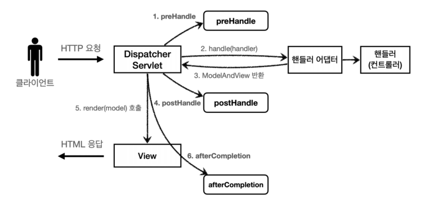

*preHandle : 컨트롤러 호출 전에 호출(핸들러 어댑터 호출 이전)*

- *true: 진행*
      - *false: stop*

*postHandle : 컨트롤러 호출 후에 호출(핸들러 어댑터 호출 후)*

*afterCompletion : 뷰가 렌더링 된 이후에 호출, 예외가 발생해도 항상 호출(공통 처리에 사용)*

***HandlerMethod***

*핸들러 정보는 어떤 핸들러 매핑을 사용하는가에 따라 달라진다. 스프링을 사용하면 일반적으로 @Controller, @RequestMapping을 활용한 핸들러 매핑을 사용하는데, 이 경우 핸들러 정보로 HandlerMethod 가 넘어온다. (핸들러에 대한 모든 정보가 들어있다.)*

***ResourceHttpRequestHandler***

*@Controller가 아니라 /resources/static와 같은 정적 리소스가 호출 되는 경우
ResourceHttpRequestHandler 가 핸들러 정보로 넘어오기 때문에 타입에 따라서 처리가 필요*

***WebConfig - 인터셉터 등록***

```java
@Configuration
public class WebConfig implements WebMvcConfigurer {

		@Override
		public void addInterceptors(InterceptorRegistry registry) {
		    registry.addInterceptor(new LogInterceptor())
		            .order(1)
		            .addPathPatterns("/**")
		            .excludePathPatterns("/css/**", "/*.ico", "/error");
		            
		} 
}		           
```

# ***서블릿 예외 처리 - 시작***

***서블릿의 예외 처리 지원***

    - *Exception(예외)*
    - *HttpServeletResponse sendError(HTTP 상태코드, 오류 메시지)*

## ***Exception(예외)***

*애플리케이션에서 예외가 발생했는데 try, catch로 잡지 않으면 어떻게 동작할까?*

→ ***WAS(여기까지 전파) <- 필터 <- 서블릿 <- 인터셉터 <- 컨트롤러(예외발생)***

*WAS(톰캣)까지 예외가 전달된다.*

***Spring Boot 제공 기본 예외 페이지 설정 - application.properties***

```java
server.error.whitelabel.enabled=false
```

    - *default: true*

***result***

*Excetption의 경우 서버 내부에서 처리할 수 없는 오류가 발생한 것으로 생각해서 HTTP 상태 코드를 500으로 반환한다.  + tomcat 기본 제공 오류 화면을 볼 수 있다.* 

## ***response.sendError(HTTP 상태 코드, 오류 메시지)***

*오류가 발생했을 때 HttpServletResponse가 제공하는 sendError 라는 메서드를 사용해도 된다.* 

*이것을 호출한다고 당장 예외가 발생하는 것은 아니지만, 서블릿 컨테이너에게 오류가 발생했다는 점을 전달할 수 있다.*

    - *response.sendError(HTTP 상태 코드)*
    - *response.sendError(HTTP 상태 코드, 오류 메시지)*

***sendError 흐름***

***WAS(sendError call check) ← Filter ← Servlet ← Interceptor ← Spring MVC (sendError)***

*서블릿 컨테이너는 클라이언트 응답 전에 sendError() 호출 여부를 확인한다.* 

*만약 호출되었다면 설정한 상태 코드에 맞추어 기본 서블릿(tomcat) 오류 페이지를 보여준다.*

# *서블릿 예외 처리 - 오류 화면 제공*

***WebServerCustomizer - implements WebServerFactoryCustomizer<T extends WebServerFactory>***

```java
@Component
public class WebServerCustomizer implements WebServerFactoryCustomizer<ConfigurableWebServerFactory> {
    @Override
    public void customize(ConfigurableWebServerFactory factory) {
        ErrorPage errorPage404 = new ErrorPage(HttpStatus.NOT_FOUND, "/error-page/404");
        ErrorPage errorPage500 = new ErrorPage(HttpStatus.INTERNAL_SERVER_ERROR, "/error-page/500");
        ErrorPage errorPageEx = new ErrorPage(RuntimeException.class, "/error-page/500");

        factory.addErrorPages(errorPage404, errorPage500, errorPageEx);
    }
}
```

    - *response.sendError(404) : errorPage404 호출*
    - *response.sendError(500) : errorPage500 호출*
    - *RuntimeException 또는 그 자식 타입의 예외: errorPageEx 호출*

***오류 처리 컨트롤러*** 

```java
@Slf4j
@Controller
public class ErrorPageController {
		@RequestMapping("/error-page/404")
		public String errorPage404(HttpServletRequest request, HttpServletResponse response){
		    log.info("errorPage 404");
		    return "error-page/404";
		}
		
		@RequestMapping("/error-page/500")
		public String errorPage500(HttpServletRequest request, HttpServletResponse response){
		    log.info("errorPage 500");
		    return "error-page/500";
		}
}
```

# ***서블릿 예외 처리 - 오류 페이지 작동 원리***

*WAS는 해당 예외(Exception, responseSendError())를 처리하는 오류 페이지 정보를 확인한다.*

*→ ex: new ErrorPage(RuntimeException.class, "/error-page/500")*

*예를 들어서 RuntimeException 예외가 WAS까지 전달되면, WAS는 오류 페이지 정보를 확인한다.* 

*RuntimeException 의 오류 페이지로 /error-page/500이 지정되어 있다.*

*WAS는 오류 페이지를 출력하기 위해 /error-page/500를 다시 요청한다.*

***예외 발생과 오류 페이지 요청 흐름***

 *WAS(여기까지 전파) <- 필터 <- 서블릿 <- 인터셉터 <- 컨트롤러(예외발생)*

 *WAS(/error-page/500) 요청 -> 필터 -> 서블릿 -> 인터셉터 -> 컨트롤러(/error-page/500) -> View*

***클라이언트는 내부에서 이런 추가 오류 페이지 호출을 모른다.***

## ***오류 정보 추가***

*WAS는 오류 페이지를 단순히 다시 요청만 하는 것이 아니다.* 

*오류 정보를 HttpServeletRequest 객체의 attribute에 추가해서 넘겨준다.*

***RequestDispatcher - interface***

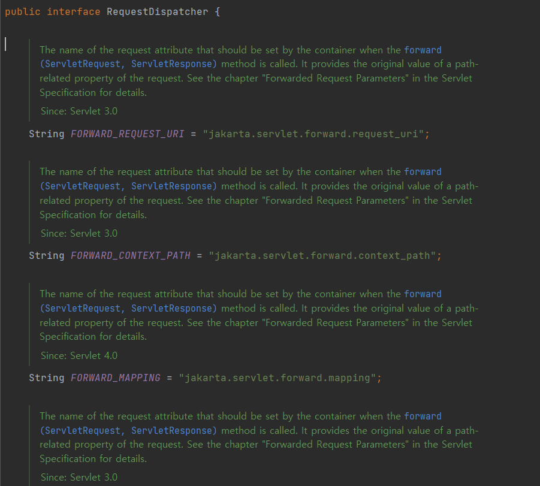

***attribute 값 조회*** 

```java
private void printErrorInfo(HttpServletRequest request) {
   //ex의 경우 NestedServletException 스프링이 한번 감싸서 반환
   log.info("ERROR_EXCEPTION: ex=", request.getAttribute(ERROR_EXCEPTION));
   log.info("ERROR_EXCEPTION_TYPE: {}", request.getAttribute(ERROR_EXCEPTION_TYPE));
   log.info("ERROR_MESSAGE: {}", request.getAttribute(ERROR_MESSAGE));
   log.info("ERROR_REQUEST_URI: {}", request.getAttribute(ERROR_REQUEST_URI));
   log.info("ERROR_SERVLET_NAME: {}", request.getAttribute(ERROR_SERVLET_NAME));
   log.info("ERROR_STATUS_CODE: {}", request.getAttribute(ERROR_STATUS_CODE));
   log.info("dispatchType={}", request.getDispatcherType());
}
```

    - *예외, 예외 타입, 오류 메시지, 클라이언트 요청 URL, 오류가 발생한 서블릿 이름, HTTP 상태 코드 정보가 있다.* 

# ***서블릿 예외 처리 - 필터***

***What is Dispatcher Type?***

*오류가 발생하면 오류 페이지를 출력하기 위해 WAS 내부에서 다시 한번 호출이 발생한다.*

*이때 필터, 서블릿, 인터셉터도 모두 다시 호출된다.*

*그런데 로그인 인증 체크 같은 경우를 생각해보면, 이미 한번 필터나, 인터셉터에서 로그인 체크
를 완료했다.*

*따라서 서버 내부에서 오류 페이지를 호출한다고 해서 해당 필터나 인터셉트가 한번 더 호출되는 것은 매우 비효율적이다.*

*결국 클라이언트로 부터 발생한 정상 요청인지, 아니면 오류 페이지를 출력하기 위한 내부 요청인지 구분할 수 있어야한다.*

*서블릿은 이런 문제를 해결하기 위해* *DispatcherType* *이라는 추가 정보를 제공한다.*

## ***DispatcherType***

***jakarta.servlet.DispatcherType - enum***

```java
public enum DispatcherType {
    FORWARD,
    INCLUDE,
    REQUEST,
    ASYNC,
    ERROR
}
```

***DispatcherType***

    - ***REQUEST*** *: 클라이언트 요청*
    - ***ERROR*** *: 오류 요청*
    - ***FORWARD*** *: MVC에서 배웠던 서블릿에서 다른 서블릿이나 JSP를 호출할 때*
*`RequestDispatcher.forward(request, response);`*
    - ***INCLUDE*** *: 서블릿에서 다른 서블릿이나 JSP의 결과를 포함할 때*
*`RequestDispatcher.include(request, response);`*
    - ***ASYNC*** *: 서블릿 비동기 호출*

## ***필터와 DispatcherType***

```java
@Configuration
public class WebConfig implements WebMvcConfigurer {
		 @Bean
		 public FilterRegistrationBean logFilter() {
				 FilterRegistrationBean<Filter> filterRegistrationBean = new FilterRegistrationBean<>();
				 filterRegistrationBean.setFilter(new LogFilter());
				 filterRegistrationBean.setOrder(1);
				 filterRegistrationBean.addUrlPatterns("/*");
				 filterRegistrationBean.setDispatcherTypes(DispatcherType.REQUEST, DispatcherType.ERROR);
				 return filterRegistrationBean;
		 }
}
```

`filterRegistrationBean.setDispatcherTypes(DispatcherType.REQUEST, DispatcherType.ERROR);`

    - *이렇게 두 가지를 넣으면 클라이언트 요청은 물론이고, 오류 페이지 요청에서도 필터가 호출*
    - *default: 아무것도 넣지 않으면 기본 값이 DispatcherType.REQUEST 이다.*
- *클라이언트의 요청이 있는 경우에만 필터가 적용*
      - *특별히 오류 페이지 경로도 필터를 적용할 것이 아니면, 기본 값을 그대로 사용하면 된다*

# ***서블릿 예외 처리 - 인터셉터***

*서블릿 필터와 다르게 인터셉터는 스프링이 제공하는 기술이다.* 

*따라서 DispatcherType과 무관하게 항상 호출된다.*

*인터셉터는 다음과 같이 요청 경로에 따라서 추가하거나 제외하기 쉽게 되어 있기 때문에, 이러한 설정을 사용해서 오류 페이지 경로를* ***excludePathPatterns****를 사용해서 빼주면 된다*

```java
@Configuration
public class WebConfig implements WebMvcConfigurer {
		@Override
    public void addInterceptors(InterceptorRegistry registry) {
        registry.addInterceptor(new LogInterceptor())
                .order(1)
                .addPathPatterns("/**")
                .excludePathPatterns("/css/**", "*.ico", "/error", "/error-page/**");
    }
}
```

# ***스프링 부트 - 오류 페이지1***

## ***스프링 부트 기본 제공***

    - *ErrorPage를 자동으로 등록한다. 이때 /error 라는 경로로 기본 오류 페이지를 설정*
- *new ErrorPage("/error") , 상태코드와 예외를 설정하지 않으면 기본 오류 페이지로 사용된다.*
      - *서블릿 밖으로 예외가 발생하거나, response.sendError(...) 가 호출되면 모든 오류는 /error를
호출*
    - *BasicErrorController라는 스프링 컨트롤러를 자동으로 등록*
- *ErrorPage 에서 등록한 /error 를 매핑해서 처리하는 컨트롤러*

*ErrorMvcAutoConfiguration이라는 클래스가 오류 페이지를 자동으로 등록하는 역할을 한다*

***정리***

*오류가 발생 → /error를 기본 요청 스프링 부트가 자동 등록한 BasicErrorController는 이 경로를 기본으로 받는다.*

## ***개발자는 오류 페이지만 등록***

*BasicErrorController는 기본적인 로직이 모두 개발되어 있다*

*개발자는 오류 페이지 화면만 BasicErrorController가 제공하는 룰과 우선순위에 따라서 등록하면 된다.*

***뷰 선택 우선순위 (BasicErrorController 처리 순서)***

    - *뷰 템플릿*
- *resources/templates/error/500.html*
      - *resources/templates/error/5xx.html*
    - *정적 리소스( static , public )*
- *resources/static/error/400.html*
      - *resources/static/error/404.html*
      - *resources/static/error/4xx.html*
    - *적용 대상이 없을 때 뷰 이름(error)*
- *resources/templates/error.html*

*해당 경로 위치에 HTTP 상태 코드 이름의 뷰 파일을 넣어두면 된다.*

*뷰 템플릿이 정적 리소스보다 우선순위가 높고, 404, 500처럼 구체적인 것이 5xx처럼 덜 구체적인 것 보다 우선순위가 높다.*

*5xx, 4xx 라고 하면 500대, 400대 오류를 처리해준다*

# ***스프링 부트 - 오류 페이지2***

## ***BasicErrorController가 제공하는 기본 정보들***

*BasicErrorController컨트롤러는 다음 정보를 model에 담아서 뷰에 전달한다.*

```java
* timestamp: Fri Feb 05 00:00:00 KST 2021
* status: 400
* error: Bad Request
* exception: org.springframework.validation.BindException
* trace: 예외 trace
* message: Validation failed for object='data'. Error count: 1
* errors: Errors(BindingResult)
* path: 클라이언트 요청 경로 (`/hello`)
```

*오류 관련 정보를 클라이언트에게 노출하는 것은 좋지 않다.*

*BasicErrorController 오류 컨트롤러에서 다음 오류 정보를 model 에 포함할지 여부 선택할 수 있다*

***application.properties(yaml)***

    - *server.error.include-exception=false : exception 포함 여부( true , false )*
    - *server.error.include-message=never : message 포함 여부*
    - *server.error.include-stacktrace=never : trace 포함 여부*
    - *server.error.include-binding-errors=never : errors 포함 여부*

***스프링 부트 오류 관련 옵션***

    - *server.error.whitelabel.enabled=true : 오류 처리 화면을 못 찾을 시, 스프링 whitelabel 오류 페
이지 적용*
    - *server.error.path=/error : 오류 페이지 경로, 스프링이 자동 등록하는 서블릿 글로벌 오류 페이지 경로와 BasicErrorController 오류 컨트롤러 경로에 함께 사용된다.*

# ***API 예외 처리*** 

*API 예외 처리는 어떻게 해야할까?*

*API는 각 오류 상황에 맞는 오류 응답 스펙을 정하고, JSON으로 데이터를 내려주어야 한다.*

# ***API 예외 처리 - 스프링 부트 기본 오류 처리***

*API 예외 처리도 스프링 부트가 제공하는 기본 오류 방식을 사용할 수 있다.*

***BasicErrorController 코드***

```java
@RequestMapping(produces = MediaType.TEXT_HTML_VALUE)
public ModelAndView errorHtml(HttpServletRequest request, HttpServletResponse response) {}

@RequestMapping
public ResponseEntity<Map<String, Object>> error(HttpServletRequest request) {}
```

*/error 동일한 경로를 처리하는 errorHtml() , error() 두 메서드를 확인할 수 있다*

    - *errorHtml() : produces = MediaType.TEXT_HTML_VALUE : 클라이언트 요청의 Accept 해더 값이
text/html 인 경우에는 errorHtml()을 호출해서 view를 제공한다*
    - *error() : 그외 경우에 호출되고 ResponseEntity 로 HTTP Body에 JSON 데이터를 반환*

## ***Html 페이지 vs API 오류***

*BasicErrorController를 확장하면 JSON 메시지도 변경할 수 있다.* 

*그런데 API 오류는 조금 뒤에 설명할 @ExceptionHandler가 제공하는 기능을 사용하는 것이 더 나은 방법이므로 지금은 BasicErrorController를 확장해서 JSON 오류 메시지를 변경할 수 있다 정도로만 이해해두자*

*스프링 부트가 제공하는 BasicErrorController는 HTML 페이지를 제공하는 경우에는 매우 편리하다.*

*하지만 API 오류 처리는 다르다.* 

*API 마다 클라이언트가 원하는 응답 스펙이 다를 수 있다. 즉, 매우 세밀하고 복잡하다.* 

*따라서 스프링 부트가 제공하는 BasicErrorController 기능이 아닌 직접 오류 처리를 하는게 좋다.*

# ***API 예외 처리 - HandlerExceptionResolver 시작***

*예외가 발생해서 서블릿을 넘어 WAS까지 예외가 전달되면 HTTP 상태코드가 500으로 처리된다.*

*발생하는 예외에 따라서 400, 404 등등 다른 상태코드로 처리하고 싶다.
상태코드 말고도 오류 메시지, 형식등을 API마다 다르게 처리하고 싶다.*

## ***HandlerExceptionResolver***

*스프링 MVC는 컨트롤러(핸들러) 밖으로 예외가 던져진 경우 예외를 해결하고, 동작을 새로 정의할 수 있는 방법을 제공한다.*

*컨트롤러 밖으로 던져진 예외를 해결하고, 동작 방식을 변경하고 싶으면 HandlerExceptionResolver 를 사용하면 된다.*

***스프링 인터셉터가 추가된 구조에서의 ExceptionHandler 적용 before/after 동작*** 

***before***


***after***


 *ExceptionResolver로 예외를 해결해도 Spring interceptor postHandle()은 호출되지 않는다.*

***HandlerExceptionResolver - interface***

```java
public interface HandlerExceptionResolver {
 ModelAndView resolveException( HttpServletRequest request, HttpServletResponse response,
		 Object handler, Exception ex);
}
```

    - *handler : 핸들러(컨트롤러) 정보*
    - *Exception ex : 핸들러(컨트롤러)에서 발생한 발생한 예외*

***MyHandlerExceptionResolver***

```java
public class MyHandlerExceptionResolver implements HandlerExceptionResolver {
    @Override
    public ModelAndView resolveException(HttpServletRequest request,
           HttpServletResponse response, Object handler, Exception ex) {

       try{
           if(ex instanceof IllegalArgumentException){
              response.sendError(HttpServletResponse.SC_BAD_REQUEST, ex.getMessage());
              return new ModelAndView();
           }
       }
       catch (Exception e){
            
       }
       return null;
    }
} 
```

*IllegalArgumentException이 발생하면 response.sendError(400)를 호출해서 HTTP 상태
코드를 400으로 지정하고, 빈 ModelAndView를 반환한다*

### ***반환 값에 따른 동작 방식***

*HandlerExceptionResolver의 반환 값에 따른 DispatcherServlet의 동작 방식*

    - *빈 ModelAndView: new ModelAndView()처럼 빈 ModelAndView 를 반환하면 뷰를 렌더링 하지 않고, 정상 흐름으로 서블릿이 리턴된다.*
    - *ModelAndView 지정: ModelAndView에 View , Model 등의 정보를 지정해서 반환하면 뷰를 렌더링 한다.*
    - *null: null 을 반환하면, 다음 ExceptionResolver 를 찾아서 실행한다. 만약 처리할 수 있는
ExceptionResolver가 없으면 예외 처리가 안되고, 기존에 발생한 예외를 서블릿 밖으로 던진다.*

### ***ExceptionResolver 활용***

    1. ***예외 상태 코드 변환***
    - *예외를 response.sendError(xxx) 호출로 변경해서 서블릿에서 상태 코드에 따른 오류를 처리하도
록 위임*
    - *WAS는 서블릿 오류 페이지를 찾아서 내부 호출, 예를 들어서 스프링 부트가 기본으로 설정한 /error 가 호출됨 (BasicErrorController)*
    1. ***뷰 템플릿 처리***
    - *ModelAndView에 값을 채워서 예외에 따른 새로운 오류 화면 뷰 렌더링 해서 고객에게 제공*
    1. ***API 응답 처리***
    - *`response.getWriter().println("hello");`* *처럼 HTTP 응답 바디에 직접 데이터를 넣어주는
것도 가능하다. 여기에 JSON 으로 응답하면 API 응답 처리를 할 수 있다*

***WebMvcConfigurer를 통해 등록***

```java
@Configuration
public class WebConfig implements WebMvcConfigurer{

    @Override
    public void extendHandlerExceptionResolvers(List<HandlerExceptionResolver> resolvers) {
         resolvers.add(new MyHandlerExceptionResolver());
    }
}    
```

# ***API 예외 처리 - HandlerExceptionResolver 활용***

*ExceptionResolver를 사용하면 컨트롤러에서 예외가 발생해도 ExceptionResolver에서 예외를 처리해버린다.*

*따라서 예외가 발생해도 서블릿 컨테이너까지 예외가 전달되지 않고, 스프링 MVC에서 예외 처리는 끝이 난다.*

*결과적으로 WAS 입장에서는 정상 처리가 된 것이다. 이렇게 예외를 이곳에서 모두 처리할 수 있다는 것이 핵심이다.*

*서블릿 컨테이너까지 예외가 올라가면 복잡하고 지저분하게 추가 프로세스가 실행된다. 
반면에 ExceptionResolver를 사용하면 예외처리가 상당히 깔끔해진다.*

*스프링은 이런 ExceptionResolver를 제공한다.*

# ***API 예외 처리 - 스프링 제공 ExceptionResolver1***

***스프링 부트가 기본으로 제공하는 ExceptionResolver***

    - *ExceptionHandlerExceptionResolver*
    - *ResponseStatusExceptionResolver*
    - *DefaultHandlerExceptionResolver*

***ExceptionHandlerExceptionResolver***

    - *@ExceptionHandler을 처리한다. API 예외 처리는 대부분 이 기능으로 해결한다.*

***ResponseStatusExceptionResolver***

    - *HTTP 상태 코드를 지정해준다.*
    - *예) @ResponseStatus(value = HttpStatus.NOT_FOUND)*

***DefaultHandlerExceptionResolver***

    - *스프링 내부 기본 예외를 처리한다.*

## ***ResponseStatusExceptionResolver***

*다음 두 가지 경우를 처리*

    - *@ResponseStatus가 달려있는 예외*
    - *ResponseStatusException 예외*

### ***@ResponseStatus***

```java
@ResponseStatus(code = HttpStatus.BAD_REQUEST, reason = "잘못된 요청 오류")
public class BadRequestException extends RuntimeException {
}
```

*BadRequestException 예외가 컨트롤러 밖으로 넘어가면 ResponseStatusExceptionResolver가 해당 애노테이션을 확인해서 오류 코드를 HttpStatus.BAD_REQUEST (400)으로 변경하고, 메시지도 담는다.*

*ResponseStatusExceptionResolver 코드를 확인해보면 결국 response.sendError(statusCode,
resolvedReason)를 호출하는 것을 확인할 수 있다.*

*→ WAS에서 다시 오류 페이지( /error )를 내부 요청*

***메시지 기능***

*reason을 MessageSource 에서 찾는 기능도 제공한다. reason = “error.bad”*

```java
@ResponseStatus(code = HttpStatus.BAD_REQUEST, reason = "error.bad")
public class BadRequestException extends RuntimeException {
}
```

*messages.properties*

```java
error.bad=잘못된 요청 오류입니다. 
```

### ***ResponseStatusException***

*@ResponseStatus는 개발자가 직접 변경할 수 없는 예외에는 적용할 수 없다.*

*내가 코드를 수정할 수 없는 라이브러리의 예외 코드 같은 곳에는 적용할 수 없다.*

*추가로 애노테이션을 사용하기 때문에 조건에 따라 동적으로 변경하는 것도 어렵다.*

*이때는 ResponseStatusException 예외를 사용하면 된다.*

```java
@GetMapping("/api/response-status-ex2")
public String responseStatusEx2() {
   throw new ResponseStatusException(HttpStatus.NOT_FOUND, "error.bad", new IllegalArgumentException());
}
```

*마찬가지로 ResponseStatusExceptionResolver가 ResponseStatusException 예외를 받아서 처리를 한다.* 

*WAS → /error 경로로 내부 호출이 다시 일어난다.*

# ***API 예외 처리 - 스프링 제공 ExceptionResolver2***

## ***DefaultHandlerExceptionResolver***

*스프링 내부에서 발생하는 스프링 예외를 해결*

*대표적으로 파라미터 바인딩 시점에 타입이 맞지 않으면 내부에서 TypeMismatchException이 발생하는데, 이 경우 예외가 발생했기 때문에 그냥 두면 서블릿 컨테이너까지 오류가 올라가고, 결과적으로 500 오류가 발생한다*

*그런데 파라미터 바인딩은 대부분 클라이언트가 HTTP 요청 정보를 잘못 호출해서 발생하는 문제이다.* 

*HTTP 에서는이런 경우 HTTP 상태 코드 400을 사용하도록 되어 있다.
DefaultHandlerExceptionResolver는 이것을 500 오류가 아니라 HTTP 상태 코드 400 오류로 변경한다.
스프링 내부 오류를 어떻게 처리할지 수 많은 내용이 정의되어 있다.*

***ResponseStatusExceptionResolver*** *처럼* *response.sendError()를 통해서 문제를 해결한다.*

# ***API 예외 처리 - @ExceptionHandler***

*스프링은 ExceptionHandlerExceptionResolver를 기본으로 제공하고, 기본으로 제공하는 ExceptionResolver 중에 우선순위도 가장 높다*

***ErrorResult***

```java
@Data
@AllArgsConstructor
public class ErrorResult {
	 private String code;
	 private String message;
}
```

    - *예외 발생 API 응답 객체*

***RestController*** 

```java
@ResponseStatus(HttpStatus.BAD_REQUEST)
@ExceptionHandler(IllegalArgumentException.class)
public ErrorResult illegalExceptionHandler(IllegalArgumentException e){
    return new ErrorResult("BAD", e.getMessage());
}

@ExceptionHandler
public ResponseEntity<ErrorResult> userExceptionHandler(UserException e){
    ErrorResult errorResult = new ErrorResult("user-ex", e.getMessage());
    return new ResponseEntity(errorResult, HttpStatus.BAD_GATEWAY);
}

@ResponseStatus(HttpStatus.INTERNAL_SERVER_ERROR)
@ExceptionHandler
public ErrorResult exHandler(Exception e){
    return new ErrorResult("all ex", e.getMessage());
}
```

***@ExceptionHandler 예외 처리 방법***

*@ExceptionHandler 애노테이션을 선언하고, 해당 컨트롤러에서 처리하고 싶은 예외를 지정해주면 된다.*

*해당 컨트롤러에서 예외가 발생하면 이 메서드가 호출된다. 참고로 지정한 예외 또는 그 예외의 자식 클래스는 모두 잡을 수 있다.*

***우선순위***

*스프링의 우선순위는 항상 자세한 것이 우선권을 가진다.*

```java
@ExceptionHandler(부모예외.class)
public String 부모예외처리()(부모예외 e) {}

@ExceptionHandler(자식예외.class)
public String 자식예외처리()(자식예외 e) {}
```

    - *자식 예외는 자식예외처리()가 처리* 
    - *부모 예외는 부모예외처리()가 처리*

***다양한 예외***
*다음과 같이 다양한 예외를 한번에 처리할 수 있다.*

```java
@ExceptionHandler({AException.class, BException.class})
public String ex(Exception e) {
	  return "fail";
}
```

***예외 생략*** 

```java
@ExceptionHandler
public ResponseEntity<ErrorResult> userExHandle(UserException e) {}
```

    - *@ExceptionHandler에 예외를 생략할 수 있다. 생략하면 메서드 파라미터의 예외가 지정된다.*

***파리미터와 응답***

    - *@ExceptionHandler에는 마치 스프링의 컨트롤러의 파라미터 응답처럼 다양한 파라미터와 응답을 지정할 수 있다.*

# ***API 예외 처리 - @ControllerAdvice***

*@ExceptionHandler를 사용해서 예외를 깔끔하게 처리할 수 있게 되었지만, 정상 코드와 예외 처리 코드가 하나의 컨트롤러에 섞여 있다.*

*@ControllerAdvice 또는 @RestControllerAdvice를 사용하면 둘을 분리할 수 있다.*

*역할의 분리 (SRP)*

```java
@Slf4j
@RestControllerAdvice
public class ExControllerAdvice {

       @ResponseStatus(HttpStatus.BAD_REQUEST)
       @ExceptionHandler(IllegalArgumentException.class)
       public ErrorResult illegalExceptionHandler(IllegalArgumentException e){
           return new ErrorResult("BAD", e.getMessage());
       }
       
       @ExceptionHandler
       public ResponseEntity<ErrorResult> userExceptionHandler(UserException e){
           ErrorResult errorResult = new ErrorResult("user-ex", e.getMessage());
           return new ResponseEntity(errorResult, HttpStatus.BAD_GATEWAY);
       }
       
       @ResponseStatus(HttpStatus.INTERNAL_SERVER_ERROR)
       @ExceptionHandler
       public ErrorResult exHandler(Exception e){
           return new ErrorResult("all ex", e.getMessage());
       }
}
```

*@ControllerAdvice, @RestControllerAdvice는 대상으로 지정한 여러 컨트롤러에 @ExceptionHandler , @InitBinder 기능을 부여해주는 역할을 한다.*

*대상을 지정하지 않으면 모든 컨트롤러에 적용된다. (글로벌 적용)*

***대상 컨트롤러 지정 방법***

```java
@ControllerAdvice(annotations = RestController.class)
public class ExampleAdvice1 {}

@ControllerAdvice("org.example.controllers")
public class ExampleAdvice2 {}

@ControllerAdvice(assignableTypes = {ControllerInterface.class, AbstractController.class})
public class ExampleAdvice3 {}
```

***정리***

*@ExceptionHandler와 @ControllerAdvice를 조합하면 예외를 깔끔하게 해결할 수 있다.*

# ***스프링 타입 컨버터 소개***

*문자를 숫자로 변환하거나, 반대로 숫자를 문자로 변환해야 하는 것 처럼 애플리케이션을 개발하다 보면 타입을 변환해야 하는 경우가 상당히 많다.*

*HTTP 쿼리 스트링으로 전달하는 값은 @RequestParam을 사용하면 원하는 타입으로 편리하게 받을 수 있다. → 스프링이 중간에서 타입을 변환해주었기 때문이다.*

***스프링의 타입 변환 적용 예***

    - *@RequestParam , @ModelAttribute , @PathVariable*
    - *@Value 등으로 YML 정보 읽기*
    - *뷰를 렌더링 할 때*

***컨버터 인터페이스***

```java
package org.springframework.core.convert.converter;
public interface Converter<S, T> {
		T convert(S source);
}
```

*개발자가 새로운 타입으로 만들어서 변환하고 싶으면 해당 컨버터 인터페이스를 구현해서 등록하면 된다.*

*해당 기능은 Java8 부터 제공하는 FunctionalInterface인 Function과 유사하다.*

# ***타입 컨버터 - Converter***

*타입 컨버터를 사용하려면* *`org.springframework.core.convert.converter.Converter`* *인터페이스를
구현하면 된다.*

***스프링의 다양한 타입 컨버터*** 

    - *Converter: 기본 타입 컨버터*
    - *ConverterFactory: 전체 클래스 계층 구조가 필요할 때*
    - *GenericConverter: 정교한 구현, 대상 필드의 애노테이션 정보 사용 가능*
    - *ConditionalGenericConverter: 특정 조건이 참인 경우에만 실행*

***ConversionService?***

*컨버터를 하나하나 직접 사용하면(컨버터를 객체를 생성해서 직접 사용) 개발자가 직접 컨버팅 하는 것과 큰 차이가 없다. 
타입 컨버터를 등록하고 관리하면서 편리하게 변환 기능을 제공하는 컨버전 서비스(ConversionService)가 필요하다.*

# ***컨버전 서비스 - ConversionService***

***ConversionService - Interface***

```java
package org.springframework.core.convert;

public interface ConversionService {
		boolean canConvert(@Nullable Class<?> sourceType, Class<?> targetType);
		
		boolean canConvert(@Nullable TypeDescriptor sourceType, TypeDescriptor targetType);
		
		<T> T convert(@Nullable Object source, Class<T> targetType);
		
		Object convert(@Nullable Object source, @Nullable TypeDescriptor sourceType, TypeDescriptor targetType);
}
```

    - *컨버팅이 가능한지 확인하는 기능(canConvert), 컨버팅(convert) 기능을 제공*

***ConversionServiceTest - 컨버전 서비스 테스트 코드***

```java
@Test
void conversionService(){
    // 등록
    DefaultConversionService conversionService = new DefaultConversionService();
    conversionService.addConverter(new StringToIntegerConverter());
    conversionService.addConverter(new IntegerToStringConverter());
    conversionService.addConverter(new StringToIpPortConverter());
    conversionService.addConverter(new IpPortToStringConverter());

    // 사용
    assertThat(conversionService.convert("10", Integer.class)).isEqualTo(10);
    assertThat(conversionService.convert(10, String.class)).isEqualTo("10");

    assertThat(conversionService.convert("127.0.0.1:8080", IpPort.class))
            .isEqualTo(new IpPort("127.0.0.1", 8080));

    assertThat(conversionService.convert(new IpPort("127.0.0.1", 8080), String.class))
            .isEqualTo("127.0.0.1:8080");

}
```

    - *DefaultConversionService implements ConversionService*
- *addConverter(Converter<?, ?> converter): 컨버터 등록 기능을 제공한다.*

***등록과 사용 분리***

*컨버터를 사용하는 입장에서는 타입 컨버터를 전혀 몰라도 된다.*

*타입 컨버터들은 모두 컨버전 서비스 내부에 숨어서 제공 (캡슐화)*

*타입 변환을 원하는 클라이언트는 컨버전 서비스 인터페이스에만 의존한다.* 

***인터페이스 분리 원칙 - ISP(Interface Segregation Principle)***

*인터페이스 분리 원칙은 클라이언트가 자신이 이용하지 않는 메서드(컨버터 등록)에 의존하지 않아야 한다.*

*DefaultConversionService는 다음 두 인터페이스를 구현했다.*

    - *ConversionService: 컨버터 사용에 초점* 
    - *ConverterRegistry: 컨버터 등록에 초점*

***단일 책임 원칙 - SRP*** *또한 잘 적용되었다. 하나의 인터페이스는 하나의 역할과 책임을 가진다.* 

*SRP가 잘 적용된 구조는 OCP(Open-Closed-Principal) 또한 지켜지기 쉽다.*

# ***스프링에 Converter 적용하기***

***WebConfig - implements WebMvcConfigurer***

```java
@Configuration
public class WebConfig implements WebMvcConfigurer {
    @Override
    public void addFormatters(FormatterRegistry registry) {
         registry.addConverter(new StringToIntegerConverter());
         registry.addConverter(new IntegerToStringConverter());
         registry.addConverter(new StringToIpPortConverter());
         registry.addConverter(new IpPortToStringConverter());
    }
}
```

    - *스프링 내부에서 사용하는 ConversionService에 컨버터를 추가한다.*

*스프링은 내부에서 수 많은 기본 컨버터를 제공한다.*

*FormatterRegistry를 통해서 컨버터를 추가하면 같은 타입의 source(S), 같은 타입의 return(T) 이어도 기본 컨버터 보다 높은 우선순위를 가진다.*

***처리 과정 - @RequestParam***

*@RequestParam을 처리하는 ArgumentResolver인 RequestParamMethodArgumentResolver에서 ConversionService를 사용해서 타입을 변환한다*

*반면 @RequestBody를 처리하는 HttpMessageConverter 같은 경우 Jackson의 ObjectMapper를 사용하고 내부에서 ConversionService를 사용하지는 않는다.*

# ***뷰 템플릿에 컨버터 적용하기***

*타임리프는 렌더링 시에 컨버터를 적용해서 렌더링 하는 방법을 편리하게 지원한다.*

***ConverterController***

```java
@Controller
public class ConverterController {

		 @GetMapping("/converter-view")
		 public String converterView(Model model) {
				 model.addAttribute("number", 10000);
				 model.addAttribute("ipPort", new IpPort("127.0.0.1", 8080)); 
				 return "converter-view";
		 }
}
```

***coverter-view 일부***

```html
<span th:text="${number}" ></span>
<span th:text="${{number}}" ></span>
<span th:text="${ipPort}" ></span>
<span th:text="${{ipPort}}" ></span>
```

***렌더링 결과***

```html
10000
10000
hello.typeconverter.type.IpPort@59cb0946
127.0.0.1:8080
```

*타임리프는 ${{...}}를 사용하면 자동으로 컨버전 서비스를 사용해서 변환된 결과를 출력*

*변수 표현식 : ${...}
컨버전 서비스 적용 : ${{...}}*

**<span th:text="${ipPort}" ></span>:** *toString() 호출 → 재정의 하지 않았기 때문에 Object toString()*

**<span th:text="${{ipPort}}" ></span>:** *ConversionService 호출* 

### ***폼에 적용하기***

```java
@Data
@AllArgsConstructor
@NoArgsConstructor
static class Form{
    private IpPort ipPort;
}

@GetMapping("/converter/edit")
public String converterForm(Model model){
    IpPort ipPort = new IpPort("127.0.0.1", 8080);
    Form form = new Form(ipPort);
    model.addAttribute("form", form);
    return "converter-form";
}
```

***converter-form 일부*** 

```html
<form th:object="${form}" th:method="post">
    th:field <input type="text" th:field="*{ipPort}"><br/>
    th:value <input type="text" th:value="*{ipPort}">(보여주기 용도)<br/>
 <input type="submit"/>
</form>
```

*타임리프의 th:field는 컨버전 서비스 적용된다.*

*th:value: toString() 호출* 

*th:field: ConversionService 호출*

# ***포맷터 - Formatter***

***What is Formatter?***

*Converter는 입력과 출력 타입에 제한이 없는, 범용 타입 변환 기능을 제공*

*일반적인 웹 애플리케이션 상황에서는 문자를 다른 타입으로 변환하거나, 다른 타입을 문자로 변환하는 상황이 대부분이다.*

*객체를 특정한 포맷에 맞추어 문자로 출력하거나 그 반대의 역할을 하는 것에 특화된 기능이 바로 Formatter이다.* 

***Converter vs Formatter***

    - *Converter는 범용(객체 ↔ 객체)*
    - *Formatter는 문자에 특화(객체 ↔ 문자) + 현지화(Locale)*

***Formatter - interface extends Printer, Parser***

```java
public interface Printer<T> {
		String print(T object, Locale locale);
}

public interface Parser<T> {
		T parse(String text, Locale locale) throws ParseException;
}

public interface Formatter<T> extends Printer<T>, Parser<T> {
	
}
```

***MyNumberFormatter***

```java

public class MyNumberFormatter implements Formatter<Number> {
    @Override
    public Number parse(String text, Locale locale) throws ParseException {
        // "1,000" -> 1000
        NumberFormat format =  NumberFormat.getInstance(locale);
        return format.parse(text); // Long
    }

    @Override
    public String print(Number object, Locale locale) {
		    // 1000 -> "1,000"
        NumberFormat instance = NumberFormat.getInstance(locale);
        return instance.format(object);
    }
}
```

*“1,000” 처럼 숫자 중간의 쉼표를 적용하려면 자바에서 제공하는 NumberFormat 객체를 사용하면 된다. (Local 정보를 활용해서 나라별로 다른 숫자 포맷을 만들어준다)*

*참고로 parse 결과는 Long이다. 
Number는 abstract class 이고 구현체는 AtomicInteger, Integer, Long 등이 있다.*

***스프링은 용도에 따라 다양한 방식의 기본 포맷터를 제공***

# ***포맷터를 지원하는 컨버전 서비스***

*컨버전 서비스는 컨버터만 등록할 수 있고, 포맷터는 등록할 수 없다.*

*포맷터를 지원하는 컨버전 서비스를 사용하면 컨버전 서비스에 포맷처를 추가할 수 있다.* 

*내부에서 어댑터 패턴을 사용하여 Formatter를 Converter처럼 동작하도록 지원한다.*

*FormattingConversionService는 포맷터를 지원하는 컨버전 서비스*

*DefaultFormattingConversionService는 FormattingConversionService에 기본적인 통화, 숫자 관
련 몇가지 기본 포맷터를 추가해서 제공*

***DefaultFormattingConversionService Test***

```java
public class FormattingConversionServiceTest {
    @Test
    void formattingConversionService(){
        DefaultFormattingConversionService conversionService = new DefaultFormattingConversionService();

        // 컨버터 등록
        conversionService.addConverter(new StringToIpPortConverter());
        conversionService.addConverter(new IpPortToStringConverter());

        // 포멧터 등록
        conversionService.addFormatter(new MyNumberFormatter());

        // 컨버터 사용
        assertThat(conversionService.convert(new IpPort("127.0.0.0.1", 8080), String.class))
                .isEqualTo("127.0.0.0.1:8080");

        // 포멧터 사용
        assertThat(conversionService.convert("1,000", Integer.class)).isEqualTo(1000);
        assertThat(conversionService.convert(1000, String.class)).isEqualTo("1,000");

    }

}
```

    - *포맷터 등록/사용,  컨버터 등록/사용 모두 가능* 
    - *Spring Boot는 DefaultFormattingConversionService를 상속 받은* ***WebConversionService****를
내부에서 사용*

# ***포맷터 적용하기***

***WebConfig implements WebMvcConfigurer***

```java
@Configuration
public class WebConfig implements WebMvcConfigurer {
    @Override
    public void addFormatters(FormatterRegistry registry) {
    
         // registry.addConverter(new StringToIntegerConverter());
         // registry.addConverter(new IntegerToStringConverter());
         
         registry.addConverter(new StringToIpPortConverter());
         registry.addConverter(new IpPortToStringConverter());
         
         registry.addFormatter(new MyNumberFormatter());
    }
}

```

*MyNumberFormatter 기능은 숫자 ↔ 문자 기능이고 StringToIntegerConverter, IntegerToStringConverter 또한 숫자 ↔ 문자 기능이다.* 

*즉, 둘의 기능이 겹친다.* 

***우선순위가 Converter > Formatter*** *이기 때문에 Formatter 기능을 사용하고 싶으면 주석 처리를 해야한다.* 

# ***스프링이 제공하는 기본 포맷터***

*스프링은 자바에서 기본으로 제공하는 타입들에 대해 수 많은 포맷터를 기본으로 제공*

***@NumberFormat*** 

    - *숫자 관련 형식 지정 포맷터 사용*
    - *NumberFormatAnnotationFormatterFactory*

***@DateTimeFormat*** 

    - *날짜 관련 형식 지정 포맷터 사용*
    - *Jsr310DateTimeFormatAnnotationFormatterFactory*

***Controller***

```java
@Data
static class Form{
    @NumberFormat(pattern = "###,###")
    private Integer number;

    @DateTimeFormat(pattern = "yyyy-MM-dd HH:mm:ss")
    private LocalDateTime localDateTime;
}

@GetMapping("/formatter/edit")
public String formatterForm(Model model){
    Form form = new Form();
    form.setNumber(10000);
    form.setLocalDateTime(LocalDateTime.now());
    model.addAttribute("form", form);
    return "formatter-form";
}

@PostMapping("/formatter/edit")
public String formatterEdit(@ModelAttribute Form form){
    return "formatter-view";
}

```

***formatter-form***

```html
<form th:object="${form}" th:method="post">
     number <input type="text" th:field="*{number}"><br/>
     localDateTime <input type="text" th:field="*{localDateTime}"><br/>
    <input type="submit"/>
</form>
```

    - *th:field는 value convert를 자동으로 해준다.*


***formatter-view***

```html
<ul>
     <li>${form.number}: <span th:text="${form.number}" ></span></li>
     <li>${{form.number}}: <span th:text="${{form.number}}" ></span></li>
     <li>${form.localDateTime}: <span th:text="${form.localDateTime}" ></span></li>
     <li>${{form.localDateTime}}: <span th:text="${{form.localDateTime}}" ></span></li>
</ul>
```


    - *${}: → convert x*
    - *${{}}: → convert o*

***LocalDateTime toString()***

```java
@Override
public String toString() {
    return date.toString() + 'T' + time.toString();
}
```

    - *${form.localDateTime}: LocalDateTime toString()이 호출돼서 중간에 T가 들어갔다.*
    - *${{form.localDateTime}}:@DateTimeFormat(pattern = "yyyy-MM-dd HH:mm:ss")형식에 맞게 출력*

# *정리*

*컨버터를 사용하든, 포맷터를 사용하든 등록 방법은 다르지만, 사용할 때는 컨버전 서비스를 통해서 일관성 있게 사용할 수 있다.*

*메시지 컨버터(HttpMessageConverter)에는 컨버전 서비스가 적용되지 않는다.*

*JSON을 객체로 변환하는 메시지 컨버터는 내부에서 Jackson 같은 라이브러리를 사용
한다. 객체를 JSON으로 변환한다면 그 결과는 이 라이브러리에 달린 것*

*컨버전 서비스는 @RequestParam , @ModelAttribute , @PathVariable , 뷰 템플릿 등에서 사용할 수 있다.*

# ***파일 업로드 소개***

***HTML 폼 전송 방식***

    - *application/x-www-form-urlencoded*
    - *multipart/form-data*

## ***application/x-www-form-urlencoded 방식***


*application/x-www-form-urlencoded 방식은 HTML 폼 데이터를 서버로 전송하는 가장 기본적인 방법*

*Form 태그에 별도의 enctype 옵션(인코딩 타입)이 없으면 웹 브라우저는 요청 HTTP 메시지의 헤더에 다음 내용을 추가 →* ***Content-Type: application/x-www-form-urlencoded***

*HTTP Body에 문자로 username=kim&age=20 와 같이 &로 구분해서 전송*

## ***파일 업로드는 어떻게?***

*파일을 업로드 하려면 파일은 문자가 아니라 바이너리 데이터를 전송해야 한다.*

*문자를 전송하는 이 방식으로 파일을 전송하기는 어렵다,*

*또한 보통 폼을 전송할 때 파일만 전송하는 것이 아니다.*

***전송 데이터 example***

```java
- 이름
- 나이
- 첨부파일
```

*이름과 나이도 전송해야 하고, 첨부파일도 함께 전송해야 한다*

*이름과 나이는 문자로 전송하고, 첨부파일은 바이너리로 전송해야 한다*

*즉, 문자와 바이너리 데이터 모두를 동시에 전송해야 하는 상황이다.*

→ *이 문제를 해결하기 위해서 HTTP는* ***multipart/form-data****라는 전송 방식을 제공*

## ***multipart/form-data 방식***


*multipart/form-data 방식을 사용하려면  Form 태그에 별도의* ***enctype="multipart/form-data"*** *를 지정해야 한다.*

*multipart/form-data 방식은 다른 종류의 여러 파일과 폼의 내용 함께 전송할 수 있다*

***폼의 입력 결과***

*폼의 입력 결과(HTTP 메시지)를 보면 각각의 전송 항목이 구분(****——X****)이 되어있다.*

***Content-Disposition****이라는 항목별 헤더가 추가되어 있고 여기에 부가 정보가 있다.*

 *username , age , file1 이 각각 분리되어있고, 폼의 일반 데이터는 각 항목별로 문자가 전송되고, 파일의 경우 파일 이름과 Content-Type이 추가되고 바이너리 데이터가 전송된다.*

*multipart/form-data는 이렇게 각각의 항목을 구분해서, 한번에 전송하는 것*

# ***서블릿과 파일 업로드1***

```java
@Slf4j
@Controller
@RequestMapping("/servlet/v1")
public class ServletUploadControllerV1 {

    @GetMapping("/upload")
    public String newFile(){
        return "upload-form";
    }
    
    @PostMapping("/upload")
    public String saveFileV1(HttpServletRequest request) throws ServletException, IOException {
        log.info("request ={}", request);

        String itemName = request.getParameter("itemName");
        log.info("itemName ={}", itemName);

        Collection<Part> parts = request.getParts();
        log.info("parts={}", parts);

        return "upload-form";
    }
}
```

*HttpServletRequest request.getParts(): → return Collections<Part> parts*

*multipart/form-data 전송 방식에서 각각 나누어진 부분을 받아서 확인할 수 있다.*

***스프링 부트 3.2 이상 로그 출력 - application.properties/yaml***

```java
logging.level.org.apache.coyote.http11=trace
```

***결과 로그***

```java
Content-Type: multipart/form-data; boundary=----xxxx

------xxxx
Content-Disposition: form-data; name="itemName"
Spring

------xxxx
Content-Disposition: form-data; name="file"; filename="test.data"
Content-Type: image/jpeg

sdklajkljdf...

------xxxx--
```

## ***멀티파트 사용 옵션***

***업로드 사이즈 제한***

```java
spring.servlet.multipart.max-file-size=1MB
spring.servlet.multipart.max-request-size=10MB
```

    - *사이즈를 넘으면 예외(SizeLimitExceededException)가 발생*
    - *max-file-size : 파일 하나의 최대 사이즈, 기본 1MB*
    - *max-request-size : 멀티파트 요청 전체 합 사이즈, 기본 10 MB*

***spring.servlet.multipart.enabled 끄기***

```java
spring.servlet.multipart.enabled=false
```

    - *default: true*
    - *해당 옵션을 끄면 서블릿 컨테이너는 멀티파트 관련된 처리를 하지 않는다.*

***참고***

*spring.servlet.multipart.enabled 옵션을 켜면 Dispatcher Servlet에서 멀티파트 리졸버(MultipartResolver)를 실행*

*멀티팔트 리졸버는 HttpServletRequest 객체를 MultipartHttpServletRequest(extends HttpServletRequest)로 변환해서 반환*

*스프링이 제공하는 멀티파트 리졸버는 MultipartHttpServletRequest 인터페이스를 구현한
StandardMultipartHttpServletRequest를 반환*

*해당 객체로 멀티 파트 관련 처리를 편리하게 할 수 있지만 MultipartFile을 사용하면 더 편하기 때문에 MultipartHttpServletRequest는 잘 사용하지 않는다.*

# ***서블릿과 파일 업로드2***

*서블릿이 제공하는 Part 통해서 실제 파일을 서버에 업로드 하자* 

***파일 저장 경로 지정 - application.properties***

```java
file.dir=/Users/baeue/study/file/
```

    - *해당 경로에 실제 폴더를 미리 만들어두자*

***파일 업로드 예제***

```java
@Slf4j
@Controller
@RequestMapping("/servlet/v2")
public class ServletUploadControllerV2 {

    @Value("${file.dir}")
    private String fileDir;

    @GetMapping("/upload")
    public String newFile(){
        return "upload-form";
    }
    
    @PostMapping("/upload")
    public String saveFileV1(HttpServletRequest request) throws ServletException, IOException {
        log.info("request ={}", request);

        String itemName = request.getParameter("itemName");
        log.info("itemName ={}", itemName);

        Collection<Part> parts = request.getParts();
        log.info("parts={}", parts);

        for (Part part : parts) {
            log.info("====PART====");
            log.info("name={}", part.getName());
            part.getHeaderNames()
                    .iterator()
                    .forEachRemaining(
                            headerName -> log.info("header {}: {}", headerName, part.getHeader(headerName)));

      
            // content-disposition fileName
            log.info("submittedFileName={}", part.getSubmittedFileName());
            // 데이터(body) 사이즈
            log.info("size={}", part.getSize());

            // 데이터 읽기
            InputStream inputStream = part.getInputStream();
            String body = StreamUtils.copyToString(inputStream, StandardCharsets.UTF_8);
            // log.info("body={}", body);

            // 파일 저장하기
            if(StringUtils.hasText(part.getSubmittedFileName())){
                String fullPath = fileDir + part.getSubmittedFileName();
                log.info("파일 저장 fullPath={}", fullPath);
                part.write(fullPath);
            }
        }

        return "upload-form";
    }
}

```

***application.properties 에서 설정한 file.dir의 값을 주입***

```java
@Value("${file.dir}")
private String fileDir;
```

*HttpServletRequest getParts() 정확히는 StandardMultipartHttpServletRequest*

*→ Collection<Part> 반환*

*멀티파트 형식은 전송 데이터를 하나하나 각각 부분(Part)으로 나누어 전송한다. 
parts에는 이렇게 나누어진 데이터가 각각 담긴다.*

***Part 주요 메서드***

    - *part.getName(): <input> 태그 name*
    - *part.getSize(): 사이즈* 
    - *part.getSubmittedFileName() : 클라이언트가 전달한 파일명*
    - *part.getHeaderNames(), part.getHeader(): header* 
    - *part.getInputStream(): Part의 전송 데이터(인코딩된 바이너리 데이터)를 읽을 수 있다.*
- *디코딩: StreamUtils.copyToString(inputStream, StandardCharsets.UTF_8) return String*
    - *part.write(String path): Part를 통해 전송된 데이터를 저장할 수 있다.*
- *저장 경로를 넘긴다.*

***결과 로그***

```plain text
 request =org.springframework.web.multipart.support.StandardMultipartHttpServletRequest@2f19d21c
 itemName =배제우
 parts=[org.apache.catalina.core.ApplicationPart@35d0d5cc, org.apache.catalina.core.ApplicationPart@2feb9c]

 ====PART====
 name=itemName
 header content-disposition: form-data; name="itemName"
 submittedFileName=null
 size=9
 body=배제우
 
 ====PART====
 name=file
 header content-disposition: form-data; name="file"; filename="xxx.JPG"
 header content-type: image/jpeg
 submittedFileName=xxx.JPG
 size=41781
 body=���� JFIF  x x  ���Exif  MM *   ;      J�i      P��    
```

*서블릿이 제공하는 Part는 편하기는 하지만, HttpServletRequest를 사용해야 하고(서블릿에 의존성이 생긴다), 추가로 파일 부분만 구분하려면 여러가지 코드를 넣어야 한다.*

# ***스프링과 파일 업로드***

```java
@Slf4j
@Controller
@RequestMapping("/spring")
public class SpringUploadController {

    @Value("${file.dir}") 
    private String fileDir;
    
    @PostMapping("/upload")
    public String saveFile(@RequestParam String itemName,
                           @RequestParam MultipartFile file) throws IOException{

        if(!file.isEmpty()){
            String fullPath = fileDir + file.getOriginalFilename();
            log.info("파일 저장 fullPath={}", fullPath);
            file.transferTo(new File(fullPath));
        }
        return "upload-form";
    }
}    
```

    - *스프링은 MultipartFile 이라는 인터페이스로 멀티파트 파일을 매우 편리하게 지원*
    - *HTML Form input 태그 name에 맞추어 @RequestParam 또는 @ModelAttribute를 적용하면 된다.*
- *getOriginalFilename() : 업로드 파일 명*
      - *transferTo(new File(fullPath)): 파일 저장*

***dependency***

```groovy
dependencies {
	 implementation 'org.springframework.boot:spring-boot-starter-jdbc'
	 compileOnly 'org.projectlombok:lombok'
	 runtimeOnly 'com.h2database:h2'
	 annotationProcessor 'org.projectlombok:lombok'
	 testImplementation 'org.springframework.boot:spring-boot-starter-test'
	 
	 //테스트에서 lombok 사용
	 testCompileOnly 'org.projectlombok:lombok'
	 testAnnotationProcessor 'org.projectlombok:lombok'
}
```

# ***H2 데이터베이스 설정***

***윈도우 실행: h2 database 설치경로 → bin 폴더 이동*** 

    - *./h2.bat*

***데이터베이스 생성 방법***

    - *사용자명, 비밀번호 입력* 
    - *jdbc:h2:~/db_name*
- *연결 시험: → 오류 발생* 
      - *연결을 직접 누른다*
    - *db_name.mv.db 파일 생성 확인*
    - 이후 접속 *jdbc:h2/tcp://localhost/~/db_name*

***참고: H2 데이터베이스가 정상 생성되지 않을 때***

    - *H2 데이터베이스 재실행*
    - *웹 브라우저가 자동 실행되면 주소창 앞 부분 localhost로 변경* 
    - *jdbc:h2:~/db_name*
    - 이후 접속 *jdbc:h2/tcp://localhost/~/db_name*

***연결 시험***


# ***JDBC 이해***


    - *커넥션 연결: TCP/IP를 사용하여 커넥션 연결* 
- *3-way-handshake*
    - *SQL 전달: 애플리케이션 서버는 DB가 이해할 수 있는 SQL을 연결된 커넥션을 통해 DB에 전달*
    - *결과 응답: DB는 전달된 SQL을 수행하고 그 결과를 응답*

***문제는 각 DB마다 커넥션을 연결하는 방법, SQL 전달하는 방법, 결과를 응답 받는 방법이 모두 다르다.***

    - *데이터베이스를 다른 종류의 데이터베이스로 변경하면 애플리케이션 서버에 개발된 데이터베이스 사용 코드도 함께 변경*
    - *개발자가 각각의 데이터베이스마다 커넥션 연결, SQL 전달, 그리고 그 결과를 응답 받는 방법을 새로 학습*

*→ 이런 문제를 해결하기 위해 JDBC 등장*

# ***JDBC 표준 인터페이스***

***JDBC(Java Database Connectivity)는*** *자바에서 데이터베이스에 접속할 수 있도록 하는 자바 API*

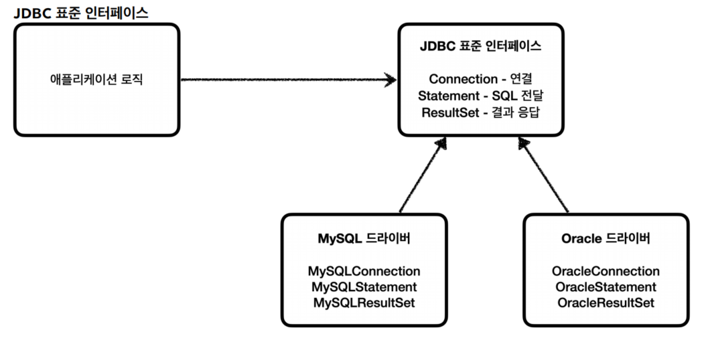

***JDBC 제공 인터페이스*** 

    - *java.sql.Connection* 
    - *java.sql.Statement*
    - *java.sql.ResultSet* 

***JDBC 드라이버?***

    - *해당 JDBC 인터페이스를 각각의 DB에 맞도록 구현해서 라이브러리로 제공, 이것을 JDBC 드라이버라 한다. (MySQL 드라이버, Oracle 드라이버)*

***표준화의 한계***

    - *각각의 데이터베이스마다 SQL, 데이터타입 등의 일부 사용법 다르다.*
    - *ANSI SQL이라는 표준이 있기는 하지만 일반적인 부분만 공통화했기 때문에 한계가 있다.*
    - *결국 데이터베이스를 변경하면 JDBC 코드는 변경하지 않아도 되지만 SQL은 해당 데이터베이스에 맞도록 변경해야한다.*
- *JPA(Java Persistence API)를 사용하면 각각의 데이터베이스마다 다른 SQL을 정의해야 하는 문제도 많은 부분 해결할 수 있다.*

# ***JDBC와 최신 데이터 접근 기술***

*JDBC 오래된 기술이고 사용하는 방법도 복잡하다.*

*최근에는 JDBC를 직접 사용하기 보다는 JDBC를 편리하게 사용하는 다양한 기술이 존재*

→ ***SQL Mapper, ORM*** 

***SQL Mapper(JdbcTemplate, MyBatis)***

    - *장점: JDBC를 편리하게 사용하도록 도와준다.*
- *SQL 응답 결과를 객체로 편리하게 변환*
      - *JDBC의 반복 코드를 제거*
    - *단점: 개발자가 SQL을 직접 작성*
- *이게 정말 단점일까?*

***ORM 기술(JPA, 하이버네이트, 이클립스링크)***

    - ORM은 객체를 관계형 데이터베이스 테이블과 매핑해주는 기술
    - *개발자는 반복적인 SQL을 직접 작성하지 않고, ORM 기술이 개발자 대신에 SQL을 동적으로 만들어 실행해준다*
    - *각각의 데이터베이스마다 다른 SQL을 사용하는 문제도 중간에서 해결해준다*
    - *JPA는 ORM 표준 인터페이스 구현체로 하이버네이트, 이클립스 링크 등이 있다.* 

# *JDBC DriverManager 연결 이해*

```java
Connection connection = DriverManager.getConnection(URL, USERNAME, PASSWORD);
```

    - *throws SQLException*

***JDBC 커넥션 인터페이스와 구현***


    - *JDBC는 java.sql.Connection 표준 커넥션 인터페이스를 정의*
    - *H2 데이터베이스 드라이버는 JDBC Connection 인터페이스를 구현한 org.h2.jdbc.JdbcConnection 구현체를 제공*


*JDBC가 제공하는 DriverManager는 라이브러리에 등록된 DB 드라이버들을 관리하고, 커넥션을 획득하는 기능을 제공한다.*

    1. *애플리케이션 로직에서 커넥션이 필요하면 DriverManager.getConnection()을 호출*
    1. *DriverManager는 라이브러리에 등록된 드라이버 목록을 자동으로 인식, 해당 드라이버들에게 순서대로 url, name, password 정보를 넘겨서 커넥션을 획득할 수 있는지 확인*
    1. *각각의 드라이버는 URL 정보를 체크해서 본인이 처리할 수 있는 요청인지 확인하고 처리할 수 있으면 DB에 커넥션을 요청하고 본인이 처리할 수 없으면 다음 드라이버에게 순서를 넘긴다.*
    1. *이렇게 찾은 커넥션 구현체가 클라이언트(애플리케이션 서버)에 반환된다.*

# ***JDBC 개발 - 등록***

***member.sql***

```sql
drop table member if exists cascade;
create table member (
		 member_id varchar(10),
		 money integer not null default 0,
		 primary key (member_id)
);
```

***Member***

```java
@Data
@NoArgsConstructor
@AllArgsConstructor
public class Member {
    private String memberId;
    private int money;
}
```

***MemberRepositoryV0 - 회원 등록***

```java
@Slf4j
public class MemberRepositoryV0 {
		private static Connection getConnection() {
        return DBConnectionUtil.getConnection();
    }
    public Member save(Member member) throws SQLException{
        String sql = "insert into member(member_id, money) values (?, ?)";

        Connection con = null;
        PreparedStatement pstmt = null;

        try {
            con = getConnection();
            pstmt = con.prepareStatement(sql);
            pstmt.setString(1, member.getMemberId());
            pstmt.setInt(2, member.getMoney());
            int count = pstmt.executeUpdate(); 

            return member;
        }
        catch (SQLException e){
            log.error("db error", e.getMessage());
            throw e;
        }
        finally {
             close(con, pstmt, null);
        }
    }
    private void close(Connection con, Statement stmt, ResultSet rs) throws SQLException{
        if(rs != null){
            try {
                rs.close();
            }
            catch (SQLException e){
                log.error("db error", e);
            }
        }
        if(stmt != null){
            try {
                stmt.close();
            }
            catch (SQLException e){
                log.error("db error", e);
            }
        }
        if(con != null){
            try {
                con.close();
            }
            catch (SQLException e){
                log.error("db error", e);
            }
        }
    }
}
```

***커넥션 획득***

    - *getConnection() DriverManager를 통해서 획득*

***save() 로직 정리*** 

    - *sql: 데이터베이스에 전달한 insert SQL 정의*
    - *pstmt = con.prepareStatement(sql)*
- *데이터베이스에 전달할 SQL과 파라미터로 전달할 데이터 준비*
- *pstmt.setString(1, member.getMemberId())* 
        - *pstmt.setInt(2, member.getMoney())*
    -  *int count = pstmt.executeUpdate();* 
- *Statement를 통해 준비된 SQL을 커넥션을 통해 실제 데이터베이스에 전달*
      - *executeUpdate()은 int를 반환하는데 영향받은 DB row 수를 반환*

***PrepareStatement extends Statemet <interface>***

    - *PreparedStatement는 Statement 의 자식 타입*
    - *? 와일드 카드를 통한 파라미터 바인딩을 가능하게 해준다.*
    - *파라미터 바인딩에서* ***SQL Injection 공격을 예방****한다.*
- *PrepareStatement가 아닌 Statement를 사용하고 파라미터 바인딩을 문자열 더하기를 통해서 하면 만약 공격자가 정상값이 아닌 추가 쿼리를 날렸을 때 그대로 subquery가 날라간다.*
    - ***성능 최적화***
- *동일한 쿼리를 여러 번 실행할 때 쿼리를 매번 파싱하지 않고, 미리 컴파일된 쿼리를 재사용하므로 성능이 향상*

***close()***

    - *close() 메소드를 보면 자원 획득 역순으로 정리를 하고있다.*
    - *각 자원에 대해 try catch를 하는 이유는 자원 정리 예외 발생에 대한 격리를 위함이다.*

***데이터 변경(추가): INSERT, DELETE, UPDATE***

    - *executeUpdate()*

***데이터 조회: SELECT*** 

    - *executeQuery()*
- *ResultSet 반환 next()로 iterator 같이 사용 가능* 
      - *Select 쿼리 결과랑 같은 순서대로 반환*

  - *H2 Database 생성, 설정* 
  - *PrepareStatement과 SQL Injection, Resource 해제 정리*

# ***커넥션 풀 이해***


***커넥션 풀 없이 데이터베이스 커넥션 획득 과정*** 

    - *애플리케이션 로직 DB 드라이버를 통해 커넥션 조회*
- *DriverManager.getConnection(URL, USERNAME, PASSWORD)*
    - *DB 드라이버는 DB와 TCP/IP 커넥션 연결*
- *3 way handshake 같은 네트워크 동작 발생*
    - *DB 드라이버는 TPP/IP 커넥션 통해서 ID/PW 기타 부가정보를 DB에 전달* 
    - *DB는 ID,PW를 통해 내부 인증을 완료하고, 내부에 DB 세션을 생성*
    - *DB 커넥션 생성이 완료되었다는 응답을 보낸다.*
    - *DB 드라이버는 커넥션 객체를 생성해서 클라이언트: DriverManager.getConnection() 호출 스레드에게 반환*

***커넥션 풀 없이 데이터베이스 커넥션 획득 과정의 문제점*** 

    - *DB, 애플리케이션 서버에서도 매번 TCP/IP 커넥션을 새로 생성하기 위한 리소스 매번 사용* 

***커넥션 풀?***

    - *커넥션을 미리 생성하고 재사용하는 방식이 커넥션 풀이다.*
    - *스프링 애플리케이션 서버에서 스레드를 미리 생성하고 재사용하는 방식과 똑같다.*

***커넥션 풀 초기화***


    - *애플리케이션을 시작하는 시점에 커넥션 풀은 설정해둔 커넥션 개수만큼 커넥션을 미리 확보해서 풀에 보관한다*
    - *커넥션 개수는 서비스 특징, 서버 스펙에 따라 다르지만 default: 10*

***커넥션 풀의 연결 상태***

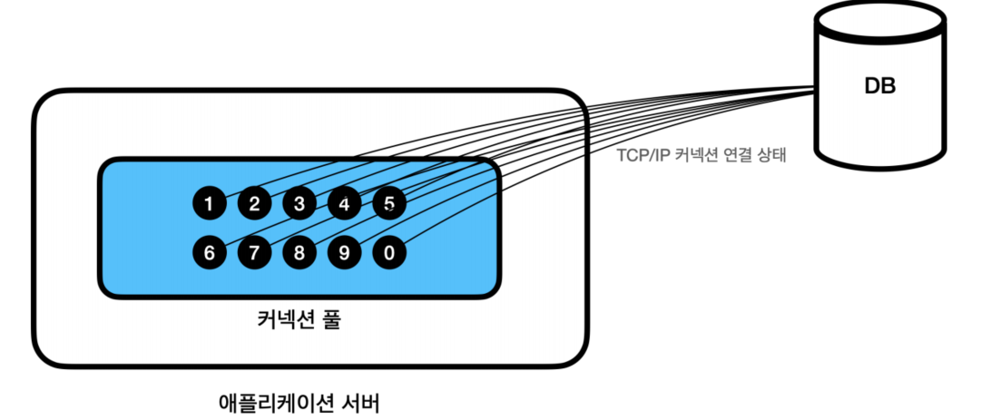

    - *커넥션 풀에 들어있는 커넥션은 TCP/IP로 DB와 커넥션이 연결되어 있는 상태이기 때문에 언제든지 SQL을 DB에 전달할 수 있다.*

***커넥션 풀 정리***

    - *커넥션 풀 숫자는 서비스의 특징과 애플리케이션 서버 스펙, DB 서버 스펙에 따라 다르다 → 성능 테스트를 통해서 최적의값을 정해야 한다.*
- *MySQL 유료 에디션에서는 스레드 풀 기능을 제공하는데 스레드 풀 도입이 무조건 성능 개선을 의미하지는 않는다는 내용이 있다. 너무 많은 스레드의 개수는 너무 많은 컨텍스트 스위칭을 발생시키고 CPU 친화도가 낮아진다. 즉, 언제나 성능 테스트를 통해서 맞춰야 한다.*
    - *커넥션 풀의 최대 커넥션 수를 제한할 수 있다.*
- *커넥션 수를 제한하지 않으면 DB에 무한정 연결이 생성되는 것을 막아주어서 DB를 보호하는 효과도 있다.*
      - *트랜잭션을 시작하고 종료하지 않으면 MySQL은 MVCC를 언두 로그를 통해서 제공하는데 언두 로그에 데이터가 무한정 쌓이게된다.*
    - *커넥션 풀 오픈소스* 
-  *commons-dbcp2 , tomcat-jdbc pool ,* ***HikariCP(스프링 부트 2.0부터 default)***

# *DataSource 이해* 

***여러가지 커넥션 획득 방법과 문제점*** 

*커넥션을 획득하는 방법은 다양하다.*

*→ DBCP2  조회, HikariCP 조회, DriverManger를 통한 신규 커넥션 생성 등등…*

*만약 애플레이션 로직이 DriverManger를 통해 신규 커넥션을 획득하다가, 커넥션 풀을 사용하는 방법으로 변경하면 어떻게 해야할까?*

*→ 애플리케이션 코드가 변경된다. 즉, 커넥션을 획득하는 클라이언트 코드가 변경된다.* 

***커넥션을 획득하는 방법을 추상화***


    - *javax.sql.DataSource 인터페이스를 제공 (커넥션 획득하는 방법 추상화)*

***DataSource 핵심 기능만 축약***

```java
public interface DataSource {
		 Connection getConnection() throws SQLException;
}
```

    - *커넥션 풀 implements DataSource*
    - *DriverManager: DriverManagerDataSource implments DataSource*  
- *항상 새로운 커넥션 획득*

# *DataSource 예제1 - DriverManager*

***DriverManager 사용 커넥션 획득***

```java
@Test
void driverManager() throws SQLException {
    Connection con1 = DriverManager.getConnection(URL, USERNAME, PASSWORD);
    Connection con2 = DriverManager.getConnection(URL, USERNAME, PASSWORD);
    assertThat(con1).isNotSameAs(con2);
}
```

***DataSourceDriverManager 사용 커넥션 획득*** 

```java
@Test
void dataSourceDriverManager() throws SQLException{
    DataSource datasource = new DriverManagerDataSource(URL, USERNAME, PASSWORD);
    useDataSource(datasource);
}
 private void useDataSource(DataSource dataSource) throws SQLException{
    Connection con1 = dataSource.getConnection();
    Connection con2 = dataSource.getConnection();
}
```

*2방식 모두 커넥션을 획득할 때마다 신규 TCP/IP 통신을 한다.*

*하지만 큰 차이점이 있다.*

*DriverManger 방식은 커넥션을 획득할 때마다 설정 정보(URL, USERNAME, PASSWORD)를 넘긴다.*

*하지만 DriverManagerDataSource 방식은 처음 DataSource 객체를 생성할 때 설정 정보를 넘기고 이후에 커넥션 획득할 때는 단순히 getConnection()을 호출해서 얻어온다.*

*즉, 설정과 사용이 분리되어 있다.*

# *DataSource 예제2 - Connection Pool*

 ***HikariDataSource 사용 커넥션 획득***

```java
@Test
void dataSourceConnectionPool() throws SQLException, InterruptedException{
    HikariDataSource dataSource = new HikariDataSource();
    dataSource.setJdbcUrl(URL);
    dataSource.setUsername(USERNAME);
    dataSource.setPassword(PASSWORD);
    dataSource.setMaximumPoolSize(10);
    dataSource.setPoolName("OceanWorld");

    useDataSource(dataSource);
    Thread.sleep(1000); 

private void useDataSource(DataSource dataSource) throws SQLException{
    Connection con1 = dataSource.getConnection();
    Connection con2 = dataSource.getConnection();
}
```

    - ***HikariCP 커넥션 풀을 사용***

***커넥션 생성 작업***

*커넥션 풀에서 커넥션을 생성하는 작업은 애플리케이션의 실행 속도에 영향을 주지 않기 위해 별도의 쓰레드에서 비동기적으로 동작한다.*

*그래서 테스트가 먼저 종료될 가능성이 존재한다. 그래서 커넥션 생성 작업 스레드의 작업 완료를 기다리기 위해 Thread.sleep이 필요하다.*

*테스트를 위해서 Future를 통한 블로킹 비동기 방식이나 CompletableFuture를 통한 논블로킹 비동기 방식을 적용해도 괜찮을듯하다*

***커넥션 획득*** 

*커넥션 풀에 사용 가능한 커넥션 풀이 없을 때는 블로킹 방식으로 동작한다.*

*즉, 다른 스레드가 커넥션 반납 전까지는 커넥션이 필요한 스레드는 대기 상태이다.*

*UX와 애플리케이션의 안정성을 위해서 커넥션 획득 타임아웃을 걸어야 한다.*

*→ ex: setConnectionTimeout(1000)* 

    - ***HikariCP 커넥션 풀***

# ***DataSource 적용***

```java
@RequiredArgsConstructor
public class MemberRepositoryV1 {
		 private final DataSource dataSource;
		 
		 // CRUD 생략 ..		 
		 
		 private void close(Connection con, Statement stmt, ResultSet rs) {
			  JdbcUtils.closeResultSet(rs);
			  JdbcUtils.closeStatement(stmt);
			  JdbcUtils.closeConnection(con);
     }
		 
		 private Connection getConnection() throws SQLException {
				 return dataSource.getConnection();
	   }
}		 
```

    - *resource 정리 → JdbcUtils.closeXXX*
    - *Connection 획득 → DataSource.getConnnection() is not static*
- *이제 DataSource를 주입받아서 사용해서 커넥션 획득 방식이 바뀌어도 클라이언트 코드 즉,*
*getConnnection() 메소드가 변경되지 않고, 외부 설정 코드만 바뀐다.*
      - *DI + OCP*

[Untitled](https://app.notion.com/p/16b7d6692ca8805faa5cdb501579c425) 

    - *트랜잭션 개념, MySQL 기반 트랜잭션 정리*

# ***트랜잭션 - 개념 이해***


    - *격리 레벨 READ_COMMITED 이상, MySQL(InnoDB)기준*
    - *세션1은 트랜잭션을 시작하고 신규 회원1, 신규 회원2를 DB에 추가했다. 아직 커밋은 하지 않은 상태*
    - *새로운 데이터는 언두 로그에 기록된다.*
    - *세션1은 select 쿼리를 실행해서 본인이 입력한 신규 회원1, 신규 회원2를 조회할 수 있다.*
- *본인의 트랜잭션 번호(TxID)보다 같거나 낮은 번호 데이터까지 →  MVCC*
    - *세션2는 select 쿼리를 실행해도 신규 회원들을 조회할 수 없다. 왜냐하면 세션1이 아직 커밋을 하지 않았기 때문이다.*
- *MySQL 에서는 언두 로그를 통해 읽기 일관성(Read Consistency)를 보장하는 방식 때문*
      - *REPEATABLE_READ 레벨 같은 경우 잠금 읽기(Lock Read)는 버퍼 풀에 있는 데이터를 조회한다.*
    - *세션1이 데이터를 commit 한다면?*
- *먼저 리두 로그에 추가된(변경) 데이터를 기록 (시스템 장애 시 복구 가능성 보장)*
      - *언두 로그에 있는 데이터를 버퍼 풀(메모리 캐시)에 is Dirty Page저장, 변경 내용이 커밋 후 MVCC 스냅샷 용도로 더 이상 필요 없으면 삭제*
      - *인덱스 처리: 인덱스 관련(not unique)는 체인지 버퍼에서 지연 처리*
- *unique 인덱스는 바로 처리*
      - *버퍼 풀에 있는 Dirty Page 데이터는 추후에 백그라운드 스레드에 의해서 쓰기 버퍼를 통한 디스크 데이터 파일과의 동기화 → 플러시 작업*
      - ***리두 로그 기록 → 언두 로그 정리 → 인덱스 처리 → 플러시***

# ***DB 락*** 

*강의에서 설명하는 락 방식은 데이터베이스의 락을 활용하는 비관적 락 방식이다.*

*데이터베이스의 락은 요청 세션의 순서대로 처리하는 블로킹 동기적 공정 락 방식이다.*

*즉, 성능이 떨어진다, 락 타임아웃 오류 발생* 

*낙관적 락을 생각할 수 있지만, 낙관적 락은 마치 spin lock 처럼 재시도를 하면서 성공할 때까지 반복한다. 그리 좋지 않다.*

*그래서 사람들은 데이터베이스의 락으로는 데이터의 정합성을 맞추는 건 가능하지만 성능상 떨어진다고 평가한다.*

# *트랜잭션 적용1*

*트랜잭션 없이 로직을 구현하니까 원자성이 보장이 안된다.*

# *트랜잭션 적용2*

*커넥션을 유지하도록 코드를 변경하는 것이 쉬운 일이 아니다.* 

*서비스 계층이 매우 지저분해지고 복잡하다*

# ***문제점들***

*애플리케이션을 layer 관점으로 봤을 때 가장 중요한 계층은 어디일까?*

*바로 핵심 비즈니스 로직이 들어있는 서비스 계층이다.*

*UI(웹) 프레젠테이션 계층 관련된 부분이 변경되고 데이터 접근 계층이 다른 기술로 변경해도* 

*비즈니스 로직은 최대한 변경없이 다른 계층에 종속적이지 않게 유지되어야 한다.*

*서비스 계층이 특정 기술에 종속되지 않으면 비즈니스 로직을 유지보수 하기도 쉽고, 단위 테스트 하기도 쉽다.*

***MemberServiceV1, MemberServiceV2의 문제점 정리***

    - *트랜잭션을 사용하기 위해서 SQLException, DataSource, Connection 같은 JDBC 기술에 의존*
    - *비즈니스 로직보다 JDBC를 사용해서 트랜잭션을 처리하는 코드가 더 많다.*
    - *향후 JDBC에서 JPA 같은 기술로 바꾸어 사용하게 되면 서비스 코드를 모두 변경해야 한다.*
    - *정리하면 핵심 비즈니스 로직과 JDBC 기술이 섞여 있어서 유지보수 하기 어렵다.*

# ***트랜잭션 추상화***

***트랜잭션 구현 기술에 따른 트랜잭션 사용법이 다르다***

    - *JDBC : con.setAutoCommit(false)*
    - *JPA : transaction.begin()*

***트랜잭션 기능을 추상화*** 

```java
public interface TxManager {
		 begin();
		 commit();
		 rollback();
}
```

    - *트랜잭션은 단순하다. 트랜잭션을 시작하고, 비즈니스 로직의 수행이 끝나면 커밋하거나 롤백하면 된다.*
    - *TxManager 인터페이스를 기반으로 각각의 기술에 맞는 구현체를 만들면 된다.*
- *JdbcTxManager : JDBC 트랜잭션 기능을 제공하는 구현체*
      - *JpaTxManager : JPA 트랜잭션 기능을 제공하는 구현체*

# ***스프링의 트랜잭션 추상화***

*우리가 직접 트랜잭션 추상화를 위해 개발할 필요 없이 스프링은 이미 다 구현해두었다.* 

*우리는 스프링이 제공하는 트랜잭션 추상화 기술을 사용하면 된다.*

*각 데이터 접근 기술에 따른 트랜잭션 구현체도 대부분 만들어두었다.*


    - *org.springframework.transaction.PlatformTransactionManager*

***PlatformTransactionManager 인터페이스***

```java
public interface PlatformTransactionManager extends TransactionManager {
		
		TransactionStatus getTransaction(@Nullable TransactionDefinition definition) throws TransactionException;
		
		void commit(TransactionStatus status) throws TransactionException;
		
		void rollback(TransactionStatus status) throws TransactionException;
}
```

    - *getTransaction()*
- *트랜잭션 시작 또는 참여*
    - *commit(), rollback()*
- *트랜잭션 커밋, 롤백*

# ***트랜잭션 동기화***

***스프링이 제공하는 트랜잭션 매니저의 역할*** 

    - *트랜잭션 추상화*
    - *리소스 동기화* 

***리소스 동기화***

    - *트랜잭션을 유지하려면 트랜잭션의 시작부터 끝까지 같은 데이터베이스 커넥션을 유지해야한다.*
    - *결국 같은 커넥션을 사용하기 위해서 이전에는 파라미터로 커넥션을 전달하는 방법을 사용했다.* 
    - *파라미터로 커넥션을 전달하는 방법은 코드가 지저분해지고, 커넥션을 넘기는 메소드와 넘기지 않는 메소드를 중복해서 만들어야 하는 등 단점이 많았다.*

***트랜잭션 매니저와 트랜잭션 동기화 매니저***


    - *스프링은 트랜잭션 동기화 매니저를 제공한다.*
    - *쓰레드 로컬(Thread Local)을 사용해서 커넥션을 동기화해준다.*
- *트랜잭션 동기화 매니저는 쓰레드 로컬을 사용하기 때문에 멀티쓰레드 환경에서도 안전하게 커넥션을 동기화 할 수 있다.* 
      - *따라서 커넥션이 필요하면 트랜잭션 동기화 매니저를 통해서 커넥션을 획득하면 된다.*
    - *트랜잭션 매니저는 내부에서 이 트랜잭션 동기화 매니저를 사용한다.*
    - *org.springframework.transaction.support.TransactionSynchronizationManager*

***트랜잭션 메니저 동작 흐름 정리***

    - *클라이언트 요청 → 서비스 계층 로직 실행* 
    - *트랜잭션 매니저 getTransaction()을 통해서 트랜잭션 시작*
    - *트랜잭션 매니저는 내부에서  DataSource를 활용해서 커넥션을 생성*
    - *커넥션의 세션을 수동 커밋 모드로 변경해서 실제 데이터베이스 트랜잭션을 시작* 
    - *획득한 커넥션을 트랜잭션 동기화 매니저(스레드 로컬)에 보관* 
    - *서비스는 비즈니스 로직을 실행하면서 리포지토리의 메소드를 호출*
- *리포지토리에서 커넥션이 필요하면 스레드 로컬에서 꺼내서 사용 → 트랜잭션 유지*
    - *예외가 터지면 트랜잭션 매니저는 롤백하고 예외가 없었다면 커밋* 
    - *DataSource의 커넥션 획득 방식에 따라 커넥션을 커넥션 풀에 반납 또는 소멸* 

# ***트랜잭션 문제 해결 - 트랜잭션 템플릿***

*트랜잭션을 사용하는 로직을 살펴보면 다음과 같은 패턴이 반복되는 것을 확인할 수 있다.*

***트랜잭션 사용 반복 코드*** 

```java
TransactionStatus status = transactionManager.getTransaction(new DefaultTransactionDefinition());
try {
		 bizLogic(fromId, toId, money);
		 transactionManager.commit(status); 
} 
catch (Exception e) {
		 transactionManager.rollback(status);
     throw new IllegalStateException(e);
}
```

    - *트랜잭션을 시작하고, 비즈니스 로직을 실행하고, 성공하면 커밋하고, 예외가 발생해서 실패하면 롤백*
    - *이런 형태는 각각의 서비스에서 반복된다. 달라지는 부분은 비즈니스 로직 뿐*
    - *이럴 때 템플릿 콜백 패턴을 활용하면 이런 반복 문제를 깔끔하게 해결할 수 있다*
- *템플릿 콜백 패턴: JdbcTemplate, RestTemplate,* ***TransactionTemplate****, Redis Template 등등..*

***TransactionTemplate***

```java
public class TransactionTemplate {
		 private PlatformTransactionManager transactionManager;
		 
		 public <T> T execute(TransactionCallback<T> action){..}
		 
		 void executeWithoutResult(Consumer<TransactionStatus> action){..}
}
```

***트랜잭션 템플릿 사용 로직***

```java
public void accountTransfer(String fromId, String toId, int money) throws SQLException{
    txTemplate.executeWithoutResult((status) -> {
        try {
            bizLogic(fromId, toId, money);
        }
        catch (SQLException e){
            throw new IllegalStateException(e);
        }
    });
}
```

    - *executeWithoutResult(Consumer<TransactionStatus> action)*
    - *TransactionCallback<TransactionStatus> action → Consumer 동작 정의* 
    - *TransactionTemplate execute(TransactionCallback<TransactionStatus> action)을 매개변수로 준다.*
- *action → Consumer action 동작*

*템플릿 콜백 패턴은 GoF 디자인 패턴의 정식 패턴은 아니다.* 

*전략 패턴의 확장 버전이다.*

***정리***

    - *트랜잭션 템플릿 덕분에, 트랜잭션을 사용할 때 반복하는 코드를 제거할 수 있었다*
    - *하지만 이곳은 서비스 로직인데 비즈니스 로직 뿐만 아니라 트랜잭션을 처리하는 기술 로직이 함께 포함되어 있다.*
    - *즉, 부가 기능인 트랜잭션 처리기능과 핵심 기능인 비즈니스 로직이 하나의 클래스에서 처리하게 된다.*

*→ Spring AOP (Dynamic Proxy) 통해서 해결하자*

# ***트랜잭션 문제 해결 - 트랜잭션 AOP*** 


    - *프록시를 사용하면 트랜잭션을 처리하는 객체와 비즈니스 로직을 처리하는 서비스 객체를 명확하게 분리할 수 있다*

### ***스프링이 제공하는 트랜잭션 AOP***

    - *스프링은 트랜잭션 AOP를 처리하기 위한 모든 기능을 제공한다.*
    - *스프링 부트를 사용하면 트랜잭션 AOP를 처리하기 위해 필요한 스프링 빈들도 자동으로 등록해준다.*
- *Advisor: BeanFactoryTransactionAttributeSourceAdvisor*
      - *Pointcut: TransactionAttributeSourcePointcut*
      - *Advice: TransactionInterceptor*
    - *개발자는 트랜잭션 처리가 필요한 곳에 @Transactional 애노테이션만 붙여주면 된다.*


# *스프링 부트의 자동 리소스 등록* 

*DataSource, TransactionManager를 자동 등록*

***데이터소스 - 자동 등록***

    - *스프링 부트는 DataSource를 스프링 빈에 자동으로 등록*
    - *개발자가 직접 데이터소스를 빈으로 등록하면 스프링 부트는 데이터소스를 자동으로 등록하지 않는다.*

```java
spring.datasource.url=jdbc:h2:tcp://localhost/~/test
spring.datasource.username=sa
spring.datasource.password=
[REDACTED]

    - *스프링 부트가 기본으로 생성하는 데이터소스는 커넥션풀을 제공하는 HikariDataSource이다. 
커넥션풀과 관련된 설정도 application.properties를 통해서 지정할 수 있다*
    - *spring.datasource.url 속성이 없으면 내장 데이터베이스(메모리 DB)를 생성하려고 시도한다.*

***트랜잭션 매니저 - 자동 등록***

    - *개발자가 직접 트랜잭션 매니저를 빈으로 등록하면 스프링 부트는 트랜잭션 매니저를 자동으로 등록하지 않는다.*
    - *어떤 트랜잭션 매니저를 선택할지는 현재 등록된 라이브러리를 보고 판단하는데, JDBC를 기술을 사용하면 DataSourceTransactionManager를 빈으로 등록하고, JPA를 사용하면 JpaTransactionManager를 빈으로 등록한다. 둘다 사용하는 경우 JpaTransactionManager 를 등록한다. 
JpaTransactionManager는 DataSourceTransactionManager가 제공하는 기능도 대부분 지원한다.*

  - *트랜잭션 매니저, 트랜잭션 동기화 매니저(Thread Local), 트랜잭션 템플릿(Templete CallBack Pattern), 트랜잭션 AOP (Dynamic Proxy)*

# ***자바 예외 계층*** 


    - *Throwable: 최상위 예외, 하위에 Exception, Error가 존재* 
    - *Error: OutOfMemoryError(메모리 부족)같이 심각한 시스템 오류와 같이 애플리케이션에서 복구 불가능한 시스템 예외이다. 애플리케이션 개발자는 해당 예외를 잡으려고 해서는 안된다.*
- *Error is Unchecked Exception*
    - *Exception*
- *애플리케이션 로직에서 사용 가능한 실질적인 최상위 예외* 
      - *Excetpion과 그 하위 예외는 모두 컴파일러가 체크하는 Checked Excetpion*
    - *RuntimeExcetpion*
- *RuntimeException, 자식 예외 is Unchecked Exception*

# ***예외 기본 규칙***

*예외는 폭탄 돌리기와 같다. 잡아서 처리하거나, 처리할 수 없으면 밖으로 던져야한다.*

    - *catch or throw*

***예외에 대한 2가지 기본 규칙*** 

    - *예외는 잡아서 처리하거나 던져야 한다.*
    - *예외를 잡거나 던질 때 지정한 예외뿐만 아니라 그 예외의 자식들도 함께 처리된다.*
- *ex) Exception을 catch로 잡으면 그 하위 예외들도 모두 잡을 수 있다.*
      - *ex) Exception을 throws로 던지면 그 하위 예외들도 모두 던질 수 있다.*

***예외를 처리하지 못하고 계속 던진다면?***

    - *Java main() 쓰레드 경우 예외 로그를 출력하면서 시스템이 종료된다.*
    - *특별한 설정이 없다면 WAS는 해당 예외를 받아서 BasicErrorController를 내부 호출한다.*

# ***체크 예외 기본 이해***

    - *RuntimeException을 제외한 Exception과 그 하위 예외들* 
    - *체크 예외는 잡아서 처리하거나, 또는 밖으로 던지도록 명시적으로 선언해야한다. 런타임 예외와 다르게 명시적으로 선언하지 않으면 컴파일 오류가 발생한다.*

***체크 예외의 장단점***

    - *체크 예외는 예외를 잡아서 처리할 수 없을 때, 예외를 밖으로 던지는 throws 예외를 필수로 선언해야 한다. 그렇지 않으면 컴파일 오류가 발생한다. → 이것 때문에 장단점이 동시에 존재* 
- *장점: 개발자가 실수로 예외를 누락하지 않도록 컴파일러를 통해 문제를 잡아주는 훌륭한 안전 장치이다.*
      - *단점: 개발자가 모든 체크 예외를 반드시 잡거나 던지도록 처리해야 하기 때문에, 너무 번거로운 일이 된다. 쓸데없는 예외까지 모두 챙겨야 하고 특정 layer가 특정 기술에 종속된다.*

# ***언체크 예외 기본 이해***

    - *RuntimeException과 그 하위 예외는 언체크 예외로 분류된다.*
    - *언체크 예외는 체크 예외와 기본적으로 동일하다. 차이가 있다면 예외를 던지는 throws 를 선언하지 않고, 생략할 수 있다. 이 경우 자동으로 예외를 던진다.*

***체크 예외 VS 언체크 예외***

    - *체크 예외: 예외를 잡아서 처리하지 않으면 항상 throws 에 던지는 예외를 선언해야 한다.*
    - *언체크 예외: 예외를 잡아서 처리하지 않아도 throws를 생략할 수 있다.*

***언체크 예외의 장단점***

    - *언체크 예외는 예외를 잡아서 처리할 수 없을 때, 예외를 밖으로 던지는 throws 예외를 생략할 수 있다. → 장점과 단점이 동시에 존재한다.*
- *장점: 신경쓰고 싶지 않은 언체크 예외를 무시할 수 있다. 체크 예외의 경우 처리할 수 없는 예외를 밖으로 던지려면 항상 throws 예외를 선언해야 하지만, 언체크 예외는 이 부분을 생략할 수 있다. 체크 예외와 다르게 예외 때문에 의존성이 생기지 않는다.* 
      - *단점: 언체크 예외는 개발자가 실수로 예외를 누락할 수 있다. 반면에 체크 예외는 컴파일러를 통해 예외 누락을 잡아준다.*

# ***체크 예외 문제점*** 

*기본적으로 언체크(런타임) 예외를 사용하자*

*체크 예외는 비즈니스 로직상 의도적으로 던지는 예외에만 사용하자.*

***체크 예외의 문제점 - 던져도 어차피 복구 불가능한 예외*** 

*특정 layer에서 발생하는 예외는 다른 계층에서 처리할 방법이 거의 없다.*

*ex) SQLException는 데이터베이스에 무언가 문제가 있어서 발생하는 예외이다.* 

*원인은 다양하다. SQL 문법 오류, 데이터베이스 자체에 뭔가 문제가 발생했을 수도 있다.* 

*이런 문제들은 서비스, 컨트롤러 layer에서 해결 불가능하다.* 

***체크 예외의 문제점 - 의존 관계에 대한 문제***

*체크 예외의 또 다른 심각한 문제는 예외에 대한 의존 관계 문제이다.*

*앞서 대부분의 예외는 복구 불가능한 예외라고 했다. 
그런데 체크 예외이기 때문에 컨트롤러나 서비스 입장에서는 본인이 처리할 수 없어도 어쩔 수 없이 throws를 통해 던지는 예외를 선언해야 한다.*

*향후 다른 기술로 바뀐다고 하면 모든 서비스, 컨트롤러 코드의 의존성을 바꾸도록 고쳐야 한다.*

*서비스나 컨트롤러 입장에서는 어차피 본인이 처리할 수 도 없는 예외를 의존해야 하는 큰 단점이 발생하게 된다.*

*결과적으로 OCP, DI를 통해 클라이언트 코드의 변경 없이 대상 구현체를 변경할 수 있다는 장점이 체크 예외 때문에 발목을 잡게 된다.*

# 정리

*체크 예외의 단점들은 명확하다. 최근 라이브러리들은 대부분 런타임 예외를 기본으로 제공한다.*

*→ JPA, 스프링도 대부분 런타임 예외를 제공*

*런타임 예외도 필요하면 잡을 수 있기 때문에 필요한 경우에는 잡아서 처리하고, 그렇지 않으면 자연스럽게 던지도록 둔다. 그리고 예외를 공통으로 처리하는 부분을 앞에 만들어서 처리하면 된다.*

*→ Controller Advice*

*추가로 런타임 예외는 놓칠 수 있기 때문에 문서화가 중요하다*

***런타임 예외는 문서화***

    - *런타임 예외는 문서화를 잘해야 한다.*

***JPA EntityManager 문서화 예시*** 

```java
/**
 * Make an instance managed and persistent.
 * @param entity entity instance
 * @throws EntityExistsException if the entity already exists.
 * @throws IllegalArgumentException if the instance is not an
 * entity
 * @throws TransactionRequiredException if there is no transaction when
 * invoked on a container-managed entity manager of that is of type 
 * <code>PersistenceContextType.TRANSACTION</code>
 */
public void persist(Object entity);
```

# ***예외 포함과 스택 트레이스***

*예외를 전환할 때는 꼭! 기존 예외를 포함해야 한다. 
그렇지 않으면 스택 트레이스를 확인할 때 심각한 문제가 발생한다.*

*기존 예외를 포함하지 않고 예외를 던지면 예외가 어디서 시작했는지 정확하게 확인할 수 없다.*

# ***체크 예외와 인터페이스***

*서비스 계층은 가급적 특정 구현 기술에 의존하지 않고, 순수하게 유지하는 것이 좋다.* 

*이렇게 하려면 예외에 대한 의존도 함께 해결해야 한다.*

*예를 들어서 서비스가 처리할 수 없는 SQLException에 대한 의존을 제거하려면 어떻게 해야할까?*

*서비스가 처리할 수 없으므로 리포지토리가 던지는 SQLException 체크 예외를 런타임 예외로 전환해서 서비스 계층에 던지자. 이렇게 하면 서비스 계층이 해당 예외를 무시할 수 있기 때문에, 특정 구현 기술에 의존하는 부분을 제거하고 서비스 계층을 순수하게 유지할 수 있다.*

# ***스프링 예외 추상화 이해***

*데이터를 DB에 저장할 때 같은 ID가 이미 데이터베이스에 저장되어 있다면, 데이터베이스는 오류 코드를 반환하고, 이 오류 코드를 받은 JDBC 드라이버는 SQLException을 던진다. 
그리고 SQLException 에는 데이터베이스가 제공하는 errorCode 라는 것이 들어있다.*

*SQLException 내부에 들어있는 errorCode를 활용하면 데이터베이스에서 어떤 문제가 발생했는지 확인할 수 있다.*

*문제는 같은 오류여도 각각의 데이터베이스마다 정의된 오류 코드가 다르다. 
따라서 오류 코드를 사용할 때는 데이터베이스 메뉴얼을 확인해야 한다.*

*또한 데이터베이스가 전달하는 오류는 키 중복 뿐만 아니라 락이 걸린 경우, SQL 문법에 오류 있는 경우 등등 수십 수백가지 오류 코드가 있다.*

*스프링은 이런 문제를 해결하기 위해 데이터 접근과 관련된 예외를 추상화해서 제공한다.* 


    - *각각의 예외는 특정 기술에 종속적이지 않게 설계되어 있다. 
따라서 서비스 계층에서도 스프링이 제공하는 예외를 사용하면 된다.* 
    - *JDBC나 JPA를 사용할 때 발생하는 예외를 스프링이 제공하는 예외로 변환해주는 역할도 스프링이 제공한다.*
    - *예외의 최고 상위는 org.springframework.dao.DataAccessException이다. 런타임 예외를 상속 받았기 때문에 스프링이 제공하는 데이터 접근 계층의 모든 예외는 런타임 예외이다.*
    - ***NonTransient 예외와 Transient 예외***
- *일시적인 - Transient 예외*
- *쿼리 타임아웃, 락과 관련된 오류들이다. 
이런 오류들은 데이터베이스 상태가 좋아지거나, 락이 풀렸을 때 다시 시도하면 성공할 수 도 있다.*
      - *일시적이지 않은 - NonTransient 예외*
- *SQL 문법 오류, 데이터베이스 제약조건 위배 등*

# ***스프링이 제공하는 예외 변환기***

*스프링은 데이터베이스에서 발생하는 오류 코드를 스프링이 정의한 예외로 자동으로 변환해주는 변환기를 제공한다*

```java
@Slf4j
public class SpringExceptionTranslatorTest{
    DataSource dataSource;
    
    @BeforeEach
    void init(){
       dataSource = new DriverManagerDataSource(URL, USERNAME, PASSWORD);
    }
    @Test
    void sqlExceptionErrorCode(){
        String sql = "select bad grammer";

        try {
            Connection con = dataSource.getConnection();
            PreparedStatement pstmt = con.prepareStatement(sql);
            pstmt.executeQuery();
        }
        catch (SQLException e){
            assertThat(e.getErrorCode()).isEqualTo(42122);
			      // 직접 예외 던지기?
        }
    }
}    
```

    -  *SQL ErrorCode를 직접 확인하는 방법: 직접 ErrorCode를 확인하고 스프링이 만들어준 예외(DataAccessException)로 변환하는 것은 현실성이 없다.*
- *데이터베이스마다 오류 코드가 모두 다르고 예외는 너무 많이 존재한다.*
    - *그래서 스프링은 예외 변환기를 제공한다.*

```java
@Slf4j
public class SpringExceptionTranslatorTest{
    DataSource dataSource;
    
    @BeforeEach
    void init(){
       dataSource = new DriverManagerDataSource(URL, USERNAME, PASSWORD);
    }
    
    @Test
    void exceptionTranslator(){
        String sql = "select bad grammar";

        try {
            Connection con = dataSource.getConnection();
            PreparedStatement pstmt = con.prepareStatement(sql);
            pstmt.executeQuery();
        }
        catch (SQLException e){
            assertThat(e.getErrorCode()).isEqualTo(42122);
          
            //org.springframework.jdbc.support.sql-error-codes.xml
            // 스프링이 제공하는 SQL 예외 변환기
            SQLExceptionTranslator exTranslator = 
				            new SQLErrorCodeSQLExceptionTranslator(dataSource);

            //org.springframework.jdbc.BadSqlGrammarException
            DataAccessException resultEx = exTranslator.translate("select", sql, e);
            log.info("resultEx", resultEx);

            assertThat(resultEx.getClass()).isSameAs(BadSqlGrammarException.class);
        }
    }
}    
```

    - *스프링이 제공하는 SQL 예외 변환기 → SQLExceptionTranslator* 
    - *translate() 파라미터: 설명, 실행한 sql, 발생된 SQLException*
    - *translate() 결과: 반환 타입은 최상위 타입인 DataAccessException이지만 실제 예외는 BadGrammerException 예외가 반환된다.*

*각각의 DB마다 SQL ErrorCode는 모두 다르다*

*그런데 스프링은 어떻게 각각의 DB가 제공하는 SQL ErrorCode를 고려해서 예외를 변환할 수 있을까?*

*→* ***sql-error-codes.xml*** 


    - *스프링 예외 변환기는 SQL ErrorCode를 SQLException에서 꺼내서 이 파일에 대입해 어떤 예외로 전환해야 할지 찾아낸다.*
    - *해당 파일을 확인해보면 10개 이상의 우리가 사용하는 대부분의 관계형 데이터베이스를 지원하는 것을 확인할 수 있다.*

# *정리*

*스프링은 데이터 접근 계층에 대한 일관된 예외 추상화를 제공*

*스프링은 예외 변환기를 통해서 SQLException의 ErrorCode에 맞는 적절한 스프링 데이터 접근 예외로 변환해준다. (* ***sql-error-codes.xml )***

*만약 서비스, 컨트롤러 계층에서 예외 처리가 필요하면 특정 기술에 종속적인 SQLException 같은 예외를 직접 사용하는 것이 아니라, 스프링이 제공하는 데이터 접근 예외를 사용하면 된다.* 

*그리고 데이터 접근 예외는 런타임 예외이다.*

*향후 JDBC → JPA로 데이터 접근 기술을 변경하더라도 스프링은 JPA 예외를 적절한 스프링 데이터 접근 예외로 변경해준다.* 

# ***JDBC 반복 문제 해결 - JdbcTemplate***

***JDBC 반복 문제***

    - *커넥션 조회, 커넥션 동기화*
    - *PreparedStatement 생성 및 파라미터 바인딩*
    - *쿼리 실행*
    - *결과 바인딩*
    - *예외 발생시 스프링 예외 변환기 실행*
    - *리소스 종료*

Repository 각 메소드를 살펴보면 상당히 많은 부분이 반복된다.

*이런 반복을 효과적으로 처리하는 방법이 템플릿 콜백 패턴이다.*

*스프링은 JDBC의 반복 문제를 해결하기 위해* ***JdbcTemplate****이라는 템플릿을 제공한다.*

```java
@Slf4j
public class MemberRepositoryV5 implements MemberRepository{
    private final JdbcTemplate template;
    public MemberRepositoryV5(DataSource dataSource) {
         this.template = new JdbcTemplate(dataSource);
    }
    @Override
    public Member save(Member member){
        String sql = "insert into member(member_id, money) values (?, ?)";

        template.update(sql, member.getMemberId(), member.getMoney());
        return member;
    }
    @Override
    public Member findById(String memberId){
        String sql = "select * from member where member_id = ?";
        return template.queryForObject(sql, memberRowMapper(), memberId);
    }
    @Override
    public void update(String memberId, int money){
        String sql = "update member set money=? where member_id = ?";
        template.update(sql, money, memberId);
    }
    @Override
    public void delete(String memberId){
        String sql = "delete member where member_id = ?";
        template.update(sql, memberId);
    }
    public RowMapper<Member> memberRowMapper(){
       return (rs, rowNum) -> {
           Member member = new Member();
           member.setMemberId(rs.getString("member_id"));
           member.setMoney(rs.getInt("money"));
           return member;
       };
   }
}
```

    - *JdbcTemplate은 JDBC로 개발할 때 발생하는 반복을 대부분 해결해준다. 트랜잭션을 위한 커넥션 동기화는 물론이고, 예외 발생시 스프링 예외 변환기도 자동으로 실행해준다*

```java
@Slf4j
@RequiredArgsConstructor
public class TestDataInit {

    private final ItemRepository itemRepository;
    
    @EventListener(ApplicationReadyEvent.class)
    public void initData() {
        log.info("test data init");
        itemRepository.save(new Item("itemA", 10000, 10));
        itemRepository.save(new Item("itemB", 20000, 20));
    }
}
```

    - *애플리케이션을 실행할 때 초기 데이터를 저장*
    - ***@EventListener(ApplicationReadyEvent.class)***
*스프링 컨테이너가 완전히 초기화를 다 끝내고, 실행 준비가 되었을 때 발생하는 이벤트*
    - *@PostConstruct를 사용할 경우 AOP 같은 부분이 아직 다 처리되지 않은 시점에
호출될 수 있기 때문에, 간혹 문제가 발생할 수 있다. 
예를 들어서 @Transactional과 관련된 AOP가 적용되지 않은 상태로 호출될 수 있다.*
    - *@EventListener(ApplicationReadyEvent.class)는 AOP를 포함한 스프링 컨테이너가 완전
히 초기화 된 이후에 호출되기 때문에 이런 문제가 발생하지 않는다.*

***빈 후처리기 메소드는 2개가 있는데 스프링 프록시 생성 빈 후처리기는 PostConstruct 호출 이후에 동작하는 메소드를 사용하여 프록시가 적용되기 때문이다.***

  - ***AOP 적용 이후 초기 데이터를 저장하는 방법***

```java
@SpringBootApplication(scanBasePackages = "hello.itemservice.web")
public class ItemServiceApplication {
		public static void main(String[] args) {
				SpringApplication.run(ItemServiceApplication.class, args);
		}
	
		@Bean
		@Profile("local")
		public TestDataInit testDataInit(ItemRepository itemRepository) {
			return new TestDataInit(itemRepository);
		}
}		
```

    - ***@Profile("local") : 특정 프로필의 경우에만 해당 스프링 빈을 등록한다***
    - *여기서는 local이라는 이름의 프로필이 사용되는 경우에만 testDataInit이라는 스프링 빈을 등록한다*

***application.properties***

```java
spring.profiles.active=local
```

***프로필?***

*스프링은 로딩 시점에 application.properties/yaml의 spring.profiles.active 속성을 읽어서 프로필로 사용한다.*

*이 프로필은 로컬(나의 PC), 운영 환경, 테스트 실행 등등 다양한 환경에 따라서 다른 설정을 할 때 사용하는 정보이다.*

***데이터베이스 기본 키는 다음 3가지 조건을 모두 만족해야 한다***

    - *null 값은 허용하지 않는다.*
    - *유일해야 한다.*
    - *변해선 안 된다.* 

***테이블의 기본 키를 선택하는 전략은 크게 2가지가 있다.***

    - *자연 키(natural key)* 
- *비즈니스에 의미가 있는 키*
      - *예: 주민등록번호, 이메일, 전화번호*
    - *대리 키(surrogate key)*
- *비즈니스와 관련 없는 임의로 만들어진 키, 대체 키로도 불린다.*
      - *예: 오라클 시퀀스, auto_increment, identity, 키생성 테이블 사용*

***자연 키보다는 대리 키를 권장한다***

    - *자연 키와 대리 키는 일장 일단이 있지만 될 수 있으면 대리 키의 사용을 권장한다.* 
    - *예를 들어 자연 키인 전화번호를 기본 키로 선택한다면 그 번호가 유일할 수는 있지만, 전화번호가 없을 수도 있고 전화번호가 변경될 수도 있다. 따라서 기본 키로 적당하지 않다. 문제는 주민등록번호처럼 그럴듯하게 보이는 값이다. 이 값은 null 이 아니고 유일하며 변하지 않는다는 3가지 조건을 모두 만족하는 것 같다. 하지만 현실과 비즈니스 규칙은 생각보다 쉽게 변한다. 주민등록번호 조차도 여러 가지 이유로 변경될 수 있다.*
- *정부 정책 변경으로 테이블에 주민등록번호 저장 불가능 케이스* 
      - *JPA는 모든 엔티티에 일관된 방식으로 대리 키 사용을 권장*
      - *비즈니스 요구사항은 계속해서 변하는데 테이블은 한 번 정의하면 변경하기 어렵다. 
그런면에서 외부 풍파에 쉽게 흔들리지 않는 대리 키가 일반적으로 좋은 선택이라 생각한다.*

# ***JdbcTemplate 소개와 설정***

*SQL을 직접 사용하는 경우에 스프링이 제공하는 JdbcTemplate은 아주 좋은 선택지다.*

*JdbcTemplate은 JDBC를 매우 편리하게 사용할 수 있게 도와준다.*

***장점***

    - *반복 문제 해결*
- *JdbcTemplate은 템플릿 콜백 패턴을 사용해서, JDBC를 직접 사용할 때 발생하는 대부분의 반복 작업을 대신 처리해준다.*
      - *개발자는 SQL을 작성하고, 전달할 파리미터를 정의하고, 응답 값을 매핑하기만 하면 된다.*
      - *JDBC 반복 작업 해결 부분* 
- *커넥션 획득*
        - *statement를 준비하고 실행*
        - *결과를 반복하도록 루프를 실행*
        - *커넥션 종료, statement , resultset 종료*
        - *트랜잭션 다루기 위한 커넥션 동기화 (트랜잭션 동기화 매니저*
        - *예외 발생시 스프링 예외 변환기 실행*

***단점***

    - *동적 쿼리를 해결하기 어렵다.*

***JdbcTemplate 설정 - build.gradle***

```java
implementation 'org.springframework.boot:spring-boot-starter-jdbc'
runtimeOnly 'com.h2database:h2'
```

    - *org.springframework.boot:spring-boot-starter-jdbc를 추가하면 JdbcTemplate이 들어있는
spring-jdbc가 라이브러리에 포함된다.*

# ***JdbcTemplate 적용1 - 기본***

```java
@Slf4j
public class JdbcTemplateItemRepositoryV1 implements ItemRepository {
    private final JdbcTemplate template;
    
    public JdbcTemplateItemRepositoryV1(DataSource dataSource) {
        this.template = new JdbcTemplate(dataSource);
    }
    
    // 생략 ...
}    
```

    - *JdbcTemplate은 DataSource가 필요하다.*
    - *해당 방법이 아니라 스프링 빈으로 생성하고 주입하는 방식도 가능하다.*

***save()***

```java
@Override
public Item save(Item item) {
    String sql = "insert into item(item_name, price, quantity) values (?,?,?)";

    // 데이터베이스가 identity 전략으로 자동 생성한 primary key를 받기 위해 필요
    KeyHolder keyHolder = new GeneratedKeyHolder();

    template.update(connection -> {
        // 자동 증가 키
        PreparedStatement ps = connection.prepareStatement(sql, new String[]{"id"});
        ps.setString(1, item.getItemName());
        ps.setInt(2, item.getPrice());
        ps.setInt(3, item.getQuantity());
        return ps;
    }, keyHolder);

    long key = keyHolder.getKey().longValue();
    item.setId(key);

    return item;
}
```

    - *template.update() : 데이터를 변경할 때는 update()를 사용하면 된다.*
- *INSERT , UPDATE , DELETE → SQL에 사용한다.*
      - *template.update()의 반환 값은 int 인데, 영향 받은 로우 수를 반환한다.*
    - *데이터를 저장할 때 PK 생성에 identity (auto increment) 방식을 사용하기 때문에, PK인 ID 값을 개발자가 직접 지정하는 것이 아니라 비워두고 저장해야 한다. 그러면 데이터베이스가 PK인 ID를 대신 생성해준다*
    - *KeyHolder와 connection.prepareStatement(sql, new String[]{"id"}) 를 사용해서 id를
지정해주면 INSERT 쿼리 실행 이후에 데이터베이스에서 생성된 ID 값을 조회할 수 있다.*
    - *JdbcTemplate이 제공하는* ***SimpleJdbcInsert****라는 훨씬 편리한 기능이 있다.*

***update()***

```java
@Override
public void update(Long itemId, ItemUpdateDto updateParam) {
    String sql = "update item set item_name=?, price=?, quantity=?, where id=?";
    template.update(sql,
            updateParam.getItemName(),
            updateParam.getPrice(),
            updateParam.getQuantity(),
            itemId);
}
```

    - *와일드 카드(?)에 바인딩할 파리미터 순서대로 전달한다.*

***findById(), RowMapper***

```java
@Override
public Optional<Item> findById(Long id) {
    String sql = "select id, item_name, price, quantity from item where id=?";
    try {
        Item item = template.queryForObject(sql, itemRowMapper(), id);
        return Optional.of(item);
    }
    catch (EmptyResultDataAccessException e){
        return Optional.empty();
    }
}

private RowMapper<Item> itemRowMapper() {
    return ((rs, rowNum) -> {
       Item item = new Item();
       item.setId(rs.getLong("id"));
       item.setItemName(rs.getString("item_name"));
       item.setPrice(rs.getInt("price"));
       item.setQuantity(rs.getInt("quantity"));
       return item;
    });
}
```

    - *데이터 하나를 조회 → queryForObject() 사용* 
- *결과가 없으면 EmptyResultDataAccessException 예외가 발생*
      - *결과가 둘 이상이면 IncorrectResultSizeDataAccessException 예외가 발생*
    - *파라미터: sql, rowmapper, 바인딩 파라미터*

***RowMapper - functionalInterface***

```java
@Nullable
T mapRow(ResultSet rs, int rowNum) throws SQLException;
```

    - *데이터를 조회 결과를 객체로 변환할 때 사용한다.*
    - *JDBC를 직접 사용할 때 ResultSet, ResultSet.next()를 사용하면서 객체를 직접 변환했는데 JdbcTemplate이 내부에서 루프를 돌리면서 RowMapper를 사용하여 객체를 변환하는 방식이다.* 

# ***JdbcTemplate 적용2 - 동적 쿼리 문제***

```java
@Override
public List<Item> findAll(ItemSearchCond cond) {
    String itemName = cond.getItemName();
    Integer maxPrice = cond.getMaxPrice();

    String sql = "select id, item_name, price, quantity from item";

    // 동적쿼리
    if(StringUtils.hasText(itemName) || maxPrice != null){
        sql += " where";
    }

    boolean andFlag = false;
    List<Object> param = new ArrayList<>();
    if(StringUtils.hasText(itemName)){
        sql += " item_name like concat ('%',?,'%')";
        param.add(itemName);
        andFlag = true;
    }

    if(maxPrice != null){
        if(andFlag){
            sql += " and";
        }
        sql += " price <= ?";
        param.add(maxPrice);
    }

    return template.query(sql, itemRowMapper(), param.toArray());
}
```

    - *너무 복잡하다 → MyBatis 사용하면 동적 쿼리를 쉽게 작성할 수 있다.*
    - *template.query()*
- *RowMapper는 데이터베이스의 반환 결과인 ResultSet을 객체로 변환*
      - *결과가 없으면 빈 컬렉션을 반환*

***JdbcTemplate - Query 로그 확인***

```java
logging.level.org.springframework.jdbc=debug
```

# ***JdbcTemplate - 이름 지정 파라미터 1,2***

*JdbcTemplate을 기본으로 사용하면 파라미터를 순서대로 바인딩 한다*

*따라서 순서만 잘 지키면 문제가 될 것은 없다*

*하지만 개발자도 사람이기 때문에 실수를 한다.* 

***이름 지정 바인딩***

*JdbcTemplate은 이런 문제를 보완하기 위해* ***NamedParameterJdbcTemplate****라는 이름을 지정해서 파라미터를 바인딩 하는 기능을 제공한다*

```java
@Slf4j
public class JdbcTemplateItemRepositoryV2 implements ItemRepository {
    
    private final NamedParameterJdbcTemplate template;
    
    public JdbcTemplateItemRepositoryV2(DataSource dataSource) {
        this.template = new NamedParameterJdbcTemplate(dataSource);
    }
}    
```

    - *NamedParameterJdbcTemplate 또한 마찬가지로 DataSource가 필요하다.*

***이름 지정 바인딩에서 자주 사용하는 파라미터의 종류 3가지*** 

    - *Map*
    - *SqlParameterSource*
- *MapSqlParameterSource*
      - *BeanPropertySqlParameterSource*
- *자바빈 프로퍼티 규약을 통해서 자동으로 파라미터 객체를 생성*
        - *getItemName() → itemName*

***save()***

```java
@Override
public Item save(Item item) {
    String sql = "insert into item(item_name, price, quantity) " +
            "values (:itemName, :price , :quantity)";
            
    KeyHolder keyHolder = new GeneratedKeyHolder();

    SqlParameterSource param = new BeanPropertySqlParameterSource(item);
    template.update(sql, param, keyHolder);

    long key = keyHolder.getKey().longValue();
    item.setId(key);
    return item;
}
```

    - *파라미터 바인딩에 BeanPropertySqlParameterSource 사용* 
- *단순히 생성자에 객체를 넘겨주면 끝이다.*
    - *KeyHolder를 넘겨서 자동 생성 키에 대한 값을 받아올 수 있도록 한다.*

***update()***

```java
@Override
public void update(Long itemId, ItemUpdateDto updateParam) {
    String sql = "update item " +
                 "set item_name=:itemName, price=:price, quantity=:quantity " +
                 "where id=:id";

    MapSqlParameterSource param = new MapSqlParameterSource()
            .addValue("itemName", updateParam.getItemName())
            .addValue("price", updateParam.getPrice())
            .addValue("quantity", updateParam.getQuantity())
            .addValue("id", itemId);

    template.update(sql, param);
}
```

    - *파라미터 바인딩에 MapSqlParameterSource 사용*
- *addValue()를 사용해서 바인딩* 
      - *메소드 체이닝을 지원한다*

 

***RowMapper*** 

```java
 private RowMapper<Item> itemRowMapper() {
     return BeanPropertyRowMapper.newInstance(Item.class);
  }
```

    - *BeanPropertyRowMapper static method newInstance 사용* 
    - *BeanPropertyRowMapper는 ResultSet 의 결과를 받아서 자바빈 규약에 맞추어 데이터를 변환한다.*

***findById()***

```java
@Override
public Optional<Item> findById(Long id) {
    String sql = "select id, item_name, price, quantity from item where id= :id";
    try {
        Map<String, Object> param = Map.of("id", id);
        Item item = template.queryForObject(sql, param, itemRowMapper());
        return Optional.of(item);
    }
    catch (EmptyResultDataAccessException e){
        return Optional.empty();
    }
}
```

    - *파라미터 바인딩에 Map사용*
- *여기서는 immutable Map: Map.of 사용*
    - *BeanPropertyRowMapper 사용*

```java
@Override
public List<Item> findAll(ItemSearchCond cond) {
    String itemName = cond.getItemName();
    Integer maxPrice = cond.getMaxPrice();

    String sql = "select id, item_name, price, quantity from item";

    SqlParameterSource param = new BeanPropertySqlParameterSource(cond);
    

    if(StringUtils.hasText(itemName) || maxPrice != null){
        sql += " where";
    }

    boolean andFlag = false;
    if(StringUtils.hasText(itemName)){
        sql += " item_name like concat ('%',:itemName,'%')";
        andFlag = true;
    }

    if(maxPrice != null){
        if(andFlag){
            sql += " and";
        }
        sql += " price <= :maxPrice";
    }

    log.info("sql={}", sql);
    return template.query(sql, param, itemRowMapper());
}
```

    - *파라미터 바인딩에 BeanPropertySqlParameterSource 사용* 
    - *BeanPropertyRowMapper 사용*

***별칭***

*select item_name의 경우 setItem_name()이라는 메서드가 없기 때문에 골치가 아프다*

*이런 경우 개발자가 조회 SQL을 다음과 같이 고치면 된다.
→ select item_name as itemName*

***관례의 불일치***

*자바 객체는 카멜(camelCase) 표기법을 사용한다.*

*반면에 관계형 데이터베이스에서는 주로 언더스코어를 사용하는 snake_case 표기법을 사용한다.* 

*이 부분을 관례로 많이 사용하다 보니 BeanPropertyRowMapper는 언더스코어 표기법을 카멜로 자동 변환해준다.
따라서 select item_name 으로 조회해도 setItemName()에 문제 없이 값이 들어간다.*

*정리하면 snake_case는 자동으로 해결되니 그냥 두면 되고, 컬럼 이름과 객체 이름이 완전히 다른 경우에는 조회 SQL에서 별칭을 사용하면 된다.*

# ***JdbcTemplate - SimpleJdbcInsert***

*JdbcTemplate은 INSERT SQL를 직접 작성하지 않아도 되도록* ***SimpleJdbcInsert****라는 편리한 기능을 제공한다.*

```java
@Slf4j
public class JdbcTemplateItemRepositoryV3 implements ItemRepository {
    
    private final NamedParameterJdbcTemplate template;
    private final SimpleJdbcInsert jdbcInsert;
    
    public JdbcTemplateItemRepositoryV3(DataSource dataSource) {
        this.template = new NamedParameterJdbcTemplate(dataSource);
        this.jdbcInsert = new SimpleJdbcInsert(dataSource)
                .withTableName("item")
                .usingGeneratedKeyColumns("id");
            //  .usingColumns("item_name", "price", "quantity");  생략 가능
    }
```

    - *SimpleJdbcInsert 또한 DataSource가 내부에서 필요하다.*
    - *SimpleJdbcInsert를 스프링 빈으로 생성하고 외부에서 주입하는 방식으로 사용이 가능하지만 
특정 테이블에 대한 쿼리만 가능하기 때문에 외부에서 주입하는 방식이 아닌 생성자에서 테이블 설정을 하는 방식을 많이 사용한다.*
    - *SimpleJdbcInsert는 생성 시점에 데이터베이스 테이블의 메타 데이터를 조회한다. 
따라서 어떤 컬럼이 있는지 확인 할 수 있으므로 usingColumns 생략이 가능하다.*
- *특정 컬럼만 지정해서 저장하고 싶으면 usingColumns를 사용하면 된다.*

***save()***

```java
@Override
public Item save(Item item) {
    SqlParameterSource param = new BeanPropertySqlParameterSource(item);
    long id = jdbcInsert.executeAndReturnKey(param).longValue();
    item.setId(id);
    return item;
}
```

*나머지는 NamedParameterJdbcTemplate를 사용해서 동일하다.*

***@SpringBootTest***

    - *@SpringBootTest는 @SpringBootApplication를 찾아서 설정으로 사용한다.*

***테스트 원칙*** 

    - *테스트는 다른 테스트와 격리해야 한다.*
    - *테스트는 반복해서 실행할 수 있어야 한다.*

# ***테스트 - 데이터베이스 분리***

*로컬에서 사용하는 애플리케이션 서버와 테스트에서 같은 데이터베이스를 사용하고 있으니 테스트에서 문제가 발생한다.*

*이런 문제를 해결하려면 테스트를 다른 환경과 철저하게 분리해야 한다.*

*가장 간단한 방법은 테스트 전용 데이터베이스를 별도로 운영하는 것*

    - *jdbc:h2:tcp://localhost/~/test* 
- *local에서 접근하는 서버 전용 데이터베이스*
    - *jdbc:h2:tcp://localhost/~/testcase* 
- *test 케이스에서 사용하는 전용 데이터베이스*

***main - application.properties***

```java
spring.profiles.active=local
spring.datasource.url=jdbc:h2:tcp://localhost/~/test
spring.datasource.username=sa
```

***test - application.properties***

```java
spring.profiles.active=test
spring.datasource.url=jdbc:h2:tcp://localhost/~/testcase
spring.datasource.username=sa
```

# ***테스트 - 데이터 롤백, 트랜잭션*** 

***트랜잭션과 롤백 전략***

    - *테스트가 끝나고 나서 트랜잭션을 강제로 롤백해버리면 데이터가 깔끔하게 제거된다*
    - *테스트를 하면서 데이터를 이미 저장했는데, 중간에 테스트가 실패해서 롤백을 호출하지 못해도 괜찮다 트랜잭션을 커밋하지 않았기 때문에 데이터베이스에 해당 데이터가 반영되지 않는다.*
    - *트랜잭션을 활용하면 테스트가 끝나고 나서 데이터를 깔끔하게 원래 상태로 되돌릴 수 있다.*

***테스트 격리*** 

```java
트래잭션 시작 
테스트 A
트랜잭션 롤백 

트랜잭션 시작 
테스트 B
트랜잭션 롤백 
```

    - *테스트는 각각의 테스트 실행 전 후로 동작하는 @BeforeEach , @AfterEach라는 편리한 기능을 제공*

***테스트에 직접 트랜잭션 추가***

```java
@SpringBootTest
class ItemRepositoryTest {
		 @Autowired
		 ItemRepository itemRepository;

		 @Autowired
		 PlatformTransactionManager transactionManager;
		 TransactionStatus status;
		 
		 @BeforeEach
		 void beforeEach() {
				 //트랜잭션 시작
				 status = transactionManager.getTransaction(new DefaultTransactionDefinition());
		 }
		 @AfterEach
		 void afterEach() {
				 //트랜잭션 롤백
				 transactionManager.rollback(status);
		 }
		 //...
}
```

    - *스프링 부트는 자동으로 트랜잭션 매니저(PlatformTransactionManager 구현체)를 스프링 빈으로 등록한다.*
    - *@BeforeEach에서는 트랜잭션을 실행*
    - *@AfterEach에서는 트랜잭션을 롤백한다.*
    - *이 방식은 너무 불편한다. → @Transactional 사용하자*

# ***테스트 - @Transactional***

```java
@Transactional
@SpringBootTest
class ItemRepositoryTest {}
```

    - *여러번 반복해서 실행해도 테스트가 성공하는 것을 확인할 수 있다.*

***@Transactional 원리***

    - *스프링이 제공하는 @Transactional 애노테이션은 로직이 성공적으로 수행되면 커밋하도록 동작한다*
    - *그런데* ***@Transactional 애노테이션을 테스트에서 사용하면 아주 특별하게 동작한다.***
    - *@Transactional 이 테스트에 있으면 스프링은 테스트를 트랜잭션 안에서 실행하고, 테스트가 끝나면 트랜잭션을 자동으로 롤백시켜 버린다*

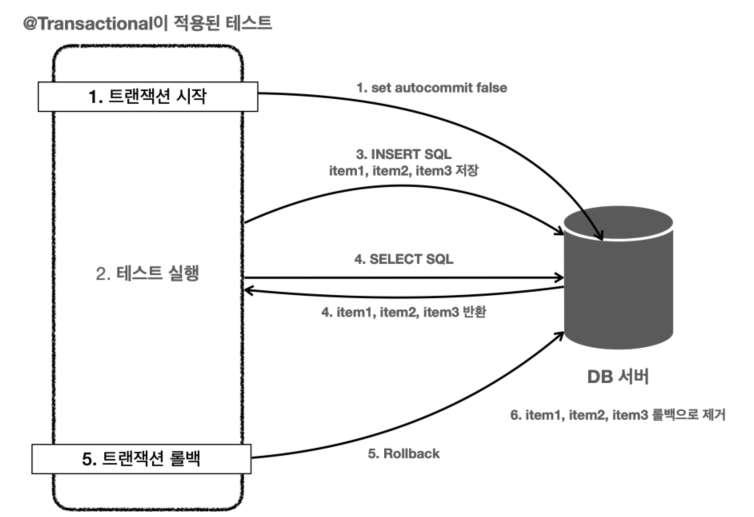

    - *테스트에 @Transactional 애노테이션이 테스트 메서드나 클래스에 있으면 먼저 트랜잭션을 시작*
    - *테스트 로직을 실행한다. 테스트가 끝날 때 까지 모든 로직은 트랜잭션 안에서 수행된다.*
    - *트랜잭션은 기본적으로 전파되기 때문에, 리포지토리에서 사용하는 JdbcTemplate도 같은 트랜잭션을 사용한다.*
- ***트랜잭션 전파 기본 옵션은 기존 트랜잭션에 참여***
    - *테스트 로직 동작, 검증*  
    - *@Transactional이 테스트에 있으면 테스트가 끝날때 트랜잭션을 강제로 롤백*

***테스트 @Transactional 정리***

    - *테스트가 끝난 후 개발자가 직접 데이터를 삭제하지 않아도 되는 편리함을 제공*
    - *테스트 실행 중에 데이터를 등록하고 중간에 테스트가 강제로 종료되어도 걱정이 없다.*
- *트랜잭션을 시작하고 커밋하지 않고 커넥션이 종료되기 때문에 데이터는 자동으로 롤백된다.*
    - *트랜잭션 범위 안에서 테스트를 진행하기 때문에 동시에 다른 테스트가 진행되어도 서로 영향을 주지 않는다.*

***강제로 커밋하기 - @Commit*** 

    - *@Transactional을 테스트에서 사용하면 테스트가 끝나면 바로 롤백되기 때문에 테스트 과정에서 저장한 모든 데이터가 사라진다.*
    - *하지만 데이터베이스에 데이터가 실제로 잘 보관되었는지 최종 결과를 눈으로 확인하고 싶은 케이스가 있다.*
    - *이럴 때는 다음과 같이 @Commit을 클래스 또는 메서드에 붙이면 테스트 종료후 롤백
대신 커밋이 호출된다*

```java
@Commit
@Transactional
@SpringBootTest
class ItemRepositoryTest {}
```

    - 또는 ***@Rollback(value = false)*** *방식을 사용해도 커밋된다.*

# ***테스트 - 임베디드 모드 DB***

*테스트 케이스를 실행하기 위해서 별도의 데이터베이스를 설치하고, 운영하는 것은 상당히 번잡한 작업이다.*

***임베디드 모드??***

*H2 데이터베이스는 자바로 개발되어 있고, JVM안에서 메모리 모드로 동작하는 특별한 기능을 제공한다.*

*애플리케이션을 실행할 때 H2 데이터베이스도 해당 JVM 메모리에 포함해서 함께 실행할 수 있다.*

*DB를 애플리케이션에 내장해서 함께 실행한다고 해서 임베디드 모드(Embedded mode)라 한다.*

*애플리케이션이 종료되면 임베디드 모드로 동작하는 H2 데이터베이스도 함께 종료되고, 데이터도 모두 사라진다.*

### ***임베디드 모드 직접 사용***

```java
@Slf4j
@SpringBootApplication
public class ItemServiceApplication {
		public static void main(String[] args) {
				SpringApplication.run(ItemServiceApplication.class, args);
		}

		@Bean
		@Profile("test")
		public DataSource dataSource(){
			 log.info("메모리 데이터베이스 초기화");
			 DriverManagerDataSource dataSource = new DriverManagerDataSource();
			 dataSource.setDriverClassName("org.h2.Driver");
			 dataSource.setUrl("jdbc:h2:mem:db;DB_CLOSE_DELAY=-1");
			 dataSource.setUsername("sa");
			 dataSource.setPassword("");
			 return dataSource;
		}
}
```

    - *@Profile("test")*
- *프로필이 test 인 경우에만 데이터소스를 스프링 빈으로 등록*
    - *dataSource()*
- *jdbc:h2:mem:db* 
- *데이터소스를 만들때 이렇게만 적으면 임베디드 모드로 동작하는 H2 데이터베이스를 사용할 수 있다.*
      - *DB_CLOSE_DELAY=-1*
- *임베디드 모드에서는 데이터베이스 커넥션 연결이 모두 끊어지면 데이터베이스
도 종료되는데, 그것을 방지하는 설정이다.*

***스프링 부트 - 기본 SQL 스크립트를 사용해서 데이터베이스를 초기화하는 기능***

    - *메모리 DB는 애플리케이션이 종료될 때 함께 사라지기 때문에, 애플리케이션 실행 시점에 데이터베이스 테이블도 새로 만들어주어야 한다.*
    - *직접 DDL을 호출해도 되지만 너무 불편하다.*
    - *스프링 부트는 SQL 스크립트를 실행해서 애플리케이션 로딩 시점에 데이터베이스를 초기화하는 기능을 제공한다.*

***src/test/resources/schema.sql***

```sql
drop table if exists item CASCADE;
create table item
(
	 id bigint generated by default as identity,
	 item_name varchar(10),
	 price integer,
	 quantity integer,
	 primary key (id)
);
```

    - *위치와 파일 이름을 주의하자*

# ***테스트 - 스프링 부트와 임베디드 모드***

*스프링 부트는 데이터베이스에 대한 별다른 설정이 없으면 임베디드 데이터베이스를 사용한다.*

***test - application.properties***

```yaml
spring.profiles.active=test
logging.level.org.springframework.jdbc=debug
```

    - *데이터베이스에 접근하는 설정 정보가 존재하지 않는다.*
    - *이렇게 별다른 정보가 없으면 스프링 부트는 임베디드 모드로 접근하는 데이터소스(DataSource)를 만들어서 제공한다.*
```java
DriverManagerDataSource dataSource = new DriverManagerDataSource();
dataSource.setDriverClassName("org.h2.Driver");
dataSource.setUrl("jdbc:h2:mem:db;DB_CLOSE_DELAY=-1");
dataSource.setUsername("sa");
dataSource.setPassword("");
```

      - *이런 느낌의 데이터소스를 내부에서 만들어서 제공한다.*

***임베디드 모드 데이터베이스 이름***

*로그를 보면 jdbc:h2:mem 뒤에 임의의 데이터베이스 이름이 들어가 있다.*

*→ url=jdbc:h2:mem:d8fb3a29-caf7-4b37-9b6c-b0eed9985454*

*혹시라도 여러 데이터소스가 사용될 때 같은 데이터베이스를 사용하면서 발생하는 충돌을 방지하기 위해 스프링 부트가 임의의 이름을 부여한 것이다.*

*임베디드 데이터베이스 이름을 스프링 부트가 기본으로 제공하는 jdbc:h2:mem:testdb로 고정하고 싶으면 application.properties 에 다음 설정을 추가하면 된다.*

```java
spring.datasource.generate-unique-name=false
```

***스프링 부트 3.0 이상 로깅 변경 사항*** 

*트랜잭션 관련 로그가 보이지 않는다면 설정 추가를 하자* 

***application.properties***

```java
logging.level.org.springframework.test.context.transaction=trace
```

  - ***H2 데이터베이스 임베디드 모드 설정 방법***

# ***MyBatis 소개***

*MyBatis는 JdbcTemplate보다 더 많은 기능을 제공하는 SQL Mapper이다.*

*JdbcTemplate이 제공하는 대부분의 기능을 제공한다.* 

*MyBatis의 가장 매력적인 점은 SQL을 XML에 편리하게 작성할 수 있고 또 동적 쿼리를
매우 편리하게 작성할 수 있다는 점이다.*

***설정의 장단점***

*JdbcTemplate은 스프링에 내장된 기능이고, 별도의 설정없이 사용할 수 있다는 장점이 있다.*

*반면에 MyBatis는 약간의 설정이 필요하다.*

# ***MyBatis 설정***

***build.gradle - MyBatis dependency 추가*** 

```groovy
implementation 'org.mybatis.spring.boot:mybatis-spring-boot-starter:3.0.3'
```

    - *스프링 부트가 버전을 관리해주는 공식 라이브러리가 아니기 때문에 뒤에 버전이 붙는다.* 
*스프링 부트가 버전을 관리해주는 경우 버전 정보를 붙이지 않아도 최적의 버전을 자동으로 찾아준다.*
    - *Spring Boot 3.0 이상이면 3.0.3을 사용한다.*

### ***application.properties/yaml 설정*** 

***main - application.properties***

```yaml
spring.profiles.active=local
spring.datasource.url=jdbc:h2:tcp://localhost/~/test
spring.datasource.username=sa

logging.level.org.springframework.jdbc=debug

# MyBatis
mybatis.type-aliases-package=hello.itemservice.domain
mybatis.configuration.map-underscore-to-camel-case=true
logging.level.hello.itemservice.repository.mybatis=trace
```

***test - application.properties***

```yaml
spring.profiles.active=test

logging.level.org.springframework.jdbc=debug

# MyBatis
mybatis.type-aliases-package=hello.itemservice.domain
mybatis.configuration.map-underscore-to-camel-case=true
logging.level.hello.itemservice.repository.mybatis=trace
```

`mybatis.type-aliases-package` 

    - *마이바티스에서 타입 정보를 사용할 때는 패키지 이름을 적어주어야 하는데, 여기에 명시하면 패키지 이름을 생략할 수 있다.*
    - *지정한 패키지와 그 하위 패키지가 자동으로 인식된다.*
    - *여러 위치를 지정하려면* *`,`* *,* *`;`**로 구분하면 된다.*

`mybatis.configuration.map-underscore-to-camel-case` 

    - *JdbcTemplate의 BeanPropertyRowMapper에서 처럼 언더바를 카멜로 자동 변경해주는 기능을 활성화 한다.*
    - *default: false*

`logging.level.hello.itemservice.repository.mybatis=trace` 

    - *MyBatis에서 실행되는 쿼리 로그를 확인할 수 있다.*

# ***MyBatis 적용1 - 기본***

***ItemMapper - Mapper***

```java
package hello.itemservice.repository.mybatis;

@Mapper
public interface ItemMapper {
    void save(Item item);
    
    void update(@Param("id") Long id, @Param("updateParam") ItemUpdateDto updateParam);
    
    Optional<Item> findById(Long id);
    
    List<Item> findAll(ItemSearchCond itemSearch);
}
```

    - *마이바티스 매핑 XML을 호출해주는 매퍼 인터페이스이다.*
    - *@Mapper 애노테이션을 붙여주어야 한다. 그래야 MyBatis에서 인식 가능* 
    - *이 인터페이스의 메서드를 호출하면 다음에 보이는 xml의 해당 SQL을 실행하고 결과를 돌려준다*

*이제 같은 위치에 실행할 SQL이 있는 XML 매핑 파일을 만들어주면 된다.*

*자바 코드가 아니기 때문에 src/main/resources 하위에 만들되, 패키지 위치는 맞추어 주어야 한다.*

***src/main/resources/hello/itemservice/repository/mybatis/ItemMapper.xml***

```xml
<?xml version="1.0" encoding="UTF-8"?>

<!DOCTYPE mapper PUBLIC "-//mybatis.org//DTD Mapper 3.0//EN"
        "http://mybatis.org/dtd/mybatis-3-mapper.dtd">

<mapper namespace="hello.itemservice.repository.mybatis.ItemMapper">

     <insert id="save" useGeneratedKeys="true" keyProperty="id">
         insert into item (item_name, price, quantity)
         values (#{itemName}, #{price}, #{quantity})
     </insert>

     <update id="update">
         update item
         set item_name=#{updateParam.itemName},
             price=#{updateParam.price},
             quantity=#{updateParam.quantity}
         where id = #{id}
     </update>

    <select id="findById" resultType="Item">
         select id, item_name, price, quantity
         from item
         where id = #{id}
    </select>

     <select id="findAll" resultType="Item">
         select id, item_name, price, quantity
         from item
         <where>
             <if test="itemName != null and itemName != ''">
                and item_name like concat('%', #{itemName}, '%')
             </if>
             <if test="maxPrice != null">
                and price &lt;= #{maxPrice}
             </if>
         </where>
     </select>

</mapper>
```

    - *<mapper namespace="hello.itemservice.repository.mybatis.ItemMapper">*
- *앞서 만든 매퍼 인터페이스를 지정*

### ***XML 파일 경로 수정하기***

    - *XML 파일을 원하는 위치에 모아서 두고 싶을 수 있다.*

***application.properties***

```yaml
mybatis.mapper-locations=classpath:mapper/**/*.xml
```

    - *resources/mapper를 포함한 그 하위 폴더에 있는 XML을 XML 매핑 파일로 인식*

### ***MyBatis 로직 분석*** 

***insert - save***

```xml

void save(Item item);

<insert id="save" useGeneratedKeys="true" keyProperty="id">
		 insert into item (item_name, price, quantity)
		 values (#{itemName}, #{price}, #{quantity})
</insert>
```

    - *Insert SQL: <insert> 태그를 사용하면 된다.*
    - *id: 매퍼 인터페이스에 설정한 메소드 이름을 지정하면 된다.*
    - *파라미터는 #{} 문법을 사용하면 된다. 매퍼에서 넘긴 객체의 프로퍼티 이름을 적어주면 된다.* 
- *#{} 문법을 사용하면 PreparedStatement를 사용한다. JDBC의 ?를 치환한다 생각하면 된다.*
    - *useGeneratedKeys는 데이터베이스가 키를 생성해 주는 IDENTITY 전략(Auto_increment)일 때 사용한다. keyProperty는 생성되는 키의 속성 이름을 지정한다. Insert가 끝나면 item 객체의 id 속성에 생성된 값이 입력된다.*

***update - update***

```xml
void update(@Param("id") Long id, @Param("updateParam") ItemUpdateDto updateParam);

<update id="update">
   update item
   set item_name=#{updateParam.itemName},
       price=#{updateParam.price},
       quantity=#{updateParam.quantity}
   where id = #{id}
</update>
```

    - *Update SQL은 <update> 태그를 사용하면 된다.*
    - *파라미터가 Long id, ItemUpdateDto updateParam으로 2개여서 @Param으로 이름을 지정해서 파라미터를 구분해야 한다.*
    - *파라미터가 2개여서 xml 파일에도 #{updateParam.itemName} 이런 식으로 사용한다.*

***select - findById***

```xml
Optional<Item> findById(Long id);

<select id="findById" resultType="Item">
     select id, item_name, price, quantity
     from item
     where id = #{id}
</select>
```

    - *Select SQL은 <select> 태그를 사용하면 된다.*
    - *resultType은 반환 타입을 명시하면 된다. 여기서는 결과를 Item 객체에 매핑한다.*
- *앞서 application.properties에 mybatis.type-aliasespackage=hello.itemservice.domain
속성을 지정한 덕분에 모든 패키지 명을 다 적지는 않아도 된다. 그렇지 않으면 모든 패키지 명을 다 적어야 한다.*
      - *mybatis.configuration.map-underscore-to-camel-case=true 속성을 지정한 덕분에 언더스코어를 카멜 표기법으로 자동으로 처리해준다. (item_name → itemName)*
    - *자바 코드에서 반환 객체가 하나이면 Item , Optional<Item>과 같이 사용하면 되고, 반환 객체가 하나 이상이면 컬렉션을 사용하면 된다. 주로 List를 사용한다.*

***select - findAll***

```xml
List<Item> findAll(ItemSearchCond itemSearch);

<select id="findAll" resultType="Item">
     select id, item_name, price, quantity
     from item
     <where>
         <if test="itemName != null and itemName != ''">
            and item_name like concat('%', #{itemName}, '%')
         </if>
         <if test="maxPrice != null">
            and price &lt;= #{maxPrice}
         </if>
     </where>
 </select>
```

    - *Mybatis는 <where> , <if> 같은 동적 쿼리 문법을 통해 편리한 동적 쿼리를 지원한다.*
    - *<if>는 해당 조건이 만족하면 구문을 추가한다.*
    - *<where>은 적절하게 where 문장을 만들어준다.*
- *<if>가 모두 실패하게 되면 SQL where를 만들지 않는다.*
      - *<if>가 하나라도 성공하면 처음 나타나는 and를 where로 변환해준다.*

***XML 특수문자*** 

*XML에서는 데이터 영역에 < , > 같은 특수 문자를 사용할 수 없다.*

*XML에서 TAG가 시작하거나 종료할 때 < , > 와 같은 특수문자를 사용하기 때문이다.*

```xml
< : &lt;
> : &gt;
& : &amp;
```

***XML CDATA 사용***

```xml

<select id="findAll" resultType="Item"> 
		select id, item_name, price, quantity
	  from item
	 <where>
			 <if test="itemName != null and itemName != ''">
					 and item_name like concat('%',#{itemName},'%')
			 </if>
			 <if test="maxPrice != null">
					 <![CDATA[ and price <= #{maxPrice}]]>
			 </if>
	 </where>
</select> 
```

    - *XML에서 지원하는 CDATA 구문 문법은 구문 안에서 특수문자를 사용할 수 있다.* 
    - *대신 구문 안에서는 XML TAG가 단순 문자로 인식되기 때문에 <if> , <where>등이 적용되지 않는다.*

# ***MyBatis 적용2,3 - 설정과 실행과 분석*** 

```java
@Repository
@RequiredArgsConstructor
public class MyBatisItemRepository implements ItemRepository {

    private final ItemMapper itemMapper;
    
    @Override
    public Item save(Item item) {
        itemMapper.save(item);
        return item;
    }
    @Override
    public void update(Long itemId, ItemUpdateDto updateParam) {
        itemMapper.update(itemId, updateParam);
    }
    @Override
    public Optional<Item> findById(Long id) {
        return itemMapper.findById(id);
    }
    @Override
    public List<Item> findAll(ItemSearchCond cond) {
        return itemMapper.findAll(cond);
    }
}
```

    - *단순히 ItemMapper에 기능을 위임*

***ItemMapper 매퍼 인터페이스의 구현체가 없는데 어떻게 동작한 것일까?***

```java
@Mapper
public interface ItemMapper {
    void save(Item item);
    void update(@Param("id") Long id, @Param("updateParam") ItemUpdateDto updateParam);
    Optional<Item> findById(Long id);
    List<Item> findAll(ItemSearchCond itemSearch);
}
```


    - *애플리케이션 로딩 시점에 MyBatis 스프링 연동 모듈은 @Mapper가 붙은 인터페이스를 찾는다.* 
    - *인터페이스를 발견하면 동적 프록시 기술을 사용해서 ItemMapper 인터페이스의 구현체를 만든다.*
    - *생성된 구현체를 스프링 빈으로 등록한다.*

***Mapper 구현체*** 

    - *마이바티스 스프링 연동 모듈이 만들어주는 Mapper 구현체 덕분에 인터페이스 만으로 편리하게 XML의 데이터를 찾아서 호출할 수 있다.*
    - *매퍼 구현체는 예외 변환까지 처리해준다. MyBatis에서 발생한 예외를 스프링 예외 추상화인
DataAccessException에 맞게 변환해서 반환해준다.*

***정리*** 

    - *매퍼 구현체 덕분에 마이바티스를 스프링에 편리하게 통합해서 사용할 수 있다.*
    - *매퍼 구현체를 사용하면 스프링 예외 추상화도 함께 적용된다.*
    - *마이바티스 스프링 연동 모듈이 많은 부분을 자동으로 설정해주는데, 데이터베이스 커넥션, 트랜잭션과 관련된 기능도 마이바티스와 함께 연동하고, 동기화해준다.*
    - *자동으로 등록해주는 부분은 MybatisAutoConfiguration 클래스를 참고하자*

# ***JPA 설정***

***build.gradle*** 

```java
implementation 'org.springframework.boot:spring-boot-starter-data-jpa'
```

    - ***spring-boot-starter-data-jpa****,* ***mybatis-spring-boot-starter****는 s****pring-boot-starter-jdbc****도 함께 포함한다. 따라서 제거해도 된다.*
    - ***추가되는 라이브러리*** 
- *jakarta.persistence-api: JPA 인터페이스*
      - *hibernate-core: JPA 구현체인 하이버네이트 라이브러리*
      - *spring-data-jpa: 스프링 데이터 JPA 라이브러리*

 ***spring boot 3.0 미만 - application.properties -main,test***

```yaml
logging.level.org.hibernate.SQL=DEBUG
logging.level.org.hibernate.type.descriptor.sql.BasicBinder=TRACE
```

    - *logging.level.org.hibernate.SQL=DEBUG*
- *하이버네이트가 생성하고 실행하는 SQL을 확인할 수 있다.*
    - *logging.level.org.hibernate.type.descriptor.sql.BasicBinder=TRACE*
- SQL에 바인딩 되는 파라미터를 확인할 수 있다
    - *spring.jpa.show-sql=true*
- *이런 설정도 있다. 이전 설정은 logger를 통해서 출력된다. 이 설정은 System.out 콘솔을 통해서 SQL이 출력된다.*

 ***spring boot 3.0 이상 - application.properties -main,test***

```yaml
logging.level.org.hibernate.SQL=DEBUG
logging.level.org.hibernate.orm.jdbc.bind=TRACE
```

    - *하이버네이트 6버전이 사용되는데, 로그 설정 방식이 달라졌다.*

# ***JPA 적용1 - 개발***

```java
@Data
@Entity
public class Item {
    @Id @GeneratedValue(strategy = GenerationType.IDENTITY)
    private Long id;

    @Column(name = "item_name", length = 10)
    private String itemName;
    private Integer price;
    private Integer quantity;

    public Item() {
    }

    public Item(String itemName, Integer price, Integer quantity) {
        this.itemName = itemName;
        this.price = price;
        this.quantity = quantity;
    }
}
```

    - *@Entity: JPA가 사용하는 객체라는 뜻이다. 이 에노테이션이 있어야 JPA가 인식할 수 있다. 
이렇게 @Entity 가 붙은 객체를 JPA에서는 엔티티라 한다.*
    - *@Column(name = "item_name", length = 10) → VARCHAR 10*

*JPA는 public 또는 protected 기본 생성자가 필수이다.*

```java
public Item() {}
```

    - *아마 프록시 기술을 사용하는 데 상속을 통한 프록시 기술이어서 부모 클래스의 생성자에 접근을 가능하게 해야 동작하기 때문인듯하다.*

```java
@Repository
@Transactional
@RequiredArgsConstructor
public class JpaItemRepository implements ItemRepository {
    
    private final EntityManager em;
    
    @Override
    public Item save(Item item) {
        em.persist(item);
        return item;
    }

    @Override
    public void update(Long itemId, ItemUpdateDto updateParam) {
        Item findItem = em.find(Item.class, itemId);
        findItem.setItemName(updateParam.getItemName());
        findItem.setPrice(updateParam.getPrice());
        findItem.setQuantity(updateParam.getQuantity());
    }

    @Override
    public Optional<Item> findById(Long id) {
        Item item = em.find(Item.class, id);
        return Optional.ofNullable(item);
    }

    @Override
    public List<Item> findAll(ItemSearchCond cond) {
        String jpql = "select i from Item i";

        Integer maxPrice = cond.getMaxPrice();
        String itemName = cond.getItemName();

        if(StringUtils.hasText(itemName) || maxPrice != null){
            jpql += " where";
        }

        boolean andFlag = false;
        if(StringUtils.hasText(itemName)){
            jpql += " i.itemName like concat('%',:itemName,'%')";
            andFlag = true;
        }

        if(maxPrice != null){
            if(andFlag){
                jpql += " and";
            }
            jpql += " i.price <= :maxPrice";
        }

        TypedQuery<Item> query = em.createQuery(jpql, Item.class);
        if(StringUtils.hasText(itemName)){
            query.setParameter("itemName", itemName);
        }
        if(maxPrice != null){
            query.setParameter("maxPrice", maxPrice);
        }

       return query.getResultList();
    }
}
```

    - *EntityManager* 
- *JPA의 모든 동작은 엔티티 매니저를 통해서 이루어진다.*
      - *엔티티 매니저는 내부에 데이터소스를 가지고 있고, 데이터베이스에 접근할 수 있다.*
    - *@Transactional*
- *JPA의 모든 데이터 변경(등록, 수정, 삭제)은 트랜잭션 안에서 이루어져야 한다.*
      - *조회는 트랜잭션이 없어도 가능하다.*
      - *변경의 경우 일반적으로 서비스 계층에서 트랜잭션을 시작하기 때문에 문제가 없다. 
꼭 서비스 계층에 트랜잭션을 걸어주자.*

*스프링 부트는 자동으로 JPA 관련 설정을 자동화 해준다.*

    - *자세한 내용은* ***JpaBaseConfiguration****를 참고*

# ***JPA 적용2 - 리포지토리 분석***

***save() - 저장***

```java
@Override
public Item save(Item item) {
    em.persist(item);
    return item;
}
```

    - *JPA가 만들어서 실행한 SQL을 보면 id 에 값이 빠져있는 것을 확인할 수 있다.* 
    - *PK 키 생성 전략을 IDENTITY로 사용했기 때문에 JPA가 이런 쿼리를 만들어서 실행한 것이다.*
    - *JPA가 INSERT SQL 실행 이후에 생성된 ID 결과를 받아서 넣어준다.*

***update() - 수정 JPA - DirtyChecking***

```java
@Override
public void update(Long itemId, ItemUpdateDto updateParam) {
    Item findItem = em.find(Item.class, itemId);
    findItem.setItemName(updateParam.getItemName());
    findItem.setPrice(updateParam.getPrice());
    findItem.setQuantity(updateParam.getQuantity());
}
```

    - *em.update() 같은 메소드를 전혀 호출하지 않았다.*
    - *JPA는 트랜잭션이 커밋되는 시점에, 변경된 엔티티 객체가 있는지 확인한다.*
    - *특정 엔티티 객체가 변경된 경우에는 UPDATE SQL을 실행한다.*
    - *테스트의 경우 마지막에 트랜잭션이 롤백되기 때문에 JPA는 UPDATE SQL을 실행하지 않는다.*

***findById() - 단건 조회***

```java
@Override
public Optional<Item> findById(Long id) {
    Item item = em.find(Item.class, id);
    return Optional.ofNullable(item);
}
```

    - *JPA에서 엔티티 객체를 PK 기준으로 조회할 때 find()를 사용하고 조회 타입과 PK 값을 주면 된다.*

***findAll - 목록 조회***

```java
public List<Item> findAll(ItemSearchCond cond) {
	 String jpql = "select i from Item i";
	 
	 //동적 쿼리 생략
	 
	 TypedQuery<Item> query = em.createQuery(jpql, Item.class);
	 
	 if(StringUtils.hasText(itemName)){
      query.setParameter("itemName", itemName);
   }
   if(maxPrice != null){
      query.setParameter("maxPrice", maxPrice);
   }
	 
	 return query.getResultList();
}
```

***JPQL***

    - *JPA는* ***JPQL(Java Persistence Query Language)****이라는 객체지향 쿼리 언어를 제공한다.*
    - *주로 여러 데이터를 복잡한 조건으로 조회할 때 사용한다.*
    - *SQL이 테이블을 대상으로 한다면, JPQL은 엔티티 객체를 대상으로 SQL을 실행한다 생각하면 된다.*
    - *엔티티 객체를 대상으로 하기 때문에 from 다음에 Item 엔티티 객체 이름이 들어간다. 
엔티티 객체와 속성의 대소문자는 구분해야 한다.*
    - *결과적으로 JPQL을 실행하면 그 안에 포함된 엔티티 객체의 매핑 정보를 활용해서 SQL을 만들게 된다.*

# ⭐ ***JPA 적용3 - 예외 변환*** 

*JPA의 경우 예외가 발생하면 JPA 예외가 발생하게 된다.*

*EntityManager는 순수한 JPA 기술이고, 스프링과는 관계가 없다. 
따라서 엔티티 매니저는 예외가 발생하면 JPA 관련 예외를 발생시킨다.*

*JPA는 PersistenceException과 그 하위 예외를 발생시킨다.*

    - *추가로 JPA는 IllegalStateException, IllegalArgumentException을 발생시킬 수 있다.*

*그렇다면 JPA 예외를 스프링 예외 추상화(DataAccessException)로 어떻게 변환할 수 있을까?*

*→ @Repository*

***예외 변환 전***


***@Repository의 기능***

    - *@Repository가 붙은 클래스는 컴포넌트 스캔의 대상*
    - *@Repository가 붙은 클래스는 예외 변환 AOP의 적용 대상*
- *스프링과 JPA를 함께 사용하는 경우 스프링은 JPA 예외 변환기
(PersistenceExceptionTranslator)를 등록한다.*
      - *예외 변환 AOP 프록시는 JPA 관련 예외가 발생하면 JPA 예외 변환기를 통해 발생한 예외를 스프링 데이터 접근 예외로 변환한다.*

***예외 변환 후***


*정리하면 @Repository 애노테이션만 있으면 스프링이 예외 변환 처리하는 AOP를 만들어준다.*

***참고*** 

    - *스프링 부트 @Repository를 AOP 프록시로 만드는 빈 후처리기*
- *PersistenceExceptionTranslationPostProcessor*
      - *여기서 @Repository AOP를 프록시로 만드는 어드바이스가 등록*
    -  *실제 JPA 예외를 변환하는 코드*
- *EntityManagerFactoryUtils.convertJpaAccessExceptionIfPossible()*

  - ***@Repository의 비밀***

# ***스프링 트랜잭션 소개***

### ***1. 스프링 트랜잭션 추상화***

*각각의 데이터 접근 기술들은 트랜잭션을 처리하는 방식에 차이가 있다.*

***JDBC 트랜잭션:*** *setAutoCommit(false) → 트랜잭션 시작* 

***JPA 트랜잭션****: begin() → 트랜잭션 시작* 

*스프링은* ***PlatformTransactionManager****라는 인터페이스를 통해 트랜잭션을 추상화*


    - *스프링은 트랜잭션을 추상화해서 제공할 뿐만 아니라, 실무에서 사용하는 데이터 접근 기술에 대한 트랜잭션 매니저의 구현체도 제공한다.*
    - *스프링 부트는 어떤 데이터 접근 기술을 사용하는지 자동으로 인식해서(AutoConfiguration) 적절한 트랜잭션 매니저(+ DataSource)를 선택해서 스프링 빈으로 등록한다.*

### ***2. 스프링 트랜잭션 사용 방식***

***선언적 트랜잭션 관리 vs 프로그래밍 방식 트랜잭션 관리***

    - *선언적 트랜잭션 관리* 
- *@Transactional*
      - *이름 그대로 로직에 트랜잭션을 적용하겠다 라고 어딘가에 선언하기만 하면 트랜잭션이 적용되는 방식*
    - *프로그래밍 방식의 트랜잭션 관리*
- *트랜잭션 매니저, 트랜잭션 템플릿 등을 사용해서 직접 트랜잭션 관련 코드를 작성하는 방식*

*프로그래밍 방식의 트랜잭션 관리는 핵심 비즈니스 로직과 트랜잭션이라는 기술 코드가 강하게 결합된다.*  

*반면에 선언적 트랜잭션 관리는 Spring AOP 기술을 사용하기 때문에 비즈니스 로직과 분리되고 훨씬 간편하고 실용적이기 때문에 실무에서는 대부분 선언적 트랜잭션 관리를 사용한다.*

### *3. 선언적 트랜잭션과 AOP*


*그림에서는 트랜잭션 프록시라고 표현하지만 정확히는 클라이언트가 프록시를 호출하고 순서에 따라 어드바이스들을 호출한다. 
어드바이스 중에 하나가 트랜잭션 어드바이스이고 순서에 따라 모든 어드바이스 호출이 끝나면 실제 서비스를 호출하게 된다.* 

***프록시 도입 후 전체 과정***


# *프로젝트 설정* 

***build.gradle dependency***

```groovy
dependencies {
			implementation 'org.springframework.boot:spring-boot-starter-data-jpa'
			compileOnly 'org.projectlombok:lombok'
			runtimeOnly 'com.h2database:h2'
			annotationProcessor 'org.projectlombok:lombok'
			testImplementation 'org.springframework.boot:spring-boot-starter-test'
			
			//테스트에서 lombok 사용
			testCompileOnly 'org.projectlombok:lombok'
			testAnnotationProcessor 'org.projectlombok:lombok'
}
```

    - *lombok, spring data jpa, h2 database, boot test*

# ***트랜잭션 적용 확인***

***AopUtils.isAopProxy()***

    - *파라미터로 넘기는 객체 프록시 적용 여부 확인*

***TransactionSynchronizationManager.isActualTransactionActive()***

    - *현재 쓰레드 트랜잭션 적용 여부 확인*

***application.properties***

```groovy
logging.level.org.springframework.transaction.interceptor=TRACE
```

    - *트랜잭션 프록시가 호출하는 트랜잭션의 시작과 종료를 명확하게 로그로 확인할 수 있다.*

# ***트랜잭션 적용 위치***

*스프링에서 우선순위는* ***항상 더 구체적이고 자세한 것이 높은 우선순위를 가진다****.*

*예를 들어서 메소드와 클래스에 애노테이션을 붙일 수 있다면 더 구체적인 메소드가 더 높은 우선순위를 가진다.*

***스프링 @Transactional 두 가지 규칙*** 

    - *우선순위 규칙*
    - *클래스에 적용하면 메소드는 자동 적용*

```java
@Slf4j
@SpringBootTest
public class TxLevelTest {
    @Autowired LevelService levelService;
    @Test
    void orderTest(){
        levelService.write();
        levelService.read();
    }
    @TestConfiguration
    static class TestConfig{
        @Bean
        LevelService levelService(){
            return new LevelService();
        }
    }
    @Slf4j
    @Transactional(readOnly = true)
    static class LevelService{
        @Transactional(readOnly = false)
        public void write(){
            log.info("call write");
            printTxInfo();
        }
        public void read(){
            log.info("call read");
            printTxInfo();
        }
        private void printTxInfo(){
            boolean txActive = TransactionSynchronizationManager.isSynchronizationActive();
            log.info("tx active={}", txActive);
            boolean readOnly = TransactionSynchronizationManager.isCurrentTransactionReadOnly();
            log.info("tx readonly={}", readOnly);
        }
    }
}
```

    - ***TransactionSynchronizationManager.isSynchronizationActive()***
- *트랜잭션 동기화 메커니즘의 활성화 여부를 확인*
    - ***TransactionSynchronizationManager.isCurrentTransactionReadOnly()***
- *현재 활성화된 트랜잭션이 읽기 모드인지 확인*
    - ***TransactionSynchronizationManager.isActualTransactionActive()***
- *현재 쓰레드 물리적 트랜잭션 활성화 여부를 확인*
    -  *@Transactional(readOnly = false)*
- *default: false*

***Test Result***

```java
call write
tx active=true
tx readonly=false

call read
tx active=true
tx readonly=false
```

# ***트랜잭션 AOP 주의 사항 - 프록시 내부 호출1***

***내부 호출 → self invocation***

```java
@Slf4j
@SpringBootTest
public class InternalCallV1Test {

    @Autowired CallService callService;
    @Test
    void printProxy(){
        log.info("callService class={}", callService.getClass());
    }

    @Test
    void internalCall(){
        callService.internal();
    }

    @Test
    void externalCall(){
        callService.external();
    }

    @TestConfiguration
    static class TestConfig{
        @Bean
        CallService callService(){
            return new CallService();
        }
    }
    @Slf4j
    static class CallService{
        public void external(){
            log.info("call external");
            printTxInfo();
            internal();
        }

        @Transactional
        public void internal(){
            log.info("call internal");
            printTxInfo();
        }

        private void printTxInfo(){
           boolean txActive = TransactionSynchronizationManager.isSynchronizationActive();
           log.info("tx active={}", txActive);
           boolean readOnly = TransactionSynchronizationManager.isCurrentTransactionReadOnly();
           log.info("tx readonly={}", readOnly);
       }
    }
}
```

***printProxy() result***

```java
callService class=class spring.transaction.apply.InternalCallV1Test$CallService$$SpringCGLIB$$0

```

    - *CallService is Proxy* 

***internalCall() result***

```java
call internal
tx active=true
tx readonly=false

```

    - *정상적으로 트랜잭션 적용* 

***흐름 정리*** 

***요청:*** *클라이언트 → Proxy: internal() → 트랜잭션 Advice (시작) →  CallService: internal()* 

***응답:*** *CallService: internal() → 트랜잭션 Advice (종료) → Proxy: internal() → 클라이언트*

***externalCall() result***

```java
call external
tx active=false
tx readonly=false
call internal
tx active=false
tx readonly=false
```

    - *external() 내부에서 internal()을 호출했지만 트랜잭션은 적용되지 않았다.*

***흐름 정리*** 

***요청:*** *클라이언트 → Proxy: externalCall() → CallService: externalCall() → CallService: internal()*

***응답:***  *CallService: internal() → CallService: externalCall() → Proxy: externalCall() → 클라이언트* 

***흐름 부가 설명*** 

*externalCall()은 Transaction Advice 호출 대상이 아니다.
그래서 바로 RealSubject인 CallService externalCall()을 호출하고 externalCall() 내부에서 호출하는 internalCall()은 this.internalCall()이다.* 

*그래서 트랜잭션이 적용되지 않고 CallService의 internalCall()을 호출하게 된다.*

***프록시 방식의 AOP 한계***

*@Transactional를 사용하는 트랜잭션 AOP는 프록시를 사용한다*

*프록시를 사용하면 메소드 내부 호출에 프록시를 적용할 수 없다.*

# ***트랜잭션 AOP 주의 사항 - 프록시 내부 호출2***

*메소드 내부 호출 때문에 트랜잭션 프록시가 적용되지 않는 문제를 해결하기 위해 internal() 메서드를 별도의 클래스로 분리하자.*

 *proxy self invocation 문제를 해결하는 여러가지 방법이 있지만* ***실무에서는 별도의 클래스를 분리하는 방식****으로 자주 해결한다.*

```java
@Slf4j
@SpringBootTest
public class InternalCallV2Test {

    @Autowired CallService callService;
    
    @Test
    void printProxy(){
        log.info("callService class={}", callService.getClass());
    }
    @Test
    void externalCallV2(){
        callService.external();
    }

    @TestConfiguration
    static class TestConfig{
        @Bean
        CallService callService(){
            return new CallService(internalService());
        }
        @Bean
        InternalService internalService(){
            return new InternalService();
        }
    }
    
    @Slf4j
    @RequiredArgsConstructor
    static class CallService{
        private final InternalService internalService;
        public void external(){
            log.info("call external");
            printTxInfo();
            internalService.internal();
        }
        private void printTxInfo(){
           boolean txActive = TransactionSynchronizationManager.isSynchronizationActive();
           log.info("tx active={}", txActive);
           boolean readOnly = TransactionSynchronizationManager.isCurrentTransactionReadOnly();
           log.info("tx readonly={}", readOnly);
       }
    }
    
    static class InternalService{
        @Transactional
        public void internal(){
           log.info("call internal");
           printTxInfo();
        }
        private void printTxInfo(){
           boolean txActive = TransactionSynchronizationManager.isSynchronizationActive();
           log.info("tx active={}", txActive);
           boolean readOnly = TransactionSynchronizationManager.isCurrentTransactionReadOnly();
           log.info("tx readonly={}", readOnly);
       }
    }
}
```

***externalCallV2 result***

```java
call external
tx active=false
tx readonly=false

call internal
tx active=true
tx readonly=false
```

    - *이제 internal part는 트랜잭션이 정상적으로 적용된다.*

***흐름 분석, 응답은 생략*** 

    - *클라이언트: CallService external 호출* 
    - *CallService: InternalService.internal 호출*
    - *Proxy(InternalService): internal Transaction Advice 호출* 
    - *Transaction Advice: 트랜잭션 시작, RealSubject(InternalService) internal 호출* 
    - *RealSubject(InternalService): this.printTxInfo() 호출*
    - *RealSubject(InternalService): 트랜잭션 활성화 로그 출력* 

***접근제어자(Access Modifier)에 따른 트랜잭션 적용 여부***

    - *Spring Boot 3.0 미만: public only*
    - *Spring Boot 3.0 이상: public, default, protected*

# *트랜잭션 AOP 주의 사항 - 초기화 시점*

*스프링 초기화 시점에는 트랜잭션 AOP가 적용되지 않을 수 있다.*

***스프링 AOP 초기화를 포함한 전체 라이프 사이클*** 

*스프링 컨테이너 생성 → 스프링 빈 생성 → 의존관계 주입 → PostProceesor before 메소드 →* 

*초기화 콜백 →  PostProceesor after 메소드 → 사용 → 소멸전 콜백 → 스프링 종료* 

*스프링 AOP는 postProcessAfterInitialization 메소드를 구현*

*즉, 초기화 콜백(@PostConstruct) 메소드에서는 @Transactional을 함께 사용하면 트랜잭션이 적용되지 않는다.* 

```java
@SpringBootTest
public class InitTxTest {
    @Autowired Hello hello;
    
    @Test
    void go(){
    }

    @TestConfiguration
    static class InitTxTestConfig{
        @Bean
        public Hello hello(){
            return new Hello();
        }
    }

    @Slf4j
    static class Hello{
        @PostConstruct
        @Transactional
        public void initV1(){
            boolean isActive = TransactionSynchronizationManager.isActualTransactionActive();
            log.info("Hello init @PostConstruct tx active={}", isActive);
        }
        @EventListener(ApplicationReadyEvent.class)
        @Transactional
        public void initV2(){
            boolean isActive = TransactionSynchronizationManager.isActualTransactionActive();
            log.info("Hello init ApplicationReady tx active={}", isActive);
        }
    }
}
```

***@PostConstruct + @Transactional result***

```java
Hello init @PostConstruct tx active=false
```

***@EventListener(ApplicationReadyEvent.class) + @Transactional result***

```java
 Hello init ApplicationReady tx active=true
```

# ***트랜잭션 옵션 소개***

***value, transactionManager***

    - *트랜잭션을 사용하려면 스프링 빈에 등록된 어떤 트랜잭션 매니저를 사용할지 알아야 한다.*
    - *@Transactional도 트랜잭션 어드바이스가 사용할 트랜잭션 매니저를 지정해주어야 한다.*
    - *사용할 트랜잭션 매니저를 지정할 때 value, transactionManager 둘 중 하나에 트랜잭션 매니저의 스프링 빈의 이름을 적어주면 된다.*
    - *값을 생략하면 기본으로 등록된 트랜잭션 매니저를 사용하기 때문에 거의 생략한다.*
- *만약 트랜잭션 매니저가 둘 이상이라면 트랜잭션 매니저의 이름을 지정해서 구분하면 된다.*

```java
@Configuration
public class TransactionConfig {
    @Bean(name = "jpaTxManager")
    public PlatformTransactionManager jpaTransactionManager(EntityManagerFactory emf) {
        return new JpaTransactionManager(emf);
    }
    @Bean(name = "jdbcTxManager")
    public PlatformTransactionManager jdbcTransactionManager(DataSource dataSource) {
        return new DataSourceTransactionManager(dataSource);
    }
}

public class TxService {
		 @Transactional("jpaTxManager")
		 public void member() {...}
		 
		 @Transactional(value = "jdbcTxManager")
		 public void order() {...}
}
```

    - *애노테이션 속성이 value 하나인 경우 생략하고 값을 바로 넣을 수 있다.*

***rollbackFor***

    - ***예외 발생시 스프링 트랜잭션의 기본 정책*** 
- *Unchecked Exception(RuntimeException, Error): RollBack*
      - *Checked Exception(Exception): Commit*
    - ***rollbackFor: 기본 정책에 추가로 어떤 예외가 발생했을 때 롤백할 지 지정할 수 있다.***
```java
@Transactional(rollbackFor = Exception.class)
```

      - *해당 케이스 같은 경우 예외가 발생하면 무조건 RollBack*
    - ***rollbackForClassName***
- *예외 이름을 문자로 넣는다.*
    - ***noRollbackFor***
- ***rollbackFor 반대 개념***

***propagation***

    - *트랜잭션 전파에 대한 옵션*

***isolation***

    - *트랜잭션 격리 수준을 지정할 수 있다.*
    - *기본 값은 데이터베이스에서 설정한 트랜잭션 격리 수준을 사용하는 DEFAULT*
    - *직접 격리 수준을 지정하는 경우는 드물다.*
- *DEFAULT : 데이터베이스에서 설정한 격리 수준을 따른다.*
- *MySQL → REPEATABLE_READ DEFAULT*
      - *READ_UNCOMMITTED* 
      - *READ_COMMITTED* 
      - *REPEATABLE_READ* 
      - *SERIALIZABLE*

***timeout***

    - *트랜잭션 수행 시간에 대한 타임아웃을 초 단위로 지정한다.*
    - *기본 값은 트랜잭션 시스템의 타임아웃을 사용한다.*
- *데이터베이스 락(네임드 락, 베타 락, 공유 락)획득을 하지 못하여 트랜잭션이 무한정 대기하면 애플리케이션 서버 성능에도 좋지 않고 UX 측면에서도 좋지 않다.*

***readOnly***

    - *트랜잭션은 기본적으로 읽기 쓰기가 모두 가능한 트랜잭션이 생성된다.*
- *default: readOnly = false*
    - *readOnly=true 옵션을 사용하면 읽기 전용 트랜잭션이 생성된다*
    - *readOnly 옵션을 사용하면 읽기에서 다양한 성능 최적화가 발생할 수 있다.*
- ***프레임워크*** 
- *JdbcTemplate은 읽기 전용 트랜잭션 안에서 변경 기능을 실행하면 예외를 던진다*
        - *JPA(하이버네이트)는 읽기 전용 트랜잭션의 경우 커밋 시점에 플러시를 호출하지 않는다. 추가로 변경이 필요 없으니 변경 감지를 위한 스냅샷 객체도 생성하지 않는다.*
      - ***JDBC 드라이버***
- *읽기 전용 트랜잭션에서 변경 쿼리가 발생하면 예외를 던진다.*
        - *읽기, 쓰기(Master, Slave) DB를 구분해서 요청, 읽기 전용인 경우 슬레이브 데이터베이스 커넥션 획득*
      - ***데이터베이스*** 
- *데이터베이스에 따라 읽기 전용 트랜잭션의 경우 읽기만 하면 되므로, 내부에서 성능 최적화가 발생*

# ***예외와 트랜잭션 커밋, 롤백 - 기본***

*트랜잭션 커밋, 롤백에 대해서 테스트로 이해해 보자* 

***트랜잭션 로그 확인 - application.properties***

```yaml
logging.level.org.springframework.transaction.interceptor=TRACE
logging.level.org.springframework.jdbc.datasource.DataSourceTransactionManager=DEBUG

#JPA log
logging.level.org.springframework.orm.jpa.JpaTransactionManager=DEBUG
logging.level.org.hibernate.resource.transaction=DEBUG
```

***Test & Reulst***

```java
@SpringBootTest
public class RollbackTest {
    @Autowired RollbackService service;
    @Test
    void runtimeException(){
        assertThatThrownBy(() -> service.runtimeException())
                .isInstanceOf(RuntimeException.class);
    }
    @Test
    void checkedException(){
        assertThatThrownBy(()-> service.checkedException())
                .isInstanceOf(MyException.class);
    }
    @Test
    void rollbackFor(){
        assertThatThrownBy(()-> service.rollbackFor())
                .isInstanceOf(MyException.class);
    }
    @TestConfiguration
    static class RollbackTestConfig{
        @Bean
        RollbackService rollbackService(){
            return new RollbackService();
        }
    }
    @Slf4j
    static class RollbackService{

        // 런타임 예외 발생: 롤백
        @Transactional
        public void runtimeException(){
            log.info("call runtimeException");
            throw new RuntimeException();
        }

        // 체크 예외 발생: 커밋
        @Transactional
        public void checkedException() throws MyException{
            log.info("call checkedException");
            throw new MyException();
        }

        // 체크 예외 rollbackFor 지정: 롤백
        @Transactional(rollbackFor = MyException.class)
        public void rollbackFor() throws MyException{
            log.info("call rollbackFor");
            throw new MyException();
        }

    }
    static class MyException extends Exception{
    }
}
```

  - ***트랜잭션 옵션 isolation, readOnly, timeout .., 트랜잭션 AOP 주의사항***

***application.properties***

```java
logging.level.org.springframework.transaction.interceptor=TRACE
logging.level.org.springframework.jdbc.datasource.DataSourceTransactionManager=DEBUG

#JPA log
logging.level.org.springframework.orm.jpa.JpaTransactionManager=DEBUG
logging.level.org.hibernate.resource.transaction=DEBUG

#JPA SQL
logging.level.org.hibernate.SQL=DEBUG
```

# ***스프링 트랜잭션 전파2 - 트랜잭션 두 번 사용***

***double_commit()***

```java
@Test
void double_commit(){
   log.info("트랜잭션1 시작");
   TransactionStatus tx1 = txManager.getTransaction(new DefaultTransactionDefinition());
   log.info("트랜잭션1 커밋 시작");
   txManager.commit(tx1);
   log.info("트랜잭션1 커밋 완료");

   log.info("트랜잭션2 시작");
   TransactionStatus tx2 = txManager.getTransaction(new DefaultTransactionDefinition());
   log.info("트랜잭션2 커밋 시작");
   txManager.commit(tx2);
   log.info("트랜잭션2 커밋 완료");  
}
```

***double_commit() - result***

```java
트랜잭션1 시작
Creating new transaction with name [null]: PROPAGATION_REQUIRED,ISOLATION_DEFAULT
Acquired Connection [HikariProxyConnection@1064414847 wrapping conn0] for JDBC transaction
Switching JDBC Connection [HikariProxyConnection@1064414847 wrapping conn0] to manual commit
트랜잭션1 커밋 시작
Initiating transaction commit
Committing JDBC transaction on Connection [HikariProxyConnection@1064414847 wrapping conn0]
Releasing JDBC Connection [HikariProxyConnection@1064414847 wrapping conn0] after transaction
트랜잭션1 커밋 완료

트랜잭션2 시작
Creating new transaction with name [null]: PROPAGATION_REQUIRED,ISOLATION_DEFAULT
Acquired Connection [HikariProxyConnection@778350106 wrapping conn0] for JDBC transaction
Switching JDBC Connection [HikariProxyConnection@778350106 wrapping conn0] to manual commit
트랜잭션2 커밋 시작
Initiating transaction commit
Committing JDBC transaction on Connection [HikariProxyConnection@778350106 wrapping conn0]
Releasing JDBC Connection [HikariProxyConnection@778350106 wrapping conn0] after transaction
트랜잭션2 커밋 완료
```

    - *트랜잭션이 각각 수행되면서 사용되는 DB 커넥션도 각각 다르다.*

# ***스프링 트랜잭션 전파3 - 전파 기본***

*트랜잭션을 각각 사용하는 것이 아니라, 이미 트랜잭션이 진행중인데, 여기에 추가로 트랜잭션을 수행하면 어떻게 될까?*

*이런 경우 어떻게 동작할지 결정하는 것을* ***트랜잭션 전파(propagation)****라 한다.*

***외부 트랜잭션이 수행중인데, 내부 트랜잭션이 추가로 수행***


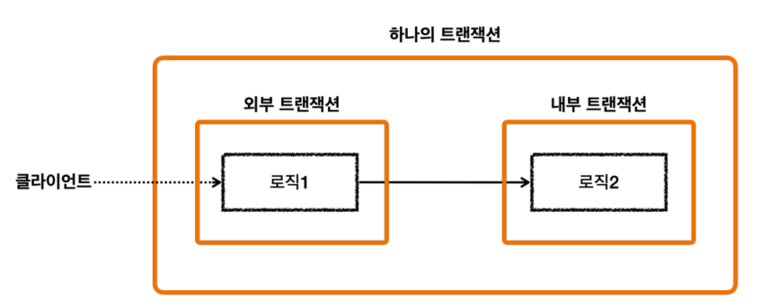

    - *스프링은 이 경우 외부 트랜잭션과 내부 트랜잭션을 묶어서 하나의 트랜잭션을 만들어준다.*
    - *즉, 내부 트랜잭션이 외부 트랜잭션에 참여하는 것이다.* 
    - *이것이 기본 동작이다.*

***물리 트랜잭션, 논리 트랜잭션***


    - *논리 트랜잭션들은 하나의 물리 트랜잭션으로 묶인다.*
    - *물리 트랜잭션이 실제 데이터베이스에 적용되는 실제 트랜잭션을 뜻한다.*
    - *논리 트랜잭션은 트랜잭션 매니저를 통해 트랜잭션을 사용하는 단위이다.*
    - *논리 트랜잭션 개념은 트랜잭션이 진행되는 중에 내부에 추가로 트랜잭션을 사용하는 경우에 나타난다.* 

***원칙*** 

    - *모든 논리 트랜잭션이 커밋되어야 물리 트랜잭션이 커밋된다.*
    - *하나의 논리 트랜잭션이라도 롤백되면 물리 트랜잭션은 롤백된다.*

# ***스프링 트랜잭션 전파4 - 전파 예제***

```java
@Test
void inner_commit(){
    log.info("외부 트랜잭션 시작");
    TransactionStatus outer = txManager.getTransaction(new DefaultTransactionDefinition());
    log.info("outer.isNewTransaction()={}", outer.isNewTransaction());

    log.info("내부 트랜잭션 시작");
    TransactionStatus inner = txManager.getTransaction(new DefaultTransactionDefinition());
    log.info("inner.isNewTransaction()={}", inner.isNewTransaction());

    log.info("내부 트랜잭션 커밋");
    txManager.commit(inner);

    log.info("외부 트랜잭션 커밋");
    txManager.commit(outer);
}
```

    - *외부 트랜잭션은 처음 수행된 트랜잭션이다. 이 경우 신규 트랜잭션(isNewTransaction=true)이 된다.* 
    - *내부 트랜잭션을 시작하는 시점에는 이미 외부 트랜잭션이 진행중인 상태이다. 이 경우 내부 트랜잭션은 외부 트랜잭션에 참여한다(isNewTransaction= false).*
    - *트랜잭션 참여: 외부 트랜잭션과 내부 트랜잭션이 하나의 물리 트랜잭션으로 묶이는 것*

***동작 흐름***


*트랜잭션 매니저에 커밋을 호출한다고해서 항상 실제 커넥션에 물리 커밋이 발생하지 않는다.*

*신규 트랜잭션인 경우에만 실제 커넥션을 사용해서 물리 커밋과 롤백을 수행한다.*

*즉, 신규 트랜잭션이 아니라면 물리 커넥션을 사용하지 않는다.*

*트랜잭션이 내부에서 추가로 사용되면, 트랜잭션 매니저를 통해 논리 트랜잭션을 관리하고, 
모든 논리 트랜잭션이 커밋되면 물리 트랜잭션이 커밋된다고 이해하면 된다.*

# ***스프링 트랜잭션 전파5 - 외부 롤백***

*내부 트랜잭션 커밋, 외부 트랜잭션 롤백되는 상황*


    - *논리 트랜잭션이 하나라도 롤백되면 전체 물리 트랜잭션은 롤백된다.*
    - *내부 트랜잭션이 커밋했어도, 내부 트랜잭션 안에서 저장한 데이터도 모두 함께 롤백된다.*

# ***스프링 트랜잭션 전파6 - 내부 롤백***

***외부 트랜잭션 커밋, 내부 트랜잭션 롤백 case*** 


```java
@Test
void inner_rollback(){
    log.info("외부 트랜잭션 시작");
    TransactionStatus outer = txManager.getTransaction(new DefaultTransactionDefinition());

    log.info("내부 트랜잭션 시작");
    TransactionStatus inner = txManager.getTransaction(new DefaultTransactionDefinition());

    log.info("내부 트랜잭션 롤백");
    txManager.rollback(inner); // rollback - only 표시

    log.info("외부 트랜잭션 커밋");
    assertThatThrownBy(()->txManager.commit(outer))
            .isInstanceOf(UnexpectedRollbackException.class);
}
```

***흐름***

*외부 트랜잭션 시작(물리 트랜잭션 시작) → 내부 트랜잭션 시작(논리 트랜잭션, 기존 트랜잭션 참여)*

*→ 내부 트랜잭션 롤백(marking rollback-only) → 외부 트랜잭션 커밋(Global Transaction rollback-only but transactional code commit) → UnexpectedRollbackException(물리 트랜잭션 RollBack)*


***내부 트랜잭션 응답***

    - *트랜잭션 매니저를 통해 내부 트랜잭션을 롤백한다.*
    - *트랜잭션 매니저는 롤백 시점에 신규 트랜잭션 여부(isNewTransaction)에 따라 다르게 동작한다.
내부 트랜잭션은 기존 트랜잭션에 참여한 트랜잭션 즉, isNewTransaction=false 이다.*
    - *내부 트랜잭션은 물리 트랜잭션을 롤백하지 않는 대신에 트랜잭션 동기화 매니저에게 rollbackOnly=true 표시를 해둔다.*

***외부 트랜잭션 응답***

    - *트랜잭션 매니저를 통해 외부 트랜잭션을 커밋한다.*
    - *외부 트랜잭션은 물리 트랜잭션의 시작 즉, isNewTransaction= true이다.*
    - *DB 커넥션에 실제 커밋을 호출해야 하는데 이때 먼저 트랜잭션 동기화 매니저에 rollbackOnly 표시가 있는지 확인한다.* 
    - *내부 트랜잭션에서 rollbackOnly=true 표시를 했기 때문에 외부 트랜잭션 커밋을 요청했지만 물리 트랜잭션을 커밋하는것이 아니라 롤백한다.*
    - *스프링은 커밋을 호출했지만 롤백이 발생했다는 것을 UnexpectedRollbackException 런타임 예외를 던져서 알려준다.*

***정리***

    - *논리 트랜잭션이 하나라도 롤백되면 물리 트랜잭션은 롤백된다.*
    - *내부 논리 트랜잭션이 롤백되면 롤백 전용 마크를 표시한다.*
    - *외부 트랜잭션을 커밋할 때 롤백 전용 마크를 확인한다.
롤백 전용 마크가 표시되어 있으면 물리 트랜잭션을 롤백하고, UnexpectedRollbackException 예외를 던진다.*

# ***스프링 트랜잭션 전파7 - REQUIRES_NEW***

*외부 트랜잭션과 내부 트랜잭션을 분리해서 각각 별도의 물리 트랜잭션을 사용하는 방법에 대해서 알아보자*


    - *물리 트랜잭션을 분리하려면 내부 트랜잭션을 시작할 때 REQUIRES_NEW 옵션을 사용하면 된다.*
    - *외부 트랜잭션과 내부 트랜잭션이 각각 별도의 물리 트랜잭션을 가진다.*
- *별도의 물리 트랜잭션을 가진다는 뜻은 DB 커넥션을 따로 사용한다는 뜻이다.*

```java
@Test
void inner_rollback_requires_new(){
    log.info("외부 트랜잭션 시작");
    TransactionStatus outer = txManager.getTransaction(new DefaultTransactionDefinition());
    log.info("outer.isNewTransaction()={}", outer.isNewTransaction());

    log.info("내부 트랜잭션 시작");
    DefaultTransactionDefinition definition = new DefaultTransactionDefinition();
    definition.setPropagationBehavior(TransactionDefinition.PROPAGATION_REQUIRES_NEW);
    TransactionStatus inner = txManager.getTransaction(definition);
    log.info("inner.isNewTransaction()={}", inner.isNewTransaction()); // true

    log.info("내부 트랜잭션 롤백");
    txManager.rollback(inner); // 롤백

    log.info("외부 트랜잭션 커밋");
    txManager.commit(outer);  // 커밋
}
```

    - ***definition.setPropagationBehavior(TransactionDefinition.******PROPAGATION_REQUIRES_NEW******)***
- *내부 트랜잭션의 전파 옵션을 REQUIRES_NEW로 설정* 
      - *내부 트랜잭션이 새로운 물리 트랜잭션으로 동작한다*
      - *즉, 하나의 요청 쓰레드가 2개의 서로 다른 커넥션을 가진다.*
      - *내부 트랜잭션을 TransactionStatus: isNewTransaction() 통해서 확인하면 true가 나온다.*
    -  *DefaultTransactionDefinition*
- *생성자로 DefaultTransactionDefinition을 생성하면*  ***PROPAGATION_REQUIRED****이다.*


# ***스프링 트랜잭션 전파8 - 다양한 전파 옵션***

*스프링은 다양한 트랜잭션 전파 옵션을 제공, 별도의 설정을 하지 않으면 REQUIRED가 기본이다.*

*실무에서는 REQUIRED 옵션을 대부분 사용하고 아주 가끔 REQUIRES_NEW를 사용한다.*

***REQUIRED***

    - *기존 트랜잭션이 없으면 생성하고, 있으면 참여한다.*
    - *트랜잭션이 필수이다.*
- *없으면 생성*
      - *있으면 참여*

***REQUIRES_NEW***

    - *항상 새로운 트랜잭션을 생성*

***SUPPORT***

    - *트랜잭션을 지원*
- *기존 트랜잭션 없음: 트랜잭션 없이 진행*
      - *기존 트랜잭션 존재: 기존 트랜잭션에 참여*

***NOT_SUPPORT***

    - 트랜잭션을 지원 X
- *기존 트랜잭션 없음: 트랜잭션 없이 진행*
      - *기존 트랜잭션 존재: 기존 트랜잭션 보류*

***MANDATORY***

    - *의무사항, 기존 트랜잭션이 없으면 예외 발생*
- *기존 트랜잭션 없음: IllegalTransactionStateException 예외 발생*
      - *기존 트랜잭션 존재: 기존 트랜잭션 참여*

***NEVER***

    - *트랜잭션을 사용하지 않는다는 의미*
- *기존 트랜잭션 없음: 트랜잭션 없이 진행*
      - *기존 트랜잭션 존재: IllegalTransactionStateException 예외 발생*

***NESTED***

    - *기존 트랜잭션 없음: 새로운 트랜잭션 생성*
    - *기존 트랜잭션 존재: 중첩 트랜잭션 생성*
- *중첩 트랜잭션은 외부 트랜잭션 영향을 받지만, 중첩 트랜잭션은 외부에 영향 X*
      - *중첩 트랜잭션이 롤백 되어도 외부 트랜잭션은 커밋*
      - *외부 트랜잭션이 롤백 되면 트랜잭션도 함께 롤백*
    - *참고*
- *JDBC savepoint 기능을 사용. DB 드라이버에서 해당 기능을 지원하는지 확인이 필요하다.*
      - *JPA 사용 불가*

***트랜잭션 전파와 옵션***

    - *isolation, timeout, readOnly는 트랜잭션 시작만 적용, 트랜잭션 참여에는 적용되지 않는다.*
- *REQUIRED 통한 물리 트랜잭션 시작, REQUIRES_NEW를 통한 트랜잭션 시작*

  - ***트랜잭션 전파 옵션, 원리***

# ***ThreadLocal?***

*ThreadLocal은 Java에서 제공하는 클래스(java.lang.ThreadLocal)로,* ***스레드마다 고유한 변수를 저장****할 수 있는 메커니즘을 제공한다. 
동일한 ThreadLocal 객체를 사용하더라도, 각 스레드는 독립적인 값을 갖게 되며 다른 스레드의 값에 영향을 받지 않는다.*

    - ***스레드 간 독립성****: 각 스레드는 자신의 ThreadLocal 인스턴스에 고유한 값을 저장.*
    - ***동시성 문제 해결****: 여러 스레드가 공유 자원에 접근하지 않기 때문에 동기화가 필요 없다.*
    - ***값의 생명주기****: 값은 스레드가 종료될 때까지 유지. (명시적으로 제거하지 않으면 메모리 누수가 발생할 수 있음)*

# ***ThreadLocal - 예제 코드***

***ThreadLocalService***

```java
@Slf4j
public class ThreadLocalService {
    
    private ThreadLocal<String> nameStore = new ThreadLocal<>();
    
    public String logic(String name){
		    nameStore.set(name);
        log.info("저장 name={} -> nameStore={}", name, nameStore.get());
        sleep(1000);
        log.info("조회 nameStore={}", nameStore.get());
        return nameStore.get();
    }
    
    private void sleep(int millis) {
        try {
            Thread.sleep(millis);
        }
        catch (InterruptedException e){
            log.info("sleep fail={}", e);
        }
    }
}
```

***ThreadLocal 사용법***

    - *값 저장: ThreadLocal.set(xxx)*
    - *값 조회: ThreadLocal.get()*
    - *값 제거: ThreadLocal.remove()*

***ThreadLoalServiceTest***

```java
@Slf4j
public class ThreadLocalServiceTest {
    private final ThreadLocalService threadLocalService = new ThreadLocalService();
    @Test
    void field(){
        log.info("main start");
        ExecutorService executorService = Executors.newFixedThreadPool(2);
        Runnable userA = () -> threadLocalService.logic("userA");
        Runnable userB = () -> threadLocalService.logic("userB");

        executorService.submit(userA);
        executorService.submit(userB);

        sleep(3000);
        log.info("main exit");
    }
    private void sleep(int mills) {
        try {
            Thread.sleep(mills);
        }
        catch (InterruptedException e){
            log.info("sleep fail{}", e);
        }
    }
}
```

***Result***

```java
main start
저장 name=userA -> nameStore=null
저장 name=userB -> nameStore=null
조회 nameStore=userA
조회 nameStore=userB
main exit
```

*userA 이름을 저장하는 스레드가 저장하고 userB 이름을 저장하는 스레드가 저장했지만*

*각 스레드의 ThreadLocal에 저장했기 때문에* 

*저장 이후 조회에서도 각 스레드가 저장한 이름이 조회된다*

***변하는 것과 변하지 않는 것을 분리*** 

*좋은 설계는 변하는 것과 변하지 않는 것을 분리하는 것* 

*강의에서 나오는 현재 예시는 핵심 기능(비즈니스 로직) 부분은 변하고, 부가 기능(로그 추적기)부분은 변하지 않는 부분이다.*

***템플릿 메소드 패턴(Template Method Pattern)****은 이런 문제를 해결하는 디자인 패턴*

# ***템플릿 메소드 패턴 - 예제1***

*템플릿 메소드 패턴을 쉽게 이해하기 위해 단순한 예제 코드를 만들어보자*

```java
@Slf4j
public class TemplateMethodTest {
    @Test
    void templateMethodV0(){
        logic1();
        logic2();
    }
    private void logic1(){
        long startTime = System.currentTimeMillis();
        log.info("비즈니스 로직1 실행");
        long endTime = System.currentTimeMillis();
        long resultTime = endTime - startTime;
        log.info("resultTime={}", resultTime);
    }
    private void logic2(){
        long startTime = System.currentTimeMillis();
        log.info("비즈니스 로직2 실행");
        long endTime = System.currentTimeMillis();
        long resultTime = endTime - startTime;
        log.info("resultTime={}", resultTime);
    }
```

***result***

```java
비즈니스 로직1 실행
resultTime=17
비즈니스 로직2 실행
resultTime=0
```

***변하는 부분:*** *비즈니스 로직* 

***변하지 않는 부분:*** *시간 측정* 

*→ 템플릿 메소드 패턴을 적용해서 변하는 부분과 변하지 않는 부분을 분리해보자*

# ***템플릿 메소드 패턴 - 예제2***

***템플릿 메서드 패턴 구조***


*템플릿 메소드 패턴의 템플릿은 기준이 되는 거대한 틀이다.*

*템플릿(Abstract Class)에 변하지 않는 부분을 몰아둔다.*

*그리고 일부 변하는 부분을 상속을 통해 구현(오버라이딩)하게 하고 별도로 호출해서 해결한다.*

***AbstractTemplate - abstract class***

```java
@Slf4j
public abstract class AbstractTemplate {
    public void execute(){
        long startTime = System.currentTimeMillis();
        call(); 
        long endTime = System.currentTimeMillis();
        long resultTime = endTime - startTime;
        log.info("resultTime={}", resultTime);
    }
    protected abstract void call();
}
```

***SubClassLogic1, SubClassLogic2 - extends AbstractTemplate***

```java
@Slf4j
public class SubClassLogic1 extends AbstractTemplate{
    @Override
    protected void call() {
        log.info("비즈니스 로직1 실행");
    }
}

@Slf4j
public class SubClassLogic2 extends AbstractTemplate{
    @Override
    protected void call() {
        log.info("비즈니스 로직2 실행");
    }
}
```

***템플릿 메소드 패턴 실행***

```java
@Test
void templateMethodV1(){
    AbstractTemplate template1 = new SubClassLogic1();
    template1.execute();
    AbstractTemplate template2 = new SubClassLogic2();
    template2.execute();
}
```

    - *템플릿 메소드 패턴 적용 before와 동일하다.*

*템플릿 메소드 패턴은 이렇게 다형성을 사용해서 변하는 부분과 변하지 않는 부분을 분리하는 방법이다.*

# ***템플릿 메소드 패턴 - 예제3***

*템플릿 메소드 패턴은 클래스를 계속 만들어야 하는 단점이 있다.*

*익명 내부 클래스를 사용하면 이런 단점을 보완할 수 있다.*

***익명 내부 클래스 사용하기*** 

```java
@Test
void templateMethodV2(){
     AbstractTemplate template1 = new AbstractTemplate() {
         @Override
         protected void call() {
             log.info("비즈니스 로직1 실행");
         }
     };
     template1.execute();

     AbstractTemplate template2 = new AbstractTemplate() {
         @Override
         protected void call() {
             log.info("비즈니스 로직2 실행");
         }
     };
     template2.execute();
}
```

***익명 클래스 적용 구조***


    - *익명 클래스는 이름이 없기 때문에 이름을 알아서 만들어주는데 이때 추상클래스이름 + $ +숫자를 붙인다.*

***좋은 설계란?***

*진정한 좋은 설계는 바로 변경이 일어날 때 자연스럽게 드러난다.*

*예제에서는 로그를 남기는 부분을 모아서 하나로 모아서 모듈화하고, 비즈니스 로직 부분을 분리했다.*

*만약 로그를 남기는 로직이 변경해야 한다고 생각해보자.*

*그럼 AbstractTemplate 코드만 변경하면 된다. (변경 지점을 하나로 모았다.)*

*만약 템플릿이 없다고 하면 모든 클래스를 다 찾아서 고쳐져야 한다.* 

*Template Method Pattern를 적용해서 SRP 또한 지켜지게 되었다.* 

# ***템플릿 메서드 패턴 - 정의***

***GOF 디자인 패턴에서 템플릿 메소드 패턴 정의*** 

    - *작업에서 알고리즘의 골격을 정의하고 일부 단계를 하위 클래스로 연기합니다.*
    - *템플릿 메서드를 사용하면 하위클래스가 알고리즘의 구조를 변경하지 않고도 알고리즘의 특정 단계를 재정의할 수 있습니다*

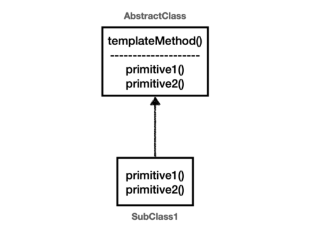

*부모 클래스에 알고리즘의 골격인 템플릿을 정의하고, 일부 변경되는 로직은 자식 클래스에 정의하는 방식*

*이렇게 하면 자식 클래스가 알고리즘 전체 구조를 변경하지 않고, 특정 부분만 재정의할 수 있다.*

*상속과 오버라이딩을 통한 다형성으로 문제를 해결하는 것* 

***템플릿 메소드 패턴 단점?***

*템플릿 메서드 패턴은 상속을 사용한다. 따라서 상속에서 오는 단점들을 그대로 안고간다.*

*자식 클래스가 부모 클래스와 컴파일 시점에 강하게 결합되는 문제가 발생한다.*

*상속을 받는다는 것은 특정 부모 클래스를 의존하고 있다는 것* 

*자식 클래스 입장에서는 부모 클래스의 기능을 전혀 사용하지 않는데, 부모 클래스를 알아야한다.*

*또한 부모 클래스를 수정하면, 자식 클래스에도 영향을 줄 수 있다.*

*추가로 상속 구조를 사용하기 때문에 별도의 클래스나 익명 내부 클래스를 만들어야 하는 부분도 복잡하다.*

*템플릿 메소드 패턴과 비슷한 역할을 하면서 상속의 단점을 제거할 수 있는* ***전략 패턴(Strategy Pattern)****에 대해서 알아보자*

# *전략 패턴 - 예제1*

*동일한 문제를 전략 패턴을 사용해서 해결해보자.*

*전략 패턴은 변하지 않는 부분을* ***Context****라는 곳에 두고, 변하는 부분을* ***Strategy****라는 인터페이스를 만들고 해당 인터페이스를 구현하도록 해서 문제를 해결한다.*

*즉, 상속이 아닌 위임으로 문제를 해결하는 방식이다.*

*전략 패턴에서* ***Context****는 변하지 않는 템플릿 역할을 하고,* ***Strategy****는 변하는 알고리즘 역할을 한다*

***GOF 디자인 패턴에서 정의한 전략 패턴의 의도***

    - *알고리즘 제품군을 정의하고 각각을 캡슐화하여 상호 교환 가능하게 만들자.*
    - *전략을 사용하면 알고리즘을 사용하는 클라이언트와 독립적으로 알고리즘을 변경할 수 있다.*

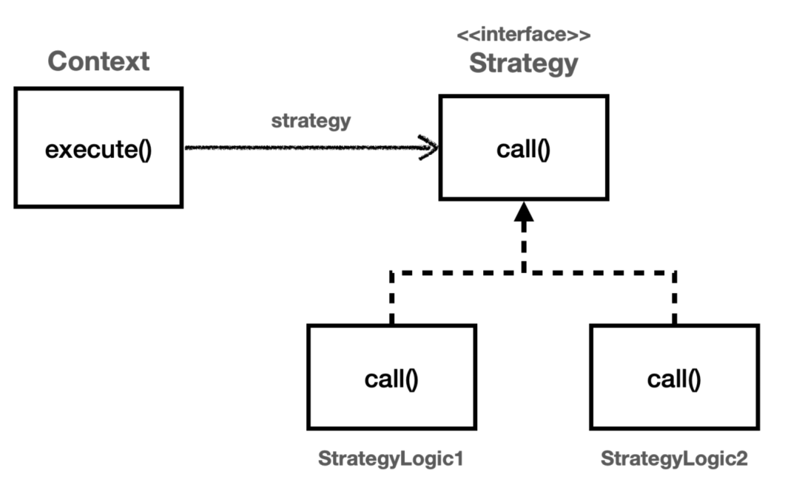

***Strategy - inteface***

```java
public interface Strategy {
    void call();
}
```

    - *변하는 알고리즘 역할*

***StrategyLogic1, StrategyLogic2 implements Strategy***

```java
@Slf4j
public class StrategyLogic1 implements Strategy {
    @Override
    public void call() {
        log.info("비즈니스 로직 실행1");
    }
}

@Slf4j
public class StrategyLogic2 implements Strategy {
    @Override
    public void call() {
        log.info("비즈니스 로직 실행2");
    }
}
```

***ContextV1***

```java
@Slf4j
public class ContextV1 {
    private Strategy strategy;
    public ContextV1(Strategy strategy) {
        this.strategy = strategy;
    }
    public void execute(){
        long startTime = System.currentTimeMillis();
        strategy.call();
        log.info("resultTime={}", System.currentTimeMillis() - startTime);
    }
}
```

*ContextV1은 변하지 않는 로직을 가지는 템플릿 역할을 하는 코드*

*전략 패턴에서는 이것을 컨텍스트(문맥)이라고 한다.*

*즉, 문맥은 크게 변하지 않지만 그 문맥 속에서 일부 전략이 변경된다 생각하면 된다.*

*전략 패턴의 핵심은 Context는 Strategy 인터페이스에만 의존한다는 점이다.*

*즉, 덕분에 Strategy 구현체를 변경하거나 새로 만들어도 Context 코드에는 영향을 주지 않는다.*

*→ OCP가 지켜진다.*

*→ 스프링에서 의존관계 주입(DI)에서 사용하는 방식이 전략 패턴이다.*

***ContextV1Test - 전략 패턴 적용*** 

```java
@Test
void strategyV1(){
    StrategyLogic1 strategyLogic1 = new StrategyLogic1();
    ContextV1 contextV1 = new ContextV1(strategyLogic1);
    contextV1.execute();

    StrategyLogic2 strategyLogic2 = new StrategyLogic2();
    ContextV1 contextV2 = new ContextV1(strategyLogic2);
    contextV2.execute();
}
```

***실행결과***

```java
StrategyLogic1 - 비즈니스 로직1 실행
ContextV1 - resultTime=3
StrategyLogic2 - 비즈니스 로직2 실행
ContextV1 - resultTime=0
```

# *전략 패턴 - 예제2*

*전략 패턴도 익명 내부 클래스를 사용할 수 있다.*

*또한 전략이 함수형 인터페이스이기 때문에 람다식으로 더욱 간편하게 주입이 가능하다.* 

***익명 내부 클래스 적용***

```java
@Test
void strategyV2(){
    Strategy strategy1 = new Strategy() {
        @Override
        public void call() {
            log.info("비즈니스 로직1 실행");
        }
    };
    Strategy strategy2 = new Strategy() {
       @Override
       public void call() {
           log.info("비즈니스 로직2 실행");
       }
    };

    ContextV1 contextV1 = new ContextV1(strategy1);
    contextV1.execute();

    ContextV1 contextV2 = new ContextV1(strategy2);
    contextV2.execute();
}
```

***람다식 적용***

```java
@Test
void strategyV4(){
   ContextV1 contextV1 = new ContextV1(()->{
       log.info("비즈니스 로직1 실행");
   });
   ContextV1 contextV2 = new ContextV1(()->{
       log.info("비즈니스 로직2 실행");
   });

   contextV1.execute();
   contextV2.execute();
}
```

***정리***

*현재 방식은 Context가 Strategy를 선 조립, 후 실행한다.*

*한번 조립하고 나면 이후로는 Context를 실행하기만 하면 된다.*

*우리가 스프링으로 애플리케이션을 개발할 때 애플리케이션 로딩 시점에 의존관계 주입을 통해 필요한 의존관계를 모두 맺어두고 난 다음에 실제 요청을 처리하는 것과 같은 원리이다.*

*문제는 한번 조립한 이후에는 전략을 변경하기 번거롭다는점이다.*

*Context에 setter를 제공해서 Strategy를 넘겨 받아 변경하면 되지만, Context를 싱글톤으로 사용할 때는 동시성 이슈 등 고려할점이 많다.*

*이렇게 먼저 조립하고 사용하는 방식보다 더 유연하게 전략 패턴을 사용하는 방법은 없을까?*

# ***전략 패턴 - 예제3 - Template Callback Pattern***

*이전에는 Context 필드에 Strategy를 주입해서 사용했다.*

*이번에는 전략을 실행할 때 직접 파라미터로 전달해서 사용해보자.*

***ContextV2***

```java
@Slf4j
public class ContextV2 {
    public void execute(Strategy strategy){
        long startTime = System.currentTimeMillis();
        strategy.call();
        long endTime = System.currentTimeMillis();
        log.info("resultTime={}", System.currentTimeMillis() - startTime);
    }
}
```

***ContextV2 test***

```java
@Test
void strategyV1(){
  ContextV2 context = new ContextV2();
  context.execute(()->{
      log.info("비즈니스 로직1 실행");
  });

  context.execute(()->{
      log.info("비즈니스 로직2 실행");
  });
}
```

*이제 Context와 Strategy를 선 조립 후 실행하는 방식이 아니라 Context를 실행할 때 마다 전략을 매개변수로 전달한다.*

*클라이언트는 Context를 실행하는 시점에 원하는 Strategy를 전달할 수 있다.*

*따라서 이전 방식과 비교해서 원하는 Strategy를 동시성 이슈 없이 유연하게 변경할 수 있다.*

# ***템플릿 콜백 패턴*** 

*ContextV2는 변하지 않는 템플릿 역할을 한다.*

*그리고 변하는 부분은 파라미터로 넘어온 Strategy의 코드를 실행해서 처리한다.*

*이렇게 다른 코드의 인수로서 넘겨주는 실행 가능한 코드를* ***콜백(CallBack)****이라 한다.*

*CallBack은 코드가 호출(call)이 되는데 코드를 넘겨준 곳의 뒤(back)에서 실행된다는 뜻이다.*

***템플릿 콜백 패턴***

*스프링에서는 ContextV2 같은 방식의 전략 패턴을 템플릿 콜백 패턴이라 한다.*

*템플릿 콜백 패턴은 GOF 패턴은 아니고 스프링에서만 이렇게 부른다.*

*전략 패턴에서 템플릿과 콜백 부분이 강조된 패턴이라 생각하면 된다.*

*Spring에서는 JdbcTemplate , RestTemplate , TransactionTemplate , RedisTemplate처럼 다양한 템플릿 콜백 패턴이 사용된다.*

  - ***+ 전략 패턴 VS 템플릿 콜백 패턴***

[https://20240228.tistory.com/426](https://20240228.tistory.com/426)

  - *백기선님 강의 들으면서 정리했던 내용*

***GOF 디자인 패턴***

*GOF 디자인 패턴에서 이 둘을 의도(intent)에 따라서 프록시 패턴과 데코레이터 패턴으로 구분한다.*

    - *프록시 패턴: 접근 제어가 목적*
    - *데코레이터 패턴: 새로운 기능 추가가 목적*

*둘다 프록시를 사용하지만, 의도가 다르다는 점이 핵심이다.* 

# ***프록시 패턴 - 예제*** 

***Proxy Pattern 적용 before 의존 관계***


***Subject interface***

```java
public interface Subject {
    String operation();
}
```

***RealSubject implements Subject***

```java
@Slf4j
public class RealSubject implements Subject{
    @Override
    public String operation() {
        log.info("실제 객체 호출");
        sleep(1000);
        return "data";
    }
    private void sleep(int millis) {
        try {
            Thread.sleep(millis);
        }
        catch (InterruptedException e){
            log.info("sleep fail={}", e);
        }
    }
}
```

***ProxyPatternClient***

```java
public class ProxyPatternClient {
    private Subject subject;
    public ProxyPatternClient(Subject subject) {
        this.subject = subject;
    }
    public void execute(){
        subject.operation();
    }
}
```

***noProxyTest***

```java
@Test
void noProxyTest(){
    ProxyPatternClient client = new ProxyPatternClient(new RealSubject());
    client.execute();
    client.execute();
    client.execute();
}
```

    - *client.execute()를 3번 호출*
    - *데이터 조회에 1초가 소모되므로 총 3초의 시간이 걸린다.*

***Proxy Pattern 적용 after 의존 관계***


***CacheProxy***

```java
@Slf4j
public class CacheProxy implements Subject {
    private Subject target;
    private String cacheValue;
    public CacheProxy(Subject target) {
        this.target = target;
    }
    @Override
    public String operation() {
        log.info("프록시 호출");
        if(cacheValue == null){
            cacheValue = target.operation();
        }
        return cacheValue;
    }
}
```

    - *Subject target: 클라이언트가 프록시를 호출하면 프록시가 최종적으로 실제 객체를 호출해야
한다.*

***cacheProxyTest***

```java
@Test
void cacheProxyTest(){
    CacheProxy cacheProxy = new CacheProxy(new RealSubject());
    ProxyPatternClient client = new ProxyPatternClient(cacheProxy);
    client.execute();
    client.execute();
    client.execute();
}
```

    - *client → proxy → realSubject*
    - *캐시 프록시를 도입하기 전에는 3초가 걸렸지만, 캐시 프록시 도입 이후에는 최초에 한번만 1초(Cache miss)가 걸리고 이후에는 거의 즉시 반환(Cache hit)한다.*

***정리***

*프록시 패턴의 핵심은 RealSubject 코드와 클라이언트 코드를 전혀 변경하지 않고, 프록시를 도입해서 접근 제어(캐싱)했다는 점이다.* 

또한 클라이언트의 코드 변경 없이 자유롭게 프록시를 넣고 뺄 수 있다.

*클라이언트 입장에서는 프록시 객체가 주입되었는지, 실제 객체가 주입되었는지 알지 못한다.*

# *데코레이터 패턴 - 예제*

***Decorator Pattern 적용 before 의존 관계***


***Component - interface***

```java
public interface Component {
    String operation();
}
```

***RealComponent - implements Component***

```java
@Slf4j
public class RealComponent implements Component{
    @Override
    public String operation() {
        log.info("RealComponent 실행");
        return "data";
    }
}
```

***DecoratorPatternClient***

```java
@Slf4j
public class DecoratorPatternClient {
    private Component component;
    public DecoratorPatternClient(Component component) {
        this.component = component;
    }
    public void execute(){
        String result = component.operation();
        log.info("result={}", result);
    }
}
```

***DecoratorPatternTest***

```java
@Test
void noDecorator(){
    DecoratorPatternClient client = new DecoratorPatternClient(new RealComponent());
    client.execute();
}
```

    - *그냥 단순하게 클라이언트가 RealComponent execute() 실행*

***요구 사항  - 부가 기능 추가*** 

*프록시를 통해서 부가 기능을 추가하는 것을 데코레이터 패턴이라 한다.*

    - *요청 값이나, 응답 값을 중간에 변형*
    - *실행 시간을 측정해서 추가 로그를 남긴다*

*응답 값을 꾸며주는 데코레이터를 만들어보자*

***Decorator Pattern 적용 after 의존 관계***

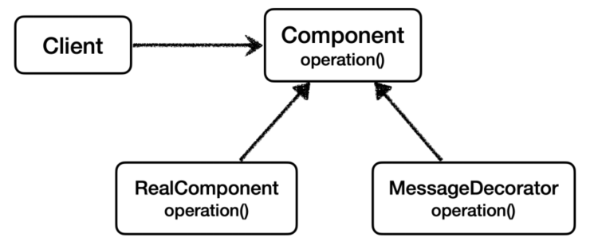

*Client → MessageDecorator → RealComponent*

***MessageDecorator***

```java
@Slf4j
public class MessageDecorator implements Component {
    private Component target;
    public MessageDecorator(Component target) {
        this.target = target;
    }
    @Override
    public String operation() {
        log.info("MessageDecorator 실행");
        String result = target.operation();
        String decoResult =  "****" + result + "****";
        log.info("MessageDecorator 꾸미기 적용 전={}, 적용 후={}", result, decoResult);
        return decoResult;
    }
}
```

    - *꾸미기 전: data* 
    - *꾸미기 후: ****data*****

***decorator1()***

```java
@Test
void decorator1(){
    MessageDecorator decorator = new MessageDecorator(new RealComponent());
    DecoratorPatternClient client = new DecoratorPatternClient(decorator);
    client.execute();
}
```

    - *실행 결과를 보면 MessageDecorator가 RealComponent를 호출하고 반환한 응답 메시지를 꾸며서 반환한 것을 확인할 수 있다*

***요구 사항  - 부가 기능 추가*** 

*기존 데코레이터에 실행 시간을 더해서 측정하는 기능까지 추가하자*


*Client → TimeDecorator → MessageDecorator → RealComponent*

***TimeDecorator***

```java
@Slf4j
public class TimeDecorator implements Component{
    private Component component;

    public TimeDecorator(Component component) {
        this.component = component;
    }

    @Override
    public String operation() {
        log.info("TimeDecorator 실행");
        long startTime = System.currentTimeMillis();
        String result = component.operation();
        long endTime = System.currentTimeMillis();
        log.info("TimeDecorator 종료 resultTime={}ms", endTime - startTime);
        return result;
    }
}

```

***decorator2()***

```java
@Test
void decorator2(){
    RealComponent realComponent = new RealComponent();
    MessageDecorator messageDecorator = new MessageDecorator(realComponent);
    TimeDecorator timeDecorator = new TimeDecorator(messageDecorator);
    DecoratorPatternClient client = new DecoratorPatternClient(timeDecorator);
    client.execute();
}
```

    - *실행하면 TimeDecorator가 MessageDecorator를 실행하고 실행 시간을 측정해서 출력한 것을 확인할 수 있다.*

# ***프록시 패턴과 데코레이터 패턴 정리***

***GOF 데코레이터***


*이전 Decorator 코드를 보면 중복이 존재한다.*

*꾸며주는 Decorator들은 내부에 호출 대상인 Component를 가지고 있어야 한다.*

*그리고 항상 Component를 호출해야 한다.*

*이런 부분이 중복이다.*

*이런 중복을 제거하기 위해 Component를 속성으로 가지고 있는 Decorator라는 추상 클래스를 만드는 방법도 고민할 수 있다.*

*이렇게 하면 클래스 다이어그램에서 실제 컴포넌트인지, 데코레이터인지 명확하게 구분할 수 있다.*

*여기까지 고민한 것이 바로 GOF에서 설명하는 데코레이터 패턴의 기본 예제이다.*

***프록시 패턴 vs 데코레이터 패턴***

*사실 프록시 패턴과 데코레이터 패턴은 그 모양이 거의 같고, 상황에 따라 정말 똑같을 때도 있다. 
그러면 둘을 어떻게 구분하는 것일까?
디자인 패턴에서 중요한 것은 해당 패턴의 겉모양이 아니라 그 패턴을 만든 의도가 더 중요하다. 
따라서 의도에 따라 패턴을 구분한다.*

    - *프록시 패턴의 의도: 다른 개체에 대한 접근을 제어하기 위해 대리자를 제공*
    - *데코레이터 패턴의 의도: 객체에 추가 책임(기능)을 동적으로 추가하고, 기능 확장을 위한 유연한 대안 제공*

[https://20240228.tistory.com/373](https://20240228.tistory.com/373)

[https://20240228.tistory.com/380](https://20240228.tistory.com/380)

[https://20240228.tistory.com/340](https://20240228.tistory.com/340)

[https://20240228.tistory.com/429](https://20240228.tistory.com/429)

[https://20240228.tistory.com/430](https://20240228.tistory.com/430)

***추가로 포인트컷 표현식 정리가 필요***

  - *AOP를 직접 적용할 때 공부 예정*

