# 정리 

# In-Memory Storage 핵심 특징

### 메모리 중심 아키텍처 

    - 모든 데이터를 메모리(RAM)에 저장
    - 디스크가 아닌 메모리 기반으로 초고속 처리 가능
    - 읽기/쓰기 속도는 마이크로초(us)단위 수준

### 디스크 I/O 불필요

    - 전통적인 DBMS와 달리 디스크 접근이 없다
    - Latency: Disk I/O (ms 단위) >> RAM Access (us 단위)

### 메모리 용량이 데이터 저장 한계

    - 전체 데이터 크기는 할당된 메모리 내에 한정
    - 수십~수백 GB 메모리로 운영되는 경우가 많다
    - 메모리 부족 시 정책에 따라 데이터 제거 또는 쓰기 실패 발생

---

# 단일 스레드 기반 처리 모델

### 순차적 명령 처리

    - Redis는 **단일 스레드에서 명령을 순차적으로 실행**
    - 이벤트 큐에 도착한 순서대로 빠르게 처리
    - 명령 간 락(lock) 불필요, 순차 실행 자체로 동시성 해결

### 명령 단위 원자성

    - 하나의 명령이 실행되는 동안 다른 명령은 대기
    - 단일 명령은 중단 없이 완전히 실행
    - 결과적으로 Redis 명령은 기본적으로 **원자적(atomic)**

### 주의: CPU 바운드 작업

    - 무거운 계산, **대용량 Lua 스크립트** 등은 처리 지연 발생
    - 하나의 명령이 오래 걸리면 모든 명령 큐가 대기 상태가 된다
    - Redis는 빠른 처리를 전제로 설계됨 → **복잡한 로직은 외부 워커로 분리 필요**

---

# 이벤트 루프의 동작 방식

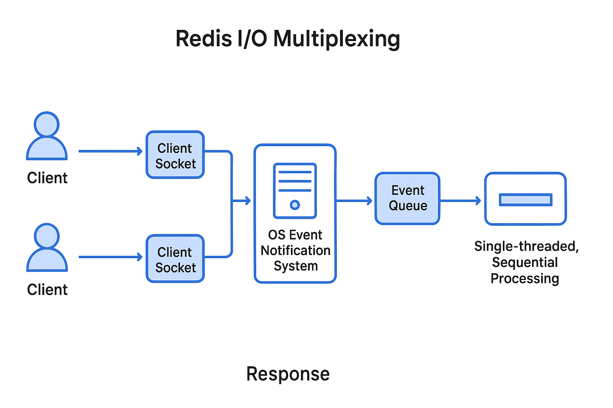

### OS 수준 이벤트 감지 시스템

    - epoll(Linux), kqueue(BSD/macOS) 등 고성능 이벤트 처리 기반
    - 수천 개 클라이언트 연결 상태를 비동기적으로 감지

### IO Multiplexing 방식

    - **Multiplexing:** 하나의 자원(채널, 장치, 스레드 등)을 통해 여러 개의 데이터 흐름(또는 작업)을 동시에 처리하는 기술적 개념
    - 클라이언트 I/O 이벤트를 감지해 이벤트 큐에 등록
    - Redis는 이 큐에서 순서대로 명령을 꺼내 실행
- **여러 클라이언트 요청을 한 개의 스레드가 관리**

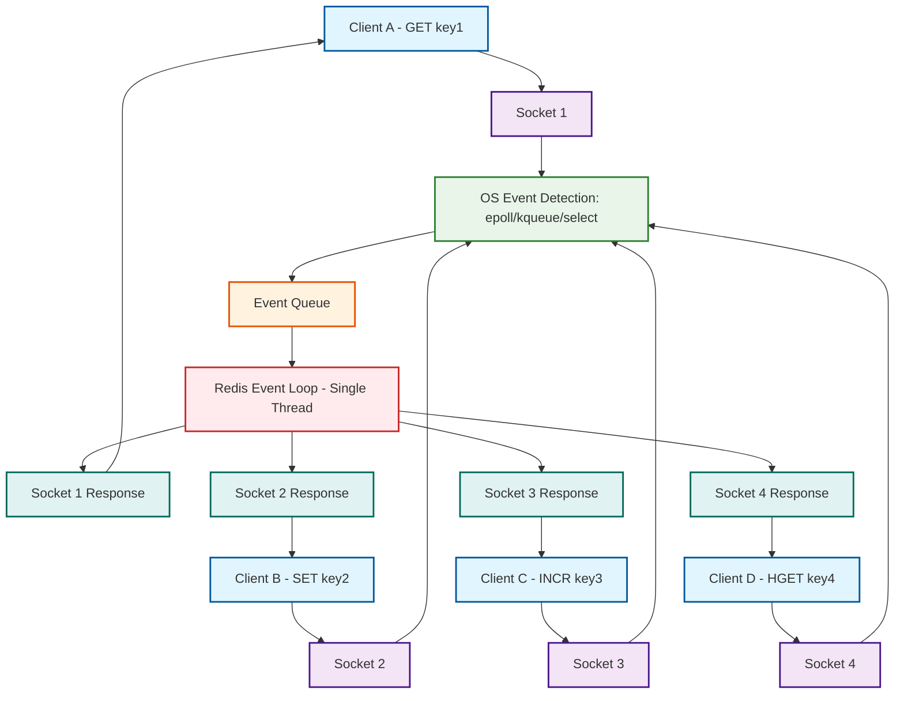

---

# String

### String: Redis에서 가장 기본이자 범용적인 타입

    - 문자열은 Redis 기본 데이터 타입이며, 실질적으로 임의의 값을 저장하는 컨테이너
    - 문자열, 숫자, JSON, 바이너리, 불리언 표현까지 모두 저장 가능
    - 최대 512MB까지 저장 가능 (SDS 기반 문자열)
    - Redis는 C언어로 구현되었으며, 문자열은 내부적으로 SDS(Simlple Dynamic String) 구조체로 저장됨

### 다양한 데이터 표현 예시

    - Redis는 인터페이스 레벨에서 값을 해석하지 않는다 → 모두 문자열로 취급
    - 명령어가 그 값을 숫자, 비트, JSON처럼 해석해서 활용할 수 있다

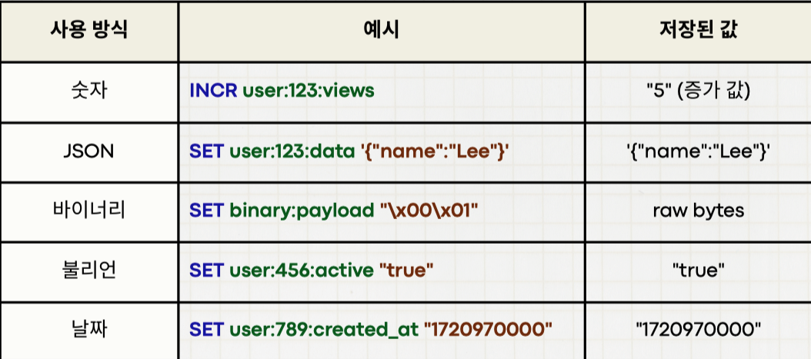

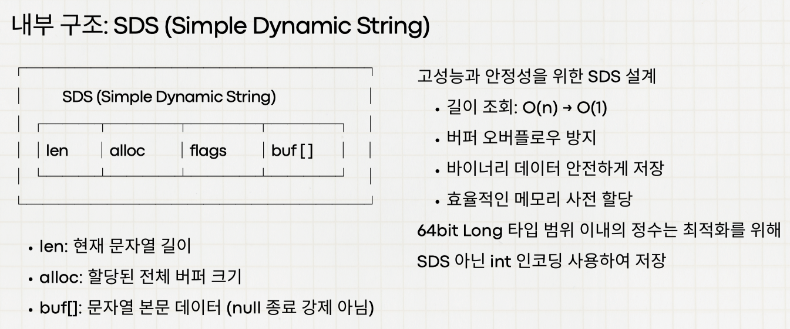

**64bit Long 타입 범위 이내의 정수는 최적화를 위해 SDS가 아닌 int 인코딩 사용하여 저장**

| 명령어 | 문법 | 설명 |
| --- | --- | --- |
| **INCR key** | 인자 1개 | **1씩 증가** |
| **INCRBY key increment** | 인자 2개 | **지정값만큼 증가** |
| **DECR key** | 인자 1개 | **1씩 감소** |
| **DECRBY key decrement** | 인자 2개 | **지정값만큼 감소** |

### 활용1: 사용자 로그인 횟수(정수형 카운터)

```bash
INCR user:123:login_count
```

### 활용2: 세션 정보 캐시(TTL 설정 포함)

```bash
SET session:abc123 '{"user_id":456, "expires_at":"2025.."}' EX 1800
```

    - **KEY:** session:abc123
    - **VALUE:** '{"user_id":456, "expires_at":"2025.."}'
    - **TTL:** 1800초 

### 활용3: 게시글 제목 캐시(단순 문자열)

```bash
SET article:789:title "Redis란?"
```

### String 타입 활용 정리

단순한 값 저장 외에도 다양한 연산을 효율적으로 처리 가능

    - 카운터: INCR, DECR, INCRBY, DECRBY 통해 정수 증가/감소 처리 
    - TTL 설정: SET key value EX time 만료 시간 함께 지정
    - 크기 제한 주의: 최대 512MB, 너무 크면 구조 분해 고려

---

# List

### List: 양방향 삽입/삭제가 가능한 순서형 컬렉션

    - Redis List는 값들의 순서를 유지하는 선형 구조
    - FIFO, LIFO 구조로 사용 가능
    - 동일한 키에 여러 값을 순차적으로 저장
    - 양쪽에서 삽입/삭제 가능 (LPUSH, RPUSH, LPOP, RPOP)

### 주요 연산 및 동작 방식

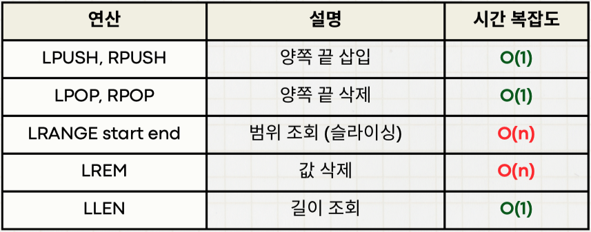

### 활용1: 작업 큐로 활용(왼쪽 삽입, 오른쪽 제거)

```bash
LPUSH task:queue "resize image #1"
LPUSH task:queue "resize image #2"
RPOP task:queue
```

    - KEY: task:queue
    - VALUE: resize image #2

### 활용2: 최근 본 항목 기록

```bash
RPUSH view:user:123 "item1"
RPUSH view:user:123 "item2"
RPUSH view:user:123 "item3"
...

LTRIM view:user:123 -2 -1 
```

    - LTRIM -2 -1: 최신 2개만 유지

### 활용3: 블로킹 큐(작업 대기열 처리)

```bash
BLPOP task:queue 5
```

    - 동작: 리스트에 데이터가 없으면 최대 5초 동안 대기(blocking)
    - 데이터가 들어오는 즉시 pop하여 반환
    - 프로듀서-컨슈머 패턴 구현

### List 타입 활용 정리

큐, 로그처럼 순서가 있는 데이터 처리에 적합하며 고정 길이 유지도 가능

    - 작업 큐: LPUSH + BRPOP 조합으로 소비자 대기 큐 구성
    - 최근 로그: LPUSH 후 LTRIM으로 최대 길이 유지
    - 키 분할: 너무 큰 리스트는 키에 샤딩 값 붙여 분산 처리
    - 양방향 처리: LPUSH, RPUSH, LPOP, RPOP 모두 O(1)

---

# Set

### Set: 중복 없는 집합형 자료 구조

    - Redis Set은 중복을 허용하지 않는 문자열 집합
    - 순서를 보장하지 않으며, 수학적 집합 개념과 동일
    - 삽입, 삭제, 존재 여부 확인이 빠르고, 교집합/합집합/차집합 같은 집합 연산 명령어도 기본 제공

### 내부 구조: intset 또는 hashtable

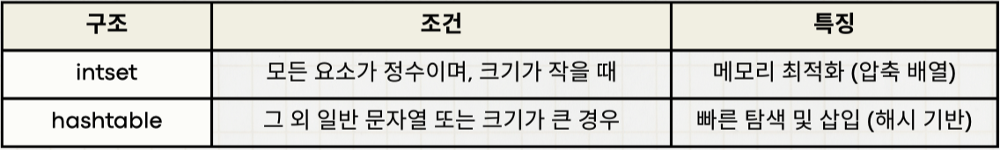

### 주요 연산 및 동작 방식

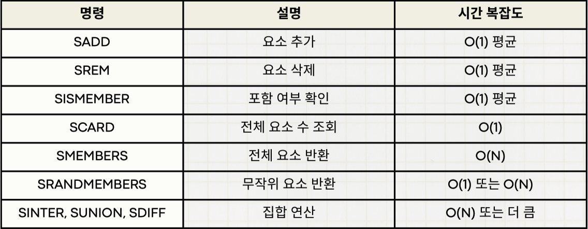

### 활용1: 사용자 태그 등록 (중복 없는 관심사 저장)

```bash
SADD user:123:tags sports music travel
```

    - KEY: user:123:tags
    - VALUE: {sports, music, travel}
- 중복 없음, 순서 없음

### 활용2: 교집합 연산 - 공통 태그 구하기

```bash
SADD user:1 sports music travel
SADD user:2 sports travel movies

SINTER user:1 user:2
```

    - 결과: sports, travel

### 활용3: 태그 목록 전체 조회

```bash
SMEMBERS user:1
```

    - 결과: {sports travel movies}

### 활용4: 랜덤 샘플링 - 관심 주제 무작위 선택

```bash
SRANDMEMBER user:1
```

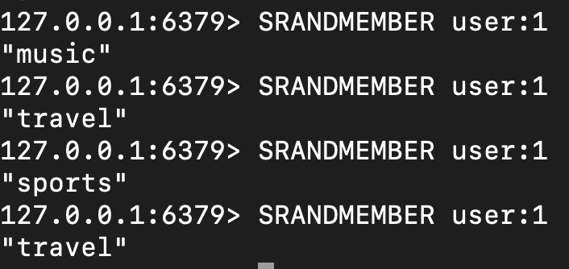

    - 무작위 추출

### Set 타입 활용 정리

중복 없는 집합 표현과 집합 연산 기능을 활용해 간단한 필터링과 샘플링 가능

    - 중복 제거: 자동으로 동일 값 제거
    - 태그 필터링: 교집합(SINTER)으로 조건 필터 구현
    - 랜덤 추출: SRANDMEMBER 랜덤 추천 구현
    - 키 사이즈 주의: 전체 데이터 셋 조회 시, 너무 큰 Set은 SCARD +SSCAN 조합 활용
- **SCARD:** 집합(Set)에 포함된 멤버(member)의 수를 반환
      - **SSCAN:** 집합(Set)에 저장된 멤버들을 부분적으로 반복하여 조회(Iterative Scan)

**SSCAN KEY 커서(시작 위치) COUNT 개수**

    - COUNT 개수로 힌트를 줄 수 있다.
    - COUNT 지정값 보다 더 많이 가져올 수 있다.
    - 다음 커서가 있다면 맨 처음에 응답으로 커서가 온다.

```bash
127.0.0.1:6379> SSCAN myset 0 COUNT 100
1) "1247"    # 다음 커서 (0이 아니면 더 있음)
2) 1) "data1"
   2) "data2"
   # ...

127.0.0.1:6379> SSCAN myset 1247 COUNT 100  
1) "0"       # 커서가 0 = 스캔 완료!
2) 1) "data_last"
   # ...
```

---

# Sorted Set(ZSet)

### ZSet: 점수 기반으로 정렬된 고유한 집합

    - Sorted Set은 중복 없는 요소들에 대해 정렬 기준(score)을 함께 부여하는 자료구조
    - 값은 고유하고, 정렬은 점수에 따라 자동 유지
    - 내부적으로 순서를 갖는 집합, 즉 정렬된 우선순위 큐와 유사
    - 점수를 기반으로 정렬, 범위 조회, 순위 검색이 가능

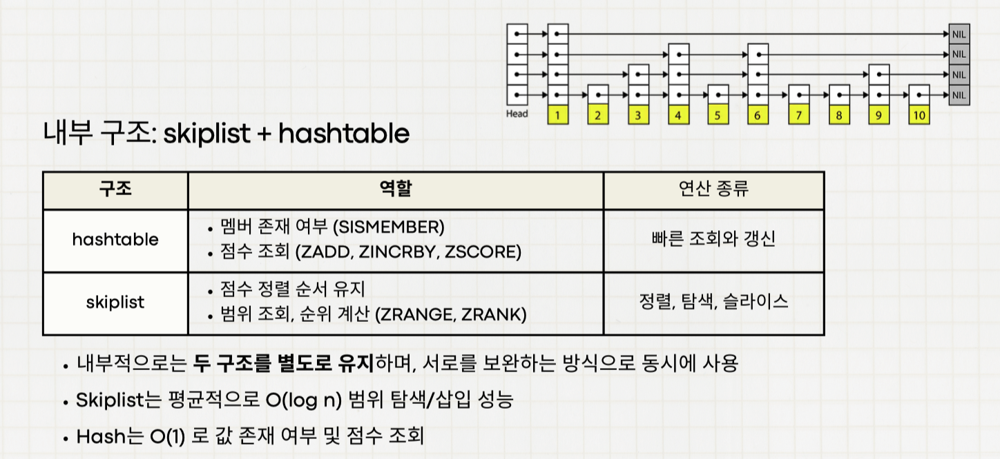

### 주요 연산 및 동작 방식

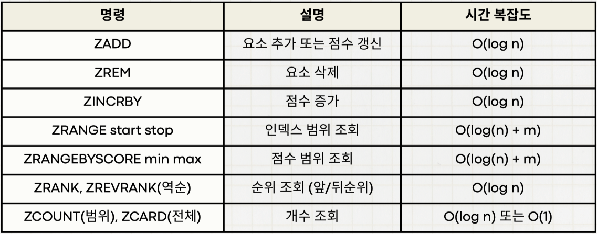

### example

```bash
ZADD leaderboard 100 "userA"
ZADD leaderboard 200 "userB"
ZADD leaderboard 150 "userC"
```

    - KEY: leaderboard
    - 정렬 기준: 점수(score) 오름차순
```bash
# 인덱스 범위 조회 조회
127.0.0.1:6379> ZRANGE leaderboard 0 -1
1) "userA"
2) "userC"
3) "userB"

# 개수 조회
127.0.0.1:6379> ZCOUNT leaderboard 0 300
(integer) 3

127.0.0.1:6379> ZCOUNT leaderboard 0 100
(integer) 1

127.0.0.1:6379> ZCARD leaderboard
(integer) 3

# 점수 범위 조회
127.0.0.1:6379> ZRANGEBYSCORE leaderboard 0 300
1) "userA"
2) "userC"
3) "userB"

# 특정 사용자 순위 조회
127.0.0.1:6379> ZRANK leaderboard userA
(integer) 0
127.0.0.1:6379> ZRANK leaderboard userB
(integer) 2
127.0.0.1:6379> ZRANK leaderboard userC
(integer) 1

# 상위 2명 조회(오름차순)
127.0.0.1:6379> ZRANGE leaderboard 0 1
1) "userA"
2) "userC"

# 상위 2명 조회(내림차순)
127.0.0.1:6379> ZREVRANGE leaderboard 0 1
1) "userB"
2) "userC"
```

### Sorted Set(ZSet) 타입 활용 정리

점수 기반 정렬된 집합으로 순위, 통계, 타임라인 등에 적합

    - 랭킹 시스템: 점수를 기반으로 정렬(ZADD, ZRANGE)
    - 최근순 정렬: timestamp를 score로 사용
- 데이터  제한: ZREMRANGEBYRANK, ZREMRANGEBYSCORE로 오래된 항목 정리
    - 통계 집계: ZUNIONSTORE(합집합), ZINTERSTORE(교집합)로 집계 처리 가능
- ZUNIONSTORE(합집합): 여러 그룹별 랭킹 합산하여 전체 랭킹 집계, 타임라인 머지/정렬
      - ZINTERSTORE(교집합): 이벤트 이력(공동 참여, 공통 활동 등)추출

### **추가 정리**

```bash
# 점수랑 함께 조회하는 방법
127.0.0.1:6379> ZREVRANGE leaderboard 0 -1 WITHSCORES
1) "userD"
2) "1000"
3) "userB"
4) "200"
5) "userC"
6) "150"
7) "userA"
8) "100"

# 점수 추가
127.0.0.1:6379> ZINCRBY leaderboard 100 userD
"1100"

# 존재하지 않았던 member 또한 추가 가능
127.0.0.1:6379> ZINCRBY leaderboard 100 userE
"100"
```

---

# Hash

### Hash: 필드-값 쌍의 소형 컬렉션

    - Redis의 Hash는 한 Key 안에 여러 개의 필드-값 쌍(field-value pair)을 저장하는 자료구조
    - 일반적인 해시맵 구조와 유사하지만, Redis에서는 복수 필드를 하나의 키 아래에 묶는 용도로 사용
    - JSON 유사한 구조, 사용자 정보, 설정값 캐싱에 적합
- 중첩(nested) 구조 저장 불가 
      - 내부적으로 field: string → value:string 구조

### 내부 구조: ziplist 또는 hashtable

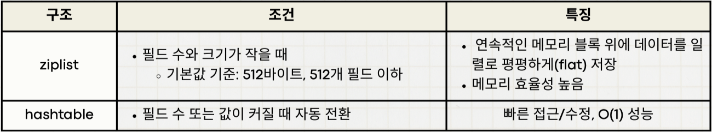

### 주요 연산 및 동작 방식

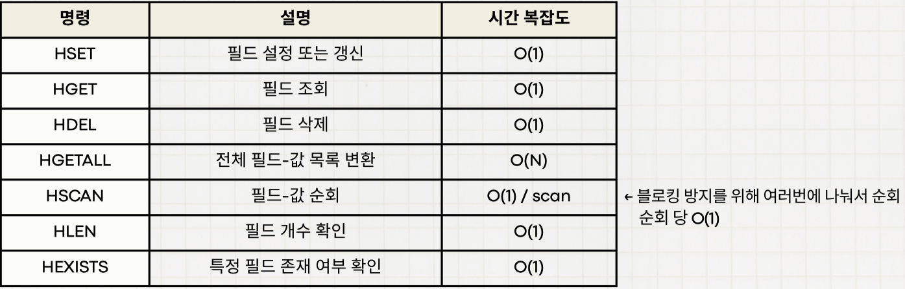

### Practice 

```bash
HSET user:123 name Alice
HSET user:123 email alice@example.com
HSET user:123 age 30

KEY -> user:123
VALUE -> {
	 name: Alice
   email: alice@example.com
   age: 30  
}
```

```bash
# 필드 조회
127.0.0.1:6379> HGET user:123 email
"alice@example.com"

# 전체 필드 조회
127.0.0.1:6379> HGETALL user:123
1) "name"
2) "Alice"
3) "email"
4) "alice@example.com"
5) "age"
6) "30"

# 필드 삭제 및 존재 확인
127.0.0.1:6379> HEXISTS user:123 email
(integer) 1
127.0.0.1:6379> HDEL user:123 email
(integer) 1
127.0.0.1:6379> HEXISTS user:123 email
(integer) 0

#대량 데이터 순회
127.0.0.1:6379> HSCAN user:123 0
1) "0"
2) 1) "name"
   2) "Alice"
   3) "age"
   4) "30"
   5) "email"
   6) "alice@exmaple.com"
```

### Hash 타입 활용 정리

한 키에 여러 필드를 저장할 수 있어 객체 저장이나 설정 캐시에 적합

    - 유저 세션/프로필 저장: HSET, HGET으로 필드별 접근
    - 소형 객체 최적화: **ziplist** 인코딩으로 메모리 절약
    - 필드 수 주의: 많아지면 **hashtable**로 전환되어 메모리 증가
    - 대량 순회: HSCAN 활용해 점진적 순회 가능

---

# Redis에서 영속성이 필요한 이유

### 기본 동작: 메모리 기반 저장

    - Redis는 모든 데이터를 메모리(RAM)에 저장
    - 서버를 재시작하면 데이터는 기본적으로 모두 사라짐
    - 디스크에는 아무것도 남지 않음(기본 설정 시)

### 영속성이 필요한 이유

    - 서버 장애, 재시작 등 예기치 못한 상황 발생 시 데이터 복구 필요
    - 휘발성 캐시가 아닌, 중요한 상태 저장소로 Redis를 활용할 경우
    - 수동 복원이나 백업 없이도 서비스 일관성을 유지하려면 필수

### 영속성이 필요한 케이스

    - **캐시 중심 서비스:** 데이터가 유실되어도 복원 가능 → 저장 생략 가능
    - **상태 중심 시스템:** 장애 발생 시 그대로 복원돼야 함 → 저장 필수
    - **데이터 보호가 중요한 환경:** 가능한 한 모든 변경 사항을 남겨야 함

---

# RDB(Redis Database)

### RDB(Redis Database): 스냅샥 기반 저장 방식

Redis의 전체 메모리 상태를 일정 시점에 저장하여, 빠른 복구를 지원하는 기본적인 영속화 메커니즘

    - **저장 대상:** Redis 전체 메모리 상태(snapshot)
    - **저장 트리거:** SAVE, BGSAVE, 또는 save 설정(redis.conf) 조건 충족 시
    - **저장 포맷:** .rdb 확장자, 바이너리 직렬화 포맷
    - **저장 파일 특징**
- **파일 크기 작음:** 명령 이력 없이 상태만 저장
      - **로딩 속도 빠름:** 일괄 읽기 → 바로 메모리에 복원
    - **저장 위치 및 파일명:** 기본 이름은 dump.rdb, 위치는 dir 설정 기준
    - **save 조건 예시**
- **save 900 1:** 900초 내 1건 이상 변경 시 저장
      - **save 300 10:** 5분 내 10건 이상 변경 시 저장
      - 다중 조건 동시 설정 가능

### 백그라운드 저장과 Copy-on-Write

Redis는 RDB 저장 중에도 요청 처리를 중단하지 않기 위해 fork() 기반 비차단 구조를 사용한다

    - 저장 실행: BGSAVE 명령 또는 설정 조건 충족 시 자동 실행
    - **fork() 호출: 자식 프로세스를 생성해 저장 작업 전담**
    - 역할 분리
- **부모 프로세스:** 클라이언트 요청 처리 계속 수행
      - **자식 프로세스:** 저장 시점의 메모리 상태를 .rdb 파일로 기록
    - **Copy-on-Write(CoW) 메커니즘**
- 메모리 페이지는 부모 - 자식이 공유
      - 부모가 페이지 수정 시 → 해당 페이지만 복사
    - 동시성 확보: 저장 중에도 읽기/쓰기 모두 처리 가능
    - 주의 사항
- 쓰기 트래픽이 많을수록 Cow 증가 → 메모리 급등
      - 메모리 부족 시 fork 실패 또는 OOM 가능성 존재

### RDB의 장단점 요약

스냅샷 기반의 구조적 특성을 기준으로 RDB의 장점과 제한점을 비교해 정리

    - **장점**
- **빠른 복구:** 전체 상태를 일괄 로딩 → 짧은 재시작 시간
      - **파일 크기 효율적:** 상태만 저장, 누적 로그 없음
      - **포맷 단순:** 바이너리 직렬화 → 외부 전송/이식성 유리
    - **단점**
- 마지막 저장 이후의 변경 데이터는 복구되지 않음
      - fork() 또는 디스크 병목 시 저장 실패 가능
      - 실시간 무결성 보장 불가 → 민감한 시스템에 단독 사용 어려움

---

# AOF(Append Only File)

### AOF(Append Only File) 개요: 변경 명렁어 로그 기록 방식

**명령어 로그**를 통해 Redis의 상태를 복구할 수 있도록 보장하는 **실시간 영속화 방식**

    - **영속화 방식:** 처리된 쓰기 명령어 자체를 로그에 기록하여 상태 복원 가능
    - **저장 포맷:** .aof 파일, 사람이 읽을 수 있는 명령어 나열 형식
    - **복구 방식:** 서버 재시작 시 **AOF 파일의 명령어를 순서대로 재실행하여 메모리 상태 복원**
    - **동작 시점:** 명령 처리 직후 버퍼에 기록, 설정에 따라 디스크에 반영
    - **RDB와 차이점:** 메모리 상태 저장이 아니라, **명령의 이력을 저장**하는 방식

### AOF 활성화와 설정 항목

AOF 기능을 사용하려면 명시적으로 활성화해야 하며, 관련 설정 항목들을 함께 지정해야 한다

    - **활성화 옵션:** appendonly yes 설정 시 AOF 기능이 켜진다(default: no)
    - **설정 위치:** redis.conf 파일 또는 CONFIG SET 명령을 통해 적용 가능
    - **주의 사항:** appendonly yes로 설정되기 전에는 AOF 관련 옵션이 적용되지 않음
    - **AOF 파일 이름:** appendfilename (default: appendonly.aof)
    - **저장 디렉터리:** dir 옵션으로 지정
    - **영구 적용 방법:** CONFIG REWRITE 명령으로 현재 설정을 redis.conf에 반경 가능

### AOF 설정 예시 (redis.conf)

```
# AOF 기능 활성화
appendonly yes

# AOF 파일 이름 설정
appendfilename appendonly.aof

# AOF fsync 정책: 1초마다 디스크 반영
appendfsync eversec

# 저장 경로(RDB와 공유)
dir /var/lib/redis

# AOF 리라이팅 조건 설정
auto-aof-rewrite-percentage 100
auto-aof-rewrite-min-size 64mb
```

### 내부 동작 흐름: 버퍼, flush, fsync

AOF는 **명령 실행 후 버퍼에 기록되고, 설정에 따라 디스크에 반영**되는 단계적 흐름을 가진다.

```
1. 클라이언트 쓰기 명령 실행
2. Redis 명령어를 AOF 내부 버퍼에 먼저 기록
3. 이후 OS 파일 시스템 캐시에 flush (write 또는 writev) 호출
4. fsync 또는 fdataasync로 디스크에 물리적 반영
```

    - **버퍼:** Redis 내부에 존재, 여러 명령어를 일시적으로 쌓아둔다
    - **flush:** 버퍼 내용을 OS 파일 시스템 캐시(RAM)에 쓰는 단계
    - **fsync:** 파일 시스템 캐시의 내용을 디스크에 강제 반영(write-through)
    - flsuh/fsync 호출 시점은 appendfsync 설정에 따라 결정된다

### appendfsync 옵션 설명

fsync 호출 시점을 제어하며 AOF의 데이터 안정성과 쓰기 성능 사이의 균형을 조절하는 설정

**설정 항목: appendfsync**

AOF 내부 버퍼의 내용을 OS 파일 시스템 캐시 flush 후 언제 디스크에 반영할지를 결정

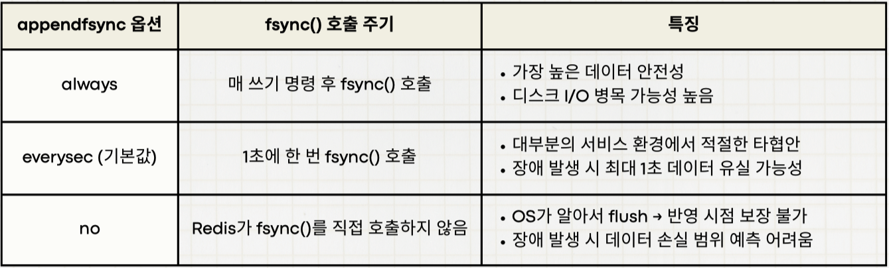

### **AOF 파일 리라이팅**

명령 누적으로 커진 AOP 파일을 정리하여, **상태 재현에 필요한 최소 명령어 집합으로 재작**성하는 최적화 과정

    - **필요 이유**
- AOF는 모든 쓰기 명령을 누적 기록 → 시간이 지날수록 파일 크기 지속 증가
      - 예: SET * 1 → SET * 2 → SET * 3 → 최종 상태는 SET * 3 하나면 충분
    - **동작 방식**
- Redis는 현재 메모리 상태를 기준으로 최소 명령 집합을 생성
      - 새 AOF 파일을 백그라운드에서 작성한 뒤, 기존 파일과 교체
    - **자동 트리거 조건**
- 설정 항목: auto-aof-rewrite-percentage, auto-aof-rewrite-min-size
      - 예: 이전 파일보다 100% 이상 커지고, 64MB 이상일 때 자동 실행
    - **중단 없는 리라이팅 보장**
- 리라이팅 중에도 Redis는 명령어를 계속 처리하고, diff buffer에 변경사항 기록 후 최종 병합
      - 전체 무중단 운영 가능

### AOF 장단점 요약

    - **장점**
- **높은 데이터 보존성:** everysec 기준으로도 최대 1초 이내 손실 → RDB 보다 유실 가능성 낮음
      - **명령어 기반 복원:** 사람이 읽을 수 있어 수동 분석 및 복구 용이
      - **실시간 반영:** 모든 쓰기 명령 즉시 기록 → 상태 변경 직후에도 복원 가능
      - **RDB와 병행 가능:** 빠른 재시작(RDB) + 정밀 복원(AOF) 조합 구성 가능
    - **단점**
- **파일 크기 증가:** 명령 누적으로 RDB보다 훨씬 커질 수 있음
      - **복구 속도 저하:** 재시작 시 명령어 순차 실행 → RDB보다 느림
      - **명령 오류 전파 위험:** 잘못된 명령도 그대로 기록 → 복구 시 재현
      - **디스크 I/O 영향 민감:** 설정에 따라 TPS 성능 저하 가능

---

# 하이브리드 방식(RDB + AOF)

### 하이브리드 구성의 실제 동작 구조

Redis는 RDB, AOF 병행 설정하면, 각 방식의 역할을 명확히 분리하여 함께 운영한다

    - **구성 목적**
- RDB: 메모리 상태를 정기적으로 스냅샷 저장
      - AOF: RDB 저장 이후의 변경 명령을 지속적으로 기록
    - **저장 동작**
- save 설정 조건 충족 시 .rdb 생성
      - 이후 발생한 쓰기 명령은 .aof에 순차적으로 기록됨
    - **복구 시 동작 순서**
1. Redis가 .rdb 파일로 메모리 상태를 먼저 복원
      1. .aof 파일의 전체 명령어(=RDB 이후 기록된 명령)를 순차 실행하여 최신 상태 반영
    - **중복 여부** 
- .aof에는 RDB에 포함된 명령은 기록되지 않음
      - Redis는 AOF 전체를 실행하지만, 그 내용은 RDB 이후의 것만 포함

### **설정 방식과 구성 예시** 

하이브리드 방식은 RDB, AOF 설정을 함께 활성화하여 운영한다

    - **설정 항목 예시(redis.conf)**
- save 900 1
      - save 300 10
      - appendonly yes
      - appendfsync everysec
    - **저장 위치:** .rdb와 .aof 파일 모두 dir 설정 경로에 저장
    - **복구 흐름은 고정**
- .rdb 로드
      - .aof 명령 전체 재실행
    - AOF에는 RDB 이후 명령만 포함되므로 중복 실행 없음

### 하이브리드 구성의 장단점

**두 방식의 특성을 결합하여 복구 성능과 데이터 정합성 모두를 확보할 수 있다.**

    - **장점**
- RDB로 빠른 재시작 가능
      - AOF로 정밀한 복구 가능(최대 1초 단위 보존)
      - 중복 저장 없이 명확한 복구 흐름 확보
    - **단점**
- 디스크 사용량 증가(두 파일 모두 저장됨)
      - 설정 관리 복잡도 증가(주기, 경로, 정책 등 이중 관리 필요)

---

# Maxmemory 정책

### Redis에서 메모리 제거 정책이 필요한 이유

Redis는 모든 데이터를 메모리에 저장하므로, **메모리 한도 초과 시 명확한 제거 전략**이 필요

    - **메모리 기반 구조:** 디스크가 아닌 RAM에 저장하므로 공간 유한
    - **maxmemory 설정:** Redis에 메모리 상한을 명시적으로 지정 가능
    - **쓰기 요청 처리 조건:** 메모리 한도 초과 시 **eviction 정책** 없으면 쓰기 거부
    - **정책 필요성:** 어떤 키를 우선 제거할지 기준 없으면 서비스 불안정

### Eviction 정책 개요

Eviction 정책은 **두 가지 기준(제거 대상과 제거 알고리즘)**을 조합해 동작하는 메커니즘

    - 정책 구성 = 제거 대상 범위 + 제거 알고리즘
    - **Redis 내 사용 예시**
- allkeys-lru, volatile-lru, alkeys-random, noeviction 등
    - **설정 방식**
- **제거 대상:** allkeys / volatile
      - **알고리즘:** lru / lfu / random / noeviction

### 제거 대상 범위 기준

Eviction은 먼저 어떤 키들을 제거 대상으로 삼을지를 결정하며, 이 범위에 따라 제거 알고리즘이 적용

    - **allkeys-*:** 모든 키를 제거 후보로 포함(TTL 여부 무관)
- ex:allkeys-lru, allkeys-lfu
    - **volatile-*:** TTL이 설정된 키만 제거 대상
- ex:volatile-lru, volatile-random
    - **차이점**
- allkeys: 캐시 전체를 관리할 때 사용
      - volatile: 임시 데이터, 만료 데이터만 선별 정리할 때 사용

### 주요 제거 알고리즘

어떤 기준으로 제거할 키를 선택할지를 정의하는 알고리즘

    - **LRU: Least Recently Used** - 가장 오랫동안 사용되지 않은 키 제거
- Redis는 정확한 LRU 대신 샘플 기반 근사 사용
    - **LFU: Least Frequently Used** - 가장 적게 사용된 키 제거
- 내부 카운터 + decay 기반, Redis 4.0 이상
    - **Random:** 제거 대상 중 무작위로 선택
- 계산 비용은 낮지만 예측 불가능
    - **noeviction:** 제거하지 않고 쓰기 실패
- 저장소처럼 사용할 때 적용 가능

### 정책 적용 시 고려사항

Eviction 정책은 설정 후에도 동작 조건과 모니터링 방법을 함께 고려해야 한다.

    - **기본값:** Redis 기본 정책은 noeviction
    - **동작 조건 설정 명령어**
- maxmemory, maxmemory-policy
    - **작동 조건**
- **maxmemory 미설정 시 eviction 자체 미작동**
      - **volatile 정책은 TTL 키가 없으면 작동 안 함**
    - **확인 명령어**
- INFO memory, MEMORY STATS, evicted_keys 지표
    - **운영 팁** 
- eviction trigger 상황 로그 추적(MONITOR, SLOWLOG 활용)
      - 목적 기반 정책 선택: 캐시 → allkeys-lru / 저장소 → noeviction

### 사용 가능한 Eviction 정책 목록 정리

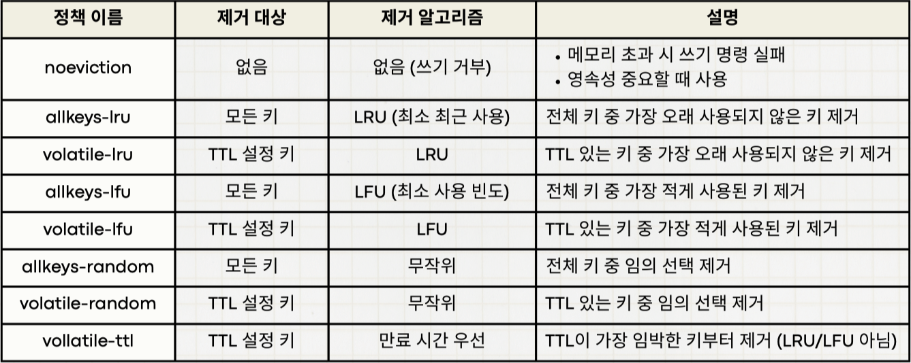

---

# Redis에서의 복제와 고가용성 개요

### 단일 인스턴스의 한계

Redis는 기본적으로 단일 프로세스 기반의 인메모리 데이터베이스

이 구조는 빠르지만 단일 장애지점(SPOF)이 존재

    - **메모리 기반 특성:** 장애 시 데이터 손실 가능
    - **서버 자체 장애:** Redis 프로세스 크래시, OS 문제 등
    - **네트워크 단절:** 클라이언트와 연결 불가 상황
    - **운영 환경:** 단일 인스턴스만으로는 안정성 확보 어려움

### 복제의 도입 목적

복제는 Redis가 고가용성과 확장성을 갖추기 위해 가장 먼저 적용할 수 있는 기본 전략

    - **고가용성 확보:** 장애 시 Replica를 통해 빠른 복구 가능
    - **읽기 분산:** Replica를 통해 read 처리 분산 가능
    - **백업/테스트 분리:** Replica를 활용한 비파괴 테스트 및 데이터 스냅샷
    - **지역 복제:** 멀티 리전 환경에서의 데이터 복제 구성 가능

### Redis 고가용성 구성 전략

    - **단순 복제:** Master → Replica 구성을 통한 기본 복제
    - **Sentinel 구성:** 장애 감지 및 자동 failover 수행
    - **Redis Cluster:** 파티셔닝 + 복제 + 자동 장애 전환 포함된 고급 구성
    - **Hybrid 구성:** 복제 + Sentinel 또는 Cluster 병행 사용

### 구성 전략별 비교

Redis 고가용성 구성 방식들 비교

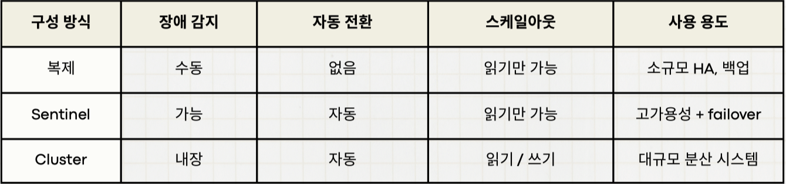

Replication + Sentinel이 현실적인 기본값

Cluster는 쓰기 확장성과 자동 파티셔닝이 필요한 경우에만 선택

---

# Master-Slave 복제

### 복제의 기본 개념

Redis는 단방향 **Master → Replica 복제**를 통해 **읽기 부하 분산과 장애 대비**를 지원

    - **복제 방향:** Master → Replica (쓰기 → 읽기 복제)
    - **쓰기/읽기 분리:** Master는 쓰기 전용, Replica는 기본 읽기 전용
    - **복제 목적:** 장애 복구, 읽기 부하 분산
    - **구조 특성:** 단순하고 빠르지만 실시간 일관성 보장 불가

### 복제의 작동 원리

Redis 복제는 **full sync**와 **명령어 스트리밍**으로 구성

    - **최초 연결 시:** Replica가 Master로부터 RDB 스냅샷을 수신 (full sync)
    - **이후 실시간 복제:** Redis 프로토콜 기반 명령어 스트리밍
    - **명령어 버퍼링:** RDB 전송 중에도 명령어는 별도 버퍼에 저장
    - **중단 복구:** PSYNC 또는 PSYNC2 통해 부분 복제 가능

### 일관성 모델 

| 일관성 모델 | 설명 | 장점 | 단점 | 사용 예시 |
| --- | --- | --- | --- | --- |
| **Strong Consistency** | 모든 노드가 항상 동일한 최신 데이터 보장 | • 데이터 정확성 완벽<br>• 예측 가능한 동작 | • 성능 저하<br>• 가용성 감소 | 은행 잔액, 재고 관리 |
| **Eventual Consistency** | 일시적 불일치 허용, <br>시간이 지나면 일치 | • 높은 성능<br>• 높은 가용성 | • 일시적 데이터 불일치<br>• 복잡한 충돌 해결 | SNS 좋아요, 댓글 수 |
| **Weak Consistency** | 일관성 보장 없음 | • 최고 성능<br>• 최고 가용성 | • 데이터 불일치 가능<br>• 예측 불가능 | 실시간 게임, 로그 수집 |

### 비동기 복제와 데이터 일관성

Redis 복제는 성능을 우선해 기본적으로 비동기 방식으로 동작

    - **비동기 구조:** Master는 Replica 반응을 기다리지 않는다
    - **Replica 지연 가능성:** 최신 데이터 반영 시점에 차이 발생
    - **일관성 모델:** **eventual consistency**
    - **보완 기능:** WAIT 명령어로 지정 수 Replica 반영까지 대기 가능

### 복제의 한계와 장애 복구

**복제 구조만으로는 자동 장애 복구가 불가능**하며, 보완 도구가 필요

```
# 1. Replica를 Master로 승격
redis-cli -p 6380
> REPLICAOF NO ONE

# 2. 애플리케이션 설정 변경
spring.redis.host=replica-server  # 코드 수정 + 재배포

# 3. 기존 Master 복구 후 새로운 Replica로 설정
redis-cli -p 6379
> REPLICAOF replica-server 6380
```

    - **장애 시 동작:** Replica는 연결 유지하지만 승격은 수동 수행
    - **자동 전환 없음:** replicaof no one 등 수동 명령 필요
    - **구조적 한계:** 복제는 데이터 전달 경로일 뿐, failover 로직 없음
    - **보완 도구:** **Sentinel 또는 Redis Cluster 필요**

### 애플리케이션 개발자의 관점

    - Replica는 실시간 일관성을 보장하지 않음
    - 읽기 확장은 가능하지만 쓰기 확장은 불가능
    - Master 장애 시 자동 전환은 없음 → Sentinel 필요
    - 중요 쓰기 이후 확인 필요 시 WAIT 명령 사용 고려

```
# 2개 replica에 복제 완료까지 최대 1000ms 대기
WAIT 2 1000

# 사용 예시
SET user:1000:balance 500
WAIT 1 5000  # 최소 1개 replica 반영까지 5초 대기
```

---

# Redis Sentinel

### Sentinel의 역할과 개념

Sentinel은 Redis **고가용성을 위한 외부 감시자 프로세스**로, 

기존 Master-Replica 구조에 추가로 구성되는 별도 노드

    - **역할: 장애 감지, 자동 전환, 구성 재조정**
    - **구성 위치:** Redis 인스턴스 외부에 독립 배치
    - **감시 대상:** Redis Master, Replica
    - **실행 방식:** Redis 프로토콜 기반의 독립 프로세스

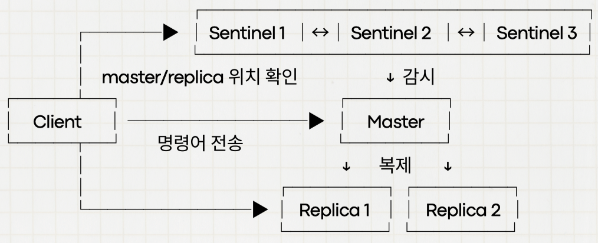

### 장애 감지와 자동 전환 방식

Sentinel은 **네트워크 기반 상태 감시와 합의 기반 트리거를 통해 장애를 판단하고 전환 수행**

    - **감시 대상:** Master + 모든 Replica
    - **감지 기준:** 일정 시간 동안 응답 없음, 연결 실패
    - **failover 조건:** 복수 Sentinel 합의(quorum) 필요
    - **전환 흐름:** 최신 상태 Replica → Master 승격, 나머지 재지정

### 클라이언트와 Sentinel 연동 구조

Sentinel은 단순 감시 도구가 아니라, 클라이언트 측의 Master 탐색 기능도 제공한다.

    - Sentinel은 Redis 프로토콜 기반 API 제공 
    - 클라이언트는 Sentinel에게 현재 Master 주소를 질의
    - 장애 발생 시점마다 새로운 Master를 자동 인식 가능
    - 대표 명령어: SENTINEL get-master-addr-by-name <group>

### Sentinel 구성 시 고려사항

    - 최소 3개 이상 구성 권장 → quorum(의사 결정에 필요한 최소 투표 수)안정 확보
```
# Sentinel 2개일 때 문제
Sentinel A: "Master 죽었어!" 
Sentinel B: 네트워크 끊어져서 응답 없음
→ 혼자서는 failover 못함 (과반수 동의 필요)

# Sentinel 3개일 때
Sentinel A: "Master 죽었어!"
Sentinel B: "맞아, 죽었어!" 
Sentinel C: 네트워크 끊어짐
→ 2/3 과반수로 failover 진행 가능
```
    - Sentinel은 Redis와 노드 분리 배치 → 장애 전파 방지
```
# 나쁜 예: 같은 서버에 배치
Server A: Redis Master + Sentinel A
Server B: Redis Replica + Sentinel B
→ Server A 죽으면 Master와 Sentinel 동시 사망

# 좋은 예: 분리 배치  
Server A: Redis Master
Server B: Redis Replica  
Server C: Sentinel A
Server D: Sentinel B
Server E: Sentinel C
→ Redis 서버 죽어도 Sentinel은 살아있음
```
    - split-brain 방지 → 각 Sentinel의 네트워크 가시성 중요
```
# 네트워크 분할 상황
그룹 1: Master + Sentinel A,B (여전히 Master라고 생각)
  |
 --- 네트워크 단절 ---
  |  
그룹 2: Replica + Sentinel C (새 Master로 승격)

→ 두 개의 Master 존재! 데이터 충돌!
```
    - 원래 Master 복구 시 동기화 순서 주의 → 쓰기 유실 감지 필요
```
# 위험한 상황
1. 원래 Master 죽음
2. Replica가 새 Master로 승격
3. 새 Master에 데이터 쌓임: [A, B, C, D, E]
4. 원래 Master 복구: 여전히 [A, B, C]만 가지고 있음
5. 잘못 연결하면 새 데이터 [D, E] 유실!

# 올바른 복구
1. 원래 Master를 Replica로 강등
2. 새 Master로부터 전체 데이터 동기화
3. 최신 데이터 [A, B, C, D, E] 완전히 받은 후 서비스 투입
```

---

# Redis Cluster 

### Redis Cluster의 개념과 등장 배경

Redis Cluster는 **수평 확장(쓰기 포함)과 내장형 고가용성(failover)**을 동시에 해결하기 위해 도입된 Redis 분산 구조

    - **수평 확장 지원:** 데이터를 노드 간 **분산(sharding)**하여 저장
    - **내장 고가용성:** 각 **노드마다 Replica**를 설정해 장애 발생 시 자동 전환
    - **중앙 관리 없음:** 분산 노드 간 직접 통신으로 클러스터 상태 유지
    - **데이터 모델 특성:** 키 공간을 **16384개의 hash slot**으로 나눠 분배

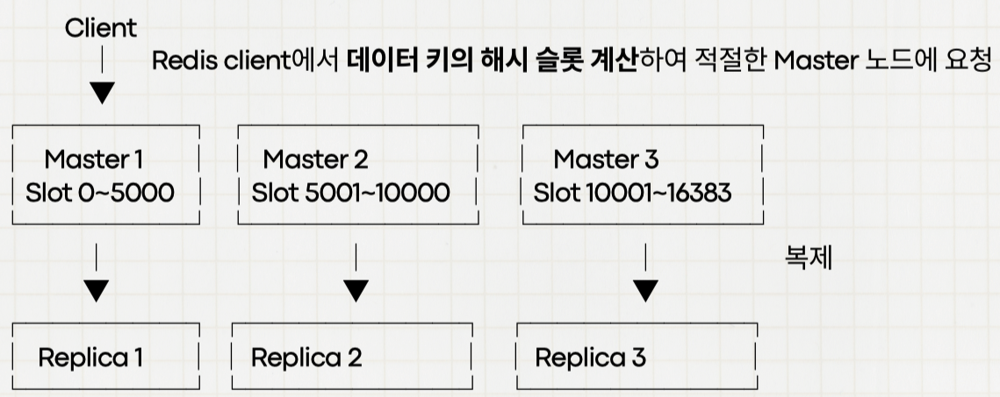

### Cluster 구조와 구성 요소

데이터를 여러 노드에 분산 저장, 각 노드마다 자체적으로 장애 대응이 가능한 구조

    - **키 분산 단위:** 전체 키 공간(16384 slots)을 노드 단위로 분할
    - **Master 노드:** 각 slot 범위를 담당하며 읽기/쓰기를 처리
    - **Replica 노드:** 각 Master 복제본, 장애 시 자동 승격 가능
    - **노드 통신:** Redis Cluster 프로토콜 기반 ping/gossip 주기적 송수신
    - **구성 예시:** 최소 3 Master + 3 Replica = 6개 노드 이상 권장

### 키 분산 원리와 Hash Slot 구조

키 공간 전체를 16384개의 해시 슬롯(hash slots)으로 분할, 해시 슬롯을 Master 노드들에 균등 분배

    - 키 → CRC16 해시 → 0 ~ 16383 슬롯 번호 계산
    - 각 Master 노드는 슬롯 범위를 담당 (예: 05460, 546110922, …)
    - 클라이언트는 슬롯 번호 기반으로 요청 대상 노드 결정
    - **슬롯 이동 가능:** 운영 중에도 slot reassignment 가능 (resharding)

### 클러스터의 장애 처리와 자동 복구

각 Master 노드에 대한 Replica를 두고, 장애 발생 시 클러스터 내부에서 자동으로 복구 절차 수행

    - **Master 장애 감지:** 노드 간 ping/pong 실패, **타 노드의 판단 quorum**
    - **자동 승격:** 해당 Master의 Replica 중 우선순위가 높은 노드가 자동 승격
    - **클라이언트 리다이렉션:** 기존 연결 노드는 무응답, 재요청 시 -MOVED 반환
    - **상태 반영:** 다른 노드들이 새로운 Master 정보를 gossip을 통해 공유

```
# T0: 정상 상태
Master A (0-5460) + Replica A1
Master B (5461-10922) + Replica B1  
Master C (10923-16383) + Replica C1

# T1: Master B 장애
Master A ✓ + Replica A1
Master B ✗ + Replica B1
Master C ✓ + Replica C1

# T2: 장애 감지 (quorum)
A,C가 "B 죽었다" 합의

# T3: 자동 승격
Replica B1 → 새 Master B

# T4: Gossip 전파
모든 노드가 "B1이 새 Master" 정보 공유

# T5: 클라이언트 적응
기존 B로 가던 요청들이 자동으로 B1로 리다이렉션
```

# 캐싱 전략과 패턴

### Redis 캐싱 전략의 실전 중요성

Redis는 단순히 메모리 저장소가 아니라, 캐시 운영에 필요한 **일관성과 안정성**을 제공하는 핵심 요소

    - 캐시 데이터 **갱신/무효화/일관성** 전략이 실제 운영에 큰 영향
    - **Redis는** **TTL, eviction, persistence** **등 전략 구현 기능을 모두 제공**
    - 전략에 따라 캐시 데이터의 신뢰성, 복구 가능성, 응답 지연이 결정됨

### Cache-Aside(Lazy Loading)

**필요할 때만 DB에서 데이터를 불러와 캐시에 저장**하는 가장 일반적인 캐시 전략

    - **기본 흐름**
- 캐시 조회 
      - 없으면 DB 조회
      - 조회 결과를 캐시에 저장 후 반환
    - **장점:** 자주 접근하는 데이터만 캐시됨 → 메모리 효율 높음
    - **단점:** 첫 조회 시 느림, 데이터 변경 시 캐시 삭제 필요
    - **활용 예시:** 사용자 프로필, 게시글, 상세 정보 캐시 등

### Write-Through

**쓰기 요청이 들어올 때 캐시와 DB를 동시에 업데이트**하는 전략

    - **흐름:** 클라이언트 → 캐시와 DB 동시에 쓰기
    - **장점:** 항상 최신 데이터 유지됨 → 캐시 일관성 보장
    - **단점:** 쓰기 지연 발생, 장애 시 롤백/재시도 로직 필요
    - **활용 예시:** 환경 설정, 계정 설정, 상태값 등

### Write-Behind(Write-Back)

**캐시에 먼저 쓰고, 나중에 비동기로 DB에 반영**하는 전략

    - **흐름:** 클라이언트는 Redis에만 쓰고 → Redis가 비동기로 DB 갱신
    - **장점:** 응답 속도 빠름, 대량 쓰기 처리에 유리
    - **단점:** Redis 장애 시 DB 누락 발생 가능
    - **활용 예시:** 로그 수집, 임시 통계, 비동기 큐

### 대표 캐싱 전략 비교 요약

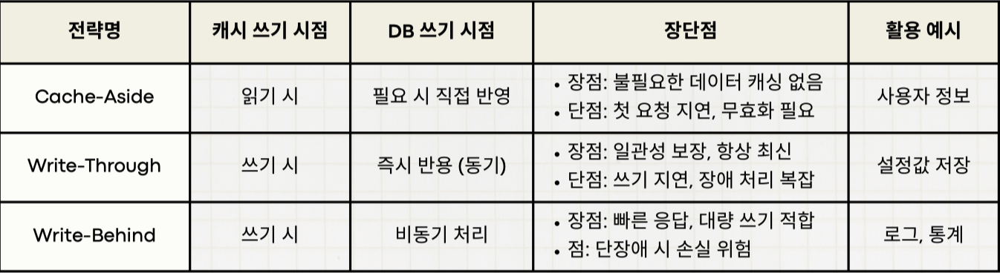

# 파이프 라이닝 성능 최적화 기법 

### 파이프라이닝: 개념과 효과

**여러 Redis 명령을 한 번에 서버로 전송해** **RTT(Round Trip Time)를 줄이고 처리량을 높이는** 네트워크 최적화 기법

    - **동작 방식:** 여러 명령을 요청 큐에 쌓아 한 번에 Redis 서버로 전송
    - **기대 효과:**
- RTT 횟수 감소 → 네트워크 지연 감소화
      - 대량 연산 시 throughtput 개선
    - **유의 사항:**
- 실행은 순차 처리 → 명령 간 종속성 주의
      - 응답 순서는 클라이언트가 직접 관리

### 파이프라이닝: 실전 예시와 적용 시점

    - **적용 적합 상황**
- 대량 SET/INCR/DEL
      - 통계 적재, 마이그레이션, 이벤트 처리 등
    - **비적합 상황**
- 명령 결과를 즉시 필요로 하는 경우
      - 트랜잭션 보장이 필요한 경우

---

# Redis 서버 설정을 통한 연결 제어

### Redis 서버 설정을 통한 연결 제어

Redis는 가벼운 연결 모델을 기반으로 하며, 설정을 통해 **불필요한 연결을 제어** 가능

    - **주요 설정 옵션**
- **timeout 300:** 비활성 연결 유지 시간(초)
      - **maxclients 10000:** 최대 허용 클라이언트 수
      - **tcp-keepalive 60:** TCP 수준 연결 유지 주기
    - **모니터링 명령어**
- **INFO client:** 연결 수, rejected 연결 수 등 확인
      - **CLIENT LIST:** 각 연결 상세 정보 조회

---

# 클라이언트 연결 풀 구성과 운영 전략

### 클라이언트 연결 풀 구성과 운영 전략

Redis **클라이언트에서도 연결을 풀(pool)로 관리하면 성능과 자원 효율성 향상**

```java
GenericObjectPoolConfig config = new GenericObjectPoolConfig();
config.setMaxTotal(100);
config.setMinIdle(10);
config.setMaxIdle(50);
```

**클라이언트 풀 도입 효과**

    - 재사용 가능한 연결로 응답 속도 향상
    - 빈번한 연결/해제 비용 제거
    - 서버의 maxclients 소모 감소

---

# Redis 트랜잭션 

### Redis 트랜잭션: 기본 구조와 동작 원리

Redis 트랜잭션은 여러 명령을 하나의 묶음으로 큐잉하고, 원자적으로 실행하는 방식

    - **기본 흐름**

```bash
MULTI
SET KEY1 VALUE1
INCR counter
EXEC
```

    - 명령은 MULTI 이후 큐에 저장되고, EXEC으로 일괄 실행됨
    - 명령 간 실패가 발생해도, 중단 없이 전체 실행
    - 명령 순서와 수에 따라 실행 속도, 부하 달라짐

### WATCH: 조건 기반 낙관적 락

**트랜잭션 전 특정 키의 변화를 감시하여,** **동시성 충돌 시 트랜잭션 실행을 차단****하는 방법**

    - 사용 흐름
```bash
WATCH balance
MULTI
DECR balance
EXEC
```
    - WATCH로 등록한 키가 EXEC 전 변경되면 → **EXEC는 실패**하고 null 반환
    - 실정 활용 예
- 선착순 처리, 이체 트랜잭션
      - 잔고 부족 시 중복 감소 방지

### 트랜잭션 실패 처리와 실전 적용 주의점

Reids 트랜잭션은 RDBMS 수준의 일관성을 보장하지 않으므로, 설계 상 제약과 우회 전략이 필요

    - **실패 처리 특성**
- EXEC 실패: 전혀 실행되지 않음
      - EXEC 성공 후 일부 명령 실패: 나머지는 그대로 실행
      - DISCARD: 전혀 실행되지 않음(큐에 명령어 다 버림)
    - **주의 사항**
- 롤백 없음: 명령 하나가 실패해도 취소 불가
      - 상태 불일치 가능성 → 로직 상 복구 전략 필요
    - **적용 패턴**
- WATCH + 재시도 로직 → 분산 환경 동시성 문제 보안
      - Lua로 통합 → 원자성 + 조건 분기 동시 처리
    - **실패 케이스**
```bash
MULTI
DECR balance   // 실패
LPUSH history  // 성공
EXEC
```

---

# Lua 스크립트 

### Lua 스크립트: Redis에서의 역할과 장점

**Lua**는 Redis 서버 내에서 **실행 가능한 스크립트 언어,** **복잡한 로직을 단일 명령처럼 처리** 가능

    - **사용 명령:** EVAL, EVALSHA, SCRIPT LOAD, SCRIPT EXISTS
    - **주요 특성**
- **원자성 보장:** 스크립트 전체가 하나의 명령처럼 실행됨
      - **조건 분기, 루프 가능:** 일반 Redis 명령으로 불가능한 로직 처리
      - **네트워크 지연 없음:** 서버 내부에서 직접 연산 처리

### Lua 스크립트: 구문 구조와 핵심 개념

스크립트는 Redis 명령을 Lua 문법 안에 포함해 호출하는 방식으로 작성

    - **주요 개념**
- **redis.call():** Redis 명령 실행 (오류 시 중단)
      - **redis.pcall():** 오류 발생해도 nil 반환 (예외 방지)
      - **KEYS, ARGV:** 외부에서 넘긴 인자
    - **기본 구조**
- EVAL “return redis.call(’GET’, KEYS[1])” 1 mykey
      - EVAL “return redis.call(’SET, KEYS[1], ARGV[1])” 1 mykey myval
    - **예시 설명**
- “1”은 KEYS 배열의 길이
      - “mykey”는 KEYS[1]에 바인딩

### Lua 스크립트: 실전 예제와 구문 해석

“키의 값이 특정 값일 때만 삭제”하는 조건 삭제 예시

**예제 스크립트**

```lua
EVAL "
   if redis.call('GET', KEYS[1]) == ARGV[1] then
      return redis.call('DEL', KEYS[1])
   else 
      return 0
   end
   "1 lock_key expected_value       
```

    - GET으로 현재 값 조회
    - 기대값과 일치하면 DEL, 아니면 아무 일도 하지 않음
    - 반환값: 삭제 성공 → 1, 삭제 안됨 → 0

### Lua 스크립트: 운영 상 주의사항과 한계

스크립트는 강력하지만, **리소스 소비와 유지보수 측면에서 고려**할 점이 많다.

    - **성능 한계**
- 긴 실행 시간 → Redis 전체 블로킹(단일 스레드)
      - 기본 제한: lua-time-limit (기본 5초)
    - **디버깅 어려움**
- 에러 메시지 단순, 로그 출력 불가
      - 멀티라인 스크립트는 외부 파일 분리 권장
    - **보안 및 버전 이슈**
- **외부 코드 injection 주의**
      - 일부 명령은 Lua 내부에서 지원 안 함 (예: MONITOR)

---

### Redis 클러스터 구조 개요

Redis 클러스터: 데이터를 **키 해시 기반으로 자동 분산 저장, 고가용성과 수평 확장을 동시에 달성**

    - **슬롯 기반 분산:** 전체 16384개의 해시 슬롯 사용
    - 각 키 → CRC16(key) % 16384 → 슬롯 결정
- **CRC16:** 빠르고 예측 가능한 해시 알고리즘
    - 슬롯 → 특정 마스터 노드에 매핑됨
    - **노드 구성:** 마스터에 여러 개 + 각 마스터당 0개 이상의 복제본(Slave)
    - Redis 클러스터는 여러 노드에 데이터 분산 저장을 해야하기 때문에, **해시 슬롯을 기반으로 키의 위치(노드)를 결정**

### 클러스터 샤딩 전략

데이터는 키의 해시값을 기반으로 자동 샤딩, 일부 **제어를 위해 해시 태그(hash tag) 활용**

    - 자동 샤딩 구조: CRC16(key) % 16384 → 슬롯 결정 (사용자 임의 지정 불가능)
    - **해시 태그 활용**
- 키 중 {…} 내부의 값만 해시 대상
      - user:{123}:profile → {123} 기준 해시
      - user:{123}:orders → {123} 기준 해시
    - **키 분산 주의**
- 동시 접근 키가 동일 슬롯으로 몰리면 **hotspot** 발생
      - 슬롯 분산 균형 유지가 중요
    - **다중 키 연산 강제적 제약사항**
- 모든 키가 동일한 해시 슬롯에 속해야만 다중 키 연산 가능
      - **키들이 서로 다른 슬롯에 있을 시에 오류 발생(CROSSSLOT Keys in request don't hash to the same slot)**
    - **다중 키 연산**
- MGET, MSET: 여러 키 동시 읽기 / 쓰기
      - SUNION, SINTER, SDIFF 등: Set 자료구조간 집합 연산
      - MULTI/EXEC: 트랜잭션 연산

### 읽기 부하 분산 전략

클러스터 내 복제본 노드를 활용해 읽기 요청을 분산할 수 있지만, 일관성과 지연 문제는 고려 필수

    - **마스터-레플리카 구조**
- 쓰기 → 마스터
      - 읽기 → 복제본(replica) 가능
    - **설정 방식**
- 클라이언트 설정에서 read from replica 옵션 설정
    - **고려 사항**
- 복제 지연 발생 가능 → eventually consistent
      - 실시간성이 중요한 데이터는 마스터에서 조회 권장

### 클러스터 장애 전환과 재구성

Redis 클러스터는 **노드 장애 시 자동 failover를 수행, slot 재배치 및 resharding** 기능도 제공

    - **장애 전환 구조**
- 마스터 노드 장애 발생
      - 슬레이브 중 하나가 승격 → 새 마스터
    - **재구성 도구**
- redis-cli —cluster reshard → slot 재배치
      - redis-cli —cluster failover → 수동 전환
    - **운영 시 고려 사항**
- slot 이동 시 서비스 중단 최소화 위해 단계적 처리
      - 클라이언트 MOVED 리다이렉션 자동 처리 필요

---

### Redis 진단 도구와 명령어

    - **INFO:** 서버 전반 상태 확인(섹션별로 구분 가능)
- INFO memory, INFO stats, INFO clients, INFO replication
    - **SLOWLOG:** 지정 시간(ms) 이상 소요된 명령 기록
    - **MONITOR:** Redis에 들어오는 명령을 실시간으로 출력 (주의: 운영환경 X)
    - **redis-cli —latency:** ping latency 측정용
    - **redis-benchmark:** TPS, 응답 시간 측정용 부하 테스트 도구
    - **외부 도구 연동**
- Prometheus Redis Exporter → Grafana 시각화
      - RedisInsight, Datadog, CloudWatch 등

### Redis 주요 지표 확인 방법 및 의미 정리

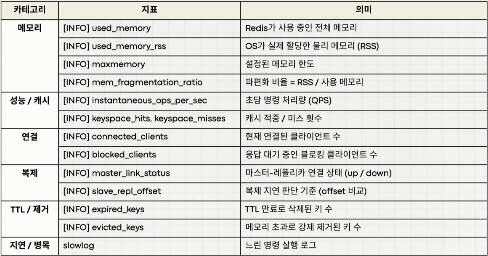

### 대표 문제 유형과 실전 대응 전략 

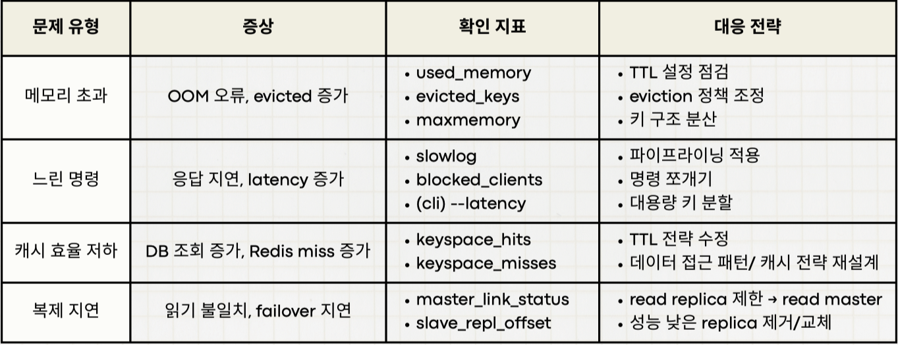

### 지표 해석 흐름과 장애 판단 사례

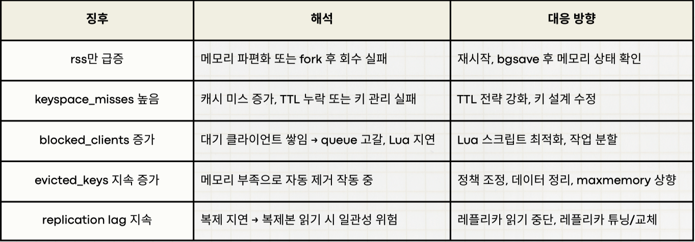

### 초고속 캐시: DB 응답 속도와 부하 문제를 해결할 때

읽기 지연 최소화와 요청 트래픽 완화를 위해 Redis를 캐시 계층으로 활용

**활용 사례**

    - REST API 응답 캐싱
    - 복잡한 DB 쿼리 결과 저장
    - 자주 조회되는 인기 콘텐츠 데이터 저장

**특징** 

    - 평균 응답 속도 < 1ms (명령 처리 시간)
    - TTL 기반 자동 만료 관리
    - key-value 기반으로 간단하게 구성 가능

### 세션 및 상태 저장소: 빠르게 사라지는 사용자 데이터를 저장할 때

사용자 로그인 세션, 장바구니, 일시적 설정 값을 빠르게 저장하고 자동 만료 처리

**활용 사례**

    - 로그인 토큰 및 세션 정보 저장
    - 장바구니, 최근 본 상품 목록
    - 사용자 설정 캐시(언어, 테마 등)

**특징** 

    - TTL 기반 세션 만료 자동 처리
    - 해시(Hash) 구조로 속성 단위 저장
    - 많은 연결에도 빠른 응답 보장

### 실시간 순위/통계 집계: 빠르게 변화하는 데이터를 정렬/집계할 때

ZSet을 활용해 실시간 인기 랭킹, 조회수 순위, 카운터 등을 빠르게 처리

**활용 사례** 

    - 인기 게시물 / 상품 랭킹
    - 실시간 검색어 / 해시태그 집계
    - 사용자 활동 점수 관리

**특징** 

    - INCR, ZINCRBY, ZREVRANGE로 실시간 계산
    - 수십만 건 데이터도 < 10ms 처리
    - TTL로 주기적 재집계도 가능

### 작업 큐 및 메시지 전달: 비동기 처리나 이벤트 기반 구조가 필요할 때

Redis List, Stream, Pub/Sub을 활용해 실시간 비동기 처리 구성

**활용 사례**

    - 작업 큐(배치, 알림, 이메일)
    - 이벤트 브로커(로그 수집, 감시 알림)
    - 사용자 간 실시간 메시징

**특징** 

    - LPUSH + BRPOP으로 간단한 큐 구성
    - Pub/Sub은 구독자에게 즉시 메시지 전송
    - Stream은 메시지 저장 + 소비 이력 관리 가능

## 1. Redis의 두 가지 메모리 개념

### used_memory vs used_memory_rss

```bash
INFO memory 명령어 결과

used_memory:        500MB  # Redis가 관리하는 논리적 메모리
used_memory_rss:    750MB  # OS가 할당한 실제 물리 메모리
```

### 메모리 구조 분석

```
used_memory (500MB)
├── 실제 데이터: 450MB
└── Redis 내부 구조: 50MB

used_memory_rss (750MB)
├── used_memory: 500MB
├── 메모리 단편화: 150MB
└── OS 할당 오버헤드: 100MB
```

## 2. 메모리 단편화(Memory Fragmentation)

### 단편화 발생 과정

```
# 시나리오
1. SET user:1 "매우긴데이터..." (100KB 할당)
2. SET user:2 "짧은데이터" (1KB 할당)
3. DEL user:1 (100KB 해제)
4. SET user:3 "중간데이터" (50KB 필요)

# 결과
- 100KB 공간 있지만 50KB만 사용
- 나머지 50KB = 단편화로 인한 낭비
```

### mem_fragmentation_ratio 해석

```
mem_fragmentation_ratio = used_memory_rss / used_memory

1.0 = 이상적 (현실적으로 불가능)
1.2 = 정상 범위 (20% 오버헤드)
1.5 = 주의 필요 (50% 메모리 낭비)
2.0 = 위험 수준 (메모리 절반이 낭비)
0.9 = 스왑 발생 (매우 위험한 상태)
```

## 3. ElastiCache에서 RSS가 중요한 이유

### OOM(Out of Memory) 발생 조건

```
일반적인 착각
- used_memory: 900MB
- maxmemory: 1000MB
- "아직 100MB 여유가 있다"

실제 위험 상황
- used_memory_rss: 1200MB
- 인스턴스 메모리: 1370MB
- AWS가 메모리 부족으로 Redis 재시작
```

### 실제 메모리 사용량 확인

```
redis-cli INFO memory

# 주요 지표
used_memory: 1073741824        # 1GB (논리적 사용량)
used_memory_human: 1.00G
used_memory_rss: 1503238144    # 1.4GB (물리적 사용량)
used_memory_rss_human: 1.40G
mem_fragmentation_ratio: 1.40  # 40% 단편화
```

## 4. 모니터링 전략

### CloudWatch 알람 설정

```
DatabaseMemoryUsagePercentage:
  - 경고: 80% 이상
  - 위험: 90% 이상
  - 기준: RSS 메모리

MemFragmentationRatio:
  - 경고: 1.5 이상
  - 목표: 1.3 이하 유지

BytesUsedForCache:
  - used_memory 추적
  - 증가 추세 분석
```

### 메모리 계산 방법

```
인스턴스 선택 가이드:
1. 예상 데이터 크기: 500MB (used_memory)
2. 단편화 고려: 500MB × 1.3 = 650MB (RSS)
3. 안전 여유분 30%: 650MB × 1.3 = 845MB
4. 권장 인스턴스: cache.t3.small (1.37GB)

대응 시점:
- fragmentation_ratio > 1.5: 최적화 필요
- used_memory_rss > 80%: 스케일업 검토
- used_memory_rss > 90%: 즉시 대응
```

---

**Q: 레디스에서 별도의 잠금 메커니즘 없이 레이스 컨디션이 발생하지 않는 이유를 레디스 아키텍처로 설명해 주세요**

Redis = 싱글 스레드 / 이벤트 루프 아키텍처

싱글 스레드 실행: Redis는 모든 클라이언트 명령을 하나의 메인 스레드에서 순차적으로 처리 → **원자성 보장**

이벤트 루프 기반: epoll/kqueue 같은 I/O 멀티플렉싱을 사용해 여러 클라이언트 연결을 효율적으로 관리

Redis 6.0 이전 = 완전한 싱글 스레드

Redis 6.0 이휴 = I/O 스레드 도입 → 네트워크 I/O 만 멀티 스레드로 처리

**Q: 왜 KEYS 같은 작업이 오래 걸리는 커맨드를 사용하면 안되는지 레디스 아키텍처로 설명해 주세요**

Redis 싱글 스레드 특성상 블로킹 현상이 발생하기 때문

KEYS 같은 경우 모든 키를 순회하며, 이 동안 다른 모든 클라이언트 요청이 대기

```
시간 →
[KEYS *] ────────────────────> (3초 소요)
         ↑                    ↑
    다른 모든 요청들이 대기 상태
```

**Q: OS 파일 디스크립터가 레디스 클라이언트 개수와 무슨 관계가 있는지 설명해 주세요**

Redis는 각 클라이언트 연결마다 파일 디스크립터(FD)를 사용

TCP 소켓 = FD: 각 클라이언트 연결은 TCP 소켓으로 구현되며, 이는 OS 레벨에서 파일 디스크립터로 관리

1:1 매핑 = 클라이언트 1개 = FD 개 소비

시스템 제한: OS ulimit 설정이 동시 연결 가능한 클라이언트 수를 제한

**Q: DEL 커맨드 같은 경우 특정 키에 ITEM이 많으면 삭제 작업에 오래 걸려 아이템이 많은 키에는 사용을 지양해야 하는데 이를 대체할 명령어는 무엇인지 또 해당 명령어의 동작 방식을 설명해 주세요**

**큰 컬렉션 삭제 시 UNLINK 명령어를 사용해야 한다**

**DEL**: 동기 삭제, 즉시 메모리에서 모든 요소를 제거, O(N) 시간 복잡도로 블로킹 발생

**UNLINK:** 비동기 삭제, 키를 즉시 키스페이스에서 제거(O(1)), 실제 메모리 해제는 백그라운드 스레드에서 처리

**Q: KEYS VS SCAN 커맨드의 차이점을 설명해 주세요**

**KEYS**

```
- 한 번에 모든 키 검색
- O(N) 시간 복잡도
- 서버 블로킹 발생
- 패턴 매칭 지원 (예: KEYS user:*)
- 프로덕션 환경 사용 금지
```

**SCAN**

```
- 커서 기반 반복자 사용
- 한 번에 일부 키만 반환 (기본 10개)
- O(1) * 반복 횟수
- 블로킹 없음
- 패턴 매칭 지원 (MATCH 옵션)

내부적으로 해시 테이블을 순회
각 호출마다 작은 부분만 검사
중복 반환 가능 (rehashing 중)
누락 없음 보장 (시작 시점 기준)
```

**SCAN + MATCH**

```
**# 동작 방식**
1. COUNT 개수만큼 키를 순회 (검사)
2. 순회한 키들에 대해 MATCH 패턴 적용 (필터링)
3. 매칭된 키만 반환

# **example**
1단계: COUNT 5개 키 순회
   → [key1, key2, user:1, key3, user:2] 검사

2단계: MATCH user:* 패턴 필터링
   → key1 (X)
   → key2 (X)
   → user:1 (O) ✓
   → key3 (X)
   → user:2 (O) ✓

3단계: 결과 반환
   → 커서: 5
   → 키: [user:1, user:2]  # 2개만 반환!
   
   
**Redis 6.0 부터는 TYPE(타입)으로 필터링도 가능**   
```

# 스터디 일정

| **1주차** | **1장 마이크로서비스 아키텍처와 레디스, 3장 레디스 기본 개념** |
| --- | --- |
| **2주차** | **4장 레디스 자료 구조 활용 사례, 5장 레디스를 캐시로 사용하기** |
| **3주차** | **6장 레디스를 메시지 브로커로 사용하기, 7장 레디스 데이터 백업 방법** |
| **4주차** | **8장 복제, 9장 센티널** |
| **5주차** | **10장 클러스터, 11장 보안** |
| **6주차** | **12장 클라이언트 관리, 13장 레디스 운영하기** |

**1~3주차:** 기본적인 레디스 사용법 및 활용 방법

**4~6주차:** 레디스 HA 구성 및 운영 방법

---

# 스터디 벌금 제도

보증금 30000원(6주 * 5000원)

각 주차마다 참석 여부, 발표 준비 여부  체킹 → 보증금 - 5000원

---

# 출석 체크 

| 닉네임 | 출석  | 발표 자료 준비 | 날짜 |
| --- | --- | --- | --- |
| 너구리라면 | ✅ | ✅ | 9월 14일(1주차) |
| 널널 | ✅ | ✅ | 9월 14일(1주차) |
| 호박고구마 | ✅ | ✅ | 9월 14일(1주차) |
| 네오 | ✅ | ✅ | 9월 14일(1주차) |
| 너구리라면 | ✅ | ✅ | 9월 21일(2주차) |
| 널널 | ✅ | ✅ | 9월 21일(2주차) |
| 호박고구마 | ✅ | ✅ | 9월 21일(2주차) |
| 네오 | ✅ | ✅ | 9월 21일(2주차) |
| 너구리라면 | ✅ | ✅ | 9월 28일(3주차) |
| 널널 | ✅ | ✅ | 9월 28일(3주차) |
| 호박고구마 | ✅ | ✅ | 9월 28일(3주차) |
| 네오 | ✅ | ✅ | 9월 28일(3주차) |

---

# 발표

## 1주차

### **1장 마이크로서비스 아키텍처와 레디스**

**발표자: 호박고구마**

**발표자료:** [1장 마이크로서비스 아키텍처와 레디스](https://parallel-shrine-c64.notion.site/1-2667d6692ca880aeaba6c33145e97c59)

### 3장 레디스 기본 개념

**발표자: 너구리라면**

**발표자료:** [3장 레디스 기본 개념](https://kjsdevblog.netlify.app/%EC%B1%85-%EB%82%B4%EC%9A%A9-%EC%A0%95%EB%A6%AC/%EA%B0%9C%EB%B0%9C%EC%9E%90%EB%A5%BC-%EC%9C%84%ED%95%9C-%EB%A0%88%EB%94%94%EC%8A%A4/3-1-%EB%A0%88%EB%94%94%EC%8A%A4%EC%9D%98-%EC%9E%90%EB%A3%8C-%EA%B5%AC%EC%A1%B0.html)

---

## 2주차

### **4장 레디스 자료 구조 활용 사례**

**발표자: 너구리라면**

**발표자료:** [4장 레디스 자료 구조 활용 사례](https://kjsdevblog.netlify.app/%EC%B1%85-%EB%82%B4%EC%9A%A9-%EC%A0%95%EB%A6%AC/%EA%B0%9C%EB%B0%9C%EC%9E%90%EB%A5%BC-%EC%9C%84%ED%95%9C-%EB%A0%88%EB%94%94%EC%8A%A4/4%EC%9E%A5-%EB%A0%88%EB%94%94%EC%8A%A4-%EC%9E%90%EB%A3%8C-%EA%B5%AC%EC%A1%B0-%ED%99%9C%EC%9A%A9-%EC%82%AC%EB%A1%80.html)

### **5장 레디스를 캐시로 사용하기**

**발표자: 널널**

**발표자료:** [5장 레디스를 캐시로 사용하기](https://www.notion.so/27414dfe5d9a8081aac6f84218b1f3df)

---

## 3주차

### **6장 레디스를 메시지 브로커로 사용하기**

**발표자: 호박고구마**

**발표자료:** [6장 레디스를 메시지 브로커로 사용하기](https://parallel-shrine-c64.notion.site/6-26b7d6692ca88165a1dce97a64746f18)

### **7장 레디스 데이터 백업 방법**

**발표자: 네오**

**발표자료:** [7장 레디스 데이터 백업 방법](https://www.notion.so/7-27517aa57c0280b499a7deca8ae6c181)

---

### 학습 기록

# NoSQL 등장 배경

모놀리틱 서비스에서 애플리케이션 개발을 위해 가장 많이 사용된 데이터베이스는 Oracle, SQL Server, MySQL 등의 RDBMS이다.

관계형 데이터베이스는 고정된 스키마를 갖고 있다. 모든 데이터를 행과 열로 구성된 테이블에 저장하여 각 테이블 간의 관계를 정확하게 규정한다.

이러한 관계는 애플리케이션이 커질수록 매우 복잡해지며 복잡성으로 인해 쿼리의 성능 문제가 발생하며 성능 향상을 위해 쿼리, 인덱스, 테이블 구조를 자추 최적화해야 한다.

최근의 서비스에서는 **비정형 데이터가 증가하고 있다**.

이러한 비정형 데이터는 관계형 데이터베이스의 정형화된 테이블에서는 관리하기가 어렵다.

그래프, JSON 데이터의 복잡성, 실시간 로그 데이터 및 시계열 데이터는 실시간으로 데이터를 저장해야 하기 때문에 쓰기 성능 이슈가 발생할 수 있다.

---

# NoSQL이란?

NoSQL이란 용어는 No SQL또는 Not Only SQL을 의미한다.

NoSQL에서도 여러 타입이 존재하는데, 관계형 데이터베이스와는 다르게 **관계가 정의돼 있지 않은 데이터를 저장**한다는 공통적인 특징이 있다.

### NoSQL 특징

    1. 실시간 응답(매우 빠르게 응답)
    1. 확장성(트랜잭션 증가에 의해 유연하게 확장될 수 있다)
    1. 고가용성(장애 상황에서 신속하게 복구돼 항상 사용할 수 있는 상태를 유지)
    1. 클라우드 네이티브 DBaas(Elastic Cache, DynamoDB …)
    1. 단순성
    1. 유연성(다양한 방식으로 비정형 데이터를 저장할 수 있다)

---

# NoSQL 데이터 저장소 유형

NoSQL 저장소별로 다양한 방식으로 데이터를 저장하며, 대표적인 방식으로 **그래프, 칼럼, 문서, 키-값** 유형이 있다.

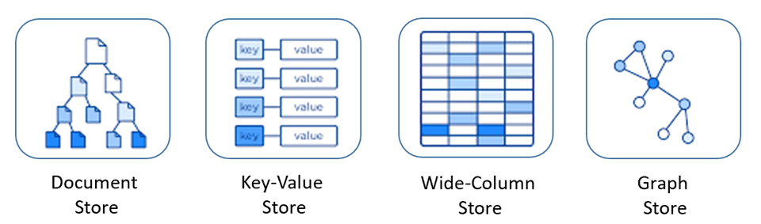

### 그래프 유형

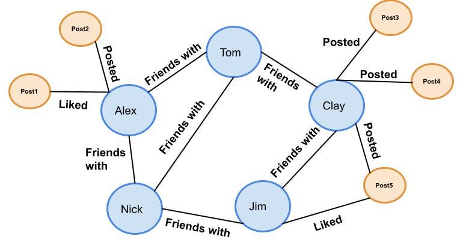

그래프 유형의 데이터베이스는 엔티티 간의 관계를 효율적으로 저장하도록 설계됐다.

다양한 데이터 간의 관계를 그래프로 나타낸다.

그래프 유형의 데이터베이스는 관계를 저장하고 표현할 때 유용하지만 저장되는 속성의 크기가 크거나 혹은 너무 많으면 적합하지 않은 경우가 많다.

**그래프 유형 데이터베이스는 추천 서비스에서 유용하게 사용**될 수 있다. 예를들어 유저간 친구 관계를 이용해 새로운 친구를 추천해주는 서비스를 구현할 수 있다.

### 칼럼 유형

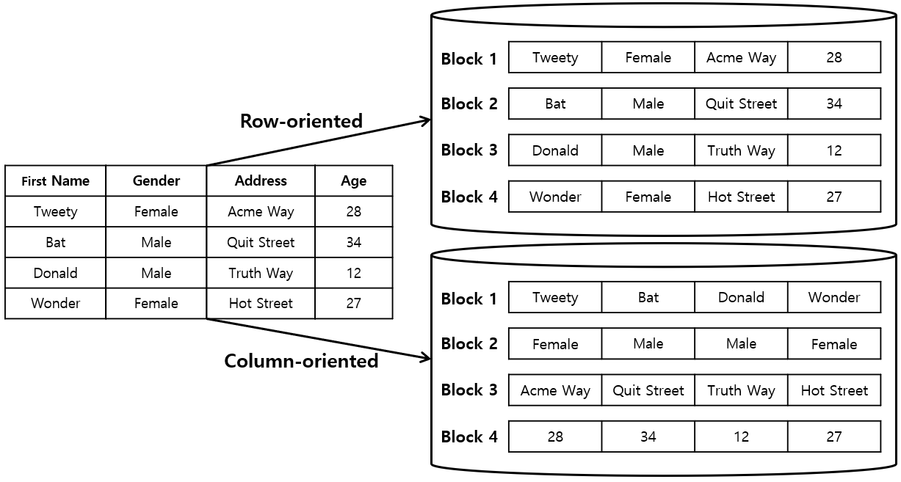

**칼럼 유형의 NoSQL은 테이블을 행이 아닌 열을 기준으로 저장한다는 철학으로 설계**됐다.

데이터는 하나의 열에 중첩된 형태로 저장될 수 있기 때문에 관계형 데이터베이스보다 유연한 스키마를 저장할 수 있다.

### 문서 유형

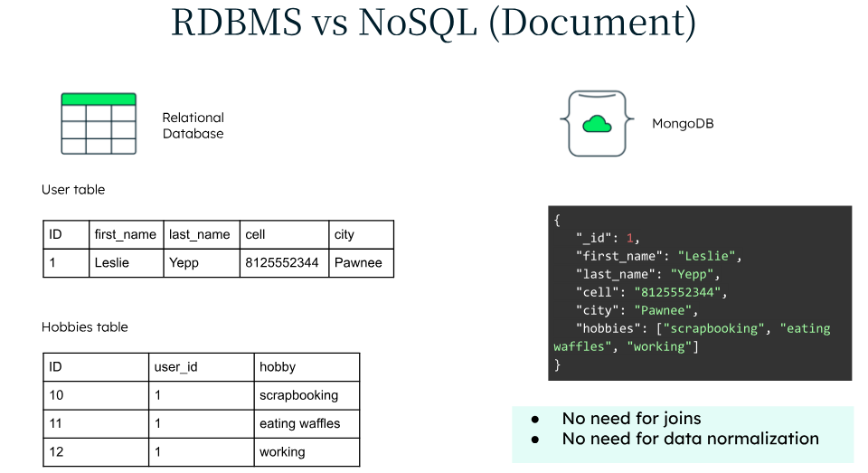

**문서 유형의 경우 JSON 형태로 데이터가 저장**돼, 개발자들이 편하게 사용할 수 있는 구조다.

스키마가 따로 정해져 있지 않기 때문에 애플리케이션에 맞게 데이터를 그대로 저장할 수 있어 유연성이 크다.

모든 값은 항상 키와 연결되는 계층적 트리와 가은 구조를 갖는다.

**ex: MongoDB, CouchDB, AWS DocumentDB, Elastic Search**

### 키-값 유형

키-값 유형은 가장 단순하고 빠르다. 키는 관계형 데이터베이스의 PK라고도 생각할 수 있다.

**모든 값은 키에 연결돼 있으며, 키 자체도 유의미한 데이터**다.

키를 사용해 값을 검색할 수 있으며, 키를 삭제하면 값도 삭제된다.

키-값 유형의 데이터베이스는 데이터의 저장이 간단하기 때문에 다른 유형보다 구평적 확장이 쉽다.

**ex: Redis, AWS ElasticCache, AWS DynamoDB, Oracle NoSQL Database, Memcached**

---

# 레디스란?

**레디스(Redis, Remote dictionary server)는 고성능 키-값 유형의 인메모리 NoSQL 데이터베이스**로, 오픈 소스 기반의 데이터 저장소다. 

## 레디스의 특징

### 실시간 응답(빠른 성능)

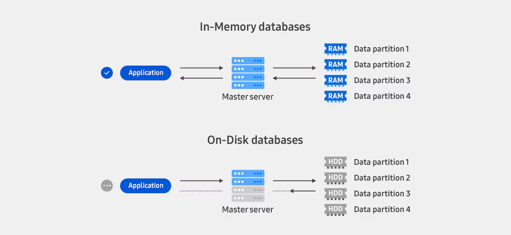

인메모리 데이터베이스와 온디스크 데이터베이스의 가장 큰 차이점은 데이터의 위치이다.

온디스크 형태의 데이터베이스에서 데이터는 영구적으로 디스크에 저장된다. 자중 사용되는 데이터는 캐싱(MySQL InnoDB 버퍼 풀)돼 메모리에 올라와 있는 경우도 있지만 그렇지 않은 데이터를 찾고 할 때에는 직접 디스크에 가서 데이터를 검색하는 과정을 거쳐야 한다.

이때 디스크에 저장된 데이터는 바로 찾을 수 없으며, 디스크의 데이터를 페이지 단위로 메모리에 올린뒤 메모리에서 데이터를 찾고, 없는 경우 다른 페이지를 디스크에서 가져와 메모리에 올린 뒤 찾는 과정을 반복한다.

메모리와 저장장치(SSD, HDD)의 속도차이는 매우 크다. 즉, 디스크에 접근하는 빈도가 증가할수록 시스템의 성능은 저하된다.

**인메모리 형태의 데이터베이스는 모든 데이터가 메모리에서 관리된다.**

디스크에 접근하는 과정이 없기 때문에 처리 성능이 매우 빠르다.

### 단순성

레디스는 키-값 형태로 데이터를 관리할 수 있는 저장소이다. 키에 매핑되는 값에는 **문자열뿐만 아니라 Hash, Set등 복잡하고 다양한 데이터 구조를 저장할 수 있도록 지원**한다.

이런 데이터 구조의 지원은 **임피던스 불일치 문제(관계형 데이터베이스와 프로그래밍 언어 간 데이터 구조, 기능 차이로 발생하는 충돌)**를 해소하고 개발을 편리하게 할 수 있도록 지원한다.

레디스는 싱글 스레드로 동작한다. 정확히는 **메인 스레드 1개와 싱글 스레드 3개, 총 4개의 스레드로 동작**한다.

하나의 스레드가 여러 클라이언트의 커맨드를 이벤트 루프 기반으로 처리하며, 하나의 코어만 있어도 레디스를 사용할 수 있어 배포가 간편하다. 또한 싱글 스레드로 커맨드를 처리하기 때문에 동기화나 잠금 메커니즘 없이 안정적이게 요청을 처리할 수 있다.

만약 한 사용자가 오래 걸리는 커맨드(KEYS, FLUSALL)를 수행한다면 다른 사용자는 완료될 때까지 대기할 수밖에 없다.

### 고가용성

레디스는 **자체적으로 HA(High Availability)기능을 제공**한다. 

**복제를 통해 데이터를 여러 서버에 분산**시킬 수 있으며, **센티널(Sentinel)은 장애 상황을 탐지해 자동으로 Failover** 시켜준다.

애플리케이션이 센티널을 이용해 레디스에 연결하는 구조에서는 마스터에 장애가 발생하더라도 레디스로의 엔드포인트를 변경할 필요 없이 페일오버가 완료돼 정상화된 마스터 노드를 사용할 수 있다.

### 확장성

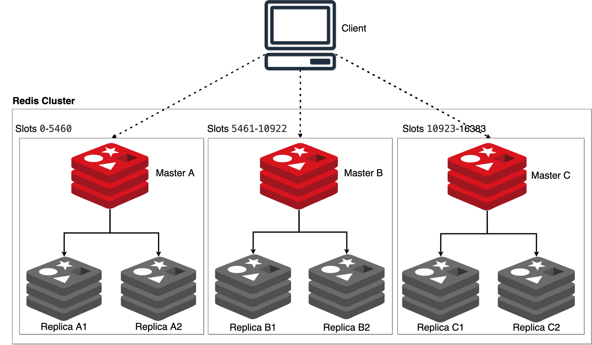

레디스에서 클러스터 모드를 사용하면 손쉬운 수평적 확장이 가능하다.

데이터는 레디스 클러스터 내에서 자동으로 샤딩된 후 저장되며, 여러 개의 복제본이 생성될 수 있다.

**애플리케이션에서는 대상 데이터가 어떤 샤드에 있는지 신경 쓰지 않아도 된다.**

**싱글 레디스를 사용할 때와 동일하게 데이터를 가져오고 저장할 수 있다.**

**클러스터 구조에서는 모든 레디스 인스턴스는 클러스트 버스라는 프로토콜을 이용해 서로 감시하며, 마스터 노드에 문제가 발생하면 자동으로 페일오버를 시켜 고가용성을 유지할 수 있다.**

### 클라우드 네이티브 - 멀티 클라우드

**클라우드 네이티브는 클라우드 환경에 특화된 애플리케이션의 개발 및 운영 방식을 의미**한다.

**멀티 클라우드는 여러 클라우드 제공업체의 서비스를 동시에 혹은 혼합해서 활용하는 전략**을 의미한다.

이 전략은 다일 클라우드 환경의 장애나 제한된 자원에 대한 의존성을 줄이며, 각 클라우드 서비스의 강점을 활용할 수 있게 해준다.

국내외 주요 클라우드 벤더들은 레디스를 상품화해 다양한 서비스를 제공하고 있다.

**AWS: Amazone ElastiCache for Redis**

**Google Cloud: Cloud Memory store for Redis**

**NHN CLOUD: EasyCache**

**Naver CLOUD: Cloud DB for Redis**

---

# 마이크로서비스 아키텍처와 레디스

### 데이터 저장소로서의 레디스

레디스는 설치가 간편하고 사용이 간단하기 때문에 마이크로서비스의 요구 사황에 맞는 데이터를 저장하기에 간편하다. 또한 **고가용성을 위해 별도의 로드밸런서나 프록시 등 추가적인 서비스를 설치할 필요가 없어** 하나의 튼튼한 저장소로서의 역할을 수행하기에 충분하다.

또한 **AOF(Append Only File), RDB(Redis DataBase)형식으로 영속화를 지원**한다.

레디스에 장애가 발생해 데이터가 유실되더라도 백업 파일을 이용하면 다시 복구할 수 있다.

### 메시지 브로커로서의 레디스

마이크로서비스 아키텍처에서 각 서비스는 지속적인 통신이 필요하다.

메시징 큐 혹은 stream 같은 메시지 브로커를 이용해 서비스들 간에 비동기적으로 데이터를 전달할 수 있는 통신 채널을 구현하는 것이 좋다.

레디스는 서비스 간 메시지를 전달할 때 유용하게 사용할 수 있다.

레디스의 **pub/sub 기능은 가장 간단한 메시징 기능**으로, 굉장히 빠르게 동작하며 간단하게 사용할 수 있다.

1개의 채널에 데이터를 던지면 이 채널을 듣고 있는 모든 소비자는 데이터를 빠르게 가져갈 수 있다.

pub/sub에서 모든 데이터는 전달된 뒤 삭제되는 일회성으로, 모든 메시징 상황에 적합하진 않지만 간단한 알림 서비스에서는 유용하게 사용할 수 있다.

레디스의 **list 자료 구조는 메시징 큐로 사용하기 알맞다**. list에서 데이터를 빠르게 push/pop을 할 수 있으며, 애플리케이션에서는 매번 확인할 필요 없이 대기하다가 list에 새로운 데이터가 들어오면 읽어 갈 수 있는 블로킹 기능을 사용할 수도 있다.

**레디스 stream 자료 구조는 아파치 카프카 시스템에서 영감을 받았으며, 데이터는 계속해서 추가되는 방식으로 저장된다(append-only).**

카프카처럼 저정되는 데이터를 읽을 수 있는 소비자와 소비자 그룹이 존재해 데이터의 분산 처리도 가능하며, 저장된 데이터를 시간대별로 검색하는 것도 가능하다.

---

# MacOS 레디스 설치하기

**HomeBrew를 사용해 레디스 설치**

```bash
brew install redis
```

**레디스 설치 확인 및 버전 확인 방법**

```bash
# 설치 확인
brew list redis

# 버전 확인 
redis-server --version
redis-cli --version
```

**레디스 서버 시작 및 종료**

```bash
# 서버 포그라운드 시작
redis-server

# 서버 백그라운드 시작
brew services start redis

# 서버 종료
brew services stop redis

# 서버 실행 상태 확인
brew services info redis
```

---

# 레디스 환경 구성

레디스 프로세스를 중단시킨 뒤 실행

## 서버 환경 설정 변경

**Open files 확인 → THP 비활성화 → vm.overcommit_memory=1 → somaxconn, syn_backlog** 

### Open files 확인

# 소켓과 파일 디스크립터 정리

## 1. 파일 디스크립터(File Descriptor)란?

**운영체제가 열린 파일이나 입출력 리소스를 식별하는 정수 값**

```
프로세스
├── fd 0: stdin  (표준 입력)
├── fd 1: stdout (표준 출력) 
├── fd 2: stderr (표준 에러)
├── fd 3: 파일/소켓
├── fd 4: 파일/소켓
└── ...
```

      - **Unix/Linux에서는 모든 것을 파일로 취급 → 네트워크 소켓도 파일 디스크립터로 관리**
      - 각 소켓 = 하나의 파일 디스크립터

## 2. 서버의 소켓 구조

### 각 서비스마다 독립적인 리스너 소켓

```
맥북 (물리적 서버)
├── MySQL 프로세스
│   ├── 리스너 소켓 1개 (포트 3306) → fd=10
│   ├── 클라이언트 연결 소켓 1 → fd=11  
│   └── 클라이언트 연결 소켓 2 → fd=12
├── Redis 프로세스
│   ├── 리스너 소켓 1개 (포트 6379) → fd=6
│   ├── 클라이언트 연결 소켓 1 → fd=7
│   └── 클라이언트 연결 소켓 2 → fd=8  
└── Spring 프로세스
    ├── 리스너 소켓 1개 (포트 8080) → fd=15
    └── 클라이언트 연결 소켓들...
```

## 3. Redis와 파일 디스크립터 관계

### 계산 공식

```
Redis가 사용하는 파일 디스크립터 =
├── 리스너 소켓: 1개
├── 클라이언트 연결: N개 (연결된 클라이언트 수)
├── 내부 파일: ~32개 (로그, RDB, AOF 등)
└── 기본: 3개 (stdin, stdout, stderr)
```

### Redis maxclients 설정

```
maxclients = 시스템 fd 제한 - 32
```

## 4. 소켓 식별 방법

**5-tuple로 각 소켓을 유니크하게 식별**

**<protocol, source IP, source Port, Destination IP, Destination Port>**

      - Protocol (TCP/UDP)
      - Source IP
      - Source Port
      - Destination IP
      - Destination Port

### 연결 예시

```
Spring → Redis 연결
127.0.0.1:랜덤포트 → 127.0.0.1:6379
```

## 5. 시스템 제한 관리

### 확인 명령어

```
# 파일 디스크립터 제한 확인
ulimit -n

# 전체 제한 확인  
ulimit -a

# 현재 사용량 확인
lsof -p $(pgrep redis-server) | wc -l
```

### 권장 설정

```
# Redis 운영 시 권장
ulimit -n 65536

# 계산: (예상 최대 클라이언트 × 1.2) + 100
```

## 6. 핵심 포인트

      - **1개 클라이언트 연결 = 1개 파일 디스크립터**
      - **각 서비스는 독립적인 리스너 소켓 보유**
      - **파일 디스크립터 제한을 높게 설정해도 실제 사용하지 않으면 리소스 소비 없음**
      - **시스템 제한 < Redis maxclients 설정 시 연결 거부 발생**

---

**레디스의 기본 maxclients 설정값: 10000**

→ 레디스 프로세스에서 받아들일 수 있는 최대 클라이언트의 개수를 의미

하지만 이 값은 레디스를 실행하는 서버의 파일 디스크립터 수에 영향을 받는다.

**레디스 프로세스 내부적으로 사용하기 위해 예약한 파일 디스크립터 수는 32개로, maxclients 값에 32를 더한 값보다 서버의 최대 파일디스크립터 수가 작으면 레디스는 실행될 때 자동으로 그 수에 맞게 조정**된다.

레디스의 최대 클라이언트 수를 기본값인 10000으로 지정하고 싶으면 서버의 파일 디스크립터 수를 최대 10032 이상으로 지정해야 한다.

**파일 디스크립터 확인 방법**

```shell
# 현재 제한 확인
ulimit -n
ulimit -a | grep descriptor

# 하드 제한 확인  
ulimit -Hn
```

**현재 세션 파일 디스크립터 변경 방법**

```bash
# 15000으로 설정
ulimit -n 15000

# 확인
ulimit -n
```

**영구적으로 파일 디스크립터 변경 방법**

```bash
echo "ulimit -n 15000" >> ~/.zshrc
source ~/.zshrc
```

---

### THP 비활성화

## THP란?

**Transparent Huge Pages는 리눅스 커널의 메모리 관리 기능**으로, 일반적인 4KB 페이지 대신 2MB 크기의 큰 페이지를 자동으로 사용하여 메모리 관리 효율성을 높이려는 기술

### 이론적 장점

      - TLB(Translation Lookaside Buffer) 미스 감소
      - 메모리 커버리지 향상(같은 TLB 엔트리 수로 512배 더 많은 메모리 커버)

## Redis에서 THP 비활성화 이유

### 1. 메모리 할당 지연(Memory Allocation Latency)

      - 큰 페이지 할당을 위한 메모리 조각 모음(defragmentation) 발생
      - 예측할 수 없는 지연시간으로 Redis 응답 시간 불안정

### 2. Copy-on-Write 문제

      - Redis RDB 스냅샷용 fork()시 문제 발생
      - 작은 데이터 변경에도 전체 2MB 페이지 복사 필요
      - 메모리 사용량 급증 및 성능 저하

### 3. 메모리 단편화

      - 내부 단편화 증가 (2MB 페이지를 다 사용하지 않는 경우)
      - 외부 단편화 재등장 (연속된 2MB 공간 확보 어려움)

### 4. 예측 불가능한 성능

      - THP 동적 할당/해제로 인한 성능 변동
      - 실시간성이 중요한 Redis에 치명적

## THP 비활성화 방법

```bash
# 즉시 비활성화
echo never > /sys/kernel/mm/transparent_hugepage/enabled

# 부팅 시 자동 비활성화 (GRUB 설정)
# /etc/default/grub 파일에 추가
GRUB_CMDLINE_LINUX_DEFAULT="transparent_hugepage=never"
```

## 페이지 시스템과 THP의 철학적 모순

### 페이지 시스템의 원래 목적

      - 고정 크기(4KB) 페이지로 메모리 균등 분할
      - 외부 단편화 완전 제거, 내부 단편화 최대한 제거
      - 예측 가능하고 효율적인 메모리 할당/해제

### THP의 모순점

      1. **외부 단편화 재등장**: 연속된 2MB 공간 확보의 어려움
      1. **철학적 모순**: "작고 균등하게" vs "크게 합치기"
      1. **복잡성 증가**: 4KB와 2MB 페이지 동시 관리 필요

## TLB 효율성 vs 메모리 관리 복잡성

### TLB 커버리지 비교

```
TLB 엔트리 64개 기준
- 4KB 페이지: 64 × 4KB = 256KB 메모리 커버
- 2MB 페이지: 64 × 2MB = 128MB 메모리 커버
→ 512배 차이
```

### 성능 트레이드오프

**장점**

      - TLB 효율성 대폭 향상
      - 메모리 집약적 애플리케이션에서 성능 개선

**단점:**

      - 메모리 단편화
      - 할당 지연
      - 예측 불가능한 성능
      - 내부 단편화

## 결론

THP는 "TLB 캐시 효율 vs 메모리 관리 복잡성"의 트레이드오프. 고성능 컴퓨팅에서는 효과적일 수 있지만, Redis처럼 **일관된 응답시간이 중요한 시스템**에서는 예측 불가능성이 더 큰 문제가 되어 비활성화가 권장된다.

---

**프로덕션 환경에서 비활성화**

---

### vm.overcommit_memory = 1로 변경

| 항목 | 0 (Heuristic) | 1 (Always) | 2 (Never) |
| --- | --- | --- | --- |
| **정책명** | **휴리스틱 오버커밋** | **항상 오버커밋 허용** | **엄격한 메모리 제한** |
| **기본값** | **default** | **수동 설정 필요** | **수동 설정 필요** |
| **할당 기준** | **커널이 "합리적" 판단** | **요청 시 무조건 허용** | **엄격 제한** |
| **메모리 제한** | **물리메모리 + 스왑(대략적)** | **제한 없음** | **물리메모리 × ratio + 스왑** |
| **Redis fork() 성공률** | **🟡 중간(메모리 상황에 따라)** | **🟢 높음(거의 항상 성공)** | **🔴 낮음(보수적 할당)** |
| **OOM 위험도** | **🟡 중간** | **🔴 높음** | **🟢 낮음** |
| **시스템 안정성** | **🟡 보통** | **🔴 위험할 수 있음** | **🟢 매우 안정** |
| **성능** | **🟡 보통** | **🟢 좋음** | **🟡 제한적** |

레디스는 **디스크에 파일을 저장할 때 fork()를 이용해 백그라운드 프로세스**를 만드는데, 이때 **COW(Copy On Write)라는 메커니즘이 동작**한다.

부모 프로세스와 자식 프로세스가 동일한 메모리 페이지를 공유하다가 **레디스의 데이터가 변경될 때마다 메모리 페이지를 복사하기 때문에 데이터 변경이 많이 발생하면 메모리 사용량이 빠르게 증가할 수 있다.**

따라서 레디스 프로세스가 실행되는 도중 메모리를 순간적으로 초과해 할당해야 하는 상황이 발생할 수 있다.

이때 vm.overcommit_memory=0이면 포크에 실패한다.

```bash
Redis 프로세스 (8GB 사용)
        ↓ fork()
부모 프로세스 (8GB) + 자식 프로세스 (8GB 예약)
        ↓ COW 동작
실제로는 변경된 페이지만 복사 (훨씬 적은 메모리 사용)
```

**Redis의 fork() + COW 패턴에서는 일시적으로 많은 메모리를 예약해야 하지만 실제로는 점진적으로 사용하기 때문에, vm.overcommit_memory=1 설정이 합리적인 선택이다.**

---

### somaxconn과 syn_backlog 설정 변경

### somaxconn

    - **역할**: **완료된 TCP 연결을 저장하는 큐 크기 제한**
    - **저장 대상**: 3-way handshake 완료 후 **accept()** 호출을 대기하는 **연결(connection)**
    - **위치**: **/proc/sys/net/core/somaxconn**
    - **기본값**: 128 또는 4096

### syn_backlog (tcp_max_syn_backlog)

    - **역할**: **TCP handshake 진행 중인 미완료 연결 저장 큐**
    - **저장 대상**: **SYN_RECEIVED 상태의 진행중인 연결(SYN → ACK + SYN 이후 클라이언트 응답 대기)**
    - **위치**: **/proc/sys/net/ipv4/tcp_max_syn_backlog**
    - **기본값**: 1024

## 연결 처리 흐름

```
클라이언트 연결 시도
    ↓
syn_backlog 큐 (handshake 진행) 
    ↓
somaxconn 큐 (연결 완료, accept() 대기)
    ↓
실제 데이터 통신 시작
```

## 설정 변경

### 임시 변경

```bash
echo 65535 > /proc/sys/net/core/somaxconn
echo 65535 > /proc/sys/net/ipv4/tcp_max_syn_backlog
```

### 영구 변경

**/etc/sysctl.conf**에 추가

```
net.core.somaxconn = 65535
net.ipv4.tcp_max_syn_backlog = 65535
```

---

## 레디스 설정 파일 변경

**설정파일: redis.conf**

```bash
open -a TextEdit /opt/homebrew/etc/redis.conf
```

### port

**default: 6379**

커넥션이 지정된 포트로 레디스 서버에 접속할 수 있도록 허용한다.

### bind

**default: 127.0.0.1 ::1**

레디스가 설치된 서버 외부에서 레디스 인스턴스로 바로 접근하는 것을 허용하기 위해서는 해당 설정값을 변경해야 한다.

```bash
bind 192.168.1.100 127.0.0.1
```

해당 설정값의 경우 192.168.1.100과 127.0.0.1 IP 주소로 들어오는 연결을 허용함을 의미한다.

### protected-mode

**default: yes**

패스워드를 설정해야만 레디스에 접근할 수 있으며, 패스워드가 설정돼 있지 않다면 서버는 오직 로컬에서 들어오는 연결만 수신할 수 있다.

### requirepass / masterauth

**default: 없음** 

**requirespass:** 서버에 접속하기 위한 패스워드 값을 의미한다.

**masterauth:** 복제 구조를 사용할 때 필요하다. 연결될 마스터의 패스워드 값을 의미한다. 만약 복제 연결을 사용할 예정이라면 이 두 값은 같은 값으로 설정하는 것이 좋다.

### **daemonize**

**default: no**

레디스 프로세스를 데몬으로 실행시키려면 yes로 변경해야 한다.

레디스를 데몬으로 실행하면 백그라운드에서 실행되고, pid 파일이 생성된다.

### dir

**default: ./**

레디스의 워킹 디렉터리를 의미한다. 로그 파일이나 백업 파일 등 인스턴스를 실행하면서 만들어지는 파일은

기본적으로 해당 파라미터에서 지정한 디렉터리에 저장되므로 특정 값을 지정해주는 것이 좋다.

---

## 레디스 접속하기

```bash
redis-cli -h <ip주소> -p<port> -a <패스워드>
```

    - **ip 주소 생략: 127.0.0.1**
    - **포트 생략: 6379**

---

# 레디스의 자료 구조

## String

**SET, GET, NX 옵션** 

```bash
127.0.0.1:6379> SET hello world
OK
127.0.0.1:6379> GET hello
"world"
127.0.0.1:6379> SETNX hello world2
(integer) 0
127.0.0.1:6379> GET hello
"world"
```

SET + NX: 지정한 키가 없을 때에만 새로운 키를 저장

**INCR, INCRBY** 

```bash
127.0.0.1:6379> SET counter 100
OK
127.0.0.1:6379> INCR counter
(integer) 101
127.0.0.1:6379> INCRBY counter 50
(integer) 151
127.0.0.1:6379> INCRBY counter -50
(integer) 101
```

    - **DECR, DECRBY:** 감소

**MSET, MGET**

```bash
127.0.0.1:6379> MSET a 10 b 20 c 30
OK
127.0.0.1:6379> MGET a b c
1) "10"
2) "20"
3) "30"
```

    - MSET, MGET 같은 커맨드를 적절하게 사용해 RTT 시간을 줄인다면 응답 속도를 향상시킬 수 있다.


---

## List

LPUSH, RPUSH, LRANGE

```bash
127.0.0.1:6379> LPUSH list E
(integer) 1
127.0.0.1:6379> RPUSH list B
(integer) 2
127.0.0.1:6379> LRANGE list 0 -1
1) "E"
2) "B"
127.0.0.1:6379> LPUSH list A B C D E
(integer) 7
127.0.0.1:6379> LRANGE list 0 -1
1) "E"
2) "D"
3) "C"
4) "B"
5) "A"
6) "E"
7) "B"
```

LPOP

```bash
127.0.0.1:6379> LRANGE list 0 -1
1) "E"
2) "D"
3) "C"
4) "B"
5) "A"
6) "E"
7) "B"

127.0.0.1:6379> LPOP list
"E"
127.0.0.1:6379> LPOP list 2
1) "D"
2) "C"
```

    - 저장된 아이템 반환과 동시에 삭제

LTRIM

```bash
127.0.0.1:6379> LRANGE list 0 -1
1) "B"
2) "A"
3) "E"
4) "B"
127.0.0.1:6379> LTRIM list 0 1
OK
127.0.0.1:6379> LRANGE list 0 -1
1) "B"
2) "A"
```

    - LPOP과 다르게 삭제된 아이템을 반환하지 않는다.
    - begin, end 인덱스 모두 포함
    - 고정된 길이의 큐를 유지하는 경우에 자주 사용


LINSERT(AFTER, BEFORE 옵션)

```bash
127.0.0.1:6379> LPUSH list A B C
(integer) 3
127.0.0.1:6379> LRANGE list 0 -1
1) "C"
2) "B"
3) "A"
127.0.0.1:6379> LINSERT list AFTER A Z
(integer) 4
127.0.0.1:6379> LRANGE list 0 -1
1) "C"
2) "B"
3) "A"
4) "Z"
127.0.0.1:6379> LINSERT list BEFORE C D
(integer) 5
127.0.0.1:6379> LRANGE list 0 -1
1) "D"
2) "C"
3) "B"
4) "A"
5) "Z"
```

    - 특정 아이템 앞이나 뒤에 아이템 추가

LINDEX

```bash
127.0.0.1:6379> LRANGE list 0 -1
1) "D"
2) "C"
3) "B"
4) "A"
5) "Z"
127.0.0.1:6379> LINDEX list 1
"C"
```

    - 인덱스에 해당하는 아이템 조회

LSET

```bash
127.0.0.1:6379> LRANGE list 0 -1
1) "D"
2) "C"
3) "B"
4) "A"
5) "Z"
127.0.0.1:6379> LSET list 2 W
OK
127.0.0.1:6379> LRANGE list 0 -1
1) "D"
2) "C"
3) "W"
4) "A"
5) "Z"
```

    - 지정한 인덱스에 신규 데이터를 입력
    - 만약 범위를 벗어난 인덱스를 입력하면 에러를 반환한다.

---

## Hash

필드-값 쌍을 가지는 아이템 집합

HSET, HGET, HGETALL

```bash
127.0.0.1:6379> HSET user name baejeu age 28 email baejeu@naver.com
(integer) 3
127.0.0.1:6379> HGET user name
"baejeu"
127.0.0.1:6379> HGETALL user
1) "name"
2) "baejeu"
3) "age"
4) "28"
5) "email"
6) "baejeu@naver.com"
```

---

## Set

SADD, SMEMBERS

```bash
127.0.0.1:6379> SADD set A
(integer) 1
127.0.0.1:6379> SADD set A A A B B B C C C
(integer) 2
127.0.0.1:6379> SMEMBERS set
1) "A"
2) "B"
3) "C"
```

SPOP, SREM

```bash
127.0.0.1:6379> SPOP set
"A"
127.0.0.1:6379> SREM set A
(integer) 0
127.0.0.1:6379> SREM set B
(integer) 1
```

    - SPOP: 랜덤으로 하나의 아이템 반환 및 삭제 

SUNION, SINTER, SDIFF

```bash
127.0.0.1:6379> SADD set1 A B C
(integer) 3
127.0.0.1:6379> SADD set2 B C D
(integer) 3

127.0.0.1:6379> SUNION set1 set2
1) "A"
2) "B"
3) "D"
4) "C"
127.0.0.1:6379> SINTER set1 set2
1) "B"
2) "C"
127.0.0.1:6379> SDIFF set1 set2
1) "A"
127.0.0.1:6379> SDIFF set2 set1
1) "D"
```

    - SUNION: 합집합
    - SINTER: 교집합
    - SDIFF: 차집합

---

## Sorted Set

스코어 값에 따라 정렬되는 고유한 문자열의 집합

같은 스코어를 가진 아이템은 데이터의 사전 순으로 정렬돼 저장된다.

ZADD

```bash
127.0.0.1:6379> ZADD rank 100 user:A
(integer) 1
127.0.0.1:6379> ZADD rank 200 user:B
(integer) 1
```

    - KEY, SCORE, VALUE 순서대로 입력
    - 만약 이미 sorted set에 있다면 스코어만 업데이트된다.

ZADD 옵션 

    - **XX:** 아이템이 이미 존재할 때에만 스코어를 업데이트한다.
    - **NX:** 아이템이 존재하지 않을 때에만 신규 삽입하며, 기존 아이템의 스코어를 업데이트하지 않는다.
    - **LT:** 업데이트하고자 하는 스코어가 기존 아이템의 스코어보다 작을 때에만 업데이트한다.
    - **GT:** 업데이트하고자 하는 스코어가 기존 아에팀의 스코어보다 클 때에만 업데이트한다.

ZRANGE, ZREVRANGE

```bash
127.0.0.1:6379> ZRANGE rank 0 -1
1) "user:A"
2) "user:B"

127.0.0.1:6379> ZRANGE rank 0 -1 WITHSCORES
1) "user:A"
2) "100"
3) "user:B"
4) "200"

127.0.0.1:6379> ZREVRANGE rank 0 -1 WITHSCORES
1) "user:B"
2) "200"
3) "user:A"
4) "100"
```

    - start, stop 범위로 조회
    - ZREVRANGE 또는 REV 옵션 추가 내림차순 조회

**스코어를 통한 조회**

```bash
127.0.0.1:6379> ZRANGE rank 0 -1 WITHSCORES
 1) "user:A"
 2) "100"
 3) "user:B"
 4) "200"
 5) "user:C"
 6) "300"
 7) "user:D"
 8) "400"
 9) "user:E"
10) "500"

# 100 ~ 250 사이 조회
127.0.0.1:6379> ZRANGE rank 100 250 BYSCORE WITHSCORES
1) "user:A"
2) "100"
3) "user:B"
4) "200"

# 100 초과 250 이하 조회
127.0.0.1:6379> ZRANGE rank (100 250 BYSCORE WITHSCORES
1) "user:B"
2) "200"

# 100 초과 200 미만 조회
127.0.0.1:6379> ZRANGE rank (100 (200 BYSCORE WITHSCORES
(empty array)

# 200 이상 조회
127.0.0.1:6379> ZRANGE rank 200 +inf  BYSCORE WITHSCORES
1) "user:B"
2) "200"
3) "user:C"
4) "300"
5) "user:D"
6) "400"
7) "user:E"
8) "500"

# 200 초과 조회
127.0.0.1:6379> ZRANGE rank (200 +inf BYSCORE WITHSCORES
1) "user:C"
2) "300"
3) "user:D"
4) "400"
5) "user:E"
6) "500"

# 200이하 100이상 역순 조회
127.0.0.1:6379> ZRANGE rank 200 100 BYSCORE WITHSCORES REV
1) "user:B"
2) "200"
3) "user:A"
4) "100"
```

    - **BYSCORE:** 스코어로 점수 조회
    - “(” 문자를 추가하면 해당 스코어를 포함하지 않는 값만 조회 가능
    - **BYSCORE 옵션을 사용하면 ZREVRANGE 커맨더는 사용 불가능하다. 단 REV 옵션은 가능하다.**
    - REV 옵션을 사용하면 인자는 최대, 최소 순서이다.

---

## 비트맵, Hyperloglog, Geospatial 

나중에 정리

---

## stream

stream은 **레디스를 메시지 브로커로서 사용**할 수 있게 하는 자료 구조다.

전체적인 구조는 카프카에서 영향을 받아 만들어졌으며, 카프카에서처럼 소비자 그룹 개념을 도입해 데이터를 분산 처리할 수 있는 시스템이다.

stream 자료 구조는 데이터를 계속해서 추가하는 방식(append-only)으로 저장하므로, 실시간 이벤트 혹은 로그성 데이터의 저장을 위해 사용할 수 있다.

자세한 내용은 7장에서 알아보자.

---

# 레디스에서 키를 관리하는 방법

## 키의 자동 생성과 삭제

키의 생성과 삭제는 세 가지 공통적인 규칙을 따른다.

    1. **키가 존재하지 않을 때 아이템을 넣으면 아이템을 삽입하기 전에 빈 자료 구조를 생성한다.**
```bash
127.0.0.1:6379> LPUSH list 1 2 3
(integer) 3
127.0.0.1:6379> TYPE list
list
# 이미 존재하는 key list -> string 성공
127.0.0.1:6379> SET list new
OK
127.0.0.1:6379> TYPE list
string
# 이미 존재하는 key string -> list 실패
127.0.0.1:6379> LPUSH list 1 2 3
(error) WRONGTYPE Operation against a key holding the wrong kind of value
```
    1. **모든 아이템을 삭제하면 키도 자동으로 삭제된다.(stream 제외)**
```bash
# 아이템 3개 추가
127.0.0.1:6379> LPUSH list 1 2 3
(integer) 3
# 리스트 존재 확인
127.0.0.1:6379> EXISTS list
(integer) 1
# 리스트에서 1개 제거
127.0.0.1:6379> LPOP list
"3"
# 리스트에서 2개 제거
127.0.0.1:6379> LPOP list 2
1) "2"
2) "1"
# 아이템이 없으면 키도 존재하지 않는다.
127.0.0.1:6379> EXISTS list
(integer) 0
```
    1. **키가 없는 상태에서 키 삭제, 아이템 삭제, 자료 구조 크기 조회 같은 읽기 전용 커맨드를 수행하면 에러를 반환하는 대신 키가 있으나 아이템이 없는 것처럼 동작한다.**
```bash
# 키 제거
127.0.0.1:6379> DEL list
(integer) 0
# 존재하지 않는 키 길이 확인 -> 에러 x
127.0.0.1:6379> LLEN list
(integer) 0
# 존재하지 않는 리스트 아이템 꺼내기 -> 에러 x
127.0.0.1:6379> LPOP list
(nil)
```

---

# 키와 관련된 커맨드

## 키의 조회

### EXISTS

```bash
127.0.0.1:6379> SET hello world
OK

# 존재하면 1
127.0.0.1:6379> EXISTS hello
(integer) 1

# 존재하지 않으면 0
127.0.0.1:6379> EXISTS hello2
(integer) 0
```

### KEYS 

```bash
KEYS pattern
```

    - KEYS 커맨드는 레디스에 저장된 모든 키를 조회하는 커맨드다.
    - 매칭되는 패턴에 해당하는 모든 키의 list를 반환한다.
    - 패턴은 **글롭 패턴(Glob pattern)스타일로 동작**한다.

# 글롭 패턴(Glob Pattern) 

글롭 패턴은 파일명이나 경로를 매칭하기 위한 와일드카드 패턴으로, 쉘, 검색, 파일 필터링 등에서 사용

## 기본 와일드카드

### `*` (애스터리스크)

**0개 이상의 모든 문자와 매칭**

```bash
*.txt          # 모든 .txt 파일
file*          # file로 시작하는 모든 파일
*config*       # config가 포함된 모든 파일
*              # 모든 파일
```

### `?` (물음표)

**정확히 1개의 문자와 매칭**

```bash
file?.txt      # file1.txt, fileA.txt, file_.txt
test??         # test01, testAB, testXY
?.log          # a.log, 1.log, _.log
```

### `[]` (대괄호)

**지정된 문자 중 1개와 매칭**

```bash
file[123].txt     # file1.txt, file2.txt, file3.txt
[abc]*            # a, b, c로 시작하는 파일
[a-z]*            # 소문자로 시작하는 파일
[A-Z]*            # 대문자로 시작하는 파일
[0-9]*            # 숫자로 시작하는 파일
[!0-9]*           # 숫자로 시작하지 않는 파일 (! = NOT)
[^abc]*           # a, b, c로 시작하지 않는 파일 (^ = NOT)

```

## 확장 글롭 패턴

### `*` (더블 애스터리스크)

**재귀적 디렉토리 매칭** (모든 하위 디렉토리 포함)

```bash
**/*.js           # 모든 하위 디렉토리의 .js 파일
src/**/*.css      # src 하위의 모든 .css 파일
**/test/*         # 모든 test 디렉토리 내의 파일
```

### `{}` (중괄호)

**여러 패턴 중 하나와 매칭** (OR 조건)

```bash
*.{js,ts}                    # .js 또는 .ts 파일
file.{txt,md,json}          # file.txt, file.md, file.json
{src,test}/**/*.js          # src 또는 test 디렉토리의 모든 .js 파일
```

---

KEYS 위험성

```
KEYS는 위험한 커맨드다.
레디스에 100만 개의 키가 저장돼 있다면 모든 키의 정보를 반환한다.
레디스는 싱글 스레드로 동작하기 때문에 실행 시간이 오래 걸리는 커맨드를 수행하는 동안 다른 클라이언트에서
들어오는 다른 모든 커맨드는 차단된다.

만약 모니터링 도구가 마스터 노드로 보낸 health check에 응답할 수 없어 의도하지 않은 페일오버가
발생할 수 있다.
```

### SCAN

```
SCAN cursor [MATCH pattern] [COUNT count] [TYPE type]
```

SCAN은 KEY를 대체해 키를 조회할 때 사용할 수 있는 커맨드다.

KEYS는 한 번에 모든 키를 반환하는 커맨드로, 잘못 사용하면 문제가 발생할 수 있지만, 

**SCAN 커맨드는 커서를 기반으로 특정 범위의 키만 조회할 수 있기 때문에 비교적 안전하게 사용할 수 있다.**

```bash
# 커서 0 사용
127.0.0.1:6379> SCAN 0
1) "17"
2) 1) "key:12"
   2) "key:8"
   3) "key:4"
   4) "key:14"
   5) "key:16"
   6) "key:17"
   7) "key:15"
   8) "key:10"
   9) "key:3"
  10) "key:7"
  11) "key:1"
  
# 커서 17 사용  
127.0.0.1:6379> SCAN 17
1) "0"
2) 1) "key:5"
   2) "key:18"
   3) "key:0"
   4) "key:2"
   5) "key:19"
   6) "key:13"
   7) "key:6"
   8) "key:9"
   9) "key:11"  
```

**첫 번째로 반환되는 값은 다음 SCAN 커맨드를 사용할 때 인수로 사용해야 하는 커서 위치**

**다음 커서 값이 0이면 더 이상 검색할 키 값이 없다는 것을 의미**한다.

클라이언트는 반환되는 첫 번째 인자가 0이 될 때까지 SCAN을 반복적으로 사용해 레디스의 모든 키를 확인할 수 있다.

**기본적으로 한 번에 반환되는 키의 개수는 10개 정도지만 COUNT 옵션을 사용하면 조정할 수 있다.**

하지만 **데이터는 정확하게 지정한 개수만큼 출력되지는 않는데**, 레디스가 메모리를 스캔하며 데이터가 저장된 형상에 따라 몇 개의 키를 더 읽는 것이 효율적이라고 판단되면 1~2개의 키를 더 읽은 뒤 함께 반환한다.

### MATCH , TYPE 옵션

현재 레디스에는 key:0 ~ key:200까지의 키가 저장돼 있고, “11”문자열이 포한된 키를 조회하고 싶다.

```bash
127.0.0.1:6379> KEYS *11*
 1) "key:117"
 2) "key:118"
 3) "key:113"
 4) "key:11"
 5) "key:111"
 6) "key:115"
 7) "key:114"
 8) "key:116"
 9) "key:112"
10) "key:119"
11) "key:110"
```

KEYS 커맨드로 키를 조회하면 다음과 같이 한 번에 원하는 키가 조회된다.

**SCAN + MATCH 옵션을 이용해 키 값을 조회할 때 한 번에 패턴에 매칭된 여러 개의 키 값이 반환되지 않는다.**

적은 수의 결과가 반환되거나 혹은 빈 값이 반환될 수 있다.

```bash
127.0.0.1:6379> SCAN 0 MATCH *11*
1) "208"
2) 1) "key:115"
127.0.0.1:6379> SCAN 208 MATCH *11*
1) "200"
2) (empty array)
127.0.0.1:6379> SCAN 200 MATCH *11*
1) "56"
2) 1) "key:110"
127.0.0.1:6379> SCAN 56 MATCH *11*
1) "228"
2) (empty array)
127.0.0.1:6379> SCAN 228 MATCH *11*
1) "76"
2) (empty array)
127.0.0.1:6379> SCAN 76 MATCH *11*
1) "226"
2) (empty array)
```

**SCAN 커맨드에서 MATCH 옵션을 사용할 때에는 우선 데이터를 필터링 없이 스캔한 다음 데이터를 반환하기 직전에 필터링하는 방식**으로 동작하기 때문이다.

**TYPE 옵션을 사용하면 지정한 타입의 키만 조회할 수 있는데 마찬가지로 반환하기 직전에 필터링**한다.

### SCAN과 비슷한 커맨드

SSCAN, HSCAN, ZSCAN

각각 set, hash, sorted set에서 아이템을 조회하기 위해 사용되는 SMEMBERS, HGETALL, ZRANGE WITHSCORE 를 대체해서 서버에 최대한 영향을 끼치지 않고 반복해서 호출할 수 있도록 사용할 수 있는 커맨드다.

### SORT

```bash
SORT key [BY pattern] [LIMIT offset count] [GET pattern ...[GET pattern]]
[ASC | DESC ] [ALPHA] [STORE destination]
```

list, set, sorted set에서만 사용할 수 있는 커맨드로, 키 내부의 아이템을 정렬해 반환

LIMIT 옵션을 사용하면 일부 데이터만 조회 가능

정렬 대상이 문자열인 경우 ALPHA 옵션을 사용하면 데이터를 사전 순으로 정렬해 조회

```bash
127.0.0.1:6379> LPUSH list a b c hello
(integer) 4

127.0.0.1:6379> SORT list
(error) ERR One or more scores can't be converted into double

127.0.0.1:6379> SORT list ALPHA
1) "a"
2) "b"
3) "c"
4) "hello"

127.0.0.1:6379> SORT list ALPHA DESC
1) "hello"
2) "c"
3) "b"
4) "a"
```

### RENAME / RENAMENX

```bash
RENAME key newkey
RENMAE key newkey
```

RENAME, RENAMENX: 모두 키의 이름을 변경하는 커맨드

**RENAMENX 커맨드는 오직 변경할 키가 존재하지 않을 때에만 동작**

RENAME

```bash
127.0.0.1:6379> SET a apple
OK
127.0.0.1:6379> SET b banana
OK
127.0.0.1:6379> RENAME a b
OK
127.0.0.1:6379> GET a
(nil)
127.0.0.1:6379> GET b
"apple"
```

RENAMENX

```bash
127.0.0.1:6379> SET a apple
OK
127.0.0.1:6379> SET b banana
OK
127.0.0.1:6379> RENAMENX a b
(integer) 0
127.0.0.1:6379> GET a
"apple"
127.0.0.1:6379> GET b
"banana"
```

### COPY

```bash
COPY source destination [DB destination-db] [REPLACE]
```

source에 지정된 키를 destination 키에 복사

destination에 지정한 키가 이미 있는 경우 에러를 반환하는데, REPLACE 옵션을 사용하면 발생하지 않는다.

```bash
127.0.0.1:6379> SET b banana
OK
127.0.0.1:6379> COPY b bb
(integer) 1
127.0.0.1:6379> GET bb
"banana"
127.0.0.1:6379> GET b
"banana"
```

### TYPE

```bash
TYPE key
```

지정한 키의 자료 구조 타입을 반환

```bash
127.0.0.1:6379> SET string value
OK
127.0.0.1:6379> TYPE string
string
127.0.0.1:6379> LPUSH queue 1 2 3
(integer) 3
127.0.0.1:6379> TYPE queue
list
127.0.0.1:6379> ZADD rank 10 user:A 20 user:B
(integer) 2
127.0.0.1:6379> TYPE rank
zset
```

### OBJECT

```bash
OBJECT <subcommand> [<arg> [value] [opt] ...]
```

키에 대한 상세 정보를 반환

subcommand 옵션으로는 ENCODING, IDLETIME 등이 있다.

내부적으로 어떻게 저장됐는지, 혹은 키가 호출되지 않은 시간이 얼마나 됐는지 확인이 가능

---

## 키의 삭제

### FLUSHALL

```bash
FLUSHALL [ASYNC | SYNC]
```

레디스에 저장된 모든 키를 삭제

기본적으로 SYNC한 방식으로 동작 → 커맨드가 실행되는 도중 다른 응답 처리 불가능

ASYNC 옵션을 사용하면 백그라운드로 실행되고, 커맨드가 수행됐을 때 존재했던 키만 삭제

**lazyfree-lazy-user-flush 옵션**이 yes인 경우 ASYNC 옵션 없이도 백그라운드로 키 삭제 작업이 동작

버전 7 기준으로 해당 옵션의 기본값: no

### DEL

```bash
DEL key [key, ...]
```

키와 키에 저장된 모든 아이템을 삭제하는 커맨드, 기본적으로 동기적 동작

### UNLINK

DEL와 비슷하게 키와 데이터를 삭제하는 커맨드

하지만 이 커맨드는 **백그라운드에서 다른 스레드에 의해 처리**되며, **우선 키와 연결된 데이터의 연결을 끊는다**.

set, sorted set 같이 하나의 키에 여러 개의 아이템이 저장된 자료 구조의 경우 1개의 키를 삭제하는 DEL 커맨드를 수행하는 것은 레디스 인스턴스에 영향을 끼칠 가능성이 존재한다.

**100만개의 아이템이 저장돼 있는 sorted set 키를 DEL 커맨드로 삭제하는 것은 마치 전체 키가 100만개 있는 레디스에서 동기적으로 FLUSHALL을 수행하는 것과 동일하다.**

따라서 키에 저장된 아이템이 많은 경우 DEL이 아니라 UNLINK를 사용해 데이터를 삭제하는 것이 좋다.

**lazyfree-lazy-user-del 옵션**이 yes일 경우 모든 DEL 커맨드는 UNLINK로 동작해 백그라운드로 키를 삭제

버전 7 기준으로 해당 옵션의 기본값: no

---

## 키의 만료 시간

### EXPIRE

```bash
EXPIRE key seconds [NX | XX | GT | LT]
```

키가 만료될 시간을 초 단위로 정의할 수 있으며, 아래와 같은 옵션을 함께 사용할 수 있다.

    - **NX:** 해당 키 만료 시간이 정의돼 있지 않을 경우에만 커맨드 수행
    - **XX:** 해당 키 만료 시간이 정의돼 있을 때에만 커맨드 수행
    - **GT:** 현재 키가 가지고 있는 만료 시간보다 새로 입력한 초가 더 클 때에만 수행
    - **LT:** 현재 키가 가지고 있는 만료 시간보다 새로 입력한 초가 더 작을 때에만 수행

### EXPIREAT

```bash
EXPIREAT key unix-time-seconds [NX | XX | GT | LT]
```

키가 특정 유닉스 타임스탬프에 만료될 수 있도록 키의 만료 시간을 직접 지정

옵션은 EXPIRE와 동일

### EXPIRETIME

```bash
EXPIRETIME key
```

키가 삭제되는 유닉스 타임스탬프를 초 단위로 반환

키가 존재하지만 만료 시간이 설정돼 있지 않은 경우에는 -1, 키가 없을 때에는 -2 반환

### TTL

```bash
TTL key
```

키가 몇 초 뒤에 만료되는지 반환

키가 존재하지만 만료 시간이 설정돼 있지 않은 경우에는 -1, 키가 없을 때에는 -2 반환

### ETC

PEXPIRE, PEXPIREAT, PEXPIRETIME, PTTL은 밀리초 단위로 계산된다는 점만 다르며 동일하게 동작

---

# Sorted set을 이용한 실시간 리더보드

### 일별 리더보드 도입

KEY: daily-score:<날짜> 

```bash
ZADD daily-score:250908 28 player:286 400 player:234 45 player:101 357 player:24 199 player:143
(integer) 5

ZREVRANGE daily-score:250908 0 -1 WITHSCORES
 1) "player:234"
 2) "400"
 3) "player:24"
 4) "357"
 5) "player:143"
 6) "199"
 7) "player:101"
 8) "45"
 9) "player:286"
10) "28"
```

오늘의 상위 스코어 세 명의 유저만 출력

```bash
ZREVRANGE daily-score:250908 0 2 WITHSCORES
1) "player:234"
2) "400"
3) "player:24"
4) "357"
5) "player:143"
6) "199"
```

### 데이터 업데이트

**ZADD 데이터 업데이트**

```bash
# 이미 존재하기 때문에 0 반환
ZADD daily-score:250908 200 player:286
(integer) 0

ZRANGE daily-score:250908 200 200 BYSCORE WITHSCORES
1) "player:286"
2) "200"
```

**ZINCRBY 이용해서 스코어 증감**

```bash
# ZINCRBY 통한 스코어 감소
ZINCRBY daily-score:250908 -150 player:286
"50"

ZRANGE daily-score:250908 50 50 BYSCORE WITHSCORES
1) "player:286"
2) "50"
```

관계형 데이터베이스만 이용해 실시간 차트 서비스를 구현하는 것은 까다로운 작업

모든 유저의 변경 데이터는 실시간으로 업데이트, 점수별로 데이터를 정렬해서 가져오는 작업 자체가 데이터베이스에 부하

### 랭킹 합산 

주간 리더보드는 매주 월요일마다 초기화된다고 가정 25년 09월 10일은 수요일, 따라서 이날의 주간 리더보드를 확인하면 8일, 9일, 10일까지의 스코어를 모두 합산한 값일 것이다.

관계형 데이터베이스에서 이런 주간 누적 랭킹을 구하려면 하나의 테이블에서 일자에 해당하는 데이터를 모두 가져온 뒤 GROUP BY를 통해서 선수별로 합치고, 이를 다시 소팅(using filesort)하는 작업이 필요하다. 

**레디스에서는 ZUNIONSTORE 커맨드를 사용해 간단하게 구현**

**ZUNIONSTORE?**

```bash
ZUNIONSTORE <생성할 키 이름> <합산할 키 개수> <합산할 키 ... >
```

지정한 키에 연결된 각 아이템의 스코어를 합산하는 커맨드

해당하는 일자의 키를 지정하기만 한다면 손쉽게 주간 리더보드 데이터를 얻을 수 있다.

**데이터**

```bash
# daily-score:250908 25년 9월 8일
ZADD daily-score:250908 50 player:101 250 player:24

# daily-score:250909 25년 9월 9일
ZADD daily-score:250909 200 player:286 350 player:24 400 player:234

# daily-score:250910 25년 9월 10일 
ZADD daily-score:250910 50 player:24 100 player:101 250 player:234
```

**주간 리더보드 데이터 생성**

```bash
ZUNIONSTORE weekly-score:2509-2 3 daily-score:250908 daily-score:250909 daily-score:250910
(integer) 4

ZREVRANGE weekly-score:2509-2 0 -1 WITHSCORES
1) "player:24"
2) "650"
3) "player:234"
4) "650"
5) "player:286"
6) "200"
7) "player:101"
8) "150"
```

**ZUNIONSTORE + WEIGHTS 옵션 스코어 가중치 주기**

ZUNIONSTORE 이용해 데이터를 합칠 때 스코어에 가중치를 줄 수도 있다.

만약 25년 9월 9일에 두 배 이벤트가 있었다면 9월 9일 데이터에만 가중치를 두 배로 늘려 계산할 수 있다.

```bash
ZUNIONSTORE weekly-score:2509-2 3 daily-score:250908 daily-score:250909 daily-score:250910 WEIGHTS 1 2 1
(integer) 4

ZREVRANGE weekly-score:2509-2 0 -1 WITHSCORES
1) "player:234"
2) "1050"
3) "player:24"
4) "1000"
5) "player:286"
6) "400"
7) "player:101"
8) "150"
```

---

# Sorted set을 이용한 최근 검색 기록

**목표:** 쇼핑몰에서 사용자가 최근에 검색한 내역을 확인할 수 있는 기능을 추가

**요구사항**

    - 유저별로 다른 키워드 노출
    - 검색 내역은 중복 제거
    - 가장 최근 검색한 5개의 키워드만 사용자에게 노출

**관계형 데이터베이스로 구현한다면?**

```sql
# 조회 
SELECT * FROM DISTINCT keyword WHERE user_id = 123 ORDER BY reg_date DESC LIMIT 5;
```

    - 유저의 검색 마다 INSERT  (쓰기 부하)
    - 유저의 검색 마다 SELECT (읽기 부하)
    - 주기적으로 테이블의 데이터를 삭제하는 배치 작업이 필요 (복잡성)

**레디스 Sorted Set 활용**

키: 사용자ID / 스코어: 검색 시간 / 데이터: 검색 키워드

이후에 동일한 검색 키워드를 통해 검색해도 스코어만 업데이트

```bash
ZADD keyword:123 20221105220913 실버
(integer) 1
ZADD keyword:123 20221105220954 에나멜 
(integer) 1
ZADD keyword:123 20221105221002 반지갑
(integer) 1
ZADD keyword:123 20221106143501 코로듀이
(integer) 1
ZADD keyword:123 20221106152734 기모후드
(integer) 1
```

**최근 5개 검색어 조회**

```bash
ZREVRANGE keyword:123 0 4 WITHSCORES
기모후드
20221106152734
코로듀이
20221106143501
반지갑
20221105221002
에나멜
20221105220954
실버
20221105220913
```

**이후 5개의 최신 검색 데이터가 추가**

```bash
ZADD keyword:123 20230101000000 사과
ZADD keyword:123 20230101000001 바나나
ZADD keyword:123 20230101000002 과자
ZADD keyword:123 20230101000003 스테이크
ZADD keyword:123 20230101000004 초밥

ZREVRANGE keyword:123 0 -1 WITHSCORES
초밥
20230101000004
스테이크
20230101000003
과자
20230101000002
바나나
20230101000001
사과
20230101000000
기모후드
20221106152734
코로듀이
20221106143501
반지갑
20221105221002
에나멜
20221105220954
실버
20221105220913
```

데이터가 점점 많아진다. → 메모리 관리를 위한 삭제 처리가 필요

레디스 TTL은 아이템 단위가 아니라 키별로 동작한다.

즉, 직접 아이템들을 삭제해야 한다.

**상위 5개만 남기는 커맨드**

```bash
ZREMRANGEBYRANK keyword:123 0 -6
5

ZREVRANGE keyword:123 0 -1 WITHSCORES
초밥
20230101000004
스테이크
20230101000003
과자
20230101000002
바나나
20230101000001
사과
20230101000000
```

    - **ZREMRANGEBYRANK**
    - 인덱스 0 ~ 인덱스 - 6 까지 삭제 → 인덱스 -1, -2, -3, -4, -5 제외하고 모두 삭제
    - 인덱스 -1, -2, -3, -4, -5 → 상위 5개

이를 매번 추가할 때 사용하면

```bash
ZADD + ZREMRANGEBYRANK 
```

    - Lua 스크립트 사용해서 적용하면 RTT 감소 효과

---

# Set을 이용한 태그 기능

블로그에 게시글을 작성할 때 태그를 추가한다고 했을 때

관계형 데이터베이스에서 태그 기능을 사용하려면 적어도 2개의 테이블이 추가돼야 한다.

<테그 테이블, 테그-게시글 테이블>

레디스에서 set을 사용하면 굉장히 간단하게 게시물의 태그 기능을 사용할 수 있다.

```bash
SADD post:47:tags IT REDIS DataStore
3
SADD post:22:tags IT Python
2
SADD post:53:tags DataStore MySQL IT
3
```

**특정 태그를 포함한 게시물들 확인**

```bash
# 포스트에 태그 추가
SADD post:53:tags DataStore IT MySQL

# 각 태그에 추가
SADD tag:DataStore:posts 53
SADD tag:IT:posts 53
SADD tag:MySQL:posts 53

# IT 태그를 가지는 게시물 조회
SMEMBERS tag:IT:posts
22
47
53

# IT, DataStore 태그를 모두 가지는 게시물 확인
SINTER tag:IT:posts tag:DataStore:posts
53

# 게시글 53의 태그 조회
SMEMBERS post:53:tags 
DataStore
MySQL
IT
```

---

# 랜덤 데이터 추출

게임에서 랜덤으로 게임 유저를 매핑하거나 이벤트에 옹모한 유저를 랜덤으로 추출같은 로직을 구현하는 것을 가정

관계형 데이터베이스에서 랜덤 데이터 추출을 사용할 때 ORDER BY RAND()함수를 많이 사용한다.

해당 쿼리는 조건 절에 맞는 모든 행을 읽은 뒤, 임시 테이블에 넣어 정렬한 다음 랜덤으로 limit에 해당할 때까지 데이터를 추출한다. 굉장히 부하가 많이 가는 작업이다.

**레디스를 사용하면 O(1) 시간 복잡도로 랜덤한 데이터를 추출할 수 있다.**

**RANDOMKEY 커맨드는 레디스에 저장된 전체 키 중 하나를 무작위로 반환한다.**

**HRANDFIELD, SRANDMEMBER, ZRANDMEMBER** 각각 hash, set, sorted set에 저장된 아이템 중 랜덤한 아이템을 추출할 수 있다.

COUNT 옵션으로 원하는 개수만큼 랜덤 아이템이 반환된다. (양수는 중복 X, 음수는 중복 O)

WITHVALUES 옵션을 사용하거나, WITHSCORE 옵션을 사용하면 각각 hash, sorted set 필드에 연결된 값도 함께 반환할 수 있다.

---

# 레디스에서의 다양한 카운팅 방법

## 좋아요 처리하기

포털 사이트 뉴스 댓글에 좋아요를 누를 수 있는 기능을 추가한다고 가정

실시간 트래픽이 많은 사이트라면 하나의 뉴스 댓글에 좋아요가 눌리는 일은 1초에 몇만 개 이상 발생할 수 있으며, **좋아요를 누를 때마다 관계형 데이터베이스 테이블의 특정 행에서 좋아요 개수 데이터를 증가시키는 일은 데이터베이스에 직접적인 영향을 끼칠 수 있다**.

또한 하나의 유저는 같은 댓글에 한 번씩만 좋아요를 누를 수 있어야 하기 때문에 단순히 좋아요의 개수를 파악하는 것이 아닌, 어떤 유저가 어떤 댓글에 좋아요를 눌렀는지의 데이터 또한 처리할 수 있어야 한다.

```bash
# 좋아요 추가
SADD comment:like:12554 345 25 967
3
# 좋아요 추가
SADD comment:like:19967 508 167 86 816
4
# 좋아요 개수 확인
SCARD comment:like:19967
4
```

##  읽지 않은 메시지 수 카운팅

채팅 애플리케이션에서 사용자가 속한 채널별로 읽지 않은 메시지를 카운팅하고 관리

단순히 채널에 새로 추가된 메시지의 개수를 확인하면 된다.

**Hash 자료 구조를 통한 관리**

KEY: 사용자 ID FIELD: 채널의 ID VALUE: 카운트

```bash
HINCRBY user:123 channel:4234 1
```

## beatmap, hyperlog 활용

**책 페이지 120 ~ 124 참고하자**

---

# Geospatial Index를 이용한 위치 기반 애플리케이션 개발

**책 페이지 125 ~ 128 참고하자**

# 레디스와 캐시

### 캐시?

캐시란 데이터의 원본보다 더 빠르고 효율적으로 엑세스할 수 있는 임시 데이터 저장소를 의미한다.

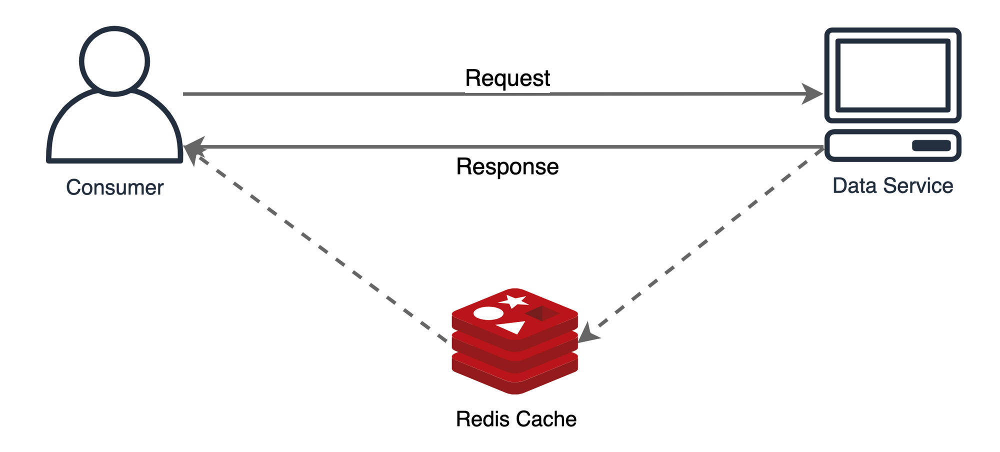

사용자가 동일한 정보를 반복적으로 엑세스할 때 원본이 아니라 캐시에서 데이터를 가져옴으로써 리소스를 줄일 수 있다.

애플리케이션에서 조회되는 데이터 중에 아래 조건들을 만족한다면 캐시 도입을 고려해 보자

    1. 원본 데이터 저장소에서 원하는 데이터를 찾기 위해 검색하는 시간이 오래 걸리거나, 매번 계산을 통해 데이터를 가져와야 하는 경우
    1. 캐시에서 데이터를 가져오는 것이 원본 데이터 저장소 데이터를 요청하는 것보다 빨라야 한다.
    1. 캐시에 저장된 데이터는 잘 변하지 않는 데이터
    1. 캐시에 저장된 데이터는 자주 검색되는 데이터

원본 데이터 저장소 데이터를 가지고 오는 시간을 단축시키기 때문에 **애플리케이션의 응답 속도(laytency)**를 줄일 수 있다.

또한 원본 데이터 저장소에서 **데이터를 읽는 커넥션(부하)**를 줄일 수 있다.

### 캐시로서의 레디스

레디스는 다양한 자료 구조를 제공하기 때문에 애플리케이션에서 **사용하던 자료 구조를 변환하는 과정 없이** 레디스에 바로 저장할 수 있다.

레디스는 모든 데이터를 메모리에 저장하는 인메모리 데이터 저장소 → 검색, 반환이 매우 빠르다

관계형 데이터베이스에서는 디스크에 접근해 데이터를 검색해와야 한다.

레디스는 평균 읽기 및 쓰기 작업 속도가 1ms 미만이며, 초당 수백만 건의 작업이 가능하다

캐싱 전략마다 다르지만 캐시에 접근할 수 없게 되면 바로 서비스의 장애 즉, SPOF(Single Point Of Failure)로 작용할 수 있다. 하지만 **레디스는 자체적으로 고가용성(HA) 기능을 가지는 솔루션**이다.

레디스의 센티널, 클러스터 기능을 사용하면 마스터 노드의 장애를 자동으로 감지해 페일오버를 발생시키기 때문에 운영자의 개입 없이 캐시는 정상적으로 유지될 수 있어 가용성이 높아진다.

### 캐싱 전략

레디스를 캐시로 사용할 때 레디스를 어떻게 배치할 것인지에 대해 따라 서비스의 성능에 큰 영향을 끼칠 수 있다.

캐싱 전략은 **캐싱되는 데이터의 유형과 엑세스 패턴에 따라 다르기 때문에 서비스에 맞는 적절한 전략을 선택**하는 것이 중요하다.

### 읽기 전략 - look aside

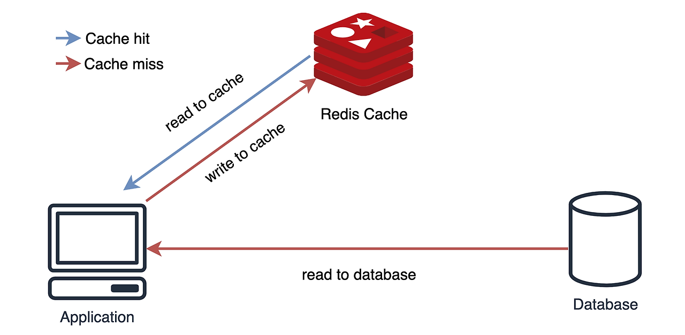

데이터가 캐시에 있는지 먼저 확인, 캐시에 데이터가 있으면 캐시 히트

캐시 미스가 발생하면 원본 데이터베이스에 접근해 데이터를 가져오고 애플리케이션은 이를 다시 캐시에 저장

찾고자 하는 데이터가 없을 때에만 레디스에 저장되기 때문에 이런 구조를 lazy loading 이라고도 부른다.

**look aside 구조의 장점**은 레디스에 문제가 생겨 접근할 수 없는 상황이 발생하더라도 서비스 장애로 이어지지 않고 데이터베이스에서 데이터를 가지고 올 수 있다는 것이다.

하지만 기존에 애플리케이션에서 레디스를 통해 가져오는 연결이 매우 많았다면, 모든 커넥션이 한꺼번에 원본 데이터베이스로 몰려 많은 부하를 발생시키고, 이로 인해 원본 데이터베이스의 응답이 느려지거나 장애로 이어지는 상황이 발생할 수 있다.

이런 상황을 예방하기 위해서 미리 데이터베이스에서 캐시로 데이터를 밀어넣어주는 작업을 하기도 하는데, 이를 **캐시 워밍(cache warming)**이라고 한다.

### 쓰기 전략과 캐시의 일관성

데이터가 변경될 때 원본 데이터베이스에만 또는 캐시에만 업데데이트 된다면 데이터 간 불일치가 일어난다.이트 된다면 데이이트 된ㄷ

이를 **캐시 불일치(cache inconsistency)**라 한다.

### write through

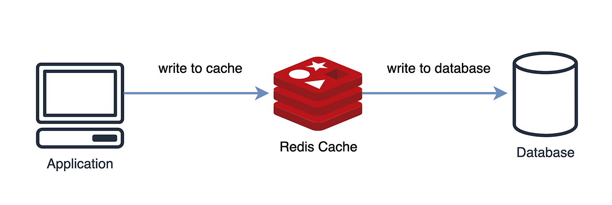

write through 방식은 데이터베이스에 업데이트할 때마다 매번 캐시에도 데이터를 함께 업데이트시키는 방식

캐시는 항상 최신 데이터를 가지고 있을 수 있다는 장점이 있지만, 매번 2개의 저장소에 저장돼야 하기 때문에 데이터를 쓸 때마다 시간이 많이 소요될 수 있다는 단점이 있다.

### cache invalidation

cache invalidation 방식은 데이터베이스에 값을 업데이트할 때마다 캐시에서는 데이터를 삭제하는 전략이다.

저장소에서 특정 데이터를 삭제하는 것이 새로운 데이터를 저장하는 것보다 훨씬 적은 리소스를 사용하는 특징을 적용한 전략이다.

### write behind(write back)

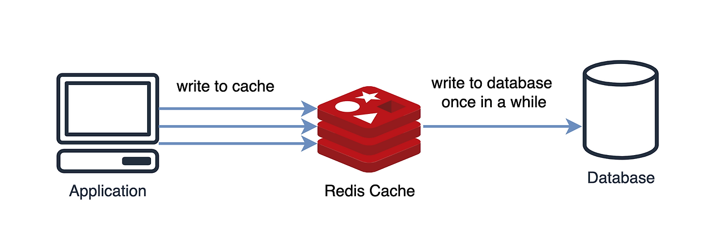

만약 쓰기가 빈번하게 발생하는 서비스라면, write behind 방식을 고려해볼 수 있다.

데이터베이스에 대량의 쓰기 작업이 발생한다면 이는 많은 디스크 I/O를 유발해 성능 저하가 발생할 수 있다.

따라서 먼저 데이터를 빠르게 접근할 수 있는 캐시에 업데이트한 뒤, 이후에는 건수나 특정 시간 가격 등에 따라 비동기적으로 데이터베이스에 업데이트 하는 것이다.

저장되는 데이터가 실시간으로 정확한 데이터가 아니어도 되는 경우 이 방법이 유용할 수 있다.

예를 들어 유투브와 같은 스트리밍 사이트 동영상의 좋아요 수는 매번 실시간 집계가 필요하지 않다.

먼저 레디스에 저장해둔 다음 5분 간격으로 집계해 데이터베이스에 저장하는 과정을 거친다면 데이터베이스의 성능을 향상시킬 수 있다.

물론 이 방법에는 캐시에 문제가 생겨 데이터가 날아갈 경우 최대 5분 동안의 데이터가 날아갈 수 있다는 위험이 있다.

---

# 캐시에서의 데이터 흐름

캐시는 데이터 스토어가 갖고 있는 데이터 중 사용자가 자주 사용할 만한 데이터를 갖고 와서 임시로 저장하는 저장소다.

**레디스(캐시)는 데이터 스토어보다 적은 양을 보관하고 있는 데이터베이스의 서브넷**이라 볼 수 있다.

캐시로 레디스를 사용할 때에는 데이터를 저장함과 동시에 적절한 시간의 TTL 값을 지정하는 것이 좋다.

### 만료 시간(TTL, Time To Live)

만료 시간은 일반적으로 초 단위로 표현되며, 특정 키에 대한 만료 시간이 설정되면 해당 키와 관련된 데이터는 지정된 시간이 지난 후에 레디스에서 자동으로 삭제된다.

이를 통해 키에 만료 시간을 설정하면 데이터의 수명을 관리하고 메모리 공간을 효율적으로 사용하는 데 도움을 준다.

레디스에 저장된 키에 **EXPIRE 커맨드**를 사용하면 만료 시간을 설정할 수 있다.

SET 커맨드로 string 데이터를 저장할 때에는 **EX 옵션**을 함께 사용해 데이터의 저장과 동시에 만료 시간을 설정

**TTL 커맨드**를 사용하면 키에 대한 만료 시간을 확인할 수 있다.

    - 키가 존재 X: -2
    - 만료 시간이 없는 경우: -1
    - 만료 시간이 있는 경우: 남은 시간

PTTL, PEXPIRE 커맨드는 → 밀리세컨드 단위로 동작한다.

```
> SET a 100
OK
> EXPIRE a 60
(integer) 1
> TTL a
(integer) 58
```

INCR, RENAME 같은 커맨드로 데이터를 조작하거나 키의 이름을 바꾸더라도 만료 시간은 변경되지 않는다.

```
> SET a 100 EX 70
OK
> TTL a
(integer) 64
> INCR a
(integer) 101
> TTL a
(integer) 60
> RENAME a apple
OK
> TTL apple
(integer) 49
```

기존 키에 새로운 값을 저장해 키를 덮어 쓸 때에는 이전에 설정한 만료 시간은 유지되지 않고 사라진다.

```
> SET b 100 EX 60
OK
> TTL b
(integer) 55
> SET b banana
OK
> TTL b
(integer) -1
```

### 레디스 키 만료 시 동작 방식

**레디스에서 키가 만료됐다고 해도 메모리에서 바로 삭제되는 것은 아니다.**

키는 passive 방식, active 방식 두 가지로 삭제된다.

**passive 방식**

```
클라이언트가 키에 접근하고자 할 때 키가 만료됐다면 메모리에서 수동적으로 삭제한다.
사용자가 접근할 때에만 수동적으로 삭제되기 때문에 이를 passive 방식의 만료라 한다.
그러나 사용자가 접근하지 않는 만료된 키도 있어 이 방식으로는 충분하지 않다.
```

**active 방식**

```
TTL 값이 있는 키 중 20개를 랜덤으로 뽑아낸 뒤, 만료된 키를 모두 메모리에서 삭제한다.
만약 25% 이상의 키가 삭제됐다면 다시 20개의 키를 랜덤하게 뽑은 뒤 확인하고, 
아니라면 뽑아놓은 20개의 키 집합에서 다시 확인한다.
이런 과정을 1초에 10번씩 수행한다.
```

만료된 키를 곧바로 삭제하지 않기 때문에 키를 삭제하는 데에 들어가는 리소스를 줄일 수 있지만, 그만큼 메모리를 더 사용할 가능성이 존재한다. 최악의 경우 전체 메모리의 1/4는 이미 만료된 키 값일 수 있다.

### 메모리 관리와 maxmemory-policy 설정

레디스의 메모리는 제한적이기 때문에 모든 키에 만료 시간을 설정하더라도 너무 많은 키가 저장되면 메모리가 가득 차는 상황이 발생할 수 있다.

**메모리의 용량을 초과하는 양의 데이터가 저장되면 레디스는 내부 정책을 사용해 어떤 키를 삭제할지 결정한다.**

레디스에서는 데이터의 최대 용량을 설정하는 **maxmemory** 설정과 이 용량을 초과할 때의 처리 방식을 결정하는 **maxmemory-policy** 설정값을 사용해 메모리를 관리한다.

### Noeviction

**기본값은 noeviction 이다.**

이 값은 레디스에 데이터가 가득 차더라도 임의로 **데이터를 삭제하지 않고 더 이상 레디스에 데이터를 저장할 수 없다는 에러를 반환하는 설정**값이다.

### LRU(Least Recent Used) eviction

레디스에 데이터가 가득 찼을 때 **가장 최근에 사용되지 않는 데이터부터 삭제하는 정책**이다.

캐시는 나중에 사용될 가능성이 있는 데이터를 유지하는 것을 목표로 하기 때문에 효율적인 메모리 관리 방법이다.

**volatile-lru**

```
만료 시간이 설정돼 있는 키에 한해서 LRU 방식으로 키를 삭제한다.
만약 레디스 내부에 저장된 키에 모두 만료 시간이 지정돼 있지 않다면 이는 noeviction 상황과 동일하다.
```

**allkeys-lru**

```
모든 키에 대해 LRU 알고리즘을 이용해 데이터를 삭제하기 때문에 메모리가 꽉 찼을 때 
장애가 발생할 상황은 방지할 수 있다.
```

### LFU(Least Frequently Used) eviction

레디스에 데이터가 가득 찼을 때 **가장 자주 사용되지 않는 데이터부터 삭제하는 정책**이다.

자주 사용되지 않는 데이터는 나중에도 엑세스될 가능성이 낮을 것이라는 가정을 전제하고 있다.

**volatile-lfu, allkeys-lfu**

### RANDOM eviction

레디스에 **저장된 키 중 하나를 임의로 골라내 삭제**한다.

알고리즘을 사용하지 않기 때문에 레디스의 부하를 줄여줄 수 있는 방법이다.

**volatile-random, allkeys-random**

### volatile-ttl

**만료 시간이 가장 작은 키를 삭제한다.** 즉, 삭제 예정 시간이 얼마 남지 않은 키를 추출해 해당 키를 미리 삭제하는 옵션이다.

### 캐시 스탬피드 현상(cache stampede, cascading failure)

여러 개의 애플리케이션에서 바라보던 키가 레디스에서 만료돼 삭제된다면 이 서버들은 한꺼번에 데이터베이스에 가서 데이터를 읽어오는 과정을 거친다. 이를 중복 읽기라 한다.

이후 각 애플리케이션은 읽어온 데이터를 레디스에 쓰게 되는데, 이 또한 여러 번 반복되기 떄문에 중복 쓰기가 발생한다.

보통 정렬이나 카운팅처럼 데이터베이스에서 쿼리하는 데 오래 걸리는 작업을 미리 계산해서 캐싱해두기 때문에 만약 중복 읽기(duplicate read)작업이 발생하면 데이터베이스에 큰 부하를 줄 수 있으며, 이는 곧 서비스 이슈로도 이어질 수 있다.

### 캐시 스탬피드 현상을 막을려면

선 계산 방식을 사용한다.

먼저 TTL을 적절하게 잡아두고 애플리케이션에서 주기적으로 캐시의 데이터 만료 시간을 확인하고, 데이터베이스에 접근해서 데이터를 읽어와 캐시의 값과 TTL을 갱신한다.

즉, 일종의 웜업 방식을 사용한다.

---

서비스 간 통신이 불가능한 상황이 바로 장애로 이어지지 않게, **당장 메시지를 처리하지 못하더라도 보낸 메시지를 어딘가에 쌓아 둔 뒤 나중에 처리할 수 있는 채널을 만들어 주는 것**.

이것이 메시지 브로커의 핵심 역할이라 할 수 있다.

메시지 브로커는 크게 메시징 큐와 이벤트 스트림이라는 두 가지 형태로 나눌 수 있다.

# 메시징 큐와 이벤트 스트림

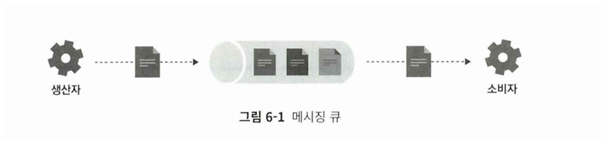

**메시징 큐**에서는 주로 데이터를 생성하는 쪽을 **생산자(producer)**, 데이터를 수신하는 쪽을 **소비자(consumer)**로 지칭한다.

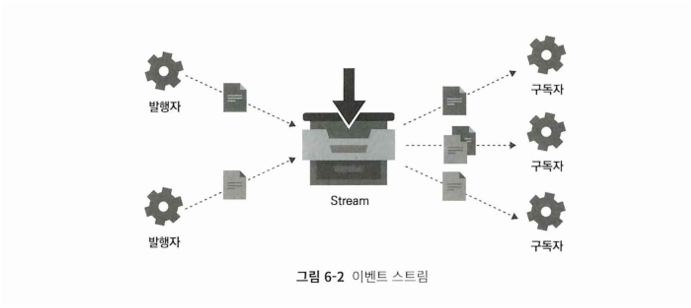

**이벤트 스트림**에서는 데이터를 생성하는 쪽을 **발행자(publisher)**, 데이터를 조회하는 쪽을 **구독자(subscriber)**로 지칭한다.

**메시징 큐와 이벤트 스트림은 방향성이 다르다.**

메시징 큐의 생산자는 소비자의 큐로 데이터를 직접 푸시한다.

2개의 서비스에 같은 메시지를 보내야할 때 메시징 큐를 이용한다면 생잔자는 2개의 각각 다른 메시징 큐에 각각 데이터를 푸시해야 한다.

반면 스트림을 이용한다면 생산자는 특정 저장소에 하나의 메시지를 보낼 수 있고, 메시지를 읽어가는 소비자들은 스트림에서 같은 메시지를 풀(pull)해 갈 수 있게 떄문에 메시지를 복제해서 저장하지 않아도 된다.

**메시징 큐와 이벤트 스트림은 데이터의 영속성이 다르다.**

메시징 큐에서는 소비자가 데이터를 읽어갈 때 큐에서 데이터를 삭제한다. 하지만 이벤트 스트림에서는 구독자가 읽어간 데이터는 바로 삭제되지 않고, 저장소의 설정에 따라 특정 기간 동안 저장될 수 있다.

메시지를 보내는 도중에 새로운 소비자를 추가할 때, 메시징 큐를 이용한다면 소비자는 새롭게 추가된 이후의 이벤트만 확인할 수 있다. 

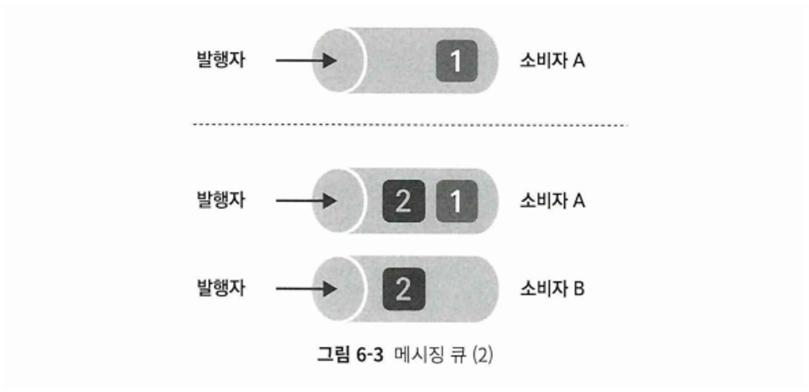

그림 6-3을 보면 소비자 B는 프로듀서가 소비자에게 1이라는 메시지를 보낸 이후 추가됐기 때문에 데이터 2만을 확인할 수 있다.

하지만 **스트림 방식에서는 메시지를 생산할 때 구독자를 지정하지 않고, 스트림에 쌓인 데이터는 일정 기간 동안 지워지지 않기** 때문에 새로 추가된 서비스도 스트림에 남아 있는 이전 데이터의 히스토리를 볼 수 있다.

따라서 메시지 큐는 일대일(1:1) 상황에서 한 서비스가 다른 서비스에게 동작을 지시할 때 유용하게 사용될 수 있으며, 스트림은 다대다(n:n) 상황에서 유리함을 확인할 수 있다.

### 레디스를 메시지 브로커로 사용하기

레디스에서 제공하는 **pub/sub**를 사용하면 빠르고 간단한 방식으로 메시지를 전달할 수 있는 메시지 브로커를 구현할 수 있다. 발행자가 특정한 채널에 데이터를 전송하면 이 채널을 듣고 있는 모든 소비자는 데이터를 바로 소비할 수 있다.

**레디스의 pub/sub에서 모든 데이터는 한 번 채널 전체에 전파된 뒤 삭제되는 일회성의 특징을 가지며, 메시지가 잘 전달됐는지 등의 정보는 보장하지는 않는다.**

따라서 완벽하게 메시지가 전달돼야 하는 상황에는 적합하지 않을 수 있지만 fire-and-forget 패턴이 필요한 간단한 알림 서비스에서는 유용하게 사용될 수 있다.

**fire-and-forget 패턴** 

```
비동기 프로그래밍에서 사용되는 디자인 패턴
어떤 작업을 실행하고 그 결과에 대한 응답을 기다리지 않고 다음 코드를 실행하는 것을 의미
fire-and-forget 패턴을 사용할 때는 결과 확인이나 오류 처리를 고려하지 않고 작업을 진행하므로,
신뢰성이 필요한 경우에는 사용하지 않아야 한다.
```

**레디스의 list 자료 구조는 메시징 큐로 사용하기에 알맞다.** list의 데이터는 푸시와 팝이 가능하며 애플리케이션은 list에 데이터가 있는지 매번 확인할 필요 없이 대기하다가 list에 새로운 데이터가 들어오면 읽어갈 수 있는 블로킹 기능을 사용할 수도 있다

**레디스의 stream을 사용하면 레디스를 완벽한 스트림 플랫폼으로 사용할** 수 있다.

레디스 stream은 아파치 카프카 시스템에서 영감을 받아 만들어진 자료 구조로, 데이터는 계속 추가되는 방식으로 저장된다(append-only) 소비자, 소비자 그룹 개념을 이용하면 카프카에서와 비슷하게 데이터의 분산 처리를 구현할 수 있다.

stream에 저장되는 메시지를 실시간으로 리스닝하며 소비할 수도 있으며, 저장돼 있는 데이터를 시간대별로 검색하는 것도 가능하다.

---

# 레디스의 pub/sub

레디스 노드에 접근할 수 있는 모든 클라이언트는 발행자와 구독자가 될 수 있다.

발행자는 특정 채널에 메시지를 보낼 수 있고, 구독자는 특정 채널을 리스닝하다가 메시지를 읽어갈 수 있다.

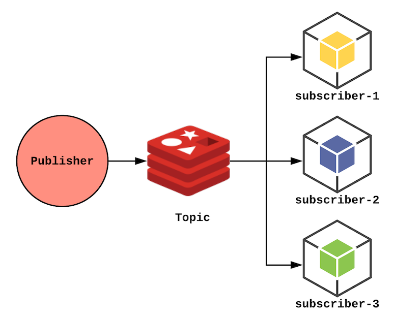

**레디스 pub/sub은 최소한의 메시지 전달 기능만 제공한다**

발행자는 메시지를 보낼 수 있을 뿐, 어떤 구독자가 읽어가는지, 정상적으로 전달됐는지 확인할 수 없다.

마찬가지로 구독자 또한 메시지를 받을 수 있지만 언제 어떤 발행자에 의해 생성됐는지 등의 메타데이터는 알 수 없다.

한 번 전파된 데이터는 레디스에 저장되지 않으며, 단순히 메시지의 통로 역할만 한다.

이런 특징 때문에 정합성이 중요한 데이터를 전달하기에는 적합하지 않을 수 있다.

## 메시지 발행 

**PUBLISH 커맨드**

```
PUBLISH hello world
```

해당 커맨드를 수행하면 hello 채널을 수신하고 있는 모든 서버들에 world 메시지가 전파된다.

메시지가 전파된 후에는 메시지를 수신한 구독자의 수가 반환된다.

## 메시지 구독

**SUBSCRIBE 커맨드**

SUBSCRIBE 커맨드를 이용하면 특정 채널을 구독할 수 있다.

클라이언트가 구독자로 동작할 때에는 pub/sub과 관련되지 않은 다른 커맨드를 수행할 수는 없다.

구독자가 수행할 수 있는 커맨드는 아래와 같다.

```
SUBSCRIBE, SSUBSCRIBE, SUNSUBSCRIBE, PSUBSCRIBE,
UNSUBSCRIBE, PUNSCRIBE, PING, RESET, QUIT
```

PSUBSCRIBE 커맨드는 일치하는 패턴에 해당하는 채널을 한 번에 구독할 수 있도록 한다.

```
PSUBSCRIBE mail-*
```

prefix가 “maile-”인 모든 채널을 구독한다. ex): mail-track, mail-album 등등

### **메시지 타입**

```
**PSUBSCRIBE 커맨드로 구독하는 경우 메시지 타입이 pmessage** 
**SUBSCRIBE 커맨드로 구독하는 경우 메시지 타입이 message 

특정 클라이언트 구독 상태**
1. subscribe mail-1
2. psubscribe mail-*

**발행자**
publish mail-1 hello

**해당 클라이언트 수신**
1. message: hello
2. pmessage: hello
```

## 클러스터 구조 pub/sub

**레디스 클러스터에서 pub/sub을 사용할 때, 메시지를 발행하면 해당 메시지는 클러스터에 속한 모든 노드에 자동으로 전달**된다.

따라서 **레디스 클러스터의 아무 노드에 연결해 SUBSCRIBE 커맨드를 사용하면 데이터를 수신**할 수 있다.

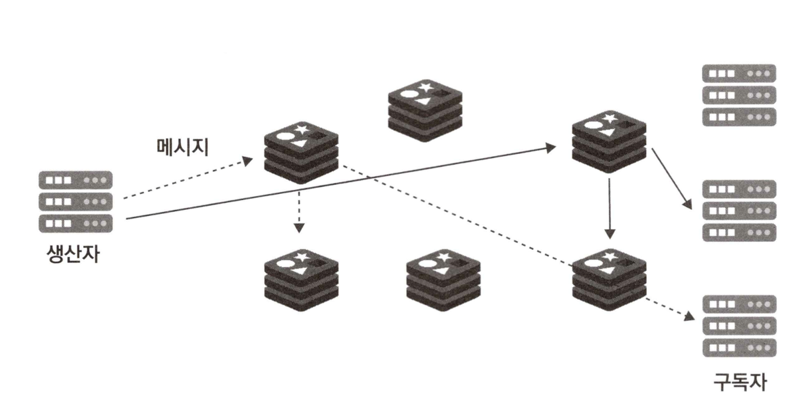

모든 노드에 전파되는 방식은 굉장히 간단하고 명료하지만, 불필요한 리소스 사용과 네트워크 부하가 발생한다.

### sharded pub/sub

클러스터 환경에서의 모든 노드에 전파되는 pub/sub 비효율을 해결하기 위해서 레디스 7.0에서는 shared pub/sub 기능이 도입됐다.

클러스터에서 키가 특정 슬롯에 할당되는 것과 동일한 방식으로 채널이 할당되면, 같은 슬롯을 가지고 있는 노드 간에만 pub/sub 메시지를 전달한다.

---

# 레디스의 List를 메시징 큐로 사용하기

레디스에는 큐의 tail, head에 데이터를 넣고 뺄 수 있는 LPUSH, LPOP, RPUSH, RPOP 커맨드가 존재하기 때문에 애플리케이션 특성에 맞는 메시징 큐를 직접 구현할 수 있다.

## list EX 기능

인스타그램, 트위터, 페이스북 같은 SNS에는 각 유저별 타임라인이 존재한다.

각자의 타임라인에 자신이 팔로우한 계정의 게시물, 혹은 자신과 관련 있는 게시물 등이 표시된다.

트위터는 각 유저의 타임라인 캐시 데이터를 레디스에서 list 자료 구조로 관리한다.

유저 A가 새로운 트윗을 작성하면 그 데이터는 유저 A를 팔로우하는 유저의 타임라인 캐시에 저장된다.

이때 **각 타임라인 캐시에 데이터를 저장할 때 RPUSH 커맨드가 아닌 RPUSHX 커맨드를 사용한다**

RPUSHX는 데이터를 저장하고자 하는 리스트가 이미 존재할 때에만 아이템을 추가하는 커맨드다.

즉, 이미 캐시된 타임라이엔만 데이터를 추가할 수 있다.

이를 통해 자주 트위터를 들어오지 않는 유저에 대해서는 타임라인 캐시 데이터를 굳이 관리해야 할 필요가 없기 때문이다.

사용자의 캐시가 이미 존재하는지 유무를 애플리케이션 레벨에서 확인하는 과정 없이 레디스를 통해서만 제어할 수 있기 때문에 불필요한 확인 과정을 줄여 서능을 향상시킬 수 있다.

## list 블로킹 기능

레디스를 이벤트 큐로 사용할 경우, 블로킹 기능을 유용하게 사용할 수 있다.

event-driven 구조에서 event handler는 이벤트 루프를 돌며 신규로 처리할 데이터가 있는지 체크한다.

새로운 데이터가 없을 경우 정해진 시간(폴링 인터벌)동안 대기한 뒤 다시 이벤트 큐에 데이터가 있는지 확인하는 과정을 반복한다.

이러한 방식을 “폴링”이라고 부르며, 폴링 프로세스가 진행되는 동안 애플리케이션과 큐의 리소스가 불필요하게 소모될 수 있다.

또한 이벤트가 들어왔을 수 있지만, 폴링 인터벌 시간 동안은 대기한 뒤 다시 확인하는 과정을 거치기 때문에 이벤트를 즉시 처리할 수 없다는 단점이 있다.

list 블로킹 기능을 사용하면 이를 해결할 수 있다. 

BPOP, LPOP 커맨드를 사용하면, list에 데이터가 들어올 때까지 기다린 후에 들어온 값을 반환하거나, 클라이언트가 설정한 타임아웃시간만큼 대기한후 nil값을 반환한다.

```
> BROP queue:a 5
1) "queue:a"
2) "data"

**BROP queue:a 5 커맨드**
해당 커맨드는 queue:a 리스트에 데이터가 입력할 때까지 최대 5초 동안 대기하고, 
5초가 경과하면 nil을 반환하라는 의미다.

"타임아웃을 0으로 설정하면 제한 없이 기다리라는 의미로 쓰인다."
하나의 리스트에 여러 클라이언트가 동시에 블로킹될 수 있으며, 리스트에 데이터가 입력되면
가장 먼저 요청을 보낸 클라이언트가 데이터를 가져간다.
```

BROP은 RPOP과 다르게 2개의 데이터를 반환한다.

첫 번째는 팝된 리스트 키, 두 번째는 반환된 데이터 값을 반환한다.

이렇게 설계된 이유는 동시에 여러 개의 리스트에서 대기할 수 있게 하기 위해서다.

```
> BRPOP queue:a queue:b queue:c timeout 1000
1) "queue:b"
2) "EVENT"
```

클라이언트는 3개의 리스트 중에서 어느 하나라도 데이터가 들어올 때까지 기다린 뒤, 데이터를 반환받는다.

---

# Stream

## 레디스의 Stream과 아파치 카프카

Stream은 레디스 5.0에서 새로 추가된 자료 구조로 대용량, 대규모의 메시징 데이터를 빠르게 처리할 수 있도록 설계됐다.

stream은 데이터를 계속해서 추가하는 방식으로 저장되는(append-only)자료 구조다.

stream은 사용 목적에 따라 두 가지 방식으로 활용될 수 있다.

첫 번째로 **stream을 대량의 데이터를 효율적으로 처리하는 플랫폼으로 활용**할 수 있다.

두 번째로 **stream을 여러 생산자가 생성한 데이터를 다양한 소비자가 처리할 수 있게 지원하는 데이터 저장소 및 중간 큐잉 시스템으로 사용**할 수 있다.

대규모 메시징 데이터를 처리하기 위해 플랫폼을 도입하고자 할 때 가장 먼저 고려되는 시스템은 아파치 카프카이다. 카프카는 링크드인에서 처음 개발된 분산 메시징 시스템이다.

**레디스 stream은 카프카의 영향을 많이 받은 시스템**인 만큼 카프카와 유사한 여러 기능을 갖고 있으며, 일부 기능은 카프카보다 뛰어난 처리를 할 수 있도록 설계됐다.

---

## 스트림이란?

스트림이란 연속적인 데이터 흐름, 일정한 데이터 조각의 연속을 의미한다.

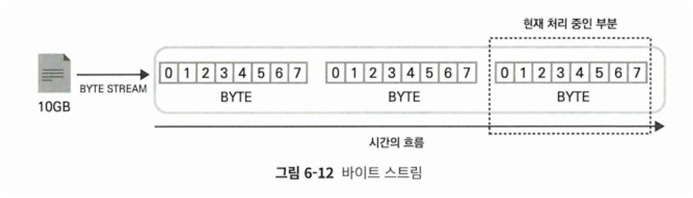

그림 6-12에서는 10GB의 텍스트 파일을 처리하는 애플리케이션에서 바이트 스트림을 처리하는 과정을 보여준다.

파일 하나는 유한하지만 이를 읽어올 때 애플리케이션은 단어 단위, 줄 단위로 데이터를 잘게 쪼개서 처리하기 때문에 애플리케이션은 바이트 스트림을 처리하는 것이라고 생각할 수 있다.

끝이 정해지지 않고 계속되는 불규칙한 데이터를 연속으로 반복 처리할 때 이 또한 스트림 처리를 한다고 할 수 있다.

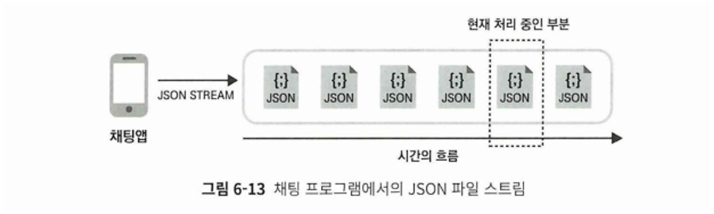

그림 6-13은 채팅 프로그램에서 JSON 파일을 스트리밍하는 과정을 나타낸다.

채팅앱에서 사용자는 아무때나 채팅을 보낼 수 있으며, 메신저 서버는 사람들이 계속 채팅하는 동안 끝없이 데이터를 처리할 수 있어야 한다. 따라서 서버는 JSON 스트림을 처리하는 것이라고 볼 수 있다.

그림 6-12, 6-13은 애플리케이션 외부에서 인풋을 받아오는 예제이지만 애플리케이션 내부에서 서버 간 데이터의 이동이 필요할 수도 있다.

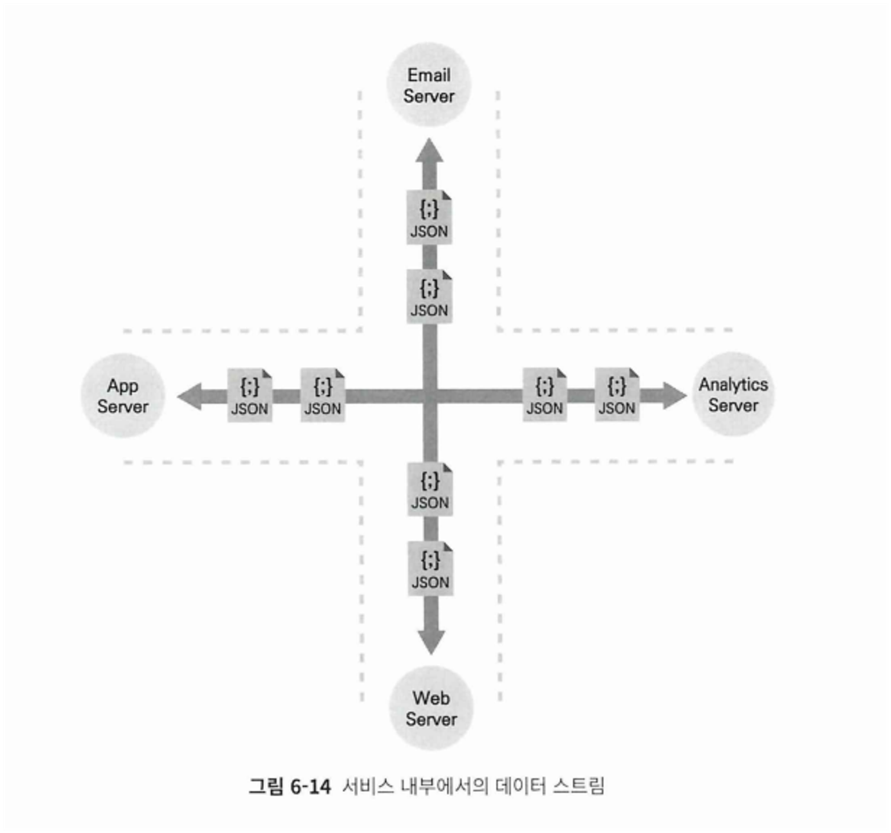

그림 6-14에서는 웹 서버에서 받아온 결제 데이터를 분석 서버로 전달하거나, 사용자의 결제 데이터를 이메일 서버로 넘기는 등의 서비스 간 데이터 전달 과정 또한 연속적인 데이터의 전달을 의미하기 때문에, 이 또한 스트림이라 할 수 있다.

---

## 데이터의 저장

### 메시지의 저장과 식별

카프카에서 **스트림 데이터는 토픽이라는 개념에 저장**된다.

**토픽은 각각의 분리된 스트림을 뜻하며, 같은 데이터를 관리하는 하나의 그룹을 의미**한다.

레디스에서는 **하나의 stream 자료 구조가 하나의 stream을 의미**한다.

stream 또한 다른 자료구조와 마찬가지로 **하나의 키에 연결된 자료 구조**다.

카프카에서 각 메시지는 0부터 시작해 증가하는 시퀀스 넘버로 식별할 수 있는데, 이때 시퀀스 넘버는 토픽 내의 파티션 안에서만 유니크하게 증가하기 때문에 토픽이 1개 이상의 파티션을 갖는다면 메시지는 하나의 토픽 내에서 유니크하게 식별되지 않는다.

레디스 stream에서 **각 메시지는 시간과 관련된 유니크한 ID를 가지며, 이 값은 중복되지 않는다**.

```
# ID는 밀리세컨드 파트, 시퀀스 넘버 파트 2개의 파트로 나뉜다.
<millisecondsTime>-<sequenceNumber>
```

**밀리세컨드 파트는 stream에 아이템이 저장될 시점의 레디스 노드 로컬 시간**이다.

시퀀스 파트는 동일한 밀리세컨드 시간에 여러 아이템이 저장될 수 있으므로, **같은 밀리세컨드에 저장된 데이터의 순서를 의미**한다.

**시퀀스 번호는 64bit로 사실상 하나의 밀리세컨드 내에 생성할 수 있는 항목 수에는 제한이 없다.**

레디스 stream은 지정된 모든 데이터는 유니크한 ID를 가지며, 이 ID 값이 곧 시간을 의미하기 때문에 **시간을 이용해 특정 데이터를 검색할 수 있다.**

---

### 스트림 생성과 데이터 입력

카프카에서 생성자는 데이터를 토픽에 푸시하며, 소비자는 토픽에서 데이터를 읽어간다.

카프카에서는 데이터를 저장하기 위해 토픽을 먼저 생성한 뒤, 프로듀서를 이용해 메시지를 보낼 수 있다.

레디스에서는 다른 자료구조와 마찬가지로 따로 stream을 생성하는 과정이 필요하지 않으며, 

**XADD 커맨드를 이용해 새로운 이름의 stream에 데이터를 저장하면 데이터 저장과 동시에 생성**된다.

```bash
XADD Email * subject "first" body "hello?"
1757346642191-0
```

Email KEY를 가지는 stream 생성, 이미 존재했다면 기존 stream에 새로운 메시지 추가

“*” 저장되는 데이터 ID를 의미, 이 값을 “*”로 입력할 경우 레디스에서 자동 생성되는 타임스탬프 ID를 사용하겠다는 것을 의미한다. 반환되는 값이 바로 저장되는 데이터 ID이다.

메시지는 key-value 쌍으로 저장되며, subject key에 first value, body key에 hello? value가 저장된다.

```bash
XADD Push * userid 1000 ttl 3 body hey
1757346946000-0
XADD Email * subject "second" body "hi?"
1757346964466-0
```

```
스트림
├── 엔트리 ID: 1757346946000-0
│   ├── userid: 1000
│   ├── ttl: 3
│   └── body: hey
└── 엔트리 ID: 1757346964466-0
    ├── subject: "second"
    └── body: "hi?"
```

각 엔트리는 하나의 논리적 메시지 단위이고, 그 안에 관련된 여러 필드들을 함께 저장할 수 있다.

만약 자동으로 생성되는 ID가 아니라 서비스에서 기존에 사용하던 ID를 이용해 메시지를 구분하고 싶을 수 있다.

이때에는 ID를 직접 지정하면 된다.

```bash
XADD mystream 0-1 hello world
0-1
XADD mystream 0-2 hi redis
0-2
XADD mystream 0-0 expect error
ERR The ID specified in XADD must be greater than 0-0
```

**ID는 이전에 저장됐던 ID 값보다 작은 값으로 지정할 수 없다.**

---

### 데이터의 조회

카프카와 레디스 stream의 데이터 저장 방식은 비슷하지만 데이터를 읽는 방식에서 차이가 있다.

**카프카** 

**카프카에서 소비자는 토픽을 실시간으로 리스닝하며, 새롭게 토픽에 저장되는 메시지를 전달받을 수 있다**.

기본적으로 리스닝을 시작한 시점부터 토픽에 새로 저장되는 메시지를 받도록 동작하며, 카프카에 저장돼 있는 모든 데이터를 처음부터 읽는것도 가능하다.

소비자는 더 이상 토픽에서 읽어올 데이터가 없으면 새로운 이벤트가 토픽에 들어올 때까지 계속 토픽을 리스닝하면서 기다린다.

**레디스 스트림**

데이터를 두 가지 방식으로 읽을 수 있다.

    1. **카프카처럼 실시간으로 처리되는 데이터를 리스닝**
    1. **ID를 이용해 필요한 데이터를 검색하는 방식**

---

### **실시간 리스닝**

```bash
XREAD [COUNT count] [BLOCK milliseconds] STREAMS key [key ...] ID [ID ...]
```

**XREAD:** 실시간으로 stream에 저장되는 데이터를 읽어올 수 있다.

Email stream에 저장된 데이터를 처음부터 읽어오고, 새로운 메시지가 들어올 때까지 토픽을 리스닝하면서 기다리기

```bash
XREAD BLOCK 0 STREAMS Email 0
Email
1757346642191-0
subject
first
body
hello?
1757346964466-0
subject
second
body
hi?
```

**BLOCK 0**: 더 이상 stream에 가져올 데이터가 없더라도 연결을 끊지 말고 계속 stream을 리스닝하라는 의미

**BLOCK 1000:** 들어오는 데이터가 없더라도 1000ms 즉, 최대 1초 동안 연결을 유지하며 대기하라는 의미

**STREAMS Email 0:** Email stream에 저장된 데이터 중 ID가 0보다 큰 값을 읽어오라는 의미

    - 즉, 모든 데이터를 읽어온다.

```bash

# 1번 클라이언트
XREAD BLOCK 0 STREAMS Email $

# 2번 클라이언트
XADD Email * head test1 head test2
1757348397670-0

# 1번 클라이언트
Email
1757348397670-0
head
test1
head
test2

# 1번 클라이언트 직접 ID 값 지정해서 읽어오기
XREAD BLOCK 0 STREAMS Email 1757346642191-0
Email
1757346964466-0
subject
second
body
hi?
1757348397670-0
head
test1
head
test2
1757348407117-0
head
test1
head
test2
```

**Email $:** 커맨드를 실행한 이후의 메시지만을 가져오기

    - $: stream에 저장된 최대 ID를 의미

**XREAD BLOCK 0 STREAMS Email 1757346642191-0:** 1757346642191-0 이후의 데이터 가져오기 

    - 1757346642191-0 포함 X

---

### 특정한 데이터 조회

```bash
XRANGE key start end [COUNT count]
XREVRANGE key end start [COUNT count]
```

**XRANGE 커맨드**를 이용하면 ID를 이용해 원하는 시간대의 데이터를 조회할 수도 있다.

ID 중 가장 작은 ID 값을 지정하고 싶을 때에는 “-”, 제일 마지막 ID값을 지정하고 싶을 때에는 “+” 기호를 사용

**모든 데이터 가져오기**

```bash
XRANGE Email - +
1757346642191-0
subject
first
body
hello?
1757346964466-0
subject
second
body
hi?
1757348397670-0
head
test1
head
test2
1757348407117-0
head
test1
head
test2
```

XRANGE를 이용하면 메시지가 저장된 시점을 이용해 데이터를 조회할 수도 있다.

```bash
# 범위로 조회
XRANGE Email 1757346642191 1757348397670
1757346642191-0
subject
first
body
hello?
1757346964466-0
subject
second
body
hi?
1757348397670-0
head
test1
head
test2

# 입력한 데이터 포함하지 않고 그 다음 데이터 부터 조회
XRANGE Email (1757346642191 1757348397670 
1757346964466-0
subject
second
body
hi?
1757348397670-0
head
test1
head
test2
```

COUNT 옵션으로 조회할 데이터 개수 제한

```bash
XRANGE Email 1757346642191 1757348397670 COUNT 2
1757346642191-0
subject
first
body
hello?
1757346964466-0
subject
second
body
hi?
```

---

### 소비자와 소비자 그룹

stream 데이터를 여러 소비자가 읽어가는 상황

같은 데이터를 여러 소비자에게 전달하는 것을 팬아웃(fan-out)이라 한다.

카프카에서는 같은 토픽을 여러 개의 소비자가 읽어가게 함으로써 간단하게 팬아웃할 수 있다.

레디스 stream에서도 XREAD 커맨드를 여러 소비자가 수행한다면 팬아웃이 가능하다.

데이터를 여러 개의 소비자를 이용해 메시지를 병렬 처리함으로써 서비스의 처리 성능을 높일 수 있다.

stream을 이용해 이벤트 데이터를 처리하는 과정에서 이벤트의 처리 성능을 높이기 위해 여러 소비자를 이용해 한 번에 여러 이벤트를 병렬적으로 처리되도록 구성할 수 있다.

이때 처리되는 메시지의 순서가 보장돼야 하는 경우와 그렇지 않은 경우 2가지 유형이 존재한다.

티켓 판매 서비스에서는 고객이 티켓을 결제할 때 카드의 유효성 검사나 사용자 잔고 확인 같은 선행 작업 후에 결제 프로세스가 진행돼야 하므로, 이벤트의 순서를 보장하는 것이 중요하다.

반면, 사용자의 회원가입 이벤트는 순서를 엄격하게 지키지 않아도 되므로 메시지를 생성한 순서대로 처리할 필요가 없다.

레디스 stream에서는 데이터가 저장될 때마다 고유한 ID를 부여받아 순서대로 저장된다.

**따라서 소비자에게 데이터가 전달될 때, 그 순서는 항상 보장**된다.

반면 **카프카에서 유니크 키는 파티션 내에서만 보장되기 때문에 소비자가 여러 파티션에서 토픽을 읽어갈 때에는 데이터의 순서를 보장할 수 없다.**

즉, **카프카에서 메시지 순서가 보장되도록 데이터를 처리하려면 소비자 그룹을 사용**해야 한다.

---

### 소비자 그룹

카프카에서는 소비자 그룹에 여러 소비자를 추가할 수 있으며, 이때 소비자는 토픽 내의 파티션과 일대일로 연결

파티션 내부에서는 메시지의 순서가 보장되기 때문에 메시지를 읽을 때 순서를 보장 받을 수 있다.

레디스 stream에서도 소비자 그룹이라는 개념이 존재하지만, 카프카와는 다르다.

**레디스 stream은 카프카와는 달리 메시지가 전달되는 순서를 신경 쓰지 않아도 되기 때문**이다.

레디스 stream에서 소비자 그룹 내의 한 소비자는 다른 소비자가 아직 읽지 않은 데이터만을 읽어간다.

각 요청마다 소비자는 stream에서 차례대로 데이터를 가져오게 된다.

**소비자 그룹 생성**

```bash
XGROUP CREATE Email EmailServiceGroup $ 
```

레디스 stream에서 소비자 그룹을 생성하려면 XGROUP 커맨드를 사용한다.

EmailServiceGroup 소비자 그룹 이름, Email Stream, $는 현재 시점 이후의 데이터부터 리스닝하겠다는 의미

**소비자 그룹을 이용해 데이터를 읽어오기**

```bash
XREADGROUP GROUP EmailServiceGroup emailService1 COUNT 1 STREAMS Email >

XADD Email * publisher consumer
1757357803993-0

XREADGROUP GROUP EmailServiceGroup emailService1 COUNT 1 STREAMS Email >
Email
1757357803993-0
publisher
consumer
```

    - EmailServiceGroup에 속한 emailService1 이름의 소비자가 Email stream에 있는 1개의 메시지를 읽어오고자 하는 커맨드다. 
    - 매번 소비자가 소비자 그룹을 이용해 작업을 수행할 때마다 그룹 내에서 이 소비자를 고유하게 식별할 수 있는 이름을 지정해야 한다.
    - 만약 다른 소비자에게 읽히지 않은 데이터가 있다면 데이터를 1개 가져오고 없다면 nil 반환
    - 카프카와는 다르게 각 소비자는 COUNT 커맨드를 이용해 소비할 메시지 개수를 지정할 수 있다.
    - **STREAM Email >:** Email이라는 이름의 stream에서, 다른 소비자에게 전달되지 않았던 새로운 데이터를 가지고 오는 것
- 대부분의 상황에서 “>”를 사용하면 되겠지만 만약 0 또는 다른 숫자 ID를 입력할 경우 새로운 메시지를 확인하는 것이 아닌, 입력한 ID 보다 큰 ID 중 대기에 속하던 메시지를 반환

소비자는 처음 언급될 때 자동으로 생성되며 명시적으로 생성할 필요는 없다.

하지만 소비자 그룹은 먼저 생성해야 한다.

**하나의 소비자 그룹에서 여러 개의 stream 리스닝**

```bash
XGROUP CREATE Email BIGroup 0
XGROUP CREATE Push BIGroup 0

XREADGROUP GROUP BIGROUP BI1 COUNT 2 STREAMS Email Push > > 
```

---

### ACK와 보류 리스트

여러 서비스가 메시지 브로커를 통해 데이터를 처리할 때 예상치 못한 장애로 인해 시스템이 종료됐을 경우 이를 인지하고 재처리할 수 있는 기능이 필요하다.

메시지 브로커는 각 소비자에게 어떤 메시지까지 전달됐고, 전달된 메시지의 처리 유무를 인지하고 있어야 한다.

레디스 stream 에서는 소비자 그룹에 속한 소비자가 메시지를 읽어가면 각 소비자별로 읽어간 메시지에 대한 리스트를 새로 생성하며, 마지막으로 읽어간 데이터의 ID로 last_delivered_id 값을 업데이트한다.

**last_delivered_id 값은 해당 소비자 그룹에 마지막으로 전달한 ID가 무엇인지를 파악해, 동일한 메시지를 중복으로 전달하지 않기 위해 사용**된다.

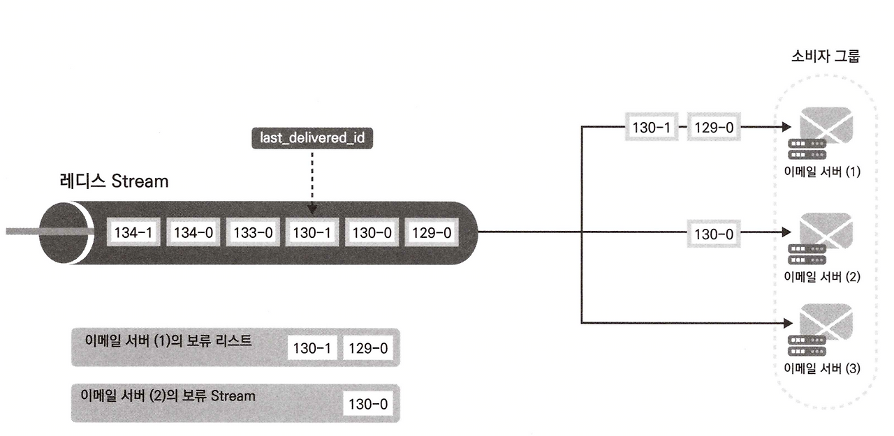

**레디스 stream은 소비자별로 보류 리스트를 만들고, 어떤 소비자가 어떤 데이터를 읽어갔는지 인지하고 있다.**

만약 이메일 서비스2가 **stream 에게 데이터가 처리됐다는 뜻의 ACK를 보내면 레디스 stream은 이메일 서비스2의 보류 리스트에서 ACK를 받은 메시지를 삭제**한다.

즉, 보류 리스트를 이용해 소바자가 처리한 데이터를 파악할 수 있다.

예를 들어 이메일 서비스에 문제가 발생해 서비스를 재부팅해야 하는 상황에서, stream 보류 리스트에 데이터가 남아 있는 경우 해당 데이터를 먼저 불러와 처리하는 작업을 선행적으로 수행한다면 예상치 못한 서비스 중단 상황에서도 모든 메시지를 놓치지 않고 처리할 수 있게 된다.

만약 이메일 서버 1에 장애가 발생해 해당 서버를 당분간 사용할 수 없는 상태라면,

1번 서버가 맡아서 처리해야할 작업을 다른 서버에서 처리해야 한다.

이를 위해 1번 서버의 보류 리스트에 남아 있는 메시지를 확인하는 과정을 거치면 된다.

따라서 XREADGROUP를 이용해 소비자 그룹 형태로 데이터를 읽었을 때, 데이터 처리가 완료된 후에 애플리케이션에서 XACK를 주기적으로 전송하는 작업이 필요하다.

현재 소비자 그룹에서 보류 중인 리스트가 있는지 확인하려면 다음 커맨드를 이용할 수 있다.

```
XPENDING <key> <groupname> [<start-id> <end-id> <count> [<consumer-name>]]
```

```bash
XPENDING Email EmailServiceGroup
1
1757357803993-0
1757357803993-0
emailService1
1
```

    - **첫 번째 값: 현재 소비자 그룹에서 ACK를 받지 못해 보류중인 메시지 개수**
    - **두 번째 값: 보류 중인 메시지 ID의 최솟값**
    - **세 번째 값: 보류 중인 메시지 ID의 최댓값**
    - 그 뒤로는 각 소비자별로 보류 중인 리스트가 몇 개 있는지 알려준다.

**XACK 통해 데이터가 처리됐음을 알려줄 수 있다.**

```bash
XACK Email EmailServiceGroup 1757357803993-0
1

XPENDING Email EmailServiceGroup
0
```

카프카도 레디스 stream과 마찬가지로 비슷하게 파티션별 오프셋을 관리한다.

카프카는 내부적으로 _consumer_offsets 라는 토픽에 데이터를 기록하는데, 소비자가 지정된 토픽의 특정 파티션의 메시지를 읽으면 소비자 그룹, 토픽, 파티션 내용이 토합돼 저장된다.

소비자 그룹은 consumer_offsets 토픽에 기록된 정보를 이용해 내부 소비자가 어디까지 읽었는지 추적 가능하다. 카프카는 마지막으로 읽은 위치가 아니라 다음으로 읽어야 할 위치를 기록한다.

---

### 레디스 stream 메시지 보증 전략 

**at most once**

메시지를 최대 한 번 보내는것을 의미

**소비자는 메시지를 받자마자 실제 처리하기 전에 먼저 ACK를 보낸다.**

이로 인해 속도는 향상되지만 **ACK를 보낸 뒤 소비자에 문제가 생겨 서비스가 다운 됐을 때에는 이미 ACK를 보냈지만 실제 처리하지 못한 데이터는 잃을 수 있다.**

메시지가 일부 손실되더라도 빠른 응답이 필요한 경우에 선택하는 전략

**at least once**

소비자는 받은 메시지를 모두 처리한 뒤 ACK를 보낸다.

ACK 전송이 지연돼, 실제로 메시지는 처리됐지만 ACK를 전송하기 전에 소비자가 종료되는 상황이 발행할 수도 있다.

이런 경우 보류 리스트에 처리된 메시지도 남아있기 때문에 이미 처리한 메시지를 또 한 번 더 처리하게 되는 상황이 발생할 수도 있다.

**exactly once** 

모든 메시지가 무조건 한 번씩 전송된다는 것을 보장한다는 의미로, 이런 방식으로 메시지를 전송하려면 추가적인 기능이 필요할 수도 있다. 만약 레디스 stream을 이용하면서 exactly once하게 메시지를 전송하고 싶다면 레디스의 set 등의 추가 자료 구조를 이용해 이미 처리된 메시지인지 아닌지를 확인하는 과정이 필요할 수도 있다.

---

### 메시지의 재할당

레디스는 소비자에게 장애가 날 경우를 대비해 소비자별 보류 리스트를 유지한다

만약 소비자 서버에 장애가 발생해 복구되지 않는다면, 해당 소비자가 처리하던 보류 중인 메시지들을 다른 소비자가 대신 처리해야 한다. 

**XCLAIM 커맨드를 이용하면 메시지의 소유권을 다른 소비자에게 할당할 수 있다.**

```bash
XCLAIM <key> <group> <consumer> <min-idle-time> <ID-1> <ID-2> ... 
```

XCLAIM 커맨드를 사용할 때는 최소 대기 시간 min-idle-time을 지정해야 한다.

이는 메시지가 보류 상태로 머무른 시간이 최소 대기 시간을 초과한 경우에만 소유권을 변경할 수 있도록 해서

같은 메시지가 2개의 다른 소비자에게 중복으로 할당되는 것을 방지할 수 있다.

EmailService3 소비자에 문제가 생겨, 다른 소비자인 EmailService 1, 2가 가져가기 위해 XCLAIM 커맨드를 실행하는 상황 가정

```bash
EmailService 1: XCLAIM Email EmailServiceGroup EmailService3 3600000

EmailService 2: XCLAIM Email EmailServiceGroup EmailService3 3600000
```

**2개의 소비자가 모두 보류 중인 메시지에 XCLAIM 커맨드를 실행하지만, EmailService1이 먼저 실행되면**

**메시지의 보류 시간이 즉시 0으로 재설정된다.**

그럼 EmailService2에서 실행한 XCLAIM 커맨드는 최소 대기 시간보다 메시지의 보류 시간이 짧기 때문에

이 커맨드는 무시되며, 이를 통해 consumer에 중복 메시지 할당을 방지할 수 있다.

[Redis Stream 재할당(XCLAIM) 테스트](https://app.notion.com/p/26b7d6692ca881a6ae6ef585bee33a85) 

---

### 메시지의 자동 재할당

메시자의 재할당 파트에서는 특정 소비자 그룹에서 XPENDING 명령을 사용해 보류 중인 메시지를 확인,

XCLAIM 명령을 사용해 메시지를 다른 소비자에게 할당하였다.

그러나 **보류 중인 메시지를 확인**하고 **특정 소비자에게 직접 소유권을 재할당하는 작업이 자주 발생**한다면 이러한 방법은 번거로울 수 있다.

**XAUTOCLAIM**

소비자가 직접 보류했던 메시지 중 하나를 자동으로 가져와서 처리할 수 있도록 하는 XAUTOCLAIM 커맨드는

할당 대기 중인 다음 메시지의 ID를 반환하는 방식으로 동작하기 때문에 반복적인 호출이 가능하다.

```
XAUTOCLAIM <key> <group> <consumer> <min-idle-time> <start> [Count count] [JUSTID]
```

```
# 현재 보류 메시지 확인
XPENDING Email EmailServiceGroup - + 10
1) 1) "1757395389502-0"
   2) "EmailService3"
   3) (integer) 25068
   4) (integer) 2
2) 1) "1757395389504-0"
   2) "EmailService2"
   3) (integer) 1785793
   4) (integer) 1
3) 1) "1757395391312-0"
   2) "EmailService2"
   3) (integer) 1117103
   4) (integer) 3
   
# EmailService1 소비자에게 자동 할당
XAUTOCLAIM Email EmailServiceGroup EmailService1 60000 0-0 count 1
1) "1757395389504-0"
2) 1) 1) "1757395389502-0"
      2) 1) "subject"
         2) "Welcome Email"
         3) "recipient"
         4) "user1@example.com"
3) (empty array)   

# 자동 할당 이후 다시 확인: EmailService3 소비자 -> EmailService1 소비자로 이동
XPENDING Email EmailServiceGroup - + 10
1) 1) "1757395389502-0"
   2) "EmailService1"
   3) (integer) 16635
   4) (integer) 3
2) 1) "1757395389504-0"
   2) "EmailService2"
   3) (integer) 1881412
   4) (integer) 1
3) 1) "1757395391312-0"
   2) "EmailService2"
   3) (integer) 1212722
   4) (integer) 3
```

    - XAUTOCLAIM 0-0: 타임스탬프-시퀀스넘버 → 가장 오래된 메시지 ID부터 찾아라
```
보류 리스트의 메시지들: 1757395389502-0, 1757395389502-1, 1757395389504-0

XAUTOCLAIM ... 0-0 을 하면
0-0 < 1757395389502-0 이므로 첫 번째 메시지부터 검색 시작 
```

**XAUTOCLAIM 커맨드를 실행 결과**

    - **첫 번째 반환값:** 다음 보류 메시지 ID(더 이상 대기중인 메시지가 없는 경우 0-0 반환)
    - **두 번째 반환값:** 소유권이 이전된 메시지 정보

---

### 메시지의 수동 재할당

stream 내의 각 메시지는 counter 값을 각각 가지고 있다.

XREADGROUP 이용해 소비자에게 할당하거나 XCLAIM 명령을 통해 재할당할 경우 1씩 증가한다.

메시지가 처리되지 못하고 보류될 경우, 위와 같은 프로세스에 의해 새로운 소바자에게 다시 할당돼 처리

만약 메시지에 문제가 있어 처리되지 못할 경우 메시지는 계속 여러 소비자에게 할당되기를 반복하면서

counter 값이 계속 증가한다. 따라서 **counter가 특정 값에 도달하면 이 메시지를 특수한 다른 stream으로 보내**, 관리자가 추후에 처리할 수 있도록 하는 것이 현명할 수 있다. **이런 메시지를 dead letter라고 부른다.**

---

### Stream 상태 확인

XINFO 커맨드를 통해 여러 상태를 확인할 수 있으며, 사용할 수 있는 기능은 XINFO HELP를 통해 확인할 수 있다.

---

# 커넥션 제어

## bind

*레디스 인스턴스가 실행 중인 서버는 여러 개의 네트워크 인터페이스 즉, 여러 개의 ip를 가질 수 있다*

*bind 설정은 여러 ip 중 어떤 ip를 통해 들어오는 연결을 받아들일 것인지를 지정한다*

*bind 기본 설정은 127.0.0.1이며, 이는 서버에 대한 로컬 IP 주소를 나타낸다*

*기본값을 변경하지 않으면 오직 동일한 서버 내에서의 연결만을 허용한다.*

***레디스가 설치된 서버 외부에서 직접 레디스에 접근해야 하는 경우, 이 값을 서버를 바라보는 다른 유효한 IP 주소로 변경해야 한다***

*bind 설정값 자체를 주석 처리하거나 0.0.0.0 또는 *으로 설정하는 경우, 레디스는 서버가 가지고 있는 IP 주소로 들어오는 모든 연결을 허용하는 방식으로 동작한다, 이는 보안상 좋지 않다*

### 패스워드(레디스 비밀번호를 설정하는 2가지 방법)

*첫 번째 방법은 노드에 직접 패스워드를 지정하는 방식, 두 번째 방법은 버전 6.0에서 추가된 ACL(Access Control List)기능을 사용하는 방식이다*

파이프라이닝 / 클라이언트 사이드 캐싱 (로컬 캐싱)

**스트림 생성과 소비자 그룹 생성**

```bash
# 빈 스트림 생성과 동시에 소비자 그룹 생성
XGROUP CREATE Email EmailServiceGroup $ MKSTREAM
```

**메시지 추가**

```bash
# 스트림에 메시지 추가 
XADD Email * subject "Welcome Email" recipient "user1@example.com"
XADD Email * subject "Order Confirmation" recipient "user2@example.com"
XADD Email * subject "Password Reset" recipient "user3@example.com"
```

**소비자들이 메시지 읽기**

```bash
# EmailService1이 메시지 읽기
XREADGROUP GROUP EmailServiceGroup EmailService1 COUNT 1 STREAMS Email >

# EmailService2가 메시지 읽기  
XREADGROUP GROUP EmailServiceGroup EmailService2 COUNT 1 STREAMS Email >

# EmailService3이 메시지 읽기
XREADGROUP GROUP EmailServiceGroup EmailService3 COUNT 1 STREAMS Email >
```

    - “>”: 아직 어떤 소비자에게도 전달되지 않은 새로운 메시지만 읽기
    - “0”: 해당 소비자의 보류 리스트(Pending List)에 있는 메시지들을 읽음
    - 특정 메시지 ID: 그 ID 이후의 메시지를 읽음

**보류 리스트 확인**

```bash
# 전체 그룹의 보류 리스트 확인
XPENDING Email EmailServiceGroup

# EmailService3의 보류 리스트 상세 확인
XPENDING Email EmailServiceGroup - + 10 EmailService3
```

```
XPENDING Email EmailServiceGroup
1) (integer) 3
2) "1757395389502-0"
3) "1757395391312-0"
4) 1) 1) "EmailService1"
      2) "1"
   2) 1) "EmailService2"
      2) "1"
   3) 1) "EmailService3"
      2) "1"
      
XPENDING Email EmailServiceGroup - + 10 EmailService3
1) 1) "1757395391312-0"
   2) "EmailService3"
   3) (integer) 41603
   4) (integer) 1      
```

    - **그룹 전체 보류 메시지 확인**
- (integer)3: 전체 보류 중인 메시지 개수
      - "1757395389502-0": 가장 오래된 보류 메시지 ID
      - "1757395391312-0": 가장 최근 보류 메시지 ID
      - 각 소비자별 보류 메시지 개수
- 보류 메시지가 0이면 출력 X
    - **특정 소비자 보류 메시지 확인**
- "1757395391312-0": 메시지 ID
      - "EmailService3": 소비자 이름
      - (integer) 41603: 보류 상태로 있었던 시간(밀리초)
      - (integer) 1: 메시지가 전달된 횟수 delivery count

**EmailService3 장애 가정 XCLAIM(메시지 재할당 테스트)**

```bash
# EmailService1이 EmailService3의 메시지를 클레임 
XCLAIM Email EmailServiceGroup EmailService1 60000 <EmailService3의-메시지-ID>

# 클레임 후 보류 리스트 다시 확인
XPENDING Email EmailServiceGroup
XPENDING Email EmailServiceGroup - + 10 EmailService1
XPENDING Email EmailServiceGroup - + 10 EmailService3

# EmailService2가 같은 메시지를 클레임 시도
XCLAIM Email EmailServiceGroup EmailService2 60000 <동일한-메시지-ID>
```

    - **min-idle-time 단위: ms**
    - 60,000ms = 1분

**테스트할 내용**

```
1분이 지난 후 EmailService3 보류 메시지를 EmailService1 재할당 -> 성공
바로 EmailService1 보류 메시지를 EmailService2 재할당 -> 실패 (min-idle-time 안 지남)
```

    1. XCLAIM 후 메시지가 EmailService3에서 EmailService1으로 이동하는가? → yes
    1. EmailService3의 보류 리스트에서 메시지가 완전히 제거되는가? → yes 
    1. EmailService2가 같은 메시지 ID로 XCLAIM을 시도하면 어떻게 되는가? → min-idle-time 초과해야 가능
    1. 메시지의 idle time이 실제로 재설정되는가? → yes

**XCLAIM(재할당)**

```
XCLAIM Email EmailServiceGroup EmailService1 60000 1757395391312-0
1) 1) "1757395391312-0"
   2) 1) "subject"
      2) "Password Reset"
      3) "recipient"
      4) "user3@example.com"
XCLAIM Email EmailServiceGroup EmailService2 60000 1757395391312-0
(empty array)
```

    - EmailService1: 재할당 성공 (min-idle-time 초과 O)
    - EmailService2: 재할당 실패 (min-idle-time 초과 X)

**각 소비자 보류 메시지 확인** 

```
127.0.0.1:6379> XPENDING Email EmailServiceGroup - + 10 EmailService1
1) 1) "1757395389502-0"
   2) "EmailService1"
   3) (integer) 541934
   4) (integer) 1
2) 1) "1757395391312-0"
   2) "EmailService1"
   3) (integer) 95272
   4) (integer) 2
127.0.0.1:6379> XPENDING Email EmailServiceGroup - + 10 EmailService2
1) 1) "1757395389504-0"
   2) "EmailService2"
   3) (integer) 545103
   4) (integer) 1
127.0.0.1:6379> XPENDING Email EmailServiceGroup - + 10 EmailService3
(empty array)
```

    - EmailService3 → EmailService1 이동 완료

**스트림 정보 확인 명령어** 

```bash
# 스트림 정보 확인
XINFO STREAM Email

# 그룹 정보 확인  
XINFO GROUPS Email

# 소비자 정보 확인
XINFO CONSUMERS Email EmailServiceGroup
```

# ***Redis(Remote Dictionary Server)***

*In-Memory 기반의 Dictionary(key-value) 구조 데이터 관리 서버 시스템*

*MySQL 같은 RDBMS와 다르게 관계형 데이터가 아닌 비 관계형 구조로서 데이터를 그저 키-값 형태단순하게 저장하는 구조를 가진다.* 

*그래서 쿼리 연산을 지원하지는 않지만. 대신 데이터의 고속 읽기와 쓰기에 최적화 되어 있다.* 

***→ 따라서 Redis는 일종의 NoSQL(Not Only SQL)로 분류된다.*** 

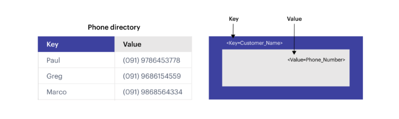

***Redis 사용 용도*** 

  - *캐싱*
  - *세션 관리*
  - *실시간 데이터 처리(채팅, 게임 순위 등)*
  - *Message Queue*
  - *Shared Memory*

***Redis 작업 속도*** 

*일반 DBMS 같이 디스크(hdd, ssd)에 데이터를 쓰는 구조가 아니라 메모리(ram)에서 데이터를 처리하기 때문에 작업 속도가 상당히 빠르다.* 

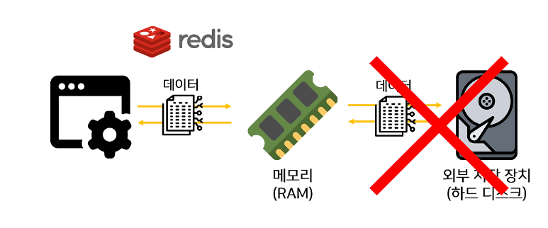

***Redis 인기 이유***

*Java, Python, PHP, C, C++, JavaScript, Node.js 등등.. 많은 프로그래밍 언어 프레임워크에 대한 API를 폭넓게 지원한다.* 

  - [https://redis.io/docs/latest/develop/clients/](https://redis.io/docs/latest/develop/clients/)

***Redis 특징 정리*** 

  - *NoSql DBMS(비관계형 데이터베이스)로 분류 In Memory 기반의 Key - Value 구조를 가진 데이터 관리 시스템*
  - *메모리 기반이라 모든 데이터들을 메모리에서 저장하고 → 조회에 매우 빠르다.* 
  - *메모리에 상주하면서 서비스의 상황에 따라 데이터베이스로 사용될 수 있으며, Cache로 사용될 수 있다.* 
  - *Remote Data Storage로 여러 서버에서 같은 데이터를 공유해서 보고 싶을 때 사용할 수 있다.* 
  - *다양한 자료구조를 지원한다* 
- *Strings*
    - *Set*
    - *Sorted-Set*
    - *Hashes*
    - *List*
  - *쓰기 성능 증대를 위한 클라이언트 측 샤딩(Sharding)을 지원한다* 
- *Sharding: 같은 테이블 스키마를 가진 데이터(row)를 다수의 데이터베이스에 분산하여 저장하는 방법* 
    - [https://20240228.tistory.com/417](https://20240228.tistory.com/417)
  - *메모리 기반이지만 Redis는 영속적인 데이터 보존(Persistence)이 가능하다.* 
  - *스냅샷 기능을 제공해 메모리 내용을 *.rdb 파일로 저장하여 해당 시점으로 복구할 수 있다.*
  - *여러 프로세스에서 동시에 같은 key에 대한 갱신을 요청하는 경우, 데이터 부정합 방지 Atomic 처리 함수를 제공한다.(원자성)*
  - *Redis는 기본적으로 1개의 싱글 쓰레드로 수행되기 때문에, 안정적인 인프라를 구축하기 위해서는 Reflication(Master-Slave 구조)는 필수이다.*

# ***Redis 활용하기 - 캐시(Cache)***

## ***what is cache?***

*Cache란 한번 조회된 데이터를 미리 특정 공간에 저장해놓고, 똑같은 요청이 발생하게 되면 서버에게 다시 요청하지 말고 저장해놓은 데이터를 제공해서 빠르게 서비스를 제공해 주는 것을 의미한다.*

*즉, 미리 결과를 저장하고 나중에 요청이 오면 그 요청에 대해서 DB 또는 API를 참조하지 않고 Cache를 접근하여 요청을 처리하는 기법이다.* 

*서비스를 처음 운영할 때는 WEB-WAS-DB 정도로 간단하게 인프라를 구축하는데, 사용자가 늘어나면 DB에 무리가 간다.*

*DB는 데이터를 디스크에 직접 쓰기 때문에 서버에 문제가 발생해도 데이터가 손실되지는 않지만, 매 트랜잭션마다 디스크에 접근해야 하므로 부하가 많아지면 성능이 떨어진다.* 

*MySQL은 버퍼 풀(메모리)에 데이터 페이지를 캐시 해두고 이미 데이터가 있다면 바로 반환하고 데이터 페이지가 변경된 페이지 즉, Dirty Page는 리두 로그에 저장하여 쓰기 지연 방식으로 성능을 올린다.* 

*→ 즉, 매 트랜잭션마다 디스크 I/O를 하지는 않을 수 있다.*

***BUT!!***

*하지만 사용자가 계속 늘어나서 DB 부하가 심해지면 DB를 스케일 인(버퍼 풀 크기 확장 & 리두 로그 크기 확장) 또는 스케일 아웃(Reflication, Sharding)하는 방식 외에도 캐시 서버를 검토하게 된다.*

*Redis Cache는 메모리 단(In - Memory)에 위치한다. 따라서 용량은 적지만 접근 속도가 빠르다* 

*다만 저장하려는 데이터 셋이 주어진 메모리 크기보다 크면 디스크를 쓰는 것이 올바른 선택이다.* 

## *캐시의 구조 패턴* 

### *Look aside Cache 패턴* 

*look aside cache는 캐시를 한 번 접근하여 데이터가 있는지 판단한 후, 있다면 캐시의 데이터를 사용하고 없으면 실제 DB 또는 API를 호출한다.* 

***Look aside Cache 동작 순서*** 

  1. *클라이언트가 데이터 요청* 
  1. *서버에서 캐시에 데이터 존재 유무 확인* 
  1. *데이터가 있다면 캐시의 데이터 사용(빠른 조회 / Cache Hit)*
  1. *데이터가 없다면 실제 DB 데이터에 접근(Cache Miss)*
  1. *DB에서 받아온 데이터를 캐시에 저장하고 클라이언트에게 반환* 

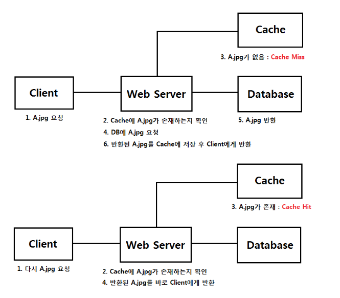

### *Write Back 패턴* 

*write back 패턴은 주로 쓰기 작업이 많아서 INSERT 쿼리를 일일이 날리지 않고 한꺼번에 배치 처리를 하기 위해 사용한다.* 

***example***

*영어 듣기 평가를 온라인으로 진행하는 서비스가 있을 때 여러 학생이 동시에 제출 버튼을 누르면 DB에 갑작스럽게 엄청난 쓰기 요청이 몰리게 되면 DB 서버가 죽을 수도 있다.* 

*이때 write back 기반의 캐시를 사용하면 캐시 메모리에 데이터를 저장해 놓고, 이후 DB 디스크에 업데이트 해주면 안전하게 쓰기 작업을 이행할 수 있는 것이다.* 

*즉, insert 쿼리를 1개씩 500번 수행하는 것보다 500개를 한번에 삽입하는 동작이 훨씬 빠르기 때문에 write back 방식은 빠른 속도로 서비스가 가능하다.* 

***why 쿼리를 1개씩 500번 수행하는 것보다 500개를 한번에 삽입하는 동작이 더 빠를까?***

  - *500개의 트랜잭션 VS 1개의 트랜잭션 배치 처리* 
  - *데이터 처리를 1개의 트랜잭션 단위로 묶어서 데이터 무결성과 일관성을 보장* 
  - *디스크 I/O 감소 각각 하면 매번 로그 기록 및 디스크 동기화 작업이 발생하지만 1개로 묶으면 중간 단계에서 디스크 I/O가 줄어들고 커밋 시점에 한 번만 동기화된다.* 
  - *네트워크 부하 감소 (통신 횟수)*
  - *DB 최적화 → 내부에서 배치 작업(Batch Processing)으로 처리되어 더 빠르게 실행* 

***Write Back 패턴 문제점***

  - *DB에 데이터를 저장하기 전에 캐시 서버가 죽으면 데이터가 유실된다.* 
  - *그래서 재생 가능한 데이터나, 극단적으로 무거운 데이터에서 해당 패턴을 사용한다.* 
  - *EX) 로그를 캐시에 저장하고 특정 시점에 DB에 한번에 저장* 

***Write Back 동작 순서*** 

  1. *모든 데이터를 캐시 서버에 저장* 
  1. *캐시의 데이터를 일정 주기마다 DB에 한꺼번에 저장(배치 작업)*
  1. *그리고 DB에 저장했으니 잔존 데이터를 캐시에서 제거* 

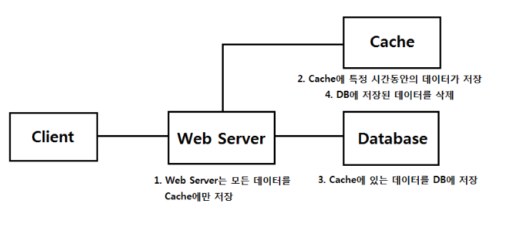

# *Redis 캐시의 활용 사례*

### ***Twitter***

*트위터는 140자 정도의 짧은 글을 올릴 수 있는 SNS이다.* 

*트위터에서의 타임라인은 사용자가 구독하는 사용자들의 최근 트윗을 확인할 수 있는 페이지이다.* 

*2012년 당시 트위터는 15만 명이 넘는 동시 접속자와 초당 30만 건이 넘는 타임라인 요청이 발생했었다.*

*이러한 규모의 타임라인 요청을 DB에 직접 접근하는 방식으로 처리하면 Query가 복잡해짐에 따라 속도가 현저히 떨어지는 문제가 발생한다.* 

*트위터는 해당 문제를 해결하기 위해서 Redis를 사용하였다고 한다.* 

*트위터는 데이터 센터에 존재하는 방대한 양의 Redis Cluster는 각 사용자의 타임라인에 노출될 트윗의 정보(Tweet ID, 작성자 ID)를 List 형태로 약 800개 정도 캐싱한다.* 

*발생하는 타임라인 요청은 바로 데이터베이스로 접근하지 않고 Redis에 캐싱된 타임라인 정보를 먼저 가져와서, 이를 토대로 Query를 단순화하여 DB에 접근하여 처리한다.* 

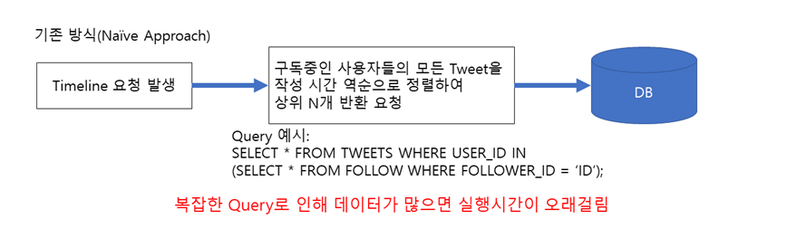

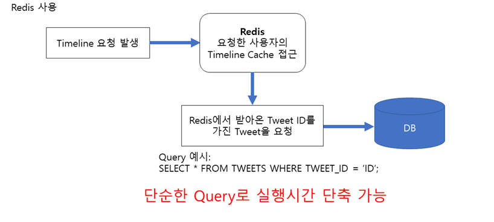

*단, 모든 사용자의 타임라인을 캐싱하면 메모리가 부족해질 수 있으므로, 로그인을 안한 지 30일이 지난 사용자의 타임라인은 Redis Cluster에서 삭제하도록 설정하였다.*

*Redis Cluster에서 삭제된 사용자의 Timeline 정보는 해당 사용자가 다시 로그인 할 시에 재생성 하는데 이때 데이터베이스에 직접 접근하는 과정이 필요하기에 시간이 다소 소요될 수도 있다.*

### ***Redis 사용하는 곳*** 

  - *인증 토큰 저장(Strings or Hash)*
  - *Ranking 보드로 저장(Sorted-Set)*
  - *유저 API Limit*

### ***Redis Cache 중간 정리*** 

*이처럼 Redis는 RDBMS의 캐시 솔루션으로 사용 용도가 굉장히 높다.*

*일반적으로 데이터베이스는 저장장치에 저장이 되는데, 데이터베이스를 조회하려면 저장장치로 i/o가 발생하게 된다.*

*RDBMS에서 SELECT 쿼리문을 날려 특정 데이터들을 FETCH했을 때, RDBMS의 구조상 DISK에서 데이터를 꺼내오는 데 Memory에서 읽어들이는 것보다 천배 가량 더 느리다.*

*예를 들어 데이터베이스에 접근하여 10,000개의 레코드를 읽는다고 가정했을 때 disk에 저장되어 있다면 약 30초의 시간이 걸리는 반면 RAM에서 읽을 경우엔 약 0.0002초 밖에 걸리지 않는다.*

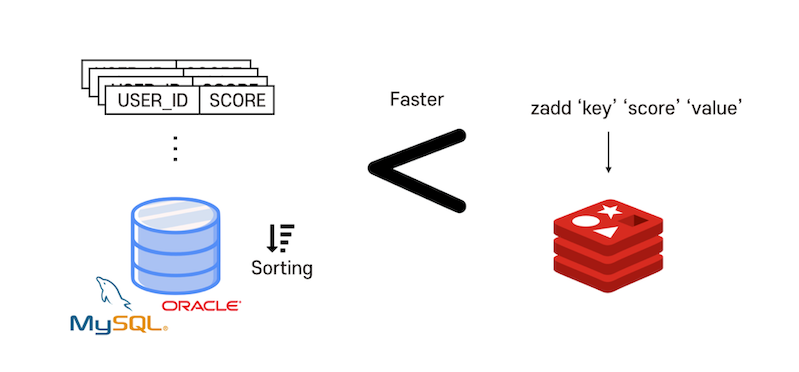

*따라서 Redis같은 유연한 자료구조를 가지는 인메모리 Key-Value 솔루션을 사용하여 DB 부하의 Read 연산의 부하를 분산시키는 데 적용한다.*

*또한 RAM은 휘발성인데 그럼 실행중인 Redis를 끄면 데이터가 전부 날라간다고 생각이 들게 되는데,*

*Redis는 In-Memory 이지만 persistant on-disk 데이터베이스 이기도 하다.*

*Redis는 특정한 때에 현재까지의 in-memory 상태를 disk에 저장해 두었다가 Redis를 다시 시작했을 때 disk에 저장해 두었던 dump 파일들을 load 하기 때문에 데이터의 손실 발생을 방지할수도 있다.*

# *Redis 활용하기 - 세션 스토어(Session Store)*

### *분산 서버 처리 환경에서의 세션 불일치* 

*실무에서는 트래픽 부하를 방지하기 위해 로드밸런서에 서버를 여러대 운영한다.* 

*그러나 서버를 여러대를 운영하게 되면 클라이언트의 세션이 서로 서버마다 달라 서비스 이용에 지장을 줄 수 있다는 문제점을 가지게 된다.*

[https://inpa.tistory.com/entry/WEB-%F0%9F%8C%90-%EC%84%B8%EC%85%98Session-%EB%B6%88%EC%9D%BC%EC%B9%98-%EB%AC%B8%EC%A0%9C-%ED%95%B4%EA%B2%B0%EB%B2%95-%E2%B8%A2%EC%84%9C%EB%B2%84-%EB%8B%A4%EC%A4%91%ED%99%94-%ED%99%98%EA%B2%BD-%E2%B8%A5](https://inpa.tistory.com/entry/WEB-%F0%9F%8C%90-%EC%84%B8%EC%85%98Session-%EB%B6%88%EC%9D%BC%EC%B9%98-%EB%AC%B8%EC%A0%9C-%ED%95%B4%EA%B2%B0%EB%B2%95-%E2%B8%A2%EC%84%9C%EB%B2%84-%EB%8B%A4%EC%A4%91%ED%99%94-%ED%99%98%EA%B2%BD-%E2%B8%A5)

## ***Redis vs Memcached***

*세션을 저장하는데 있어, In-memory DB를 활용하는 것이 효율적이라는 것을 배웠다.*

*같은 RDBMS라도 MySQL, MSSQL, Oracle 등의 종류가 있듯이 In-memory DB에도 다양한 DB가 존재한다.*

*그 중에서도 세션 저장소로 가장 많이 사용되는 In-Memory 기반의 디비로는 Redis와 Memcached가 있다.* 

***공통 특징*** 

  - *무료 오픈소스 데이터베이스* 
  - *In-Memory 기반* 
  - *Key-Value 형태로 저장되기 때문에 같은 Key-Value 형태로 저장되는 세션 데이터를 다루는데 적합하다* 


***비교*** 

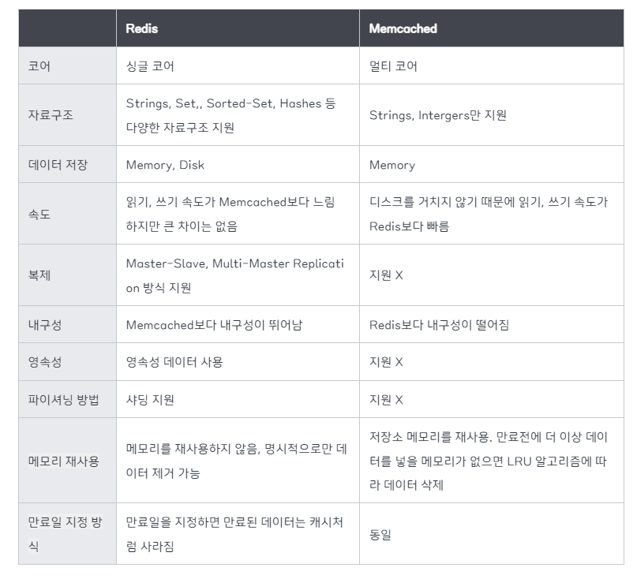

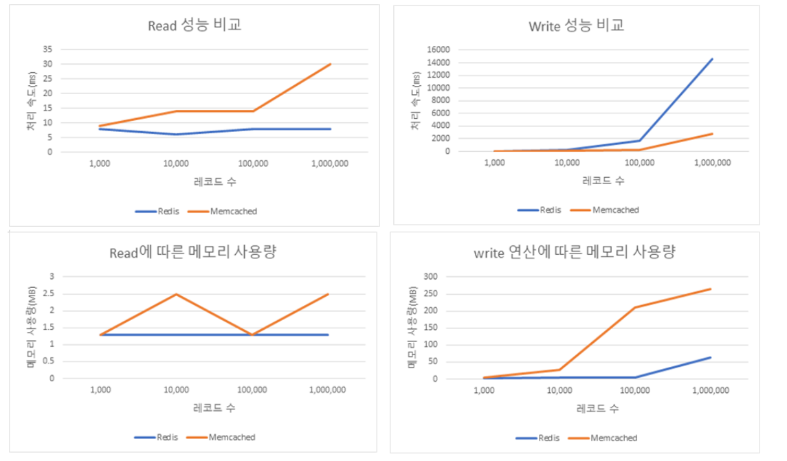

***READ 성능  - Redis > Memcached***

***WRITE 성능 - Memcached > Redis***

*세션 관련 작업의 경우, 쓰기 연산보다는 읽기 연산이 압도적으로 높은 작업이다.* 

*따라서 Redis를 사용하는 게 합리적이다.* 

*또한 Redis가 READ/WRITE에 있어서 메모리 또한 효율적으로 사용하는 것을 볼 수 있다.* 

*정리하면 쓰기 성능에서는 Memcached가 앞서지만 메모리 사용 효율과 처리속도, 다양한 자료구조 지원과 아키텍처 지원을 모두 고려하면 Redis가 상대적으로 합리적인 선택임을 알 수 있었다.*

# ***Redis 문제점(주의점)***

## *시간 복잡도* 

***레디스는 싱글 스레드 기반으로 돌아간다.*** 

*그래서 한 번에 딱 하나의 명령어만 실행하기 때문에, 긴 처리시간이 필요한 명령어를 쓰면 불리하고 요청 건을 처리하기 전까지 다른 서비스 요청을 받아들일 수 없고 서버가 다운되는 현상이 일어날 수 있다.* 

*따라서 전체 데이터를 다루는 시간 복잡도를 가진 O(N) 명령어* *`keys`* *,* *`flush`* *,* *`getall`* *는 주의해서 사용할 필요가 있다.*

  - *`KEYS`**: 특정 패턴에 맞는 모든 키를 검색한다. 키 수가 많을 경우 심각한 성능 저하를 초래* 
  - *`FLUSHALL`* */* *`FLUSHDB`* *: Redis의 모든 키를 삭제한다. 데이터 크기에 따라 처리 시간이 오래 걸릴 수 있다.* 
  - *`HGETALL`* *: 특정 해시 키의 모든 필드와 값을 가져온다. 해시에 저장된 필드 수에 따라 시간이 증가한다.* 

## *메모리 파편화*

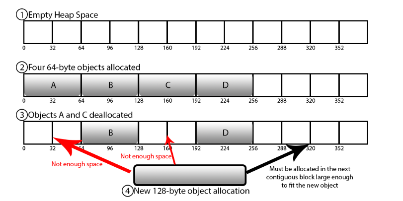

*메모리를 할당받고 해제하는 과정에서 아래 그림과 같이 부분부분 빈 공간이 생기게 되는데, 4번같이 새로운 메모리를 할당할 때 알맞는 공간(4칸)이 없기 때문에 마지막 부분(우측) 부분에 프로세스가 위치해야 되고, 그러면 빈 공간 메모리가 남아 낭비가 발생하게 된다.*

*그리고 이 현상이 계속되면 실제 physical 메모리가 커져 프로세스가 죽는 현상이 발생 할 수도 있다.또한 쓰기 연산이 copy on wirte 방식으로 동작하기 때문에 최대 메모리를 2배 이상까지 사용하기도 한다.*

*그래서 redis를 사용할 때 메모리를 적당히 여유 있게 사용하는 것이 좋다.*

---

# 강의 정리 

# ***링크***

[https://gaesae.com/161](https://gaesae.com/161)

    - ***윈도우10 WSL2 설치***

[https://redis.io/docs/latest/operate/oss_and_stack/install/install-redis/install-redis-on-windows/](https://redis.io/docs/latest/operate/oss_and_stack/install/install-redis/install-redis-on-windows/)

    - ***Windows에 Redis 설치***

# ***DISM 명령어 실행 오류 해결 방법***

*`DISM`* *명령어가 실행되지 않는 이유는* *`PowerShell`**에서 해당 명령을 인식하지 못하거나, 환경 변수에* *`DISM.exe`* *경로가 올바르게 설정되지 않았기 때문이다.* 

*`DISM.exe`**는 일반적으로 경로* *`C:\Windows\System32`**에 위치해 있다.*

*환경 변수에* *`C:\Windows\System32`**가 포함되어 있는지 확인하려면 PowerShell에서 다음 명령을 실행*

```shell
$env:Path
```


*출력된 경로에* *`C:\Windows\System32`**가 없으면 다음 명령으로 추가*

```shell
$env:Path += ";C:\Windows\System32"
```

***성공!***


# *우분투 Redis 실행*

***Redis 서비스 시작***

```shell
sudo service redis-server start
```

***Redis 클라이언트 접속*** 

```shell
redis-cli
```

***Redis test***

```shell
ping
```

    - *pong*


# *Redis 특징*

    - ***In-Memory*** *모든 데이터를 RAM에 저장 (백업 / 스냅샷 제외)*
    - ***Single Threaded*** *단일 thread에서 모든 task 처리*
    - ***Cluster Mode*** *다중 노드에 데이터를 분산 저장하여 안정성 & 고가용성 제공*
    - ***Persistence*** *RDB(Redis Database) + AOF(Append only file) 통해 영속성 옵션 제공*
    - ***Pub/Sub*** *Pub/Sub 패턴을 지원하여 손쉬운 어플리케이션 개발(e.g 채팅, 알림 등)*

# ***Pub/Sub 패턴***

    1. ***발행자(Publisher)***
- *특정 이벤트나 메시지를 발행하는 역할을 한다.*
      - *발행자는 메시지를 전달할 구독자가 누구인지 알지 못한다.*
      - *메시지는 특정 주제(Topic) 또는 채널(Channel)에 발행된다*
    1. ***구독자(Subscriber)***
- *특정 주제에 대해 구독하여 발행된 메시지를 수신한다*
      - *구독자는 발행자가 누구인지 알 필요가 없다.*
    1. ***중앙 메시징 시스템 (Broker)***
- *발행자와 구독자 간의 중재 역할을 한다.*
      - *메시지를 발행자로부터 수신하고, 이를 구독자들에게 전달한다.*
      - *대표적인 예: Apache Kafka, RabbitMQ, Redis Pub/Sub, Google Cloud Pub/Sub.*

***Pub/Sub (Publish/Subscribe) 패턴****은 소프트웨어 설계에서 메시징 시스템을 설계하는 데 자주 사용되는 패턴으로, 발행자(Publisher)와 구독자(Subscriber)가 직접적으로 서로 알 필요 없이 메시지를 주고받을 수 있도록 해준다. 
이 패턴은* ***느슨한 결합****(loose coupling)을 제공하여 확장성과 유연성을 높이는 데 큰 도움을 준다.*

# *Redis 장점*

    - ***높은 성능*** *모든 데이터를 메모리에 저장하기 때문에 매우 빠른 읽기/쓰기 속도 보장*
    - ***Data Type 지원***  *Redis에서 지원하는 Data type을 잘 활용하여 다양한 기능 구현*
    - ***클라이언트 라이브러리*** *Python, Java, JavaScript 등 다양한 언어로 작성된 클라이언트 라이브러리 지원*
    - ***다양한 사례 / 강한 커뮤니티*** *Redis를 활용하여 비슷한 문제를 해결한 사례가 많고, 커뮤니티 도움 받기 쉬움*

# ***Redis 사용 사례***

    - ***Caching*** *임시 비밀번호(One-Time Password) 로그인 세션(Session)*
    - ***Rate Limiter***  *Fixed-Window / Sliding-Window Rate Limiter(비율 계산기)*
    - ***Message Broker*** *메시지 큐(Message Queue)*
    - ***실시간 분석 / 계산***  *순위표(Rank / Leaderboard), 반경 탐색(Geofencing),
방문자 수 계산(Visitors Count)*
    - ***실시간 채팅***  *Pub/Sub 패턴*

# *Redis Persistence*

***Persistence(영속성)***

    - *Redis는 주로 캐시로 사용되지만 데이터 영속성을 위한 옵션 제공*
    - *SSD와 같은 영구적인 저장 장치에 데이터 저장*

***RDB(Redis Database) 옵션***

    - *Point-in-time Snapshot → 재난 복구(Disaster Recovery) 또는 복제에 주로 사용*
    - *일부 데이터 유실의 위험이 있고, 스냅샷 생성 중 클라이언트 요청 지연 발생*

***AOF(Append Only File) 옵션***

    - *Redis에 적용되는 Write 작업을 모두 log로 저장*
    - *데이터 유실의 위험이 적지만, 재난 복구시 Write 작업을 다시 적용하기 때문에 RDB 보다
느림*

*Redis 에서는 RDB + AOF 함께 사용하는 옵션을 제공한다.*

# ***Redis Caching***

***캐싱(Caching)***

    - *데이터를 빠르게 읽고 처리하기 위해 임시로 저장하는 기술*
    - *계산된 값을 임시로 저장해두고, 동일한 계산 / 요청 발생시 다시 계산하지 않고 저장된 값
바로 사용*
    - *캐시(Cache) = 임시 저장소*


***사용 사례***

    - ***CPU 캐시*** *CPU와 RAM의 속도 차이로 발생하는 지연을 줄이기 위해 L1, L2, L3 캐시
사용*
    - ***웹 브라우저 캐싱*** *웹 브라우저가 웹 페이지 데이터를 클라이언트 로컬 저장소에 저장하여 해당 페이지 재방문시 사용*
    - ***DNS 캐싱*** *이전에 조회한 도메인 이름과 해당하는 IP 주소를 저장하여 재요청시 사용*
    - ***데이터베이스 캐싱(MySQL Buffer Pool)*** *데이터베이스 조회나 계산 결과를 저장하여 재요청시 사용*
    - ***CDN*** *원본 서버의 컨텐츠를 PoP 서버에 저장하여 사용자와 가까운 서버에서 요청*
    - ***어플리케이션 캐싱*** *어플리케이션에서 데이터나 계산 결과를 캐싱하여 반복적 작업*

# ***Cache Hit / Miss***


# ***Cache Aside Pattern***


# *Strings*

*문자열, 숫자, serialized object(JSON string) 등 저장*

## ***Strings명령어***

***[SET] Strings 저장***

```shell
SET lecture inflearn-redis
```

      - ***key: lecture, value: inflearn-redis***

***[GET] Strings 조회***

```shell
GET lecture
```

      - ***return: inflearn-redis***

***[MSET] n개의 Strings 저장***

```shell
MSET price 100 language ko
```

      - ***key: price, value: 100***
      - ***key: language, value: ko***

***[MGET] n개의 Strings 조회***

```shell
MGET lecture price language
```


***[INCR] 주어진 키의 값을 1 증가*** 

```shell
INCR price
```

      - ***키가 존재하지 않으면***  *Redis는 해당 키를 0으로 초기화한 후 증가*
      - ***키가 존재하고 정수값인 경우:*** *값을 1 증가*
      - ***키가 숫자가 아닌 경우:*** *오류를 반환*


***[INCRBY]*** *특정 키의 값을* ***주어진 정수만큼 증가****시키는 명령어*

```shell
INCRBY price 9
```

      - ***키가 존재하고 정수값인 경우****: 지정된* *`increment`* *값만큼 증가*
      - ***키가 존재하지 않는 경우****: 키를 0으로 초기화한 후* *`increment`* *값만큼 증가*
      - ***키가 숫자가 아닌 경우****: 오류가 반환*


***[SET] JSON Strings 형태 저장***

```shell
SET inflearn-redis '{"price": 100, "language": "ko"}'
```


***Redis naming Convention***

```shell
 SET inflearn-redis:ko:price 200
```

# ***Redis Lists?***

      - *String을 Linked List로 저장 → PUSH / POP 최적화 (O(1)*
      - *Linked List → Double Linked List 해당 노드의 앞 노드와 뒤 노드의 포인터를 가진다.*
      - *Queue(FIFO) / Stack(FILO) 구현에 사용한다*


# ***Queue, Stack 구현***


      - *RPOP → 가장 오른쪽 즉, 먼저 들어간 데이터를 빼기 때문에 FIFO(큐)로 동작*
      - *LPOP → 가장 왼쪽 즉, 가장 늦게 들어간 데이터를 빼기 떄문에 FILO(스택)으로 동작*

```shell
RPOP queue
LPOP queue
```

# ***RANGE 범위 검색*** 

***먼저 LPUSH 통해서 데이터 2개 더 넣기*** 

```shell
LPUSH queue job4 job5
```


***현재 queue에 있는 데이터*** 

*→ job5, job4, job3, job2*

***전체 조회*** 

```shell
LRANGE queue 0 -1
```


      - *LRANGE: 0(제일 왼쪽) -1(가장 오른쪽)*

***job2, job3 조회***

```shell
LRANGE queue 2 3
```

```shell
LRANGE queue -2 -1
```

```shell
LRANGE queue -2 3
```


***[LTRIM] 지정한 범위에 해당하는 데이터만 남기기*** 

      - *현재 queue 데이터 job5 ~ job4*
      - *job5, job4 제외 데이터 삭제* 

```shell
LTRIM queue 0, 1
```

      - *다시 전체 조회*


# *표로 정리*

| 명령어 | 설명 |
| --- | --- |
| **LPUSH** | 리스트의 왼쪽(앞)에 하나 이상의 값을 추가 |
| **RPUSH** | 리스트의 오른쪽(뒤)에 하나 이상의 값을 추가 |
| **LPOP** | 리스트의 왼쪽(앞)에서 값을 제거하고 반환 |
| **RPOP** | 리스트의 오른쪽(뒤)에서 값을 제거하고 반환 |
| **LRANGE** | 리스트에서 지정된 범위의 값을 반환 |
| **LTRIM** | 리스트에서 지정된 범위 외의 값들을 잘라낸다. |
| **LINDEX** | 리스트의 특정 인덱스 위치에 있는 값을 반환 |
| **LLEN** | 리스트의 길이를 반환 |
| **LREM** | 리스트에서 지정된 값을 제거 |
| **LSET** | 리스트의 특정 인덱스에 값을 설정 |

# ***Redis Sets?***

*Unique String을 저장하는 정렬되지 않은 집합* 

*Set Operation 사용 가능(intersection(교집합), union(합집합), difference(차집합))*

# *Redis Sets 명령어*

***[SADD] Sets 추가 명령어***

```shell
 SADD user:1:fruits apple banana orange orange
```


      - *Unique String을 저장하기 때문에 중복인 orange는 저장하지 않는다.*

***[SMEMBERS] Sets 전체 조회 명령어***

```shell
SMEMBERS user:1:fruits
```


***[SCARD] Sets*** ***원소 개수를 조회하는 명령어***

```shell
SCARD user:1:fruits
```


***[SISMEMBER] Sets에 특정 원소 포함 여부 확인 명령어***

```shell
SISMEMBER user:1:fruits
```


### ***Set Operation (집합 연산)***

      - ***SINTER: 교집합***
      - ***SDIFF: 차집합***
      - ***SUNION:  합집합***


***user:2:fruits 추가*** 

```shell
SADD user:2:fruits apple lemon
```

      - *apple, lemon 추가* 

***[SINTER] 2개의 Sets 교집합 명령어***

```shell
SINTER user:1:fruits user:2:fruits
```


***[SDIFF] 2개의 Sets 차집합 명령어***

```shell
SDIFF user:1:fruits user:2:fruits
```


      - ***차집합: user:1:fruits - (user:1:fruits 교집합 user:2:fruits)***

***[SUNION] 2개의 Sets 합집합 명령어***

```shell
 SUNION user:1:fruits user:2:fruits
```


# ***Redis Hashes?*** 

 *field-value 구조를 갖는 데이터 타입*

*다양한 속성을 갖는 객체의 데이터를 저장할 때 유용*

# ***Redis Hashes 명령어***

 ***[HSET] Hash*** ***자료구조에 필드와 값을 설정하는 명령어***

```shell
 HSET lecture name inflearn-redis price 100 language ko
```

      - *KEY: lecture*
      - *Field1: name       Value1: inflearn-redis*
      - *Field2: price        Value2: 100*
      - *Field3: language Value3: ko*


 ***[HGET] Hash*** ***자료구조 조회 명령어***

```shell
HGET lecture name 
HGET lecture price
HGET lecture language
```


***[HMGET] Hash 자료구조에서 하나 이상의 필드의 값을 조회 명령어***

```shell
HGET lecture name price language
```


      - *존재하지 않는 field인 invalid, invalid2는 결과로 nil이 나온다.*

***[HINCRBY] Hash 자료구조의 특정 필드에 대해 정수 값을 증가시키는 명령어***

```shell
HINCRBY lecture price 5
```


      - *숫자 타입이 아니면 에러가 난다.*
      - *존재하지 않는 필드면 0으로 초기화하고 5를 추가한다.*


# ***Redis Sorted Sets?***

*ZSets라고도 부른다.*

*Unique string을 연관된 score를 통해 정렬된 집합(Set의 기능 + 추가로 score 속성 저장)*

*내부적으로 Skip List + Hash Table로 이루어져 있고, score 값에 따라 정렬 유지
score가 동일하면 lexicographically(사전 편찬 순) 정렬*

# ***Redis Sorted Sets 명령어***


***[ZADD] Sorted Sets 데이터 추가*** 

```shell
ZADD points 10 TeamA 10 TeamB 50 TeamC
```

      - *Key: points*
      - *Score1: 10 Value1: TeamA*
      - *Score2: 10 Value2: TeamB*
      - *Score3: 50 Value3: TeamC*


***[ZRANGE] Sorted Set 자료구조의 원소들을 점수(score) 기준으로 범위에 맞게 조회하는 명령어*** 

```shell
ZRANGE points 0 -1 
```

      - *오름차순으로 조회*


***[ZRANGE + WITHSCORES] Score도 함께 조회***

```shell
ZRANGE points 0 -1 WITHSCORES
```


***[ZRANGE + REV] 내림차순(역순) 조회***

```shell
ZRANGE points 0 -1 REV
```


***[ZRANK] 등수 조회***

```shell
ZRANK points TeamA
```


# ***What is Streams?***

*append-only log에 Consumer groups과 같은 기능을 더한 자료 구조* 

*unique id를 통해 하나의 entry를 읽을 때, O(1) 시간 복잡도 
Consumer Group을 통해 분산 시스템에서 다수의 consumer가 event 처리*

# ***Redis Streams 명령어***

***[XADD] Redis Streams에 새로운 데이터를 추가할 때 사용***

```shell
 XADD events * action like user_id 1 product_id 1
 XADD events * action like user_id 2 product_id 1
```

      - *데이터를 시간순으로 추가하며, 각 항목은 고유한 ID와 함께 저장*
      - *timestamp-sequence 형식의 고유 ID 생성* 
      - *Streams는 Append-only Log 기반이기 때문에 항상 Streams 끝에 추가된다.* 
      - *ID 자동 생성 →* *`*`* 
- *사용자가 ID를 지정할 수 있지만 보통* *`*`**를 사용하는 게 일반적이다.*

| **ID** | **Fields** | **Values** |
| --- | --- | --- |
| `1674567890123-0` | `action`, `user_id`, `product_id` | `like`, `1`, `1` |
| `1674567890456-0` | `action`, `user_id`, `product_id` | `like`, `2`, `1` |


***[XRANGE] Stream에서 특정 범위에 해당하는 항목들을 조회할 때 사용하는 명령어***

```shell
XRANGE events - + 
```


      - *ID를 통해서 범위 지정이 가능하다.*

```shell
XRANGE mystream 1674567890123-0 1674567890456-0
```

***[XDEL] 이벤트 삭제***

```shell
XDEL events 1736249713643-0
```


# ***Geospatial Indexes*** 

*좌표를 저장하고, 검색하는 데이터 타입*

*거리 계산, 범위 탐색 등 지원*


# ***Redis Geospatial  명령어***

***GEOADD***

```shell
GEOADD seoul:station 126.923917 37.556944 hong-dae 127.027583 37.497928 gang-nam
```

      - *지오스페이셜 데이터를 Redis에 추가*
      - *KEY: seoul:station*
      - *Value(Member): hong-dae, gang-nam*
- *hong-dae: (126.923917, 37.556944)*
        - *gang-nam: (127.027583, 37.497928)*
      - *경도, 위도 순서대로 넣는다.*

***GEODIST***

```shell
GEODIST seoul:station hong-dae gang-nam KM
```

      - *두 지점 간 거리 계산*


      - *두 역 사이의 거리가 11.2561KM* 

| **명령어** | **설명** | **형식 및 예제** |
| --- | --- | --- |
| **GEOADD** | 지정된 key에 경도(longitude), 위도(latitude), 멤버(member) 추가 | GEOADD key longitude latitude member |
|  |  | **예:** GEOADD seoul:station 126.923917 37.556944 hong-dae 127.027583 37.497928 gang-nam |
| **GEOPOS** | 지정된 멤버의 경도 및 위도를 반환 | GEOPOS key member  |
|  |  | **예:** GEOPOS seoul:station hong-dae gang-nam |
| **GEODIST** | 두 멤버 간의 거리 반환 | GEODIST key member1 member2 [unit] |
|  |  | **예:** GEODIST seoul:station hong-dae gang-nam km |
| **GEORADIUS** (Deprecated) | 특정 좌표를 기준으로 지정된 반경 내의 멤버 검색 (Redis 6.2 이후 GEOSEARCH 사용 권장) | GEORADIUS key longitude latitude radius unit [WITHDIST] [WITHCOORD] [WITHHASH] [COUNT count] [ASC |
|  |  | **예:** GEORADIUS seoul:station 126.923917 37.556944 10 km WITHDIST |
| **GEORADIUSBYMEMBER** (Deprecated) | 특정 멤버를 기준으로 지정된 반경 내의 멤버 검색 (Redis 6.2 이후 GEOSEARCH 사용 권장) | GEORADIUSBYMEMBER key member radius unit [WITHDIST] [WITHCOORD] [WITHHASH] [COUNT count] [ASC |
|  |  | **예:** GEORADIUSBYMEMBER seoul:station hong-dae 10 km WITHDIST |
| **GEOSEARCH** | 반경 또는 사각형 영역 내 멤버 검색 | GEOSEARCH key BYRADIUS center radius unit [WITHDIST] [WITHCOORD] [ASC] |
|  |  | **예:** GEOSEARCH seoul:station BYRADIUS 126.923917 37.556944 10 km WITHDIST |
|  |  | GEOSEARCH key BYBOX center width height unit [WITHDIST] [WITHCOORD] [ASC] |
|  |  | **예:** GEOSEARCH seoul:station BYBOX 126.923917 37.556944 10 5 km |
| **GEOSEARCHSTORE** | GEOSEARCH 결과를 지정된 Redis key에 저장 | GEOSEARCHSTORE destination source BYRADIUS center radius unit [WITHDIST] [ASC |
|  |  | **예:** GEOSEARCHSTORE seoul:nearby seoul:station BYRADIUS 126.923917 37.556944 10 km |

### ***주요 옵션***

| **옵션** | **설명** |
| --- | --- |
| `WITHDIST` | 거리와 함께 반환 (기준점에서 각 멤버까지의 거리 포함) |
| `WITHCOORD` | 경도, 위도 좌표와 함께 반환 |
| `WITHHASH` | Redis 내부에서 사용하는 Geohash 값을 반환 |
| `COUNT count` | 반환 결과를 제한 |
| `ASC` / `DESC` | 거리 기준으로 오름차순(`ASC`) 또는 내림차순(`DESC`) 정렬 |
| `STORE key` | 결과 멤버를 지정된 key에 저장 (위치 정보 제외) |
| `STOREDIST key` | 결과 멤버와 거리를 지정된 key에 저장 |

# ***Redis Bitmaps?*** 

      - *실제 데이터 타입은 아니고, String에 binary operation을 적용한 것*
      - *최대 42억개 binary 데이터 표현 = 2^32(4,294,967,296)*


# ***Redis Bitmaps 명령어***

***SETBIT***

```shell
 SETBIT key offset value
 
 SETBIT user:log-in:23-01-01 123 1
 SETBIT user:log-in:23-01-01 456 1
 SETBIT user:log-in:23-01-02 123 1
```

      - *특정 키에 저장된 문자열 값을 비트 단위로 조작하는 명령어*
      - *문자열의 특정 위치에 있는 비트를 설정(0 또는 1로)할 수 있다.*
      - ***key****: 조작할 문자열이 저장된 키. 키가 없으면 Redis가 새 문자열을 생성*
      - ***offset****: 문자열 내에서 조작할 비트의 위치(0부터 시작하는 인덱스)*
      - ***value****: 설정할 비트 값(0 또는 1)*


***GETBIT***

```shell
GETBIT user:log-in:23-01-01 123
```

      - *특정 위치의 비트 값을 확인*
      - *return 1이면 23년 01월 01일에 123번 user가 로그인을 했다는 의미*
      - *GETBIT user:log-in:23-01-01 → 23년 01월 01일에 로그인한 전체 사용자* 

***BITCOUNT***

```shell
BITCOUNT user:log-in:23-01-01
```

      - *저장된 문자열 값에서 1로 설정된 비트의 개수를 계산하는 데 사용*


      - *23년 01월 01일은 로그인 사용자 2명*
      - *23년 01월 02일은 로그인 사용자 1명*

***BITOP AND***

```shell
BITOP AND result user:log-in:23-01-01 user:log-in:23-01-02
```

      - *지정된 키들 간의 비트 AND 연산을 수행하고, 결과를 새로운 키에 저장*
      - *결과를 result에 저장한다.*
      - *23년 01월 01일 로그인 사용자와 23년 01월 02일 로그인 사용자의 교집합을 구한다.*

***BITOP AND - 동작 설명***

```shell
user:log-in:23-01-01: 사용자 123과 456이 로그인 (123=1, 456=1)
user:log-in:23-01-02: 사용자 123만 로그인 (123=1, 456=0)

AND 연산 
123: 1 AND 1 = 1
456: 1 AND 0 = 0

result:
123 = 1
456 = 0

GETBIT result 123  # 1
GETBIT result 456  # 0
```

      - *여러 조건을 결합하여 특정 상태를 가진 사용자 필터링*

# ***Redis HyperLogLog?***

      - *집합의 cardinality를 추정할 수 있는 확률형 자료구조*
      - *정확성을 일부 포기하는 대신 저장공간을 효율적으로 사용(평균 에러 0.81%)*
      - *VS Set: HyperLogLog는 실제 값을 저장하지 않기 때문에 매우 적은 메모리 사용* 


      - *가정) 이렇게 kiwi, apple 처럼 해시 충돌이 발생하면 오차가 발생한다.*

***정리***
*HyperLogLog는 해시값의 통계적 특성을 활용해 Cardinality를 추정하며, 실제 데이터를 저장하지 않고도 효율적으로 작동한다. 
이로 인해 메모리를 극도로 절약하면서도 매우 큰 데이터셋에서 Cardinality를 빠르게 계산할 수 있다. 
HyperLogLog는 정확도가 약간 떨어질 수 있지만,* ***통계적 추정****이 필요한 대부분의 대규모 데이터 분석 작업에서 유용하다.*

# ***Redis HyperLogLog 명령어***

***PFADD***

```shell
PFADD fruits apple orange grape kiwi
```

      - *HyperLogLog 자료구조에 값을 추가하기 위한 명령어*
      - *Cardinality 값이 변동되면 1을 반환, 반대의 경우 0을 반환*

***PFCOUNT***

```shell
PFCOUNT fruits
```

      - *HyperLogLog에 저장된 Cardinality 추정값을 반환*


# ***Redis BloomFilter?***

      - *element가 집합 안에 포함되었는지 확인할 수 있는 확률형 자료 구조*
      - *정확성을 일부 포기하는 대신 저장공간을 효율적으로 사용*
      - *저장 방식: element를 해싱해서 여러 key(비트)로 나눠서 저장*
      - ***false positive:*** *element가 집합에 실제로 포함되지 않은데 포함되었다고 잘못 예측하는 경우*
- *가정) kiwi, apple 해싱하고 key(비트)로 나눴는데 같은 key값의 결과가 나온다면 2과일 중 하나는 포함되지 않았어도 포함되었다고 결과가 나온다.*
      - *이런 동작 방식 때문에* ***"포함되지 않음"*** *→ 100% 정확*
- *False negative는 발생하지 않는다.*

***특징*** 

*BloomFilter를 사용하려면 RedisBloom 모듈이 필요한데 이는, redis-stack-server에서 제공한다.* 

# 
***Redis BloomFilter 명령어*** 

***BF.MADD***

```shell
 BF.MADD fruits apple orange
```

      - *BloomFilter fruits(key)에 여러 요소를 한 번에 추가하는 명령*


***BF.EXISTS***

```shell
BF.EXISTS fruits apple
BF.EXISTS fruits grape
```

      - *BloomFilter fruits(key)에 apple(element)이 포함되어 있는지 확인*

# ***데이터 만료?***

      - ***Expiration:*** *데이터를 특정시간 이후에 만료 시키는 기능*
      - ***TTL(Time To Live):*** *데이터가 유효한 시간(초 단위)*
      - **특징**
- *데이터 조회 요청시에 만료된 데이터는 조회되지 않음*
        - *데이터가 만료되자마자 삭제하지 않고, 만료로 표시했다가 백그라운드에서 주기적으로 삭제*

# ***데이터 만료 명령어***

```shell
SET greeting hello
EXPIRE greeting 10
TTL greeting
GET greeting
SETEX greeting 10 hello
```


      - *TTL 결과가 -1은 데이터 만료 설정이 없다는 뜻* 
- *데이터가 영구적으로 저장*
        - *물론 인 메모리 기반이기 때문에 디스크에 영속화하지 않는 이상 날라간다.*


      - *EXPIRE greeting 10: → 데이터 만료 10초로 설정* 
      - *TTL greeting: → 데이터 만료까지 남은 시간 결과 확인 5초*
      - *5초가 지나고 조회하자 nil 데이터가 없다고 나온다.*


      - *SETEX greeting 10 hi → 만료 시간과 함께 저장*

# ***Redis SET NX/XX?***

      - *NX 해당 Key가 존재하지 않는 경우에만 SET*
      - *XX 해당 Key가 이미 존재하는 경우에만 SET*
      - *Null Reply:  SET이 동작하지 않은 경우 (nil) 응답*

# ***Redis SET NX/XX 실습***

```shell
SET greeting hello NX
SET greeting hello XX
```


      - *SET greeting hello NX → greeting KEY가 존재하지 않아서 성공*
      - *SET greeting hi XX → greeting KEY가 존재해서 성공*
      - *SET greeting hi2 NX → greeting KEY가 존재해서 실패*
      - *SET greeting2 abcd XX → greeting2 KEY가 존재하지 않아서 실패*

# ***Redis Pub/Sub?***

      - *Publisher와 Subscriber가 서로 알지 못해도 통신이 가능하도록 decoupling 된 패턴*
      - *Publisher는 Subscriber에게 직접 메시지를 보내지 않고, Channel에 Publish*
      - *Subscriber는 관심이 있는 Channel을 필요에 따라 Subscribe하며 메시지 수신*
      - *vs. Stream 메시지가 보관되는 Stream과 달리 Pub/Sub은 Subscribe 하지 않을 때 발행된 메시지
수신 불가*

# ***Redis Pub/Sub 실습, 명령어***

***Terminal1 - Subscriber***

```shell
SUBSCRIBE ch:order ch:payment
```

      - *Consumer주문, 결재 채널 구독*

***Terminal2 - Publisher***

```shell
PUBLISH ch:order new-order
```

      - *주문 채널에 new-order 발행*


      - ***Subscriber****는 주문 채널을 구독하고 있어서 new-order 메시지를 받는다.* 

***Terminal2 - Publisher***

```shell
PUBLISH ch:payment new-payment
```


***Terminal2 - Publisher***

```shell
PUBLISH ch:delivery new-delivery
```

      - ***Subscriber****는 배달 채널을 구독하지 않아서 메시지를 받지 못한다.*

# ***Redis Pipelining?***

      - *다수의 commands를 한 번에 요청하여 네트워크 성능을 향상 시키는 기술*
      - *Round-Trip Times 최소화 (Round-Trip count down으로)*
- *Request / Response 모델에서 발생하는 네트워크 지연 시간을 의미*


      - *대부분의 클라이언트 라이브러리에서 지원*

# ***Redis Transaction?***

      - *다수의 명령을 하나의 트랜잭션으로 처리 -> 원자성(Atomicity) 보장*
- *All or Nothing / 모든 작업이 적용되거나 하나도 적용되지 않거나*
      - *중간에 에러가 발생하면 모든 작업 Rollback*
      - *하나의 트랜잭션이 처리되는 동안 다른 클라이언트의 요청이 중간에 끼어들 수 없다*
      - *vs. Pipeline* 
- *Pipeline은 네트워크 퍼포먼스 향상을 위해 여러개의 명령어를 한 번에 요청 즉, 각 명령어는 따로 처리* 
        - *Transcation은 작업의 원자성을 보장하기 위해 다수의 명령을 하나처럼 처리*
        - *Pipeline과 Transaction을 동시에 사용 가능*

# ***Redis Transaction 예제, 명령어***

```shell
$ MULTI
$ INCR foo 
$ DISCARD
$ EXEC
```

      - *MULTI → 트랜잭션 시작* 
      - *DISCARD → 트랜잭션 롤백* 
      - *EXEC → 트랜잭션 커밋* 

***예제 테스트***

```shell
127.0.0.1:6379> MULTI
OK
127.0.0.1:6379(TX)> INCR foo
QUEUED
127.0.0.1:6379(TX)> DISCARD
OK
127.0.0.1:6379> GET foo
(nil)
127.0.0.1:6379> MULTI
OK
127.0.0.1:6379(TX)> INCR foo
QUEUED
127.0.0.1:6379(TX)> EXEC
1) (integer) 1
127.0.0.1:6379> GET foo
"1"
```

# ***One-Time Password?***

      - 인증을 위해 사용되는 임시 비밀번호
- *6자리 랜덤 숫자*


      - *Redis 데이터 만료 기능 활용 (전화번호, 이메일 인증)*

# *Redis Distributed Lock?*

      - *분산 환경의 다수의 프로세스에서 동일한 자원에 접근할 때, 동시성 문제 해결*


# ***Rate Limiter?***

      - *시스템 안정성/보안을 위해 요청의 수를 제한하는 기술, 
IP-Based, User-Based, Application-Based, etc*
      - ***Fixed-window Rate Limiting:*** *고정된 시간(e.g. 1분) 안에 요청 수를 제한하는 방법*


# *Activity Feed ?*

      - *사용자 또는 시스템과 관련된 활동이나 업데이트를 시간순으로 정렬하여 보여주는 기능*
      - ***Fan-Out:*** *단일 데이터를 한 소스에서 여러 목적지로 동시에 전달하는 메시징 패턴*


# ***Shopping Cart?***

      - *사용자가 구매를 원하는 상품을 임시로 모아두는 가상의 공간*
      - *수시로 변경이 발생할 수 있고, 실제 구매로 이어지지 않을 수도 있다*


# ***Login Session?***

      - *사용자의 로그인 상태를 유지하기 위한 기술*
      - ***동시 로그인 제한:*** *로그인시 세션의 개수를 제한하여, 동시에 로그인 가능한 디바이스 개수
제한*


# ***Sliding Window Rate Limiter?***

      - *시간에 따라 Window를 이동시켜 동적으로 요청수를 조절하는 기술*
      - ***vs. Fixed Window***
- *Fixed Window는 window 시간마다 허용량이 초기화 되지만,
Sliding Window는 시간이 경과함에 따라 window가 같이 움직인다*


# ***Geofencing?***

      - *위치를 활용하여 지도 상의 가상의 경계 또는 지리적 영역을 정의하는 기술*


# ***Online Status?***

      - *사용자의 현재 상태를 표시하는 기능*
      - *특징: 실시간성을 완벽히 보장하지는 않는다. 수시로 변경되는 값이다.*


# ***Visitors Count Approximation?*** 

      - *방문자 수(또는 특정 횟수)를 대략적으로 추정하는 경우*
      - *정확한 횟수를 셀 필요 없이 대략적인 어림치만 알고자 하는
경우*


# ***Unique Events ?***

      - *동일 요청이 중복으로 처리되지 않기 위해 빠르게 해당 item이 중복인지 확인하는
방법*


- *대부분의 명령어는 O(1) 시간복잡도를 갖지만, 일부 명령어의 경우 O(N)*
      - *Redis는 Single Thread로 명령어를 순차적으로 수행하기 때문에,
오래 걸리는 O(N) 명령어 수행시, 전체적인 어플리케이션 성능 저하*
      - ***KEYS*** 
- *지정된 패턴과 일치하는 모든 키 key 조회*
        - *Production 환경에서 절대 사용 금지 -> SCAN 명령어로 대체*
      - ***SMEMBERS***
- *Set의 모든 member 반환(N = Set Cardinality)*
      - ***HGETALL*** 
- *Hash의 모든 field 반환(N = Size of Hash)*
      - ***SORT*** 
- *List, Set, ZSet의 item 정렬하여 반환*

# ***Thundering Herd?***

*병렬 요청이 공유 자원에 대해서 접근할 때, 급격한 과부하가 발생하는 문제*


      - *캐싱 적용도 중요하지만 캐시 관리 또한 매우 중요하다*
      - *별도의 배치 작업을 통해서 캐시를 최신화 해야한다.*

# ***Cache Invalidation ?***

      - *캐시의 유효성이 손실 되었거나 변경되었을 때, 캐시를 변경하거나 삭제하는 기술*
- *원본 데이터와의 sync 문제*


## Redis vs HashMap?

L1, L2: local 캐시 

L3: shared 캐시 

  - 불필요하게 여러 서버가 똑같은 캐시 데이터를 Local Cache에 저장할 필요가 있을까? 
  - Local Cache 공간 확보를 위해, 얼마나 많은 램을 추가?

→ 동기화 문제 

## Memcached vs Redis? 

Hazlecast? → 조회 성능은 Redis 보다 좋다

## 서비스가 레디스에 의존적이라면? 

ex) 세션 스토리지 활용 → 레디스 장애  → 서비스 망함 

## 레디스는 싱글 코어 


## I/O Multiplexing?

리눅스는 모든게 파일 → 소켓도 파일? 

소켓을 파일로 간주하면 하나의 스레드가 여러 파일을 관리할 수 있다?

## 레디스 자료구조 

메모리 산정이 필수 


페이지 캐싱: 리눅스 4KB


→ 개발에 적용 가능 

공식 문서 시간 복잡도를 꼭 확인 

## 불안전한 메모리 기반의 레디스 (Redis Persistence)


**AOF VS RDB 보류 …**

## **단일 장애 지점 문제 해결 가능?**

**Replication**


---

# 자료 

[https://kukim.tistory.com/178](https://kukim.tistory.com/178)

[https://inpa.tistory.com/entry/REDIS-%F0%9F%93%9A-Redis%EB%A5%BC-%ED%81%B4%EB%9D%BC%EC%9A%B0%EB%93%9C%EB%A1%9C-%EC%82%AC%EC%9A%A9%ED%95%98%EC%9E%90-Redislabs](https://inpa.tistory.com/entry/REDIS-%F0%9F%93%9A-Redis%EB%A5%BC-%ED%81%B4%EB%9D%BC%EC%9A%B0%EB%93%9C%EB%A1%9C-%EC%82%AC%EC%9A%A9%ED%95%98%EC%9E%90-Redislabs)

- **aws elastic cache가 아닌 무료로 사용할 수 있는 Redislabs 사용하기**

---

