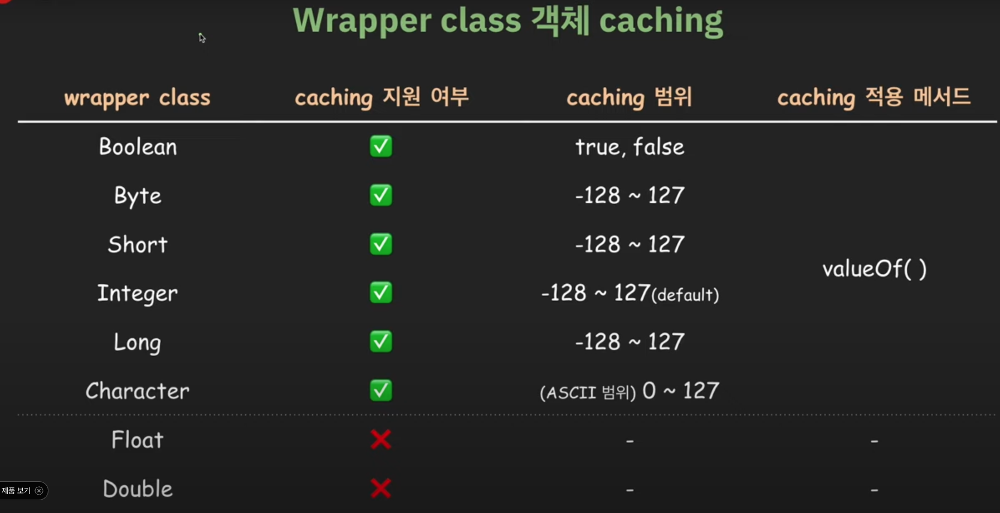
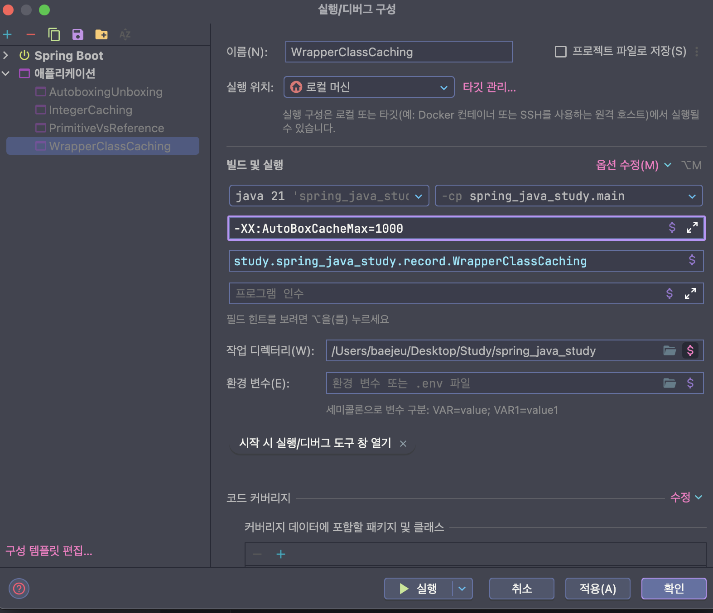

```java
Integer a = 128;
Integer b = 128;
System.out.println(a == b); // false

Integer c = 127;
Integer d = 127;
System.out.println(c == d); // true
```



**valueOf 메서드만 캐싱 적용**

```java
Integer e = new Integer(127);
Integer f = new Integer(127);
System.out.println(e == f); // false: 캐싱 적용은 valueOf 메서드만 가능
```

**Integer caching 범위 튜닝하기**

```plain text
/**
 * Cache to support the object identity semantics of autoboxing for values between
 * -128 and 127 (inclusive) as required by JLS.
 *
 * The cache is initialized on first usage.  The size of the cache
 * may be controlled by the {@code -XX:AutoBoxCacheMax=<size>} option.
 * During VM initialization, java.lang.Integer.IntegerCache.high property
 * may be set and saved in the private system properties in the
 * jdk.internal.misc.VM class.
 *
 * WARNING: The cache is archived with CDS and reloaded from the shared
 * archive at runtime. The archived cache (Integer[]) and Integer objects
 * reside in the closed archive heap regions. Care should be taken when
 * changing the implementation and the cache array should not be assigned
 * with new Integer object(s) after initialization.
 */
 
 위 선택된 코드는 Integer 클래스의 내부 정적 클래스인 IntegerCache에 대한 설명입니다. 
 이 클래스는 자바 언어 명세(JLS)에 따라 -128에서 127 사이의 int 값을 
 자동 박싱(autoboxing)할 때 객체의 동일성을 보장하기 위해 사용됩니다. 
 즉, 이 범위의 값들은 동일한 객체를 재사용하여 메모리 사용을 최적화합니다.  
 
 캐시 초기화 및 사용
 IntegerCache는 처음 사용될 때 초기화됩니다. 
 캐시의 크기는 -XX:AutoBoxCacheMax=<size> 옵션을 통해 조정할 수 있습니다. 
 예를 들어, 이 옵션을 사용하면 캐시의 상한값을 변경할 수 있습니다. 
 초기화 과정에서 java.lang.Integer.IntegerCache.high 속성이 VM 초기화 중에 설정될 수 있으며, 
 이는 시스템 속성으로 저장됩니다.
```



```java
Integer g = 1000;
Integer h = Integer.valueOf(1000);
System.out.println(g == h); // true: Integer 캐싱 범위 튜닝

Integer i = Integer.valueOf(1001);
Integer j = Integer.valueOf(1001);
System.out.println(i == j); // false: 캐싱 범위 밖의 값은 새로 생성됨
```

[https://www.youtube.com/watch?v=im17AoV0zOc&list=PLcXyemr8ZeoQRLFPZz3YKfudotIe-ZJFA&index=7](https://www.youtube.com/watch?v=im17AoV0zOc&list=PLcXyemr8ZeoQRLFPZz3YKfudotIe-ZJFA&index=7)

