**정리 오류 정리**

```
세컨더리 인덱스로 프라이머리 키 탐색 시 커버링 인덱스로 동작한다.
리프 노드에서 세컨더리 인덱스, 프라이머리 키를 갖기 때문에
- 지피티 맹신 금지-  
```

**개요** 

```
MySQL 서버 구성

1. MySQL 엔진(머리 역할)
2. 스토리지 엔진(손발 역할)

누구나 핸들러 API를 만족하는 스토리지 엔진을 구현하면 
MySQL 서버에 추가할 수 있다.

MySQL 엔진과 기본 제공 스토리지 엔진인 InnoDB 공부
```

# 4.1.1 MySQL 전체 구조 

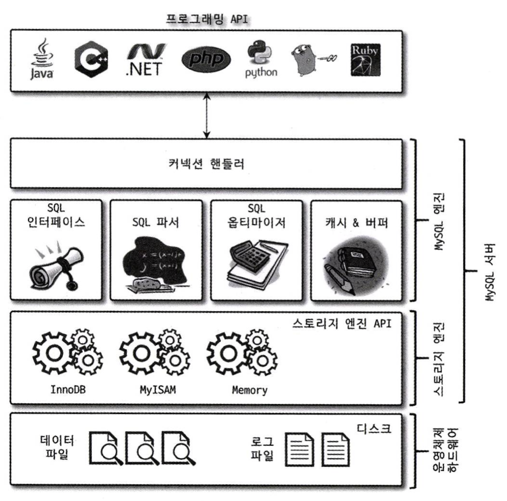

MySQL은 일반 사용 RDBMS와 같이 대부분의 프로그래밍 언어로부터 접근 방법을 모두 지원 

---

## 4.1.1.1 MySQL 엔진

**커넥션 핸들러 + (SQL 파서 및 처리기) + (옵티마이저) = MySQL 엔진** 

**커넥션 핸들러:** 클라이언트로부터 접속 및 쿼리 요청 처리

**옵티마이저:** 쿼리의 최적화된 실행

MySQL은 표준 SQL(ANSI SQL)문법을 지원

---

## 4.1.1.2 스토리지 엔진

MySQL 엔진은 요청된 SQL 문장을 분석하고 최적화하는 두뇌 역할

실제 데이터를 디스크 스토리지에 read/write 하는 부분은 스토리지 엔진이 전담

MySQL 서버에서 엔진은 하나지만 스토리지 엔진은 여러 개를 동시에 사용할 수 있다

**InnoDB 스토리지 엔진 사용 정의** 

```sql
mysql> CREATE TABLE test_table (fd1 INT, fd2 INT) ENGINE=INNODB;
```

테이블에 사용할 스토리지 엔진을 지정하면 이후 해당 테이블의 모든 read/write 작업은 정의된(InnoDB) 스토리지 엔진이 처리한다. 

각 스토리지 엔진은 성능 향상을 위해 키 캐시(MyISAM 스토리지 엔진)나 InnoDB 버퍼 풀(InnoDB 스토리지 엔진) 같은 기능을 내장한다. 

---

## 4.1.1.3 핸들러 API

MySQL 엔진의 쿼리 실행기에서 데이터 read/write 작업은 각 스토리지 엔진에 요청한다.

이러한 요청을 핸들러(Handler) 요청이라고 하고, 여기서 사용되는 API를 핸들러 API라고 한다.

핸들러 API 조회를 통해 얼마나 많은 데이터 작업이 있었는지 확인할 수 있다. 

```sql
mysql> SHOW GLOBAL STATUS LIKE 'Handler%';
```

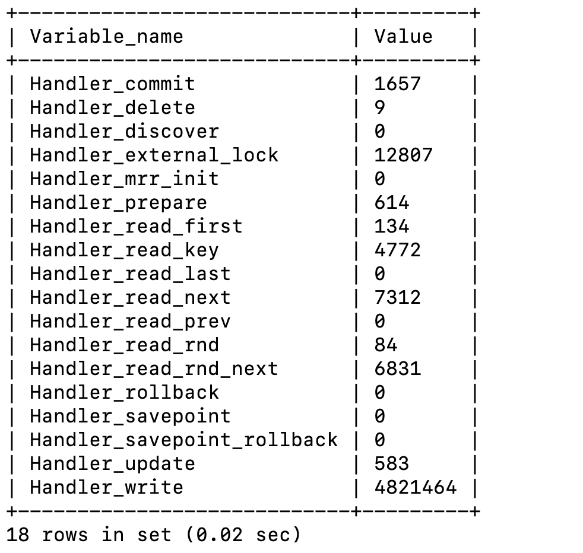

---

# 4.1.2 MySQL 스레딩 구조

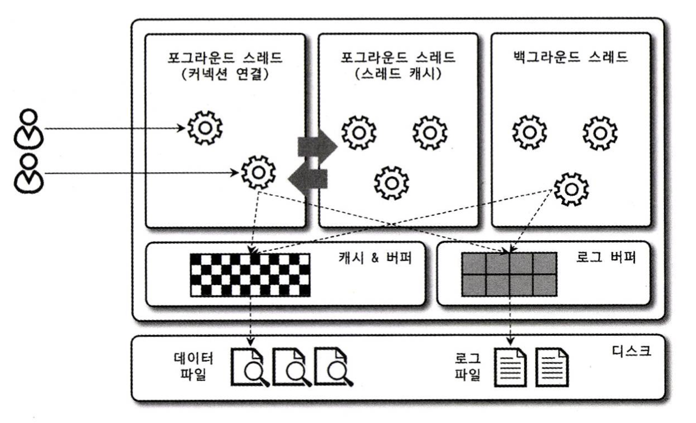

MySQL 서버는 스레드 기반으로 작동하고, **포그라운드 스레드**와 **백그라운드 스레드**로 구분할 수 있다.

MySQL 서버에서 실행 중인 스레드 목록은 **performance_schema** 데이터베이스의 **threads** 테이블을 통해 확인할 수 있다.

```sql
SELECT thread_id, name, type, processlist_user, processlist_host 
FROM performance_schema.threads 
ORDER BY type, thread_id;
```

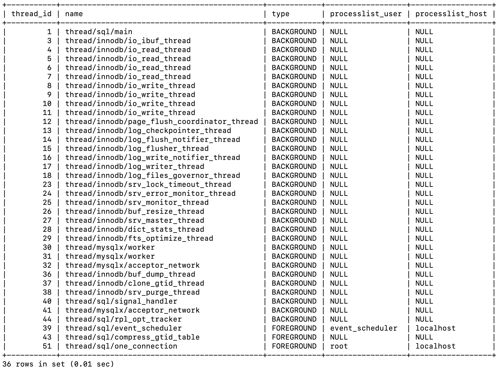

3개의 포그라운드 스레드가 존재하고 나머지는 백그라운드 스레드

**thread/sql/one_connection** 스레드만 실제 사용자의 요청을 처리하는 스레드다.

백그라운드 스레드의 개수는 서버 설정에 따라 가변적이다.

동일한 이름의 스레드가 2개 이상씩 보이는 것은 여러 스레드가 동일 작업을 병렬처리하는 경우

**참고** 

```
현재 설명은 MySQL 서버가 전통적으로 가지는 스레드 모델
즉, MySQL 커뮤니티 에디션에서 사용하는 모델이다.

MySQL 엔터프라이즈 에디션, Percona MySQL 서버에서는 스레드 풀 모델을 사용할 수 있다.

스레드 풀 vs 전통적인 스레드 모델
전통적인 스레드 모델은 커넥션별로 포그라운드 스레드가 하나씩 생성되고 할당된다.
스레드 풀은 커넥션과 포그라운드 스레드는 1:1 관계가 아니라 N:1 관계이다.
```

---

## 4.1.2.1 포그라운드 스레드(클라이언트 스레드)

포그라운드 스레드는 최소한 MySQL 서버에 접속된 클라이언트 수만큼 존재한다.

클라이언트가 작업을 마치고 커넥션을 종료하면 해당 스레드는 **스레드 캐시(Thread cache)**로 돌아간다.

이미 캐시에 일정 개수 이상의 대기 중인 스레드가 있으면 스레드 캐시에 넣지 않고 스레드를 종료시킨다.

스레드 캐시에 유지할 수 있는 최대 스레드 개수는 **thread_cache_size** 시스템 변수로 설정한다.

```sql
mysql> SHOW VARIABLES LIKE 'thread_cache_size';
```

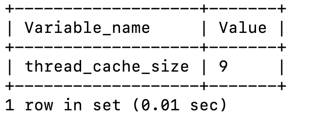

포그라운드 스레드는 데이터를 MySQL 데이터 버퍼나 캐시로부터 가져오며, 버퍼나 캐시에 없는 경우에는 

직접 디스크의 데이터나 인덱스 파일로부터 데이터를 읽는다.

MyISAM 테이블은 디스크 쓰기 작업까지 포그라운드 스레드가 처리한다.

InnoDB 테이블은 데이터 버퍼나 캐시까지만 포그라운드 스레드가 처리하고 디스크 쓰기 작업은 백그라운드 스레드가 처리한다. (지연된 쓰기)

---

## 4.1.2.2 백그라운드 스레드

InnoDB는 다음과 같이 여러 가지 작업이 백그라운드로 처리된다. 

    - 인서트 버퍼(Insert Buffer)를 병합하는 스레드
    - 로그를 디스크로 기록하는 스레드
    - InnoDB 버퍼 풀의 데이터를 디스크에 기록하는 스레드
    - 데이터를 버퍼로 읽어 오는 스레드
    - 잠금이나 데드락을 모니터링하는 스레드

모두 중요한 역할이지만 가장 중요한 것은 **로그 스레드**와 버퍼의 데이터를 디스크에 기록하는 **쓰기 스레드**이다.

InnoDB에서도 데이터를 읽는 작업은 주로 클라이언트 스레드에서 동작하기 때문에 읽기 스레드(백그라운드 스레드)를 많이 설정할 필요 없지만 쓰기 스레드는 아주 많은 작업을 처리하기 때문에 일반적인 내장 디스크를 사용할 때는 2~4 정도, DAS나 SAN 같은 스토리지는 충분히 설정하는 것이 좋다.

사용자의 데이터 쓰기 작업은 지연되어 처리될 수 있지만 데이터의 읽기 작업은 지연될 수 없다. 

그래서 대부분의 RDBMS는 이런 쓰기 작업의 지연 처리를 지원하며 InnoDB 또한 이러한 방식으로 처리한다.

하지만 MyISAM에서는 사용자 스레드가 쓰기 작업까지 함께 처리하도록 설계돼 있다. 

→ 쓰기 버퍼링 기능을 사용 불가능

**innodb_write_io_threads, innodb_read_io_threads** 시스템 변수로 스레드의 개수를 설정한다.

```sql
 SHOW VARIABLES LIKE '%io_threads';
```

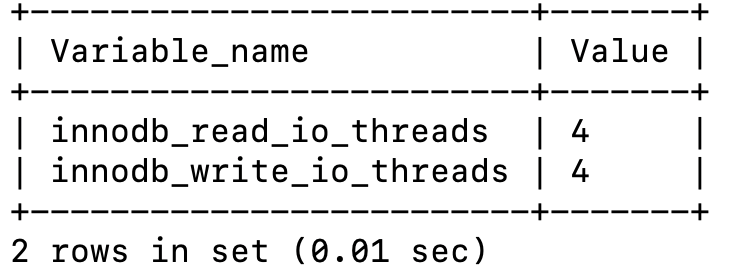

---

# 4.1.3 메모리 할당 및 사용 구조

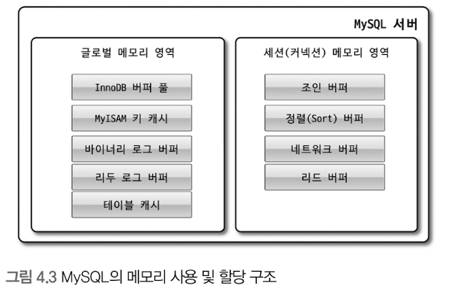

MySQL에서 사용되는 메모리 영역은 크게 글로벌 메모리 영역과 로컬 메모리 영역으로 구분된다. 

글로벌 메모리 영역과 로컬 메모리 영역은 스레드가 공유해서 사용하는 공간인지 여부에 따라 구분된다. 

---

## 4.1.3.1 글로벌 메모리 영역

일반적으로 클라이언트 스레드의 수와 무관하게 하나의 메모리 공간만 할당된다.

생성된 글로벌 영역이 N개라 하더라도 모든 스레드의 공유된다.

    - 테이블 캐시
    - InnoDB 버퍼 풀
    - InnoDB 어댑티브 해시 인덱스
    - InnoDB 리두 로그 버퍼

---

## 4.1.3.2 로컬 메모리 영역

MySQL 클라이언트 스레드가 쿼리를 처리하는 데 사용되는 메모리 영역이다.

대표적으로 커넥션(네트워크) 버퍼와 정렬 버퍼(소트) 등이 있다.

클라이언트가 MySQL 서버에 접속하면 클라이언트 커넥션으로부터 요청을 처리하기 위해 스레드를 하나씩 할당하게 되는데, 클라이언트 스레드가 사용하는 메모리 공간이라고 해서 **클라이언트 메모리 영역**이라고도 한다.

클라이언트와 MySQL 서버와의 커넥션을 세션이라고 하기 때문에 **세션 메모리 영역**이라고도 표현한다.

로컬 메모리는 스레드별로 독립적으로 할당되며 절대 공유되어 사용되지 않는다.

로컬 메모리 공간은 **커넥션 버퍼나 결과 버퍼** 같이 계속 할당된 상태로 남아있는 공간이 있고 **소트 버퍼나 조인 버퍼**처럼 쿼리를 실행하는 순간에만 할당했다가 다시 해제하는 공간이 있다.

**주의점** 

글로벌 메모리 영역의 크기는 주의해서 설정하지만 소트 버퍼 같은 로컬 메모리 영역은 크게 신경 쓰지 않고 설정한다. 최악의 경우 메모리 부족으로 멈춰 버릴 수도 있으니 적절한 메모리 공간을 설정하는 것이 중요하다.

---

# 4.1.4 플러그인 스토리지 엔진 모델

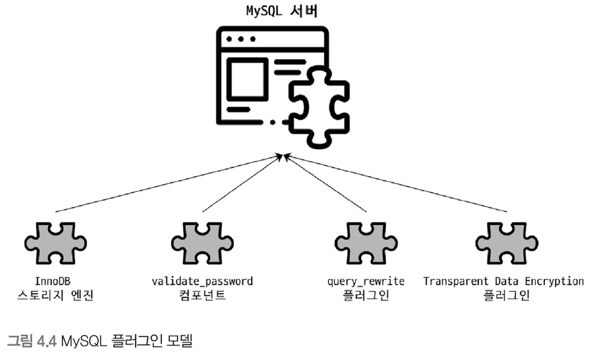

스토리지 엔진 플러그인 말고도 사용자 인증을 위한 플러그인을 포함하여 모두 플러그인으로 구현되어 제공된다. 

이런 플러그인(ex: 스토리지 엔진)은 기본적으로 많이 제공되지만 전문 개발 회사 또는 사용자가 직접 개발하여 사용할 수 있다.

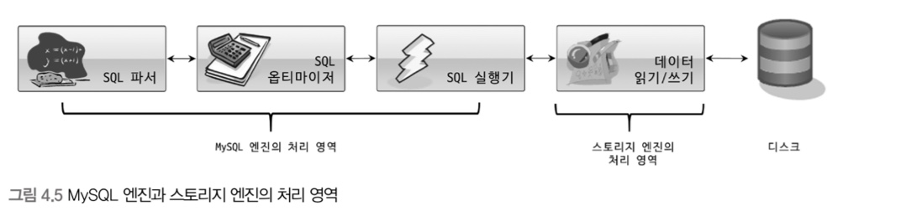

그림 4.5는 MySQL에서 쿼리가 실행되는 과정을 나타낸다.

대부분의 작업은 MySQL 엔진에서 처리되고, 마지막 데이터 읽기/쓰기 작업만 스토리지 엔진이 처리한다.

MySQL 서버에서 MySQL 엔진이 각 스토리지 엔진을 조정하기 위해 **핸들러**를 사용한다.

즉, 스토리지 엔진에게 데이터를 읽기/쓰기 하려면 반드시 **핸들러**를 통해야 한다.

MySQL에서 MyISAM이나 InnoDB 같이 다른 스토리지 엔진을 사용하는 테이블에 대해 쿼리를 실행하더라도 

MySQL의 처리 내용은 그림 4.5의 마지막 단계인 데이터 읽기/쓰기 영역의 처리만 차이가 있다.

GROUP BY, ORDER BY 같은 복잡한 처리는 스토리지 엔진이 아닌 MySQL 엔진에서 처리된다.

하지만 데이터 읽기/쓰기 영역의 처리 차이는 엄청나다.

**MySQL 서버에서 지원하는 스토리지 엔진** 

```sql
SHOW ENGINES;
```

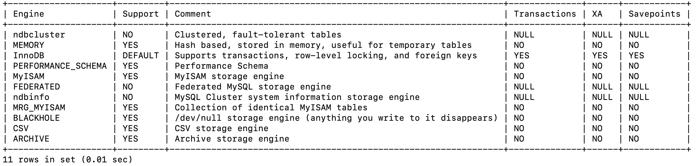

    - **YES:** MySQL 서버에 스토리지 엔진 포함, 사용 가능으로 활성화 상태
    - **DEFAULT:** YES + 필수 스토리지 엔진을 의미(없으면 서버 시작이 불가능)
    - **NO:** MySQL 서버에 해당 스토리지 엔진이 포함 X
    - **DISABLED:** 서버에 스토리지 엔진이 포함, 비활성화 상태

**MySQL 서버에서 지원하는 모든 플러그인(스토리지 엔진 포함)**

```sql
SHOW PLUGINS;
```

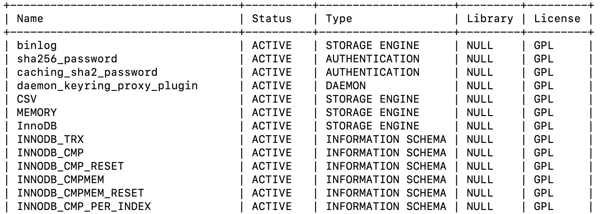

너무 많아서 생략

MySQL 서버에서는 스토리지 엔진뿐만 아니라 다양한 기능이 플러그인 형태로 지원한다. 

인증이나 전문 검색 파서 또는 쿼리 재작성, 비밀번호 검증, 커넥션 제어 등에 플러그인이 존재한다.

또한 MySQL 서버의 기능을 커스텀하게 확장할 수 있게 플러그인 API가 메뉴얼에 공개돼 있다.

---

# 4.1.5 컴포넌트

MySQL 8.0 부터는 기존의 플러그인 아키텍처를 대체하기 위해 컴포넌트 아키텍처가 지원된다.

플러그인 아키텍처의 단점은 다음과 같다. 

    - 플러그인은 오직 MySQL 서버와 인터페이스할 수 있고, 플러그인끼리는 통신할 수 없다. 
    - 플러그인은 MySQL 서버의 변수나 함수를 직접 호출하기 때문에 안전하지 않다(캡슐화 안 됨)
    - 플러그인은 상호 의존 관계를 설정할 수 없어서 초기화가 어렵다

---

# 4.1.6 쿼리 실행 구조

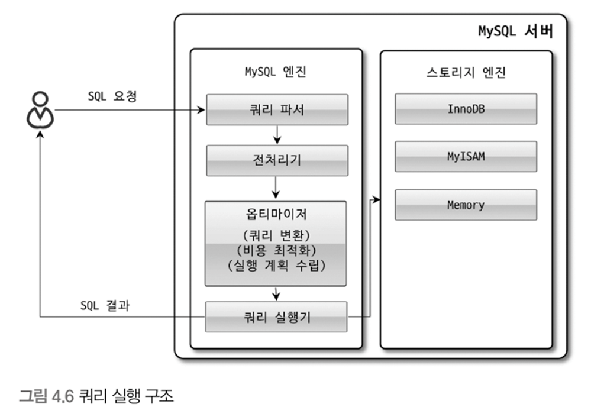

---

## 4.1.6.1 쿼리 파서

쿼리 파서는 사용자 요청으로 들어온 쿼리 문장을 **토큰(MySQL이 인식할 수 있는 최소 단위의 어휘나 기호)**으로 분리해 트리 형태의 구조로 만들어 내는 작업을 의미한다.

쿼리 문장의 기본 문법 오류는 이 과정에서 발견되고 사용자에게 오류 메시지를 전달하게 된다.

---

## 4.1.6.2 전처리기

쿼리 파서 과정에서 만들어진 파서 트리를 기반으로 쿼리 문장에 구조적인 문제점이 있는지 확인한다.

각 토큰을 테이블 이름이나 컬럼 이름, 내장 함수와 같은 객체를 매핑해 **해당 객체의 존재 여부**와 **객체의 접근 권한** 등을 확인하는 작업을 이 단계에서 수행한다.

---

## 4.1.6.3 옵티마이저

사용자의 요청으로 들어온 쿼리 문장을 어떻게 저렴한 비용으로 가장 빠르게 처리할지를 결정하는 역할을 담당한다

---

## 4.1.6.4 실행 엔진(쿼리 실행기)

**옵티마이저: 회사 경영진**

**실행 엔진: 중간 관리자**

**핸들러: 각 업무의 실무자**

**옵티마이저가 GROUP BY를 처리하기 위해 임시 테이블을 사용하기로 결정**

    1. 실행 엔진이 핸들러에게 임시 테이블 만들라고 요청
    1. 실행 엔진은 WEHRE 절에 일치하는 레코드를 읽어 오라고 핸들러에게 요청
    1. 읽어온 레코드들을 준비한 임시 테이블로 저장하라고 핸들러에게 요청
    1. 데이터가 준비된 임시 테이블에서 필요한 방식으로 데이터를 읽어오라고 핸들러에게 요청
    1. 실행엔진은 결과를 사용자나 다른 모듈에게 넘긴다.

즉, 실행 엔진은 옵티마이저가 만들어준 계획대로 각 핸들러에게 요청해서 받은 결과를 또 다른 핸들러의 입력으로 연결하는 역할을 수행한다. 

---

## 4.1.6.5 핸들러(스토리지 엔진)

MySQL 서버의 가장 밑단에서 MySQL 실행 엔진의 요청에 따라 데이터를 디스크로 저장하고 디스크로부터 읽어 오는 역할을 담당한다. 즉, 핸들러는 스토리지 엔진을 의미한다.

---

# 4.1.9 스레드 풀 

MySQL 서버 커뮤니티 에디션은 스레드 풀 기능을 지원하지 않는다. 

하지만 MySQL 서버 엔터프라이즈 에디션은 스레드 풀 기능을 지원한다.

여기서는 **Percona Server**에서 제공하는 스레드 풀 기능에 대해서 알아본다. 

엔터프라이즈 에디션 스레드 풀 기능은 MySQL 서버에 내장돼 있지만 Percona Server 스레드 풀은 플러그인 형태로 구현돼 있다. 

즉, MySQL 커뮤니티 에디션에서도 스레드 풀 기능을 사용하고자 하면 Percona Server에서 **스레드 풀 플러그인 라이브러리(thread_pool.so 파일)**을 설치해서 사용하면 된다.

스레드 풀은 내부적으로 사용자의 요청을 처리하는 스레드 개수를 줄여서 동시 처리되는 요청이 많더라도 

MySQL 서버의 CPU가 제한된 개수의 스레드 처리에만 집중할 수 있게 해서 서버의 자원 소모를 줄이는 것이 목적이다. 

하지만 스레드 풀이 실제 서비스에서 눈에 띄는 성능 향상을 보여준 경우는 드물었다. 

물론 제한된 수의 스레드만으로 CPU가 처리하도록 적절히 유도한다면 CPU의 **프로세서 친화도(Processor affinity)**도 높이고 불필요한 컨텍스트 스위칭을 줄여서 오버헤드를 낮출 수 있다.

Percona Server의 스레드 풀은 기본적으로 CPU 코어의 개수만큼 스레드 그룹을 생성하는데, 그룹의 개수는 **thread_pool_size** 시스템 변수를 통해 조정할 수 있다.

하지만 일반적으로 코어의 개수와 맞추는 것이 CPU 프로세서 친화도를 높이는 데 좋다.

```
보통 i/o 작업이 많으면 코어 개수 보다 조금 더 많거나 비슷하게 
cpu 작업이 많으면 코어 개수 보다 조금 적거나 비슷하게 스레드 개수를 가지는 게 성능상 좋다 

그렇다면 mysql 스레드 풀 사용자 스레드는 왜 코어의 개수와 맞추는 것이 좋을까?

그렇다면 보통 MySQL 작업은 i/o burst cpu burst가 비슷한 작업이지 않을까?
조인, 정렬 등 cpu를 많이 사용하는 작업이 많아서 i/o 작업과 cpu 작업이 비슷한 작업량으로 혼합되어 
스레드 수를 코어 수에 맞추는 게 적합하다고 말하는듯하다.

**스레드 풀 튜닝 포인트는 책 94페이지 참고** 
```

Percona Server 스레드 풀 플러그인은 **선순위 큐와 후순위 큐를 이용해 특정 트랜잭션이나 쿼리를 우선적으로 처리**할 수 있는 기능을 제공한다.

먼저 시작된 트랜잭션 내에 속한 SQL을 빨리 처리해주면 해당 트랜잭션이 가지고 있던 잠금이 빨리 해제되어 전체적으로 처리 성능을 향상시킬 수 있다.

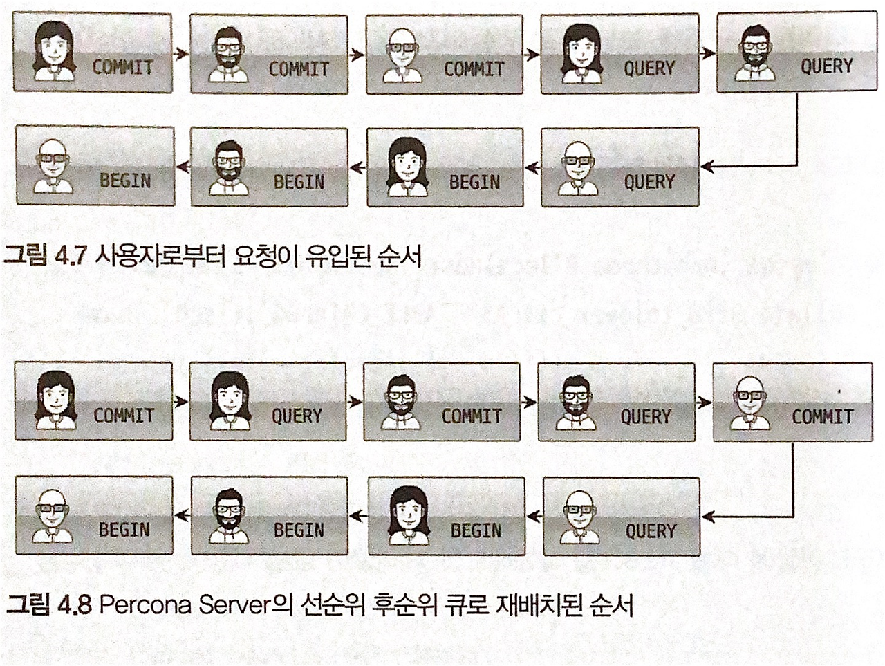

그림 4.7은 사용자의 요청 순서 그림 4.8은 선순위/후순위 큐로 재배치된 작업의 순서이다. 

---

# 생략한 내용 

**4.1.7 복제:** 16장에서 자세하게 설명

**4.1.8 쿼리 캐시:** MySQL 8.0 삭제된 기능

**4.1.9 스레드 풀 시스템 변수:** 스레드 풀 사용하면 공부

**4.1.10 트랜잭션 지원 메타데이터**

MySQL 8.0 부터 테이블 구조 정보, 스토어드 프로그램 정보를 InnoDB 테이블에 저장하도록 해서 메타 정보가 완전한 성공 또는 완전한 실패로 정리.

즉, 진행 중인 상태로 남으면서 문제를 유발하지 않도록 개선

---

MySQL의 InnoDB는 스토리지 엔진 중 유일하게 레코드 기반의 잠금을 제공하며, 높은 동시성 처리가 가능하고 성능이 뛰어나다. 


---

# 4.2.1 프라이머리 키에 의한 클러스터링

InnoDB의 모든 테이블은 기본적으로 프라이머리 키를 기준으로 클러스터링되어 저장된다.

즉, 프라이머리 키 값의 순서대로 디스크에 저장된다. 

모든 세컨더리 인덱스는 레코드의 주소 대신 프라이머리 키 값을 논리적인 주소로 사용한다.

결과적으로 프라이머리 키는 다른 보조 인덱스에 비해 비중이 높게(쿼리 실행 계획)설정된다.

InnoDB와 다르게 MyISAM 스토리지 엔진은 클러스터링 키를 지원하지 않는다.

그래서 프라이머리 키와 세컨더리 인덱스는 구조적으로 아무런 차이가 없다.

MyISAM 테이블의 모든 인덱스는 물리적인 레코드의 주소 값(ROWID)을 가진다.

---

# 4.2.2 외래 키 지원

InnoDB 스토리지 엔진 레벨에서 지원하는 기능이다. 다른 스토리지 엔진은 지원하지 않는다.

InnoDB에서 외래 키는 부모 테이블과 자식 테이블 모두 해당 칼럼에 인덱스 생성이 필요하고, 

**변경 시에는 부모 테이블이나 자식 테이블에 데이터 존재 여부를 확인하기 때문에 잠금이 여러 테이블로 전파되고,** 

**그로 인해 데드락이 많이 발생한다.**

→ 이런 이유로 서비스용 데이터베이스에서는 외래 키를 생성하지 않는 경우도 많다. 

수동으로 데이터를 적재하거나 스키마 변경 등의 관리 작업이 실패할 수 있다.

부모 테이블과 자식 테이블의 관계를 명확히 파악해서 순서대로 작업한다면 문제없이 실행할 수 없지만,

관계가 복잡한 경우에는 간단하지 않다.  

**외래 키 체크 작업을 일시적으로 멈추는 방법**

```sql
SET foreign_key_checks=OFF;

SET SESSION foreign_key_checks=OFF;

SET GLOBAL foreign_key_checks=OFF;
```

**→ foreign_key_checks 시스템 변수를 일시적으로 비활성화** 

**SESSION**이나 **GLOBAL**키워드를 생략하면 기본적으로 **SESSION**으로 적용된다.

레코드 적재, 삭제 작업은 부가적인 체크가 필요 없기 때문에 훨씬 빠르게 처리할 수 있다.

또한 비활성화되면 ON DELETE CASCADE, ON UPDATE CASCADE 옵션도 무시하게 된다.

외래 키 체크를 일시적으로 해제했다고 해서 부모와 자식 테이블 간의 관계가 깨진 상태로 유지해도 된다는 것을 의미하지 않는다. 항상 일관성을 다시 맞추고 외래 키 체크 기능을 활성화하자!

---

# 4.2.3 MVCC(Multi Version Concurrency Control)

멀티 버전이란 하나의 레코드에 여러 개의 버전이 동시에 관리된다는 의미이다.

**MVCC의 가장 큰 목적은 잠금을 사용하지 않는 일관된 읽기 제공이다.**

InnoDB는 **언두 로그(Undo log)**를 이용해 이 기능을 구현한다.

### MVCC 예제 

격리 수준: READ_COMMITTED

**트랜잭션 격리 레벨 조회** 

```sql
SELECT @@transaction_isolation;
```

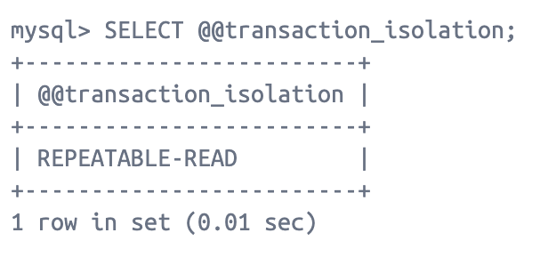

해당 결과가 **READ_COMMITTED** 레벨이면 다음 작업은 필요 없다.

```sql
SET SESSION TRANSACTION ISOLATION LEVEL READ COMMITTED; // 현재 세션

SET GLOBAL TRANSACTION ISOLATION LEVEL READ COMMITTED;  // 전체
```

**member 테이블 생성** 

```sql
CREATE TABLE member (
     m_id INT NOT NULL,
     m_name VARCHAR(20) NOT NULL,
     m_area VARCHAR(100) NOT NULL,
     PRIMARY KEY (m_id),
     INDEX ix_area (m_area)
 );
```

**데이터 삽입** 

```sql
 INSERT INTO member values(12, '홍길동', '서울');
```


```sql
UPDATE member SET m_area='경기' WHERE m_area='서울';
```


UPDATE 문장이 실행되면 **커밋 실행 여부와 관계없이 InnoDB 버퍼 풀은 새로운 값인 ‘경기’로 업데이트**된다.

디스크의 데이터 파일은  InnoDB Write 백그라운드 스레드에 의해 업데이트돼 있을 수도 있고 아닐 수도 있다.

InnoDB가 ACID를 보장하기 때문에 버퍼 풀과 데이터 파일은 동일한 상태라고 가정해도 무방하다. 

아직 COMMIT이나 ROLLBACK 되지 않은 상태에서 다른 사용자가 조회를 한다면 어디에 있는 데이터를 조회할까? →  **MySQL 격리 수준(Isolation Level)에 따라 다르다.**

```sql
SELECT * FROM MEMBER WHERE m_id = 12;
```

**READ_UNCOMMITED**

→ InnoDB 버퍼 풀이 가지는 가지고 있는 현재 변경된 데이터를 읽어서 반환한다.

**READ_COMMITED 또는 그 이상의 격리 수준**

→ 이전 내용을 보관하고 있는 언두 영역의 데이터를 반환한다.

이 과정을 **DBMS에서 MVCC**라고 표현한다.

즉, 하나의 레코드에 대해 2개의 버전이 유지되고, 상황에 따라서 다른 데이터가 보여지는 구조이다.

만약 트랜잭션이 길어지면 언두에서 관리하는 예전 데이터가 삭제되지 못하고, 언두 영역의 저장되는 공간이 많이 늘어는 상황이 발생할 수 있다.

**UPDATE & COMMIT**

InnoDB는 지금의 상태를 영구적인 데이터로 만들어 버린다.

커밋이 된다고 언두 영역의 백업 데이터가 바로 삭제되는 것은 아니다.

이 언두 영역을 필요(참조)로 하는 트랜잭션이 더는 없을 때 삭제된다.

**UPDATE & ROLLBACK**

언두 영역에 있는 백업된 데이터를 InnoDB 버퍼 풀로 복구하고, 언두 영역의 내용을 삭제한다.

**트랜잭션 ID와 함께 정리** 

```
READ_COMMITED
m_id = 12 m_name = "홍길동" m_area = "서울"
----------------------------------------------------------------------------------------

트랜잭션 A 시작 [TxID 100]
동작: UPDATE "서울" -> "경기"    
결과: InnoDB 버퍼풀: "경기" / 언두 로그:[TxID 100, "서울"]

트랜잭셤 B 시작 [TxID 101] 스냅샷: TxID 100 uncommitted 
동작: SELECT                  
결과
- 버퍼풀의 데이터가 트랜잭션 Id 100번의 데이터인데 해당 데이터는 uncommitted
- 언두 로그로 가서 "서울" READ

트랜잭션 A COMMIT
아직 언두 로그 삭제 불가능 아직 트랜잭션 B 참조중 

트랜잭션 B 종료 
언두 로그 삭제 참조되는 트랜잭션 없음
```

---

# 4.2.4 잠금 없는 일관된 읽기(Non-Locking Consistent Read)

InnoDB 스토리지 엔진은 MVCC 기술을 이용해서 잠금을 걸지 않고 읽기 작업을 수행한다.

격리 수준이 SERIALIZABLE이 아닌 모든 격리 수준에서의 순수한 읽기 작업은 다른 트랜잭션의 변경 작업과 관계없이 항상 잠금을 대기하지 않고 바로 실행된다. 이를 잠금 없는 일관된 읽기라고 표현하며, 

격리 수준에 따라서 언두 로그 또는 버퍼 풀의 데이터를 읽는다.


**순수 SELECT**는 락 무시하고 항상 읽을 수 있다.

**S-lock(SELECT FOR SHARE)** 끼리는 **공존 가능**.

    - ex: 재고 감소 전에 재고 확인하고 업데이트

**X-lock(SELECT FOR UPDATE)** 가 있으면, 어떤 락도 새로 못 건다.

    - ex: 은행 계좌 송출금 같이 바로 업데이트 

**트랜잭션을 빨리 완료하자**

```
일관된 읽기를 위해서 언두 로그를 삭제하지 못하고 계속 유지해야 하기 때문에 트랜잭션을 너무 오래 유지하면
MySQL 서버가 느려지거나 문제가 발생할 수 있다.

트랜잭션을 시작했으면 가능한 빠르게 롤백 또는 커밋하자.
```

---

# 4.2.5 자동 데드락 감지

InnoDB 스토리지 엔진은 내부적으로 잠금이 교착 상태에 빠지지 않았는지 체크하기 위해서 **잠금 대기 목록을 그래프 형태로 추적**한다.

InnoDB 스토리지 엔진은 **데드락 감지 스레드****를 가지고 있어서 주기적으로 잠금 대기 그래프를 확인하고 교착 상태에 빠진 트랜잭션들을 찾아서 그중 하나를 강제 종료**한다.

**강제 종료 대상은 언두 로그 레코드를 더 적게 가진 트랜잭션이 대상이 된다.**

롤백을 해도 언두 처리할 내용이 적기 때문이다. → MySQL 서버 부하도 덜하다.

**innodb_table_locks 시스템 변수**

```
MySQL 엔진에서 관리되는 테이블 잠금(LOCK TABLES)은 볼 수가 없어서 
데드락 감지가 불확실하다.

innodb_table_locks 시스템 변수를 활성화하면
InnoDB 스토리지 엔진의 내부 레코드 잠금뿐만 아니라 테이블 레벨의 잠금도 감지할 수 있다.  
```

**innodb_deadlock_detect, innodb_lock_wait_timeout 시스템 변수**

```sql
일반적인 서비스에서 데드락 감지 스레드의 작업은 크게 부담되지 않는다.
하지만 동시 처리 스레드가 많아지고 잠금의 개수가 많아지면 데드락 감지 스레드가 느려진다.
데드락 감지 스레드가 느려지면 다른 서비스 쿼리를 처리하는 스레드는 작업을 진행하지 못하고 
서비스에 악영향을 미치게 된다.

innodb_deadlock_detect를 off 설정하면 데드락 감지 스레드는 더는 동작하지 않는다.
데드락 감지를 하지 않으면 교착상태에 빠진 트랜잭션들은 무한정 대기하게 된다.

innodb_lock_wait_timeout 시스템 변수를 활성화하면 이런 데드락 상황에서 일정 시간이 지나면
자동으로 요청이 실패하고 에러 메시지를 반환하게 된다.

데드락 감지 스레드가 부담되어 innodb_deadlock_detect를 off로 설정해서 비활성화 하는 경우라면
innodb_lock_wait_timeout을 기본값인 50초보다 훨씬 낮은 시간으로 변경해서 사용하자
```

**google** 

```sql
구글에서 프라이머리 키 기반의 조회 및 변경이 아주 높은 빈도로 실행되는 서비스가 많았는데
이런 서비스는 매우 많은 트랜잭션을 동시에 실행하기 때문에 데드락 감지 스레드가 상당히 성능을 저하시킨다는 
것을 알아냈다.

만약 PK 또는 세컨더리 인덱스를 기반으로 매우 높은 동시성 처리를 요구하는 서비스가 있다면
innodb_deadlock_detect를 비활성화해서 성능 비교를 해보자.
```

---

# 4.2.6 자동화된 장애 복구

InnoDB 스토리지 엔진은 매우 견고해서 데이터 파일이 손상되거나 MySQL 서버가 시작되지 못하는 경우는 거의 발생하지 않는다. 

MySQL 서버와 무관하게 디스크나 서버 하드웨어 이슈로 InnoDB 스토리지 엔진이 자동으로 복구를 하지 못 하는 경우가 발생할 수 있다. 

InnoDB 데이터 파일은 기본적으로 MySQL 서버가 시작될 때 상상 자동 복구를 수행한다. 

이 단계에서 자동으로 복구될 수 없는 손상이 있다면 복구를 멈추고 MySQL 서버는 종료돼 버린다.

이때는 설정 파일에 **innodb_force_recovery 시스템 변수**를 설정해서 MySQL 서버를 시작해야 한다.

    - InnoDB 로그 파일 손상 → 6으로 설정
    - InnoDB 테이블의 데이터 파일이 손상 → 1로 설정 
    - 어떤 문제인지 알 수 없다면 innodb_force_recovery 시스템 변수를 1부터 ~ 6까지 변경하면서 재시작해 본다. 값이 커질수록 데이터 손실 가능성이 커지고 복구 가능성은 작아진다.
    - innodb_force_recovery가 0이 아닌 복구 모드에서는 SELECT 이외의 INSERT, UPDATE, DELETE 쿼리는 수행할 수 없다.
    - MySQL 서버가 가동되고 InnoDB 테이블이 인식된다면 mysqldump를 이용해 데이터를 백업하고 그 데이터로 MySQL 서버의 DB와 테이블을 다시 생성하는 것이 좋다.

각 모드의 정리는 책 106,107을 참고하자 

---

# 4.2.7 InnoDB 버퍼 풀

InnoDB 스토리지 엔진의 가장 핵심적인 부분, 디스크의 데이터 파일과 인덱스 정보를 메모리에 캐시해 두는 공간이다. 쓰기 작업을 지연시켜 일괄 작업으로 처리할 수 있게 해주는 버퍼 역할도 한다. 

일반적인 애플리케이션에서는 INSERT, UPDAET, DELETE처럼 데이터를 변경하는 쿼리는 이곳저곳에 위치한 레코드를 변경하기 때문에 랜덤한 디스크 I/O를 발생시킨다.

하지만 버퍼 풀이 이러한 변경된 데이터를 모아서 처리하면 랜덤한 디스크 작업의 횟수를 줄일 수 있고, 클라이언트에게 빠른 응답을 제공한다.

**쓰기 작업 지연의 효과** 

애플리케이션에서 INSERT, UPDATE, DELETE처럼 데이터를 변경하는 쿼리는 데이터 파일의 이곳저곳에 위치한 레코드를 변경하기 때문에 랜덤한 디스크 작업을 발생시킨다. 

하지만 버퍼 풀이 이러한 변경된 데이터를 모아서 처리하면 랜덤한 디스크 작업의 횟수를 줄일 수 있다. 

→ 디스크 작업은 오래 걸리는 작업 (메모리에 비해 엄청 느리다)

→ 디스크에 저장된 레코드들은 배열처럼 물리적으로 연속된 공간에 저장되지 않을 수 있다. (랜덤성)

→ 모아서 처리하면 동일 블록 내의 데이터 변경 가능성이 늘어난다. → 작업 횟수가 내려간다.

---

## 4.2.7.1 버퍼 풀의 크기 설정

InnoDB 버퍼 풀의 메모리는 운영체제와 각 클라이언트 스레드가 사용할 메모리도 충분히 고려해서 설정해야 한다. 

**레코드 버퍼** 

레코드 버퍼는 각 클라이언트 세션에서 테이블의 레코드를 읽고 쓸 때 버퍼로 사용하는 공간을 말하는데, 

커넥션이 많고 사용하는 테이블도 많다면 레코드 버퍼 용도로 사용되는 메모리 공간이 꽤 많이 필요해질 수도 있다.

이 레코드 버퍼 공간은 별도로 설정할 수 없다.

### 메모리 크기에 따른 버퍼 풀 크기 설정

**InnoDB 버퍼 풀 크기 동적 조절** 

MySQL 5.7 버전부터 InnoDB 버퍼 풀 크기를 동적으로 조절할 수 있다.

크기를 적절히 작은 값으로 설정해서 조금씩 상황을 봐 가면서 증가시키는 방법이 최적이다.

**운영체제의 전체 메모리 공간이 8GB 미만**

    - 50% InnoDB 버퍼 풀로 설정
    - 나머지는 MySQL 서버, 운영체제, 다른 응용 프로그램이 사용할 수 있도록 확보

**운영체제의 전체 메모리 공간이 8GB 이상**

    - 50%로 InnoDB 버퍼 풀로 설정하고 조금씩 올려가면서 최적점을 찾는다.

**운영체제 메모리 50GB 이상** 

    - 20GB ~ 35GB를 InnoDB 버퍼 풀로 할당 

**주의점** 

```
InnoDB 버퍼 풀은 **innodb_buffer_pool_size** 시스템 변수를 통해 크기를 설정할 수 있다.
버퍼 풀의 크기 변경은 크리티컬한 변경이므로 가능하면 MySQL 서버가 한가한 시점을 골라서 진행한다.

또한 InnoDB 버퍼 풀의 크기를 늘리는 작업은 시스템 영향도가 크지 않지만
버퍼 풀의 크기를 줄이는 작업은 매우 크므로 가능하면 줄이는 작업은 하지 않도록 하자.

InnoDB 버퍼 풀은 내부적으로 128MB 청크 단위로 쪼개진다.
이는 버퍼 풀의 크기를 줄이거나 늘리는 단위로 사용된다. 
```

### 버퍼 풀 인스턴스

InnoDB 버퍼 풀은 전통적으로 버퍼 풀 전체를 관리하는 잠금(세마포어)로 인해 내부 잠금 경합을 많이 유발해왔다. 이런 경합을 줄이기 위해 버퍼 풀을 여러 개로 쪼개어 관리할 수 있게 개선됐다.

**innodb_buffer_pool_instance**  시스템 변수를 이용해 버퍼 풀을 여러 개로 분리해서 관리할 수 있는데,

각 버퍼풀을 버퍼 풀 인스턴스라고 표현한다.

기본적으로 버퍼 풀 인스턴스는 8개로 초기화된다. 하지만 전체 버퍼 풀을 위한 메모리 크기가 1GB 미만이면 버퍼 풀 인스턴스는 1개만 생성된다. 버퍼 풀 인스턴스 당 5GB 정도가 되게 인스턴스 개수를 설정하는 것이 좋다.

---

## 4.2.7.2 버퍼 풀의 구조

InnoDB 스토리지 엔진은 버퍼 풀의 메모리 공간을 페이지 크기(**innodb_page_size 시스템 변수**)의 조각으로 쪼개어 관리한다. 또한 버퍼 풀의 조각을 관리하기 위해 **LRU 리스트, Flush 리스트, Free 리스트**라는 3개의 자료 구조를 관리한다. 

| **리스트 이름** | **관리 대상** | **주요 용도** |
| --- | --- | --- |
| LRU 리스트 | 최근 사용 순서대로 정렬된 모든 페이지 | 교체 대상 선정, 캐시 효율성 유지 |
| Flush 리스트 | 디스크에 동기화되지 않은(Dirty) 페이지 | 데이터 동기화(Flush) 대상 관리 |
| Free 리스트 | 비어 있거나 재사용 가능한 페이지 | 새 페이지 할당 시 사용 |

Free 리스트는 InnoDB 버퍼 풀에서 사용자의 쿼리가 새롭게 디스크의 데이터 페이지를 읽어와야 하는 경우에 사용된다. 즉, 아직 사용자 데이터로 채워지지 않은 비어있는 페이지 목록이다.

클린 페이지가 LRU 리스트에서 제거되거나, 더티 페이지가 디스크에 동기화된 후에 Free 리스트로 이동한다.


해당 그림은 InnoDB 스토리지 엔진의 버퍼 풀 LRU 리스트이다.

정확히는 **LRU(Least Recently Used) + MRU(Most Recently Used) 리스트가 결합된 형태**이다. 

Old Sublist = LRU, New Sublist = MRU

LRU 리스트를 관리하는 목적은 데이퍼 페이지를 효율적으로 InnoDB 버퍼풀의 메모리에 유지해서 **디스크 읽기를 최소화(메모리 캐시 히트)하는 것**이다.

InnoDB의 버퍼 풀 설계는 **참조 지역성** 개념에 강하게 의존한다. 

    - **시간 지역성 (Temporal Locality)**
최근에 참조된 페이지는 곧 다시 참조될 가능성이 높다

 → LRU 리스트(헤더)에 넣어준다.
    - **공간 지역성 (Spatial Locality)**
현재 참조 중인 페이지 근처의 데이터도 곧 접근될 가능성이 있다 → 페이지 단위 로딩

**왜 순수 LRU가 아닌가?**

```
순수한 LRU는 새로 읽어온 페이지가 리스트의 가장 앞에 추가되어 가장 최근에 사용된 것으로 간주한다.

하지만 InnoDB에서는 새로 읽어온 페이지는 "진짜로 다시 사용될지" 확신이 없기 때문에 바로 
MRU 앞에 두지 않고, Old Sublist 중간 정도에 넣는다. 

이것은 "순간적인 대용량 스캔(I/O burst)"으로 인한 캐시 오염을 방지하기 위한 전략이다.

즉, 단순히 파일을 한 번 읽었다고 해서 그것이 정말로 "자주 쓰일 페이지"는 아니라고 보는 것이다.
```

### InnoDB 스토리지 엔진에서 데이터를 찾는 과정

    1. 필요한 레코드가 저장된 데이터 페이지가 버퍼 풀에 있는지 검사 
1. InnoDB 어댑티브 해시 인덱스를 이용해 페이지 검사
      1. 해당 테이블의 인덱스(B-Tree)를 이용해 버퍼 풀에서 페이지를 검사
      1. 버퍼 풀에 이미 데이터 페이지가 있었다면 페이지의 포인트를 MRU 방향으로 승급
    1. 1번에서 없었다면, 디스크에서 필요한 데이터 페이지를 버퍼 풀에 적재하고(Free 리스트에서 할당 받는다.), 적재된 페이지에 대한 포인터를 LRU 헤더 부분에 추가 
    1. 버퍼 풀의 LRU 헤더 부분에 적재된 데이터 페이지가 실제로 읽히면 MRU 헤더 부분으로 승급 
(대량 읽기의 경우 데이터 페이지가 버퍼 풀로 적재는 되지만 실제 쿼리에서 사용되지는 않을 수도 있으며, 이런 경우는 MRU 방향으로 승급하지 않는다)
    1. 버퍼 풀에 상주하는 데이터 페이지는 사용자 쿼리가 얼마나 최근에 접근했었는지에 따라 나이**(Age)**가 부여되며, 버퍼 풀에 상주하는 동안 쿼리에서 오랫동안 사용되지 않으면 페이지에 나이가 오래되고**(Aging)** 결국 버퍼 풀에서 제거된다**(Eviction)**. 만약 사용되면 나이가 초기화되어 다시 젊어지고 MRU 헤더 부분으로 옮겨진다.
    1. 필요한 데이터가 자주 접근됐다면 해당 페이지의 인덱스 키를 어댑티브 해시 인덱스에 추가한다.

LRU는 단순하지 않고, **적재된 페이지가 실제로 사용되는지를 기준으로 승격/제거 + 어댑티브 해시 인덱스를 사용**

**디스크에서 읽어온 데이터 페이지를 적재하는 과정**

| 단계 | 설명 |
| --- | --- |
| 1. Free 리스트에서 하나의 `buf_block_t`를 꺼냄 | (버퍼 풀에서 아직 안 쓰인 슬롯) |
| 2. 디스크에서 페이지를 읽어옴 | 해당 페이지 내용을 `buf_block_t`가 가진 16KB 메모리에 복사 |
| 3. LRU 리스트의 Old Sublist 헤더에 등록 | 이제부터는 "사용 중"인 페이지로 전환됨 |
| 4. Free 리스트에서는 제거됨 | (더 이상 빈 슬롯이 아니므로) |

**buf_block_t**

    - 해당 페이지의 주소
    - 어떤 테이블 / 어떤 파일인지
    - 페이지가 더티인지 아닌지
    - 최근 사용 시점
    - LRU 위치 정보 (이전/다음 노드)

이런 메타정보를 담은 “페이지 객체” 

### **플러시 리스트**

디스크로 동기화되지 않은 데이터를 가진 데이터 페이지(더티 페이지)의 변경 시점 기준의 페이지 목록을 관리

디스크에서 읽은 상태 그대로 전혀 변경이 없다면 플러시 리스트에 관리되지 않지만, 일단 한 번 데이터 변경이 가해진 데이터 페이지는 플러시 리스트로 관리되고 특정 시점이 되면 디스크로 기록돼야 한다.

데이터가 변경되면 InnoDB는 변경 내용을 리두 로그에 기록하고 버퍼 풀의 데이터 페이지에도 변경 내용을 반영한다. 그래서 리두 로그의 각 엔트리는 특정 데이터 페이지와 연결된다.

리두 로그가 디스크로 기록됐다고 해서 데이터 페이지가 디스크로 기록됐다는 것을 항상 보장하지는 않는다.

또는 반대의 경우도 발생할 수 있다. 

InnoDB 스토리지 엔진은 체크포인트를 발생시켜 디스크의 리두 로그와 데이터 페이지의 상태를 동기화하게 된다.

체크 포인트는 MySQL 서버가 시작될 때 InnoDB 스토리지 엔진이 리두 로그의 어느 부분부터 복구를 실행해야 할지 판단하는 기준점 역할을 한다. 

---

## 4.2.7.3 버퍼 풀과 리두 로그

InnoDB 버퍼 풀은 서버의 메모리가 허용하는 만큼 설정하면 할수록 데이터 캐시 히트율이 높아져서 쿼리의 성능이 빨라진다. 하지만 이미 모든 디스크의 파일이 버퍼 풀에 적재될 정도의 버퍼 풀 공간이라면 더는 버퍼 풀 크기를 늘려도 성능에 도움이 되지 않는다.

**DBMS 성능 향샹 측면에서 InnoDB 버퍼 풀은 두 가지 용도이다. 앞에서 말한 데이터 캐시 기능 + 쓰기 버퍼링** 

InnoDB 버퍼 풀의 쓰기 버퍼링 기능을 향상시키려면 InnoDB 버퍼 풀과 리두 로그와의 관계를 먼저 이해해야 한다.


InnoDB 버퍼 풀은 디스크에서 읽은 상태로 전혀 변경되지 않은 **Clean Page**와 함께 INSERT, UPDATE, DELETE 명령으로 변경된 데이터를 가진 **Dirty Page**도 가지고 있다.

Dirty Page는 언젠가는 디스크로 기록돼야 한다. 영원히 버퍼 풀에 머무를 수 없다.

리두 로그의 공간은 한정적이기 때문에 InnoDB는 스토리지 엔진은 전체 리두 로그 파일에서 재사용 가능한 공간과 재사용 불가능한 공간으로 구분해서 관리하는데, 재사용 불가능한 공간을 **활성 리두 로그(Active Redo Log)**라고 한다. 그림 4.14의 화살표를 가진 엔트리들이 활성 리두 공간이다.

리두 로그 파일의 공간은 계속 순환하면서 재사용 되지만, 로그 포지션은 기록될 때마다 고유 번호인 **LSN(Log Sequence Number)**가 증가한다.

더티 페이지는 디스크와 데이터 상태가 다르기 때문에 언젠가 동기화가 필요하다. 

버퍼 풀의 더티 페이지는 특정 리두 로그 공간과 1:1로 관계를 가지면서 체크포인트 이벤트가 발생하면 체크포인트의 LSN 보다 작은 리두 로그 엔트리와 관련된 더티 페이지는 모두 디스크로 동기화 시킨다.

**이처럼 메모리에서만 변경 작업이 일어나다가, 체크 포인트 이벤트 발생 시점에 한번에 디스크로 반영되므로 쓰기 버퍼링이라고 한다.**

가장 마지막 체크포인트의 LSN과 마지막 리두 로그 엔트리의 LSN 차이를 **체크포인트 에이지(Checkpoint Age)**라고 한다. 즉 체크포인트 에이지는 활성 리두 로그 공간의 크기를 말한다.

### 버퍼 풀과 리두 로그 간단한 예제

    1. InnoDB 버퍼 풀: 100GB / 리두 로그 파일 크기: 100MB
    1. InnoDB 버퍼 풀: 100MB / 리두 로그 파일 크기: 100GB

1번의 경우 리두 로그 파일의 크기가 100MB밖에 안 되기 때문에 체크 포인트 에이지도 최대 100MB만 허용된다.

평균 리두 로그 엔트리가 4KB였다면 (100MB/4KB) 정도의 더티 페이지만 버퍼 풀(플러시 리스트)에 보관할 수 있게 된다. 즉, 하나의 데이터 페이지가 16KB 면 400MB 수준밖에 안 되는 것이다.

이 경우는 버퍼 풀의 크기는 매우 크지만 실제 쓰기 버퍼링을 위한 효과는 거의 못 보는 상황이다.

2번의 경우 대략 400GB 정도의 더티 페이지를 가질 수 있다. 하지만 버퍼 풀의 크기가 100MB이기 때문에 허용 가능한 더티 페이지는 100MB 크기 보다도 적다.

리두 로그는 변경분만 가지고 버퍼 풀은 데이터 페이지를 통째로 가지기 때문에 데이터 변경이 발생해도 리두 로그는 훨씬 작은 공간만 있으면 된다.

또한 버퍼 풀의 크기가 크더라도 리두 로그 파일의 크기가 너무 크면 갑작스러운 대규모 디스크 I/O 작업으로 MySQL 서버 전체에 큰 부하가 발생할 수 있다. 

그러니 적당한 크기로 설정하고 필요하면 늘려가면서 최적값을 선택하는 것이 좋다.

---

## 4.2.7.4 버퍼 풀 플러시(Buffer Pool Flush)

MySQL 8.0 버전으로 업그레이드 되면서 대부분의 서비스에서 예전과 같은 디스크 쓰기 폭증 현상은 발생하지 않는다. 

InnoDB 스토리지 엔진의 더티 페이지의 디스크 쓰기 동기화 관련된 시스템 설정을 살펴보겠지만 특별히 성능 문제가 발생하지 않는 상태라면 굳이 이 시스템 변수들을 조정할 필요는 없다. 

InnoDB 스토리지 엔진은 버퍼 풀 더티 페이지들의 디스크 동기화를 위해 2개의 플러시 기능으로 백그라운드 작업을 한다.

    - **플러시 리스트(Flush List) 플러시** 
    - **LRU 리스트 (LRU List) 플러시**

---

## 4.2.7.4.1 플러시 리스트 플러시

InnoDB 스토리지 엔진은 리두 로그 공간의 재활용을 위해 주기적(체크 포인트) 오래된 리두 로그 엔트리가 사용하는 공간을 비워야 한다.

이때 오래된 리두 로그 공간이 비워지려면 버퍼 풀의 더티 페이지가 먼저 디스크로 동기화돼야 한다.

이를 위해 InnoDB 스토리지 엔진은 주기적으로 플러시 리스트 함수를 호출해서 플러시 리스트에서 오래전에 변경된 데이터를 순서대로 디스크에 동기화 작업을 수행한다.

이때 얼마나 많은 더티 페이지를 어느 주기로 디스크에 기록하느냐에 따라 사용자의 쿼리 처리가 부드럽게 처리된다. 

이를 위해 InnoDB 스토리지 엔진은 다음과 같은 시스템 변수를 제공한다.

    - **innodb_page_cleaners**
    - **innodb_max_dirty_pages_pct_lwm**
    - **innodb_max_dirty_pages_pct**
    - **innodb_io_capacity**
    - **innodb_io_capacity_max**
    - **innodb_flush_neighbors**
    - **innodb_adaptive_flushing**
    - **inndob_dapative_flushing_lwm**

### innodb_page_cleaners

더티 페이지를 디스크로 동기화하는 스레드를 **클리너 스레드(Cleaner Thread)**라고 하는데,

해당 시스템 변수를 통해 개수를 조정할 수 있다.

InnoDB 스토리지 엔진은 여러 개의 InnoDB 버퍼 풀 인스턴스를 동시에 사용할 수 있다.

```
innodb_page_cleaners > 버퍼 풀 인스턴스 개수 
-> 자동으로 클리너 스레드 개수를 버퍼 풀 인스턴스 개수(innodb_buffer_pool_instance)로 맞춘다.

innodb_page_cleaners < 버퍼 풀 인스턴스 개수 
-> 1개의 클리너 스레드가 여러 개의 버퍼 풀 인스턴스를 처리한다. 

추천 
innodb_page_cleaners = innodb_buffer_pool_instance
```

### innodb_max_dirty_pages_pct

기본적으로 InnoDB 스토리지 엔진은 전체 버퍼 풀이 가진 페이지의 90%까지 더티 페이지를 가질 수 있다.

때로는 이 값이 너무 높을 수도 있다. 이런 경우에는 해당 시스템 변수를 통해서 비율을 조정할 수 있다.

일반적으로 InnoDB 버퍼 풀은 더티 페이지를 많이 가지고 있을수록 디스크 쓰기 작업을 버퍼링함으로써 디스크 쓰기를 줄이는 효과를 극대화 할 수 있다. 

그래서 해당 시스템 변수는 기본값을 유지하는 것이 좋다.

### **innodb_max_dirty_pages_pct_lwm**

InnoDB 버퍼 풀에 더티 페이지가 많을수록 **디스크 쓰기 폭팔(Disk IO Burst) 현상**이 발생할 가능성이 높아진다.

InnoDB 스토리지 엔진은 `innodb_io_capacity` 시스템 변수에 설정된 값을 기준으로 더티 페이지 쓰기를 진행한다. 하지만 디스크로 기록되는 더티 페이지 개수보다 더 많은 더티 페이지가 발생하고 

이후 비율이 `innodb_max_dirty_pages_pct`를 초과하면, **긴급 플러시(Emergency Flush)**가 실행된다.

즉, 디스크 쓰기 폭팔이 발생한다. 그래서 InnoDB 스토리지 엔진은 해당 시스템 변수를 통해 일정 수준 이상의 더티 페이지가 발생하면 조금씩 디스크로 더티 페이지를 기록하게 한다.

기본값은 10% 수준인데 쓰기 버퍼링 효과를 더 보고 싶으면 조금 더 높은 값으로 조정해도 괜찮다.

### innodb_io_capacity & innodb_io_capacity_max 

두 시스템 변수는 데이터베이스 서버에서 어느 정도의 디스크 읽기 쓰기가 가능한지를 설정하는 값이다. 

innodb_io_capcity는 일반적인 상황에서 디스크가 적절히 처리할 수 있는지를 설정

innodb_io_capcity_max는 디스크가 최대의 성능을 발휘할 때 어느 정도의 디스크 읽고 쓰기가 가능한지를 설정

### innodb_adaptive_flushing 

MySQL 서버가 많다면 서버의 트래픽을 봐 가면서 `innodb_io_capacity`, `innodb_io_capacity_max` 설정은 번거러운 일이다.

그래서 InnoDB 스토리지 엔진은 **어댑티브 플러시(Adaptive flush) 기능을 제공한다.**

해당 시스템 변수를 통해 활성화/비활성화가 가능하고 기본값은 활성화다.

활성화하면 `innodb_io_capacity`, `innodb_io_capacity_max` 설정은 무시되고 새로운 알고리즘을 사용한다.

어댑티브 플러시 알고리즘은 리두 로그의 증가 속도를 분석해서 적절한 수준의 더티 페이지가 버퍼 풀에 유지될 수 있도록 디스크 쓰기를 진행한다.

`innodb_adaptive_flushing_lwm` **시스템 변수**는 기본값이 10%인데 전체 리두 공간에서 활성 리두 공간이 10% 미만이면 어댑티브 플러시가 동작하지 않다가 10%를 넘어서면 어댑티브 플러시 알고리즘이 작동하게 된다.

### innodb_flush_neighbors 

해당 시스템 변수는 더티 페이지를 디스크에 기록할 때 디스크에서 근접한 페이지 중에서 더티 페이지가 있다면 함께 묶어서 디스크로 기록하게 해주는 기능을 활성화할지를 결정한다.

예전에 사용하던 HDD의 경우 디스크 읽고 쓰기 비용은 매우 고비용의 작업이고, 그래서 디스크 I/O 작업의 횟수를 줄이려는 많은 노력을 했고 이 시스템 변수는 그 노력의 결과이다.

데이터 저장을 HDD로 한다면 해당 시스템 변수를 1 또는 2로 설정해서 활성화하는 것이 좋다.

하지만 요즘은 SSD를 사용하기 때문에 기본값인 비활성 모드로 유지하는 것이 좋다.

SSD는 페이지 위치와 상관없이 동일한 속도로 읽고 쓸 수 있기 때문에 인접 페이지를 묶어서 flush 하는 것은 성능상 의미가 없다. 오히려 불필요한 작업을 야기할 수 있다. 

```
나는 SSD와 HDD의 디스크 종류와 관계없이, 인접 페이지를 묶어서 flush 하면 디스크 I/O 횟수가 
줄어들어 성능상 이득이 있지 않을까? 라는 의문이 들었다.
그러나 실제로는 SSD에서는 그 이득이 없거나, 오히려 손해가 될 수 있다. 

1. 
수 많은 페이지에서 인접한 페이지를 검색 -> CPU 비용 발생
즉, SSD에서는 묶는 비용이 더 커진다.

2. 
SSD는 데이터를 직접 디스크에 쓰기 전에 내부 쓰기 버퍼에 임시 저장한 뒤,
컨트롤러가 병합/정렬 작업을 알아서 처리한다. OS나 MySQL level에서 묶는다고 해서
SSD가 이를 병합해서 효율적으로 처리해준다는 보장은 없다.

3. 
SSD는 다수의 쓰기 작업을 병렬로 처리하는 데 최적화되어 있다.
하지만 flush_neighbors를 통해 묶어서 처리하려 하면,
병렬성이 줄어들어 오히려 쓰기 처리량이 떨어질 수 있다. 
```

---

## 4.2.7.4.2 LRU 리스트 플러시 

InnoDB 스토리지 엔진은 LRU 리스트에서 사용 빈도가 낮은 데이터 페이지들을 제거해서 새로운 페이지들을 읽어올 공간을 만드는데, 이를 위해 LRU 리스트 플러시가 사용된다.

InnoDB 스토리지 엔진은 LRU 리스트 끝부분부터 시작해서 최대 `innodb_lru_scan_depth`만큼 페이지들을 스캔한다.

이때 클린 페이지는 바로 Free 리스트로 페이지를 옮기고, 더티 페이지는 디스크에 동기화하게 한다.

InnoDB 스토리지 엔진은 버퍼 풀 인스턴스 별로 최대 `innodb_lru_scan_depth` 만큼 스캔하기 때문에

실질적으로 LRU 리스트 스캔은 (`innodb_buffer_pool_instances` * `innodb_lru_scan_depth`) 수만큼 수행한다.

---

## **LRU 리스트 플러시 vs Flush 리스트 플러시 시점 비교**

| **구분** | **플러시(Flush) 발생 시점 및 목적** | **동작 방식 요약** |
| --- | --- | --- |
| **LRU 리스트** | - Free 리스트(비어 있는 페이지)의 공간이 부족할 때<br>- 버퍼 풀에서 공간 확보가 필요할 때<br>- 주로 Aging Eviction 상황 | - LRU 리스트의 Old 영역(가장 오래 사용되지 않은 페이지)부터 innodb_lru_scan_depth만큼 스캔<br>- 더티 페이지는 디스크에 동기화(Flush), 클린 페이지는 바로 Free 리스트로 이동 |
| **Flush 리스트** | - 더티 페이지(Dirty Page) 관리 공간이 부족할 때<br>- 리두 로그(Redo Log) 파일 공간이 부족할 때(체크포인트 발생)<br>- 주기적(마스터 스레드 등) | - Flush 리스트에서 변경된 시점이 오래된 더티 페이지부터 순차적으로 디스크에 동기화<br>- 리두 로그 공간 재활용 및 데이터 일관성 확보를 위해 체크포인트 시점에 강제 플러시 |

---

## 4.2.7.5 버퍼 풀 상태 백업 및 복구

**워밍업(Warming Up)**

쿼리 요청이 빈번한 서버를 셧다운 했다가 다시 시작하면 초기에 성능이 평상시보다 1/10도 안 되는 경우가 대부분이다. 이는 버퍼 풀에 사용할 데이터가 없기 때문이다. 

버퍼 풀에 데이터가 적재돼 있으면 디스크로부터 데이터를 읽지 않고 쿼리를 처리될 수 있고 이 상태를 워밍업이라고 표현한다.

**MySQL 5.5 버전 이하** 

점검을 위해 서버를 셧다운 했다가 다시 시작하는 경우 강제 워밍업을 위해 주요 테이블과 인덱스에 대해 

풀 스캔을 한 번씩 실행하고 서비스를 오픈했다.

**MySQL 5.6 버전 이후**

버퍼 풀 덤프 및 적재 기능이 도입됐다. 

MySQL 서버를 재시작해야 하는 경우 셧다운하기 전에 `innodb_buffer_pool_dumb_now`시스템 변수를 이용해 현재 InnoDB 버퍼 풀 상태를 백업할 수 있다.

그리고 다시 시작하면 `innodb_buffer_pool_load_new` 시스템 변수를 이용해 버퍼 풀의 상태를 다시 복구할 수 있다.

```sql
SET GLOBAL innodb_buffer_pool_dumb_now=ON;

SET GLOBAL innodb_buffer_pool_load_now=ON;
```

 

**InnoDB 버퍼 풀 백업 파일** 

InnoDB 버퍼 풀 백업은 데이터 디렉터리에 `ib_buffer_pool` 파일에 생성된다.

해당 파일은 InnoDB 버퍼 풀의 LRU 리스트에서 적재된 데이터의 페이지 메타 정보만 가져와서 저장하기 때문에

용량이 아무리 커도 몇십 MB 이하이다.

버퍼 풀 상태를 복구할 때 `ib_buffer_pool` 를 참고해서 실제 존재하는 데이터 페이지면 InnoDB 버퍼 풀로 적재하고 존재하지 않으면 그냥 무시한다.

즉, 실제로 존재하지 않는 데이터 페이지 정보가 파일에 명시돼 있다고 해서 서버가 종료되거나 하지는 않는다.

**InnoDB 버퍼 풀 백업 및 복구** 

메타 정보만 저장하기 때문에 백업 속도는 매우 빠르다.

하지만 복구는 버퍼 풀 크기에 따라서 상당한 시간이 걸릴 수도 있다.

InnoDB 스토리지 엔진은 버퍼 풀을 다시 복구하는 과정이 어느 정도 진행됐는지 확인할 수 있는 값을 제공한다.

```sql
SHOW STATUS LIKE 'InnoDB_buffer_pool_dump_status'
```

버퍼 풀 적재 작업에 너무 시간이 오래 걸려서 중간에 멈추고자 한다면 `innodb_buffer_pool_load_abort` 시스템 변수를 이용하면 된다.

```sql
SET GLOBAL innodb_buffer_pool_load_abort=ON:
```

보통 복구를 끝내고 서비스 시작을 하는게 좋지만 급하게 서비스를 재개해야 한다면 버퍼 풀 복구를 멈출것을 권장한다.

**InnoDB 버퍼 풀 백업 및 복구 자동화** 

InnoDB 스토리지 엔진은 MySQL 서버가 셧다운 되기 직전에 버퍼 풀의 백업을 실행하고, 다시 서버가 시작하면 

자동으로 백업된 버퍼 풀의 상태를 복구할 수 있는 기능을 제공한다.

`innodb_buffer_pool_dump_at_shutdown` , `innodb_buffer_pool_load_at_startup` 설정을 MySQL 서버 설정 파일에 넣어두면 자동화된다.

---

## 4.2.7.6 버퍼 풀의 적재 내용 확인

MySQL 8.0 버전부터  `information_schema` 데이터베이스에 `innodb_cached_indexes` 테이블이 존재한다. 테이블의 인덱스별로 데이터 페이지가 얼마나 버퍼 풀에 적재돼 있는지 확인할 수 있다. 

**자세한 쿼리는 책 페이지 119, 120 확인** 

---

# 4.2.8 Double Write Buffer 

### **파셜 페이지(Partial-page), 톤 페이지(Torn-page) 현상**

더티 페이지를 디스크 파일로 플러시 할 때 일부만 기록되는 현상

하드웨어의 오작동이나 시스템의 비정상 종료 등으로 발생할 수 있다. 

### **InnoDB 스토리지 엔진 Double-Write 기법** 

파셜 페이지 문제를 막기 위한 기법

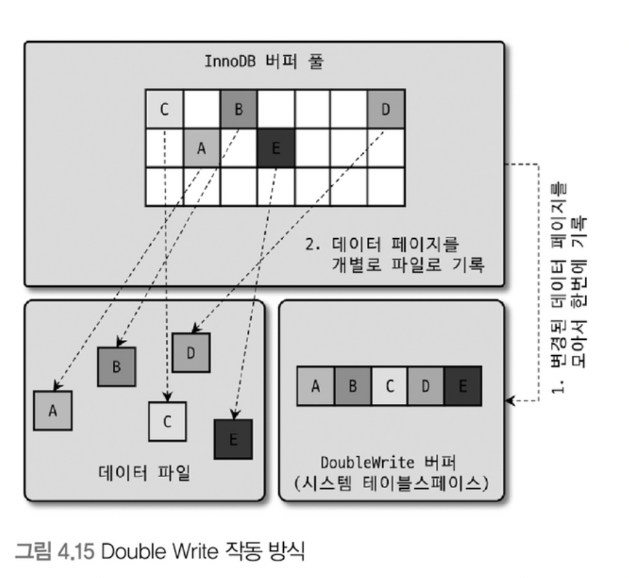

InnoDB에서 ‘A’ ~ ‘E’ 까지의 더티 페이지를 디스크로 플러시한다고 가정

먼저 ‘A’ ~ ‘E’ 까지의 더티 페이지를 묶어서 시스템 테이블스페이스의 DoubleWrite 버퍼에 기록한다.

그리고 InnoDB 스토리지 엔진은 각 더티 페이지를 파일의 적당한 위치에 하나씩 랜덤으로 쓰기를 실행한다.

Double Write 공간은 더티 페이지가 정상적으로 기록되면 더이상 필요가 없어진다.

페이지 기록 도중에 운영체제가 비정상적으로 종료됐다고 가정해보자. 

그러면 InnoDB 스토리지 엔진은 재시작될 때 Double Wirte Buffer 내용을 데이터 파일의 페이지들과 모두 비교해서 다른 내용을 담고 있는 페이지가 존재하면 Double Write Buffer 내용을 데이터 파일의 페이지로 복사한다.

Double Write 기능은 `innodb_doublewrite` 시스템 변수로 제어할 수 있다.

Double Write 버퍼는 데이터의 안정성을 위해 사용된다.

HDD는 한번의 추가 쓰기가 별로 부담이 되지 않지만 SSD는 한번의 추가 쓰기가 부담된다.

이는 SSD의 더티 페이지 수정 방식 때문이다. 

하지만 데이터의 무결성이 중요한 서비스라면 Double Write 활성화를 고려하는 것이 좋다.

만약 데이터베이스 서버의 성능을 위해 InnoDB 리두 로그 동기화 설정(`innodb_flush_log_at_trx_commit`) 시스템 변수를 1이 아닌 값으로 설정했다면 Double Write 또한 비활성화하는 것이 좋다. 

`innodb_flush_log_at_trx_commit`

    - `1`: **매 트랜잭션 커밋 시, 로그를 디스크에 동기화**하여 안정성 보장
    - `0`: **트랜잭션 커밋 시, 로그를 디스크에 동기화하지 않고, OS 캐시만 사용**(성능 향상, 데이터 손실 위험 있음)
    - `2`: **트랜잭션 커밋 시, 로그를 주기적으로 디스크에 동기화** (성능 향상, 어느 정도 안정성 보장)

즉, 데이터 무결성에 있어서 리두 로그의 동기화가 Double Write 보다 우선이다.

---

## 데이터 수정 동작 정리

### **데이터 수정(INSERT/UPDATE/DELETE) 동작 흐름**

    - 사용자가 데이터를 변경하면, 해당 데이터 페이지는 버퍼 풀(Buffer Pool, 메모리)에 적재되고, 이 페이지는 **더티 페이지(Dirty Page)** 상태가 된다.
    - 더티 페이지란, 메모리 내의 데이터가 디스크의 데이터와 달라진 상태를 의미한다.

### **리두 로그(Redo Log) 버퍼링**

    - 데이터 변경이 발생하면, 변경 내용은 리두 로그 버퍼(Redo Log Buffer, 메모리)에 먼저 기록된다.
    - 리두 로그 버퍼에 저장된 로그는 주기적으로, 또는 트랜잭션 커밋 시 리두 로그 파일(Redo Log File, 디스크)로 플러시된다.
    - 리두 로그 파일은 고정 크기의 순환 버퍼 방식으로 디스크에 저장되며, 장애 발생 시 데이터 복구에 사용된다.

### **더티 페이지의 디스크 동기화(Flush)**

    - 더티 페이지는 일정 시점(체크포인트, LRU/Flush 리스트 조건 등)에 **디스크의 데이터 파일**로 동기화된다.
    - 이때, **Double Write Buffer**라는 중간 버퍼(디스크 상의 연속된 공간)에 먼저 기록한 뒤, 실제 데이터 파일에 저장함으로써 파셜 페이지(부분 기록) 문제를 방지한다.

### **체크포인트(Checkpoint)와 리두 로그 파일 공간**

    - 리두 로그 파일(디스크)의 공간이 부족해지면, 체크포인트가 발생하여 **체크포인트 LSN**보다 이전의 더티 페이지를 디스크에 동기화하고, 해당 로그 공간을 재사용할 수 있게 만든다.
    - 체크포인트는 데이터 무결성과 장애 복구를 위한 핵심 메커니즘이다.

### **핵심 요약**

    - 데이터 변경 시, 메모리(버퍼 풀, 리두 로그 버퍼)에서 먼저 처리되고
    - 리두 로그 파일(디스크)에 장애 복구용으로 기록한 뒤
    - 더티 페이지는 Double Write Buffer를 거쳐 안전하게 데이터 파일(디스크)로 동기화됨.
    - 리두 로그 파일 공간이 부족하면 체크포인트가 발생해 더티 페이지를 디스크에 기록하고 로그 공간을 재활용

---

# 4.2.9 언두 로그

InnoDB 스토리지 엔진은 트랜잭션과 격리 수준 보장을 위해서 DML로 변경되기 이전 버전의 데이터를 별도로 백업한다. 이렇게 백업된 데이터를 **언두 로그(Undo Log)**라고 한다.

**트랜잭션 보장**

    - 트랜잭션이 롤백되면 트랜잭션 도중 변경된 데이터를 변경 전 데이터로 복구해야 하는데, 이때 언두 로그에 백업해둔 이전 버전의 데이터를 이용해 복구한다.

**격리 수준 보장** 

    - 특정 커넥션에서 데이터를 변경하는 도중에 다른 커넥션에서 데이터를 조회하면 격리 수준에 맞게 변경중인 레코드를 읽지 않고 언두 로그에 백업해둔 데이터를 읽어서 반환하기도 한다.

---

## 4.2.9.1 언두 로그 모니터링

다음과 같은 업데이트 문장을 실행했다고 해보자.

```sql
UPDATE MEMBER SET name='홍길동' WHERE member_id=1;
```

위 문장이 실행되면 트랜잭션을 커밋하지 않아도 실제 데이터 (데이터/인덱스 버퍼) 내용은 ‘홍길동’으로 변경된다. 변경되기 전의 값이 ‘벽계수’였다면, 언두 영역에는 ‘벽계수’라는 값이 백업되는 것이다.

이 상태에서 커밋하면 현재 상태가 그대로 유지되고, 롤백하면 언두 영역의 데이터를 다시 버퍼 풀로 복구한다.

언두 로그의 데이터는 크게 두 가지 용도로 사용되는데, 첫 번째 용도가 바로 위에서 언급한 트랜잭션의 롤백 대비용이다.

두 번째 용도는 트랜잭션의 격리 수준을 유지하면서 높은 동시성을 제공하는 데 있다.

트랜잭션의 격리 수준이라는 개념이 있는데, 이는 동시에 여러 트랜잭션이 데이터를 변경하거나 조회할 때 한 트랜잭션의 작업 내용이 다른 트랜잭션에 어떻게 보일지를 결정하는 기준이다.

### 언두 로그 공간 문제 

**대용량의 데이터를 처리하는 트랜잭션** 

예를 들어, 1억 건의 레코드가 저장된 100GB 크기의 테이블을 DELETE로 삭제한다고 가정해보자. 

1억 건의 레코드가 테이블에서 삭제되고 언두 로그로 복사돼야 한다.

즉, 테이블 크기만큼 언두 로그의 공간 사용량이 늘어나 결국 언두 로그 공간이 100GB가 되는 것이다.

**트랜잭션이 오랜시간 실행될 때**

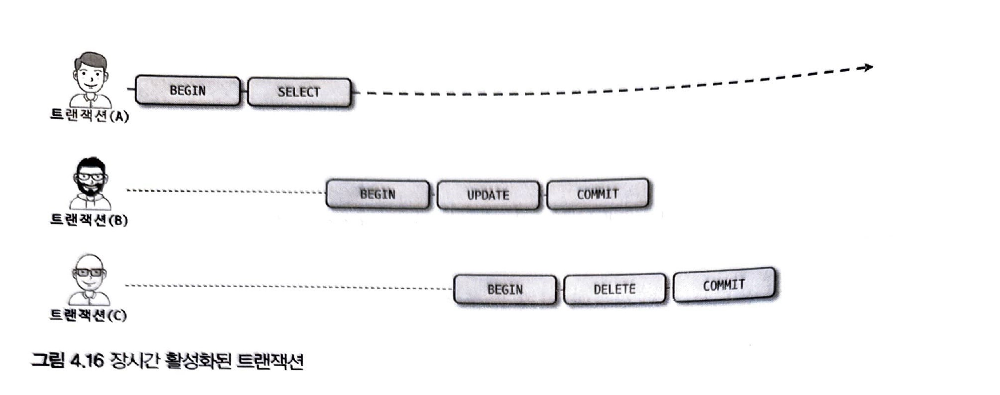

트랜잭션이 완료됐다고 해서 해당 트랜잭션이 생성한 언두 로그를 즉시 삭제할 수 있는 것은 아니다.

그림 4.16을 보면 B트랜잭션과 C트랜잭션은 완료됐지만 가장 먼저 시작된 트랜잭션 A는 완료되지 않은 상태이다.

트랜잭션 B와 트랜잭션 C는 UPDATE, DELETE 작업을 했기 때문에 언두 로그에 백업했다.

먼저 시작된 트랜잭션 A가 아직 활성 상태이기 때문에 B와 C 트랜잭션의 완료 여부와 상관없이 언두 로그에서 삭제되지 않는다. 즉, 디스크의 언두 로그 저장 공간은 계속 증가한다.

또한 빈번하게 변경된 레코드를 조회하는 쿼리가 실행되면 InnoDB 스토리지 엔진은 언두 로그의 이력을 필요한 만큼 스캔해야만 필요한 레코드를 찾을 수 있기 때문에 쿼리의 성능이 전반적으로 떨어지게 된다.

| 구분 | 설명 |
| --- | --- |
|  메모리 우선 | 처음에는 **버퍼 풀의 언두 세그먼트**(undo segment)에 메모리에 저장됨 |
| 디스크 백업 | **커밋 시점**에 **redo log**와 함께 **언두 로그도 디스크로 기록**됨 |
| Purge 조건 | **모든 트랜잭션이 해당 언두 로그를 참조하지 않을 때만 삭제 가능** |
| Evict 가능성 | **버퍼 풀이 가득 차거나 오랫동안 참조되지 않으면 evict**되어 디스크에서 읽어야 함 |
| 성능 트레이드오프 | 자주 변경되는 레코드를 과거 트랜잭션이 참조하면 **디스크 I/O가 증가해 성능 저하** 발생 |

이는 버퍼 풀에 메모리가 제한적이여서 다른 트랜잭션에서 참조된다고 하더라도 무한정 언두 로그를 들고 있을 수 없기 때문

**READ COMMITTED 이상 MVCC 관점**

    1. **트랜잭션 A 시작**
→ 현재 시점의 트랜잭션 ID `trx_id_A`를 기준으로 **가시성 판단**이 시작됨.
    1. **트랜잭션 B 시작 + UPDATE** `id = 1`
→ 변경 전 레코드는 **언두 로그에 저장 (버퍼 풀 메모리 내)**

→ 실제 데이터는 버퍼 풀에서 변경됨 (하지만 아직 커밋 전)
    1. **트랜잭션 B 커밋**
→ 변경된 레코드와 함께 리두 로그 + 언두 로그가 디스크에 동기화(flush)됨

→ **InnoDB는 언두 로그도 redo log에 의해 복구 가능해야 하기 때문**

→ 단, **트랜잭션 A가 살아 있으므로 언두 로그는 삭제되지 않음**
    1. **트랜잭션 A SELECT** `id = 1` **실행**
→ `trx_id_B`가 **A보다 나중에 커밋된 트랜잭션**

→ 따라서 A는 **B의 변경 사항을 보면 안 됨 → 언두 로그 참조 필요**

→ 언두 로그가 **버퍼 풀에 있으면 메모리 참조**,

없으면(evict 상태) **디스크에서 언두 로그를 읽어 복원한 후 참조**

언두 로그는 메모리에서 더이상 참조하는 트랜잭션이 없거나, 메모리가 부족하면 자연스럽게 evict 

또한 커밋하면서 디스크에 저장된 언두 로그는 참조되는 트랜잭션이 없다면 백그라운드 쓰레드(Purge Thread)에 의해서 주기적으로 삭제된다.

**언두 로그 모니터링** 

서비스 중인 MySQL 서버에서 활성 상태의 트랜잭션이 장시간 유지되는 것은 성능상 좋지 않다.

그래서 MySQL 서버의 언두 로그를 얼마나 증가했는지 항상 모니터링하는 것이 좋다.

**모든 버전에서 사용 가능한 명령어** 

```sql
SHOW ENGINE INNODB STATUS

# 결과
------------
TRANSACTIONS
------------
Trx id counter 2576
Purge done for trx's n:o < 2571 undo n:o < 0 state: running but idle
**History list length 0**
...
```

**MySQL 8.0 버전에서 사용 가능한 명령어** 

```sql
SELECT count 
FROM information_schema.innodb_metrics
WHERE SUBSYSTEM='transaction' AND NAME='trx_rseg_history_len';
```

레코드 데이터를 업데이트 하고 커밋하거나 롤백하면 History list length / count가 증가한다.

아마 버퍼 풀의 메모리에 언두 로그 수를 검색하는 게 아닌 디스크에 일시적으로 저장된 언두 로그 수를 카운트 하는것 같다.

**주의** 

MySQL 서버에서 INSERT 문장으로 인한 언두 로그와 UPDATE(DELETE) 언두 로그는 별도로 관리된다.

INSERT 문장으로 인한 언두 로그는 MVCC를 위해서는 사용되지 않고 오직 롤백이나 데이터 복구만을 위해서 사용되기 때문이다.

예제에서 보인 언두 로그의 건수에는 UPDATE, DELETE 문장으로 인한 언두 로그 개수만 표시된다.

---

## 4.2.9.2 언두 테이블스페이스 관리

언두 로그가 저장되는 공간을 **언두 테이블스페이스(Undo Tablespace)**라고 한다.

**언두 테이블스페이스 MySQL 버전별 차이**

```
5.6 이전 버전 
언두 로그가 모두 시스템 테이블스페이스(ibdata.idb)에 저장
문제점: 서버가 초기화될 때 생성되기 때문에 확장의 한계가 존재

5.6 버전
innodb_undo_tablespaces 시스템 변수 도입
innodb_undo_tablespaces > 2
-> 시스템 테이블스페이스가 아닌 별도의 언두 로그 파일을 사용

5.6 이후 버전에서도 innodb_undo_tablespaces = 0 설정 시 
언두로그가 테이블스페이스에 저장

8.0 이후
innodb_undo_tablespaces 시스템 변수 Deprecated
언두로그는 항상 시스템 테이블스페이스 외부의 별도 로그파일로 기록되도록 개선 
```

**언두 테이블스페이스 구조** 


하나의 언두 테이블 스페이스가 1개 이상 128개 이하의 롤백 세그멘트를 가진다.

롤백 세그멘트는 InnoDB 페이지의 크기를 16바이트로 나눈 값의 개수만큼 언두 슬롯을 가진다.

하나의 트랜잭션이 필요로 하는 언두 슬롯의 개수는 쿼리 특성에 따라 최대 4개까지 사용하지만 일반적으로는 2개의 언두 슬롯을 사용한다고 가정한다.

최대 동시 트랜잭션 수 = (InnoDB 언두 스페이스 개수) * (언두 테이블 스페이스가 1개 이상 128개 이하의 롤백 세그멘트) * (InnoDB 페이지 크기 / 16 = 하나의 롤백 세그멘트가 가지는 언두 슬롯) / 2(하나의 트랜잭션이 필요한 언두 슬롯)

기본 설정 기준 최대 동시 트랜잭션 수 = (`innodb_undo_tablespaces = 2`) * (128) * (1024) / 2 

    - 1024 * 128 = 131072 정도의 트랜잭션이 동시에 처리 가능하다.

더 자세한 내용은 책 127, 128 참고 

---

# 4.2.10 체인지 버퍼 

RDBMS에서 레코드가 변경될 때 데이터 파일을 변경하는 작업뿐 아니라 테이블에 포함된 인덱스를 업데이트하는 작업도 필요하다. 인덱스를 변경하는 작업은 랜덤하게 디스크를 읽는 작업이 필요하므로 테이블에 인덱스가 많다면 이 작업은 상당히 많은 자원을 소모하게 된다.

InnoDB는 변경해야 할 인덱스 페이지가 버퍼 풀에 존재하면 업데이트를 바로 수행하지만 그렇지 않다면 디스크로부터 읽어와서 업데이트해야 한다면 이를 즉시 실행하지 않고 **임시 메모리(체인지 버퍼)**에 저장해 두고 사용자에게 결과를 반환하는 형태로 성능을 향상시킨다. 

사용자에게 결과를 전달하기 전에 반드시 중복 여부를 체크해야 하는 유니크 인덱스는 체인지 버퍼를 사용할 수 없다. 체인지 버퍼에 임시로 저장된 인덱스 페이지는 이후 백그라운드 스레드인 체인지 버퍼 **머지 스레드(Merge Thread)**에 의해 처리된다.

| **정리**  |
| --- |
| 데이터 페이지는 변경 시 더티 페이지가 되어 플러시 리스트에 올라간다 |
| 인덱스 변경은 리소스가 크므로 체인지 버퍼를 통해 지연 처리할 수 있다 |
| 버퍼 풀에 있다면 바로 수정, 없다면 체인지 버퍼 사용 |
| 유니크 인덱스는 중복 확인이 필요하므로 체인지 버퍼 사용 불가 |
| PK는 자주 접근되므로 대부분 버퍼 풀에 있어 성능 문제가 덜하다 |
| 보조 유니크 인덱스는 버퍼 풀에 없으면 디스크를 읽어야 하므로 느려진다 |

| 조건 | 처리 방식 | 체인지 버퍼 사용 여부 | 사용자 응답 속도 |
| --- | --- | --- | --- |
| 버퍼 풀에 있음 | 메모리에서 직접 수정 | ❌ 사용 안 함 | 빠름 ✅ |
| 버퍼 풀에 없음 + 보조 인덱스 | 체인지 버퍼에 저장 | ✅ 사용함 | 빠름 ✅ |
| 버퍼 풀에 없음 + 유니크 인덱스 | 디스크에서 읽어 수정 | ❌ 사용 불가 | 느림 ❌ |

`innodb_change_buffering` 시스템 변수를 통해 작업의 종류별로 체인지 버퍼를 활성화할 수 있다.

체인지 버퍼가 비효율적일 때는 체인지 버퍼를 사용하지 않게 설정할 수 있다.

`innodb_change_buffering` 시스템 변수에 설정할 수 있는 값

    - all: 모든 인덱스 관련 작업(inserts + deletes + purges)
    - none: 버퍼링 안함
    - inserts: 인덱스에 새로운 작업을 추가하는 작업만 버퍼링
    - deletes: 인덱스에서 기존 아이템을 삭제하는 작업(삭제됐다는 마킹 작업)만 버퍼링
- MVCC: 모든 트랜잭션이 참조하지 않아서 언두 로그가 삭제될 때 물리적으로 삭제(purges)
    - changes: 인덱스에 추가하고 삭제하는 작업만(inserts + deletes)버퍼링
    - purges: 인덱스 아이템을 영구적으로 삭제하는 작업만 버퍼링(백그라운드 작업)

**체인지 버퍼 플러시 시점 4가지** 

    1. 해당 인덱스 페이지가 버퍼 풀로 로딩될 때 체인지 버퍼의 인덱스 페이지 변경 내용을 먼저 병합
    1. 백그라운드 스레드를 통한 주기적 병합 
    1. 해당 인덱스 페이지가 플러시될 때 먼저 체인지 버퍼 플러시
    1. MySQL 종료 직전

인덱스 페이지 VS 데이터 페이지

```
id(PK) name(index) age area 4개의 컬럼이 존재하는 테이블(member) 가정

레코드: 1 '배제우' 28 '대한민국'

UPDATE member SET name = '배제우2' WHERE name = '배제우';

데이터 페이지(클러스티드 인덱스) 1 배제우 28 대한민국 -> 더티 페이지 즉, 버퍼 풀 플러시 리스트에 보관
인덱스 페이지(name 인덱스) LRU에 보관  

언두 로그에 저장
리두 로그에 저장

커밋하면 언두 로그, 리두 로그 모두 디스크에 동기화

인덱스 페이지는 체인지 버퍼에 임시 저장으로 버퍼링 (버퍼 풀에 없었다고 가정)

플러시 리스트에 있는 데이터 페이지는 리두 로그 특정 체크 포인트(어댑티브 알고리즘)에 의해 디스크로 플러시 
추후에 인덱스 페이지는 LRU 리스트에서 Old 리스트로 이동하고 evict 대상이될 때 
체인지 버퍼에 있는 인덱스 페이지 디스크로 플러시
```

**UPDATE 버퍼링** 

```
InnoDB는 클러스터드 인덱스(primary key 기반 데이터 저장)을 기반
보조 인덱스(secondary index)의 값을 변경하는 경우,

해당 보조 인덱스의 기존 값을 삭제하고, 새 값을 삽입하는 형태로 동작.

예시로, 보조 인덱스 컬럼이 name이고
이 값을 "Tom"에서 "Jerry"로 바꾸면

-- 내부적으로는
DELETE name='Tom' (보조 인덱스에서 삭제 마킹)
INSERT name='Jerry' (보조 인덱스에 새로 삽입)
```

체인지 버퍼는 기본적으로 InnoDB 버퍼 풀로 설정된 메모리 공간의 25% 까지 사용할 수 있게 설정 

필요하면 50% 까지도 가능하다. 

INSERT, UPDATE, DELETE 등이 너무 빈번하게 실행되어 체인지 버퍼가 더 많은 버퍼 풀을 사용할 수 있게 하고자 한다면 `innodb_change_buffer_max_size` 시스템 변수로 비율을 설정하면 된다.

**체인지 버퍼가 사용 중인 메모리 크기 확인** 

```sql
SELECT EVENT_NAME, CURRENT_NUMBER_OF_BYTES_USED
FROM performance_schema.memory_summary_global_by_event_name
WHERE EVENT_NAME='memory/innodb/ibuf0ibuf';


# 결과 
144 
```

 **체인지 버퍼 관련 오퍼레이션 처리 횟수**

```sql

SHOW ENGINE INNODB STATUS


# 결과 
-------------------------------------
INSERT BUFFER AND ADAPTIVE HASH INDEX
-------------------------------------
Ibuf: size 1, free list len 0, seg size 2, 0 merges
merged operations:
 insert 0, delete mark 0, delete 0
discarded operations:
 insert 0, delete mark 0, delete 0
```

**변수 확인** 

```sql
SHOW GLOBAL VARIABLES LIKE 'innodb_change_buffer%';
```

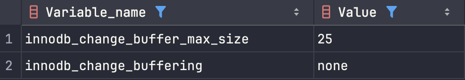

**default: none** 

---

# 4.2.11 리두 로그 및 로그 버퍼

**리두 로그(Redo Log)**는 ACID 중에서 Durable에 해당하는 영속성과 연관돼 있다.

리두 로그는 하드웨어나 소프트웨어 등 여러 가지 문제점으로 인해 MySQL 서버가 비정상적으로 종료됐을 때

데이터 파일에 기록되지 못한 데이터를 잃지 않게 해주는 안정장치다.

서버는 데이터 변경 내용을 로그로 먼저 기록한다.

데이터의 파일 쓰기는 디스크의 랜덤 엑세스가 필요하다. 

→ 변경된 데이터 기록은 큰 비용이 필요

→ 변경 내용은 리두 로그에 기록하고 추후 디스크 flush (버퍼링, 쓰기 지연)

→ 장애 발생 시 리두 로그를 사용해 커밋된 트랜잭션만 복구 가능

데이터 베이스 서버는 ACID도 중요하지만 성능 또한 중요하기 때문에 데이터 파일은 InnoDB 버퍼 풀로 버퍼링 리두 로그는 로그 버퍼로 버퍼링한다.

MySQL 서버가 비정상 종료되는 경우 InnoDB 스토리지 엔진은 두 가지 종류의 일관되지 않은 데이터를 가진다.

    1. 커밋됐지만 데이터 파일에 기록되지 않은 데이터
    1. 롤백됐지만 데이터 파일에 이미 기록된 데이터

**디스크 flush 시점과 로그 flush 시점** 

```
디스크 flush 시점은 다양하다. 
- InnoDB 버퍼풀 메모리 부족으로 디스크 flush (커밋/롤백 이전)
- 로그 버퍼 메모리 부족으로 디스크 flush (커밋/롤백 이전)
- 커밋/롤백  이후 

언두 로그 / 리두 로그 디스크 flush 시점 
- 언제나 커밋/롤백 발생 시 디스크로 동기화
- 언두 로그는 만약 참조되는 트랜잭션이 없다면 롤백 시점에 디스크로 동기화 X

InnoDB의 설계는 커밋 = 반드시 데이터 페이지 디스크 반영이 아니라, 커밋 = 로그 디스크 반영
참고로 인덱스 페이지는 체인지 버퍼를 통한 다른 생명주기를 가진다.

Q: 커밋됐지만 데이터 파일에 기록되지 않은 데이터?
A: 리두 로그는 디스크로 동기화 했지만 데이터 파일(디스크)에 동기화 되지 않은 케이스

Q: 백됐지만 데이터 파일에 이미 기록된 데이터
A: 롤백 이전에 이미 디스크 flush가 발생했고 이후 롤백으로 버퍼 풀에서는 되돌렸지만
디스크를 이전 상태로 바꾸지 않은 케이스
```

1번의 경우 리두 로그에 저장된 데이터를 데이터 파일에 복사하면 끝이다.

2번의 경우 변경되기 전 데이터를 가진 리두 로그의 내용을 가져와 데이터 파일에 복사하면 된다.

2번의 경우에도 리두 로그는 필요하다. 

→ 그 변경이 커밋됐는지, 롤백됐는지, 아니면 트랜잭션의 실행 중간 상태였는지를 확인하기 위해서 필요하다.

**`innodb_flush_log_at_trx_commit`**

데이터베이스 서버에서 **리두 로그는 트랜잭션이 커밋되면 즉시 디스크로 기록되도록 시스템 변수를 설정하는 것을 권장**한다. 서버가 비정상적으로 종료됐을 때 직전까지의 트랜잭션 커밋 내용이 리두 로그에 기록될 수 있고, 그 리두 로그를 이용해 장애 직전 시점까지의 복구가 가능하다.

```
**✅ 기록(write)**
리두 로그 내용을 운영체제의 파일 시스템 캐시(메모리)에 저장
즉, write() 시스템 콜로 디스크로 가는 준비만 하는 상태
디스크로 바로 가지 않음 (OS의 페이지 캐시에 있음)

**✅ 동기화(sync, fsync)**
운영체제의 파일 시스템 캐시에 있는 내용을 실제 디스크에 물리적으로 기록
즉, fsync() 호출을 통해 디스크에 보장된 상태로 저장

**innodb_flush_log_at_trx_commit = 0**
1초에 한 번씩 리두 로그를 디스크로 기록, 동기화 
서버가 비정상 종료되면 최대 1초 동안 커밋된 트랜잭션의 데이터가 사라질 수 있다. 

**innodb_flush_log_at_trx_commit = 1**
매번 트랜잭션이 커밋될 때마다 디스크로 기록, 동기화 
서버가 비정상 종료되더라도 커밋된 내용은 복구가 가능하다.

**innodb_flush_log_at_trx_commit = 2** 
매번 트랜잭션이 커밋될 때마다 디스크로 기록하지만 동기화는 1초에 한번만 한다.
일단 트랜잭션이 커밋되면 운영체제의 메모리 버퍼로 기록되는 것이 보장된다. 
MySQL 서버가 비정상 종료됐더라도 운영체제가 살아있으면 데이터는 사라지지 않는다.
하지만 서버와 운영체제 모두 비정상적으로 종료되면 최근 1초 동안의 트랜잭션 데이터는 사라질 수 있다.
```

**추가 디테일** 

```
**innodb_flush_log_at_trx_commit = 0, 2** 인 경우 
- 항상 1초마다 동기화를 하지는 않는다. 스키마 변경을 위한 DDL이 발생하면 1초보다 간격이 적을 수 있다.
- 디스크 동기화 시간 간격을 **innodb_flush_log_at_timeout** 시스템 변수로 변경이 가능하다.
```


**InnoDB 스토리지 엔진의 리두 로그 파일들의 전체 크기는 InnoDB 스토리지 엔진의 버퍼 풀의 효율성을 결정**하기 때문에 신중히 결정해야 한다.

```
데이터 변경 -> 리두 로그 버퍼(메모리)에 리두 로그를 기록한다.

데이터 커밋 -> 리두 로그 버퍼에 있는 리두 로그를 리두 로그 파일(디스크)에 저장한다.

실제 데이터 페이지에 대한 디스크 flush 시점은 다양하다
- 버퍼 풀 메모리 부족(OldList)
- 리두 로그 파일 부족(체크 포인트 에이징) 자세한 내용은 버퍼 풀 크기와 리두 로그 관계를 다시 보자

리두 로그에 해당하는 데이터 페이지가 디스크로 동기화되면 리두 로그 파일의 리두 로그 또한 삭제된다.
```

리두 로그 파일 크기 = `innodb_log_file_size` (파일 크기) * `innodb_log_files_in_group` (파일 개수)

리두 로그 파일의 전체 크기가 InnoDB 버퍼 풀 크기에 맞게 적절히 선택돼야 InnoDB 스토리지 엔진이 적절히 변경된 내용을 버퍼 풀에 모았다가 한 번에 모아서 디스크에 기록할 수 있다.

사용량(변경 작업)이 매우 많은 DBMS 서버의 경우 리두 로그를 메모리로 임시 저장하는 작업이 큰 문제가 되는데

이때 로그 버퍼를 통해서 버퍼링하고 로그 버퍼의 크기의 기본값은 16MB 이지만, BLOB TEXT 같이 큰 데이터를 자주 변경하는 경우에는 더 크게 설정하는 것이 좋다.  

---

## 4.2.11.1 리두 로그 아카이빙

MySQL 8.0 버전부터 InnoDB 스토리지 엔진의 리두 로그를 아카이빙할 수 있는 기능이 추가됐다.

```
리두 로그 아카이빙?

커밋된 트랜잭션을 복구 가능하게 하기 위해 리두 로그를 삭제하지 않고 별도로 백업/보관하는 작업.

주요 목적
- 장애 복구 시 지정 시점까지 데이터 복구
- 백업 이후부터 현재까지의 변경 사항을 리두 로그로 재적용
```

더 자세한 내용은 책 페이지 133~135 확인 

---

## 4.2.11.2 리두 로그 활성화 및 비활성화

MySQL 8.0 버전부터 리두 로그를 수동으로 비활성화 할 수 있다.

대용량 파일을 한번에 적재하는 경우 리두 로그를 비활성화 해서 적재 시간을 단축시킬 수 있다. 

적재가 끝나면 항상 다시 활성화하는 것을 잊지 말자

더 자세한 내용은 책 페이지 135~136 확인

---

# 4.2.12 어댑티브 해시 인덱스

어댑티브 해시 인덱스는 B-Tree 검색 시간을 줄여주기 위해 도입된 기능이다.

InnoDB 스토리지 엔진은 자주 읽히는 데이터 페이지의 키 값을 이용해 해시 인덱스를 만들고, 필요할 때마다 어댑티브 해시 인덱스를 검색해서 레코드가 저장된 데이터 페이지를 즉시 찾아갈 수 있다.

B-Tree를 루트 노드부터 리프 노드까지 찾아가는 비용이 없어지고 그만큼 CPU가 적은 일을 하지만, 쿼리의 성능은 빨라진다. 즉, 컴퓨터는 동시에 더 많은 쿼리를 처리할 수 있다.

사용자는 `innodb_dapative_hash_index` 시스템 변수를 이용해서 어댑티브 해시 인덱스 기능을 활성화 또는 비활성화 할 수 있다. 

```sql
SHOW VARIABLES LIKE 'innodb_adaptive_hash_index';

# 결과 
OFF
```

해시 인덱스는 인덱스 키 값과 해당 인덱스 키 값이 저장된 데이터 페이지의 주소 쌍으로 관리된다.

인덱스 키 값은 B-Tree 인덱스의 고유 번호와 B-Tree 인덱스의 실제 키 값 조합으로 생성된다.

데이터 페이지의 주소는 InnoDB 버퍼 풀에 로딩된 페이지의 주소를 의미한다.

**즉, 버퍼 풀에서 해당 페이지가 사라지면 어댑티브 해시 인덱스에서도 해당 페이지의 정보가 사라진다**.

어댑티브 해시 인덱스 자세한 내용은 페이지 137~141 확인

---

# 4.12.13 InnoDB와 MyISAM, MEMORY 스토리지 엔진 비교

MySQL 8.0 이후 버전부터는 모든 MySQL 서버 기능이 InnoDB 스토리지 엔진을 기반으로 한다.

MyISAM, MEMORY 스토리지 엔진은 추후 버전에서 사라질 가능성이 높다.

---

**추가 정리** 

## ✅ 기본 구조

### 🧱 HDD (Hard Disk Drive)

    - **구조**: 자기 디스크(플래터) 위에 데이터를 저장. 디스크가 회전하고, 읽기/쓰기 헤드가 이동하여 데이터를 읽음.
    - **동작 원리**: 기계적으로 동작함. 디스크 회전 + 헤드 이동이 필요.

### ⚡ SSD (Solid State Drive)

    - **구조**: 반도체 메모리(보통 NAND 플래시)를 사용하여 데이터를 저장.
    - **동작 원리**: 전기적으로 동작함. 움직이는 부품 없음.

---

## ✅ 주요 차이점

| 항목 | HDD | SSD |
| --- | --- | --- |
| **속도** | 느림 (회전 지연 + 탐색 시간) | 빠름 (즉시 접근 가능) |
| **내구성** | 충격에 약함 (기계 부품 있음) | 충격에 강함 (기계 부품 없음) |
| **소음** | 있음 (회전 소리 등) | 없음 |
| **발열** | 상대적으로 더 발생 | 적음 |
| **수명** | 일반적으로 더 김 | 쓰기 횟수에 제한 (TBW 수치로 표시) |
| **가격** | GB당 저렴 | GB당 비쌈 |
| **용량** | 대용량 제품 흔함 (수 TB 이상) | 고용량은 비싸고 상대적으로 적음 |

---

## ✅ 순차 접근 (Sequential Access)

    - **정의**: 데이터가 **연속된 블록**에 저장되어 있을 때, 이를 한 번에 읽거나 쓰는 방식
예: 큰 파일 다운로드, 동영상 재생 등

### HDD에서 순차 접근

    - 디스크가 회전하면서 읽기 헤드가 **연속된 트랙**을 읽으면 됨
    - → 비교적 효율적임 (최대 속도 기준으로는 꽤 빠름)
    - 예: 150MB/s ~ 250MB/s 수준

### SSD에서 순차 접근

    - NAND 플래시 메모리에서 전기적으로 연속된 셀을 읽음
    - → **훨씬 빠름**, 보통 500MB/s 이상, NVMe는 3000MB/s 이상

📌 **요약**: 순차 접근은 HDD도 나쁘지 않지만, SSD는 훨씬 빠름.

---

## ✅ 랜덤 접근 (Random Access)

    - **정의**: 여러 위치에 흩어진 데이터를 여기저기 빠르게 접근해서 읽거나 쓰는 방식
예: DB 쿼리, 운영체제 부팅, 앱 실행 등

### HDD에서 랜덤 접근

    - 읽기 헤드가 **디스크 여기저기를 이동해야 함**
    - → **탐색 시간(Seek Time)** + **회전 지연(Rotational Latency)** 발생
    - → 매우 느림 (수천 IOPS 이하)

### SSD에서 랜덤 접근

    - 전기적으로 주소만 알면 바로 접근 가능 (마이크로초 수준)
    - → **탐색 지연 없음**, 매우 빠름 (수만~수십만 IOPS)

📌 **요약**: 랜덤 접근에서는 SSD가 **압도적으로 우세**

---

## ✅ SSD 쓰기 제한이 있는 이유: **NAND 플래시의 특성 때문**

SSD는 **NAND 플래시 메모리**를 사용하는데, 이 메모리는 쓰기와 삭제가 복잡하다.

### 🔸 플래시 메모리는 다음과 같은 특징이 있다.

    1. **덮어쓰기 불가**
- 플래시는 이미 저장된 데이터를 직접 덮어쓸 수 없다.
      - 데이터를 바꾸려면 **먼저 지우고**, 그다음 다시 써야 한다.
    1. **삭제는 '블록' 단위, 쓰기는 '페이지' 단위**
- 데이터를 쓸 때는 4KB 페이지 단위로 가능
      - 하지만 **삭제는 한 번에 256KB ~ 1MB 블록 단위로만 가능**
      - 즉, 작은 변경도 전체 블록을 읽고 → 수정하고 → 통째로 다시 써야 함 (이걸 **Read-Modify-Write**라고 함)
    1. **지우기/쓰기 횟수 제한**
- 각 셀은 **정해진 횟수만큼**만 지우고 쓸 수 있음 (보통 수천~수만 번)
      - 이걸 PE Cycles (Program-Erase Cycles)이라고 한다.

---

## ✅ SSD 쓰기 비용이 더 큰 이유

### 🔸 ① Read보다 Write가 훨씬 복잡함

    - 위에서 말한 **지우고 다시 쓰는 구조** 때문에, write는 read보다 **시간도 오래 걸리고** 셀에 **부담도 큼**

### 🔸 ② GC (Garbage Collection) 발생

    - SSD는 변경된 데이터를 새로운 위치에 쓰고, 예전 데이터를 **지우기 위해 백그라운드에서 GC**를 해야 함
    - 이 과정에서 **성능 저하**와 추가 쓰기(I/O Overhead)가 발생함

### 🔸 ③ Wear Leveling 필요

    - 특정 셀만 계속 쓰면 빨리 고장나니까, SSD는 **모든 셀을 고르게 사용**하려고 내부에서 **데이터를 자주 이동**시킴
    - 이 또한 **추가적인 쓰기 부담**을 유발함

### 🔸 ④ Over-Provisioning (OP)

    - 실제 저장공간보다 더 많은 NAND를 탑재해 GC, Wear Leveling 등을 수행함
    - 이로 인해 **사용자가 쓸 수 있는 용량은 줄고**, **단가가 올라감**

---

## ✅ 3. 반면 HDD는?

    - **자기 디스크에 데이터를 덮어쓰는 방식**이라 덮어쓰기가 자유롭고 쓰기 횟수 제한도 없음
    - 기계식이라 느리긴 하지만, 쓰기 동작 자체는 **간단하고 싸게** 처리 가능

---

## ✅ 실제로 SSD 수명은 괜찮은가?

    - 요즘은 TBW(Total Bytes Written)로 수명을 표시
- 예: TBW가 600TB면, 600TB만큼의 데이터를 쓸 수 있음
    - 보통 일반 사용자 기준으로는 **10년 써도 못 닳는 수준**
- 하루 50GB씩 써도 30년!

✅ 결론: **제한은 있지만 걱정할 수준은 아님**

---

## ✅ 정리

| 항목 | SSD | HDD |
| --- | --- | --- |
| 쓰기 구조 | 덮어쓰기 불가 → 지우고 다시 써야 함 | 바로 덮어쓰기 가능 |
| 쓰기 비용 | 높음 (GC, wear leveling, OP) | 낮음 |
| 쓰기 횟수 제한 | 있음 (PE Cycles 제한) | 없음 |
| 수명 관리 | TBW/GC/Wear Leveling 필요 | 별도 관리 거의 불필요 |

---

## ✅ SSD 계층적 단위

셀(Cell) < 페이지(Page) < 블록(Block)

```
Block
 ├── Page 0
 ├── Page 1
 ├── ...
 └── Page 127
      ├── Cell 0 → 저장된 비트
      ├── Cell 1
      └── ...
```

## ✅ 셀 (Cell)

    - **가장 작은 단위**
    - 전하의 양(전압)으로 **0 또는 1 같은 비트 정보를 저장**

| 타입 | 저장 비트 수 | 특징 |
| --- | --- | --- |
| SLC (Single Level Cell) | 1비트 | 빠름, 내구성 최고, 비쌈 (서버/산업용) |
| MLC (Multi Level Cell) | 2비트 | 보통 소비자용 고급 SSD |
| TLC (Triple Level Cell) | 3비트 | 저가형 SSD에서 흔함 |
| QLC (Quad Level Cell) | 4비트 | 싸지만 느리고 수명 짧음 |

## ✅ 페이지 (Page)

    - **보통 4KB 또는 8KB 크기**
    - **데이터를 실제로 쓰는 단위**
    - 하지만 한 번 쓴 페이지는 **덮어쓸 수 없음** (새로 써야 함)

### ⚠ 페이지 쓰기 제한

    - 한 번 기록된 페이지는 **지우지 않고는 수정 불가**
    - 이 때문에 **덮어쓰기 대신 새 위치에 다시 씀** → "쓰기 증폭" 현상 유발

## ✅ 블록 (Block)

    - 여러 페이지가 모여서 하나의 블록이 됨
    - 보통 **64~256개 페이지로 구성**
    - 예: 4KB 페이지 × 128개 = 512KB 블록

### ⚠ 블록 삭제 방식

    - SSD는 데이터를 지울 때 **블록 단위로만 삭제 가능**
    - 즉, 어떤 한 페이지만 지우고 싶어도, **해당 페이지가 포함된 블록 전체를 삭제하고 새로 써야 함**

---

## ✅ 실제 동작 흐름

    1. 어떤 페이지가 수정됨 (예: MySQL이 페이지 #42를 수정)
    1. SSD는 해당 페이지를 **새로운 빈 페이지 위치에 기록** (페이지 단위 쓰기)
    1. 기존 페이지는 그대로 남고, "쓰레기(Invalid Page)"가 됨
    1. 나중에 SSD는 GC(Garbage Collection) 단계에서
- **그 블록 내의 유효한 페이지들을 다른 블록에 복사**
      - **기존 블록 전체를 삭제**
      - **해당 블록을 다시 빈 상태로 등록**

---

MySQL 동시성에 영향을 미치는 잠금(Lock)과 트랜잭션, 트랜잭션의 격리 수준을 공부한다.

트랜잭션은 작업의 완전성을 보장해 주는 것

즉, 논리적인 작업 셋(집합)을 모두 완벽하게 처리하거나 처리하지 못할 경우에는 원 상태로 복구해서 작업의 일부만 적용되는 현상을 방지한다. → All Or Nothing 

잠금은 동시성을 제어하기 위한 기능 트랜잭션은 데이터의 정합성을 보장하기 위한 기능이다.

예를 들어 하나의 회원 정보 레코드를 여러 커넥션에서 동시에 변경하는데 잠금이 없다면 하나의 데이터를 여러 커넥션에서 변경이 가능하고 결과적으로 레코드의 값은 예측할 수 없는 상태가 된다.

잠금은 여러 커넥션에서 동시에 동일한 자원(레코드/테이블)을 요청할 경우 순서대로 한 시점에는 하나의 커넥션만 변경할 수 있게 해주는 역할을 한다.

격리 수준은 하나의 트랜잭션 내에서 또는 여러 트랜잭션 간의 작업 내용을 어떻게 공유하고 차단할 것인지를 결정하는 레벨이다.

트랜잭션을 지원하지 않는 MyISAM과 트랜잭션을 지원하는 InnoDB의 처리 방식 차이를 공부하고

트랜잭션을 사용할 경우 주의할 사항도 함께 살펴보자.

---

# 5.1.1 MySQL에서의 트랜잭션

트랜잭션은 꼭 여러 개의 변경 작업을 수행하는 쿼리가 조합됐을 때만 의미있는 개념이 아니다.

쿼리의 개수와 상관없이 논리적인 작업 셋 자체가 100% 적용(COMMIT)되거나 아무것도 적용되지 않아야함(트랜잭션 ROLLBACK, 서버 비정상 종료)을 보장해 주는 것이다.

### 트랜잭션 관점에서 InnoDB VS MyISAM 차이점 비교

**테이블 생성, 레코드 1건 저장** 

```sql
CREATE TABLE tab_myisam (
   fdpk INT NOT NULL,
   PRIMARY KEY (fdpk)
) ENGINE=MyISAM;

CREATE TABLE tab_innodb (
  fdpk INT NOT NULL,
  PRIMARY KEY (fdpk)
) ENGINE=INNODB;

INSERT INTO tab_myisam VALUE(3);
INSERT INTO tab_innodb VALUE(3);
```

**테스트 쿼리** 

```sql
SET autocommit=ON;

INSERT INTO tab_myisam VALUES (1), (2), (3);
INSERT INTO tab_innodb VALUES (1), (2), (3);
```

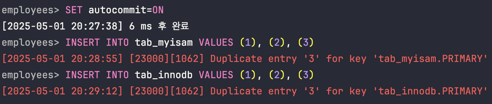

두 개의 스토리지 엔진에서 결과가 어떻게 다를까? 

```sql
SELECT * FROM tab_myisam;
SELECT * FROM tab_innodb;
```

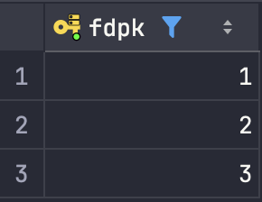


MyISAM 스토리지 엔진은 3개의 레코드, InnoDB 스토리지 엔진은 하나의 레코드만 존재한다.

두 INSERT 문장 모두 프라이머리 키 중복 오류로 쿼리 실패했다.

하지만 MyISAM 테이블에는 오류가 발생했어도 ‘1’, ‘2’는 INSERT된 상태로 남아있다.

즉, MyISAM 테이블에 INSERT 문장이 실행되면서 차례대로 ‘1’, ‘2’를 저장하고, 그다음 ‘3’을 저장하려는 순간

중복 키 오류가 발생한 갓이다.

하지만 MyISAM 테이블은 이미 실행된 ‘1’과 ‘2’를 그대로 두고 쿼리 실행을 종료해 버린다.

하지만 InnoDB 테이블은 쿼리 중 일부라도 오류가 발생하면 전체를 원 상태로 만든다는 트랜잭션 원리대로 문장을 실행하기 전 상태로 그대로 복구했다.

MyISAM 테이블에서 발생하는 이러한 현상을 **부분 업데이트(Partial Update)**라고 표현한다.

---

# 5.1.2 주의사항

트랜잭션 또한 DBMS 커넥션과 동일하게 꼭 필요한 최소의 코드에만 적용하는 것이 좋다.

**예시**

사용자가 게시판에 게시물을 작성한 후 저장 버튼 클릭했을 때 서버에서 처리하는 내용 

```sql
1) 처리 시작
-> 데이터베이스 커넥션 생성 
-> 트랜잭션 시작
2) 사용자의 로그인 여부 확인 
3) 사용자의 글쓰기 내용의 오류 여부 확인
4) 첨부로 업로드된 파일 확인 및 저장 
5) 사용자의 입력 내용을 DBMS에 저장 
6) 첨부 파일 정보를 DBMS에 저장
7) 저장된 내용 또는 기타 정보를 DBMS에서 조회
8) 게시물 등록에 대한 알림 메밀 전송 
9) 알림 메일 발송 이력을 DBMS에 저장 
-> 트랜잭션 종료(COMMIT)
-> 데이터베이스 커넥션 반납
10) 처리 완료 
```

해당 처리 절차에서 DBMS 트랜잭션 처리에 좋지 않은 영향을 미치는 부분을 나눠서 살펴보자 

**실제로 DBMS에 데이터를 저장하는 작업(트랜잭션)은 5번부터 시작된다는 것을 알 수 있다.**

2번,3번,4번 절차가 아무리 빨리 처리된다고 하더라도 DBMS의 트랜잭션에 포함시킬 필요는 없다.

데이터베이스 커넥션 개수는 제한적이어서 각 단위 프로그램이 커넥션을 소유하는 시간이 길어질수록 사용 가능한 여유 커넥션의 개수는 줄어들 것이다. 

**8번 작업 같이 메일 전송이나 FTP 파일 전송 작업 또는 네트워크를 통해 원격 서버와 통신하는 작업은 어떻게 해서든 DBMS 트랜잭션 내에서 제거하는 것이 좋다.** 
프로그램 실행되는 동안 메일 서버와 통신할 수 없는 상황이면 웹 서버뿐 아니라 DBMS 서버까지 위험해지는 상황이 발생할 것이다.

**DBMS 작업이 4개가 있다.  5번, 6번, 7번, 9번**

사용자가 입력한 정보를 저장하는 5번, 6번 작업은 하나의 트랜잭션으로 묶어야 한다. 

7번은 저장된 데이터의 단순 확인 및 조회이므로 트랜잭션에 포함될 필요는 없다.

알림 전송 저장 같은 9번은 비즈니스 목적이 아예 다른 성격의 작업이다. 
별도의 트랜잭션으로 분리하는 것이 좋다.

**재설계**

```sql
1) 처리 시작
2) 사용자의 로그인 여부 확인
3) 사용자의 글쓰기 내용의 오류 발생 여부 확인
4) 첨부된 업로드된 파일 확인 및 저장
-> DB 커넥션 생성(커넥션 풀에서 가져오기)
-> 트랜잭션 시작
5) 사용자의 입력 DBMS에 저장 
6) 첨부 파일 정보 DBMS에 저장 
-> 트랜잭션 종료(COMMIT/ROLLBACK)
7) 저장된 내용 / 기타 정보 DBMS에서 조회
8) 게시글 등록에 대한 알림 메일 전송 
-> 트랜잭션 시작
9) 알림 메일 발송 이력을 DBMS에 저장 
-> 트랜잭션 종료(COMMIT/ROLLBACK)
-> DB 커넥션 종료(커넥션 풀에 반납)
10) 처리 완료 
```

**프로그램 내에서 실행되는 데이터베이스 커넥션의 범위와 트랜잭션 범위를 최소화하자!**

MySQL 서버의 잠금은 스토리지 엔진 레벨과 MySQL 엔진 레벨로 나눌 수 있다.

MySQL 엔진 레벨의 잠금은 모든 스토리지 엔진에 영향을 미치지만, 스토리지 엔진 레벨의 잠금은 스토리지 엔진 간 상호 영향을 미치지 않는다.

MySQL 엔진에서는 테이블 데이터 동기화를 위한 테이블 락 이외에도 테이블 구조를 잠그는 메타데이터 락 그리고 사용자의 필요에 맞게 사용할 수 있는 네임드 락 기능을 제공한다.

---

# 5.2.1 글로벌 락 

**글로벌 락(GLOBAL LOCK)**은 `FLUSH TABLES WITH READ LOCK` 명령으로 획득할 수 있으며, 제공하는 잠금 가운데 가장 범위가 크다. (데이터 베이스, 테이블 상관 X → 전체)

한 세션에서 글로벌 락을 획득하면 다른 세션은 SELECT를 제외한 모든 DDL, DML은 글로벌 락이 해제될 때까지 대기 상태로 남는다.

**글로벌 락 동작 방식** 

```
글로벌 락 획득 시도보다 먼저 활성화된 모든 트랜잭션을 기다린다. 
즉, 커밋/롤백까지 기다린다.
버퍼링된 데이터 페이지를 디스크로 플러시한다.
이 모든 조건을 만족하면 글로벌 락 획득

장시간 실행되는 쿼리와 FLUSH TABLES WITH READ LOCK 명령이 최악의 케이스로 실행되면 
MySQL 서버 모든 테이블에 대한 DML 쿼리가 오랜 시간 동안 기다릴 수도 있다.

글로벌 락은 웹 서비스용 MySQL 서버에서 사용금지 

mysqldump 같은 백업 프로그램
-> 옵션에 따라서 어떤 잠금을 사용하는지 확인하자
```

### 백업 락 

InnoDB 스토리지 엔진은 트랜잭션을 지원하기 때문에 일관된 데이터 상태를 위해 모든 데이터 변경 작업을 

멈출 필요는 없다.

MySQL 8.0 부터는 InnoDB 스토리지 엔진이 기본 스토리지 엔진으로 채택되면서 조금 더 가벼운 글로벌 락 필요성이 생겼다. → 백업 락

```sql
LOCK INSTANCE FOR BACKUP;
// 백업 실행 
UNLOCK INSTANCE;
```

**백업 락 잠금 범위** 

    - 데이터베이스 및 테이블 등 모든 객체 생성 및 변경 삭제
    - 사용자 관리 및 비밀번호 변경
    - REPAIR TABLE, OPTIMIZE TABLE 명령

**백업 락 동작 방식** 

백업 락은 일반적인 데이블의 데이터 변경 DML은 허용된다. 

별도의 조건없이 바로 획득이 가능하다. 

**MySQL 서버 구성**
소스 서버(source server) 레플리카 서버(replica server)로 구성
주로 백업은 보통 레플리카 서버에서 실행된다.

source → (binary log) → replica

**레플리카 서버에서 백업을 글로벌 락 VS 백업 락** 

글로벌 락을 백업으로 사용하면 글로벌 락 획득도 복제 작업이 있으면 지연되고
글로벌 락 도중에 소스 서버 데이터 변경이 있어도 실시간 복제 작업을 못하기 때문에 좋지 않다.

하지만 백업 락은 락 획득 조건이 없어 바로 가능하고 DML은 허용되기 때문에 실시간 복제 작업도 문제없이 가능하다. 즉, 백업과 복제가 동시에 가능하다.

또한 DDL 명령으로 백업이 실패하는 상황을 방지하기 위해서 DDL 명령이 실행되면 복제를 일시 중지하는 역할을 한다. 

**MySQL 8.0 이상 + InnoDB 환경**에서는 `LOCK INSTANCE FOR BACKUP` 기반 백업 전략이 권장

---

# 5.2.2 테이블 락

**테이블 락(Table Lock)**은 개별 테이블 단위로 설정되는 잠금이며, **명시적 또는 묵시적**으로 특정 테이블의 락을 획득할 수 있다.

**명시적 테이블 락 획득, 반납** 

```sql
LOCK TABLES table_name [READ | WRITE]

UNLOCK TABLES
```

명시적인 테이블 락은 애플리케이션에서 사용할 필요가 거의 없다.

글로벌 락과 동일하게 온리인 작업에 상당한 영향을 미치기 때문이다.

### 묵시적 테이블 락 

InnoDB 테이블은 DML 쿼리에서는 사용되지 않고, DDL 쿼리에서는 자동으로 사용된다.

왜냐하면 스토리지 엔진 차원에서 레코드 기반의 잠금을 제공하기 때문에 단순 데이터 변경 쿼리인 DML은 테이블 락이 설정되지는 않는다.

하지만 MyISAM, MEMORY 테이블은 데이터 변경 또한 묵시적으로 자동으로 테이블 락이 걸린다.

### 참고 자료 

[https://steady-coding.tistory.com/545](https://steady-coding.tistory.com/545)

---

# 5.2.3 네임드 락

네임드 락(Named Lock)은 `GET_LOCK()` 함수를 이용해 임의의 문자열에 대해 잠금을 설정할 수 있다.

이 잠금의 특징은 **대상이 테이블이나 레코드 또는 AUTO_INCREMENT 같은 데이터베이스 객체가 아니라는 것**이다. 

단순히 사용자가 지정한 문자열에 대해 획득하고 반납하는 잠금이다.

여러 클라이언트가 상호 동기화를 처리해야 할 때 네임드 락을 이용하면 쉽게 해결할 수 있다.

### 네임드 락 사용법

```sql
// 이미 잠금 사용 중이면 2초 대기
SELECT GET_LOCK('mylock', 2);

// 잠금 설정 확인
SELECT IS_FREE_LOCK('mylock');

// 잠금 반납 해제 
SELECT RELEASE_LOCK('mylock');
```

    - 3개 함수 모두 정상적으로 동작하면 1을 반환
    - 3개 함수 모두 실패하면 0 또는 NULL 반환 

### 네임드 락 중첩

MySQL 8.0 부터는 다음과 같이 네임드 락을 중첩해서 사용할 수 있다.

```sql
SELECT GET_LOCK('mylock_1', 10);
SELECT GET_LOCK('mylock_2', 10);

// 작업 수행 

SELECT RELEASE_LOCK('mylock_2');
SELECT RELEASE_LOCK('mylock_1');

// 동시에 해제 방법
SELECT RELEASE_ALL_LOCKS();
```

### 올바른 네임드 락 가이드

```
내가 생각하는 네임드 락 올바른 패턴

락 트랜잭션 시작
네임드 락 획득

비즈니스 트랜잭션 시작
비즈니스 트랜잭션 커밋 / 롤백

네임드 락 반납

---------------------------------------------------------------------------
왜 이렇게 트랜잭션을 분리해서 락을 획득?

네임드 락 획득 트랜잭션과 비즈니스 트랜잭션이 같은 트랜잭션으로 동작하면
동시성 이슈가 발생한다.

락 반납 <-> 트랜잭션 커밋 사이에 다른 트랜잭션이 락을 획득하고 업데이트 시도가 가능하기 때문이다.
---------------------------------------------------------------------------
그렇다면 꼭 락을 획득하는 트랜잭션과 반납하는 트랜잭션을 분리할 필요가 있는가?

트랜잭션1
네임드 락 획득

트랜잭션2
비즈니스 로직 

트랜잭션3
네임드 락 반납

트랜잭션1과 트랜잭션3은 서로 다른 커넥션이다 무슨 문제점이 있을까?
"네임드 락은 현재 세션에서 설정한 락만 해제할 수 있다" 즉, 커넥션이 다르면 반납이 불가능하다.
즉, 트랜잭션1에서 락을 획득한 커넥션(세션)과 트랜잭션3에서 락을 반납하는 커넥션이 다르면 
락 반납이 불가능하다.
만약 반납이 가능하다면 그건 우연의 일치로 같은 히카리풀이 트랜잭션을 제공할 때 트랜잭션1과 
트랜잭션3이 같은 커넥션을 제공하였기 떄문이다. 
```


만약 세션(커넥션)이 끊긴다면 자동으로 락은 릴리즈

---

# 5.2.5 메타데이터 락

**메타데이터 락(Metadata Lock)**은 데이터베이스 객체(테이블이나 뷰)의 이름이나 구조를 변경하는 경우에 획득하는 잠금이다.

**메타데이터 락은 명시적으로 획득이 불가능하다.**

`RENAME TABLE tab_a To tab_b` 같이 테이블의 이름을 변경하는 경우 자동으로 획득하는 잠금이다.

RENAME TABLE 같은 경우 원본 이름과 변경될 이름 두 개 모두 한꺼번에 잠금을 설정한다.

**예제1**

```sql
// 배치 프로그램에서 별도의 임시 테이블(rank_new)에 서비스용 랭킹 데이터를 생성

// 랭킹 배치가 완료되면 현재 서비스용 랭킹 테이블(rank)에 rank_backup으로 백업 
// 새로 만들어진 랭킹 테이블(rank_new)을 서비스용으로 대체 
RENAME TABLE rank TO rank_backup, rank_new TO rank;
```

예제1 같이 하나의 RENAME TABLE 명령문에 두 개의 RENAME 작업을 한꺼번에 실행하면 실제 애플리케이션 서버에서는 “Table not found rank” 같은 상황을 발생시키지 않고 적용하는 것이 가능하다.

**예제2**

```sql
RENAME TABLE rank TO rank_backup;
RENAME TABLE rank_new TO rank;
```

예제2 같이 2개로 나눠서 실행하면 아주 짧은 시간이지만 rank 테이블이 존재하지 않는 순간이 생기며, 그 순간에 실행되는 쿼리는 “Table not found rank” 오류를 발생시킨다.

---

InnoDB 스토리지 엔진은 MySQL에서 제공하는 잠금과는 별개로 스토리지 엔진 내부에서 레코드 기반의 잠금 방식을 탑재하고 있다.

예전 버전의 MySQL에서는 InnoDB 잠금 정보를 진단할 수 있는 방법이 존재하긴 했지만 부족했다.

최근 버전의 MySQL에서는 InnoDB의 트랜잭션과 잠금, 담금 대기 중인 트랜잭션의 목록을 조회할 수 있는 방법이 도입됐다.

MySQL 서버의 `information_schema` 데이터베이스에 존재하는 `INNODB_TRX`, `INNODB_LOCKS`, `INNODB_LOCK_WAITS` 테이블을 조인해서 조회하면 어떤 트랜잭션이 어떤 잠금을 대기하고 있고, 해당 잠금을 어느 트랜잭션이 가지고 있는지 확인할 수 있다. 또한 장시간 잠금을 가지는 클라이언트를 찾아서 종료시킬 수도 있다.

---

# 5.3.1 InnoDB 스토리지 엔진의 잠금

InnoDB 스토리지 엔진은 **레코드 기반의 잠금**을 제공하며, 레코드 락뿐 아니라 레코드와 레코드 사이의 간격을 잠그는 **갭(GAP)락**도 존재한다.


---

## 5.3.1.1 레코드 락

레코드 자체만을 잠그는 것을 **레코드 락(Record lock)**이라고 한다.

InnoDB 스토리지 엔진은 **레코드 자체가 아니라 인덱스의 레코드를 잠근다.**

인덱스의 레코드를 잠근다 의미

**→ B+트리 인덱스의 리프 노드에 있는 엔트리(레코드)를 잠근다**는 의미

인덱스가 하나도 없는 테이블이더라도 내부적으로 자동 생성된 클러스터 인덱스를 이용해 잠금을 설정한다.

인덱스를 잠그느냐, 레코드를 잠그느냐는 상당히 크고 중요한 차이를 나타낸다.

InnoDB에서는 보조 인덱스를 이용한 변경 작업은 넥스트 키 락 또는 갭 락을 사용하지만

프라이머리 키 또는 유니크 인덱스에 의한 변경 작업은 갭(Gap, 간격)에 대해서는 잠그지 않고 레코드 락만 사용한다.

---

## 5.3.1.2 갭 락

갭 락(Gap lock)은 레코드 자체가 아니라 **레코드와 바로 인접한 레코드 사이의 간격만을 잠그는 것**을 의미한다.

갭 락의 역할은 레코드와 레코드 사이의 간격에 새로운 레코드가 생성(INSERT)되는 것을 제어하는 것이다.

갭 락은 그 자체보다는 넥스트 키 락의 일부로 자주 사용된다.

### **갭 락(Gap Lock)이 필요한 이유?**

**→ 팬텀 리드(Phantom Read)를 방지하기 위해**

---

### 팬텀 리드(Phantom Read)란?

**트랜잭션 A**가 어떤 조건에 맞는 **여러 개의 row를 읽었는데**,

그 사이에 **트랜잭션 B**가 그 조건에 해당하는 새로운 row를 **삽입**하고 커밋했을 경우,

**트랜잭션 A가 다시 동일한 조건으로 조회하면 데이터가 달라진 것처럼 보이는 현상**이다.

즉, **유령 레코드(phantom)가 생겼다**고 해서 팬텀 리드라 부른다.

---

### 갭 락이 어떻게 이를 막을까?

갭 락은 "존재하지 않는 레코드 사이의 간격(Gap)"도 잠금으로 처리함으로써

**다른 트랜잭션이 그 사이에 레코드를 새로 삽입하지 못하도록 막는다.**

---

### 예제로 이해

| id | age |
| --- | --- |
| 1 | 20 |
| 2 | 30 |
| 3 | 40 |

**트랜잭션 A**

```sql
BEGIN;
SELECT * FROM users WHERE age BETWEEN 20 AND 40 FOR UPDATE;
```

      - InnoDB는 age 인덱스를 기준으로 20 ~ 40에 해당하는 레코드 + 그 사이 간격(gap)을 Next Key lock 사용하여 잠금
      - Next-key lock = 갭 락 + 레코드 락

**트랜잭션 B 실패** (트랜잭션 A의 갭 락에 걸림)

```sql
INSERT INTO users (id, age) VALUES (4, 25);
```

---

### 참고

      - **REPEATABLE READ** (MySQL 기본) 격리 수준에서 팬텀 리드를 막기 위해 갭 락이 필요
      - **READ COMMITTED**에서는 갭 락을 사용하지 않고 팬텀 리드를 허용

---

### 정리: REPEATABLE READ에서도 **갭 락은 언제 걸리나?**

| 쿼리 유형 | 갭 락 발생 여부 | 설명 |
| --- | --- | --- |
| `SELECT` | ❌ **안 걸림** | 단순 조회는 아무 락도 걸지 않음 (MVCC로 처리) |
| `SELECT ... FOR UPDATE` 또는 `LOCK IN SHARE MODE` | ✅ **걸림** | 갭 락 또는 넥스트 키 락이 걸릴 수 있음 |
| `UPDATE`, `DELETE`, `INSERT` | ✅ **걸림** | 변경이므로 락이 필요함 (갭 락 포함) |

---

### REPEATABLE READ VS READ_COMMITED

| 격리 수준 | 트랜잭션 번호 & 커밋 처리 | 팬텀 리드 | 설명 |
| --- | --- | --- | --- |
| **`READ COMMITTED`** | 커밋된 최신 데이터만 읽음<br>트랜잭션 번호 상관 X | 발생 가능 | 커밋된 데이터를 최신 상태로 읽지만, 트랜잭션 실행 중 데이터 변경 시 팬텀 리드가 발생할 수 있음 |
| **`REPEATABLE READ`** | 트랜잭션 시작 시점의 스냅샷을 고정<br>트랜잭션 번호를 기준으로 이전 트랜잭션 커밋만 참조 | 방지됨 | 트랜잭션이 시작될 때의 데이터를 읽으며, 그 이후 커밋된 데이터는 읽지 않음. 팬텀 리드가 방지됨 |

---

---

## 5.3.1.3 넥스트 키 락

레코드 락 + 갭 락을 합쳐 놓은 형태의 잠금을 **넥스트 키 락(Next key lock)**이라고 한다.

MySQL에서는 데이터를 복제하기 위해 **바이너리 로그(binlog)**를 남긴다.

    - **소스 서버 (Primary)** 에서 데이터 변경
    - 변경 내용을 포맷 설정에 맞게 바이너리 로그(binlog)에 기록
    - **레플리카 서버(Secondary)**가 binlog를 읽어서 **실행**

대표적으로 3가지 포맷이 있다.

| 포맷 | 특징 |
| --- | --- |
| **STATEMENT** | 어떤 SQL을 실행했는지 기록 (예: `UPDATE users SET ... WHERE age > 20`) |
| **ROW** | 어떤 데이터를 변경했는지 직접 기록 (예: `id=3인 행의 age를 30 → 31로 변경`) |
| **MIXED** | 위 둘을 혼합해서 MySQL이 판단 |

**STATEMENT 문제점**

```
소스에서 WHERE age > 20 조건에 해당하는 건 id=3뿐이었다고 가정
하지만 레플리카는 INSERT로 인해 age=25인 id=4가 이미 존재하고 있는 상태였다면?
STATEMENT 포맷이니까 UPDATE ... WHERE age > 20 이라는 같은 SQL이 레플리카에서 실행됨
그러면 id=3뿐 아니라 id=4도 같이 업데이트됨 
데이터 불일치 발생
즉, STATEMENT 포맷의 특성상 "당시의 상태"가 중요하지만 보존되지 않아서 문제가 생긴다. 
```

그래서 STATEMENT 포맷의 바이너리 로그를 사용하는 MySQL 서버에서는 REPEATABLE READ 격리 수준을 사용해야 한다. 

`innodb_locks_unsafe_for_binlog` 시스템 변수가 비활성화(0으로 설정)되면 변경을 위해 검색하는 레코드에는 넥스트 키 락 방식으로 잠금이 걸린다. 1이면 넥스트 키 락 생략

의외로 넥스트 키 락과 갭 락으로 인한 데드락이 발생하거나 다른 트랜잭션을 기다리게 만드는 일이 자주 발생한다.

가능하다면 바이너리 로그 포맷을 ROW 형태로 바꿔서 데이터 자체를 반영되도록 하여 넥스트 키 락이나 갭 락을 줄이는 것이 좋다.

---

## 5.3.1.4 자동 증가 락

MySQL에서는 자동 증가하는 숫자 값을 추출하기 위해 `AUTO_INCREMENT` 칼럼 속성을 제공한다.

`AUTO_INCREMENT` 칼럼이 사용된 테이블에 동시에 여러 레코드가 INSERT되는 경우, 저장되는 각 레코드는 중복되지 않고 저장된 순서대로 증가하는 일련번호 값을 가져야 한다.

InnoDB 스토리지 엔진에서는 이를 위해 내부적으로 `AUTO_INCREMENT` 락 이라고 하는 테이블 수준의 잠금을 사용한다.

`AUTO_INCREMENT` 락은 INSERT, REPLACE 쿼리 문장 같은 새로운 레코드를 저장하는 쿼리에서만 필요하며, UPDATE, DELETE 등의 쿼리에서는 걸리지 않는다.

###  **REPLACE INTO 의 동작 방식**

```sql
REPLACE INTO users (id, name) VALUES (1, 'Alice');
```

이 쿼리의 동작 순서를 보면

      1. **해당 키(id=1)** 가 있는지 확인
      1. 있으면: **DELETE**
      1. 그리고 나서: **INSERT**

즉, 겉보기에는 한 문장처럼 보이지만 내부에서는 사실상

```sql
DELETE FROM users WHERE id = 1;
INSERT INTO users (id, name) VALUES (1, 'Alice');
```

---

### 그래서 AUTO_INCREMENT 락이 필요한 이유

      - `REPLACE`가 결국 **INSERT 동작을 포함**하므로
      - `AUTO_INCREMENT` 컬럼이 있다면, 새 값을 넣을 때 락이 필요하다.
      - 따라서 `REPLACE`도 `INSERT`처럼 **AUTO_INCREMENT 락을 획득한다.**

---

### 예시

```sql
CREATE TABLE test (
  id INT AUTO_INCREMENT PRIMARY KEY,
  name VARCHAR(50)
);

REPLACE INTO test (id, name) VALUES (1, 'Bob');
```

      - `id=1`이 이미 있으면 삭제되고,
      - `AUTO_INCREMENT`는 기존 값과 무관하게 증가함 (구멍이 생긴다.)

---

### 주의사항

      - `REPLACE`는 **DELETE + INSERT**이기 때문에 **트리거, 외래 키, AUTO_INCREMENT** 등에서 주의가 필요
      - `UPDATE`와는 완전히 다른 동작

---

`AUTO_INCREMENT` 락은 트랜잭션과 관계없이 INSERT, REPLACE 문장에서 `AUTO_INCREMENT`  값을 가져오는 순간만 락이 걸렸다가 즉시 해제된다. 

`AUTO_INCREMENT` 락은 테이블 테이블에 단 하나만 존재하고 같은 테이블에 두 개의 INSERT 쿼리가 동시에 실행되는 경우 하나의 쿼리가 `AUTO_INCREMENT` 락을 걸면 나머지 쿼리는 대기한다.

`AUTO_INCREMENT` 칼럼에 명시적으로 값을 설정하더라도 자동 증가 락을 걸게된다.

`AUTO_INCREMENT` 락을 명시적으로 획득하고 해제하는 방법은 없다.

지금까지 자동 증가 락에 대한 설명은 MySQL 5.0 이하 버전에서 사용되던 방식이다.

MySQL 5.1 이상부터는 `innodb_autonic_lock_mode` 시스템 변수를 이용해 자동 증가 락의 작동 방식을 변경할 수 있다. 

### innodb_autonic_lock_mode

`innodb_autonic_lock_mode=0`  

MySQL 5.0과 동일한 잠금 방식으로 모든 INSERT 문장은 자동 증가 락을 사용한다.

`innodb_autonic_lock_mode=1` 

단순히 한 건 또는 여러 건의 레코드를 INSERT하는 SQL 중에서 MySQL 서버가 INSERT되는 레코드의 건수를 정확히 예측할 수 있을 때는 자동 증가 락을 사용하지 않고, 훨씬 가볍고 빠른 래치(뮤텍스)를 이용해 처리한다.

개선된 뮤텍스는 자동 증가 락과 달리 아주 짧은 시간 동안만 잠금을 걸고 필요한 자동 증가 값을 가져오면 즉시 잠금이 해제된다. 하지만 MySQL 서버가 건수를 예측할 수 없을 때는 MySQL 5.0과 동일한 자동 증가 락을 사용한다.  이때는 INSERT 문장이 완료되기 전까지는 자동 증가 락이 해제되지 않기 때문에 다른 커넥션에서는 INSERT를 실행하지 못하고 대기한다. 이렇게 대량 INSERT가 수행될 때는 InnoDB 스토리지 엔진은 여러 개의 자동 증가 값을 한 번에 할당받아서 INSERT되는 레코드에 사용한다.

그래서 대량 INSERT되는 레코드는 자동 값이 누락되지 않고 연속되게 INSERT 된다. 할당 받은 자동 증가 값이 남는경우 폐기된다. 그래서 대량 INSERT 이후에 실행되는 INSERT는 연속되지 않고 누락된 값이 발생할 수 있다.

이 설정은 최소한 하나의 INSERT 문장으로 레코드들은 연속적으로 저장된다. 

그래서 이 설정을 **연속 모드(Consecutive mode)**라고도 한다.

`innodb_autonic_lock_mode=2`  **MySQL 8.0 default** 

절대 자동 증가 락을 사용하지 않고 경량화된 뮤텍스를 사용한다. 

하지만 이 설정에서는 하나의 INSERT 문장으로 INSERT되는 레코드라고 하더라도 연속된 자동 증가 값을 보장하지는 않는다. 그래서 이 설정을 **인터리빙 모드(Interleaved mode)**라고도 한다. 

이 설정에서는 INSERT … SELECT 같은 대량 INSERT 문장이 실행되어도 다른 커넥션에서 INSERT를 실행할 수 있다. 이 설정에서 작동하는 자동 증가 기능은 유니크 한 값이 생성되는 것을 보장한다.

### (건수) 예측 가능한 INSERT VS 예측 불가능한 INSERT 

| 구분 | 예측 가능 |
| --- | --- |
| INSERT ... VALUES (?, ?) | ✅ 예측 가능 (값 명확히 있음) |
| INSERT ... VALUES (?, ?), (?, ?) | ✅ 예측 가능 (몇 건인지 명확) |
| INSERT ... SELECT ... | ❌ 예측 불가 (SELECT 결과가 몇 건일지 알 수 없음) |
| REPLACE INTO ... | ❌ 예측 불가 (기존 레코드 존재 여부에 따라 INSERT 또는 DELETE+INSERT) |
| INSERT IGNORE, ON DUPLICATE KEY UPDATE | ❌ 예측 불가 (충돌 여부에 따라 동작 달라짐) |

### 자동 증가 락 VS 경량화 된 래치(뮤텍스)

| 항목 | 자동 증가 락  | 경량 뮤텍스 |
| --- | --- | --- |
| 락 범위 | 전체 테이블 | 숫자 증가 연산만 |
| 락 지속 시간 | 쿼리 완료 시까지(1개의 커넥션만 사용가능) | 수 μs 수준 |
| 동시 INSERT | ❌ 불가 | ✅ 가능 |
| ID 연속성 | ✅ 보장 | ⚠️ 안 될 수도 있음  |
| 성능 | 느림 | 빠름 |

```
기존 방식 
트랜잭션: insert 100개 전체 작업에 대한 락

최신 방식
트랜잭션: insert 100개 각 insert에 대해서 아주 짧게 락
```

---

# 5.3.2 인덱스와 잠금 

InnoDB 잠금은 레코드를 잠그는 것이 아니라 인덱스를 잠그는 방식으로 처리된다.

즉, 변경해야 할 레코드를 찾기 위해 검색한 인덱스의 레코드를 모두 락을 걸어야 한다.

### 이해를 위한 예제 

employees 테이블에는 first_name 칼럼만 있는 ix_firstname 이라는 인덱스가 준비돼 있다.

```sql
SHOW INDEX from employees;
```

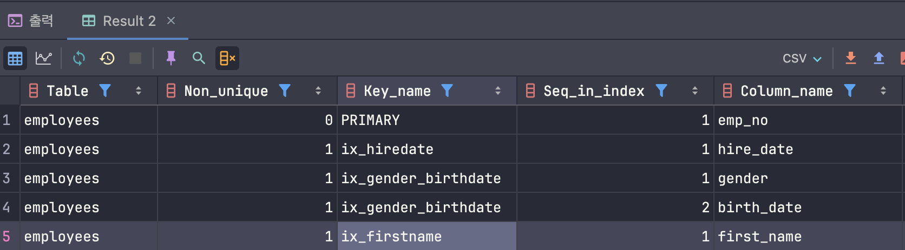

 

```sql
SELECT COUNT(*) FROM employees WHERE first_name='Georgi';
-> 253
```

```sql
SELECT COUNT(*) FROM employees
WHERE first_name='Georgi' AND last_name='Klassen';
-> 1
```

first_name=’Georgi’ 인 사원은 전체 253명이 존재하고 

first_name=’Georgi’, last_name=’Klassen’인 사원은 1명만 존재한다.

그럼 이제 first_name=’Georgi’, last_name=’Klassen’인 사원의 입사 일자를 오늘로 변경하는 쿼리를 실행해보자.

```sql
UPDATE employees SET hire_date=NOW()
WHERE first_name='Georgi' AND last_name='Klassen';
```

UPDATE 문장이 실행되면 1건의 레코드가 업데이트된다.

하지만 이 1건의 업데이트를 위해 몇 개의 레코드에 락을 걸어야 할까?

**해당 업데이트 조건에서 인덱스를 이용할 수 있는 조건은 first_name=’Georgi’이며, last_name 칼럼은 인덱스에 없기 때문에 first_name=’Georgi’인 레코드 253건의 레코드가 모두 잠긴다.**

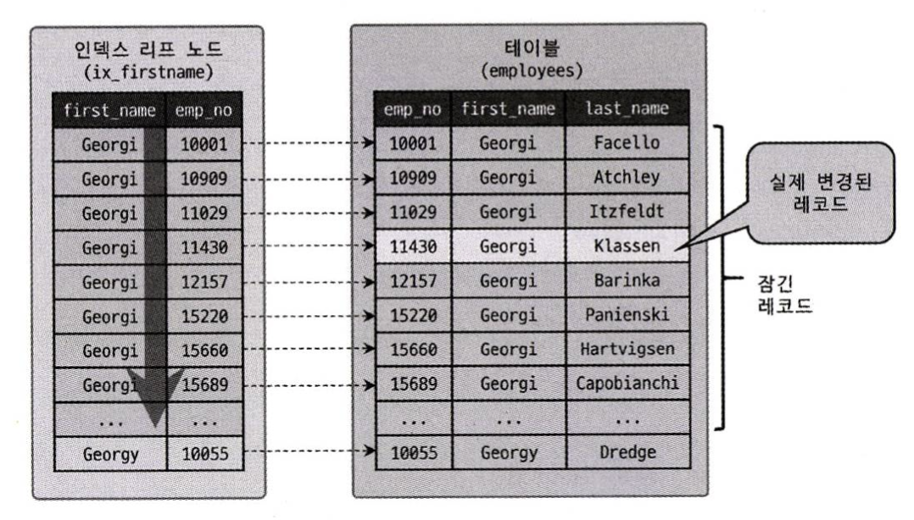

해당 그림은 UPDATE 문장이 어떻게 변경 대상 레코드를 검색하고, 실제 변경이 수행되는지를 보여준다.

이 예제에서는 몇 건 안 되는 레코드만 잠그지만 **UPDATE 문장을 위해 적절히 인덱스가 준비돼 있지 않다면** 

각 클라이언트 간의 동시성이 상당히 떨어져서 한 세션에서 UPDATE 작업을 하는 중에는 다른 클라이언트는 그 테이블을 업데이트하지 못하고 기다리는 상황이 발생할 것이다.

이 테이블에 인덱스가 하나도 없다면 어떻게 될까?

이러한 경우에는 테이블을 풀 스캔하면서 UPDATE 작업을 하는데, 이 과정에서 테이블에 있는 30여만 건의 모든 레코드를 잠그게 된다.

**이 방식이 MySQL 방식이며, InnoDB에서 인덱스 설계가 중요한 이유이다.**

```
[PK 기반 탐색]

PK 인덱스 (Clustered Index)
루트
 └── 브랜치
      └── 리프 → [실제 row 데이터]
      
---------------------------------------------------------------     
[인덱스 = 보조 인덱스 기반 탐색]    
   
Secondary Index
루트
 └── 브랜치
      └── 리프 → [인덱스 컬럼 값, PK]

→ 이 PK를 통해 Clustered Index(PK) B+Tree로 다시 접근

---------------------------------------------------------------
[FULL SCAN]

PK B+Tree
루트
 └── 브랜치
      └── 리프 → 리프 → 리프 → 리프 ... (순차적으로 모두 탐색)
```

예제에서 진행한 UPDATE는 Secondary Index 기반 잠금이니 Secondary Index 253개 리프 노드가 잠긴다.

---

# 5.3.3 레코드 수준의 잠금 확인 및 해제

MySQL 5.1부터 레코드 잠금과 잠금 대기에 대한 조회가 가능하다.

버전별로 레코드 잠금과 잠금을 대기하는 클라이언트의 정보를 확인하는 방법을 알아보자.

강제로 잠금을 해제하려면 KILL 명령을 이용해 MySQL 서버의 프로세스를 강제로 종료하면 된다.

다음과 같은 잠금 시나리오를 가정하자.

| **커넥션1** | **커넥션2** | **커넥션3** |
| --- | --- | --- |
| BEGIN; |  |  |
| UPDATE employees<br>SET birth_date=NOW()<br>WHERE emp_no=100001; |  |  |
|  | UPDATE employees<br>SET hire_date=NOW()<br>WHERE emp_no=100001; | <br> |
|  |  | UPDATE employees<br>SET hire_date=NOW(),<br>birth_date=NOW()<br>WHERE emp_no=100001; |

**MySQL 5.1 ~** 

information_schema 데이터베이스의 INNODB_TRX 테이블과 INNODB_LOCKS, INNODB_LOCK_WAITS 테이블을 통해 확인 가능하다.

**MySQL 8.0 ~** 

inofrmation_schema 정보들은 조금씩 Deprecated

peformace_schema 데이터베이스의 DATA_LOCKS, DATA_LOCK_WAITS 테이블 사용

**커넥션 1 ~ 3** → 터미널 Docker MySQL 컨테이너 접속 (트랜잭션 용도)

DataGrip → Docker MySQL 컨테이너 접속 (모니터링 용도)

```sql
SHOW PROCESSLIST;
```

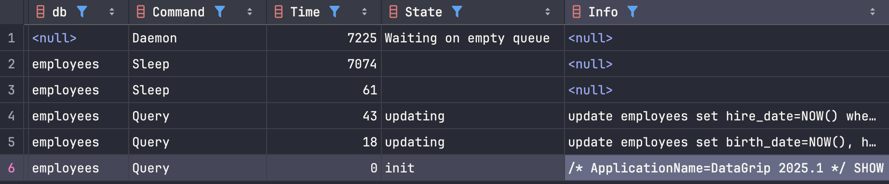

커넥션1 스레드(Time = 61)는 현재 아무것도 하지 않고 있지만 트랜잭션을 시작하고 UPDATE 명령이 실행 완료

커넥션1 스레드가 아직 COMMIT 명령을 실행하지 않았기 때문에 업데이트한 레코드의 잠금을 그대로 가지고 있는 상태이다.

커넥션2(Time = 43), 커넥션3(Time = 18) 스레드는 잠금 대기로 인해 아직 UPDATE 명령을 실행 중인 것으로 표시된다.

performance_schema  DATA_LOCKS, DATA_LOCK_WAITS 테이블 조인해서 잠금 대기 순서 살펴보기

```sql
SELECT 
   r.trx_id waiting_trx_id,
   r.trx_mysql_thread_id waiting_thread,
   r.trx_query waiting_query,
   b.trx_id blocking_trx_id,
   b.trx_mysql_thread_id blocking_thread,
   b.trx_query blocking_query
FROM performance_schema.data_lock_waits w
INNER JOIN information_schema.innodb_trx b
	ON b.trx_id = w.blocking_engine_transaction_id
INNER JOIN information_schema.innodb_trx r
  ON r.trx_id = w.requesting_engine_transaction_id;
```

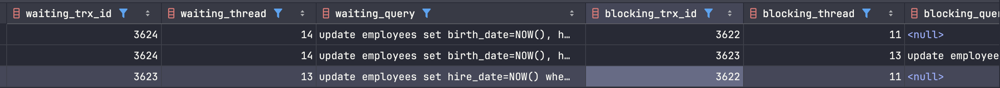

쿼리의 결과를 보면 현대 대기 중인 스레드는 14, 13이다. 

13번 스레드는 11번 스레드를 기다리고 14번 스레드는 11번, 13번 스레드를 기다린다.

이는 잠금 대기 큐의 내용을 그대로 보여주기 때문에 이렇게 표시되는 것이다.

11번 스레드의 잠금을 해제하고, 13번 스레드가 잠금 획득, 해제를 하면 14번 스레드가 잠금 획득이 가능하다.

11번 스레드가 어떤 잠금을 가지고 있는지 더 상세히 확인하고 싶으면 performance_schema DATA_LOCKS 테이블이 가진 컬럼을 모두 살펴보면 된다. 

---

트랜잭션의 격리 수준(isolation level)이란 여러 트랜잭션이 동시에 처리될 때 특정 트랜잭션이 다른 트랜잭션에서 변경하거나 조회하는 데이터를 볼 수 있게 허용할지 말지를 결정하는 것이다.

| **격리 수준** | **DIRTY READ** | **NON-REPEATABLE READ** | **PHANTOM READ** |
| --- | --- | --- | --- |
| **READ UNCOMMITTED** | 발생 | 발생 | 발생 |
| **READ COMMITTED** | 발생하지 않음 | 발생 | 발생 |
| **REPEATABLE READ** | 발생하지 않음 | 발생하지 않음 | 발생 (InnoDB는 X) |
| **SERIALIZABLE** | 발생하지 않음 | 발생하지 않음 | 발생하지 않음 |

4개의 격리 수준에서 순서대로 뒤로 갈수록 트랜잭션 간의 데이터 격리(고립) 정도가 높아지며, 동시 처리 성능도 떨어지는 것이 일반적이지만 SERIALIZABLE 격리 수준이 아니라면 크게 성능의 개선이나 저하는 발생하지 않는다.

---

# 5.4.1 READ UNCOMMITTED

READ UNCOMMITED 격리 수준에서는 트랜잭션에서의 변경 내용이 COMMIT, ROLLBACK 여부에 상관없이 디른 트랜잭션에서 보인다.

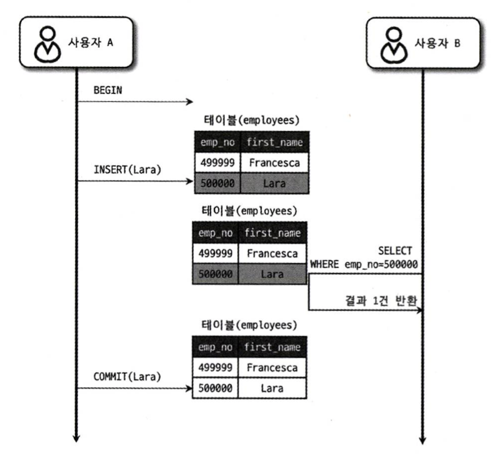

어떤 트랜잭션에서 처리한 작업이 완료되지 않았는데도 다른 트랜잭션에서 볼 수 있는 현상을 **더티 리드(Dirty Read)**라 하고, 더티 리드는 READ UNCOMMITED 격리 수준에서만 나타난다.

더티 리드 현상은 데이터가 나타났다가 사라졌다 하는 현상을 초래하여 애플리케이션 개발자와 사용자를 상당히 혼란스럽게 만든다.

이런 이유로 RDBMS 표준에서는 트랜잭션의 격리 수준으로 인정하지 않을 정도로 정합성에 문제가 많다.

---

# 5.4.2 READ COMMITED

READ COMMITED 레벨은 오라클 DBMS에서 기본으로 사용되는 격리 수준이며, 많은 온라인 서비스에서 가장 많이 선택되는 격리 수준이다.

READ COMMITED 레벨에서는 더티 리드 현상은 발생하지 않는다. 

어떤 트랜잭션에서 데이터를 변경했더라도 오직 COMMIT이 완료된 데이터만 조회가 가능하다.

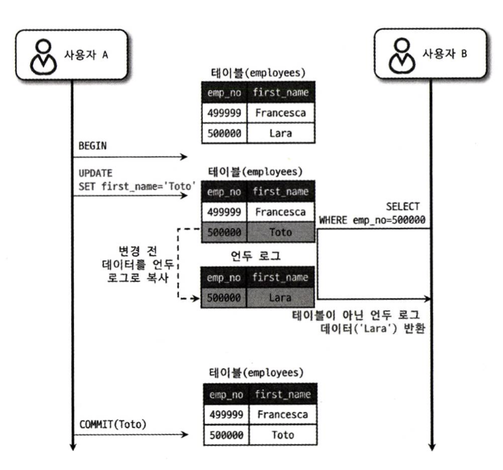

아직 사용자A가 커밋하지 않았기 때문에 사용자B는 언두 로그에 백업된 “Lara”를 조회한다.

즉, 언두 로그를 통해서 Dirty Read를 방지한다.

**InnoDB 아키텍처 복습**

```
1. 변경된 데이터는 버퍼 풀에 반영 (Dirty Page)
사용자 A가 데이터를 변경하면, 해당 페이지는 버퍼 풀(Buffer Pool) 내에서 
수정되고 더티 페이지(Dirty Page)가 된다.
즉시 디스크에 반영되지는 않으며, 플러시 대상이 되기 위해 플러시 리스트(Flush List)에 올라간다.

2. 이전 값은 Undo 로그에 기록
트랜잭션 롤백이나 Consistent Read를 위해 Undo 로그가 생성된다.
Undo는 로그 버퍼(Log Buffer)에 먼저 저장되고, 커밋과 상관없이 디스크로 플러시될 수 있다.
디스크에 있는 Undo는 모든 관련 트랜잭션이 끝나면 정리(Purge)된다.
만약 디스크 저장 전에 참조 중인 트랜잭션이 없다면, 디스크 저장 없이 버퍼에서 삭제될 수 있다.

3. 커밋 시점에 데이터 페이지는 디스크에 기록되지 않음
Redo 로그(Log Buffer)가 디스크로 fsync() 동기화되는 것이 커밋의 본질적 의미.
데이터 페이지는 이후 필요 시에 디스크로 플러시됨 (예: 체크포인트 발생, 버퍼 풀 압박 등).
이런 구조 덕분에 MySQL은 빠른 커밋이 가능하다.

4. Change Buffer (체인지 버퍼)
보조 인덱스 업데이트는 Change Buffer에 캐시 가능하다.
비유니크 보조 인덱스만 가능 (유니크 인덱스는 즉시 체크 필요 → Change Buffer 캐시 불가).
디스크 I/O를 줄이는 중요한 최적화 수단.
```

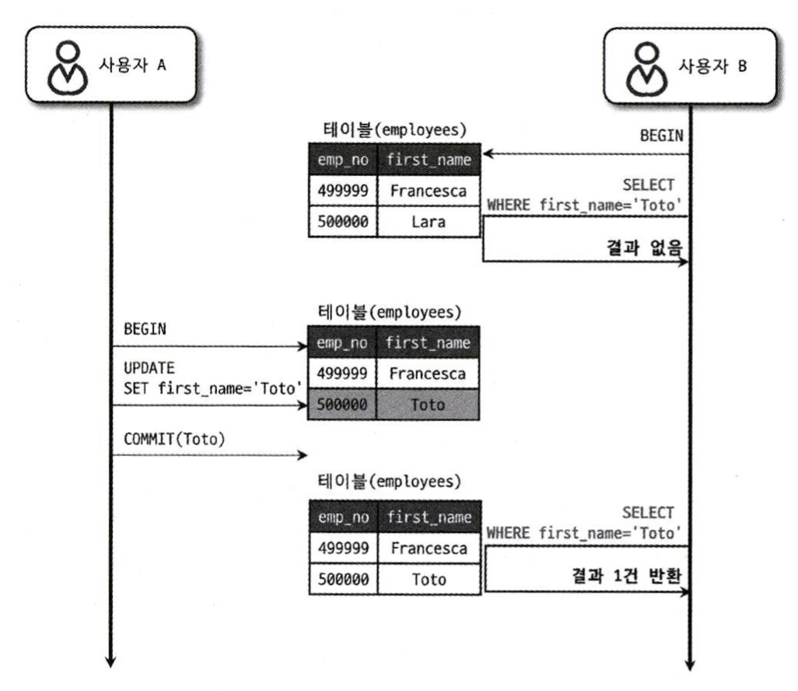

사용자B가 처음 조회 했을 때 일치하는 결과가 없었다.

사용자A가 이름을 “Toto”로 변경하고 커밋

사용자B가 같은 트랜잭션에서 똑같은 쿼리로 조회했더니 결과 반환

즉, 하나의 트랜잭션에서 **똑같은 SELECT 쿼리를 실행했을 때 항상 같은 결과를 가져와야 한다는 REPEATABLE READ 정합성에 어긋난다.**

## ✅ **Read Committed**

      - **원칙**: “커밋된 것만 읽는다.”
      - **동작 흐름**:
1. 레코드의 트랜잭션 ID(trx_id)를 보고 **커밋 여부 판단**
→ Redo 로그의 커밋 여부 + 트랜잭션 테이블에서 현재 트랜잭션 상태 확인
        1. **커밋된 트랜잭션이면** 레코드 값을 그대로 읽음
        1. **커밋되지 않았다면** → Undo 로그를 참조하여 **마지막으로 커밋된 버전**을 따라감
→ 즉, 읽기 시점의 최신 커밋된 값을 반환

## ✅ **Repeatable Read (InnoDB의 기본 격리 수준)**

      - **원칙**: “내 트랜잭션 동안 동일한 SELECT는 동일한 결과를 보장해야 한다.”
      - **동작 흐름**:
1. 트랜잭션 시작 시점에 **Consistent Read View (Read View)** 생성
→ 자신보다 **트랜잭션 ID가 이전**이고 **이미 커밋된 것만 보이도록** 설정
        1. 레코드의 트랜잭션 ID 확인
        1. **레코드의 trx_id가 나보다 이전이고**, 커밋된 트랜잭션이면 → 그대로 읽음
        1. 그렇지 않으면 → Undo 로그에서 **Read View에 부합하는 버전**을 찾을 때까지 따라감

---

## MVCC = Undo 로그 기반

InnoDB는 MVCC (Multi-Version Concurrency Control)를 지원하며, 이는 **Undo 로그를 통해 과거 버전의 데이터를 조회하는 방식**으로 동작한다. **언제 어떤 Undo 로그 버전을 보느냐**가 격리 수준에 따라 달라진다.

---

## **REPEATABLE READ (기본 InnoDB 레벨)**

### 원칙

      - 트랜잭션이 시작될 때 **Consistent Read View**를 생성
      - **본인보다 먼저 커밋된 트랜잭션**만 보인다. (트랜잭션 ID 기준)
      - 그 이후에 커밋된 트랜잭션은 **무시**.
      - 같은 SELECT는 같은 결과를 보장 (즉, repeatable)

### 내부 동작

      - InnoDB는 **현재 레코드가 본인보다 새로운 트랜잭션에 의해 커밋된 것인지 확인**하고,
      - 그렇다면 **Undo 로그를 따라가서 과거 버전**을 조회한다.

### 사용되는 것

      - **Undo 로그**: 과거 버전 보존
      - **Read View**: 트랜잭션 ID 범위 기반 필터링
      - **버퍼 풀**: 최신 데이터가 있을 수 있지만 무시됨 (Undo 기반 조회)

---

## **READ COMMITTED**

### 원칙

      - **쿼리 실행 시점에 커밋된 데이터만 조회**함 (트랜잭션 시작 시점 아님!)
      - 동일 트랜잭션 내에서 똑같은 SELECT를 반복해도 **결과가 달라질 수 있음**
      - 즉, repeatable read 정합성은 **보장되지 않음**

### 내부 동작

      - InnoDB는 쿼리 실행 시점에
- **현재 레코드가 “커밋된 상태”인지 확인**하고,
        - 커밋되었으면 **그 값을 반환**
        - 커밋되지 않았다면 Undo 로그를 따라가며 **직전 커밋된 버전**을 찾아냄

### 사용되는 것

      - **Undo 로그**: 여전히 사용됨! (이게 중요한 포인트)
      - 하지만 **트랜잭션 ID와 Read View는 고려하지 않음**
      - 버퍼 풀의 더티 페이지일지라도, **Undo 로그를 통해 커밋된 버전인지 판단**

---

## 헷갈리기 쉬운 포인트

| 구분 | REPEATABLE READ | READ COMMITTED |
| --- | --- | --- |
| **조회 기준** | 트랜잭션 시작 시점 | 쿼리 실행 시점 |
| **Read View 사용** | ✅ 사용 (트랜잭션 ID 필터링) | ❌ 사용하지 않음 |
| **Undo 로그 사용** | ✅ 사용 | ✅ 사용 |
| **버퍼 풀에서 직접 읽나?** | 아니오 (항상 Undo 체크) | 상황에 따라 가능 (변경된 값이 커밋되었으면 읽음) |
| **변경 커밋 후 재조회 결과** | 이전 값 유지 | 최신 커밋 값 반환 |

---

---

# 5.4.3 REPETABLE READ

REPEATABLE READ는 MySQL의 InnoDB 스토리지 엔진에서 기본으로 사용되는 격리 수준이다.

바이너리 로그를 가진 MySQL 서버에서는 최소 REPEATABLE READ 격리 수준 이상을 사용해야 한다.

이 격리 수준에서는 READ COMMITED 레벨에서 발생하는 NON-REPEATABLE READ 부정합이 발생하지 않는다. 

**두 격리 수준 모두 MVCC(언두 공간에 백업 & 실제 레코드 변경)을 하는데 왜 REPEATABLE READ 수준은 NON-REPEATABLE READ 부정합이 발생하지 않을까?**

모든 InnoDB 트랜잭션은 고유한 트랜잭션 번호(순차적으로 증가하는 값)을 가지며, 언두 영역에 백업된 모든 레코드에는 변경을 발생시킨 트랜잭션의 번호가 포함돼 있다.

언두 영역의 백업된 데이터는 InnoDB 스토리지 엔진이 불필요하다고 판단하는 시점(다른 트랜잭션에서 더이상 참조 X)에 주기적으로 삭제한다.

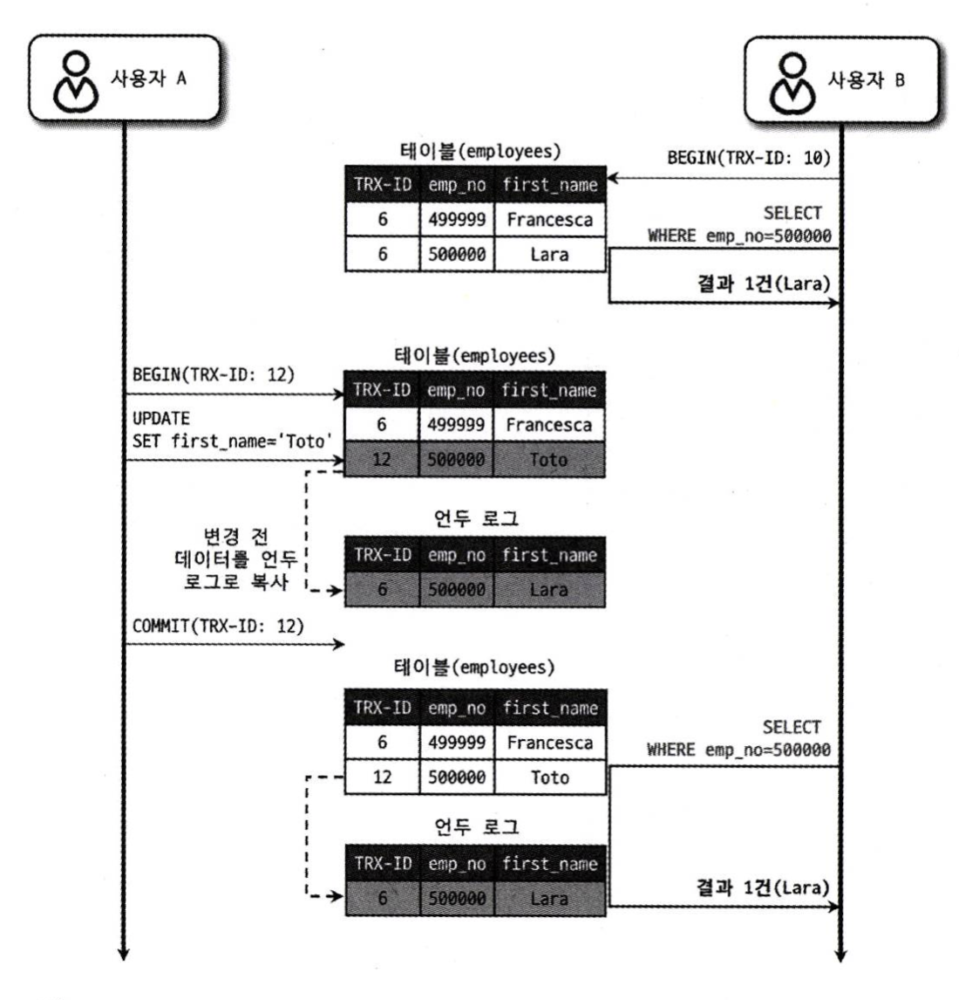

**해당 그림은 REPEATABLE READ 격리 수준의 동작 방식을 보여준다.**

초기 employees 테이블은 트랜잭션(TRX_ID 6)에 의해 INSERT

사용자B 트랜잭션(TRX-ID 10)을 시작하고 emp_no=500000 레코드를 읽는다. “Lara” 

사용자A 트랜잭션(TRX-ID 12)을 시작하고 emp_no=500000 레코드를 변경한다. “Toto”

이때 변경 전 데이터를 언두 로그로 복사한다.

복사한 데이터는 TRX-ID: 6 emp_no: 500000 first_name: “Lara”

사용자A 커밋

사용자B emo_no=500000 레코드 조회

이때 테이블의 커밋된 TRX_ID는 12 (참고로 커밋 여부도 판단도 가능하다)

**커밋된 TRX_ID 12 > 사용자B TRX_ID 10 ReadView 포함 X**

언두 로그중에 TRX_ID < 사용자B TRX_ID 10 레코드를 찾는다. “Lara”

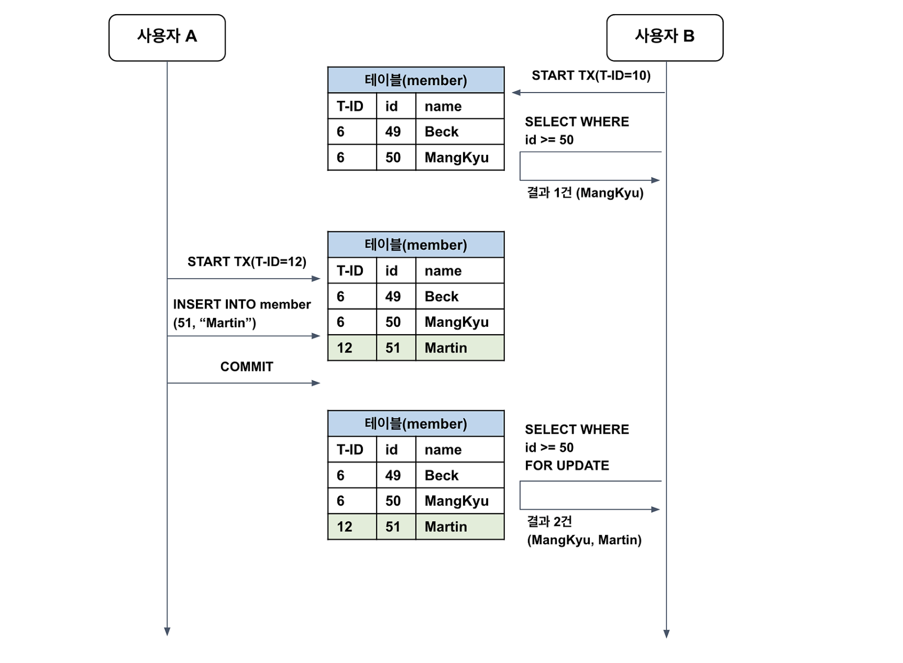

**해당 그림은 REPEATABLE READ 격리 수준에서의 부정합을 보여준다.**

사용자B는 SELECT로 잠금 없는 읽기를 하였다. 결과: MangKyu(1건)

사용자A는 트랜잭션을 시작(TRX_ID 12), INSERT Martin

사용자A 커밋

사용자B는 SLECT … FOR UPDATE를 통해 쓰기 잠금 & 조회를 하였다. (이때 넥스크 키 락 사용)

쓰기 잠금을 걸고 조회는 락을 걸고 조회하기 때문에 테이블에서 바로 읽는다.

즉, MVCC 기능을 사용하지 않는다. 

결과는 (MangKyu, Martin)으로 2건이다.

즉, PHANTOM READ가 발생하였다.

**즉, 읽기 잠금, 쓰기 잠금 모두 MVCC를 우회해서 동작하여 테이블을 바로 읽고 팬텀 리드가 발생할 수 있다.**

하지만 이런 트랜잭션은 개발자 잘못이다. 

---

# 5.4.4 SERIALIZABLE

가장 단순하고 동시에 가장 엄격한 격리 수준이다. 그만큼 동시 처리 성능도 다른 트랜잭션의 격리 수준보다 떨어진다. InnoDB 테이블에서 기본적으로 순수한 SELECT 작업은 아무런 레코드 잠금도 설정하지 않고 실행된다.

Non-locking consistent read(잠금이 필요 없는 일관된 읽기)라는 말이 이를 의미한다.

하지만 SERIAILIZABLE 레벨에서는 순수한 읽기 작업도 공유 잠금(읽기 잠금)을 획득하고, 동시에 다른 트랜잭션은 그러한 레코드를 변경하지 못한다.

즉, SERIAILIZABLE 레벨에서는 PHANTOM READ 문제가 발생하지 않는다.

하지만 InnoDB 스토리지 엔진에서는 갭 락과 넥스트 키락 덕분에 REPETABLE READ 수준에서도 PHANTOM READ가 발생하지 않기 때문에 굳이 SERIAILIZABLE을 사용할 필요성은 없어 보인다.

---

# 추천 자료 

[https://mangkyu.tistory.com/299](https://mangkyu.tistory.com/299)

---

[https://dev.mysql.com/doc/refman/8.4/en/innodb-locking.html#innodb-gap-locks](https://dev.mysql.com/doc/refman/8.4/en/innodb-locking.html#innodb-gap-locks)

[https://medium.com/daangn/mysql-gap-lock-%EB%91%90%EB%B2%88%EC%A7%B8-%EC%9D%B4%EC%95%BC%EA%B8%B0-49727c005084](https://medium.com/daangn/mysql-gap-lock-%EB%91%90%EB%B2%88%EC%A7%B8-%EC%9D%B4%EC%95%BC%EA%B8%B0-49727c005084)

인덱스는 데이터베이스 쿼리의 성능을 언급하면서 빼놓을 수 없는 부분이다.

MySQL에서 사용 가능한 인덱스의 종류 및 특성을 살펴보자.

**아무리 MySQL 서버의 옵티마이저가 발전하고 성능이 개선됐다고 해도 여전히 관리자의 역할은 매우 중요**하다.

그래서 인덱스에 대한 기본 지식은 지금도 앞으로도 개발자나 관리자에게 매우 중요한 부분이며, 쿼리 튜닝의 기본이 될 것이다.

**랜덤(Random) I/O**, **순차(Sequential) I/O** 같은 디스크 읽기 방식을 먼저 알아보자.

많이 발전했지만 여전히 데이터 저장 매체는 컴퓨터에서 가장 느린 부분이라는 사실에는 변함이 없다.

데이터베이스의 성능 튜닝은 어떻게 디스크 I/O를 줄이느냐가 관건일 때가 상당히 많다.

---

# 8.1.1 하드 디스크 드라이브(HDD)와 솔리드 스테이트 드라이브(SSD)

CPU, 메모리 같은 주요 장치는 대부분 전자식 장치지만 HDD는 기계식 장치이다.

그래서 데이터베이스 서버에는 항상 디스크 장치가 병목이 된다. 요즘은 HHD를 대체하기 위해 전자식 전장 매체인 SSD가 많이 출시되고 있다. SSD는 기존 HDD와 같은 인터페이스(SATA, SAS)를 지원한다.

SSD는 기존 HDD에서 데이터 저장용 플레터(원판)를 제거하고 그 대신 플레시 메모리를 장착하고 있다.

그래서 디스크 원판을 회전시킬 필요가 없어 아주 빨리 데이터를 읽고 쓸 수 있다.

컴퓨터의 메모리(D-Ram)보다는 느리지만 기계식 HDD보다는 훨씬 빠르다.

디스크의 헤더를 움직이지 않고 한 번에 많은 데이터를 읽는 순차 I/O에서는 SSD가 HDD보다 조금 빠르거나 비슷한 성능을 보이기도 한다. **하지만 SSD의 장점은 HDD보다 랜덤 I/O가 훨씬 빠르다는 것이다.** 

데이터베이스에서 순차 I/O 작업은 그다지 비중이 크지 않고 랜덤 I/O를 통해 작은 데이터를 읽고 쓰는 작업이 대부분이다. 그래서 SSD가 DBMS용 스토리지에 최적이다.

책에서 테스트한 결과로는 SSD는 초당 436개 HDD는 초당 60개의 트랜잭션밖에 처리하지 못한다. 

---

# 8.1.2 랜덤 I/O VS 순차 I/O


랜덤 I/O는 HDD의 플래터(원판)를 돌려서 읽어야 할 데이터가 저장된 위치로 디스크 헤더를 이동시킨 다음 데이터를 읽는 것을 의미하는데, 순차 I/O 또한 작업 과정은 동일하다.

순차 I/O는 3개의 페이지(3 * 16KB)를 디스크에 기록하기 위해 시스템 콜을 1번 요청했지만, 랜덤 I/O는 3개의 페이지를 디스크에 기록하기 위해 시스템 콜을 3번 요청했다.

즉, 디스크에 기록해야 할 위치를 찾기 위해 순차 I/O는 디스크 헤더를 1번 움직였고, 랜덤 I/O는 3번 움직였다.

디스크에 데이터를 쓰고 읽는 데 걸리는 시간은 디스크 헤더를 움직여서(회전 지연 시간) 읽고 쓸 위치로 옮기는 단계에서 결정된다.

즉, 디스크의 성능은 디스크 헤더의 위치 이동 없이 얼마나 많은 데이터를 한 번에 기록하느냐에 의해 결정된다고 볼 수 있다.

그래서 여러 번 쓰기 또는 읽기를 요청하는 랜덤 I/O 작업이 작업 부하가 훨씬 더 크다.

데이터베이스 대부분의 작업은 작은 데이터를 빈번히 읽고 쓰기 때문에 MySQL 서버에서는 그룹 커밋이나 바이너리 로그 버퍼, InnoDB 로그 버퍼 등의 기능이 내장돼 있다.

## **그룹 커밋 (Group Commit)**

      - **의미**: 여러 트랜잭션의 로그 flush 작업을 **한 번의 디스크 I/O로 묶는 기술**
      - **적용 대상**
- **바이너리 로그 버퍼** (MySQL 레벨)
        - **InnoDB 리두 로그 버퍼** (스토리지 엔진 레벨)
      - **결론**: 트랜잭션 커밋 자체가 아니라, 커밋과 함께 발생하는 **로그 동기화 작업을 묶는 것**.

> "트랜잭션 커밋 동기화"라기보단, 커밋 시 발생하는 디스크 flush 작업을 병렬로 최적화한다고 이해하자.

---

## **InnoDB 로그 버퍼 = 리두 로그 버퍼 (메모리)**

      - 시스템 변수 `innodb_flush_log_at_trx_commit`에 따라 **디스크 플러시 시점**이 달라짐.

| 값 | 의미 | 정합성 수준 | 성능 |
| --- | --- | --- | --- |
| 0 | 로그 버퍼는 1초마다 디스크에 flush | 낮음 | 빠름 |
| 1 (기본값) | 트랜잭션 커밋 시마다 flush | 높음 (ACID 보장) | 느림 |
| 2 | 커밋 시 OS 버퍼까지만 flush, 디스크 flush는 1초마다 | 중간 | 중간 |

---

## **리두 로그 파일 크기와 데이터 페이지 플러시 시점**

      - 리두 로그 파일은 **디스크에 저장된 실제 로그**.
      - 리두 로그 공간이 가득 차면 더 이상 새로운 트랜잭션 로그를 기록할 수 없음 ⇒ **체크포인트(Checkpoint)** 발생.

> 즉, 리두 로그 파일의 크기는 "얼마나 많은 더티 페이지를 오래 버퍼 풀에 유지할 수 있는가"에 영향을 준다.

### 권장 사항

      - `innodb_log_file_size * innodb_log_files_in_group`의 총합이
버퍼 풀의 **25%~50%** 수준이면 적절 (InnoDB 공식 문서 기준).

---

## **데이터 페이지 플러시 시점**

InnoDB의 더티 페이지(메모리 상에서 수정된 페이지)는 **즉시 디스크에 기록되지 않음**.

플러시는 아래 조건에서 발생

### 주요 플러시 시점

      1. **MySQL 서버 종료**
      1. **체크포인트 발생 (4번 어댑티브 기능 활성화 시 사용 X)**
      1. **리두 로그 공간 부족 (쓰기 폭주 발생 가능)**
      1. **Adaptive Checkpointing**
- InnoDB가 I/O 부하를 고려해 더티 페이지를 미리 플러시
        - Adaptive 알고리즘 기반 특정 용량 이상부터 활성화
      1. **flush 리스트를 따라 백그라운드에서 지속적인 페이지 플러시**

---

디스크 원판을 가지지 않는 SSD는 순차 I/O와 랜덤 I/O 차이가 없을 것으로 예측하지만, 실제로는 그렇지 않다.

SSD 드라이브에서도 랜덤 I/O는 여전히 순차 I/O 보다 처리량이 떨어진다.

쿼리를 튜닝해서 랜덤 I/O를 순차 I/O로 바꿔서 실행할 방법은 많지 않다.

**일반적으로 쿼리를 튜닝하는 것은 랜덤 I/O 자체를 줄여주는 것이 목적이라고 할 수 있다.**

즉, 쿼리를 처리하는 데 꼭 필요한 데이터만 읽도록 쿼리를 개선하는 것을 의미한다.

**참고**

```
보조 인덱스 레인지 스캔은 주로 데이터를 읽기 위해 랜덤 I/O 사용
풀 테이블 스캔은 순차 I/O 사용
그래서 큰 테이블의 레코드 대부분을 읽는 작업에서는 인덱스를 사용하지 않고 풀 테이블 스캔을 사용하도록
유도할 때도 있다.
이는 순차 I/O 보다 랜덤 I/O가 훨씬 빨리 많은 레코드를 읽어올 수 있기 때문이다.
```

| 조건 | 동작 방식 | I/O 성격 |
| --- | --- | --- |
| PK 기준으로 레인지 스캔 | 클러스터 인덱스 스캔 | **순차 I/O** 가능 |
| 보조 인덱스 기준 레인지 스캔 | 보조 → 클러스터 인덱스 점프 | **랜덤 I/O** |

| 인덱스 타입 | 스캔 흐름 | I/O 성격 |
| --- | --- | --- |
| 클러스터 인덱스 | `root → branch → leaf → next leaf...` | 순차 I/O 유리 |
| 보조 인덱스 (일반) | `root → branch → leaf → PK 점프 → 다시 root → ...` | 랜덤 I/O |
| 보조 인덱스 (커버링) | `root → branch → leaf → next leaf...` | 순차 I/O 유리 |

### 클러스터 인덱스의 구조적 이점

    1. **PK 기준 정렬된 B+Tree**
- 리프 노드들이 **논리적으로도 순서대로 연결**되어 있고,
      - 디스크 상에서도 가능한 한 **인접한 페이지에 배치**하려고 노력(InnoDB의 페이지 분할 및 공간 관리 정책)
    1. **레코드 탐색**
- `WHERE id BETWEEN 100 AND 200` 같은 쿼리는 B+Tree를 통해 시작 지점을 찾고,
      - 이후 리프 노드들을 **옆으로 차례로 읽어가며** 데이터를 가져온다.
    1. **물리적 연속성**
- 페이지가 꼭 완벽히 연속된 블록에 있지는 않지만,
      - **순차적으로 접근하기 유리한 구조**로 설계돼 있어서 순차 I/O로 동작할 가능성이 높다.

---

### **인덱스란 무엇인가?**

테이블을 한 권의 책으로 비유하면 인덱스는 책의 목차(색인), 데이터 파일은 책의 내용에 해당한다고 볼 수 있다.

인덱스를 통해서 알아낼 수 있는 페이지 번호는 데이터 파일에 저장된 레코드(물리) 주소이다. 

DBMS도 데이터베이스에 있는 모든 데이터를 검색해서 원하는 결과를 가져오려면 매우 오랜 시간이 걸린다.

그래서 인덱스를 KEY, 레코드가 저장된 주소를 VALUE로 구성된 저장 구조를 만들어 두는 것이다.

---

### **인덱스의 정렬, 데이터 파일의 저장 방식** 

DBMS의 인덱스는 주어진 칼럼의 값을 순서로 미리 정렬해서 보관한다. 

즉, **SortedList** 자료 구조를 사용한다. 

반대로 데이터 파일은 **ArrayList와** 같이 저장된 순서대로 별도의 정렬 없이 그대로 저장해 둔다.

SortedList 자료 구조는 데이터가 저장될 때마다 항상 값을 정렬해야 하므로 저장(INSERT, DELETE, UPDATE)하는 과정이 복잡하지만 그만큼 SELECT는 매우 빠르게 처리할 수 있다. 

결론적으로 DBMS의 인덱스는 데이터 저장 성능을 희생하고 그 대신 데이터의 읽기 속도를 높이는 기능이다.

그래서 이런 트레이드오프를 잘 이해하고 SELECT 쿼리 문장의 WHERE 조건절에 사용되는 컬럼이라고 전부 인덱스를 생성하는 등의 역효과(인덱스 관리 오버헤드, 디스크 사용량 증가)를 불러올 행위를 하지 말아야 한다. 

---

### **인덱스의 분류 Primary Key, Secondary Key**

프라이머리 키는 칼럼(들) 조합은 레코드를 식별할 수 있는 기준값이 되기 때문에 식별자라고도 부른다. NULL을 허용하지 않으며 중복을 허용하지 않는 것이 특징이다.

프라이머리 키를 제외한 나머지 모든 인덱스를 세컨더리 인덱스로 분류한다. 

유니크 인덱스는 프라이머리 키와 성격이 비슷하고 대체해서 사용이 가능할 수도 있다고 해서 대체 키라고 한다*.* 

---

### **데이터 저장 방식(알고리즘)으로 인덱스 분류**

대표적으로 B-Tree 인덱스, Hash 인덱스로 구분할 수 있다.

B-Tree 인덱스는 컬럼의 값을 변형하지 않고 원래의 값을 이용해 인덱싱하는 알고리즘 

MySQL 서버에서는 위치 기반 검색을 지원하기 위한 R-Tree 인덱스 알고리즘도 존재하지만, 결국 B-Tree의 응용 알고리즘으로 볼 수 있다.

Hash 인덱스는 컬럼의 값으로 해시값을 계산해서 인덱싱하는 알고리즘으로 매우 빠른 검색O(1)을 지원하지만 “Prefix 일치” 같이 값의 일부만 검색하거나 “범위”를 검색할 때는 해시 인덱스를 사용할 수 없다. 

이런 특징으로 보통 메모리 기반의 데이터베이스(Redis)에서 많이 사용한다.

---

### **데이터의 중복 허용 여부로 인덱스 분류** 

Non-Unique 인덱스, Unique 인덱스로 구분할 수 있다.

옵티마이저에게는 상당히 중요한 문제가 된다. 유니크 인덱스에 대해 동등 조건(Equal, =)으로 검색한다는 것은 항상 1건의 레코드만 찾으면 더 찾지 않아도 된다는 것을 알려주는 효과를 낸다.

---

### **인덱스의 기능별로 분류**

전문 검색용 인덱스, 공간 검색용 인덱스

---

B-Tree는 데이터베이스의 인덱싱 알고리즘 가운데 가장 먼저 도입되고 아직도 가장 범용적인 목적으로 사용된다.

일반적으로 DBMS에서는 B-Tree 변형된 형태의 **B+-Tree** 또는 **B*-Tree**를 사용한다.

B-Tree의 “B”는 “Binary(이진)”의 약자가 아닌 “Balanced”를 의미한다.

### 추천 자료 

[https://www.youtube.com/watch?v=bqkcoSm_rCs&list=PLcXyemr8ZeoREWGhhZi5FZs6cvymjIBVe&index=29](https://www.youtube.com/watch?v=bqkcoSm_rCs&list=PLcXyemr8ZeoREWGhhZi5FZs6cvymjIBVe&index=29)

[https://20240228.tistory.com/416](https://20240228.tistory.com/416)

---

# 8.3.1 구조 및 특성


해당 그림은 B-Tree의 기본적인 구조를 나타낸 그림이다. (4차 B+-Tree)

데이터베이스에서 인덱스와 실제 데이터가 저장된 데이터는 따로 관리되는데, **인덱스의 리프 노드는 항상 실제 데이터 레코드를 찾아가기 위한 주솟값을 가지고 있다.** 

| 항목 | B Tree | B+ Tree |
| --- | --- | --- |
| **데이터 저장 위치** | 모든 노드(내부 + 리프)에 분산 | **리프 노드에만 저장** |
| **인덱스 노드의 역할** | 일부는 인덱스, 일부는 데이터 | 전부 인덱스 (루트/브랜치) |
| **범위 검색 효율성** | 느림 (리프 간 연결 없음) | **빠름 (리프 노드가 연결됨)** |
| **디스크 I/O** | 많아질 수 있음 | **줄어듦 (리프 노드 연속 탐색)** |
| **정렬된 순회** | 복잡함 | **쉬움** (`리프 노드 연결 리스트` 덕분) |

커버링 인덱스 또한 루트, 브랜치 노드는 리프 노드로 가기 위한 자식 노드의 포인터만 존재하고

리프 노드에 인덱스, 프라이머리 키를 key, value로 가진다.


그림을 보면 인덱스의 키 값은 모두 정렬돼 있지만, 데이터 파일의 레코드는 정렬돼 있지 않고 임의의 순서로 저장돼 있다.

인덱스의 리프 노드에는 인덱스 키(KEY), 프라이머리 키(VALUE) 형태로 저장되어 있다.

```
데이터 파일의 레코드는 INSERT된 순서대로 저장되는 것으로 생각하지만 그렇지 않다.
만약 테이블의 레코드를 전혀 삭제하거나 변경하지 않고 INSERT만 수행한다면 맞을 수도 있다.
하지만 레코드가 삭제되어 빈 공간이 생기면 그 다음의 INSERT는 가능한 삭제된 빈 공간을 재활용하도록 
DBMS가 설계되기 때문에 **항상 INSERT된 순서대로 저장되는 것은 아니다.

하지만 InnoDB 테이블 레코드는 클러스터되어 디스크에 저장되므로 기본적으로 프라이머리 키 순서로 정렬되어
저장된다.** 
```

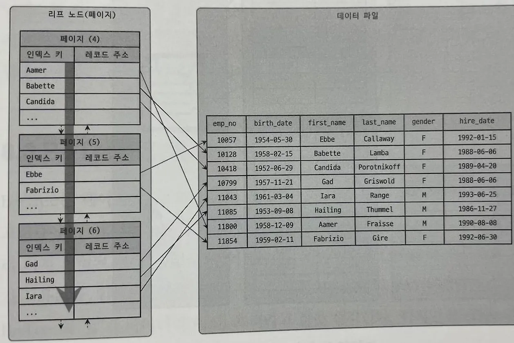

**그림 8.5 B-Tree의 리프 노드와 테이블 데이터 레코드(MyISAM)**

그림 8.5는 MyISAM 테이블의 인덱스와 데이터 파일의 관계를 보여준다.

레코드 주소는 MyISAM 테이블의 생성 옵션에 따라 레코드가 테이블에 INSERT된 순번이거나 데이터 파일 내의 위치(Offset)


그림 8.6은 InnoDB 테이블의 인덱스와 데이터 파일의 관계를 보여준다.

InnoDB 스토리지 엔진을 사용하는 테이블에서는 프라이머리 키가 ROWID 역할을 한다.

두 스토리지 엔진의 인덱스에서 가장 큰 차이점은 세컨더리 인덱스를 통해 데이터 파일의 레코드를 찾아가는 방법에 있다. MyISAM 테이블은 세컨더리 인덱스가 물리적인 주소를 가지는 반면에 **InnoDB 테이블은 프라이머리 키를 주소처럼 사용하기 때문애 논리적인 주소를 가진다고 볼 수 있다.**

그래서 InnoDB 테이블에서 세컨더리 인덱스를 통해 레코드를 읽을 때는 MyISAM에서처럼 데이터 파일을 바로 찾아가지 못한다. 세컨더리 인덱스의 리프 노드에 있는 프라이머리 키 값을 이용해 프라이머리 키 인덱스를 한 번 더 검색한 후, 프라이머이 키 인덱스의 리프 노드에 저장돼 있는 레코드를 읽는다.

즉, InnoDB 스토리지 엔진에서는 모든 세컨더리 인덱스 검색에서 반드시 프라이머리 키를 저장하고 있는 B-Tree를 다시 한번 검색해야 한다.

이 작업으로 인해 성능이 떨어질 것처럼 보이지만 MyISAM 인덱스 구조와 InnoDB 인덱스 구조는 각각 장단점을 가진다. → 8.8 클러스터 인덱스를 참고하자.

---

# 8.3.2 B-Tree 인덱스 키 추가 및 삭제

테이블의 레코드를 저장하거나 변경하는 경우 인덱스 키 추가나 삭제 작업이 발생한다.

인덱스 키 추가나 삭제의 동작을 알아보자.

---

## 8.3.2.1 인덱스 키 추가

새로운 키 값이 B-Tree에 저장될 때 테이블의 스토리지 엔진에 따라 새로운 키 값이 즉시 인덱스에 저장될 수도 있고 그렇지 않을 수 있다. (InnoDB 스토리지 엔진 체인지 버퍼 기능을 말한다.)

자세한 내용은 InnoDB 스토리지 엔진 체인지 버퍼 내용을 참고하자.

B-Tree에 저장될 때는 저장될 키 값을 이용해 B-Tree상의 적절한 위치를 검색해야 한다.

저장될 위치가 결정되면 레코드의 키 값과 대상 레코드의 주소 정보를 B-Tree의 리프 노드에 저장한다. 

    - 클러스터 인덱스는 리프 노드에 실제 데이터들을 저장한다.
    - 그래서 해당 설명은 세컨더리 인덱스의 기준 내용이다.

리프 노드가 꽉 차서 더는 저장할 수 없을 때는 리프 노드가 분리되고, 이는 상위 브랜치 노드까지 처리의 범위가 넓어진다. 즉, 조정이 들어간다. 이러한 작업 탓에 B-Tree는 상대적으로 쓰기 작업에 비용이 많이 든다.

인덱스 추가로 인해 INSERT나 UPDATE 문장이 어떤 영향을 받을지는 예측하기 힘들다.

테이블 칼럼 수, 칼럼 크기, 인덱스 칼럼의 특성 등을 확인해야 한다.

하지만 테이블에 레코드를 추가하는 비용보다 훨씬 큰 오버헤드를 가지고 **비용의 대부분이 메모리와 CPU에서 처리하는 시간이 아니라 디스크로부터 인덱스 페이지를 읽고 쓰기를 하는 시간이다.**

---

## 8.3.2.2 인덱스 키 삭제

B-Tree의 키 값이 삭제되는 경우는 간단한다.

해당 키 값이 저장된 B-Tree 리프 노드를 찾아서 그냥 삭제 마크만 하면 작업이 완료된다.

삭제 마스킹된 인덱스 키 공간은 그대로 방치하거나 재활용할 수 있다.

하지만 삭제 마스킹 또한 디스크 I/O가 필요한 작업이다.

MySQL 5.5 이상 버전의 InnoDB 스토리지 엔진에서는 이 작업 또한 체인지 버퍼를 통해 지연 처리될 수도 있다.

---

## 8.3.2.3 인덱스 키 변경

인덱스 키 값은 그 값에 따라 저장될 리프 노드의 위치가 결정되므로 B-Tree의 키 값이 변경되는 경우에는 

단순히 인덱스 상의 키 값만 변경하는 것은 불가능하다.

즉, 먼저 키 값을 삭제한 후, 다시 새로운 키를 추가하는 형태로 처리된다.

키 값의 삭제와 추가는 앞에서 설명한 절차대로 처리된다.

InnoDB 스토리지 엔진은 이 작업 모두 체인지 버퍼를 활용해 지연 처리 될 수 있다.

---

## 8.3.2.4 인덱스 키 검색

**INSERT, UPDATE, DELETE 작업을 할 때 인덱스 관리에 대한 추가 비용을 감당하면서 인덱스를 구축하는 이유는 빠른 검색을 위해서다.**

인덱스를 검색하는 작업은 루트 노드부터 최종 리프 노드까지 이동하면서 비교 작업(트리 탐색)을 수행한다.

인덱스 트리 탐색은 SELECT 뿐만 아니라 UPDATE, DELETE 또는 유니크 인덱스 INSERT에도 사용된다.

B-Tree 인덱스를 이용한 검색은 100% 일치하거나 값의 앞부분(Left-most-part)만 일치하는 경우에 사용할 수 있다. 

**인덱스를 구성하는 키 값의 뒷부분만 검색하는 용도 또는 키 값에 변형이 가해진 후 비교가 되는 경우에는 절대 B-Tree의 빠른 검색 기능을 사용할 수 없다.**

InnoDB 스토리지 엔진에서 인덱스는 더욱 중요하다. InnoDB 테이블에서 지원하는 레코드 잠금이나 넥스트 키락(갭락)이 검색을 수행한 인덱스를 잠근 후 테이블의 레코드를 잠그는 방식으로 구현돼 있다.

따라서 UPDATE, DELETE 문장이 실행될 때 테이블에 적절히 사용할 수 있는 인덱스가 없다면 불필요하게 많은 레코드를 잠근다. 심지어 모든 레코드를 잠글 수도 있다.

---

# 8.3.3 B-Tree 인덱스 사용에 영향을 미치는 요소

B-Tree 인덱스는 인덱스를 구성하는 칼럼의 크기와 레코드 건수, 그리고 유니크한 인덱스 키 값의 개수 등에 의해

검색이나 변경 작업의 성능이 영향을 받는다.

---

## 8.3.3.1 인덱스 키 값의 크기

디스크에 데이터를 저장하는 가장 기본 단위를 페이지(Page)라고 한다.

디스크의 모든 읽기 쓰기 작업의 최소 단위가 된다.

또한 InnoDB 스토리지 엔진의 버퍼 풀에서 데이터를 버퍼링하는 기본단위기도 하다.

결국 인덱스는 페이지 단위로 관리되며, B-Tree 각 노드(루트, 브랜치, 리프)기준이 페이지 단위다.

일반적으로 DBMS의 B-Tree는 자식 노드의 개수가 가변적인 구조다.

그러면 MySQL의 B-Tree는 자식 노드를 몇 개까지 가지는지 궁금할 것이다.

그것은 바로 인덱스의 페이지 크기와 키 값의 크기에 따라 결정된다.

InnoDB 스토리지 엔진의 페이지 크기는 `innodb_page_size` 시스템 변수를 이용해 선택할 수 있지만 기본값은 16KB이다. 

인덱스 페이지는 16KB, 인덱스 키가 16바이트라고 가정하자.


그림과 같이 인덱스 페이지가 구성된다.

자식 노드 주소는 여러 가지 복합적인 정보가 담긴 영역이며, 대략 6바이트에서 12바이트까지 다양한 크기의 값을 가질 수 있다. 여기서는 편의상 평균적으로 12바이트로 구성된다고 가정하자.

그럼 해당 그림에서 하나의 인덱스 페이지는 몇 개의 키를 저장할 수 있을까? 

(16 * 1024) / ((16, 키 크기) + (12, 자식 노드 주소)) = 16 * 1024 / 28 = 585개

최종적으로 이 경우 자식 노드의 585개를 가질 수 있는 B-Tree가 되는 것이다.

그렇다면 인덱스 키 값이 커지면 어떤 현상이 발생할까? 

똑같은 경우에서 인덱스 키 크기만 2배인 32바이트로 늘어났다고 가정하면 한 페이지에 인덱스 키를 372개 저장할 수 있다. → B-Tree 레벨이 증가한다.

즉, **인덱스를 구성하는 키 값의 크기가 커지면 디스크로부터 읽어야 하는 횟수가 늘어나고, 그만큼 느려진다.**

또한 인덱스 키 값의 크기 증가는 전체적인 인덱스의 크기가 커진다는 것을 의미한다.

인덱스를 캐시해 두는 InnoDB 버퍼 풀이나 MyISAM 키 캐시 영역의 크기는 제한적이기 때문에 하나의 레코드를 위한 인덱스 크기가 커지면 커질수록 메모리에 캐시해 둘 수 있는 레코드의 수는 줄어든다.

그렇게 되면 자연히 메모리 효율이 떨어지는 결과를 가져온다.

---

## 8.3.3.2 B-Tree 깊이

B-Tree 인덱스의 깊이(Depth)는 디스크 접근 횟수와 연관되어 있기 때문에 중요하지만 직접 제어할 방법은 없다.

인덱스 키 값의 평균 크기가 늘어나면 어떤 현상이 발생하는지 추가로 알아보자. 

깊이가 3이고 키 값이 16바이트인 경우 최대 2억(585 * 585 * 585)개 정도의 키 값을 담을 수 있지만, 

키 값이 32바이트인 경우 최대 5천만(372 * 372 * 372)개로 줄어든다. 

즉, 인덱스 키 값의 크기가 커지면 인덱스 페이지가 담을 수 있는 인덱스 키 값의 개수가 적어지고, 그 때문에 같은 레코드 건수라도 B-Tree 깊이가(Depth)가 깊어져서 디스크 읽기가 더 많이 필요하게 된다는 것을 의미한다.

**인덱스 키 값의 크기는 가능하면 작게 만드는 것이 좋다**

실제로는 아무리 대용량 데이터베이스라도 B-Tree 깊이가 5단계 이상까지 깊어지는 경우는 흔치 않다.

---

## 8.3.3.3 선택도(기수성)

인덱스에서 **선택도(Selectivity)** 또는 **기수성(Cardinality)**은 거의 같은 의미로 사용된다.

모든 인덱스 키 값 가운데 유니크한 인덱스를 의미한다. 

인덱스는 선택도가 높을수록 검색 대상이 줄어들기 때문에 그만큼 빠르게 처리된다.

```
선택도가 좋지 않더라도 정렬 같은 작업을 위해 인덱스를 만드는 것이 훨씬 나은 경우가 많다.
인덱스는 항상 검색에만 사용되는 것은 아니므로 여러 가지 용도를 고려해 적절히 인덱스를 설계할 필요가 있다. 
```

### **tb_test 테이블** 

    - 칼럼
- country: 인덱스 존재 O
      - city: 인덱스 존재 X
    - 전체 레코드 1만건
    - 케이스 A: country 칼럼의 유니크한 값의 개수 10개
    - 케이스 B: country 칼럼의 유니크한 값의 개수 1,000개

```sql
SELECT *
FROM tb_test
WHERE country='KOREA' AND city='SEOUL';
```

MySQL에서는 **인덱스의 통계 정보(유니크한 값의 개수)**가 관리되기 때문에 city 칼럼의 기수성은 작업 범위에 아무런 영향을 미치지 못한다.

A 케이스의 경우 평균 1,000건 B 케이스의 경우 평균 10건이 조회될 수 있다는 것을 인덱스의 통계 정보를 통해 예측할 수 있다.

A 케이스, B 케이스 모두 실제 모든 조건을 만족하는 레코드는 단 1건만 있었다면 A 케이스의 인덱스는 적합하지 않은 것이라고 볼 수 있다. A 케이스는 1건의 레코드를 위해 쓸모없는 999건의 레코드를 더 읽은 것이지만, B 케이스 같은 경우 9건만 더 읽은 것이다.

그래서 A 케이스의 경우 country 칼럼에 생성된 인덱스는 비효율적이다.

| 케이스 | country 기수성 | `country='KOREA'` 시 예상 건수 | 인덱스 효율성 |
| --- | --- | --- | --- |
| A | 10 | 약 1,000건 (10,000 / 10) | ❌ (많이 읽고 적게 얻음) |
| B | 1,000 | 약 10건 (10,000 / 1,000) | ✅ (적게 읽고 적게 얻음) |

➡ **옵티마이저는 B 케이스에서 country 인덱스를 더 선호**

### tb_city 테이블

    - 칼럼
- country: 인덱스 존재 O
      - city: 인덱스 존재 X
    - 전체 레코드 1만건
    - 국가와 도시가 중복해서 저장돼 있지 않다.
    - 케이스 A: country 칼럼의 유니크한 값의 개수 10개
    - 케이스 B: country 칼럼의 유니크한 값의 개수 1,000개

```sql
SELECT *
FROM tb_city
WHERE country='KOREA' AND city='SEOUL';
```

**케이스 A**

```
country 컬럼 unique 10 -> 10개의 국가 존재
이 케이스에서 country='KOREA' 조건으로 인덱스를 검색하면 1000(10000/10)이 일치하리라는 것을 
예상할 수 있다.
그런데 인덱스를 통해 검색된 1000건 가운데 city='SEOUL'인 레코드는 1건이므로 
999건은 불필요하게 읽은 것이다.
```

**케이스 B**

```
country 컬럼 unique 1000 -> 1000개의 국가 존재
이 케이스에서 country='KOREA' 조건으로 인덱스를 검색하면 10(10000/1000)이 일치하리라는 것을
예상할 수 있다.
그런데 인덱스를 통해 검색된 1000건 가운데 city='SEOUL'인 레코드는 1건이므로 
9건만 불필요하게 읽은 것이다.
```

위 두 케이스의 테이블에서 똑같은 쿼리를 실행해 똑같은 결과를 받았지만, 사실 두 쿼리가 처리되기 위해

MySQL 서버가 수행한 작업 내용 차이는 매우 크다는 것을 알 수 있다.

이처럼 **인덱스에서 유니크한 값의 개수는 인덱스나 쿼리의 효율성에 큰 영향을 미친다.**

---

## 8.3.3.4 읽어야 하는 레코드의 건수

인덱스를 통해 테이블을 레코드를 읽은 것은 인덱스를 거치지 않고 바로 테이블의 레코드를 읽는 것보다 높은 비용이 드는 작업이다. 

예를 들어 테이블에 레코드가 100만 건이 저장돼 있는데, 그중에서 50만 건을 읽어야 하는 쿼리가 있다고 가정해 보자. 이 작업은 전체 테이블을 모두 읽어서 필요 없는 50만 건을 버리는 것이 효율적일지, 인덱스를 통해 필요한 50만 건만 읽어 오는 것이 효율적일지 판단해야 한다.

인덱스를 이용한 읽기의 손익 분기점이 얼마인지 판단할 필요가 있는데, 일반적인 **DBMS의 옵티마이저에서는 인덱스를 통해 레코드 1건을 읽는 것이 테이블에서 직접 레코드 1건을 읽는 것보다 4~5배 정도 비용이 더 많이 드는 작업으로 예측**한다.

즉, **인덱스를 통해 읽어야 할 레코드의 건수가 전체 테이블 레코드의 20~25%를 넘어서면 인덱스를 이용하지 않고 테이블을 모두 직접 읽어서** 레코드만 가려내는(필터링) 방식으로 처리하는 것이 효율적이다.

---

# 8.3.4 B-Tree 인덱스를 통한 데이터 읽기

어떤 경우에 (세컨더리)인덱스를 사용하게 유도할지, 또는 사용하지 못하게 할지 판단하려면 어떻게 인덱스를 경유해서 실제 레코드를 읽어 내는지 알아야한다. 

---

## 8.3.4.1 인덱스 레인지 스캔

인덱스 레인지 스캔은 인덱스의 접근 방법 가운데 가장 대표적이고 빠른 방식이다.

인덱스를 통해 레코드를 1건 조회하는 경우와 2건 이상을 조회하는 경우를 각각 다른 이름으로 구분하지만,

이번 학습에서는 묶어서 “인덱스 레인지 스캔”으로 표현하겠다.

```sql
SELECT * FROM employees WHERE first_name BETWEEN 'Ebbe' AND 'Gad';
```


**인덱스 레인지 스캔은 검색해야 할 인덱스의 범위가 결정됐을 때 사용**하는 방식이다.

검색하려는 값의 수나 결과 레코드 건수와 관계없이 레인지 스캔이라고 표현한다.

루트 노드에서부터 비교를 시작해 브랜치 노드를 거치고 최종적으로 리프 노드까지 찾아 들어가야만 비로소 필요한 레코드의 시작 지점을 찾을 수 있다.

일단 시작해야 할 위치를 찾으면 그때부터는 리프 노드의 레코드를 순서대로 읽으면 된다.

이렇게 차례대로 읽는 행위를 스캔이라고 표현한다.

스캔하다가 리프 노드(페이지)의 끝까지 읽으면 리프 노드 간의 링크를 이용해 다음 리프 노드를 찾아서 다시 스캔한다. 최종적으로 스캔을 멈춰야 할 위치에 다다르면 지금까지 읽은 레코드를 사용자에게 반환하고 쿼리를 끝낸다.

그림의 경우 실제 인덱스만 읽는 경우를 보여준다. (커버링 인덱스)

하지만 B-Tree 인덱스의 리프 노드를 스캔하면서 실제 데이터 파일의 레코드를 읽어 와야 하는 경우도 많다.

→ table access rowid

**추가 정리(B+Tree)**

```
정확히는 B-Tree 자료구조가 아닌 B+Tree여서 이런식으로 동작한다.
B+Tree 루트, 브랜치 노드는 인덱스 키와 자식 노드의 주소만 가지고 리프 노드에 
인덱스 키와 프라이머리 키를 가진다. 해당 프라이머리 키는 실제 PK가 아닌 
테이블의 ROWID 이며 탐색용이다. 

-> select id(pk) from table where 세컨더리 인덱스 범위
-> 커버링 인덱스가 아님 

즉, 실제 데이터 파일에 대한 접근은 다시 클러스터 인덱스의 루트 노드로부터 세컨더리 인덱스의 
rowid를 기준으로 탐색이 시작된다.
B+Tree에서 레인지 스캔이 가능한 경우는 리프 노드가 이중 링크드 리스트로 연결되어 있으며
각 노드 즉, 페이지가 연결되어 있어서 가능하다.
```

| 구분 | 내용 |
| --- | --- |
| 인덱스 구조 | B+Tree (리프 노드에만 데이터 접근 정보 존재) |
| 리프 노드 | (인덱스 키, ROWID) 저장, 이중 연결 리스트로 연결 |
| 레인지 스캔 | 시작 위치 찾은 후, 리프 노드 순차 스캔 |
| 데이터 접근 | 커버링 인덱스 아니면 ROWID 통해 클러스터 인덱스 탐색 필요 |
| 장점 | 정렬 + 연결 덕분에 효율적인 범위 검색 가능 |


B-Tree 인덱스에서 루트와 브랜치 노드를 이용해 스캔 시작 위치를 검사하고, 그 지점부터 필요한 방향(오름차순 / 내림차순)으로 인덱스를 읽어 나간다.

중요한 것은 **어떤 방식으로 스캔하든 관계없이, 해당 인덱스를 구성하는 컬럼의 정순 또는 역순으로 정렬된 상태로 레코드를 가져온다는 것**이다. 

이는 별도의 정렬 과정이 수반되는 것이 아니라 인덱스 자체의 정렬 특성 때문에 자동으로 그렇게 된다.

인덱스의 리프 노드에서 검색 조건이 일치하는 건들은 데이터 파일에서 레코드를 읽어오는 과정이 필요하다.

이때 리프 노드에 저장된 레코드 주소로 데이터 파일의 레코드를 읽어오는데, 레코드 한 건 한 건 단위로 랜덤 I/O가 발생한다. 즉, 인덱스 조건에 일치한 레코드가 3건이면 랜덤 I/O가 최대 3번이 필요하다.

그래서 인덱스를 통해 데이터 레코드를 읽는 작업은 비용이 많이 드는 작업으로 분류된다.

인덱스를 통해 읽어야 할 데이터 레코드가 전체 테이블 레코드의 비율 20~25%를 넘기면 인덱스를 통한 읽기보다 

테이블의 데이터를 직접 읽는 것이 더 효율적인 처리 방식이 된다.

```
세컨더리 인덱스:루트 -> 브랜치 -> 리프 -> (랜덤I/O) -> 
클러스터 인덱스:루트 -> 브랜치 -> 리프 

해당 비용이

클러스터 인덱스:루트 -> 브랜치 -> 리프 비용보다 평균적으로 4~5배

그래서 옵티마이저는 인덱스를 통해 읽어야 할 데이터 레코드가 전체 테이블 레코드의 비율 20~25%를 
넘기면 인덱스를 타지 않는 선택을 한다.
```

**인덱스 레인지 스캔 3단계 정리** 

    1. 인덱스에서 조건을 만족하는 값이 저장된 위치를 찾는다. 이 과정을 인덱스 탐색(Index seek)
    1. 1번에서 탐색한 위치부터 필요한 만큼 인덱스를 차례대로 쭉 읽는다. 이 과정을 인덱스 스캔(Index scan)
    1. 2번에서 읽어 들인 인덱스 키와 레코드 주소를 이용해 레코드가 저장된 페이지를 가져오고, 최종 레코드를 읽어온다.

**쿼리가 필요로 하는 데이터에 따라 3번 과정은 필요하지 않을 수 있다. 이를 커버링 인덱스라고 한다.**

커버링 인덱스로 처리되는 쿼리는 디스크의 레코드를 추가적으로 읽지 않아도 되기 때문에 랜덤 읽기가 상당히 줄어들고 성능은 그만큼 빨라진다.

MySQL 서버에서는 1번과 2번 단계의 작업이 얼마나 수행됐는지를 확인할 수 있게 다음과 같은 상태 값을 제공.

```sql
SHOW STATUS LIKE 'Handler_%';
```

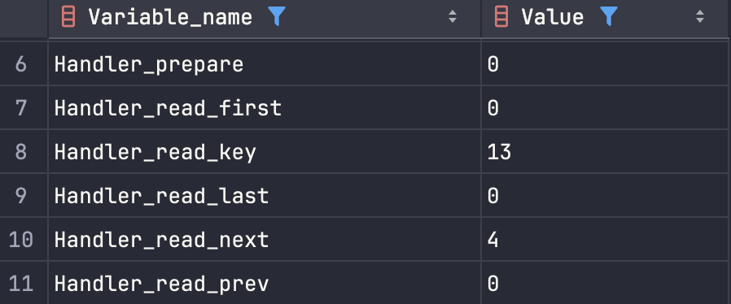

`Handler_read_key` → 1번 단계가 실행된 횟수

`Handler_read_next`, `Handler_read_prev` → 2번 단계로 읽은 레코드 건수

    - read_next → 인덱스 정순(오름차순)
    - read_prev → 인덱스 역순(내림차순)

`Handler_read_first`, `Handler_read_last` → 인덱스 첫 번째 레코드와 마지막 레코드를 읽은 횟수

    - MIN(), MAX() 사용하면 증가한다.

이 상태 값들은 읽은 레코드 건수를 의미하고, 인덱스만 읽었는지 인덱스를 통해 테이블의 레코드를 

읽었는지(3번 단계) 구분하지 않는다.

---

## 8.3.4.2 인덱스 풀 스캔

인덱스 레인지 스캔과 마찬가지로 인덱스를 사용하지만 **인덱스 레인지 스캔과는 달리 인덱스의 처음부터 끝까지 모두 읽는 방식을 인덱스 풀 스캔**이라고 한다.

대표적으로 쿼리의 조건절에 사용된 칼럼이 인덱스의 첫 번째 칼럼이 아닌 경우 인덱스 풀 스캔 방식이 사용된다.

예를 들어 인덱스는 (A,B,C) 칼럼의 순서로 만들어져 있지만 쿼리의 조건절은 B 칼럼이나 C 칼럼으로 검색하는 경우다. 

일반적으로 인덱스의 크기는 테이블의 크기보다 작으므로 직접 테이블을 처음부터 끝까지 읽는 것보다 인덱스만 읽는 것이 효율적이다. 쿼리가 인덱스에 명시된 컬럼만으로 조건을 처리할 수 있는 경우 주로 이 방식이 사용된다.

인덱스뿐만 아니라 데이터 레코드까지 모두 읽어야 한다면 절대 이 방식으로 처리되지 않는다.

즉, 커버링 인덱스인 경우에만 인덱스 풀 스캔을 진행한다.


해당 그림은 인덱스 풀 스캔의 예로 살펴볼 수 있다.

먼저 인덱스 리프 노드의 제일 앞 또는 제일 뒤로 이동한 후, 인덱스의 리프 노드를 연결하는 링크드 리스트를 따라서 처음부터 끝까지 스캔하는 방식이다.

이 방식은 인덱스 레인지 스캔보다 빠르지는 않지만 테이블 풀 스캔보다는 효율적이다.

인덱스에 포함된 컬럼만으로 처리할 수 있는 경우 테이블의 레코드를 읽을 필요가 없기 때문이다.

인덱스의 전체 크기는 테이블 자체의 크기보다는 훨씬 작으므로 인덱스 풀 스캔은 테이블 전체를 읽는 것보다는 적은 디스크 I/O로 쿼리를 처리할 수 있다.

**요약**

```
세컨더리 인덱스 리프 노드 레코드 구성 = 인덱스 키 +  물리 레코드 주소(클러스터 인덱스 키) 
클러스터 인덱스 리프 노드 레코드 구성 = 모든 레코드(칼럼)

즉, 1개의 페이지(노드)에 들어갈 수 있는 데이터량이 다르다.
-> 인덱스 풀 스캔 VS 테이블 풀 스캔을 비교하면 
압도적으로 테이블 풀 스캔 디스크 I/O 횟수가 많기 떄문에
인덱스 풀 스캔이 가능하면 훨씬 유리하다.

**InnoDB 스토리지 엔진은 한번의 I/O 단위는 페이지(블록)**
```

**주의**

```
인덱스 풀 스캔 방식 또한 인덱스를 이용하는 것이지만 효율적인 방식이 아니다.
즉, 일반적으로 인덱스를 생성하는 목적이 아니다.
테이블 전체를 읽거나 인덱스 풀 스캔 방식으로 인덱스를 사용하는 경우는
"인덱스를 사용하지 못한다" 또는 "인덱스를 사용하지 못한다"와 같다.
```

---

## 8.3.4.3 루스 인덱스 스캔

“인덱스 레인지 스캔”과 “인덱스 풀 스캔”은 “루스 인덱스 스캔”과 상반된 의미에서 “타이트(Tight) 인덱스 스캔”으로 분류된다. 

**루스 인덱스 스캔이란 듬성듬성하게 인덱스를 읽는 것을 의미한다.**

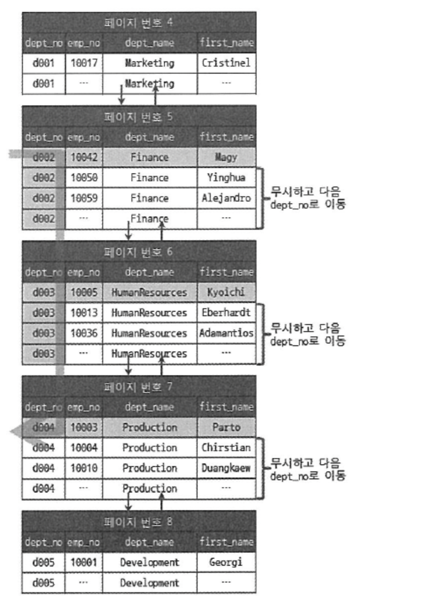

**루스 인덱스 스캔은 인덱스 레인지 스캔과 비슷하게 동작하지만 중간에 필요하지 않은 인덱스 키 값은 무시(SKIP)**하고 다음으로 넘어가는 형태로 처리한다.

**일반적으로 GROUP BY 또는 집합 함수 가운데 MAX() 또는 MIN() 함수에 대한 최적화를 하는 경우에 사용**된다.

```sql
CREATE INDEX idx_dept_emp ON dept_emp(dept_no, emp_no);

SELECT dept_no, MIN(emp_no)
FROM dept_emp
WHERE dept_no BETWEEN 'd002' AND 'd004'
GROUP BY dept_no;
```

인덱스가 (dept_no, emp_no) 두 개의 칼럼으로 생성돼 있다.

이 인덱스는 dept_no, emp_no 조합으로 정렬돼 있어서 그림과 같이 dept_no 그룹별로 첫 번째 레코드의 emp_no 값만 읽으면 된다.

즉, 인덱스에서 WHERE 조건을 만족하는 모든 범위를 다 스캔할 필요가 없다는 것을 옵티마이저는 알고 있기 때문에 조건에 만족하지 않는 레코드는 무시하고 다음 레코드로 이동한다.

---

## 8.3.4.4 인덱스 스킵 스캔

데이터베이스 서버에서 인덱스의 핵심은 값이 정렬돼 있다는 것이다.

이로 인해 인덱스를 구성하는 칼럼의 순서가 매우 중요하다.

예를 들어, employees 테이블에 다음과 같은 인덱스를 생성해보자.

```sql
ALTER TABLE employees
ADD INDEX ix_gender_birthdate (gender, birth_date);
```

이 인덱스를 사용하려면 WHERE 조건절에 gender 칼럼에 대한 비교 조건이 필수다.

```sql
// 인덱스를 사용하지 못하는 쿼리
SELECT * FROM employees WHERE birth_date >= '1965-02-01';

// 인덱스를 사용할 수 있는 쿼리
SELECT * FROM employees WHERE gender='M' AND birth_date >= '1965-02-01';
```

gender 칼럼과 birth_date 칼럼의 조건을 모두 가진 두 번째 쿼리는 인덱스를 효율적으로 사용할 수 있지만 

gender 칼럼에 조건이 없는 첫 번째 쿼리는 인덱스를 사용할 수가 없었다.

주로 이런 경우에는 birth_date 칼럼부터 시작하는 인덱스를 새로 생성해야만 했다.

### MySQL 8.0 버전 - 인덱스 스킵 스캔 최적화 기능

8.0 버전부터는 옵티마이저가 gender 칼럼을 건너뛰어서 birth_date 칼럼만으로도 인덱스 검색이 가능하게 해주는 **인덱스 스킵 스캔(Index skip scan)** 최적화 기능이 도입됐다.

8.0 이전 버전에서도 인덱스 스킵 스캔과 비슷한 최적화를 수행하는 루스 인덱스 스캔 기능이 있었지만 

GROUP BY 작업을 처리하기 위해 인덱스를 사용하는 경우에만 적용할 수 있었다.

하지만 MySQL 8.0 버전에 도입된 인덱스 스킵 스캔은 WHERE 조건절의 검색을 위해 사용 가능하도록 용도가 훨씬 넓어진 것이다.

### **옵티마이저 인덱스 스킵 스캔 최적화 OFF**

```sql
SET optimizer_switch='skip_scan=off';

EXPLAIN
SELECT gender, birth_date
FROM employees
WHERE birth_date >='1965-02-01';

mysql> EXPLAIN SELECT gender, birth_date FROM employees WHERE birth_date>='1965-02-01';
+----+-------------+-----------+------------+-------+---------------+---------------------+---------+------+--------+----------+--------------------------+
| id | select_type | table     | partitions | type  | possible_keys | key                 | key_len | ref  | rows   | filtered | Extra                    |
+----+-------------+-----------+------------+-------+---------------+---------------------+---------+------+--------+----------+--------------------------+
|  1 | SIMPLE      | employees | NULL       | index | NULL          | ix_gender_birthdate | 4       | NULL | 300719 |    33.33 | Using where; Using index |
+----+-------------+-----------+------------+-------+---------------+---------------------+---------+------+--------+----------+--------------------------+
1 row in set, 1 warning (0.00 sec)
```

```
WHERE 조건에 gender 칼럼에 조건 없이 birth_date 칼럼의 비교 조건만 가지고 있기 때문에
ix_gender_birthdate 인덱스를 효율적으로 이용할 수 없다.

"효율적"으로 이용한다는 것은, 인덱스에서 꼭 필요한 부분만 접근하는 것을 의미한다.
위의 실행계획에서 type 칼럼이 "index"라고 표시된 것은 인덱스를 처음부터 끝까지 모두 읽었다
(풀 인덱스 스캔)는 의미이므로 인덱스를 비효율적으로 사용한 것이다.

만약 예제 쿼리가 employees 테이블 모든 컬럼을 가져와야 했다면 
테이블 풀 스캔을 실행했을 것이다.
-> type: all
```

### **옵티마이저 인덱스 스킵 스캔 최적화 ON**

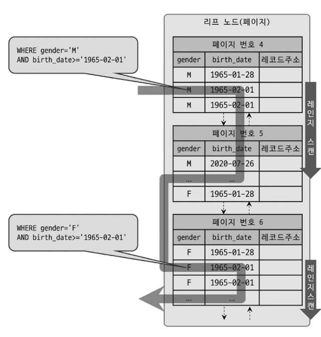

```sql
SET optimizer_switch='skip_scan=on';

EXPLAIN
SELECT gender, birth_date
FROM employees
WHERE birth_date >='1965-02-01';

+----+-------------+-----------+------------+-------+---------------------+---------------------+---------+------+--------+----------+----------------------------------------+
| id | select_type | table     | partitions | type  | possible_keys       | key                 | key_len | ref  | rows   | filtered | Extra                                  |
+----+-------------+-----------+------------+-------+---------------------+---------------------+---------+------+--------+----------+----------------------------------------+
|  1 | SIMPLE      | employees | NULL       | range | ix_gender_birthdate | ix_gender_birthdate | 4       | NULL | 100229 |   100.00 | Using where; Using index for skip scan |
+----+-------------+-----------+------------+-------+---------------------+---------------------+---------+------+--------+----------+----------------------------------------+
1 row in set, 1 warning (0.00 sec)
```

```
쿼리의 실행 계획에서 type 컬럼의 값이 “range”로 표시됐다.
이는 꼭 인덱스에서 필요한 부분만 읽었다는 것을 의미한다.
그리고 실행 계획의 Extra 칼럼에 "Using index for skip scan"
이라는 문구가 표시됐다.
이는 id_gender_birthdate 인덱스에 대해 인덱스 스킵 스캔을 활용해서
데이터를 조회했다는 의미한다.

MySQL 옵티마이저는 우선 gender 칼럼에서 유니크한 값을 모두 조회해서
주어진 쿼리에 gender 칼럼의 조건을 추가해서 쿼리를 다시 실행하는 형태로 처리한다.

gender 칼럼은 성별을 구분하는 칼럼으로 ‘M’ ‘F’ 값만 가지는 칼럼이다.
그래서 gender 칼럼에 대해 가능한 값 2개(’M’,‘F’)를 구한 다음, 
내부적으로 아래 2개의 쿼리를 실행하는 것과 비슷한 형태의 최적화를 실행하게 된다.
```

```sql
SELECT gender, birth_date 
FROM employees 
WHERE gender='M' AND birth_date >='1965-02-01';

SELECT gender, birth_date 
FROM employees 
WHERE gender='F' AND birth_date >='1965-02-01';
```

### 인덱스 스킵 스캔의 단점(조건)

    - **WHERE 조건절에 조건이 없는 인덱스의 선행 칼럼의 유니크한 값의 개수가 적어야 함**
    - **쿼리가 인덱스에 존재하는 칼럼 칼럼만으로 처리 가능해야 함(커버링 인덱스)**

첫 번째 조건은 **쿼리 실행 계획의 비용과 관련된 부분**이다.

유니크한 값의 개수가 매우 많다면 MySQL 옵티마이저는 인덱스에서 스캔해야 할 시작 지점을 검색하는 작업이 많이 필요해진다. 그래서 쿼리의 처리 성능이 오히려 더 느려질 수도 있다.

예를 들어 (emp_no, dept_no) 조합으로 만들어진 인덱스에서 인덱스 스킵 스캔을 실행한다고 하면 

사원의 수만큼 레인지 스캔 시작 지점을 검색하는 작업이 필요해져 쿼리의 성능이 매우 떨어진다.

두 번째 제약 조건은 아래 예제 쿼리를 통해 살펴보자.

```sql
EXPLAIN
SELECT *
FROM employees
WHERE birth_date >='1965-02-01';

+----+-------------+-----------+------------+------+---------------+------+---------+------+--------+----------+-------------+
| id | select_type | table     | partitions | type | possible_keys | key  | key_len | ref  | rows   | filtered | Extra       |
+----+-------------+-----------+------------+------+---------------+------+---------+------+--------+----------+-------------+
|  1 | SIMPLE      | employees | NULL       | ALL  | NULL          | NULL | NULL    | NULL | 300141 |    33.33 | Using where |
+----+-------------+-----------+------------+------+---------------+------+---------+------+--------+----------+-------------+
1 row in set, 1 warning (0.00 sec)

```

WHERE 조건은 동일하지만 SELECT 절에서 employees 테이블의 모든 칼럼을 조회하도록 변경했다.

이 쿼리는 ix_gender_birthdate 인덱스에 포함된 gender 칼럼과 birh_date 칼럼 이외의 나머지 칼럼도 필요하기 때문에 인덱스 스킵 스캔을 사용하지 못하고 풀 테이블 스캔으로 실행 계획을 수립한 것을 확인할 수 있다.

이 제약 사항은 옵티마이저가 개선하면 충분히 해결될 수 있는 부분으로 보인다.

**인덱스 스캔 방식 4가지 정리**

| 스캔 방식 | 사용 조건 / 목적 | 장점 | 제약 |
| --- | --- | --- | --- |
| 인덱스 레인지 스캔 | WHERE 절에 범위 조건이 있을 때 | 인덱스 일부만 탐색하여 빠름 | - |
| 인덱스 풀 스캔 | WHERE 없이 SELECT 또는 커버링 인덱스 사용 | 테이블 액세스 없이 인덱스만 탐색 | - |
| 루스 인덱스 스캔 | GROUP BY, DISTINCT, MIN/MAX 등 집합 연산 최적화 | 불필요한 탐색 없이 필요한 값만 추출 | - |
| 인덱스 스킵 스캔 | 복합 인덱스에서 선행 조건 없이 후행 조건만 있을 때 | 복합 인덱스의 활용도 향상 | 선행 컬럼 유니크 수 적고, 커버링 인덱스 필요 |

---

# 8.3.5 다중 칼럼(Multi-column) 인덱스

두 개 이상의 칼럼으로 구성된 인덱스를 다중 칼럼 인덱스(복합 칼럼 인덱스)라고 하며, 2개 이상의 칼럼이 연결됐다고 해서 “Concatenated Index”라고도 한다.

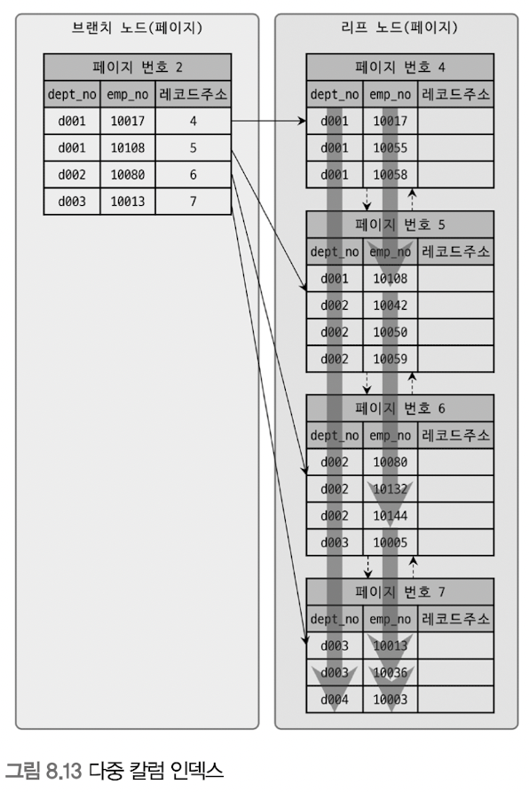

그림을 보면 인덱스의 두 번째 칼럼은 첫 번째 인덱스에 의존해서 정렬돼 있다.

즉, 두 번째 칼럼의 정렬은 첫 번째 칼럼이 똑같은 레코드에서만 의미가 있다는 것이다.

이는 **인덱스 내에서 칼럼의 위치(순서)가 상당히 중요한 이유**이다.

---

# 8.3.6 B-Tree 인덱스의 정렬 및 스캔 방향

인덱스를 생성할 때 설정한 정렬 규칙에 따라서 인덱스의 키 값은 항상 오름차순 또는 내림차순으로 정렬되어 저장된다. 하지만 어떤 인덱스가 오름차순으로 생성됐다고 해서 그 인덱스를 항상 오름차순으로만 읽을 수 있는 건 아니다. **인덱스를 어느 방향으로 읽을지는 쿼리에 따라 옵티마이저가 실시간으로 만들어 내는 실행 계획에 따라 결정**된다.

---

## 8.3.6.1 인덱스의 정렬

MySQL 5.7 버전까지는 칼럼 단위로 정렬 순서를 혼합해서 인덱스를 생성할 수 없었다.

하지만 MySQL 8.0 버전부터는 정렬 순서를 혼합한 인덱스도 생성할 수 있게 됐다.

```sql
CREATE INDEX ix_teamname_userscore ON employees (team_name ASC, user_score DESC);
```

---

## 8.3.6.1.1 인덱스 스캔 방향

first_name 칼럼에 대한 인덱스가 포함된 employees 테이블에 대해 아래 쿼리를 실행하는 과정을 살펴보자.

```sql
SELECT *
FROM employees
ORDER BY first_name DEDC
LIMIT 1;
```

Q: MySQL은 이 쿼리를 실행하기 위해 인덱스를 처음부터 오름차순으로 끝까지 읽어 first_name이 가장 큰 값 하나를 가져오는걸까? 

A: 그렇지 않다.

**인덱스를 최솟값부터 읽으면 오름차순으로 데이터를 가져올 수 있고, 최댓값부터 거꾸로 읽으면 내림차순으로 데이터를 가져올 수 있다는 것을 MySQL 옵티마이저는 이미 알고 있다.**

그래서 위의 쿼리는 역순으로 접근해 첫 번째 레코드만 읽으면 된다.

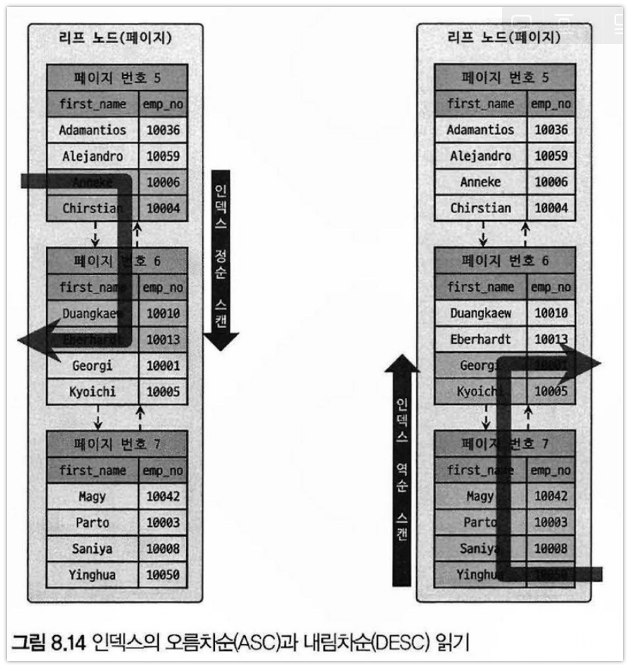

```sql
SELECT * FROM employees WHERE first_name >= 'Anneke'
ORDER BY first_name ASC LIMIT 4;

SELECT * FROM employees 
ORDER BY first_name DESC LIMIT 5;
```

쿼리의 ORDER BY 처리나 MIN() 또는 MAX() 함수 등의 최적화가 필요한 경우에도 

MySQL 옵티마이저는 인덱스의 읽기 방향을 전환해서 사용하도록 실행 계획을 만들어 낸다.

---

## 8.3.6.1.2 내림차순 인덱스

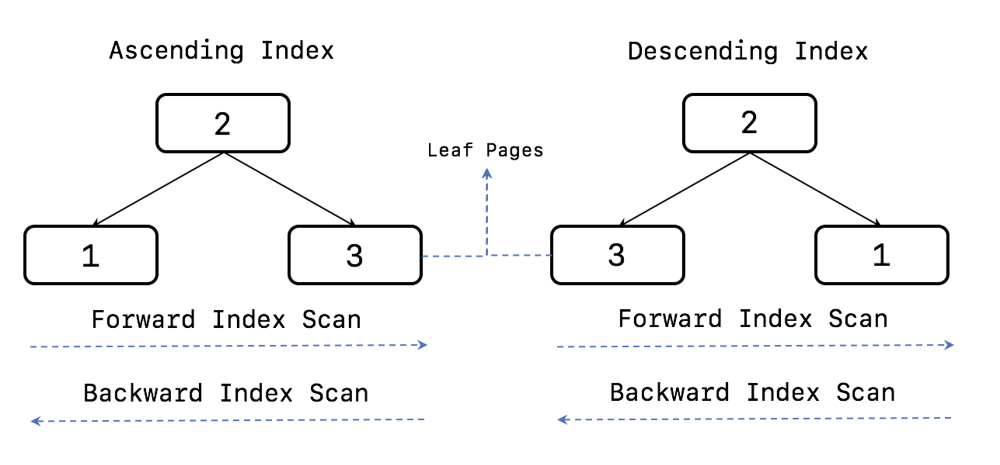

    - 오름차순 인덱스(Ascending Index): 작은 값의 인덱스 키가 B-Tree 왼쪽으로 정렬된 인덱스
    - 내림차순 인덱스(Descending Index): 큰 값의 인덱스 키가 B-Tree 왼쪽으로 정렬된 인덱스
    - 인덱스 정순 스캔(Forward index scan): 리프 노드의 왼쪽부터 오른쪽으로 스캔
    - 인덱스 역순 스캔(Backward index scan): 리프 노드의 오른쪽부터 왼쪽으로 스캔

### **내림차순 인덱스의 필요성에 대해서 알아보자**

```sql
CREATE TABLE t1(
		tid INT NOT NULL AUTO_INCREMENT,
		TABLE_NAME VARCHAR(64),
		COLUMN_NAME VARCHAR(64),
		ORDINAL_POSITION INT,
		PRIMARY KEY(tid)
)

INSERT INTO t1
SELECT NULL, TABLE_NAME, COLUMN_NAME, ORDINAL_POSITION
FROM information_schema.COLUMNS;

INSERT INTO t1
SELECT NULL, TABLE_NAME, COLUMN_NAME, ORDINAL_POSITION
FROM t1;

// 13번 실행 ...

SELECT COUNT(*) FROM t1;
+----------+
| count(*) |
+----------+
| 29736960 |
+----------+
```

대략 3천만 건 레코드 준비 끝

**참고 아래 쿼리 3개는 모두 동일하다.**

```sql

SELECT * FROM 테이블 LIMIT N;

SELECT * FROM 테이블 LIMIT 0, N;

SELECT * FROM 테이블 LIMIT N OFFSET 0;
```

```sql
SELECT * FROM t1 ORDER BY tid ASC LIMIT 29736959, 1;
+----------+---------------------------+---------------+------------------+
| tid      | TABLE_NAME                | COLUMN_NAME   | ORDINAL_POSITION |
+----------+---------------------------+---------------+------------------+
| 30007061 | x$waits_global_by_latency | total_latency |                3 |
+----------+---------------------------+---------------+------------------+
1 row in set (5.43 sec)

SELECT * FROM t1 ORDER BY tid DESC LIMIT 29736959, 1;
+-----+-------------+-------------+------------------+
| tid | TABLE_NAME  | COLUMN_NAME | ORDINAL_POSITION |
+-----+-------------+-------------+------------------+
|   1 | departments | dept_name   |                2 |
+-----+-------------+-------------+------------------+
1 row in set (6.84 sec)
```

두 쿼리는 테이블의 프라이머리 키를 정순 또는 역순으로 스캔하면서 마지막 레코드 1건만 반환한다.

첫 번째 쿼리는 tid 칼럼이 가장 큰 레코드를 1건, 두 번째 쿼리는 tid 칼럼이 가장 작은 렉코드를 1건 조회한다.

하지만 LIMIT, OFFSET 때문에 테이블의 거의 모든 레코드를 스캔해야 한다.

정확히는 OFFSET 만큼 인덱스 레인지 스캔이 일어난다.

두 쿼리는 3천만 건을 스캔하는데 “1.4초” 정도 차이난다.

하지만 **비율로 따지면 역순 정렬 쿼리가 정순 정렬 쿼리보다 26퍼 정도 더 시간이 걸리는 것을 확인**할 수 있다.

왜 이런 결과가 나올까?

    - 페이지 잠금이 인덱스 정순 스캔(Forward index scan)에 적합한 구조
    - 페이지 내에서 인덱스 레코드가 단방향으로만 연결된 구조

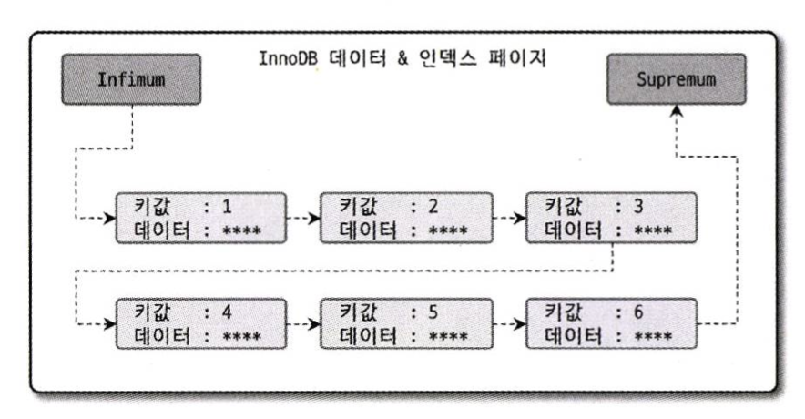

```
InnoDB 스토리지 엔진에서 데이터 페이지는 힙처럼 사용되기 때문에 그림처럼
물리적으로 저장이 순서대로 배치되지는 않는다.
```

일반적으로 인덱스를 ORDER BY … DESC 하는 쿼리가 레코드에 드물게 실행되는 경우라면 

내림차순 인덱스를 굳이 고려할 필요는 없어 보인다.

```sql
SELECT * FROM tab
WHERE userid=?
ORDER BY score DESC
LIMIT 10;
```

이 쿼리의 경우 다음 두 가지 인덱스 모두 적절한 선택이 될 수 있다.

```sql
오름차순 인덱스: INDEX (userid ASC, score ASC)
내림차순 인덱스: INDEX (userid DESC, score DESC)
```

하지만 해당 쿼리가 빈번하게 실행되고 많은 레코드를 조회한다면 내림차순 인덱스가 더 효율적이라고 볼 수 있다.

비록 페이지 단위로는 역순 이동이 되더라도, 페이지 내부 레코드는 역순으로 효율적으로 순회할 수 없기 때문에

**DESC 쿼리는 항상 어느 정도 성능 손해가 발생한다.**

| 항목 | 설명 |
| --- | --- |
| **1. 페이지 내부 레코드 간 연결** | ✅ **단방향 (정방향/ASC만 고려)** → 클러스터 인덱스든 세컨더리 인덱스든 동일하게 **레코드는 단방향으로만 연결**되어 있음 |
| **2. 클러스터 인덱스(PK)의 리프 노드 간 연결** | ✅ **양방향(Double-linked list)** → 리프 노드(페이지) 간에 **앞뒤 이동 모두 가능** → ASC/DESC 모두 효율적 (이론상) |

[https://tech.kakao.com/posts/351](https://tech.kakao.com/posts/351)

---

# 8.3.7 B-Tree 인덱스의 가용성과 효율성

쿼리의 WHERE 절이나 GROUP BY, 또는 ORDER BY 절이 어떤 경우에 인덱스를 사용할 수 있고 어떤 방식으로 사용할 수 있는지 식별할 수 있어야 한다.

그래야만 쿼리의 조건을 최적화하거나, 역으로 쿼리에 맞게 인덱스를 최적으로 생성할 수 있다.

---

## 8.3.7.1 비교 조건의 종류와 효율성

다중 칼럼 인덱스에서 각 칼럼의 순서와 사용된 조건이 동등 비교(”=”)인지 크다 (”>”) 또는 작다 (”<”) 같은 범위 조건인지에 따라 각 인덱스 칼럼의 활용 형태와 효율이 달라진다.

```sql
SELECT * FROM dept_emp
WHERE dept_no='d002' AND emp_no >= 10114;
```

    - 케이스 A: INDEX(dept_no, emp_no)
    - 케이스 B: INDEX(emp_no, dept_no)


케이스 A 같은 경우 “dept_no='d002' AND emp_no >= 10114”인 레코드를 찾고, 그 이후에는 dept_no가 ‘d002’가 아닐 때까지 인덱스를 쭉 읽기만 하면 된다.

이 경우에는 읽은 레코드가 모두 사용자가 원하는 레코드 결과임을 알 수 있다.

케이스 B 같은 경우 “emp_no >= 10114 AND  dept_no='d002'” 레코드를 찾고 그 이후 모든 레코드에 대해 

dept_no가 ‘d002’인지 비교하는 과정을 거쳐야 한다.

이처럼 인덱스를 통해 읽은 레코드가 나머지 조건에 맞는지 비교하면서 취사선택하는 작업을 ‘필터링’이라고 한다.

케이스 B도 레코드 5건을 가져온다. 하지만 케이스 A와는 다르게 7번의 비교 과정을 거친다.

**왜 이런 차이가 발생했을까?** 

다중 칼럼 인덱스의 정렬 방식은 N번째 키 값은 N-1번째 키 값에 대해서 다시 정렬되기 때문이다.

케이스 A 인덱스에서의 “dept_no='d002' , emp_no >= 10114” 같이 작업의 범위를 결정하는 조건을 작업 범위 결정 조건이라고 한다.

케이스 B 인덱스에서의 dept_np=’d002’ 조건을 필터링 조건 또는 체크 조건이라고 한다.

즉, 케이스 A 같은 경우 작업 범위 결정 조건을 2개 사용했고 케이스 B 같은 경우 작업 범위 결정 조건을 1개, 필터링 조건을 1개 사용했다.

**작업 범위를 결정하는 조건이 많으면 많을수록 쿼리의 성능을 높이지만 필터링 조건은 많다고 해서 쿼리의 처리 성능을 높이지는 못한다. 오히려 쿼리 샐행을 더 느리게 만들 때가 많다.** 

---

## 8.3.7.2 인덱스의 가용성

B-Tree 인덱스의 특징은 왼쪽 값에 기준해서 오른쪽 값이 정렬돼 있다는 것이다.

여기서 **왼쪽이란 하나의 칼럼 내에서뿐만 아니라 다중 칼럼 인덱스의 칼럼에 대해서도 함께 적용**된다.

    - 케이스 A: INDEX(first_name)
    - 케이스 B: INDEX(dept_no, emp_no)

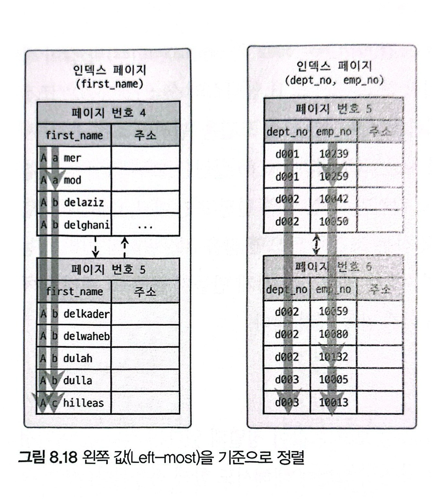

하나의 칼럼으로 검색해도 값의 왼쪽 부분이 없으면 인덱스 레인지 스캔 방식이 불가능하다.

또한 다중 칼럼 인덱스에서도 왼쪽 칼럼의 값을 모르면 인덱스 레인지 스캔을 사용할 수 없다.

물론 8.0 이후 버전이라면 커버링 인덱스 + 왼쪽 칼럼의 기수성이 낮다면 인덱스 스킵 스캔으로 동작할 수 있다.

 

```sql
SELECT * FROM employees WHERE first_name LIKE '%mer';
```

케이스 A에서 해당 쿼리는 인덱스 레인지 스캔 방식으로 인덱스를 사용할 수는 없다.

그 이유는 first_name 칼럼에 저장된 값의 왼쪽부터 한 글자씩 비교해 가면서 일치하는 레코드를 찾아야 하는데, 조건절에 주어진 상숫값(’%mer’)에는 왼쪽 부분이 고정되지 않았기 때문이다.

따라서 정렬 우선순위가 낮은 뒷부분의 값만으로는 인덱스의 효과를 얻을 수 없다.

```sql
SELECT * FROM dept_emp WHERE emp_no >= 10144; 
```

케이스 B는 인덱스가 dept_no, emp_no 순서대로 생성돼 있다.

인덱스의 선행 칼럼인 dept_no 조건 없이 emp_no 값으로만 검색하면 인덱스를 효율적으로 사용할 수 없다.

여기서는 간단히 WHERE 조건절에 대한 내용만 언급했지만 인덱스의 왼쪽 값 기준 규칙은 GROUP BY 절이나 ORDER BY 절에도 똑같이 적용된다.

---

## 8.3.7.3 가용성과 효율성 판단

기본적으로 B-Tree 인덱스의 특성상 다음 조건에서는 사용할 수 없다.

사용할 수 없다는 것은 작업 범위 결정 조건으로 사용할 수 없다는 것을 의미한다.

경우에 따라서는 체크 조건으로 인덱스를 사용할 수는 있다.

| **구분** | **예시** | **설명** |
| --- | --- | --- |
| **NOT-EQUAL로 비교된 경우** | `WHERE column <> 'N'` | 특정 값과 다른 경우를 검색 |
|  | `WHERE column NOT IN (10, 11, 12)` | 특정 값 목록에 없는 경우를 검색. |
|  | `WHERE column IS NOT NULL` | NULL이 아닌 값을 검색하며, 일반적으로 인덱스를 제대로 활용하지 못함. |
| **LIKE로 뒷부분 또는 중간 일치** | `WHERE column LIKE '%승환'` | 문자열 끝부분이 특정 패턴과 일치하는 경우.  |
|  | `WHERE column LIKE '_승환'` | 두 번째 문자부터 특정 패턴과 일치하는 경우. |
|  | `WHERE column LIKE '%승%'` | 문자열 중간에 특정 패턴이 포함된 경우. |
| **인덱스 컬럼이 변형된 경우** | `WHERE SUBSTRING(column, 1, 1) = 'X'` | 인덱스가 적용되지 않으며, 컬럼 값을 변형하는 함수 사용. |
|  | `WHERE DAYOFMONTH(column) = 1` | 날짜 함수로 컬럼을 변형하여 비교하는 경우. |
| **NOT-DETERMINISTIC <br>함수 사용** | `WHERE column = deterministic_function()` | 결과가 매번 달라질 수 있는 함수 사용 시, 인덱스 사용이 제한 |
| **데이터 타입이 다른 비교** | `WHERE char_column = 10` | 문자열과 숫자와 같이 서로 다른 타입을 비교하면 암묵적 형변환이 발생하고 인덱스 사용이 제한 |
| **문자열 콜레이션이 다른 문자열 비교** | `WHERE utf8_bin_char_column = euckr_bin_char_column` | 서로 다른 문자 집합(콜레이션)을 비교하면 불필요한 변환 |

다른 일반적인 DBMS에서는 NULL 값이 인덱스에 저장되지 않지만 MySQL에서는 NULL 값도 인덱스에 저장된다. 다음과 같은 조건도 작업 범위 결정 조건으로 인덱스를 사용한다.

```sql
	... WHERE column IS NULL ..
```

오름차순(정순) 인덱스 기준 NULL은 제일 앞에 정렬돼 있다.

### 다중 컬럼 인덱스의 적용 가능/불가능 조건 - INDEX( col1, col2, col3, … col n)

| **구분** | **설명** | **예시** |
| --- | --- | --- |
| **적용되지 않는 경우** |  |  |
| `col_1`에 대한 조건 없음 | 다중 컬럼 인덱스에서 가장 앞 컬럼(`col_1`)에 대한 조건이 없으면 인덱스가 적용되지 않음. | `WHERE col_2 = 10 AND col_3=20` |
| `col_1` 조건이 인덱스에서 사용 불가 | `col_1` 조건이 NOT-EQUAL (`<>`, `NOT IN`, 등), 패턴 불일치 (`LIKE '%str'`) 등이 포함될 경우. | `WHERE col_1 <> 10 AND col_2 = 20` |
| **적용되는 경우** |  |  |
| `col_1` ~ `col_(i-1)` 동등 비교 | 인덱스 컬럼 중 앞부분(`col_1` ~ `col_(i-1)`)이 동등 비교 조건 (`=`, `IN`)일 때 적용 가능. | `WHERE col_1 = 10 AND col_2 IN (20, 30)` |
| `col_i` 비교 가능 조건 | `col_i`에 동등 비교 (`=`, `IN`), 크고 작음 (`<`, `>`, `<=`, `>=`), 또는 좌측 일치 `LIKE` 조건 사용 가능. | `WHERE col_1 = 10 AND col_2 = 20 AND col_3 > 30`  <br>`WHERE col_1 = 10 AND col_2 LIKE 'jour%'` |
| **작업 범위/체크 조건** |  |  |
| 작업 범위 조건 | `col_1` ~ `col_i`는 작업 범위를 결정하는 조건으로 사용 | `WHERE col_1 = 10 AND col_2 = 20` (인덱스를 통한 데이터 스캔 범위 결정). |
| 체크 조건 | `col_i+1` ~ `col_n`은 작업 범위 내에서 일치 여부를 확인하는 조건으로 사용됨. | `WHERE col_1 = 10 AND col_2 = 20 AND col_3 = 30 AND col_4 = 40` (작업 범위 스캔 후 추가 체크). |

---

일반적인 인덱스는 칼럼의 값 앞부분 또는 전체에 대해서만 인덱스 생성이 허용된다.

하지만 때로는 **칼럼의 값을 변형해서 만들어진 값에 대해 인덱스를 구축**해야 할 때도 있다.

이러한 경우 함수 기반의 인덱스를 활용하면 된다.

MySQL 8.0 버전부터 함수 기반 인덱스를 2가지 방식으로 지원하기 시작했다. 

    - 가상 칼럼을 이용한 인덱스
    - 함수를 이용한 인덱스

함수 기반 인덱스는 인덱싱할 값을 계산하는 과정의 차이만 있을 뿐, 실제 인덱스의 내부적인 구조 및 유지관리 방법은 B-Tree 인덱스와 동일하다.

---

# 8.6.1 가상 칼럼을 이용한 인덱스

**사용자의 정보를 저장하는 테이블**

```sql
CREATE TABLE user (
	 user_id BIGINT,
	 first_name VARCHAR(10),
	 last_name VARCHAR(10),
	 PRIMARY KEY (user_id)
);
```

first_name, last_name 합쳐서 검색해야 하는 요건이 생겼다.

이전 버전의 MySQL 서버에서는 full_name 이라는 칼럼을 추가하고 모든 레코드에 대해 full_name을 업데이트하는 작업을 거쳐야 했다.

그래야만 비로소 full_name 칼럼에 대해 인덱스를 생성할 수 있었다.

하지만 MySQL 8.0 버전부터는 가상 칼럼을 추가하고, 그 가상 칼럼에 인덱스를 생성할 수 있게 됐다.

```sql
ALTER TABLE user
ADD full_name VARCHAR(30) AS (CONCAT(first_name, ' ', last_name)) VIRTUAL,
ADD INDEX ix_fullname (full_name);
```

```sql
EXPLAIN SELECT * FROM user WHERE full_name='Matt Lee';
+----+-------------+-------+------------+------+---------------+-------------+---------+-------+------+----------+-------+
| id | select_type | table | partitions | type | possible_keys | key         | key_len | ref   | rows | filtered | Extra |
+----+-------------+-------+------------+------+---------------+-------------+---------+-------+------+----------+-------+
|  1 | SIMPLE      | user  | NULL       | ref  | ix_fullname   | ix_fullname | 123     | const |    1 |   100.00 | NULL  |
+----+-------------+-------+------------+------+---------------+-------------+---------+-------+------+----------+-------+
```

실행 계획이 ix_fullname 인덱스를 이용해 만들어진다.

가상 칼럼이 `VIRTUAL` 또는 `STORED` 옵션 중 어떤 옵션으로 생성됐든 관계없이 해당 가상 칼럼에 인덱스를 생성할 수 있다. 가상 칼럼은 테이블에 새로운 칼럼을 추가하는 것과 같은 효과를 내기 때문에 실제 테이블의 구조가 변경된다는 단점이 있다.

두 옵션의 차이는 15.8절을 참고하자

---

# 8.6.2 함수를 이용한 인덱스

MySQL 8.0 부터는 테이블의 구조를 변경하지 않고, 함수를 직접 사용하는 인덱스를 생성할 수 있다.

```sql
CREATE TABLE user (
	 user_id BIGINT,
	 first_name VARCHAR(10),
	 last_name VARCHAR(10),
	 PRIMARY KEY (user_id),
	 INDEX ix_fullname ((CONCAT(first_name,' ', last_name)))
);
```

**함수를 직접 사용하는 인덱스는 테이블의 구조를 변경하지 않고, 계산된 결괏값의 검색을 빠르게 만들어준다.**

함수 기반 인덱스를 제대로 활용하려면 반드시 조건절에 함수 기반 인덱스에 명시된 표현식이 그대로 사용돼야 한다. 결과가 같은 함수를 사용하더라도 MySQL 옵티마이저는 다른 표현식으로 간주해서 함수 기반 인덱스를 사용하지 못한다.

```sql
EXPLAIN SELECT * FROM user WHERE CONCAT(first_name,' ', last_name)='Matt Lee';
+----+-------------+-------+------------+------+---------------+-------------+---------+-------+------+----------+-------+
| id | select_type | table | partitions | type | possible_keys | key         | key_len | ref   | rows | filtered | Extra |
+----+-------------+-------+------------+------+---------------+-------------+---------+-------+------+----------+-------+
|  1 | SIMPLE      | user  | NULL       | ref  | ix_fullname   | ix_fullname | 87      | const |    1 |   100.00 | NULL  |
+----+-------------+-------+------------+------+---------------+-------------+---------+-------+------+----------+-------+
```

만약 이 예제를 실행했을 때 옵티마이저가 표시하는 실행 계획인 “ix_fullname” 인덱스를 사용하지 않는 것으로 표시된다면 공백 문자 리터럴 때문일 가능성이 높다.

    - collation_connection
    - collation_database
    - collation_server 

→ 시스템 변수의 값을 동일 콜레이션으로 일치시킨 후, 다시 테스트를 수행하자.

---

MySQL 클러스터링 인덱스는 InnoDB 스토리지 엔진에서만 지원하며, 다른 스토리지 엔진에서는 지원되지 않는다. MySQL 서버에서 클러스터링은 테이블의 레코드를 프라이머리 키를 기준으로 묶어서 저장하는 형태로 구현된다.

---

# 8.8.1 클러스터링 인덱스

클러스터링 인덱스는 테이블의 프라이머리 키에 대해서만 적용되는 내용이다. 즉, 프라이머리 키 값이 비슷한 레코드끼리 묶어서 저장하는 것을 클러스터링 인덱스라고 표현한다.

프라이머리 키 값에 의해 레코드의 저장 위치가 결정된다.

프라이머리 키 값으로 클러스터링된 테이블은 프라이머리 키 값 자체에 의존도가 상당히 크기 때문에 신중하게 프라이머리 키를 결정해야 한다.

클러스터링 인덱스는 프라이머리 키 값에 의해 저장 위치가 결정되므로 테이블의 레코드 저장 방식이라고 볼 수 있다. 클러스터링 테이블은 프라이머리 키 기반의 검색이 매우 빠르며 대신, 레코드의 저장 변경이 상대적으로 느리다. 


클러스터링 테이블의 구조 자체는 일반 B-Tree와 비슷하다.

하지만 **세컨더리 인덱스를 위한 B-Tree 리프 노드와는 다르게 클러스터링 인덱스의 리프 노드에는 레코드의 모든 칼람이 같이 저장**돼 있음을 알 수 있다.

즉, 클러스터링 테이블은 그 자체가 하나의 거대한 인덱스 구조로 관리되는 것이다.

그림 8.25 클러스터링 테이블에서 다음 쿼리와 같이 프라이머리 키 변경 문장이 실행되면 어떤 변화가 일어날까?

```sql
UPDATE tb_test SET emp_no=100002 WHERE emp_no=100007;
```

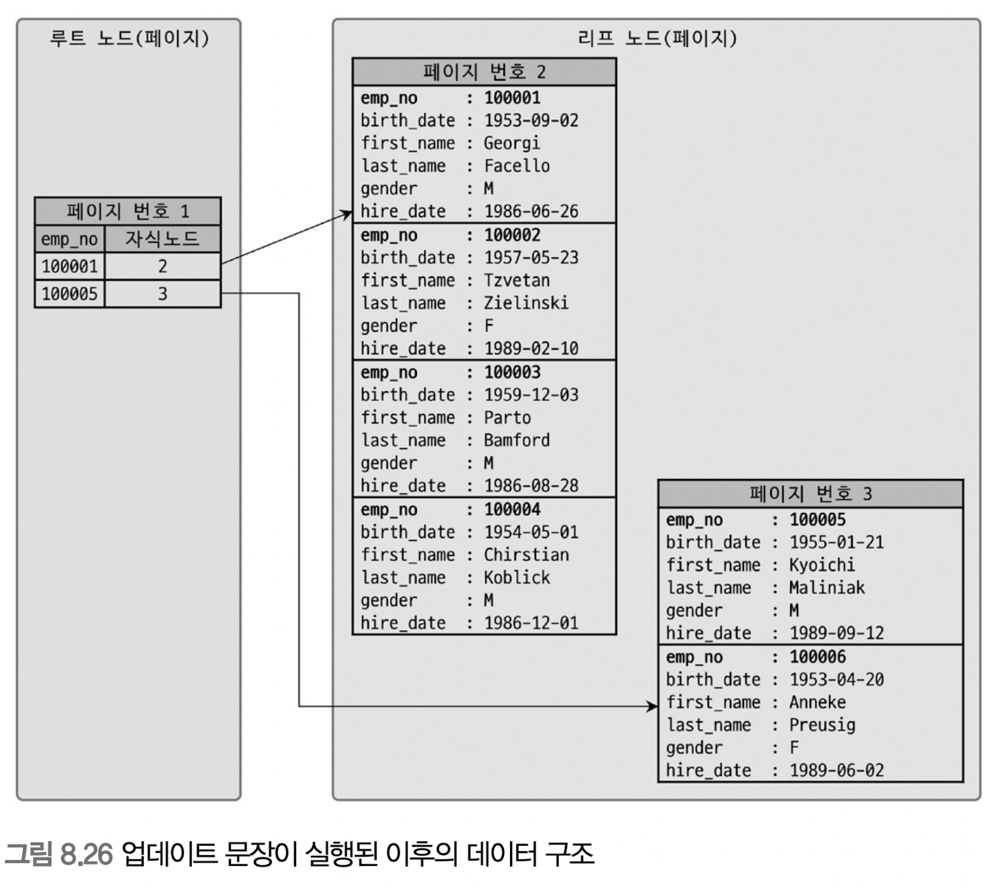

그림 8.25에서 emp_no = 100007 레코드는 3번 페이지에 저장돼 있음을 확인할 수 있었다.

하지만 그림 8.26에서는 emp_no 가 100002로 변경되면서 2번 페이지로 이동한 것을 알 수 있다.

**실제로 프라이머리 키의 값이 변경되는 경우는 거의 없을 것이다.**

### InnoDB 프라이머리 키 선택 방식

    1. 프라이머리 키 존재 → 프라이머리 키를 클러스터링 키로 선택
    1. NOT NULL, UNIQUE 인덱스중에서 첫 번째 인덱스를 클러스터링 키로 선택
    1. 자동으로 유니크한 값을 가지도록 증가되는 칼럼을 내부적으로 추가한 후, 클러스터링 키로 선택

3번의 경우 InnoDB 스토리지 엔진이 내부적으로 레코드 일련번호를 칼럼을 생성하는데, **이렇게 추가된 프라이머리 키 칼럼은 사용자에게 노출되지 않으며, 쿼리 문장에 명시적으로 사용할 수 없다.**

InnoDB 테이블에서 클러스터링 인덱스는 테이블당 단 하나만 가질 수 있는 엄청난 혜택이므로 가능하다면 꼭 프라이머리 키를 명시적으로 생성하자.

---

# 8.8.2 세컨더리 인덱스에 미치는 영향

MyISAM, MEMORY 테이블 같이 클러스터링되지 않은 테이블은 처음 INSERT될 때 처음 저장된 공간에서 절대 이동하지 않는다. 데이터 레코드가 저장된 주소는 내부적인 레코드 아이디(ROWID) 역할을 한다.

그리고 프라이머리 키나 세컨더리 인덱스의 각 키는 그 주소(ROWID)를 이용해 실제 데이터 레코드를 찾아온다.

그래서 MyISAM, MEMORY 테이블에서는 세컨더리 인덱스와 프라이머리 키는 구조적 차이가 없다.

InnoDB 세컨더리 인덱스가 실제 레코드가 저장된 주소를 가지고 있다면 어떻게 될까?

클러스터링 키 값이 변경될 때마다 데이터 레코드의 주소가 변경되고 그때마다 해당 테이블의 모든 인덱스에 저장된 주솟값을 변경해야 할 것이다.

이런 오버헤드를 제거하기 위해서 **InnoDB 테이블의 모든 세컨더리 인덱스는 해당 레코드가 저장된 주소가 아닌 프라이머리 키 값을 저장**하도록 구현돼 있다. 

### MyISAM VS InnoDB 

```sql
CREATE TABLE employees (
		emp_no INT NOT NULL,
		first_name VARCHAR(20) NOT NULL,
		PRIMARY KEY(emp_no),
	  INDEX ix_firstname (first_name)
);
```

employees 테이블에서 first_name 칼럼으로 검색한 경우 MyISAM 테이블과 InnoDB 테이블 탐색 차이점을 비교하자.

**MyISAM** 

    - ix_firstname 인덱스를 검색해서 레코드의 주소를 확인한 후, 레코드의 주소를 이용해 최종 레코드를 가져옴

**InnoDB** 

    - ix_firstname 인덱스를 검색해 레코드의 프라이머리 키 값을 확인한 후, 프라이머리 키 인덱스를 검색해서 최종 레코드를 가져옴

---

# 8.8.3 클러스터링 인덱스의 장점과 단점

### 장점 

    - 프라이머리 키(클러스터링 키)로 검색할 때 처리 성능이 매우 빠름(특히, 프라이머리 키 기반 범위 검색하는 경우 매우 빠름)
    - 테이블의 모든 세컨더리 인덱스가 프라이머리 키를 가지고 있기 때문에 인덱스만으로 처리될 수 있는 경우가 많음(커버링 인덱스)

### 단점 

    - 테이블의 모든 세컨더리 인덱스가 클러스터링 키를 갖기 때문에 클러스터링 키 값의 크기가 클 경우 전체적으로 인덱스의 크기가 커짐
    - 세컨더리 인덱스를 통해 검색할 때 프라이머리 키로 다시 한번 검색해야 하므로 처리 성능이 느림
    - INSERT 할 때 프라이머리 키에 의해 레코드의 저장 위치가 결정되기 때문에 성능이 느림
    - 프라이머리 키를 변경할 때 레코드를 DELETE, INSERT 작업이 필요하기 때문에 처리 성능이 느림

대부분의 장점은 빠른 읽기이며, 단점은 느린 쓰기(INSERT, UPDATE, DELETE)이다.

일반적으로 웹 서비스 같은 환경은 쓰기와 읽기 비율이 2:8 또는 1:9이기 때문에 조금 느린 쓰기를 감수하고 읽기를 빠르게 유지하는 것은 매우 중요하다.

---

# 8.8.4 클러스터링 테이블 사용 시 주의사항

## 8.8.4.1 클러스터링 인덱스 키의 크기

클러스터링 테이블의 경우 모든 세컨더리 인덱스가 프라이머리 키(클러스터링 키) 값을 포함한다.

그래서 프라이머리 키의 크기가 커지면 세컨더리 인덱스도 자동으로 크기가 커진다.

일반적으로 테이블에 세컨더리 인덱스가 4~5개 정도 생성된다는 것을 고려하면 세컨더리 인덱스 크기는 급격히 증가한다. 

**프라이머리 키 크기 10바이트 VS 50바이트 (세컨더리 인덱스 5개)**

| 프라이머리 키 크기  | 레코드당 증가하는 인덱스 크기  | 100만건 레코드 저장 시 증가하는 인덱스 크기  |
| --- | --- | --- |
| 10바이트 | 10바이트 * 5 = 50바이트 | 50바이트 * 1,000,000 = 47MB |
| 50바이트 | 50바이트 * 5 = 250바이트 | 250바이트 * 1,000,000 = 238MB |

레코드 한 건만 생각하면 50바이트는 큰 차이가 없지만 레코드 건수가 100만 건만 돼도 인덱스의 크기가 190(238 - 47)MB나 증가했다. 1,000만 건이 되면 1.9GB가 증가한다.

---

## 8.8.4.2 프라이머리 키는 AUTO_INCREMENT 보다는 업무적인 칼럼으로 

프라이머리 키로 검색하는 경우(특히 범위로 많은 레코드를 검색하는 경우)매우 빠르게 처리될 수 있다.

또한 프라이머리 키는 대부분 검색에서 빈번하게 사용되는 것이 일반적이다.

그러므로 그 칼럼의 크기가 크더라도 업무적으로 해당 레코드를 대표할 수 있다면 그 칼럼을 프라이머리 키로 설정하는 것이 좋다.

---

## 8.8.4.3 프라이머리 키는 반드시 명시할 것

프라이머리 키는 꼭 생성하자. InnoDB 테이블에서 프라이머리 키를 정의하지 않으면 내부적으로 자동으로 일련번호 칼럼을 추가한다(UNIQUE + NOT NULL 인덱스가 하나도 없다면). 이렇게 자동으로 추가된 칼럼은 사용자가 전혀 접근할 수가 없다. 즉, 프라이머리 키를 정의하지 않은 경우랑 AUTO_INCREMENT 칼럼을 생성하고 프라이머리 키로 설정하는 것이 결국 똑같다. 그렇다면 당연히 사용자가 사용할 수 있는 값을 프라이머리 키로 설정하는 것이 좋다.

또한 ROW 기반 복제나 InnoDB Cluster에서는 모든 테이블이 프라이머리 키를 가져야만 정상적인 복제 기능을 보장하기도 하므로 꼭 갱성하자.

---

## 8.8.4.4 AUTO_INCREMENT 칼럼을 인조 식별자로 사용할 경우

여러 개의 칼럼이 복합으로 프라이머리 키가 만들어지는 경우 프라이머리 키의 크기가 길어질 때가 가끔 있다.

하지만 프라이머리 키의 크기가 길어도 세컨더리 인덱스가 필요치 않다면 그대로 사용하는 것이 좋다.

하지만 세컨더리 인덱스도 필요하고 프라이머리 키의 크기도 길다면 AUTO_INCREMENT 칼럼을 추가하고,

이를 프라이머리 키로 설정하면 된다. 이런 인위적으로 추가된 프라이머리 키를 **인조 식별자(Surrogate Key)**라고 한다.

---

MySQL에서는 인덱스 없이 유니크 제약만 설정할 방법이 없다.

→ **유니크 제약을 걸면 자동으로 인덱스가 생성된다.**

```sql
CREATE TABLE unique_index_test(
   id bigint primary key,
   name varchar(20) unique
);
```

유니크 제약 조건 + 유니크 인덱스가 생성된다.

```sql
CREATE TABLE unique_index_test(
   id bigint primary key,
   name varchar(20),
   UNIQUE INDEX ux_name (name)
);
```

마찬가지로 유니크 제약 조건 + 유니크 인덱스가 생성된다.

유니크 인덱스에서 NULL도 저장될 수 있는데, NULL은 특정 값이 아니므로 2개 이상 저장될 수 있다.

MySQL에서 프라이머리 키는 기본적으로 NULL을 허용하지 않는 유니크 속성이 자동으로 부여된다.

---

# 8.9.1 유니크 인덱스와 일반 세컨더리 인덱스의 비교

유니크 인덱스와 유니크하지 않은 세컨더리 인덱스는 인덱스의 구조상 아무런 차이점이 없다.

유니크 인덱스와 일반 세컨더리 인덱스의 읽기와 쓰기를 성능 관점에서 살펴보자.

---

## 8.9.1.1 유니크 인덱스 읽기

유니크 인덱스는 일반 세컨더리 인덱스 보다 더 빠르지 않다. 비슷하다.

**일반 세컨더리 인덱스는 중복된 값이 허용되므로 읽어야 할 레코드가 많아서 느린 것이지, 인덱스 자체의 특성 때문에 느린 것이 아니다.**

즉, 레코드 1건을 읽는데 0.1초가 걸렸고, 2건을 읽을 때 0.2초가 걸렸다고 했을 때 후자가 느리게 처리됐다고 할 수 없는 것과 같은 이치이다.

읽어야 할 레코드 건수가 같다면 성능상의 차이는 미미하다.

---

## 8.9.1.2 유니크 인덱스 쓰기

새로운 레코드가 INSERT 되거나 인덱스 칼럼의 값이 변경되는 경우에 인덱스 쓰기 작업이 필요하다.

그런데 **유니크 인덱스의 키 값을 쓸 때는 중복된 값이 있는지 없는지 체크하는 과정이 한 단계 더 필요하다.**

그래서 유니크하지 않은 세컨더리 인덱스의 쓰기보다 느리다.

MySQL에서는 **유니크 인덱스에서 중복된 값을 체크할 때는 읽기 잠금을 사용하고, 쓰기를 할 때는 쓰기 잠금을 사용**하는데 이 과정에서 데드락이 아주 빈번하게 발생한다.

또한 **인덱스 키의 저장을 버퍼링 하기 위해 체인지 버퍼가 사용되는데 유니크 인덱스는 반드시 중복 체크를 해야 하므로 작업 자체를 버퍼링하지 못한다.** 이 때문에 유니크 인덱스는 일반 세컨더리 인덱스보다 변경 작업이 더 느리게 작동한다.

---

# 8.9.2 유니크 인덱스 사용 시 주의사항

꼭 필요한 경우면 유니크 인덱스를 생성하는 것은 당연하다. 

하지만 성능을 기대하고 불필요하게 유니크 인덱스 생성은 하지 않는 것이 좋다.

가끔 같은 칼럼에 유니크 인덱스와 일반 인덱스를 중복 생성해 둔 경우가 가끔 있는데

유니크 인덱스가 일반 세컨더리 인덱스와 같은 역할을 동일하게 수행할 수 있으므로 중복으로 만들어 줄 필요는 없다. 마찬가지로 동일한 칼럼에 프라이머리 키와 유니크 인덱스도 불필요한 중복이다.

결론적으로 유일성이 꼭 보장돼야 하는 칼럼에 대해서는 유니크 인덱스를 생성하되, 꼭 필요하지 않다면 유니크 인덱스보다는 유니크하지 않은 세컨더리 인덱스를 생성하는 방법도 한 번씩 고려해 보자.

---

MySQL에서 외래키는 InnoDB 테이블에서만 생성할 수 있으며, 외래키 제약이 설정되면 자동으로 

해당 연관되는 테이블의 칼럼에 인덱스까지 생성된다.

외래키가 제거되지 않은 상태에서는 자동으로 생성된 인덱스를 삭제할 수 없다.

**외래키 관리의 중요한 두 가지 특징**

    - 테이블의 변경(쓰기 잠금)이 발생하는 경우에만 잠금 경합(잠금 대기)이 발생한다.
    - 외래키와 연관되지 않은 칼럼의 변경은 최대한 잠금 경합(잠금 대기)을 발생시키지 않는다.

```sql
CREATE TABLE tb_parent (
		id INT NOT NULL,
    fd VARCHAR(100) NOT NULL, 
    PRIMARY KEY(id)
);

CREATE TABLE tb_child (
		id INT NOT NULL,
    pid INT DEFAULT NULL,
    fd VARCHAR(100) DEFAULT NULL, 
    PRIMARY KEY (id),
    KEY ix_parentid(pid),
    CONSTRAINT child_ibfk_1 FOREIGN KEY (pid) REFERENCES tb_parent (id) 
    ON DELETE CASCADE 
);


INSERT INTO tb_parent VALUES (1, 'parent-1'), (2, 'parent-2');

INSERT INTO tb_child VALUES (100, 1, 'child-100');
```

언제 자식 테이블의 변경이 잠금 대기를 하고, 언제 부모 테이블의 변경이 잠금을 대기를 하는지 알아보자.

---

## 8.10.1 자식 테이블의 변경이 대기하는 경우

| 작업 번호 | 커넥션-1 | 커넥션-2  |
| --- | --- | --- |
| 1 | BEGIN; |  |
| 2 | UPDATE tb_parent<br>SET fd = ’changed-2’ WHERE id = 2; |  |
| 3 |  | BEGIN; |
| 4 |  | UPDATE tb_child<br>SET pid = 2 WHERE id = 100; |
| 5 | ROLLBACK; |  |
| 6 |  | Query OK |

1번 커넥션이 먼저 트랜잭션을 시작하고 부모(tb_parent) 테이블에서 id = 2인 레코드에 UPDATE를 실행한다.

이 과정에서 1번 커넥션이 tb_parent 테이블에서 id = 2인 레코드에 대해 쓰기 잠금을 획득한다.

그리고 2번 커넥션에서 자식 테이블(tb_child)의 외래키 칼럼인 pid를 2로 변경하는 쿼리를 실행한다.

이 쿼리(작업 번호 4번)는 부모 테이블의 변경 작업이 완료될 때까지 대기한다.

다시 1번 커넥션에서 ROLLBACK이나 COMMIT으로 트랜잭션을 종료하면 2번 커넥션의 대기 중이던 작업이 즉시 처리되는 것을 확인할 수 있다.

즉, 자식 테이블의 외래 키 칼럼 변경(INSERT, UPDATE)은 부모 테이블의 확인이 필요한데, 이 상태에서 부모 테이블의 해당 레코드가 쓰기 잠금이 걸려 있으면 해당 쓰기 잠금이 해제될 때까지 기다리게 된다.

자식 테이블의 외래키(pid)가 아닌 칼럼의 변경은 외래키로 인한 잠금 확장이 발생하지 않는다.

자식 테이블이 변경을 대기하는 경우는 자식 테이블에서의 외래 키 변경이고, 자식 레코드가 참조하는 키를 가진 부모 테이블 레코드가 쓰기 잠금을 가지고 있는 경우 이 2가지 조건이 충족되면 잠금 대기가 발생한다.

---

## 8.10.2 부모 테이블의 변경 작업이 대기하는 경우

| 작업 번호 | 커넥션-1 | 커넥션-2  |
| --- | --- | --- |
| 1 | BEGIN; |  |
| 2 | UPDATE tb_child<br>SET fd = ‘changed-100’<br>WHERE id = 100; |  |
| 3 |  | BEGIN; |
| 4 |  | DELETE FROM tb_parent<br>WHERE id=1; |
| 5 | ROLLBACK; |  |
| 6 |  | Query OK |

1번 커넥션에서 부모 키 1을 참조하는 자식 테이블의 레코드를 변경하면 tb_child 테이블에 대해 쓰기 잠금을 획득한다. 이 상태에서 2번 커넥션이 tb_parent 테이블에서 id = 1 인 레코드를 삭제하는 경우 이 쿼리(작업번호 4번)은 tb_child 레코드에 대한 쓰기 잠금이 해제될 때까지 기다려야 한다.

이는 자식 테이블이 생성될 때 정의된 외래 키 특성(ON DELETE CASCADE) 때문에 부모 레코드가 삭제되면 자식 레코드도 동시에 삭제되는 식으로 작동하기 때문이다.

데이터베이스에서 외래 키를 물리적으로 생성하려면 잠금 경합까지 고려해 모델링을 진행하는 것이 좋다.

또한 자식 테이블에서 INSERT(외래 키를 포함한) 또는 UPDATE(외래 키 추가)가 동작하는 경우, 해당 참조키가 부모 테이블에 있는지 읽기 잠금을 건다. 

잠금이 이렇게 다른 테이블로 확장되면 그만큼 전체적으로 쿼리의 동시 처리에 영향을 미친다.

---

## 참고 자료 실무에서는 외래 키 사용 X

[https://geumjulee.tistory.com/80](https://geumjulee.tistory.com/80)

### 개요 

MySQL 서버로 요청된 쿼리는 결과는 동일하지만 내부적으로 그 결과를 만들어내는 방법은 매우 다양하다.

이런 다양한 방법 중에서 어떤 방법이 최적이고 최소의 비용이 소모될지 결정해야 한다.

MySQL에서는 쿼리를 최적으로 실행하기 위해 각 테이블의 데이터가 어떤 분포로 저장돼 있는지 통계 정보를 참조한다. 또한 그런 기본 데이터를 비교해 최적의 실행 계획을 수립하기 위한 작업이 필요하다.

거의 대부분의 DMBS에서 옵티마이저가 이 기능을 담당한다.

MySQL에서는 EXPLAIN 명령어로 쿼리의 실행 계획을 확인할 수 있다.

많은 정보가 출력되는데 제대로 이해하려면 옵티마이저가 실행하는 최적화에 대해 지식을 갖추고 있어야 한다.

MySQL 서버가 사용자의 요청을 처리하기 위해 데이터를 가공하는 절차와 수행하는 최적화에 대해 학습하자.

---

옵티마이저가 만들어 내는 실행 계획을 이해하는 것은 상당히 어려운 부분이다.

하지만 실행 계획을 이해할 수 있어야만 실행 계획의 불합리한 부분을 찾아내고, 더 최적화된 방법으로 실행 계획을 수립하도록 유도할 수 있다. 

---

# 9.1.1 쿼리 실행 절차

**MySQL 서버에서 쿼리가 실행되는 과정 3단계** 

    1. 사용자가 요청한 SQL 문장을 잘게 쪼개서 MySQL 서버가 이해할 수 있는 수준으로 분리(파스 트리)한다.
    1. SQL의 파싱 정보(파스 트리)를 확인하면서 어떤 테이블을 읽고 어떤 인덱스를 이용해 테이블을 읽을지 선택
    1. 두 번째 단계에서 결정된 테이블의 읽기 순서나 선택된 인덱스를 이용해 스토리지 엔진으로부터 데이터를 가져온다.

첫 번째 단계를 **SQL 파싱(Parsing)**이라고 하며, **SQL 파서(쿼리 파서)**를 통해 처리한다.

SQL 문장이 문법적으로 오류가 있으면 이 단계에서 걸러진다.

이 단계에서 **“SQL 파스 트리”**가 만들어진다.

→ MySQL 서버는 SQL 문장 그 자체가 아니라 SQL 파스 트리를 이용해 쿼리를 실행한다.

첫 번째 단계와 두 번째 단계 중간에서 **전처리기**가 만들어진 파스 트리를 분석하여 구조적인 문제점을 확인한다.

테이블 이름이나, 내장 함수 같은 객체를 매핑해 해당 객체의 존재 여부 및 접근 권한을 확인한다.

두 번째 단계에서는 **옵티마이저**가 만들어진 SQL 파스 트리를 참조하면서 다음과 같은 내용을 처리한다.

    - 불필요한 조건 제거 및 복잡한 연산의 단순화
    - 여러 테이블의 조인이 있는 경우 어떤 순서로 테이블을 읽을지 결정
    - 각 테이블에 사용된 조건과 인덱스 통계 정보를 이용해 사용할 인덱스를 결정
    - 가져온 레코드들을 임시 테이블에 넣고 다시 한번 가공해야 하는지 결정

해당 단계는 **“최적화 및 실행 수립”** 단계이며 옵티마이저가 처리한다. 

이 단계가 완료되면 **“실행 계획”**이 만들어진다.

세 번째 단계에서는 수립된 실행 계획대로 스토리지 엔진에 레코드를 읽어오도록 요청하고, MySQL 엔진에서는 스토리지 엔진으로부터 받은 레코드를 조인하거나 정렬하는 작업을 수행한다.

첫 번째 단계와 두 번째 단계는 거의 MySQL 엔진에서 처리하며, 세 번째 단계는 MySQL 엔진과 스토리지 엔진이 동시에 참여한다.

---

# 9.1.2 옵티마이저의 종류

옵티마이저는 데이터베이스 서버의 두뇌와 같은 역할을 담당한다. 

옵티마이저는 **비용 기반 최적화(Cost-based-optimizer, CBO)** 방법과 **규칙 기반 최적화 방법(Rule-based optimizer, RBO)**으로 크게 나눌 수 있다.

### 규칙 기반 최적화

대상 테이블의 레코드 건수나 선택도 등을 고려하지 않고 내장된 우선순위에 따라 실행 계획을 수립하는 방식을 의미한다. 이 방식에서는 통계 정보(레코드 건수, 칼럼값의 분포도)를 조사하지 않고 실행 계획이 수립되기 때문에 같은 쿼리에서는 거의 항상 같은 실행 방법을 만들어 낸다.

하지만 사용자의 데이터는 다양하기 때문에 **규칙 기반의 최적화는 오래전부터 많은 DBMS에서 사용되지 않는다.** 

### 비용 기반 최적화

쿼리를 처리하기 위한 여러 가지 방법을 만들고, **각 단위 작업의 비용(부하)정보와 대상 테이블의 예측된 통계 정보를 이용해 실행 계획별 비용을 산출**한다. 산출된 여러 방법중에 비용이 최소로 소요되는 방식을 선택해 쿼리를 실행한다.

현재 대부분의 RDBMS가 비용 기반의 옵티마이저를 채택하고 있으며, MySQL 역시 마찬가지다.

---

모든 RDBMS는 데이터를 정렬하거나 그루핑하는 등의 기본 데이터 가공 기능을 가지고 있다.

결과물은 동일하더라도 RDBMS 별로 그 결과를 만들어 내는 과정은 천차만별이다.

기본적인 가공을 위해 MySQL 서버가 어떤 알고리즘을 사용하는지 알아보자.

---

# 9.2.1 풀 테이블 스캔과 풀 인덱스 스캔

풀 테이블 스캔은 인덱스를 사용하지 않고 테이블의 데이터를 처음부터 끝까지 읽어서 요청된 작업을 처리하는 작업을 의미한다. 

MySQL 옵티마이저가 풀 테이블 스캔하는 경우

    - 테이블의 레코드 건수가 너무 작아서 인덱스를 통해 읽는 것보다 풀 테이블 스캔을 하는 편이 더 빠른 경우(일반적으로 테이블이 페이지 1개로 구성된 경우)
    - WHERE 절이나 ON 절에 인덱스를 이용할 수 있는 적절한 조건이 없는 경우
    - 인덱스 레인지 스캔을 사용할 수 있는 쿼리라고 하더라도 옵티마이저가 판단한 조건 일치 레코드 건수가 너무 많은 경우(인덱스의 B-Tree 샘플링해서 조사한 통계 정보 기준)

일반적으로 테이블의 전체 크기는 인덱스보다 훨씬 크기 때문에 테이블을 처음부터 끝까지 읽는 작업은 상당히 많은 디스크 읽기가 필요하다. 그래서 대부분 DBMS는 **풀 테이블 스캔을 실행할 때 한꺼번에 여러 개의 페이지를 읽어오는 기능을 내장**하고 있다. 

MySQL에서는 풀 테이블 스캔을 실행할 때 한꺼번에 몇 개씩 페이지를 읽어올지 설정하는 시스템 변수가 없다. MyISAM 스토리지 엔진에서는 디스크에서 페이지를 가져올 때 1개의 페이지씩 가져오지만 InnoDB 스토리지 엔진은 특정 테이블의 **연속된 데이터 페이지가 읽히면 백그라운드 쓰레드에 의해 리드 어헤드(Read ahead) 작업이 자동으로 시작된다.**

**리드 어헤드란** 어떤 영역의 데이터가 앞으로 필요해지라는 것을 예측해서 요청이 오기 전에 미리 디스크에서 읽어 InnoDB 버퍼 풀에 가져다 두는 것을 의미한다. 즉, 공간 지역성의 원리를 따른다. 

풀 테이블 스캔이 실행되면 처음 몇 개의 데이터 페이지는 포그라운드 쓰레드가 페이지 읽기를 실행하지만 특정 시점부터는 읽기 작업을 백그라운드 스레드로 넘긴다.

백그라운드 쓰레드가 읽기를 넘겨받는 시점부터는 한 번에 4개 또는 8개씩 페이지를 읽으면서 계속 그 수를 증가시킨다. 이때 한 번에 최대 64개의 페이지를 읽어서 버퍼 풀에 저장해 둔다.

포그라운드 쓰레드는 미리 버퍼 풀에 준비된 데이터를 가져다 사용하기만 하면 되므로 처리가 상당히 빨리 처리되는 것이다.

MySQL 서버에서는 `innodb_read_ahead_threshold`  시스템 변수를 이용해 언제 리드 어헤드를 실행할 지 임계값을 설정할 수 있다.

리드 어헤드 작업은 풀 테이블 스캔에서만 사용되는 것이 아니라 풀 인덱스 스캔에서도 동일하게 사용된다.

```sql
SELECT COUNT(*) FROM employees;
```

이 쿼리는 아무런 조건 없이 레코드 건수를 조회하고 있다. 

이 쿼리의 실행 계획은 풀 테이블 스캔보다는 풀 인덱스 스캔을 하게 될 가능성이 높다.

단순히 레코드의 건수만 필요로 하는 쿼리라면 용량이 작은 (칼럼 개수 2~3)인덱스를 선택하는 것이 디스크 읽기 횟수를 줄일 수 있기 때문이다.

 

```sql
SELECT * FROM employees;
```

이 쿼리는 레코드에만 있는 칼럼이 필요하니 풀 테이블 스캔을 한다.

---

## 9.2.2 병렬 처리

MySQL8.0 버전부터 제한적으로 쿼리의 병렬 처리가 가능해졌다.

여기서 말하는 병렬 처리는 하나의 쿼리를 여러 스레드가 작업을 나누어서 동시에 처리한다는 것을 의미한다.

`innodb_parallel_read_threads` 시스템 변수를 이용해 하나의 쿼리를 최대 몇 개의 쓰레드를 이용해서 처리할지를 변경할 수 있다. 

아직 여러 개의 쓰레드를 이용해 병렬로 처리하게 하는 힌트나 옵션은 없다.

다음 예제와 같이 아무런 WHERE 조건 없이 단순 테이블의 전체 건수를 가져오는 쿼리만 병렬로 처리할 수 있다.

```sql
// default 4 
SHOW variables LIKE 'innodb_parallel_read_threads';

SET SESSION innodb_parallel_read_threads=1;
SELECT COUNT(*) FROM salaries;
+----------+
| COUNT(*) |
+----------+
|  2844047 |
+----------+
1 row in set (0.84 sec)

SET SESSION innodb_parallel_read_threads=2;
SELECT COUNT(*) FROM salaries;
+----------+
| COUNT(*) |
+----------+
|  2844047 |
+----------+
1 row in set (0.87 sec)


SET SESSION innodb_parallel_read_threads=4;
SELECT COUNT(*) FROM salaries;
+----------+
| COUNT(*) |
+----------+
|  2844047 |
+----------+
1 row in set (0.93 sec)

SET SESSION innodb_parallel_read_threads=8;
SELECT COUNT(*) FROM salaries;
+----------+
| COUNT(*) |
+----------+
|  2844047 |
+----------+
1 row in set (0.89 sec)
```

결과 상태가..? 

병렬 처리용 스레드 개수를 아무리 늘리더라도 서버에 장착된 CPU 코어 개수를 넘어서는 경우에는 오히려 성능이 떨어질 수도 있으니 주의하자.

---

# 9.2.3 ORDER BY 처리(Using filesort)

레코드 1~2건을 가져오는 쿼리를 제외하면 대부분의 SELECT 쿼리에서 정렬은 필수적으로 사용된다.

정렬을 처리하는 방법은 **인덱스를 이용하는 방법**과 쿼리가 실행될 때 **“Filesort”라는 별도의 처리**를 이용하는 방법으로 나눌 수 있다.

|  | 장점 | 단점 |
| --- | --- | --- |
| 인덱스 이용  | INSERT, UPDATE, DELETE 쿼리가 실행될 때 이미 인덱스가 정렬돼 있어서 순서대로 읽기만 하면 되므로 매우빠르다.<br><br> | INSERT, UPDATE, DELETE 작업 시 부가적인 인덱스 추가/삭제 작업이 필요하므로 느리다.<br>인덱스 때문에 디스크 공간이 더 많이 필요하다.<br>인덱스의 개수가 늘어날수록 InnoDB 버퍼 풀을 위한 메모리가 많이 필요하다. |
| Filesort 이용 | 인덱스를 생성하지 않아도 되므로 인덱스를 이용할 때의 단점이 장점으로 바뀐다.<br>정렬해야 할 레코드가 많지 않으면 메모리에서 Filesort가 처리되므로 충분히 빠르다. | 정렬 작업이 쿼리 샐행 시 처리되므로 레코드 대상 건수가 많아질수록 쿼리의 응답 속도가 느리다. |

이미 인덱스를 이용한 정렬은 8.6.3 B-Tree 인덱스의 정렬 및 스캔 방향에서 살펴봤다.

하지만 **모든 정렬을 인덱스를 이용하도록 튜닝하기란 거의 불가능하다.**

    - 정렬 기준이 너무 많아서 요건별로 모두 인덱스를 생성하는 것이 불가능한 경우
    - GROUP BY 결과 또는 DISTINCT 같은 처리의 결과를 정렬해야 하는 경우
    - UNION의 결과와 같이 임시 테이블의 결과를 다시 정렬해야 하는 경우
    - 랜덤하게 결과 레코드를 가져와야 하는 경우

MySQL 서버에서 인덱스를 사용하지 않고 별도의 정렬 처리를 수행했는지는 **실행 계획의 Extra 칼럼에 “Using filesort” 메시지가 표시되는지 여부로 판단할 수 있다.**

**MySQL 정렬 특성을 이해하면 어떻게 쿼리를 튜닝할 때 어떻게 하면 조금이라도 더 빠른 쿼리가 될지 쉽게 판단할 수 있을 것이다.**

---

## 9.2.3.1 소트 버퍼

### 소트 버퍼

MySQL은 정렬을 수행하기 위해서 별도의 메모리 공간을 할당받는다, 이 공간을 **소트 버퍼(Sort buffer)**라고 한다. 소트 버퍼는 정렬이 필요한 경우에만 할당받는다. 버퍼의 크기는 정렬해야 할 레코드의 크기에 따라 가변적으로 증가하지만 최대 사용 가능한 소트 버퍼의 공간은 `sort_buffer_size` 시스템 변수로 설정할 수 있다.

소트 버퍼를 위한 메모리 공간은 쿼리가 종료되면 즉시 시스템으로 반납된다.

```sql
SHOW variables LIKE 'sort_buffer_size'

-> 262144
```

### 멀터 머지

지금부터 정렬이 왜 문제가 되는지 살펴보자. 

정렬해야 할 레코드가 아주 소량이어서 메모리에 할당된 소트 버퍼만으로 정렬할 수 있다면 아주 빠르게 정렬이 처리될 것이다. **하지만 정렬해야 할 레코드의 건수가 소트 버퍼로 할당된 공간보다 크다면?**

이때 MySQL은 정렬해야 할 레코드를 여러 조각으로 나눠서 처리하는데, 이 과정에서 임시 저장을 위해 디스크를 사용한다.

메모리의 소트 버퍼에서 정렬을 수행하고, 그 결과를 임시로 디스크에 기록한다. 그리고 다음 레코드를 가져와서 다시 정렬해서 반복적으로 디스크에 임시 저장한다. 각 버퍼 크기만큼 정렬된 레코드를 다시 병합하면서 정렬을 수행해야 한다. 이 병합 작업을 **멀티 머지(Multi-merge)**라고 표현한다.

수행된 멀티 머지 횟수는 `Sort-merge_passes` 시스템 변수에 누적해서 집계된다.

```sql
SHOW STATUS LIKE 'Sort_merge_passes';
```

이 작업들이 모두 디스크의 쓰기와 읽기를 유발하며, 레코드 건수가 많을수록 이 반복 작업의 횟수가 많아진다.

### 소트 버퍼 크기를 키우면 빨라질까? 

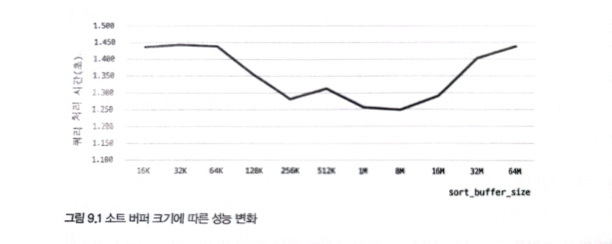

그림 9.1은 소트 버퍼의 크기를 확장해가면서 아래 쿼리의 소요되는 시간을 측정한 것이다.

```sql
SELECT * FROM salaries
ORDER By to_date
LIMIT 2844046, 1;
```

해당 쿼리는 salaries 테이블의 2,844,047건 레코드를 모두 읽어서 정렬하는데, to_date 칼럼에 인덱스가 없기 때문에 쿼리 처리 시에 정렬 작업이 필요한 쿼리다.

`sort_buffer_size` 시스템 변수의 설정값이 무조건 크면 메모리에서 모두 처리되니 빨라질 것으로 예상하지만 실제 결과는 그렇지 않다.

그리고 리눅스 계열의 운영체제에서는 너무 큰 소트 버퍼 사이즈를 사용하는 경우, 큰 메모리 공간 할당 때문에 성능이 훨씬 떨어질 수도 있다.

**해당 예제에서 인덱스가 있는 칼럼으로 정렬해도 여전히 파일 소트로 진행된다.** 

```sql
mysql> SHOW indexes from salaries;
+----------+------------+-----------+--------------+-------------+-----------+-------------+----------+--------+------+------------+---------+---------------+---------+------------+
| Table    | Non_unique | Key_name  | Seq_in_index | Column_name | Collation | Cardinality | Sub_part | Packed | Null | Index_type | Comment | Index_comment | Visible | Expression |
+----------+------------+-----------+--------------+-------------+-----------+-------------+----------+--------+------+------------+---------+---------------+---------+------------+
| salaries |          0 | PRIMARY   |            1 | emp_no      | A         |      297214 |     NULL |   NULL |      | BTREE      |         |               | YES     | NULL       |
| salaries |          0 | PRIMARY   |            2 | from_date   | A         |     2838426 |     NULL |   NULL |      | BTREE      |         |               | YES     | NULL       |
| salaries |          1 | ix_salary |            1 | salary      | A         |       74151 |     NULL |   NULL |      | BTREE      |         |               | YES     | NULL       |
+----------+------------+-----------+--------------+-------------+-----------+-------------+----------+--------+------+------------+---------+---------------+---------+------------+

mysql> EXPLAIN
    -> SELECT * FROM salaries
    -> ORDER By salary
    -> LIMIT 2844046, 1;
+----+-------------+----------+------------+------+---------------+------+---------+------+---------+----------+----------------+
| id | select_type | table    | partitions | type | possible_keys | key  | key_len | ref  | rows    | filtered | Extra          |
+----+-------------+----------+------------+------+---------------+------+---------+------+---------+----------+----------------+
|  1 | SIMPLE      | salaries | NULL       | ALL  | NULL          | NULL | NULL    | NULL | 2838426 |   100.00 | Using filesort |
+----+-------------+----------+------------+------+---------------+------+---------+------+---------+----------+----------------+
```

그 이유는 옵티마이저가 정렬된 세컨더리 인덱스(인덱스 풀 스캔) → 클러스터링 인덱스 가져오는 비용보다 바로 풀 테이블 스캔을 하여 메모리로 데이터 페이지를 가져와서 정렬(파일 소트)하는 방식이 더 빠르다고 판단했기 때문이다.

정렬을 위해 할당되는 **소트 버퍼는 세션 메모라 영역 즉, 여러 클라이언트가 공유해서 사용할 수 있는 영역이 아닌 각 클라이언트 스레드가 사용하는 공간**이다. 결과적으로 커넥션이 많으면 많을수록, 정렬 작업이 많으면 많을수록 소트 버퍼로 소비되는 메모리 공간이 커짐을 의미한다. 

책에서는 소트 버퍼의 크기를 56KB ~ 1MB 사이로 추천한다.

만약 소트 버퍼의 크기를 10MB 이상으로 설정하면 운영체제는 메모리 부족 현상을 겪을 수도 있다.

더는 여유 메모리 공간이 없는 경우 운영체제의 OOM-Killer가 프로세스를 강제로 종료할 것이다.

이때 OOM-Killer는 가장 많이 메모리를 사용하는 프로세스를 강제 종료하기 떄문에 일반적으로 MySQL 서버가 1순위가 된다.

---

## 9.2.3.2 정렬 알고리즘

레코드를 정렬할 때 **레코드 전체를 소트 버퍼에 담을지** 또는 **정렬 기준 칼럼만 소트 버퍼에 담을지**에 따라

**“싱글 패스”와 “투 패스” 2가지 정렬 모드**로 나눌 수 있다.

정렬을 수행하는 쿼리가 어떤 정렬 모드를 사용하는지는 옵티마이저 트레이스 기능으로 확인할 수 있다.

옵티마이저 트레이스 기능 활성화는 책 291쪽을 참고하자.

### MySQL 서버의 정렬 방식 3가지 (sort_mode)

    - **<sort_key, rowid>: 정렬 키와 레코드의 로우 아이디만 가져와서 정렬하는 방식**
    - **<sort_key, additional_fields>: 정렬 키와 레코드 전체를 가져와서 정렬하는 방식, 레코드의 칼럼들은 고정 사이즈로 메모리 저장**
    - **<sort_key, packed_additional_fields>: 정렬 키와 레코드 전체를 가져와서 정렬하는 방식, 레코드의 칼럼들은 가변 사이즈로 메모리 저장**

첫 번째 방식 = “투 패스”, 두 번째와 세 번째 방식 = “싱글 패스”

---

## 9.2.3.2.1 싱글 패스 정렬 방식

소트 버퍼에 정렬 기준 칼럼을 포함해 **SELECT 대상이 되는 칼럼 전부를 담아서 정렬**을 수행하는 방식

```sql
SELECT emp_no, first_name, last_name 
FROM employees
ORDER BY first_name;
```

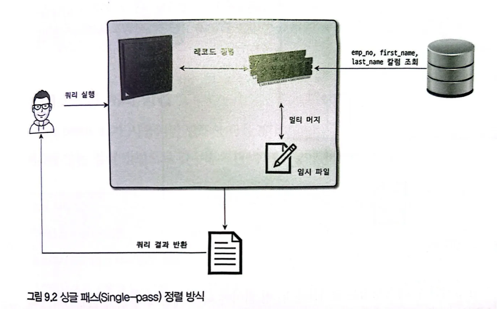

처음 employees 테이블을 읽을 때 정렬에 필요하지 않은 last_name 칼럼까지 전부 읽어서 소트 버퍼에 담고 정렬을 수행한다.

---

## 9.2.3.2.2 투 패스 정렬 방식

**정렬 대상 칼럼과 프라이머리 키 값만 소트 버퍼에 담아서 정렬을 수행**하고, **정렬된 순서대로 다시 프라이머리 키로 테이블을 읽어서 SELECT할 칼럼을 가져오는 정렬 방식**

싱글 패스 적용 이전부터 사용되던 방식. 여전히 MySQL 8.0에서도 특정 조건에는 투 패스 정렬 방식을 사용

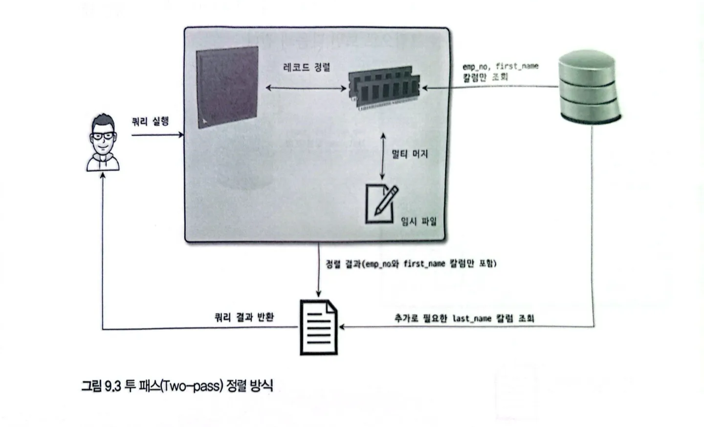

처음 정렬에 필요한 first_name 칼럼과 프라이머리 키인 emp_no만 읽어서 정렬을 수행한다. 

정렬이 완료되면 다시 테이블을 읽어서 last_name을 가져온다.

### 투 패스 VS 싱글 패스

투 패스 방식은 테이블을 두 번 읽어야 하고 싱글 패스는 테이블을 한 번 읽는다.

하지만 싱글 패스 방식은 더 많은 소트 버퍼 공간이 필요하다. 

최신 버전에서는 일반적으로 싱글 패스 정렬 방식을 주로 사용하지만 항상은 아니다.

다음의 경우, 서버는 싱글 정렬 방식을 사용하지 못하고 투 패스 정렬 방식을 사용한다.

    - 레코드의 크기가 `max_length_for_sort_data` 시스템 변수에 설정된 값보다 클 때
    - BLOB이나 TEXT 타입의 칼럼이 SELECT 대상에 포함될 때

싱글 패스 방식은 정렬 대상 레코드의 크기나 건수가 작은 경우에 빠른 성능을 보이며, 투 패스 방식은 정렬 대상 레코드의 크기나 건수가 상당히 많은 경우 효율적이라고 볼 수 있다.

**주의 (필요한 칼럼만 조회하라)**

```
SELECT 쿼리에서는 꼭 필요한 칼럼만 조회하도록 쿼리를 작성하는 것이 좋다고 권장한다.

특히 정렬이 필요한 SELECT는 불필요한 칼럼을 조회하지 않도록 하는 이유가 투 패스, 싱글 패스 차이다.
싱글 패스로 정렬되는 쿼리는 더욱 빠르다.

정렬 버퍼에만 영향을 미치는게 아니라 임시 테이블이 필요한 쿼리에서도 영향을 미친다.
```

---

## 9.2.3.3 정렬 처리 방법

### **드라이빙 테이블?**

```sql
SELECT e.name, d.name
FROM employees e
JOIN departments d ON e.dept_id = d.id
WHERE d.name = 'Engineering';
```

    - 이 경우, `departments` 테이블이 조건을 가지고 있으므로, 보통 옵티마이저는 `departments`를 먼저 읽고(드라이빙 테이블), 해당 부서 ID만 추출한 후 `employees`와 조인하는 방식으로 실행한다.
    - 반대로 `employees`가 드라이빙 테이블이면, 모든 직원 데이터를 읽은 다음 필터링해야 하므로 비효율적

**네스티드 루프 조인**은 드라이빙 테이블을 기준으로 **행마다 다른 테이블을 반복적으로 탐색**하는 방식

### **정렬 처리 방법**

쿼리에 ORDER BY가 적용되면 반드시 아래 3가지 처리 방법 중 하나로 정렬이 처리된다.

일반적으로 아래쪽에 있는 정렬 방법으로 갈수록 처리 속도는 떨어진다.

| **정렬 처리 방법**  | **실행 계획의 Extra 칼럼 내용**  |
| --- | --- |
| 인덱스를 사용한 방법  | 별도 표기 없음 |
| 조인에서 드라이빙 테이블만 정렬  | “Using filesort”  |
| 조인에서 조인 결과를 임시 테이블로 저장 후 정렬  | “Using temporary; Using filesort” |

먼저 옵티바이저는 정렬에 인덱스를 이용할 수 있다면 별도의 “Filesort” 과정 없이 순서대로 읽어서 반환한다.

하지만 인덱스를 사용할 수 없다면 WHERE 조건에 맞는 레코드를 검색해 정렬 버퍼에 저장하면서 정렬을 처리한다. 이때 옵티마이저는 정렬 대상을 최소화하기 위해 2가지 방법 중 하나를 선택한다.

    - **조인의 드라이빙 테이블만 정렬한 다음 조인을 수행**
    - **조인이 끝나고 일치하는 레코드를 모두 가져온 후 정렬을 수행**

일반적으로 조인이 수행되면서 레코드 건수와 레코드의 크기는 배수로 불어나기 때문에 가능하다면 드라이빙 테이블만 정렬한 다음 조인을 수행하는 방법이 효율적이다.

---

## 9.2.3.3.1 인덱스를 이용한 정렬

인덱스를 이용한 정렬을 위해서는 반드시 ORDER BY에 명시된 칼럼이 제일 먼저 읽는 테이블(조인 시 드라이빙 테이블)에 속하고, ORDER BY의 순서대로 생성된 인덱스가 있어야 한다.

또한 WHERE 절에 첫 번째로 읽는 테이블의 칼럼에 대한 조건이 있다면 그 조건과 ORDER BY는 같은 인덱스를 사용할 수 있어야 한다.

B-Tree 계열의 인덱스가 아니라면 사용할 수 없고, 여러 테이블이 조인되는 경우에 네스티드-루프 방식의 조인에서만 이 방식을 사용할 수 있다.

```sql
SELECT *
FROM employees e, salaries s
WHERE s.emp_no = e.emp_no
AND e.emp_no BETWEEN 100002 AND 100020
ORDER BY e.emp_no;
```

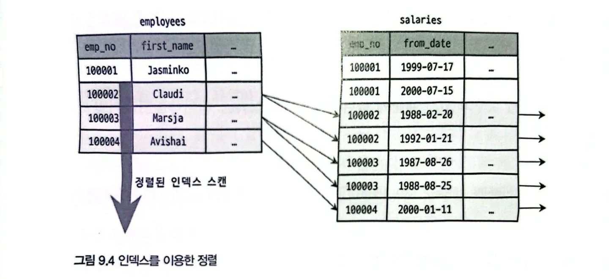

인덱스를 이용해 정렬이 처리되는 경우에는 실제 인덱스의 값이 정렬돼 있기 때문에 인덱스의 순서대로 읽기만 하면된다. 

또한 조인이 네스티드-루프 방식으로 실행되기 때문에 조인 때문에 드라이빙 테이블의 인덱스 읽기 순서가 흐트러지지 않는다.

---

## 9.2.3.3.2 조인의 드라이빙 테이블만 정렬

일반적으로 조인이 수행되면 결과 레코드 건수가 몇 배로 불어나고, 레코드 하나하나의 크기도 늘어난다.

**조인을 수행하기 전에 첫 번째(드라이빙 테이블)의 레코드를 먼저 정렬한 후 조인을 실행**하는 것이 정렬의 차선책이 될 것이다.

이 방법으로 처리되려면 **드라이빙 테이블의 칼럼만으로 ORDER BY 절을 작성**해야 한다.

```sql
SELECT * 
FROM employees e, salaries s
WHERE s.emp_no = e.emp_no
AND e.emp_no BETWEEN 100002 AND 100020
ORDER BY e.last_name;
```

WHERE 절이 다음 2가지 조건을 갖추고 있기 때문에 옵티마이저는 employees 테이블을 **드라이빙 테이블**로 선택할 것이다.

    - “e.emp_no BETWEEN 100002 AND 100020” employees 테이블의 프라이머리 키를 이용해 검색하면 작업량을 줄일 수 있다. (인덱스 레인지 스캔)
    - **드리븐 테이블**(salaries)의 조인 칼럼인 emp_no 칼럼에 인덱스가 있다.

검색은 인덱스 레인지 스캔으로 처리할 수 있지만 ORDER BY 절에 명시된 칼럼은 employees 테이블의 프라이머리 키와 관련이 없으므로 인덱스를 이용한 정렬이 불가능하다.

하지만 ORDER BY 절의 정렬 기준 칼럼이 employees 테이블 즉, 드라이빙 테이블이다.

옵티마이저는 드라이빙 테이블만 검색해서 정렬을 먼저 수행하고, 그 결과를 salaries 테이블을 조인한 것이다.

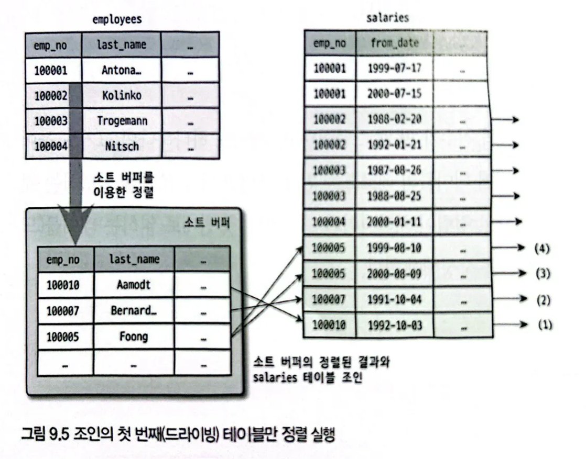

    1. 인덱스(프라이머리 키)를 이용해 인덱스 레인지 스캔
    1. 검색 결과를 last_name 칼럼으로 정렬(Filesort)을 수행
    1. 정렬된 결과를 순서대로 읽으면서 salaries 테이블과 조인을 수행해 최종 결과를 가져온다.

---

## 9.2.3.3.3 임시 테이블을 이용한 정렬

쿼리가 여러 테이블을 조인하지 않고, 하나의 테이블로부터 SELECT해서 정렬하는 경우라면 임시 테이블이 필요하지 않다. 하지만 **2개 이상의 테이블을 조인해서 그 결과를 정렬해야 한다면 임시 테이블이 필요할 수 있다.**

조인의 드라이빙 테이블만 정렬은 2개 이상의 테이블이 조인되면서 정렬이 실행되지만 드라이빙 테이블에만 정렬 기준이 있기 때문에 임시 테이블을 사용하지 않는다.

하지만 그 외 패턴의 쿼리에서는 항상 **조인 결과를 임시 테이블에 저장하고, 그 결과를 다시 정렬하는 과정을 거친다.** 이 방법은 정렬해야 할 레코드 건수가 가장 많기 때문에 가장 느린 정렬 방법이다.

```sql
SELECT * 
FROM employees e, salaries s
WHERE s.emp_no = e.emp_no
AND e.emp_no BETWEEN 100002 AND 100020
ORDER BY s.salary;
```

이 쿼리도 employees 테이블이 드라이빙 테이블로 사용되며, salaries 테이블이 드리븐 테이블로 사용된다.

이 쿼리에서는 정렬 기준이 드라이빙 칼럼이 아니라 드리븐 테이블에 있는 칼럼이다.

즉, 정렬이 수행되기 전에 salaries 테이블을 읽어야 하므로 조인된 데이터를 가지고 정렬할 수 밖에 없다.

**실행 계획 분석하기** 

```sql
+----+-------------+-------+------------+-------+---------------+---------+---------+--------------------+------+----------+----------------------------------------------+
| id | select_type | table | partitions | type  | possible_keys | key     | key_len | ref                | rows | filtered | Extra                                        |
+----+-------------+-------+------------+-------+---------------+---------+---------+--------------------+------+----------+----------------------------------------------+
|  1 | SIMPLE      | e     | NULL       | range | PRIMARY       | PRIMARY | 4       | NULL               |   19 |   100.00 | Using where; Using temporary; Using filesort |
|  1 | SIMPLE      | s     | NULL       | ref   | PRIMARY       | PRIMARY | 4       | employees.e.emp_no |    9 |   100.00 | NULL                                         |
+----+-------------+-------+------------+-------+---------------+---------+---------+--------------------+------+----------+----------------------------------------------+
```

Extra 칼럼을 보면 “Using temporary; Using filesort”라는 코멘트가 표시된다.

이는 조인 결과를 임시 테이블에 저장하고, 그 결과를 다시 정렬 처리했음을 의미한다.

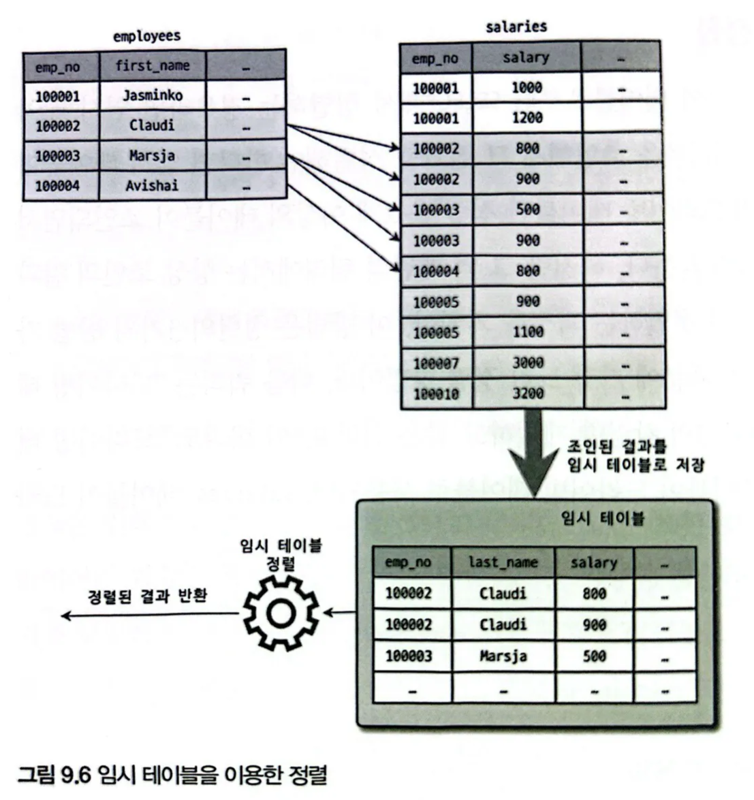

**정렬 처리 방법 3가지 정리** 

    1. 인덱스를 사용해서 처리 가장 빠르다.
    1. 인덱스가 없는 경우 정렬 조건이 드라이빙 테이블에만 있는 경우 드라이빙 테이블을 먼저 파일소트하고 이후에 조인을 진행한다.
    1. 1, 2번 모두 불가능한 경우에는 조인을 먼저 진행하고 정렬 조건으로 정렬해서 반환한다. 가장 느리다.

---

## 9.2.3.3.4 정렬 처리 방법의 성능 비교 

주로 웹 서비스용 쿼리에서는 ORDER BY + LIMIT 조합이 거의 필수로 사용되는 경향이 있다. 

일반적으로 LIMIT은 테이블이나 처리 결과의 일부만 가져오기 때문에 서버가 처리해야 할 작업량을 줄이는 역할을 한다. 하지만 ORDER BY, GROUP BY 같은 작업은 LIMIT 건수만큼만 가져와서는 처리할 수 없다.

**우선 조건을 만족하는 모든 레코드를 가져와서 정렬을 수행하거나 그루핑 작업을 실행해야만 비로소 LIMIT 건수를 제한할 수 있다.**

즉, WHERE 조건이 아무리 인덱스를 잘 활용하도록 튜닝해도 잘못된 ORDER BY나 GROUP BY 때문에 쿼리가 느려지는 경우가 자주 발생한다.

쿼리에서 인덱스를 사용하지 못하는 정렬이나 그루핑 작업이 왜 느리게 작동할 수 밖에 없는지 살펴보자.

이를 위해 쿼리가 처리되는 방법을 **“스트리밍 처리”**, **“버퍼링 처리”** 2가지 방식으로 구분해 보자.

---

## 9.2.3.3.4.1 스트리밍 방식


서버 쪽에서 처리할 데이터가 얼마인지에 관계없이 조건에 일치하는 레코드가 검색될때마다 바로바로 클라이언트에게 전달해주는 방식을 스트리밍 방식이라고 한다.

이 방식으로 처리할 경우 클라이언트는 쿼리를 요청하고 곧바로 첫 번째 레코드를 전달받는다.

가장 마지막 레코드는 언제 받을지 알 수 없지만, 이는 중요하지 않다.

그림 9.7처럼 쿼리가 스트리밍 방식으로 처리될 수 있다면 클라이언트는 MySQL 서버가 일치하는 레코드를 찾는 즉시 전달받기 때문에 동시에 데이터의 가공 작업을 시작할 수 있다.

스트리밍 방식으로 처리되는 쿼리는 조회하는 레코드 수와 관계없이 빠른 응답 시간을 보장해준다. 

또한 스트리밍 처리 방식의 쿼리에서 LIMIT 처럼 결과 건수를 제한하는 조건들은 쿼리의 전체 실행 시간을 상당히 줄여 줄 수 있다.

매우 큰 테이블을 아무런 조건 없이 SELECT만 해보면 첫 번째 레코드는 아주 빨리 가져온다는 사실을 알 수 있다.

물론 서버에서 아직 쿼리가 실행되고 있는 도중이라도 말이다.

풀 테이블 스캔의 결과는 아무런 버퍼링 처리나 필터링 과정 없이 바로 클라이언트로 스트리밍되기 때문이다.

이때 LIMIT 조건을 추가하면 마지막 레코드를 가져오기까지의 시간을 상당히 줄일 수 있다.

---

## 9.2.3.3.4.2 버퍼링 방식

ORDER BY, GROUP BY 같은 처리는 쿼리의 결과가 스트리밍되는 것을 불가능하게 한다.

우선 WHERE 조건에 일치하는 모든 레코드를 가져온 후, 정렬하거나 그루핑해서 차례대로 보내야 하기 때문이다.

MySQL 서버에서 이런 작업을 하는 동안 클라이언트는 아무것도 하지 않고 기다려야 하기 때문에 응답 속도가 느려진다. 그렇기 때문에 이 방식을 스트리밍의 반대 표현인 버퍼링이라고 표현한다.

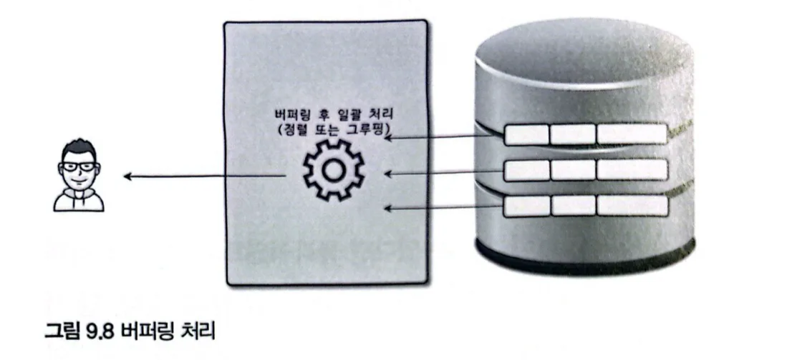

그림 9.8처럼 버퍼링 방식으로 처리되는 쿼리는 먼저 결과를 모아서 MySQL 엔진에서 일괄 가공해야 하므로 모든 결과를 스토리지 엔진으로부터 가져올 때까지 기다려야 한다.

그래서 버퍼링 방식으로 처리되는 쿼리는 LIMIT처럼 결과 건수를 제한하는 조건이 있어도 성능 향상에 별로 도움이 되지 않는다.

**참고** 

```sql
스트리밍 처리는 클라이언트 도구나 API에 따라 그 방식의 차이가 존재한다.
JDBC 라이브러리의 기본 동작 방식은 MySQL 서버가 스트리밍 처리를 한다고 해도
내부 버퍼에 모두 담아서 모든 결과를 전달받으면 그때서야 비로소 반환한다.
즉, MySQL 서버는 스트리밍 방식으로 처리하지만 클라이언트인 JDBC 라이브러리가 버퍼링하는 것이다.
```

지금까지 설명한 정렬 처리 방법에서 인덱스를 사용한 정렬 방식만 스트리밍 방식이고 나머지는 모두 버퍼링된 후에 응답된다. 즉, 인덱스를 사용한 방식만 LIMIT 적용에 큰 성능 변화가 있다.

### 조인과 함께 ORDER BY 절, LIMIT 절 자세히

```sql
SELECT * 
FROM tb_test1 t1, tb_test2 t2 
WHERE t1.col1 = t2.col1
ORDER BY 생략
LIMIT 10;
```

    - tb_test1 테이블 레코드 100건
    - tb_test2 테이블 레코드 1,000건(tb_test1 레코드 1건이 tb_test2 레코드가 10건씩 존재)
    - 두 테이블의 조인 결과는 전체 1000건

**tb_test1 드라이빙 테이블**

| 정렬 방법 | 읽어야 할 건수 | 조인 횟수 | 정렬해야 할 대상 건수  |
| --- | --- | --- | --- |
| 인덱스 사용  | tb_test1: 1건<br>tb_test2: 10건  | 1번  | 0건  |
| 조인의 드라이빙 테이블만 정렬  | tb_test1: 100건<br>tb_test2: 10건  | 1번  | 100건 (tb_test1) |
| 임시 테이블 사용 후 정렬  | tb_test1: 100건<br>tb_test2: 1000건  | 100건  | 1,000건  |

**tb_test2 드라이빙 테이블**

| 정렬 방법 | 읽어야 할 건수 | 조인 횟수 | 정렬해야 할 대상 건수 |
| --- | --- | --- | --- |
| 인덱스 사용 | tb_test1: 10건<br>tb_test2: 10건  | 10번  | 0건  |
| 조인의 드라이빙 테이블만 정렬 | tb_test1: 10건<br>tb_test2: 1000건 | 10번 | 1000건 (tb_test2) |
| 임시 테이블 사용 후 정렬 | tb_test1: 100건<br>tb_test2: 1000건 | 1,000건 | 1,000건 |

어느 테이블이 먼저 드라이빙되어 조인하는지도 중요하지만 어떤 정렬 방식으로 처리되는지는 더 큰 성능차이를 만든다.

가능하다면 인덱스를 사용한 정렬로 유도하고, 그렇지 못하다면 최소한 드라이빙 테이블만 정렬해도 되는 수준으로 유도하는 것도 좋은 튜닝 방법이라고 할 수 있다.

**참고** 

```
인덱스를 사용하지 못하고 별도의 file sort 작업이 필요한 경우 쿼리에서 LIMIT 조건이 
아무런 도움이 되지 못하는 것은 아니다. 

정렬할 대상 레코드 1,000건에 LIMIT 10이라는 조건이 있으면 서버는 필요한 순서대로 정렬해서
상위 10건만 정렬이 채워지면 정렬을 멈추고 결과를 반환한다.

하지만 MySQL 서버는 퀵 소트 또는 힙 소트 알고리즘을 사용한다.
이는 상위 10건을 정렬하기 위해 더 많은 작업이 필요할 수도 있음을 의미한다.

결론적으로, 인덱스를 사용하지 못하는 쿼리를 페이징 처리에 사용하는 경우 LIMIT 5~10건만 조회한다고
하더라도 쿼리가 기대만큼 아주 빨라지지는 않는다.
```

---

## 9.2.3.4 정렬 관련 상태 변수 

책 페이지 304~305 참고하자 

---

# 9.2.4 GROUP BY 처리 

GROUP BY 또한 ORDER BY 같이 쿼리가 스트리밍된 처리를 할 수 없다. **즉, 버퍼링 방식이다.**

GROUP BY 절에는 HAVING 절을 GROUP BY 결과에 대한 필터링 조건으로 사용할 수 있다.

**하지만 HAVING 절은 인덱스를 사용해서 처리할 수 없다.**

GROUP BY 도 인덱스를 사용하는 경우와 못한 그렇지 못한 경우로 나눠 볼 수 있다.

인덱스를 이용할 때는 인덱스 레인지 스캔과 인덱스 루스 스캔을 사용한다.

인덱스를 사용하지 못하는 쿼리는 임시 테이블을 사용한다.

---

## 9.2.4.1 인덱스 스캔을 이용하는 GROUP BY (타이트 인덱스 스캔)

조인의 드라이빙 테이블에 속한 칼럼만 이용해 그루핑할 때 GROUP BY 칼럼으로 인덱스가 이미 있다면 그 인덱스를 차례대로 읽으면서 그루핑 작업을 수행하고 그 결과로 조인을 처리한다.

GROUP BY가 인덱스를 사용해서 처리된다고 하더라도 **그룹 함수(Aggregation function)** 등의 그룹값을 처리해야 해서 임시 테이블이 필요할 때도 있다.

GROUP BY가 인덱스를 통해서 처리되는 경우 실행 계획에서는 Extra 칼럼에 별도로 GROUP BY 관련 코멘트

(”Using index for group-by”)나 임시 테이블 사용 또는 정렬 관련 코멘트(”Using temporary, Using filesort”)가 표시되지 않는다.

---

## 9.2.4.2 루스 인덱스 스캔을 이용하는 GROUP BY

옵티마이저가 루스 인덱스 스캔을 사용할 때는 실행 계획의 Extra 칼럼에 (”Using index for group-by”) 코멘트가 표시된다.

```sql
SHOW INDEXES FROM salaries;
+----------+------------+-----------+--------------+-------------+-----------+-------------+----------+--------+------+------------+---------+---------------+---------+------------+
| Table    | Non_unique | Key_name  | Seq_in_index | Column_name | Collation | Cardinality | Sub_part | Packed | Null | Index_type | Comment | Index_comment | Visible | Expression |
+----------+------------+-----------+--------------+-------------+-----------+-------------+----------+--------+------+------------+---------+---------------+---------+------------+
| salaries |          0 | PRIMARY   |            1 | emp_no      | A         |      297214 |     NULL |   NULL |      | BTREE      |         |               | YES     | NULL       |
| salaries |          0 | PRIMARY   |            2 | from_date   | A         |     2838426 |     NULL |   NULL |      | BTREE      |         |               | YES     | NULL       |
| salaries |          1 | ix_salary |            1 | salary      | A         |       74151 |     NULL |   NULL |      | BTREE      |         |               | YES     | NULL       |
+----------+------------+-----------+--------------+-------------+-----------+-------------+----------+--------+------+------------+---------+---------------+---------+------------+

EXPLAIN
SELECT emp_no
FROM salaries
WHERE from_date='1985-03-01'
GROUP BY emp_no;
+----+-------------+----------+------------+-------+-------------------+---------+---------+------+--------+----------+---------------------------------------+
| id | select_type | table    | partitions | type  | possible_keys     | key     | key_len | ref  | rows   | filtered | Extra                                 |
+----+-------------+----------+------------+-------+-------------------+---------+---------+------+--------+----------+---------------------------------------+
|  1 | SIMPLE      | salaries | NULL       | range | PRIMARY,ix_salary | PRIMARY | 7       | NULL | 297215 |   100.00 | Using where; Using index for group-by |
+----+-------------+----------+------------+-------+-------------------+---------+---------+------+--------+----------+---------------------------------------+
```

인덱스가 (emp_no, from_date)로 생성돼 있으므로 해당 해당 쿼리에서는 WHERE 조건은 인덱스 레인지 스캔 접근 방식으로 불가능하다.

하지만 실행 계획을 보면 인덱스 레인지 스캔(range 타입)을 이용했으며, Extra 칼럼을 보면 GROUP BY 처리까지 인덱스를 사용했다는 것을 알 수 있다.

**MySQL 서버의 쿼리 처리 방식**

```
SELECT emp_no
FROM salaries
WHERE from_date='1985-03-01'
GROUP BY emp_no;

1. (emp_no, from_date)인덱스를 차례대로 스캔하면서 emp_no 첫번째 유일한 값(그룹 키)를 찾아낸다.
ex: emp_no = '10001'

2. (emp_no, from_date)인덱스에서 emp_no = '10001' 인 것 중에서 from_date 값이 
'1985-03-01'인 레코드만 가져온다.
마치 "emp_no=10001 AND from_date='1985-03-01'" 조건으로 인덱스를 검색하는 것과 흡사하다.

3. (emp_no, from_date)인덱스에서 emp_no 그 다음 유니크한(그룹 키)값을 가져온다.

4. 3번 단계에서 결과가 더 없으면 종료하고, 결과가 있으면 2번 과정으로 돌아가서 반복한다.
```

MySQL **루스 인덱스 스캔 방식은 단일 테이블 대상으로 수행되는 GROUP BY 처리에만 사용**할 수 있으며,

별도의 임시 테이블이 필요하지 않는다. 또한 프리픽스 인덱스는 루스 인덱스 스캔을 사용할 수 없다.

인덱스 레인지 스캔에서는 유니크 한 값의 개수가 많을수록 성능이 향상되는 반면 루스 인덱스 스캔에서는 유니크한 인덱스 값의 수가 적을수록 성능이 향샹된다. **즉, 분포도가 좋지 않은 인덱스일수록 더 빠른 결과를 만들어낸다.**

루스 인덱스 스캔 사용 여부 판단은 매우 어렵다.

책 페이지 307, 308에서 예제 쿼리를 보고 연습하자.

(col1, col2, col3) 아래 쿼리는 루스 인덱스 스캔을 사용할 수 없는 쿼리 패턴이다.

```sql
// MIN(), MAX() 이외의 집합 함수가 사용됐기 때문에 루스 인덱스 스캔은 사용 불가
SELECT col1, SUM(col2) FROM tb_test GROUP BY col1;

// GROUP BY에 사용된 칼럼이 인덱스 구성 칼럼의 왼쪽부터 일치하지 않기 때문에 사용 불가
SELECT col1, col2 FROM tb_test GROUP BY col2, col3;

// SELECT 절의 사용된 칼럼이 GROUP BY와 일치하지 않기 때문에 사용 불가
// SQL 에러 
SELECT col1, col3 FROM tb_test GROUP BY col1, col2;
```

---

## 9.2.4.3 임시 테이블을 사용하는 GROUP BY 

인덱스를 전혀 사용하지 못할 때 이 방식으로 처리된다.

```sql
EXPLAIN
SELECT e.last_name, AVG(s.salary)
FROM employees e, salaries s
WHERE s.emp_no=e.emp_no
GROUP BY e.last_name; 

+----+-------------+-------+------------+------+---------------+---------+---------+--------------------+--------+----------+-----------------+
| id | select_type | table | partitions | type | possible_keys | key     | key_len | ref                | rows   | filtered | Extra           |
+----+-------------+-------+------------+------+---------------+---------+---------+--------------------+--------+----------+-----------------+
|  1 | SIMPLE      | e     | NULL       | ALL  | PRIMARY       | NULL    | NULL    | NULL               | 300584 |   100.00 | Using temporary |
|  1 | SIMPLE      | s     | NULL       | ref  | PRIMARY       | PRIMARY | 4       | employees.e.emp_no |      9 |   100.00 | NULL            |
+----+-------------+-------+------------+------+---------------+---------+---------+--------------------+--------+----------+-----------------+
```

이 쿼리의 실행 계획에서 Extra 칼럼에 “Using temporary” 메시지가 표시됐다.

임시 테이블이 사용된 것은 인덱스를 전혀 사용할 수 없는 GROUP BY이기 때문이다.

MySQL 8.0 이전 버전까지는 GROUP BY가 사용된 쿼리는 그루핑되는 칼럼을 기준으로 묵시적인 정렬까지 함께 수행했다. 하지만 **MySQL 8.0 버전부터는 묵시적인 정렬은 더 이상 실행되지 않게 바뀌었다.**

즉, “Using filesort” 메시지는 표시되지 않는다.

```
그래서 MySQL 8.0 이전 버전에서 GROUP BY에 정렬이 필요하지 않다면 약간의 성능 향상을 위해서
ORDER BY NULL을 사용하였다.
```

하지만 **MySQL 8.0에서도 GROUP BY가 ORDER BY가 같이 사용되면 명시적으로 정렬 작업을 실행한다**.

```sql

EXPLAIN
SELECT e.last_name, AVG(s.salary)
FROM employees e, salaries s
WHERE s.emp_no=e.emp_no
GROUP BY e.last_name 
ORDER BY e.last_name;

+----+-------------+-------+------------+------+---------------+---------+---------+--------------------+--------+----------+---------------------------------+
| id | select_type | table | partitions | type | possible_keys | key     | key_len | ref                | rows   | filtered | Extra                           |
+----+-------------+-------+------------+------+---------------+---------+---------+--------------------+--------+----------+---------------------------------+
|  1 | SIMPLE      | e     | NULL       | ALL  | PRIMARY       | NULL    | NULL    | NULL               | 300584 |   100.00 | Using temporary; Using filesort |
|  1 | SIMPLE      | s     | NULL       | ref  | PRIMARY       | PRIMARY | 4       | employees.e.emp_no |      9 |   100.00 | NULL                            |
+----+-------------+-------+------------+------+---------------+---------+---------+--------------------+--------+----------+---------------------------------+
```

**“Using temporary” + “Using filesort”**

MySQL 8.0 에서는 GROUP BY가 필요한 경우 내부적으로 GROUP BY 칼럼들로 구성된 유니크 인덱스를 임시 테이블을 만들어 중복 제거와 집합 함수 연산을 수행한다.

즉, 다음과 같은 임시 테이블을 생성한다.

```sql
EXPLAIN
SELECT e.last_name, AVG(s.salary)
FROM employees e, salaries s
WHERE s.emp_no=e.emp_no
GROUP BY e.last_name; 

CREATE TEMPORARY TABLE ... (
	last_name VARCHAR(16),
	salary INT,
  UNIQUE INDEX ux_lastname (last_name)
);
```

그리고 조인의 결과를 한 건씩 가져와 임시 테이블에 중복 체크를 하면서 INSERT 또는 UPDATE를 실행한다.

---

# 9.2.5 DISTINCT 처리

특정 칼럼의 유니크한 값만 조회하려면 SELECT + DISTINCT를 사용한다.

DISTINCT는 MIN, MAX, COUNT 같은 집합 함수와 함께 사용되는 경우와 아닌 경우로 2가지로 구분한다.

미치는 영향 범위가 달라지기 때문이다.

**집합 함수와 같이 DISTINCT가 사용되는 쿼리에서 인덱스를 사용하지 못할 때는 항상 임시 테이블이 필요**하다.

하지만 실행 계획의 Extra 칼럼에는 “Using temporary” 메시지가 표시되지 않는다.

---

## 9.2.5.1 SELECT DISTINCT …

집함 함수 없이 단순히 유니크한 레코드만 가져오도록 DISTINCT를 사용하면 GROUP BY와 동일하게 동작한다.

```sql
SELECT DISTINCT emp_no FROM salaries;
SELECT emp_no FROM salaries GROUP BY emp_no;
```

2개의 쿼리는 내부적으로 같은 작업을 수행한다.

### **많은 사람들의 DISTINCT 실수 포인트**

DISTINCT는 SELECT 하는 레코드(튜플)을 유니크하게 조회하는 것이지, 특정 칼럼만 유니크하게 조회하는 기능이 아니다.

```sql
SELECT DISTINCT first_name, last_name FROM employees;
```

즉, 해당 쿼리에서는 (first_name, last_name) 조합 전체가 유니크한 레코드를 가져오는 것이다.

```sql
SELECT DISTINCT (first_name), last_name FROM employees;
```

해당 쿼리는 얼핏 보면 first_name만 유니크하게 조회하고 last_name은 DISTINCT가 없을 때와 동일하게 조회하는 쿼리처럼 보인다. 또한 아무런 에러 없이 실행된다.

하지만 서버는 DISTINCT 뒤의 괄호를 아무 의미 없이 사용된 괄호로 해석하고 제거해 버린다.

DISTINCT는 함수가 아니기 때문에 뒤의 괄호는 의미가 없는 것이다.

---

## 9.2.5.2 집합 합수와 함께 사용된 DISTINCT

COUNT(), MIN(), MAX() 같은 집합함수가 DISTINCT 키워드와 함께 사용될 수 있다.

집합 함수가 없는 조회에서 DISTINCT는 모든 칼럼의 조합이 유니크한 것들만 가져온다.

하지만 **집합 함수 내에서 사용된 DISTINCT는 그 집합 함수의 인자가 전달된 칼럼값이 유니크한 것들을 가져온다**.

```sql
EXPLAIN SELECT COUNT(DISTINCT s.salary)
FROM employees e, salaries s
WHERE e.emp_no=s.emp_no AND 
e.emp_no BETWEEN 100001 AND 100100;

+----+-------------+-------+------------+-------+---------------+---------+---------+--------------------+------+----------+--------------------------+
| id | select_type | table | partitions | type  | possible_keys | key     | key_len | ref                | rows | filtered | Extra                    |
+----+-------------+-------+------------+-------+---------------+---------+---------+--------------------+------+----------+--------------------------+
|  1 | SIMPLE      | e     | NULL       | range | PRIMARY       | PRIMARY | 4       | NULL               |  100 |   100.00 | Using where; Using index |
|  1 | SIMPLE      | s     | NULL       | ref   | PRIMARY       | PRIMARY | 4       | employees.e.emp_no |    9 |   100.00 | NULL                     |
+----+-------------+-------+------------+-------+---------------+---------+---------+--------------------+------+----------+--------------------------+
```

이 쿼리는 내부적으로는 “COUNT(DISTINCT s.salary)”를 처리하기 위해서 임시 테이블을 사용한다.

하지만 실행 계획에서는 임시 테이블을 사용한다는 메시지인 “Using temporary”를 표시하지 않고 있다.

```sql
CREATE TABLE 임시테이블 (
	 salary INT,
	 UNIQUE INDEX ux_salary (salary)
);
```

이 임시 테이블의 salary 칼럼에는 유니크 인덱스가 생성되기 때문에 레코드 건수가 많아지면 상당히 느려질 수 있는 형태의 쿼리이다.

```sql
EXPLAIN 
SELECT COUNT(DISTINCT s.salary),
			 COUNT(DISTINCT e.last_name)
FROM employees e, salaries s
WHERE e.emp_no=s.emp_no AND 
e.emp_no BETWEEN 100001 AND 100100;

+----+-------------+-------+------------+-------+---------------+---------+---------+--------------------+------+----------+-------------+
| id | select_type | table | partitions | type  | possible_keys | key     | key_len | ref                | rows | filtered | Extra       |
+----+-------------+-------+------------+-------+---------------+---------+---------+--------------------+------+----------+-------------+
|  1 | SIMPLE      | e     | NULL       | range | PRIMARY       | PRIMARY | 4       | NULL               |  100 |   100.00 | Using where |
|  1 | SIMPLE      | s     | NULL       | ref   | PRIMARY       | PRIMARY | 4       | employees.e.emp_no |    9 |   100.00 | NULL        |
+----+-------------+-------+------------+-------+---------------+---------+---------+--------------------+------+----------+-------------+
```

해당 쿼리는 s.salary 칼럼의 값과, e.last_name 칼럼의 값을 저장하는 임시 테이블 2개가 필요하다.

```sql
EXPLAIN SELECT COUNT(DISTINCT emp_no) FROM employees;
+----+-------------+-----------+------------+-------+------------------------------------------------------+-------------+---------+------+--------+----------+-------------+
| id | select_type | table     | partitions | type  | possible_keys                                        | key         | key_len | ref  | rows   | filtered | Extra       |
+----+-------------+-----------+------------+-------+------------------------------------------------------+-------------+---------+------+--------+----------+-------------+
|  1 | SIMPLE      | employees | NULL       | index | PRIMARY,ix_hiredate,ix_gender_birthdate,ix_firstname | ix_hiredate | 3       | NULL | 300584 |   100.00 | Using index |
+----+-------------+-----------+------------+-------+------------------------------------------------------+-------------+---------+------+--------+----------+-------------+

EXPLAIN SELECT COUNT(DISTINCT emp_no) FROM dept_emp GROUP BY dept_no;
+----+-------------+----------+------------+-------+---------------------------------------+---------+---------+------+--------+----------+-------------+
| id | select_type | table    | partitions | type  | possible_keys                         | key     | key_len | ref  | rows   | filtered | Extra       |
+----+-------------+----------+------------+-------+---------------------------------------+---------+---------+------+--------+----------+-------------+
|  1 | SIMPLE      | dept_emp | NULL       | index | PRIMARY,ix_fromdate,ix_empno_fromdate | PRIMARY | 20      | NULL | 331143 |   100.00 | Using index |
+----+-------------+----------+------------+-------+---------------------------------------+---------+---------+------+--------+----------+-------------+

```

해당 쿼리들은 인덱스된 칼럼에 대해 DISTINCT 처리를 수행하기 때문에 별도의 임시 테이블없이 수행할 수 있다.

❌❌❌ **나의 테스트** ❌❌❌

```sql
SHOW STATUS LIKE 'Created_tmp_tables';

COUNT(DISTINCT ...)
```

**모든 쿼리가 임시 테이블을 사용한다. 즉, 잘못된 설명이다.**

**인덱스를 탄다고해도 임시 테이블이 생성된다.**

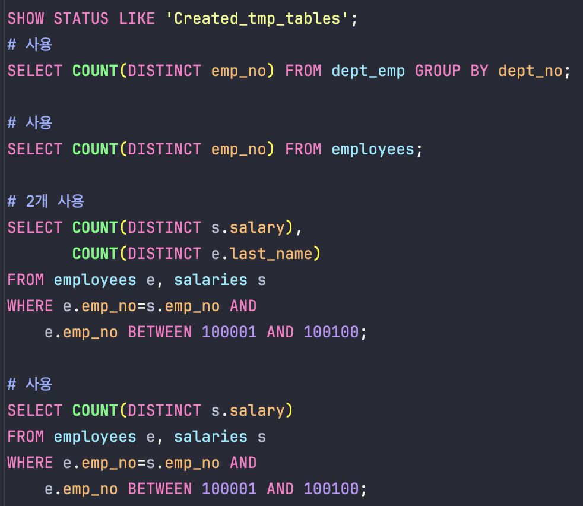

---

# 9.2.6 내부 임시 테이블 활용

MySQL 엔진이 스토리지 엔진으로부터 받아온 레코드를 정렬하거나 그루핑할 때는 내부적인 임시 테이블을 사용한다. 일반적으로 임시 테이블은 처음에는 메모리에 생성됐다가 테이블의 크기가 커지면 디스크로 옮겨진다.

특정 예외 케이스의 경우 메모리를 거치지 않고 바로 디스크에 임시 테이블이 만들어지기도 한다.

MySQL 엔진이 내부적인 가공을 위해 생성하는 임시 테이블은 다른 세션이나 다른 쿼리에서는 볼 수 없으며 사용도 불가능하다.

사용자가 생성한 임시 테이블(CREATE TEMPORARY TABLE)과 다르게 내부적인 임시 테이블은 쿼리의 처리가 완료되면 자동으로 삭제된다.

---

## 9.2.6.1 메모리 임시 테이블과 디스크 임시 테이블

원본 스토리지 엔진과 상관없이 MySQL 8.0 버전부터는 **메모리는 TempTable 이라는 스토리지 엔진**을 사용하고, **디스크에 저장되는 임시 테이블은 InnoDB 스토리지 엔진**을 사용하도록 개선됐다.

기존 MEMORY 스토리지 엔진은 VARCHAR 같은 가변 길이 타입을 지원하지 못하기 때문에 임시 테이블이 메모리에 만들어지면 최대 길이만큼 메모리를 할당해서 사용했다. 이는 메모리 낭비가 심해지는 문제점이 있다.

또한 디스크에 임시 테이블이 만들어질 때 사용되는 MyISAM 스토리지 엔진은 트랜잭션을 지원하지 않는다. 

그래서 가변 길이 타입을 지원하는 TempTable 스토리지 엔진을 메모리에서 사용하고, InnoDB 스토리지 엔진이 디스크에서 사용되도록 개선된 것이다.

MySQL 8.0 버전부터는 `internal_tem_mem_storage_engine`  시스템 변수를 이용해 메모리용 임시 테이블을 MEMORY, TempTable 중에서 선택할 수 있게 하고 있는데, default 설정은 TempTable 이다.

또한 TempTable이 최대 사용 가능한 메모리는 `temptable_max_ram` 시스템 변수로 제어할 수 있고, default 1GB이다. 

그렇다면 임시 테이블이 `temptable_max_ram` 크기 보다 커지는 경우는 어떻게할까?

2가지 디스크 저장 방식이 존재한다.

    - MMAP 파일로 디스크에 기록
    - InnoDB 테이블로 기록

더 자세한 내용은 책 314 ~ 315 참고 

---

## 9.2.6.2 임시 테이블이 필요한 쿼리

    1. ORDER BY와 GROUP BY 명시된 칼럼이 다른 쿼리
    1. ORDER BY와 GROUP BY 명시된 칼럼이 조인의 순서상 드라이빙 테이블이 아닌 쿼리
    1. DISTINCT, ORDER BY가 동시에 쿼리에 존재하는 경우 또는 DISTINCT가 인덱스로 처리되지 못하는 쿼리
- 집합 함수 + DISTINCT
    1. UNION, UNION DISTINCT가 사용된 쿼리(select_type이 UNION RESULT인 경우)
- 8.0 버전에서 UNION ALL → 임시 테이블 사용하지 않는다.
      - UNION == UNION DISTINCT → UNION은 그냥 DISTINCT 생략한 것으로 판단
    1. 쿼리의 실행 계획에서 select_type이 DERIVED인 쿼리

어떤 쿼리의 실행 계획에서 임시 테이블을 사용하는지는 `Extra` 칼럼에 `“Using temporary”` 메세지가 표시되는지 확인하면 된다. 하지만 `“Using temporary”` 가 표시되지 않을 때도 임시 테이블을 사용할 수 있다.

    - 3, 4, 5

첫 번째 부터 네 번째까지의 쿼리 패턴은 유니크 인덱스를 가지는 내부 임시 테이블이 만들어지고, 마지막 쿼리 패턴은 유니크 인덱스가 없는 내부 임시 테이블이 생성된다.

일반적으로 **유니크 인덱스가 있는 내부 임시 테이블은 그렇지 않은 쿼리보다 처리 성능이 상당히 느리다.**

더 자세한 내용은 책 페이지 316 참고

---

## 9.2.6.3 임시 테이블이 디스크에 생성되는 경우 

내부 임시 테이블은 기본적으로는 메모리상에 만들어지지만 다음 조건을 만족하면 디스크 기반의 임시 테이블을 사용한다.

    - UNION, UNION ALL에서 SELECT 칼럼 중에서 길이가 512바이트 이상인 크기의 칼럼이 있는 경우
    - GROUP BY 또는 DISTINCT 칼럼에서 512바이트 이상인 크기의 칼럼이 있는 경우
    - 메모리 임시 테이블 크기가 임시 테이블 최대 크기 시스템 변수 설정 값보다 큰 경우

---

## 9.2.6.4 임시 테이블 관련 상태 변수

임시 테이블 사용 여부를 확인하려면 `Extra` 칼럼을 `“Using temporary”` 확인하면 된다.

하지만 사용된 임시 테이블의 개수와 메모리에서 처리됐는지 디스크에서 처리됐는지 알 수 없으며, 내부 임시 테이블 같은 경우  `“Using temporary”` 메시지도 표시되지 않는다.

임시 테이블이 디스크에 생성됐는지 메모리에 생성됐는지 확인하려면 아래 쿼리를 사용하자.

```sql
# 현재 세션의 상태 값을 초기화 
FLUSH STATUS;

SELECT first_name, last_name
FROM employees
GROUP BY first_name, last_name;

# 상태 조회 
SHOW SESSION STATUS LIKE 'Created_tmp%';

+-------------------------+-------+
| Variable_name           | Value |
+-------------------------+-------+
| Created_tmp_disk_tables | 1     |
| Created_tmp_files       | 0     |
| Created_tmp_tables      | 1     |
+-------------------------+-------+
3 rows in set (0.00 sec)
```

`Created_tmp_tables` : 쿼리의 처리를 위해 만들어진 내부 임시 테이블의 개수를 누적하는 상태 값이다. 

이 값은 임시 테이블이 메모리에 만들어졌는지 디스크에 만들어졌는지 구분하지 않고 누적한다.

`Created_tmp_disk_tables` : 디스크에 내부 임시 테이블이 만들어진 개수만 누적해서 가지고 있는 상태 값

### 그런데 왜 해당 쿼리에서 임시 테이블이 필요할까?

```sql
EXPLAIN SELECT first_name, last_name
FROM employees
GROUP BY first_name, last_name;

+----+-------------+-----------+------------+------+---------------+------+---------+------+--------+----------+-----------------+
| id | select_type | table     | partitions | type | possible_keys | key  | key_len | ref  | rows   | filtered | Extra           |
+----+-------------+-----------+------------+------+---------------+------+---------+------+--------+----------+-----------------+
|  1 | SIMPLE      | employees | NULL       | ALL  | NULL          | NULL | NULL    | NULL | 300584 |   100.00 | Using temporary |
+----+-------------+-----------+------------+------+---------------+------+---------+------+--------+----------+-----------------+
1 row in set, 1 warning (0.00 sec)
```

ALL → 테이블 풀 스캔 

Extra → Using temporary

**테이블 풀 스캔 이유** 

first_name만 세컨더리 인덱스가 존재한다. last_name 칼럼은 클러스터 인덱스(레코드)에 존재

데이터가 많아서 세컨더리 인덱스 → 클러스터 인덱스 접근 비용보다 테이블 풀 스캔이 더 빠르다고 옵티마이저가 판단하였기 때문

**그렇다면 임시 테이블은 왜 필요할까?**

테이블 풀 스캔을 한다는 의미는 모든 데이터 페이지를 처음부터 끝까지 읽는다는 의미

즉, first_name 상관없이 전체를 읽는다.

읽어온 전체 테이블을 그루핑하기 위해서 임시 테이블을 디스크에 생성하고 그루핑한다.

**그럼 이때 생성되는 임시 테이블은 유니크 인덱스를 가지는가? (first_name, last_nam)으로?**

yes 

---

---

MySQL 서버의 옵티마이저는 **통계 정보 + 옵티마이저 옵션**을 결합해서 최적의 계획을 수립하게 된다.

옵티마이저 옵션은 **조인 관련된 옵션**과 **옵티마이저 스위치**로 구분할 수 있다.

---

# 9.3.1 옵티마이저 스위치 옵션

옵티마이저 스위치 옵션은 `optimizer_switch`  시스템 변수를 통해서 제어한다.

보통 `optimizer_switch` 시스템 변수에는 여러 개의 옵션을 세트로 묶어서 설정하는 방식으로 사용한다.

여러가지 스위치 옵션은 p318 ~ p319를 확인하자.

**옵션 상태 3가지** 

각각의 스위치 옵션은 “default”, “on”, “off” 3가지 중에서 하나를 설정할 수 있는데 “default” 옵션은 기본값을 의미하며 “on” 또는 “off”이다.

**스위치 옵션 적용 방법 3가지**

```sql
// MySQL 서버 전체적으로 옵티마이저 스위치 설정
SET GLOBAL optimizer_switch='~~~~';

// 현재 커넥션(세션)의 옵티마이저 스위치만 설정
SET SESSION optimizer_switch='~~~~';

// 옵티마이저 힌트를 통한 현재 쿼리에만 옵티마이저 스위치 설정
SELECT /*+ SET_VAR(optimizer_switch='~~~~') */
...
FROM ...
```

---

## 9.3.1.1 MRR과 배치 키 엑세스(mrr & batched_key_access)

**MySQL 서버에서 지금까지 지원하던 조인 방식**

```
드라이빙 테이블(조인에서 제일 먼저 읽는 테이블)의 레코드를 한 건 읽어서 
드리븐 테이블(조인되는 테이블)의 일치하는 레코드를 찾아서 수행
이를 네스티드 루프 조인(Nested Loop Join)이라고 부른다.

MySQL 서버에서 조인 처리는 MySQL 엔진이 처리, 레코드를 검색하고 읽는 부분은
스토리지 엔진이 담당한다. 

이때 드라이빙 테이블의 레코드 건별로 드라이븐 테이블의 레코드를 찾으면 레코드를 찾고 
읽는 스토리지 엔진에서는 아무런 최적화를 수행할 수가 없다.
```

**조인 버퍼 버퍼링** 

이런 단점을 보완하기 위해 MySQL 서버는 조인 대상 테이블 중 하나로부터 레코드를 읽어 조인 버퍼에 버퍼링한다. 즉, **드라이빙 테이블의 레코드를 읽어서 드리븐 테이블과의 조인을 즉시 실행하지 않고 조인 대상을 버퍼링**하는 것이다. **조인 버퍼에 레코드가 가득 차면 버퍼링 된 레코드를 스토리지 엔진에 한 번에 요청**한다.

→ 반복적인 랜덤 엑세스를 줄이고, I/O 효율을 높일 수 있다.

→ 물론 데이터 페이지가 메모리(InnoDB 버퍼 풀)에 있다고 하더라도 버퍼 풀의 접근을 최소화할 수 있다.

**MMR & BKA**

이러한 읽기 방식을 **MRR(Multi-Range Read)**이라고 하며, MRR을 응용해서 실행되는 조인 방식을 **BKA(Batched Key Access)** 조인이라고 한다.

BKA 조인은 기본적으로 비활성화돼 있다. BKA 조인을 사용할 때 추가적인 정렬 작업이 필요하고, 이로 인해 오히려 성능이 나빠질 수 있는 상황이 있기 때문이다.

MMR 및 BKA는 조인 칼럼에 인덱스가 존재하지 않으면 사용을 안한다. → **네스티드 루프 조인 최적화 기법**
BKA 성능이 MRR 보다 나빠지는 경우는 조인 칼럼에 대한 인덱스 키 없이 바로 조회하는 비용보다 인덱스 키를 모아서 정렬하고 조회하는 비용이 더 큰 경우에 발생한다.

---

## 9.3.1.2 블록 네스티드 루프 조인(block_nested_loop)

MySQL 서버에서 사용되는 대부분의 조인은 **네스티드 루프 조인(Nested Loop Join)**인데, 조인의 연결 조건이 되는 칼럼에 모두 인덱스가 있는 경우 사용되는 조인 방식이다.

```sql
EXPLAIN 
SELECT *
FROM employees e
INNER JOIN salaries s ON s.emp_no=e.emp_no
AND s.from_date <= NOW() 
AND s.to_date >= NOW()
WHERE e.first_name='Amor';

+----+-------------+-------+------------+------+----------------------+--------------+---------+--------------------+------+----------+-------------+
| id | select_type | table | partitions | type | possible_keys        | key          | key_len | ref                | rows | filtered | Extra       |
+----+-------------+-------+------------+------+----------------------+--------------+---------+--------------------+------+----------+-------------+
|  1 | SIMPLE      | e     | NULL       | ref  | PRIMARY,ix_firstname | ix_firstname | 58      | const              |    1 |   100.00 | NULL        |
|  1 | SIMPLE      | s     | NULL       | ref  | PRIMARY              | PRIMARY      | 4       | employees.e.emp_no |    9 |    11.11 | Using where |
+----+-------------+-------+------------+------+----------------------+--------------+---------+--------------------+------+----------+-------------+
```

예시 쿼리 같은 형태의 조인을 마치 중첩된 반복 명령을 사용하는 것처럼 작동한다고 해서 네스티드 루프 조인이라고 한다. 

```java
for(row1 IN employees){
	 for(row2 IN salaries){
		 if(condition_matched) return (row1, row2);
	 }
}
```

네스티드 루프 조인과 **블록 네스티드 루프 조인(Block Nested Loop Join)**의 가장 큰 차이는 **조인 버퍼**가 사용되는지 여부와 조인에서 드라이빙 테이블과 드리븐 테이블이 어떤 순서로 조인되느냐다.

조인 알고리즘에서 “Block” 단어가 사용되면 조인용으로 별도의 버퍼가 사용됐다는 것을 의미하고, 조인 쿼리의 실행 계획에서 Extra 칼럼에 “Using Join Buffer” 문구가 표시되면 그 실행 계획은 조인 버퍼를 사용한다는 것을 의미한다.

조인은 드라이빙 테이블에서 일치하는 레코드의 건수만큼 드리븐 테이블을 검색하면서 처리된다.

즉 드라이빙 테이블은 한 번에 쭉 읽지만, 드리븐 테이블은 여러 번 읽는다는 것을 의미한다.

예를 들어, 드라이빙 테이블에서 일치하는 레코드가 1,000건이라면 드리븐 테이블의 조인 조건이 인덱스를 이용할 수 없었다면 드리븐 테이블에 1,000번의 풀 테이블 스캔을 해야 한다.

**그래서 옵티마이저는 최대한 드리븐 테이블의 검색이 인덱스를 사용할 수 있게 실행 계획을 수립한다.**

만약 어떤 방식으로도 드리븐 테이블의 풀 테이블 스캔이나 인덱스 풀 스캔을 피할 수 없다면 옵티마이저는 드라이빙 테이블에서 읽은 레코드를 메모리에 캐시한 후 드리븐 테이블과 이 메모리 캐시를 조인하는 형태로 처리한다.

이때 사용되는 메모리의 캐시를 **조인 버퍼(Join Buffer)**라고 한다. 

조인 버퍼는 `join_buffer_size`  시스템 변수로 크기를 제한할 수 있으며, 조인이 끝나면 바로 해제된다.

### 일반 네스티드 루프 조인 VS 네스티드 루프 조인 최적화(MRR, BKA) VS 블록 네스티드 루프 조인

```
# 일반 네스티드 루프 조인

일반 네스티드 루프 조인은 조인 버퍼 없이, 드라이빙 테이블의 레코드를 한 건씩 읽고 바로 
드리븐 테이블을 조회해 결과를 내보낸다.

# 네스티드 루프 조인 최적화 기법(MMR, BKA)

드라이빙 테이블의 모든 레코드를 메모리 캐시 즉, 조인 버퍼에 저장하고 조인을 진행
일반 네스티드 루프 조인은 매번 레코드 마다 읽기 작업이 발생하지만 (버퍼 풀 또는 디스크)
최적화 기법인 MMR, BKA는 한 번에 드리븐 테이블 조회가 가능하다. 
조인 칼럼의 연결 조건이 모두 인덱스가 있어야 사용된다.

# 블록 네스티드 루프

드리븐 테이블을 검색할 때 어떤 방식으로도 드리븐 테이블의 테이블 풀 스캔 또는 인덱스 풀 스캔을
피할 수 없다면 네스티드 루프 조인 최적화 기법처럼 조인 버퍼에 드라이빙 테이블 레코드를 모두 캐시하고
조인을 수행한다.

MMR, BKA 와 차이점은 드리븐 테이블의 조회 방식의 차이다.

인덱스 조인(MRR, BKA 등)
→ 드라이빙 테이블의 키를 모아 한 번에 인덱스 레인지 스캔
→ 드리븐 테이블 접근이 1회(혹은 소수회)로 끝남
→ 대량 랜덤 I/O가 순차 I/O로 바뀌어 성능이 매우 좋아짐

블록 네스티드 루프 조인(인덱스 없음)
→ 드라이빙 테이블 레코드 수만큼 드리븐 테이블 풀스캔 반복
→ 예: 드라이빙 테이블 1,000건 → 드리븐 테이블 1,000번 전체 스캔
→ I/O 비용이 기하급수적으로 증가
```

```sql
SELECT *
FROM dept_emp de, employees e
WHERE de.from_date > '1995-01-01' AND e.emp_no < 109004;
```

해당 쿼리는 각 테이블에 대한 조건은 존재하지만, 두 테이블 간의 연결 고리 역할을 하는 조인 조건은 없다.

그래서 카테시안 조인을 수행한다. 조인 버퍼를 이용해 블록 네스티드 루프 조인을 Extra 칼럼을 통해서 알 수 있다. “Using join buffer (block nested loop)”

아래 그림을 보면 조인 버퍼가 어떻게 사용되는지 보여준다.

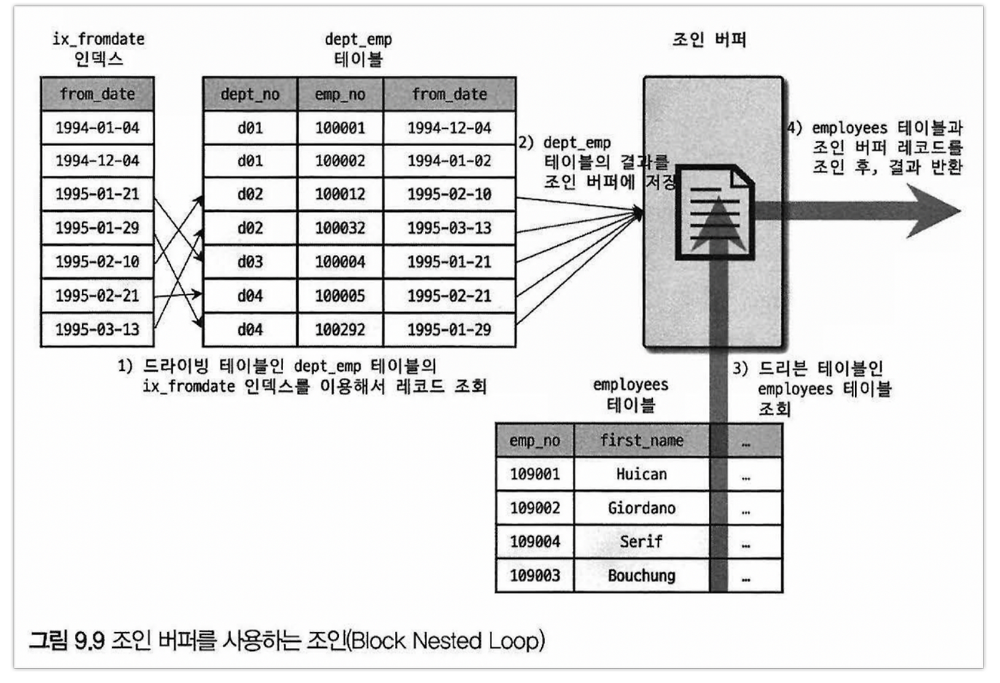

**주의점** 

조인 버퍼를 사용하는 조인에서는 결과 정렬 순서가 보장되지 않을 수 있으므로,반드시 정렬이 필요하다면 ORDER BY 절을 명시적으로 사용해야 한다.

**MySQL 8.0.18 해시 조인 도입**

```sql
EXPLAIN
SELECT *
FROM dept_emp de, employees e
WHERE de.from_date > '1995-01-01' AND e.emp_no < 109004;

+----+-------------+-------+------------+-------+---------------+---------+---------+------+--------+----------+--------------------------------------------+
| id | select_type | table | partitions | type  | possible_keys | key     | key_len | ref  | rows   | filtered | Extra                                      |
+----+-------------+-------+------------+-------+---------------+---------+---------+------+--------+----------+--------------------------------------------+
|  1 | SIMPLE      | e     | NULL       | range | PRIMARY       | PRIMARY | 4       | NULL | 149960 |   100.00 | Using where                                |
|  1 | SIMPLE      | de    | NULL       | ALL   | ix_fromdate   | NULL    | NULL    | NULL | 331143 |    50.00 | Using where; Using join buffer (hash join) |
+----+-------------+-------+------------+-------+---------------+---------+---------+------+--------+----------+--------------------------------------------+
```

MySQL 8.0.20 버전부터는 **블록 네스티드 루프 조인은 더이상 사용되지 않고 해시 조인 알고리즘이 대체**되어 사용된다.

---

## 9.3.1.3 인덱스 컨디션 푸시다운(index_condition_pushdown)

**테스트 설정**

```sql
ALTER TABLE employees ADD INDEX ix_lastname_firstname (last_name, first_name);

SET optimizer_switch='index_condition_pushdown=off';

SHOW VARIABLES LIKE 'optimizer_switch';
+------------------+-----------------------------------------------------------------------------------------------------------------------------------------------------------------------------------------------------------------------------------------------------------------------------------------------------------------------------------------------------------------------------------------------------------------------------------------------------------------------------------------------------------------------------------------------------------------------------------------------------+
| Variable_name    | Value                                                                                                                                                                                                                                                                                                                                                                                                                                                                                                                                                                                               |
+------------------+-----------------------------------------------------------------------------------------------------------------------------------------------------------------------------------------------------------------------------------------------------------------------------------------------------------------------------------------------------------------------------------------------------------------------------------------------------------------------------------------------------------------------------------------------------------------------------------------------------+
| optimizer_switch | index_merge=on,index_merge_union=on,index_merge_sort_union=on,index_merge_intersection=on,engine_condition_pushdown=off,index_condition_pushdown=on,mrr=on,mrr_cost_based=on,block_nested_loop=on,batched_key_access=off,materialization=on,semijoin=on,loosescan=on,firstmatch=on,duplicateweedout=on,subquery_materialization_cost_based=on,use_index_extensions=on,condition_fanout_filter=on,derived_merge=on,use_invisible_indexes=off,skip_scan=on,hash_join=on,subquery_to_derived=off,prefer_ordering_index=on,hypergraph_optimizer=off,derived_condition_pushdown=on,hash_set_operations=on |
+------------------+-----------------------------------------------------------------------------------------------------------------------------------------------------------------------------------------------------------------------------------------------------------------------------------------------------------------------------------------------------------------------------------------------------------------------------------------------------------------------------------------------------------------------------------------------------------------------------------------------------+
```

```sql
EXPLAIN
SELECT * FROM employees
WHERE last_name='Acton' AND first_name LIKE '%sal';

+----+-------------+-----------+------------+------+-----------------------+-----------------------+---------+-------+------+----------+-------------+
| id | select_type | table     | partitions | type | possible_keys         | key                   | key_len | ref   | rows | filtered | Extra       |
+----+-------------+-----------+------------+------+-----------------------+-----------------------+---------+-------+------+----------+-------------+
|  1 | SIMPLE      | employees | NULL       | ref  | ix_lastname_firstname | ix_lastname_firstname | 66      | const |  189 |    11.11 | Using where |
+----+-------------+-----------+------------+------+-----------------------+-----------------------+---------+-------+------+----------+-------------+
```

해당 쿼리는 (last_name, first_name) 인덱스를 last_name은 **인덱스 레인지 스캔**으로 사용할 수 있다.

하지만 first_name LIKE ‘%sal’ 조건은 테이블 데이터를 모두 읽은 후 사용자가 원하는 결과인지 **하나씩 비교해보는 조건(체크 조건 또는 필터링 조건)**으로만 사용된다.

실행 계획의 Extra 칼럼을 보면 “Using Where”가 표시된 것을 확인할 수 있다.

**“Using Where”는 인덱스를 사용할 수 없는 WHERE 조건에 일치하는지 검사하는 과정을 의미한다.** 

first_name LIKE ‘%sal’ 이 검사 과정에 사용된 조건이다.

즉, WHERE 조건 검사를 위해 테이블 읽기를 한다.

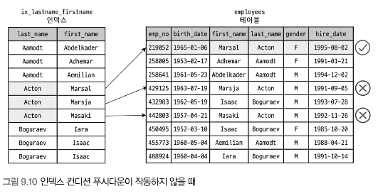

그림 9.10은 last_name=’Acton’ 조건으로 인덱스 레인지 스캔 이후 테이블의 레코드를 읽은 후, first_name LIKE ‘%sal’ 조건에 부합하는지 여부를 비교하는 과정이다.

만약 last_name=’Acton’ 조건에 일치하는 레코드가 10만 건이나 되는데, 단 1건만 모든 조건에 부합한다면 

이 경우에는 99,999건의 레코드 읽기가 불필요한 작업이 되어버린다.

그런데 왜 ix_lastname_firstname 세컨더리 인덱스에 존재하는 first_name에서 검사하지 않고 테이블의 first_name 칼럼을 이용했을까?

**first_name LIKE ‘%sal’ 조건을 누가 처리하느냐에 따라 인덱스에 포함된 first_name 칼럼을 이용할지 또는 테이블의 first_name 칼럼을 이용할지가 결정된다.**

그림 9.1에서 인덱스를 비교하는 작업은 InnoDB 스토리지 엔진이 수행하지만 테이블의 레코드에서 first_name 조건을 비교하는 작업은 MySQL 엔진이 수행하는 작업이다.

그런데 **MySQL 5.5 버전까지는 인덱스를 범위 제한 조건으로 사용하지 못하는 first_name 조건은 MySQL 엔진이 스토리지 엔진으로 아예 전달해주지 않았다.** 

그래서 스토리지 엔진에서는 불필요한 2건의 테이블 읽기를 수행할 수밖에 없었던 것이다.

MySQL 5.6 버전부터는 이렇게 인덱스를 범위 제한 조건으로 사용하지 못한다고 하더라도 인덱스에 포함된 칼럼의 조건이 있다면 모두 같이 모아서 스토리지 엔진으로 전달할 수 있게 핸들러 API가 개선됐다. 

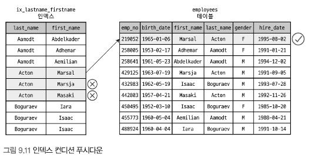

그래서 MySQL 5.6 버전부터는 그림 9.11과 같이 인덱스를 이용해 최대한 필터링까지 완료해서 꼭 필요한 레코드 1건에 대해서만 테이블 읽기를 수행할 수 있게 됐다.

```sql
SET optimizer_switch='index_condition_pushdown=on';

EXPLAIN
SELECT * FROM employees
WHERE last_name='Acton' AND first_name LIKE '%sal';

+----+-------------+-----------+------------+------+-----------------------+-----------------------+---------+-------+------+----------+-----------------------+
| id | select_type | table     | partitions | type | possible_keys         | key                   | key_len | ref   | rows | filtered | Extra                 |
+----+-------------+-----------+------------+------+-----------------------+-----------------------+---------+-------+------+----------+-----------------------+
|  1 | SIMPLE      | employees | NULL       | ref  | ix_lastname_firstname | ix_lastname_firstname | 66      | const |  189 |    11.11 | Using index condition |
+----+-------------+-----------+------------+------+-----------------------+-----------------------+---------+-------+------+----------+-----------------------+

```

이제 “Using Where”가 없어지고 “Using index condition”이 출력되는 것을 확인할 수 있다.

| **MySQL 버전** | **인덱스 범위 제한 불가 조건(예: LIKE '%sal') 처리 방식** | **스토리지 엔진에 WHERE 조건 전달** | **Extra 칼럼 표시** | **비고** |
| --- | --- | --- | --- | --- |
| 5.5 이하 | 인덱스 범위 제한 조건만 스토리지 엔진에 전달 | X (전달 안 됨) | Using where | 스토리지 엔진이 불필요한 테이블 읽기 수행 |
| 5.6 이상 | 인덱스 범위 제한 조건 + 인덱스 칼럼 조건 모두 전달 | O (전달됨) | Using index condition | 스토리지 엔진이 조건까지 검사 |

---

## 9.3.1.4 인덱스 확장(use_index_extensions)

`use_index_extensions` 옵티마이저 옵션은 InnoDB 스토리지 엔진을 사용하는 테이블에서 
세컨더리 인덱스에 자동으로 추가된 프라이머리 키를 활용할 수 있게 할지를 결정하는 옵션이다.

InnoDB 스토리지 엔진은 프라이머리 키를 클러스터링 키로 생성한다. 그래서 모든 세컨더리 인덱스는 리프 노드에 프라이머리 키 값을 가진다.

```sql
CREATE TABLE dept_emp (
    emp_no INT NOT NULL,
    dept_no CHAR(4) NOT NULL,
    from_date DATE NOT NULL,
    to_date DATE NOT NULL,
    PRIMARY KEY (dept_no, emp_no),
    KEY ix_fromdate (from_date)
) ENGINE=InnoDB;
```

프라이머리 키: (dept_no, emp_no), 세컨더리 인덱스: (from_date)

세컨더리 인덱스는 데이터 레코드를 찾아가기 위해 프라이머리 키인 dept_no, emp_no 칼럼을 순서대로(프라이머리 키에 명시된 순서) 포함한다.

최종적으로 ix_fromdate 인덱스는 (from_date, dept_no, emp_no) 조합으로 인덱스를 생성한 것과 흡사하게 작동할 수 있게 된다.

예전 MySQL 버전에서는 자동으로 추가되는 프라이머리 키를 제대로 활용하지 못했다.

하지만 업그레이드되면서 **옵티마이저는 세컨더리 인덱스에 프라이머리 키 칼럼이 숨어있다는 것을 인지하고 실행 계획을 수립**하도록 개선했다.

```sql
EXPLAIN SELECT COUNT(*)
FROM dept_emp
WHERE from_date='1987-07-25' AND dept_no='d001';

+----+-------------+----------+------------+------+---------------------------------------+-------------+---------+-------------+------+----------+-------------+
| id | select_type | table    | partitions | type | possible_keys                         | key         | key_len | ref         | rows | filtered | Extra       |
+----+-------------+----------+------------+------+---------------------------------------+-------------+---------+-------------+------+----------+-------------+
|  1 | SIMPLE      | dept_emp | NULL       | ref  | PRIMARY,ix_fromdate,ix_empno_fromdate | ix_fromdate | 19      | const,const |    6 |   100.00 | Using index |
+----+-------------+----------+------------+------+---------------------------------------+-------------+---------+-------------+------+----------+-------------+
```

실행 계획의 key_len 칼럼은 이 쿼리가 인덱스를 구성하는 칼럼 중에서 어느 부분까지 사용했는지를 바이트 수로 보여주는데, 19바이트로 표시된 것을 보면 from_date(3바이트) + dept_no(16바이트)까지 사용했다는 것을 알 수 있다.

```sql
EXPLAIN SELECT COUNT(*)
FROM dept_emp
WHERE from_date='1987-07-25t';
+----+-------------+----------+------------+------+-------------------------------+-------------+---------+-------+------+----------+-------------+
| id | select_type | table    | partitions | type | possible_keys                 | key         | key_len | ref   | rows | filtered | Extra       |
+----+-------------+----------+------------+------+-------------------------------+-------------+---------+-------+------+----------+-------------+
|  1 | SIMPLE      | dept_emp | NULL       | ref  | ix_fromdate,ix_empno_fromdate | ix_fromdate | 3       | const |   64 |   100.00 | Using index |
+----+-------------+----------+------------+------+-------------------------------+-------------+---------+-------+------+----------+-------------+
```

dept_no 칼럼을 사용하지 않았더니, from_date 칼럼을 위한 3바이트만 표시된 것을 확인할 수 있다.

InnoDB 프라이머리 키가 세컨더리 인덱스에 포함돼 있으므로 다음과 같은 정렬 작업도 인덱스를 활용해서 처리되는 장점도 있다. 

```sql
EXPLAIN SELECT *
FROM dept_emp
WHERE from_date='1987-07-25'
ORDER BY dept_no;
+----+-------------+----------+------------+------+---------------+-------------+---------+-------+------+----------+-------+
| id | select_type | table    | partitions | type | possible_keys | key         | key_len | ref   | rows | filtered | Extra |
+----+-------------+----------+------------+------+---------------+-------------+---------+-------+------+----------+-------+
|  1 | SIMPLE      | dept_emp | NULL       | ref  | ix_fromdate   | ix_fromdate | 3       | const |   64 |   100.00 | NULL  |
+----+-------------+----------+------------+------+---------------+-------------+---------+-------+------+----------+-------+
```

실행 계획을 보면 “Using Filesort”가 표시되지 않았다는 것은 별도의 정렬 작업 없이 인덱스 순서대로 레코드를 읽기만 함으로써 “ORDER BY dept_no”를 만족했다는 것을 의미한다.

---

## 9.3.1.5 인덱스 머지(index_merge)

인덱스를 이용해 쿼리를 실행하는 경우 대부분 옵티마이저는 테이블별로 하나의 인덱스만 사용하도록 실행 계획을 수립한다. 하지만 **인덱스 머지 실행 계획을 사용하면 하나의 테이블에 대해 2개 이상의 인덱스를 이용**해 쿼리를 처리한다. 

쿼리에서 한 테이블에 대한 WHERE 조건이 여러 개 있더라도 하나의 인덱스에 포함된 칼럼에 대한 조건만으로 인덱스를 검색하고 나머지 조건은 읽어온 레코드에 대해서 체크하는 형태로만 사용되는 것이 일반적이다.

하나의 인덱스만 사용해서 작업 범위를 충분히 줄일 수 있는 경우라면 테이블별로 하나의 인덱스만 활용하는 것이 효율적이다. 하지만 **각각의 조건이 서로 다른 인덱스를 사용할 수 있고, 그 조건을 만족하는 레코드 건수가 많은 것으로 예상될 때 MySQL 서버는 인덱스 머지 실행 계획을 선택**한다.

인덱스 머지 실행 계획은 병합 방식에 따라 3가지로 구분된다.

    - **index_merge_intersection**
    - **index_merge_soft_union**
    - **index_merge_union**

---

## 9.3.1.6 인덱스 머지 - 교집합(index_merge_intersection)

```sql
EXPLAIN SELECT *
FROM employees
WHERE first_name='Georgi' AND emp_no BETWEEN 10000 AND 20000;
+----+-------------+-----------+------------+-------------+----------------------+----------------------+---------+------+------+----------+----------------------------------------------------+
| id | select_type | table     | partitions | type        | possible_keys        | key                  | key_len | ref  | rows | filtered | Extra                                              |
+----+-------------+-----------+------------+-------------+----------------------+----------------------+---------+------+------+----------+----------------------------------------------------+
|  1 | SIMPLE      | employees | NULL       | index_merge | PRIMARY,ix_firstname | ix_firstname,PRIMARY | 62,4    | NULL |    1 |   100.00 | Using intersect(ix_firstname,PRIMARY); Using where |
+----+-------------+-----------+------------+-------------+----------------------+----------------------+---------+------+------+----------+----------------------------------------------------+
```

employees 테이블의 first_name 칼럼과 emp_no 칼럼은 모두 각각의 인덱스(ix_firstname, PRIMARY)를 가지고 있다. 그에 따라 옵티마이저는 ix_firstname, PRIMARY 키를 모두 사용해서 쿼리를 처리하기로 결정한다.

실행 계획의 Extra 칼럼에 “Using intersect”라고 표시된 것은 이 쿼리가 여러 개의 인덱스를 각각 검색해서 그 결과의 교집합만 반환했다는 것을 의미한다.

만약 두 칼럼의 조건 중 하나라도 충분히 효율적으로 쿼리를 처리할 수 있었다면 2개의 인덱스를 모두 사용하는 실행 계획을 사용하지 않았을 것이다.

즉, 옵티마이저는 각각의 조건에 일치하는 레코드 건수를 예측해 본 결과, 두 조건 모두 상대적으로 많은 레코드를 가져와야 한다는 것을 알게 된 것이다.

**각 조건 레코드 카운트 확인** 

```sql
SELECT COUNT(*)
FROM employees
WHERE first_name='Georgi'; 
+----------+
| COUNT(*) |
+----------+
|      253 |
+----------+

SELECT COUNT(*)
FROM employees
WHERE emp_no BETWEEN 10000 AND 20000;
+----------+
| COUNT(*) |
+----------+
|    10000 |
+----------+
```

 

**인덱스 머지 실행 계획이 없었다면?**

```
1번 
first_name='Georgi' 조건만 인덱스를 사용했다면 레코드 253건을 검색한 다음 
데이터 페이지에서 레코드를 찾고 emp_no 칼럼의 조건에 일치하는 레코드들만 반환하는 형태로 처리돼야 한다.

2번
emp_no BETWEEN 10000 AND 20000 조건만 인덱스를 사용했다면 프라이머리 키를 이용해 10,000건을 
읽어와서 first_name='Georgi' 조건에 일치하는 레코드만 반환하는 형태로 처리돼야 한다.
```

**하지만 1번 2번 모두 괜찮은 방식 같은데 왜 두 인덱스의 교집합만 가져오는 실행 계획을 세웠을까?**

```sql
SELECT COUNT(*)
FROM employees
WHERE first_name='Georgi' AND emp_no BETWEEN 10000 AND 20000;

+----------+
| COUNT(*) |
+----------+
|       14 |
+----------+
```

만약 1번 방식을 사용했다면 253번의 데이터 페이지 읽기를 하지만 실제 그중에서 겨우 14번만 의미 있는 작업이고 2번 방식의 경우 10,000건을 읽어서 9,986건은 버리고 겨우 14건만 반환하는 작업이 됐을 것이다.

두 작업 모두 비효율이 매우 큰 상황이어서 옵티마이저는 각 인덱스를 검색해 두 결과의 교집합만 찾아서 반환한 것이다.

**인덱스 확장 측면**

그런데 ix_firstname 세컨더리 인덱스는 리프 노드에 프라이머리 키인 emp_no 칼럼을 자동으로 포함하고 있기 때문에 그냥 ix_firstname 인덱스만 사용하는 것이 더 성능이 좋은 것으로 생각할 수 있다.

그렇다면  `index_merge_intersection` 최적화를 서버 레벨, 세션 레벨, 쿼리 레벨로 비활성화하면 된다.

```sql
EXPLAIN
SELECT /*+ SET_VAR(optimizer_switch='index_merge_intersection=off') */ *
FROM employees
WHERE first_name='Georgi' AND emp_no BETWEEN 10000 AND 20000;
+----+-------------+-----------+------------+-------+----------------------+--------------+---------+------+------+----------+-----------------------+
| id | select_type | table     | partitions | type  | possible_keys        | key          | key_len | ref  | rows | filtered | Extra                 |
+----+-------------+-----------+------------+-------+----------------------+--------------+---------+------+------+----------+-----------------------+
|  1 | SIMPLE      | employees | NULL       | range | PRIMARY,ix_firstname | ix_firstname | 62      | NULL |   14 |   100.00 | Using index condition |
+----+-------------+-----------+------------+-------+----------------------+--------------+---------+------+------+----------+-----------------------+
```

---

## 9.3.1.7 인덱스 머지 - 합집합(index_merge_union)

인덱스 머지의 **“Using union”은 WHERE 절에 사용된 2개 이상의 조건이 각각의 인덱스를 사용하되 OR 연산자로 연결된 경우에 사용**되는 최적화다.

```sql
EXPLAIN SELECT *
FROM employees
WHERE first_name='Matt' OR hire_date='1987-03-31';

+----+-------------+-----------+------------+-------------+--------------------------+--------------------------+---------+------+------+----------+----------------------------------------------------+
| id | select_type | table     | partitions | type        | possible_keys            | key                      | key_len | ref  | rows | filtered | Extra                                              |
+----+-------------+-----------+------------+-------------+--------------------------+--------------------------+---------+------+------+----------+----------------------------------------------------+
|  1 | SIMPLE      | employees | NULL       | index_merge | ix_hiredate,ix_firstname | ix_firstname,ix_hiredate | 58,3    | NULL |  344 |   100.00 | Using union(ix_firstname,ix_hiredate); Using where |
+----+-------------+-----------+------------+-------------+--------------------------+--------------------------+---------+------+------+----------+----------------------------------------------------+
```

employees 테이블에는 first_name 칼럼에 해당하는 인덱스와 hire_date 칼럼에 해당하는 인덱스가 각각 존재한다. 또한 각 조건 OR 연산자로 연결되었기 때문에 “Using union” 즉, 인덱스 머지 최적화를 사용한다.

Extra 칼럼을 보면 “Using union(ix_firstname,ix_hiredate)” 메시지가 보인다.

그런데 두 조건을 모두 만족하는 사원이 있었다면 사원의 정보가 두 번 출력이 되었어야 하는데 그렇지 않다. 

즉, MySQL 서버가 두 결과 집합의 중복 레코드를 제거했다는 것인데, 두 결과 집합에서 중복을 제거하기 위한 정렬 작업이 필요했을 것이다. 하지만 실행 계획에는 정렬했다는 표시는 없다.

MySQL 서버는 이 같은 중복 제거를 위해 내부적으로 어떤 작업을 수행

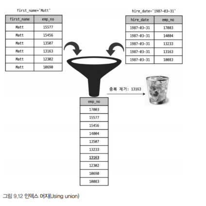

그림 9.12는 인덱스 머지 최적화의 Union 알고리즘의 작동 방식이다.

사원 번호(emp_no)가 “13163”인 사원은 first_name 검색 결과와 hire_date 검색 결과에서 모두 포함돼 있어서 반드시 하나를 제거해야 한다. 

MySQL 서버는 first_name 조건을 검색한 결과와 hire_date 조건을 검색한 결과가 프라이머리 키로 정렬돼 있다는 것을 알고 있다.

```sql
SELECT *
FROM employees
WHERE first_name='Matt';

+--------+------------+------------+-----------------+--------+------------+
| emp_no | birth_date | first_name | last_name       | gender | hire_date  |
+--------+------------+------------+-----------------+--------+------------+
|  10690 | 1962-09-06 | Matt       | Jumpertz        | F      | 1989-08-22 |
|  12302 | 1962-02-14 | Matt       | Plessier        | M      | 1987-01-28 |
|  13163 | 1963-12-11 | Matt       | Heping          | F      | 1987-03-31 |
|  13507 | 1959-09-05 | Matt       | Wallrath        | M      | 1985-06-28 |
|  15456 | 1957-09-27 | Matt       | Granlund        | M      | 1987-08-17 |
|  15577 | 1961-02-15 | Matt       | Menhardt        | M      | 1985-10-26 |
|  15696 | 1959-05-06 | Matt       | Zhang           | F      | 1987-08-21 |
|  16572 | 1956-11-26 | Matt       | Aamodt          | M      | 1987-06-16 |
|  17791 | 1952-09-22 | Matt       | Stifter         | F      | 1988-01-30 |
|  18258 | 1964-02-28 | Matt       | Hiroyama        | M      | 1986-04-03 |
|  19127 | 1963-11-30 | Matt       | Munawer         | M      | 1987-07-12 |
|  20351 | 1962-07-03 | Matt       | Vanwelkenhuysen | M      | 1994-04-12 |
|  20730 | 1959-02-08 | Matt       | Yemenis         | F      | 1990-06-11 |
|  21667 | 1963-10-28 | Matt       | Maquelin        | F      | 1995-08-23 |

// 생략 ....

SELECT *
FROM employees
WHERE hire_date='1987-03-31';

// 생략 ... 
```

그래서 MySQL **서버는 두 집합에서 하나씩 가져와서 서로 프라이머리 키를 기준으로 비교하면서 값이 중복된 레코드들을 별도의 정렬 없이 걸러낼 수 있다.**

---

## 9.3.1.8 인덱스 머지 - 정렬 후 합집합(index_merge_sort_union)

인덱스 머지 작업을 하는 도중에 결과의 정렬이 필요한 경우 MySQL 서버는 인덱스 머지 최적화의 “Sort union” 알고리즘을 사용한다.

```sql
EXPLAIN
SELECT * FROM employees
WHERE (first_name='Matt') OR (hire_date BETWEEN '1987-03-01' AND '1987-03-31');
+----+-------------+-----------+------------+-------------+--------------------------+--------------------------+---------+------+------+----------+---------------------------------------------------------+
| id | select_type | table     | partitions | type        | possible_keys            | key                      | key_len | ref  | rows | filtered | Extra                                                   |
+----+-------------+-----------+------------+-------------+--------------------------+--------------------------+---------+------+------+----------+---------------------------------------------------------+
|  1 | SIMPLE      | employees | NULL       | index_merge | ix_hiredate,ix_firstname | ix_firstname,ix_hiredate | 58,3    | NULL | 3197 |   100.00 | Using sort_union(ix_firstname,ix_hiredate); Using where |
+----+-------------+-----------+------------+-------------+--------------------------+--------------------------+---------+------+------+----------+---------------------------------------------------------+
```

2개의 쿼리로 분리해서 생각해 보자.

```sql
SELECT * FROM employees WHERE first_name='Matt';
SELECT * FROM employees WHERE hire_date BETWEEN '1987-03-01' AND '1987-03-31'
```

첫 번째 쿼리는 프라이머리 키(emp_no)를 기준으로 결과가 정렬되어 출력된다.

두 번째 쿼리는 hire_date를 기준으로 결과가 정렬되어 출력된다.

즉, 위 예제의 결과에서는 중복을 제거하기 위해 우선순위 큐를 사용하는 것이 불가능하다.

그래서 MySQL 서버는 두 집합의 결과에서 중복을 제거하기 위해 각 집합을 emp_no 칼럼으로 정렬한 다음 중복 제거를 수행한다.

인덱스 머지 최적화에서 중복 제거를 위해 강제로 정렬을 수행해야 하는 경우에는 실행 계획의 Extra 칼럼에 “Using sort_union” 문구가 표시된다.

---

## 9.3.1.9 세미 조인(semijoin)

다른 테이블과 실제 조인을 수행하지 않고, 단지 다른 테이블과 조건에 일치하는 레코드가 있는지 없는지만 

체크하는 형태의 쿼리를 **세미 조인(Semi-Join)**이라고 한다.

**MySQL 8.0 버전에서 세미 조인 쿼리의 예전 처리 방식 확인하기**

```sql
SET SESSION optimizer_switch='semijoin=off';

EXPLAIN
SELECT *
FROM employees e
WHERE e.emp_no IN
(SELECT de.emp_no FROM dept_emp de WHERE de.from_date='1995-01-01');

+----+-------------+-------+------------+------+-------------------------------+-------------+---------+-------+--------+----------+-------------+
| id | select_type | table | partitions | type | possible_keys                 | key         | key_len | ref   | rows   | filtered | Extra       |
+----+-------------+-------+------------+------+-------------------------------+-------------+---------+-------+--------+----------+-------------+
|  1 | PRIMARY     | e     | NULL       | ALL  | NULL                          | NULL        | NULL    | NULL  | 300363 |   100.00 | Using where |
|  2 | SUBQUERY    | de    | NULL       | ref  | ix_fromdate,ix_empno_fromdate | ix_fromdate | 3       | const |     57 |   100.00 | Using index |
+----+-------------+-------+------------+------+-------------------------------+-------------+---------+-------+--------+----------+-------------+
```

세미 조인 최적화 기능이 없었을 때 세미 조인 쿼리의 실행 계획은 employees 테이블을 풀 스캔(type=ALL)하면서 한 건 한 건 서브쿼리의 조건에 일치하는지 비교했다.

실행 계획만 봐도 대략 57건만 읽으면 될 쿼리를 30만 건 넘게 읽어서 처리된다는 것을 알 수 있다.

일반적으로 사용자가 기대하는 실행 방식은 서브 쿼리 먼저 실행, employees 테이블에서 일치하는 레코드만 검색

**MySQL 8.0 버전에서 세미 조인 쿼리의 최적화된 방식 확인하기**

```sql
SET SESSION optimizer_switch='semijoin=on';

EXPLAIN
SELECT *
FROM employees e
WHERE e.emp_no IN
(SELECT de.emp_no FROM dept_emp de WHERE de.from_date='1995-01-01');

+----+-------------+-------+------------+--------+-------------------------------+-------------+---------+---------------------+------+----------+------------------------------+
| id | select_type | table | partitions | type   | possible_keys                 | key         | key_len | ref                 | rows | filtered | Extra                        |
+----+-------------+-------+------------+--------+-------------------------------+-------------+---------+---------------------+------+----------+------------------------------+
|  1 | SIMPLE      | de    | NULL       | ref    | ix_fromdate,ix_empno_fromdate | ix_fromdate | 3       | const               |   57 |   100.00 | Using index; Start temporary |
|  1 | SIMPLE      | e     | NULL       | eq_ref | PRIMARY                       | PRIMARY     | 4       | employees.de.emp_no |    1 |   100.00 | End temporary                |
+----+-------------+-------+------------+--------+-------------------------------+-------------+---------+---------------------+------+----------+------------------------------+
```

먼저 서브 쿼리를 실행하여 57건을 읽고 employees 테이블의 PK emp_no를 통해서 1건만 읽는다.

세미 조인(Semi-join) 형태의 쿼리와 안티 세미 조인(Anti Semi-join) 형태의 쿼리는 최적화 방법에 차이가 존재한다.

| 최적화 기법 | 설명 |
| --- | --- |
| **세미 조인 최적화** | IN/EXISTS 서브쿼리를 내부적으로 조인으로 변환하여 효율적으로 처리. <br>Hash Semi Join, Index Semi Join 등 |
| **IN-to-EXISTS 최적화** | IN (subquery) → EXISTS로 변환하여 조건이 만족되면 즉시 반환 가능하도록 최적화 |
| **Materialization** | 서브쿼리 결과를 임시 테이블로 미리 계산하여 캐싱함으로써 반복 평가 방지 |

“= (subquery)”, “IN (subquery)” 형태의 세미 조인 쿼리에 대해 다음과 같은 최적화 방법을 사용 

    - 세미 조인 최적화
    - In-to-EXISTS 최적화
    - MATERIZATION 최적화

“<> (subquery)”, “NOT IN (subquery)” 형태의 안티 세미 조인 쿼리에 대해 다음과 같은 최적화 방법을 사용

    - In-to-EXISTS 최적화 
    - MATERIZATION 최적화

MySQL 서버 메뉴얼은 아래 최적화 전략들을 모아서 **전부 세미 조인 최적화라고 부른다.**

    - Table Pull-out
    - Duplicate Weed-out
    - First Match
    - Loose Scan
    - Materialization 

---

## 9.3.1.10 테이블 풀-아웃(Table Pull-out)

Table pullout 최적화는 **세미 조인의 서브쿼리에 사용된 테이블을 아우터 쿼리로 끄집어낸 후에 쿼리를 조인 쿼리로 재작성하는 형태**의 최적화다.

이는 서브쿼리 최적화가 도입되기 이전에 수동으로 쿼리를 튜닝하던 대표적인 방법이었다.

```sql
EXPLAIN
SELECT *
FROM employees e
WHERE e.emp_no IN (SELECT de.emp_no FROM dept_emp de WHERE de.dept_no='d009');

+----+-------------+-------+------------+--------+---------------------------+---------+---------+---------------------+-------+----------+-------------+
| id | select_type | table | partitions | type   | possible_keys             | key     | key_len | ref                 | rows  | filtered | Extra       |
+----+-------------+-------+------------+--------+---------------------------+---------+---------+---------------------+-------+----------+-------------+
|  1 | SIMPLE      | de    | NULL       | ref    | PRIMARY,ix_empno_fromdate | PRIMARY | 16      | const               | 46012 |   100.00 | Using index |
|  1 | SIMPLE      | e     | NULL       | eq_ref | PRIMARY                   | PRIMARY | 4       | employees.de.emp_no |     1 |   100.00 | NULL        |
+----+-------------+-------+------------+--------+---------------------------+---------+---------+---------------------+-------+----------+-------------+
```

실행 계획을 보면 id 칼럼이 전부 1이다.

**이 값이 동일한 값을 가진다는 것은 두 테이블이 서브쿼리 형태가 아니라 조인으로 처리됐음을 의미한다.**

IN (subquery) 형태의 세미 조인이 가장 빈번하게 사용되는 형태의 쿼리이다.

**Table pullout 최적화 간단한 확인 방법**

별도로 실행 계획의 Extra 칼럼에 “Using table pullout” 같은 문구가 출력되지 않는다.

그래서 Table pullout 최적화가 사용됐는지는 실행 계획에서 해당 테이블들의 id 칼럼값이 같은지 다른지를 비교 + Extra 칼럼에 아무것도 출력되지 않는 경우가 가장 간단한 확인 방법이다.

**Table pullout 최적화 정확한 확인 방법**

EXPLAIN 명령을 실행한 직후 SHOW WARNIGNS 명령으로 옵티마이저가 재작성한 쿼리를 살펴보기

```sql


SHOW WARNINGS;
+-------+------+------------------------------------------------------------------------------------------------------------------------------------------------------------------------------------------------------------------------------------------------------------------------------------------------------------------------------------------------------------------------------------------------------------------------------------------------------------+
| Level | Code | Message                                                                                                                                                                                                                                                                                                                                                                                                                                                    |
+-------+------+------------------------------------------------------------------------------------------------------------------------------------------------------------------------------------------------------------------------------------------------------------------------------------------------------------------------------------------------------------------------------------------------------------------------------------------------------------+
| Note  | 1003 | /* select#1 */ select `employees`.`e`.`emp_no` AS `emp_no`,`employees`.`e`.`birth_date` AS `birth_date`,`employees`.`e`.`first_name` AS `first_name`,`employees`.`e`.`last_name` AS `last_name`,`employees`.`e`.`gender` AS `gender`,`employees`.`e`.`hire_date` AS `hire_date` from `employees`.`dept_emp` `de` join `employees`.`employees` `e` where ((`employees`.`e`.`emp_no` = `employees`.`de`.`emp_no`) and (`employees`.`de`.`dept_no` = 'd009')) |
+-------+------+------------------------------------------------------------------------------------------------------------------------------------------------------------------------------------------------------------------------------------------------------------------------------------------------------------------------------------------------------------------------------------------------------------------------------------------------------------+
```

**EXPLAIN FORMAT=JSON 활용 확인**

```sql
EXPLAIN FORMAT=JSON
SELECT *
FROM employees e
WHERE e.emp_no IN (SELECT de.emp_no FROM dept_emp de WHERE de.dept_no='d009');

{
  "query_block": {
    "select_id": 1,
    "cost_info": {
      "query_cost": "35806.43"
    },
    "nested_loop": [
      {
        "table": {
          "table_name": "de",
          "access_type": "ref",
          "possible_keys": [
            "PRIMARY",
            "ix_empno_fromdate"
          ],
          "key": "PRIMARY",
          "used_key_parts": [
            "dept_no"
          ],
          "key_length": "16",
          "ref": [
            "const"
          ],
          "rows_examined_per_scan": 46012,
          "rows_produced_per_join": 46012,
          "filtered": "100.00",
          "using_index": true,
          "cost_info": {
            "read_cost": "222.44",
            "eval_cost": "4601.20",
            "prefix_cost": "4823.64",
            "data_read_per_join": "1M"
          },
          "used_columns": [
            "emp_no",
            "dept_no"
          ]
        }
      },
      {
        "table": {
          "table_name": "e",
          "access_type": "eq_ref",
          "possible_keys": [
            "PRIMARY"
          ],
          "key": "PRIMARY",
          "used_key_parts": [
            "emp_no"
          ],
          "key_length": "4",
          "ref": [
            "employees.de.emp_no"
          ],
          "rows_examined_per_scan": 1,
          "rows_produced_per_join": 46012,
          "filtered": "100.00",
          "cost_info": {
            "read_cost": "26381.60",
            "eval_cost": "4601.20",
            "prefix_cost": "35806.44",
            "data_read_per_join": "5M"
          },
          "used_columns": [
            "emp_no",
            "birth_date",
            "first_name",
            "last_name",
            "gender",
            "hire_date"
          ]
        }
      }
    ]
  }
}
```

쿼리가 IN (subquery)에서 2개의 테이블이 조인으로 동작한다.

**Table pullout 최적화 제한 사항과 특징**

    - 세미 조인 서브쿼리에서만 사용 가능하다.
- IN/EXISTS 같은 쿼리
    - **서브쿼리 부분이 UNIQUE 인덱스나 프라이머리 키 룩업으로 결과가 1건인 경우에만 사용 가능하다.**
    - 만약 모든 서브쿼리의 모든 테이블이 아우터 쿼리로 끄집어 낼 수 있다면 서브쿼리 자체는 없어진다.
    - MySQL에서는 **“최대한 서브쿼리를 풀어서 사용해라”라는 튜닝 가이드가 많은데, Table pullout 최적화는 이 가이드를 그대로 실행하는 것**이다. → 서브쿼리를 직접 조인으로 풀어서 사용할 필요가 없다.

---

## 9.3.1.11 퍼스트 매치(first match)

First Match 최적화 전략은 IN (subquery) 형태의 세미 조인을 EXISTS (subquery) 형태로 튜닝한 것과 비슷한 방법으로 실행된다.

```sql
EXPLAIN SELECT *
FROM employees e
WHERE e.first_name='Matt' AND e.emp_no IN
( SELECT t.emp_no FROM titles t
  WHERE t.from_date BETWEEN '1995-01-01' AND '1995-01-30');
  
+----+-------------+-------+------------+------+----------------------+--------------+---------+--------------------+------+----------+-----------------------------------------+
| id | select_type | table | partitions | type | possible_keys        | key          | key_len | ref                | rows | filtered | Extra                                   |
+----+-------------+-------+------------+------+----------------------+--------------+---------+--------------------+------+----------+-----------------------------------------+
|  1 | SIMPLE      | e     | NULL       | ref  | PRIMARY,ix_firstname | ix_firstname | 58      | const              |  233 |   100.00 | NULL                                    |
|  1 | SIMPLE      | t     | NULL       | ref  | PRIMARY              | PRIMARY      | 4       | employees.e.emp_no |    1 |    11.11 | Using where; Using index; FirstMatch(e) |
+----+-------------+-------+------------+------+----------------------+--------------+---------+--------------------+------+----------+-----------------------------------------+  
```

실행 계획을 보면 id 칼럼의 값이 모두 1로 표시됐다. Extra 칼럼에는 “FirstMatch(e)”라는 문구가 출력됐다.

즉, titles 테이블이 서브 쿼리 패턴이 아닌, 조인으로 처리됐다는 것을 알 수 있다.


“FirstMatch(e)” 문구는 employees 테이블의 레코드에 대해 titles 테이블에 일치하는 레코드 1건만 찾으면 더이상의 titles 테이블 검색을 하지 않는다는 것을 의미한다.

즉, EXISTS(subquery)와 동일하게 처리된 것이다. 하지만 FirstMatch는 서브쿼리가 아니라 조인으로 풀어서 실행하면서 일치하는 첫 번째 레코드만 검색하는 최적화를 실행한 것이다.

**e 테이블을 드라이빙 테이블로 잡고 t 테이블과의 네스티드 루프 조인 & first match**

**그렇다면 IN-to-EXISTS 변환에 비해 FirstMatch 최적화 전략은 어떤 장점이 있을까?**

```
여러 테이블이 조인되는 형태의 쿼리에서는 없던 동등 조건을 옵티마이저가 자동으로 추가하는 형태의
최적화가 실행되기도 한다. 
기존 IN-to-EXISTS 최적화에서는 이러한 동등 조건 전파가 서브쿼리 내에서만 가능했지만
FirstMatch에서는 조인 형태로 처리되기 때문에 서브쿼리뿐만 아니라 
아우터 쿼리의 테이블까지 전파될 수 있다.
즉, FirstMatch 같은 경우 더 많은 조건이 주어지는 것이므로 더 나은 실행 계획을 수립할 수 있다.


In-to-EXISTS 최적화는 아무런 조건 없이 변환이 가능한 경우 무조건 그 최적화를 수행했다.
반면에 FirstMatch 최적화는 서브쿼리의 모든 테이블에 대해 FirstMatch 최적화를 수행할지 
일부 테이블에서만 수행할지 선택할 수 있다는 것이 장점이다.


요약하면 아우터 쿼리에도 동등 조건 전파, 테이블 최적화 일부 또는 전체 적용 선택 가능이다.
```

**FirstMatch 최적화 특징** 

    - 서브쿼리에서 하나의 레코드만 검색되면 더이상의 검색을 멈추는 단축 실행 경로이기 때문에 서브쿼리는 그 서브쿼리가 참조하는 모든 아우터 테이블이 먼저 조회된 이후에 실행된다.
    - 최적화가 사용되면 Extra 칼럼에는 “FirstMatch(table-N)” 문구가 표시된다.
    - 최적화는 상관 서브쿼리(Correlated subquery)에서도 사용될 수 있다.
    - GROUP BY나 집합 함수가 사용된 서브쿼리의 최적화에는 사용될 수 없다.

---

## 9.3.1.12 루스 스캔(loose scan)

세미 조인 서브쿼리 최적화의 LooseScan은 인덱스를 사용하는 GROUP BY 최적화 방법에서 살펴본 

“Using index for group-by”의 루스 인덱스 스캔과 비슷한 읽기 방식을 사용한다.

```sql
select count(*) from departments;
+----------+
| count(*) |
+----------+
|        9 |
+----------+

select count(*) from dept_emp;
+----------+
| count(*) |
+----------+
|   331603 |
+----------+

SHOW INDEXES FROM dept_emp;
+----------+------------+-------------------+--------------+-------------+-----------+-------------+----------+--------+------+------------+---------+---------------+---------+------------+
| Table    | Non_unique | Key_name          | Seq_in_index | Column_name | Collation | Cardinality | Sub_part | Packed | Null | Index_type | Comment | Index_comment | Visible | Expression |
+----------+------------+-------------------+--------------+-------------+-----------+-------------+----------+--------+------+------------+---------+---------------+---------+------------+
| dept_emp |          0 | PRIMARY           |            1 | dept_no     | A         |           8 |     NULL |   NULL |      | BTREE      |         |               | YES     | NULL       |
| dept_emp |          0 | PRIMARY           |            2 | emp_no      | A         |      331143 |     NULL |   NULL |      | BTREE      |         |               | YES     | NULL       |
| dept_emp |          1 | ix_fromdate       |            1 | from_date   | A         |        6908 |     NULL |   NULL |      | BTREE      |         |               | YES     | NULL       |
| dept_emp |          1 | ix_empno_fromdate |            1 | emp_no      | A         |      298489 |     NULL |   NULL |      | BTREE      |         |               | YES     | NULL       |
| dept_emp |          1 | ix_empno_fromdate |            2 | from_date   | A         |      331143 |     NULL |   NULL |      | BTREE      |         |               | YES     | NULL       |
+----------+------------+-------------------+--------------+-------------+-----------+-------------+----------+--------+------+------------+---------+---------------+---------+------------+
```

departments 테이블의 레코드 건수는 9건, dept_emp 테이블 레코드 건수는 33만건 가까이 저장돼 있다.

그런데 dept_emp 테이블에는 (dept_no + emp_no) 칼럼의 조합으로 프라이머리 키 인덱스가 만들어져 있다

하지만 이 프라이머리 키는 dept_no 만으로 그루핑해서 보면 9건밖에 없다는 것을 알 수 있다.

즉, dept_emp 테이블의 프라이머리 키를 루스 인덱스 스캔으로 유니크한 dept_no만 읽으면 아주 효율적으로 서브쿼리 부분을 실행할 수 있다.


**옵티마이저 스위치 off 이후 실행 결과**

```sql
SET optimizer_switch='materialization=off';
SET optimizer_switch='firstmatch=off';
SET optimizer_switch='duplicateweedout=off';

EXPLAIN 
SELECT * 
FROM departments d 
WHERE d.dept_no IN (SELECT de.dept_no FROM dept_emp de);
+----+-------------+-------+------------+--------+---------------+---------+---------+----------------------+--------+----------+------------------------+
| id | select_type | table | partitions | type   | possible_keys | key     | key_len | ref                  | rows   | filtered | Extra                  |
+----+-------------+-------+------------+--------+---------------+---------+---------+----------------------+--------+----------+------------------------+
|  1 | SIMPLE      | de    | NULL       | index  | PRIMARY       | PRIMARY | 20      | NULL                 | 331143 |     0.00 | Using index; LooseScan |
|  1 | SIMPLE      | d     | NULL       | eq_ref | PRIMARY       | PRIMARY | 16      | employees.de.dept_no |      1 |   100.00 | NULL                   |
+----+-------------+-------+------------+--------+---------------+---------+---------+----------------------+--------+----------+------------------------+
```

Extra 칼럼에 LooseScan 문구가 표시된다. 또한 id 값이 동일하니 내부적으로 조인으로 처리됐다.

**옵티마이저 default 설정 실행 결과**

```sql
EXPLAIN
SELECT *
FROM departments d
WHERE d.dept_no IN (SELECT de.dept_no FROM dept_emp de);

+----+-------------+-------+------------+------+---------------+---------+---------+---------------------+-------+----------+----------------------------+
| id | select_type | table | partitions | type | possible_keys | key     | key_len | ref                 | rows  | filtered | Extra                      |
+----+-------------+-------+------------+------+---------------+---------+---------+---------------------+-------+----------+----------------------------+
|  1 | SIMPLE      | d     | NULL       | ALL  | PRIMARY       | NULL    | NULL    | NULL                |     9 |   100.00 | NULL                       |
|  1 | SIMPLE      | de    | NULL       | ref  | PRIMARY       | PRIMARY | 16      | employees.d.dept_no | 41392 |   100.00 | Using index; FirstMatch(d) |
+----+-------------+-------+------------+------+---------------+---------+---------+---------------------+-------+----------+----------------------------+
```

FirstMatch가 실행된다.

### Query 

```sql
EXPLAIN FORMAT=JSON
SELECT *
FROM departments d
WHERE d.dept_no IN (SELECT de.dept_no FROM dept_emp de);
```

---

### LooseScan

```sql
SET optimizer_switch='materialization=off';
SET optimizer_switch='firstmatch=off';
SET optimizer_switch='duplicateweedout=off';
```

```sql
{
  "query_block": {
    "select_id": 1,
    "cost_info": {
      "query_cost": "83191.43"
    },
    "nested_loop": [
      {
        "table": {
          "table_name": "de",
          "access_type": "index",
          "possible_keys": [
            "PRIMARY"
          ],
          "key": "PRIMARY",
          "used_key_parts": [
            "dept_no",
            "emp_no"
          ],
          "key_length": "20",
          "rows_examined_per_scan": 331143,
          "rows_produced_per_join": 8,
          "filtered": "0.00",
          "using_index": true,
          "loosescan": true,
          "cost_info": {
            "read_cost": "404.08",
            "eval_cost": "0.80",
            "prefix_cost": "404.88",
            "data_read_per_join": "256"
          },
          "used_columns": [
            "dept_no"
          ]
        }
      },
      {
        "table": {
          "table_name": "d",
          "access_type": "eq_ref",
          "possible_keys": [
            "PRIMARY"
          ],
          "key": "PRIMARY",
          "used_key_parts": [
            "dept_no"
          ],
          "key_length": "16",
          "ref": [
            "employees.de.dept_no"
          ],
          "rows_examined_per_scan": 1,
          "rows_produced_per_join": 1,
          "filtered": "100.00",
          "cost_info": {
            "read_cost": "82785.75",
            "eval_cost": "0.10",
            "prefix_cost": "83191.43",
            "data_read_per_join": "184"
          },
          "used_columns": [
            "dept_no",
            "dept_name",
            "emp_count"
          ]
        }
      }
    ]
  }
}
```

---

### default: FirstMatch

```sql
{
  "query_block": {
    "select_id": 1,
    "cost_info": {
      "query_cost": "37711.29"
    },
    "nested_loop": [
      {
        "table": {
          "table_name": "d",
          "access_type": "ALL",
          "possible_keys": [
            "PRIMARY"
          ],
          "rows_examined_per_scan": 9,
          "rows_produced_per_join": 9,
          "filtered": "100.00",
          "cost_info": {
            "read_cost": "0.25",
            "eval_cost": "0.90",
            "prefix_cost": "1.15",
            "data_read_per_join": "1K"
          },
          "used_columns": [
            "dept_no",
            "dept_name",
            "emp_count"
          ]
        }
      },
      {
        "table": {
          "table_name": "de",
          "access_type": "ref",
          "possible_keys": [
            "PRIMARY"
          ],
          "key": "PRIMARY",
          "used_key_parts": [
            "dept_no"
          ],
          "key_length": "16",
          "ref": [
            "employees.d.dept_no"
          ],
          "rows_examined_per_scan": 41392,
          "rows_produced_per_join": 9,
          "filtered": "100.00",
          "using_index": true,
          "first_match": "d",
          "cost_info": {
            "read_cost": "456.55",
            "eval_cost": "0.90",
            "prefix_cost": "37711.29",
            "data_read_per_join": "288"
          },
          "used_columns": [
            "dept_no"
          ]
        }
      }
    ]
  }
}
```

---

### 분석 

| 항목 | `loosescan` (서브쿼리 먼저) | `firstmatch` (departments 먼저) |
| --- | --- | --- |
| 드라이빙 테이블 | `dept_emp` (331,143 rows) | `departments` (9 rows) |
| 드리븐 테이블 | `departments` | `dept_emp` |
| `query_cost` | `83191.43` | `37711.29` |
| 옵티마이저 전략 | `loose index scan` | `firstmatch` (de-duplication) |

### 드라이빙 테이블이 dept_emp인 경우 (루스 인덱스 스캔 / Loose Index Scan)

      - dept_no가 비유니크하지만 인덱스가 있기 때문에 루스 인덱스 스캔으로 중복 건너뛰기가 가능하다.
      - 하지만 루스 스캔이더라도 MySQL은 dept_no가 바뀌는 순간까지 인덱스를 차례대로 순회하며 체크한다.
      - 따라서 결국 331,143건의 인덱스를 모두 읽으며 중복을 스킵하는 구조이다.
      - 이로 인해 I/O는 줄어들 수 있어도, CPU 연산량은 여전히 크다.

---

### 드라이빙 테이블이 departments인 경우 (FirstMatch)

      - 드라이빙 테이블이 9건이기 때문에, 먼저 departments 9건을 단순 스캔한다.
      - 각 dept_no에 대해 dept_emp 테이블에서 매칭되는 첫 번째 레코드만 찾으면 끝이다.
      - 중복 제거(distinct 등)를 따로 하지 않아도 되고, join 이후 더 이상 쓸모없는 row는 보지 않는다.
      - firstmatch는 각 드라이빙 레코드별 최초 일치만 찾고 그 뒤는 스킵하므로 매우 효율적이다.

**LooseScan 최적화의 특성** 

    - LooseScan 최적화는 루스 인덱스 스캔으로 서브쿼리 테이블을 읽고,  그다음으로 아우터 테이블을 드리븐으로 사용해서 조인을 수행한다. 그래서 서브쿼리 부분이 루스 인덱스 스캔을 사용할 수 있는 조건이 갖춰져야 사용할 수 있는 최적화다.

**사용 가능한 예시 쿼리** 

```sql
SELECT ... FROM ... WHERE expr IN (SELECT keypart1 FROM tab WHERE ...)
SELECT ... FROM ... WHERE expr IN (SELECT keypart2 FROM tab WHERE keypart1='상수' ...)
```

---

## 9.3.1.13 구체화(Materialization)

Materialization 최적화란 세미 조인에서 사용된 **서브쿼리를 통째로 구체화 즉, 내부 임시 테이블을 생성하여 쿼리를 최적화** 한다는 의미이다.

```sql
EXPLAIN 
SELECT *
FROM employees e 
WHERE e.emp_no IN (
    SELECT de.emp_no FROM dept_emp de
    WHERE de.from_date='1995-01-01'
);

+----+--------------+-------------+------------+--------+-------------------------------+-------------+---------+--------------------+------+----------+-------------+
| id | select_type  | table       | partitions | type   | possible_keys                 | key         | key_len | ref                | rows | filtered | Extra       |
+----+--------------+-------------+------------+--------+-------------------------------+-------------+---------+--------------------+------+----------+-------------+
|  1 | SIMPLE       | <subquery2> | NULL       | ALL    | NULL                          | NULL        | NULL    | NULL               | NULL |   100.00 | NULL        |
|  1 | SIMPLE       | e           | NULL       | eq_ref | PRIMARY                       | PRIMARY     | 4       | <subquery2>.emp_no |    1 |   100.00 | NULL        |
|  2 | MATERIALIZED | de          | NULL       | ref    | ix_fromdate,ix_empno_fromdate | ix_fromdate | 3       | const              |   57 |   100.00 | Using index |
+----+--------------+-------------+------------+--------+-------------------------------+-------------+---------+--------------------+------+----------+-------------+
```

해당 쿼리는 1995년 1월1일에 조직이 변경된 사원들의 목록을 조회하는 IN(subquery) 세미 조인을 사용한다.

**if FirstMatch 최적화?** 

만약 FirstMatch 최적화를 사용하면 employees 테이블에 대한 조건이 서브쿼리 이외에는 아무것도 없기 때문에 테이블을 풀 스캔해야 할 것이다.

왜냐하면 FirstMatch 같은 경우 먼저 서브 쿼리 테이블과 조인을 하고 exists 형태로 탐색을 진행하면서 조건이 맞으면 종료한다. 이때 현재 쿼리는 employees 테이블에 대한 조건이 없기 때문에 employees 테이블 전체를 풀 스캔하고 조인하는 방식으로 진행하기 때문이다.

**서브쿼리 구체화 최적화**

MySQL 옵티마이저는 이런 형태의 쿼리를 위해 서브쿼리 구체화 최적화를 도입했다.

실행 계획의 마지막 라인의 select_type 칼럼을 보면 “MATERIAILIZED” 메시지가 출력됐다. 

해당 쿼리에서 사용하는 테이블은 2개인데 실행 계획은 3개 라인이 출력된 것을 봐도 임시 테이블이 생성됐다는 것을 짐작할 수 있다.

**실행 순서 분석**

먼저 dept_emp 테이블을 읽는 서브 쿼리가 실행되고 그 결과로 임시 테이블 <subquery2>이 만들어진다.

최종적으로 서브쿼리가 구체화된 임시 테이블 <subquery2>과 employees 테이블을 조인해서 결과를 반환한다.

```sql
EXPLAIN
SELECT *
FROM employees e
WHERE e.emp_no IN (
    SELECT de.emp_no FROM dept_emp de
    WHERE de.from_date='1995-01-01'
    GROUP BY de.dept_no
);
```

구체화 최적화는 다른 서브쿼리 최적화와 다르게, 서브 쿼리 내에 Group By 절이 있어도 이 최적화 전략을 사용할 수 있다.

**Materialization 제한 사항과 특성**

    - IN(Subquery)에서 서브쿼리는 상관 서브쿼리가 아니어야 한다.
    - 서브쿼리는 Group By 또는 집합 함수들이 사용돼도 구체화를 사용할 수 있다.
    - 구체화가 사용된 경우에는 내부 임시 테이블이 사용된다.

**MySQL 8.0 버전**

구체화 최적화는 `semijoin` 옵션과 `materialization` 옵션이 모두 ON으로 활성화된 경우에만 사용된다.

8.0 버전에서는 기본적으로 두 옵션은 활성화돼 있다.

---

## 9.3.1.14 중복 제거(Duplicated Weed-out)

Duplicated Weedout은  **세미 조인 서브쿼리를 일반적인 INNER JOIN 쿼리로 바꿔서 실행하고 마지막에 중복된 레코드를 제거**하는 방법으로 처리되는 최적화 알고리즘이다.

```sql
EXPLAIN
SELECT * FROM employees e
WHERE e.emp_no IN (
    SELECT s.emp_no FROM salaries s
    WHERE s.salary > 150000
);

+----+--------------+-------------+------------+--------+-------------------+-----------+---------+--------------------+------+----------+--------------------------+
| id | select_type  | table       | partitions | type   | possible_keys     | key       | key_len | ref                | rows | filtered | Extra                    |
+----+--------------+-------------+------------+--------+-------------------+-----------+---------+--------------------+------+----------+--------------------------+
|  1 | SIMPLE       | <subquery2> | NULL       | ALL    | NULL              | NULL      | NULL    | NULL               | NULL |   100.00 | NULL                     |
|  1 | SIMPLE       | e           | NULL       | eq_ref | PRIMARY           | PRIMARY   | 4       | <subquery2>.emp_no |    1 |   100.00 | NULL                     |
|  2 | MATERIALIZED | s           | NULL       | range  | PRIMARY,ix_salary | ix_salary | 4       | NULL               |   36 |   100.00 | Using where; Using index |
+----+--------------+-------------+------------+--------+-------------------+-----------+---------+--------------------+------+----------+--------------------------+


SHOW INDEXES FROM salaries;
+----------+------------+-----------+--------------+-------------+-----------+-------------+----------+--------+------+------------+---------+---------------+---------+------------+
| Table    | Non_unique | Key_name  | Seq_in_index | Column_name | Collation | Cardinality | Sub_part | Packed | Null | Index_type | Comment | Index_comment | Visible | Expression |
+----------+------------+-----------+--------------+-------------+-----------+-------------+----------+--------+------+------------+---------+---------------+---------+------------+
| salaries |          0 | PRIMARY   |            1 | emp_no      | A         |      297214 |     NULL |   NULL |      | BTREE      |         |               | YES     | NULL       |
| salaries |          0 | PRIMARY   |            2 | from_date   | A         |     2838426 |     NULL |   NULL |      | BTREE      |         |               | YES     | NULL       |
| salaries |          1 | ix_salary |            1 | salary      | A         |       74151 |     NULL |   NULL |      | BTREE      |         |               | YES     | NULL       |
+----------+------------+-----------+--------------+-------------+-----------+-------------+----------+--------+------+------------+---------+---------------+---------+------------+
```

해당 쿼리는 급여가 150000 이상인 사원들의 정보를 조회하는 쿼리다.

salaries 테이블의 PK(emp_no + from_date)이므로 salary가 150000 이상인 레코드를 salaries 테이블에서 조회하면 그 결과에는 중복된 emp_no가 발생할 수 있다.

```sql
SELECT *
FROM salaries
WHERE salary > 150000;
+--------+--------+------------+------------+
| emp_no | salary | from_date  | to_date    |
+--------+--------+------------+------------+
|  66793 | 150052 | 2002-06-16 | 9999-01-01 |
             .....
|  43624 | 157821 | 2001-03-22 | 2002-03-22 |
|  43624 | 158220 | 2002-03-22 | 9999-01-01 |
+--------+--------+------------+------------+
36 rows in set (0.00 sec)
```

그래서 이 쿼리를 다음과 같이 재작성해서 GROUP BY 절을 넣어 주면 위의 세미 조인 서브쿼리와 동일한 결과를 얻을 수 있다. Duplicate weedout 최적화를 진행하면 아래와 같은 쿼리로 바뀐다.

```sql
 SELECT e.* 
 FROM employees e, salaries s 
 WHERE e.emp_no=s.emp_no AND s.salary > 150000 
 GROUP BY e.emp_no;
```

테스트를 진행하니까 책과 다른 결과가 나와서 그림으로 해당 최적화에 대한 이해만 해보려고 한다.

물론, 옵티마이저 스위치 설정까지 똑같이 진행하였다.


    1. salaries 테이블의 ix_salary 인덱스를 스캔해서 salary가 150000보다 큰 사원을 검색해 employees 테이블 조인을 실행
    1. 조인된 결과를 임시 테이블에 저장
    1. 임시 테이블에 저장된 결과를 emp_no 기준으로 중복 제거
    1. 중복을 제거하고 남은 레코드를 최종적으로 반환

Duplicate Weedout 최적화는 다음과 같은 장점과 제약사항이 있다.

    - 서브쿼리가 상관 서브쿼리라고 하더라도 사용할 수 있는 최적화다.
    - 서브쿼리가 GROUP BY나 집합 함수가 사용된 경우에는 사용될 수 없다.
    - Duplicate Weedout은 서브쿼리의 테이블을 조인으로 처리하기 때문에 최적화할 수 있는 방법이 많다.

---

## 9.3.1.15 컨디션 팬아웃(condition_fantout_filter)

조인을 실행할 때 테이블의 순서는 쿼리의 성능에 매우 큰 영향을 미친다.

예를 들어 A, B 테이블이 존재하는데 조인 조건에 일치하는 레코드 건수가 A가 1만건 B가 10건이라고 할 때

A 테이블을 드라이빙 테이블로 결정하면 B 테이블을 1만번 읽어야 한다.

그래서 옵티마이저는 **여러 테이블이 조인되는 경우 가능하다면 일치하는 레코드 건수가 적은 순서대로 조인을 실행**한다.

**컨디션 팬아웃 이해를 위한 예제 쿼리**

```sql
SELECT *
FROM employees e INNER JOIN salaries s
ON s.emp_no=e.emp_no
WHERE e.first_name='Matt' AND
(e.hire_date BETWEEN '1985-11-21' AND '1986-11-21');
```

**condition_fanout_filter 옵티마이저 옵션 off  실행 계획**

```sql
SET optimizer_switch = 'condition_fanout_filter=off';

+--+-----------+-----+----------+----+--------------------------------+------------+-------+------------------+----+--------+-----------+
|id|select_type|table|partitions|type|possible_keys                   |key         |key_len|ref               |rows|filtered|Extra      |
+--+-----------+-----+----------+----+--------------------------------+------------+-------+------------------+----+--------+-----------+
|1 |SIMPLE     |e    |null      |ref |PRIMARY,ix_hiredate,ix_firstname|ix_firstname|58     |const             |233 |100     |Using where|
|1 |SIMPLE     |s    |null      |ref |PRIMARY                         |PRIMARY     |4      |employees.e.emp_no|9   |100     |null       |
+--+-----------+-----+----------+----+--------------------------------+------------+-------+------------------+----+--------+-----------+
```

    1. employees 테이블에서 ix_firstname 인덱스를 이용해 first_name=’Matt’ 조건에 일치하는 233건의 레코드를 검색한다.
    1. 검색된 233건의 레코드 중에서 hire_date 조건에 맞는 레코드만 걸러낸다. 이 실행계획에서는 **filtered 칼럼의 값이 100인 것은 옵티마이저가 233건 모두 hire_date 칼럼의 조건을 만족할 것으로 예측**했다는 것을 의미한다.
    1. employees 테이블을 읽은 결과 233건에 대해 salaries 테이블의 프라이머리 키를 이용해 salaries 레코드를 읽는다. 이때 옵티마이저는 employees 테이블의 레코드 한 건당 salaries 테이블의 레코드 9건이 일치할 것으로 예상했다.

여기서 핵심은 employees 테이블의 rows 칼럼의 값이 233이고, filtered 칼럼의 값이 100%라는 것이다.

**condition_fanout_filter 옵티마이저 옵션 on**

```sql
SET optimizer_switch = 'condition_fanout_filter=on';

+--+-----------+-----+----------+----+--------------------------------+------------+-------+------------------+----+--------+-----------+
|id|select_type|table|partitions|type|possible_keys                   |key         |key_len|ref               |rows|filtered|Extra      |
+--+-----------+-----+----------+----+--------------------------------+------------+-------+------------------+----+--------+-----------+
|1 |SIMPLE     |e    |null      |ref |PRIMARY,ix_hiredate,ix_firstname|ix_firstname|58     |const             |233 |26.08   |Using where|
|1 |SIMPLE     |s    |null      |ref |PRIMARY                         |PRIMARY     |4      |employees.e.emp_no|9   |100     |null       |
+--+-----------+-----+----------+----+--------------------------------+------------+-------+------------------+----+--------+-----------+
```

condition_fanout_filter 최적화를 활성한 후 조회한 실행 계획에서도 row 칼럼의 값은 233으로 동일하다.

하지만 filtered 칼럼의 값이 100%가 아니라 23.2%로 변경됐다.

컨디션 팬아웃 최적화가 활성화되면서 옵티마이저는 인덱스를 사용할 수 있는 first_name 칼럼 조건 이외의 나머지 조건(hire_date)에 대해서도 얼마나 조건을 충족할지를 고려했다는 뜻이다.

즉, 비활성화 한 경우에는 233건으로 예측한 반면, 활성화 한 경우에는 54(233 * 0.232)만 조건을 충족할 것이라고 예측했다. 옵티마이저가 조건을 만족하는 레코드 건수를 예측할 수 있다면 더 빠른 실행 계획을 만들어 낼 수 있다는 것이다. 더 빠른 실행 계획이란 조인 시 조인에 일치하는 레코드 건수가 더 작은 테이블을 드라이빙 테이블로 잡는것을 말한다.

**condition_fanout_filter 최적화는 어떻게 filtered 칼럼의 값을 예측할까?** 

MySQL 8.0 버전에서는 컨디션 팬아웃 최적화가 활성화되면 다음과 같은 조건을 만족하는 칼럼의 조건들에 대해 조건을 만족하는 레코드의 비율을 계산할 수 있다.

    - WHERE 조건절에 사용된 칼럼에 대해 인덱스가 있는 경우
    - WHERE 조건절에 사용된 칼럼에 대해 히스토그램이 존재하는 경우

예제로 살펴본 쿼리의 경우 first_name=’Matt’ 조건을 위한 ix_firstname 인덱스만 사용한다.

하지만 실행 계획을 수립하는 경우에는 first_name 칼럼의 인덱스를 이용해 조건에 일치하는 레코드 건수가 대략 233건 정도라는 것을 알아내고, hire_date 칼럼의 인덱스가 없었다면 hire_date 칼럼값의 분포도를 살펴보고 filtered 칼럼의 값을 예측한다.

**즉, 정리하면 컨디션 팬아웃 최적화는 인덱스가 있으면 인덱스를 통해 건수를 예상하고
인덱스가 없으면 히스토그램을 통해 filtered 값을 예측하며, 검색되는 레코드 건수를 근사치로 알아내고 어떤 테이블을 드라이빙 테이블로 할지 결정한다.**

1. 레인지 옵티마이저를 이용한 예측
      1. 히스토그램을 통한 예측 
      1. 인덱스 통계를 이용한 예측
      1. 추측에 기반한 예측

레인지 옵티마이저 같은 경우 실제 인덱스의 데이터를 살펴보고 레코드 건수를 예측하는 방식인데, 

당연히 인덱스를 이용해 쿼리가 실행될 수 있을 때만 사용된다.

실제 쿼리가 실행되기도 전에 미리 인덱스를 이용해 소량의 데이터를 읽어본다.

레인지 옵티마이저의 예측은 다른 예측보다 우선순위가 높기 때문에 실행 계획에 표시되는 레코드 건수가 실제 테이블이나 인덱스의 통계, 히스토그램 정보와 다른 값이 표시될 수 있다.

컨디션 팬아웃 필터 최적화 기능을 활성화하면 옵티마이저는 더 정교한 계산을 거쳐서 실행 계획을 수립한다.

그에 때라 더 많은 시간과 컴퓨팅 자원을 사용하게 된다. 쿼리가 간단하거나 쿼리 실행 계획이 잘못된 선택을 한 적이 없다면, 오히려 컨디션 팬아웃 필터는 성능 향상에 크게 도움이 되지 않을 수 있다.

---

## 9.3.1.16 파생 테이블 머지(derived_merge)

예전 버전의 MySQL 서버에서는 다음과 같이 FROM 절에 사용된 서브쿼리는 먼저 실행해서 그 결과를 임시 테이블로 만든 다음 외부 쿼리 부분을 처리했다.


실행 계획을 보면 employees 테이블을 읽는 라인의 select_type 칼럼이 DERIVED라고 표시돼 있다.

이는 employees 테이블에서 first_name 칼럼의 값이 ‘Matt’인 레코드들만 읽어서 임시 테이블을 생성하고, 이 임시 테이블을 다시 읽어서 hire_date 칼럼의 값이 ‘1986-04-03’인 레코드만 걸러내어 반환한 것이다.

이렇게 FROM 절에 사용된 서브쿼리를  파생 테이블 (Derived Table)이라고 부른다.

이 실행 계획의 경우 MySQL 서버는 내부적으로 임시 테이블을 생성하고 first_name=’Matt’인 레코드를 employees 테이블에서 읽어서 임시 테이블로 INSERT 한다. 그리고 다시 임시 테이블을 읽으므로 레코드를 복사하고 읽는 오버헤드가 추가된다. 내부적으로 생성되는 임시 테이블은 처음에 메모리에 생성되지만, 건수가 많아지면 결국 디스크로 다시 기록돼야 한다. 메모리에 상주할 만큼 임시 테이블의 크기가 작다면 성능에 큰 영향을 미치지 않겠지만 레코드가 많아지면 오버헤드로 인해 쿼리의 성능은 많이 느려질 것이다.

### 참고 

참고로 예전 버전의 MySQL은 메모리의 임시 테이블을 MEMORY 스토리지 엔진을 이용하고 디스크에 생성되는 임시 테이블은 MyISAM 스토리지 엔진을 사용했다. 하지만 MEMORY 스토리지 엔진은 가변 길이 칼럼을 지원하지 않고 MyISAM 스토리지 엔진은 트랜잭션을 지원하지 않는 문제점이 존재하여 8.0 버전 부터는 메모리에 생성되는 임시 테이블을 위해 TempTable이라는 스토리지 엔진이 도입됐고 디스크 임시 테이블에 대해서는 InnoDB 스토리지 엔진을 사용하도록 개선했다. 메모리에 만들어지는 테이블은 가변 길이 칼럼을 지원하고, 디스크 임시 테이블도 트랜잭션을 지원할뿐만 아니라 MyISAM 스토리지 엔진보다 더 나은 성능으로 처리할 수 있게 됐다.

5.7 버전 부터 파생 테이블로 만들어지는 서브쿼리를 외부 쿼리와 병합해서 서브쿼리 부분을 제거하는 최적화가 도입됐다. `derived_merge` 최적화 옵션은 이러한 임시 테이블 최적화를 활성화할지 여부를 결정한다.

```sql
EXPLAIN
SELECT * FROM (
    SELECT * FROM employees WHERE first_name='Matt'
    ) derived_table
WHERE derived_table.hire_date='1986-04-03';

+--+-----------+---------+----------+-----------+------------------------+------------------------+-------+----+----+--------+------------------------------------------------------+
|id|select_type|table    |partitions|type       |possible_keys           |key                     |key_len|ref |rows|filtered|Extra                                                 |
+--+-----------+---------+----------+-----------+------------------------+------------------------+-------+----+----+--------+------------------------------------------------------+
|1 |SIMPLE     |employees|null      |index_merge|ix_hiredate,ix_firstname|ix_hiredate,ix_firstname|3,58   |null|1   |100     |Using intersect(ix_hiredate,ix_firstname); Using where|
+--+-----------+---------+----------+-----------+------------------------+------------------------+-------+----+----+--------+------------------------------------------------------+
```

해당 실행 계획은 쿼리에서의 임시 테이블이 외부 쿼리로 병합된 경우의 실행 계획을 보여준다.

이제 서브쿼리 없이 employees 테이블을 조회하는 형태의 단순 실행 계획으로 바뀌었다.

SHOW WARNIGNS 명령으로 옵티마이저가 새로 작성한 쿼리를 살펴보면 어떻게 외부 쿼리로 병합했는지 확인할 수 있다.

DataGrip은 SHOW WARNINGS 사용 불가 → 터미널에서 확인

```sql
EXPLAIN
SELECT * FROM (
    SELECT * FROM employees WHERE first_name='Matt'
 ) derived_table
WHERE derived_table.hire_date='1986-04-03';
+----+-------------+-----------+------------+-------------+--------------------------+--------------------------+---------+------+------+----------+--------------------------------------------------------+
| id | select_type | table     | partitions | type        | possible_keys            | key                      | key_len | ref  | rows | filtered | Extra                                                  |
+----+-------------+-----------+------------+-------------+--------------------------+--------------------------+---------+------+------+----------+--------------------------------------------------------+
|  1 | SIMPLE      | employees | NULL       | index_merge | ix_hiredate,ix_firstname | ix_hiredate,ix_firstname | 3,58    | NULL |    1 |   100.00 | Using intersect(ix_hiredate,ix_firstname); Using where |
+----+-------------+-----------+------------+-------------+--------------------------+--------------------------+---------+------+------+----------+--------------------------------------------------------+

SHOW WARNINGS;
+-------+------+-----------------------------------------------------------------------------------------------------------------------------------------------------------------------------------------------------------------------------------------------------------------------------------------------------------------------------------------------------------------------------------------------------------------------------------------------------------------------------------+
| Level | Code | Message                                                                                                                                                                                                                                                                                                                                                                                                                                                                           |
+-------+------+-----------------------------------------------------------------------------------------------------------------------------------------------------------------------------------------------------------------------------------------------------------------------------------------------------------------------------------------------------------------------------------------------------------------------------------------------------------------------------------+
| Note  | 1003 | /* select#1 */ select `employees`.`employees`.`emp_no` AS `emp_no`,`employees`.`employees`.`birth_date` AS `birth_date`,`employees`.`employees`.`first_name` AS `first_name`,`employees`.`employees`.`last_name` AS `last_name`,`employees`.`employees`.`gender` AS `gender`,`employees`.`employees`.`hire_date` AS `hire_date` from `employees`.`employees` where ((`employees`.`employees`.`hire_date` = DATE'1986-04-03') and (`employees`.`employees`.`first_name` = 'Matt')) |
+-------+------+-----------------------------------------------------------------------------------------------------------------------------------------------------------------------------------------------------------------------------------------------------------------------------------------------------------------------------------------------------------------------------------------------------------------------------------------------------------------------------------+
```

**모든 쿼리에 대해 옵티마이저가 서브쿼리를 병합할 수 있는 것은 아니다.**

다음과 같은 조건에서는 자동으로 옵티마이저가 외부 쿼리로 병합할 수 없다.

그러므로 다음의 경우 가능하다면 서브쿼리는 외부 쿼리로 수동으로 병합해서 작성하는 것이 쿼리의 성능 향상에 도움이 된다.

    - SUM(), MIN() 같은 집계 함수와 윈도우 함수가 사용
    - DISTINCT 사용
    - LIMIT 사용
    - GROUP BY, HAVING 사용
    - UNION, UNION ALL 포함 
    - SELECT 절에 사용된 서브쿼리
    - 값이 변경되는 사용자 변수가 사용된 서브쿼리

---

## 9.3.1.17 인비저블 인덱스(use_invisible_indexes)

MySQL 8.0 버전부터는 인덱스의 가용 상태를 제어할 수 있는 기능이 추가됐다.

MySQL 8.0 이전 버전까지는 인덱스가 존재하면 항상 옵티마이저가 실행 계획을 수립할 때 해당 인덱스를 검토하고 사용했다. 하지만 8.0 이후 버전부터는 인덱스를 삭제하지 않고, 해당 인덱스를 사용하지 못하게 제어하는 기능을 제공한다.

```sql
ALTER TABLE employees ALTER INDEX ix_hiredate INVISIBLE;

ALTER TABLE employees ALTER INDEX ix_hiredate VISIBLE;
```

더 자세한 기능은 책 354를 참고하자

---

## 9.3.1.18 스킵 스캔(skip_scan)

인덱스의 핵심은 값이 정렬돼 있다는 것이다. 이로 인해 인덱스를 구성하는 칼럼의 순서가 매우 중요하다.

예를 들어 (A, B, C) 인덱스가 존재할 때 쿼리의 WHERE 절에 A와 B의 칼럼에 대한 조건이 있다면 이 쿼리는 A 칼럼과 B 칼럼까지만 인덱스를 활용할 수 있고, WHERE 절에 A 칼럼에 대한 조건만 가진다면 A 칼럼까지만 인덱스를 활용할 수 있다.

그런데 WHERE 절에 B, C 칼럼에 대한 조건을 가지고 있다면 이 쿼리는 인덱스를 활용할 수 없다.

**인덱스 스킵 스캔은 제한적이긴 하지만 인덱스의 이런 제약 사항을 뛰어넘을 수 있는 최적화 기법**이다.

```sql
ALTER TABLE employees
ADD INDEX ix_gender_birthdate (gender, birth_date);

# ix_gender_birthdate 인덱스 사용 불가 쿼리
SELECT * FROM employees WHERE birth_date >= '1965-02-01';

# ix_gender_birthdate 인덱스 사용 가능 쿼리
SELECT * FROM employees WHERE gender = 'M' AND birth_date >= '1965-02-01';
```

MySQL 8.0 이전 버전에서는 인덱스 사용 불가 쿼리의 경우 인덱스를 사용하려면 birth_date 칼럼부터 시작하는 인덱스를 새로 생성해야만 했다.

하지만 **MySQL 8.0 버전부터는 인덱스 스킵 스캔 최적화가 도입됐으며, 이 기능은 인덱스의 선행 칼럼이 조건절에 사용되지 않더라도 후행 칼럼의 조건만으로도 인덱스를 이용한 쿼리 성능 개선이 가능**하다.

내가 상상하는 인덱스 스킵 스캔 내부 동작 방식

```sql
# ix_gender_birthdate 인덱스 사용 불가 쿼리
SELECT * FROM employees WHERE birth_date >= '1965-02-01';

# 인덱스 스킵 스캔
SELECT * FROM employees WHERE gender = IN ('M', 'F') AND 
birth_date >= '1965-02-01';
```

인덱스 스킵 스캔에 대한 자세한 내용은 8.3.4.4 인덱스 스킵 스캔을 참조하자.

책 페이지 355를 보면 여러가지 옵티마이저 인덱스 스킵 스캔 최적화 기능 제어 방법을 알려준다.

---

## 9.3.1.19 해시 조인(hash_join)

MySQL 8.0.18 버전부터는 해시 조인이 추가로 지원되기 시작했다.

많은 사용자가 해시 조인 성능을 기대하는 이유가 기존의 네스티드 루프 조인(Nested Loop Join)보다 해시 조인이 빠르다고 생각하기 때문이다. 하지만 이는 항상 옳은 내용은 아니다.


네스티드 루프 조인과 해시 조인은 똑같은 시점에 시작했지만 해시 조인이 먼저 끝난 것을 확인할 수 있다.

A 지점은 쿼리가 실행되면서 서버가 첫 번째 레코드를 찾아낸 지점이고, B 지점은 서버가 마지막 레코드를 찾아낸 시점을 의미한다.

해시 조인은 첫 번째 레코드를 찾는 데는 시간이 많이 걸리지만 최종 레코드를 찾는 데까지는 시간이 많이 걸리지 않음을 알 수 있다.

네스티드 루프 조인은 마지막 레코드를 찾는 데까지는 시간이 많이 걸리지만 첫 번째 레코드를 찾는 것은 상대적으로 훨씬 빠르다는 것을 알 수 있다.

즉, 해시 조인 쿼리는 **최고 스루풋(Best Throughput) 전략**에 적합하며, 네스티드 루프 조인은 **최고 응답 속도(Best Response-time)전략**에 적합하다는 것을 알 수 있다.

일반적인 웹 서비스는 온라인 트랜잭션(OLTP)서비스 이기 때문에 스루풋도 중요하지만 응답 속도가 더 중요하다.

그리고 분석과 같은 서비스는 사용자의 응답 시간보다는 전체적으로 처리 소요 시간이 중요하기 때문에 응답 속도보다는 전체 스루풋이 중요하다.

MySQL 서버는 범용 RDBMS 즉, 온라인 트랜잭션 처리를 위한 데이터베이스 서버를 지칭한다.

아마도 대용량 데이터 분석을 위해서 MySQL 서버를 사용하지 않을 것이다.

이 관점으로 본다면 MySQL 서버가 응답 속도와 스루풋 중 어디에 집중해서 최적화할 것인지 명확해진다.

이런 이유로 MySQL 서버는 주로 조인 조건의 칼럼이 인덱스가 없다거나 조인 대상 테이블 중 일부의 레코드 건수가 매우 적은 경우 등에 대해서만 해시 조인 알고리즘을 사용하도록 설계돼 있다.

즉, **네스티드 루프 조인이 사용되기에 적합하지 않은 경우를 위한 차선책 같은 기능**으로 생각하는 것이 좋다.

ex) MySQL 8.0.20: 블록 네스티드 루프 조인 → 해시 조인

나는 네스티드 루프 조인이 온라인 트랜잭션 처리에 왜 더 좋은지 아직 모르겠다 ㅠㅠ

**인덱스 확인** 

```sql
SHOW INDEXES FROM employees;
+---------+----------+---------------------+------------+-----------+---------+-----------+--------+------+----+----------+-------+-------------+-------+----------+
|Table    |Non_unique|Key_name             |Seq_in_index|Column_name|Collation|Cardinality|Sub_part|Packed|Null|Index_type|Comment|Index_comment|Visible|Expression|
+---------+----------+---------------------+------------+-----------+---------+-----------+--------+------+----+----------+-------+-------------+-------+----------+
|employees|0         |PRIMARY              |1           |emp_no     |A        |300252     |null    |null  |    |BTREE     |       |             |YES    |null      |
|employees|1         |ix_hiredate          |1           |hire_date  |A        |4744       |null    |null  |    |BTREE     |       |             |YES    |null      |
|employees|1         |ix_gender_birthdate  |1           |gender     |A        |5          |null    |null  |    |BTREE     |       |             |YES    |null      |
|employees|1         |ix_gender_birthdate  |2           |birth_date |A        |8308       |null    |null  |    |BTREE     |       |             |YES    |null      |
|employees|1         |ix_firstname         |1           |first_name |A        |999        |null    |null  |    |BTREE     |       |             |YES    |null      |
|employees|1         |ix_lastname_firstname|1           |last_name  |A        |1558       |null    |null  |    |BTREE     |       |             |YES    |null      |
|employees|1         |ix_lastname_firstname|2           |first_name |A        |272383     |null    |null  |    |BTREE     |       |             |YES    |null      |
+---------+----------+---------------------+------------+-----------+---------+-----------+--------+------+----+----------+-------+-------------+-------+----------+

SHOW INDEXES FROM dept_emp;
+--------+----------+-----------------+------------+-----------+---------+-----------+--------+------+----+----------+-------+-------------+-------+----------+
|Table   |Non_unique|Key_name         |Seq_in_index|Column_name|Collation|Cardinality|Sub_part|Packed|Null|Index_type|Comment|Index_comment|Visible|Expression|
+--------+----------+-----------------+------------+-----------+---------+-----------+--------+------+----+----------+-------+-------------+-------+----------+
|dept_emp|0         |PRIMARY          |1           |dept_no    |A        |8          |null    |null  |    |BTREE     |       |             |YES    |null      |
|dept_emp|0         |PRIMARY          |2           |emp_no     |A        |331143     |null    |null  |    |BTREE     |       |             |YES    |null      |
|dept_emp|1         |ix_fromdate      |1           |from_date  |A        |6908       |null    |null  |    |BTREE     |       |             |YES    |null      |
|dept_emp|1         |ix_empno_fromdate|1           |emp_no     |A        |298489     |null    |null  |    |BTREE     |       |             |YES    |null      |
|dept_emp|1         |ix_empno_fromdate|2           |from_date  |A        |331143     |null    |null  |    |BTREE     |       |             |YES    |null      |
+--------+----------+-----------------+------------+-----------+---------+-----------+--------+------+----+----------+-------+-------------+-------+----------+
```

**예제 쿼리**

```sql
EXPLAIN
SELECT *
FROM employees e IGNORE INDEX (PRIMARY, ix_hiredate)
INNER JOIN dept_emp de IGNORE INDEX (ix_empno_fromdate, ix_fromdate)
ON de.emp_no=e.emp_no AND de.from_date=e.hire_date;

+--+-----------+-----+----------+----+-------------+----+-------+----+------+--------+------------------------------------------+
|id|select_type|table|partitions|type|possible_keys|key |key_len|ref |rows  |filtered|Extra                                     |
+--+-----------+-----+----------+----+-------------+----+-------+----+------+--------+------------------------------------------+
|1 |SIMPLE     |de   |null      |ALL |null         |null|null   |null|331143|100     |null                                      |
|1 |SIMPLE     |e    |null      |ALL |null         |null|null   |null|300252|0       |Using where; Using join buffer (hash join)|
+--+-----------+-----+----------+----+-------------+----+-------+----+------+--------+------------------------------------------+
```

IGNORE INDEX 힌트는 네스티드 루프 조인이 사용되지 못하게 하기 위해 사용됐으며, 결과적으로 옵티마이저는 적절한 인덱스가 없어서 해시 조인을 사용했다.

보면 Extra 칼럼에 “hash join” 키워드를 확인할 수 있다.

해시 조인은 **빌드 단계(Build-phase), 프로브 단계(Probe-phase)**로 나누어 처리된다.

**빌드 단계**에서는 조인 대상 테이블 중에서 레코드 건수가 적어서 해시 테이블로 만들기에 용이한 테이블을 골라서 메모리에 해시 테이블을 생성(빌드)하는 작업을 수행한다.
**프로프 단계**에서는 나머지 테이블 나머지 테이블의 레코드를 읽어서 해시 테이블의 일치 레코드를 찾는 과정을 의미한다. 이때 나머지 테이블을 프로프 테이블이라고도 한다.

위의 실행 계획에서는 어느 테이블이 빌드 테이블이고 어느 테이블이 프로브 테이블인지 식별하기 어렵다.

이러한 경우에는 `EXPLAIN FORMAT=TREE` 명령어 또는 `EXPLAIN ANALYZE` 명령어를 사용하면 더 쉽게 구분할 수 있다.

**DataGrip 실행 결과**

```sql
EXPLAIN FORMAT=TREE
SELECT *
FROM employees e IGNORE INDEX (PRIMARY, ix_hiredate)
INNER JOIN dept_emp de IGNORE INDEX (ix_empno_fromdate, ix_fromdate)
ON de.emp_no=e.emp_no AND de.from_date=e.hire_date;

[42000][1064] You have an error in your SQL syntax; check the manual that corresponds to your MySQL server version for the right syntax to use near '' at line 1

EXPLAIN ANALYZE
SELECT *
FROM employees e IGNORE INDEX (PRIMARY, ix_hiredate)
INNER JOIN dept_emp de IGNORE INDEX (ix_empno_fromdate, ix_fromdate)
ON de.emp_no=e.emp_no AND de.from_date=e.hire_date;

-> Inner hash join (e.hire_date = de.from_date), (e.emp_no = de.emp_no)  (cost=9.94e+9 rows=331143) (actual time=138..387 rows=150301 loops=1)
    -> Table scan on e  (cost=0.0504 rows=300252) (actual time=0.817..97.5 rows=300024 loops=1)
    -> Hash
        -> Table scan on de  (cost=33851 rows=331143) (actual time=5.62..84.8 rows=331603 loops=1)
```

→ DataGrip 에서는 FORMAT=TREE 지원 X

**터미널에서 실행 결과**

```sql
EXPLAIN FORMAT=TREE
SELECT *
FROM employees e IGNORE INDEX (PRIMARY, ix_hiredate)
INNER JOIN dept_emp de IGNORE INDEX (ix_empno_fromdate, ix_fromdate)
ON de.emp_no=e.emp_no AND de.from_date=e.hire_date;
+--------------------------------------------------------------------------------------------------------------------------------------------------------------------------------------------------------------------------+
| EXPLAIN                                                                                                                                                                                                                  |
+--------------------------------------------------------------------------------------------------------------------------------------------------------------------------------------------------------------------------+
| -> Inner hash join (e.hire_date = de.from_date), (e.emp_no = de.emp_no)  (cost=9.94e+9 rows=331143)
    -> Table scan on e  (cost=0.0237 rows=300252)
    -> Hash
        -> Table scan on de  (cost=33299 rows=331143)
 |
+--------------------------------------------------------------------------------------------------------------------------------------------------------------------------------------------------------------------------+
```

실행 결과를 보면 옵티마이저는 dept_emp 테이블을 빌드 테이블로 선정되었고 employees 테이블을 프로브 테이블로 선택했다. 근데 왜 dept_emp 테이블 레코드 컨수가 더 많은데 빌드 테이블이지..?


옵티마이저는 해시 조인을 위해서 dept_emp 테이블의 레코드를 읽어서 메모리에 해시 테이블을 생성하고

employees 테이블을 스캔하면서 메모리에 생성된 해시 테이블에서 레코드를 찾아서 결과를 사용자에게 반환한다.

해시 테이블을 메모리에 저장할 때 MySQL 서버는 `join_buffer_size`  시스템 변수로 크기를 제어할 수 있는 조인 버퍼를 사용한다. 만약 해시 테이블의 레코드 건수가 많아서 조인 버퍼의 공간이 부족할 수도 있다.

이러한 경우 서버는 빌드 테이블과 프로프 테이블을 적당한 크기(조인 버퍼보다 작도록)의 청크로 분리한 다음 해시 조인을 처리한다.

### 해시 조인에서 빌드 테이블이 조인 버퍼 크기를 초과할 때의 처리 과정

해시 조인은 일반적으로 빌드 테이블 전체를 메모리(조인 버퍼)에 올려 해시 테이블을 만든 뒤, 프로브 테이블을 순차적으로 읽으며 해시 테이블과 매칭한다.

하지만, 빌드 테이블이 조인 버퍼보다 클 경우, 해시 테이블을 한 번에 메모리에 올릴 수 없어 **디스크 기반의 분할(파티셔닝) 해시 조인**이 수행된다.

**1. 파티셔닝 단계 (Partition Phase)**

    - 조인에 참여하는 양쪽 테이블(특히 빌드 테이블)의 조인 컬럼에 해시 함수를 적용한다.
    - 해시 값에 따라 데이터를 여러 청크(파티션)로 분할한다.
    - 각 파티션은 메모리에 올릴 수 있을 만큼 작게 나누어, **디스크(Temp 테이블스페이스 등)에 임시 파일로 저장한다.**

**2. 조인 단계 (Join Phase)**

    - 각 파티션 쌍(빌드 파티션, 프로브 파티션)을 하나씩 메모리로 읽어와 조인을 수행한다.
    - 이때, 빌드 파티션을 메모리에 올려 해시 테이블을 만들고, 해당 프로브 파티션을 순차적으로 읽으며 해시 테이블과 매칭한다.
    - 모든 파티션 쌍에 대해 이 과정을 반복한다.

**3. 반복(Recursive Partitioning)**

    - 만약 파티션 크기가 여전히 조인 버퍼를 초과한다면, **재귀적으로 더 작은 파티션으로 나누는 과정**을 반복한다.
    - 이 과정을 "Recursive Hash Join" 또는 "Grace Hash Join"이라고 부른다.

요약하면 파티셔닝 → 조인 → 필요하면 반복(재귀적)

이 방식은 메모리의 한계를 넘어서 대용량 데이터를 조인하도록 하지만 디스크 I/O가 증가해 인메모리 해시 조인보다 성능이 크게 저하된다.

그래서 대용량 데이터라면 조인에 사용되는 적절한 인덱스를 추가하고 최대한 인덱스 기반의 네스티드 루프 조인(+MRR, BKA)으로 동작하도록 유도해야 한다.

**해시 조인에 대해서 더 자세한 내용은 책 페이지 359 ~ 362를 참고하자**

---

## 9.3.1.20 인덱스 정렬 선호(prefer_ordering_index)

MySQL 옵티마이저는 ORDER BY 또는 GROUP BY를 인덱스를 활용해 처리 가능한 경우 쿼리의 실행 계획에서 해당 인덱스의 가중치를 높게 설정해서 실행한다.

```sql
EXPLAIN
SELECT *
FROM employees 
WHERE hire_date BETWEEN '1985-01-01' AND '1985-02-01'
ORDER BY emp_no;

+--+-----------+-----+----------+-----+-------------+-----------+-------+----+----+--------+-------------------------------------+
|id|select_type|table|partitions|type |possible_keys|key        |key_len|ref |rows|filtered|Extra                                |
+--+-----------+-----+----------+-----+-------------+-----------+-------+----+----+--------+-------------------------------------+
|1 |SIMPLE     |e    |null      |range|ix_hiredate  |ix_hiredate|3      |null|25  |100     |Using index condition; Using filesort|
+--+-----------+-----+----------+-----+-------------+-----------+-------+----+----+--------+-------------------------------------+
```

이 쿼리는 대표적으로 다음 2가지 실행 계획을 선택할 수 있다.

    1. ix_hiredate 인덱스를 이용해 where 조건에 일치하는 레코드를 찾은 다음, emp_no로 정렬해서 결과를 반환
    1. employees 테이블의 프라이머리 키가 emp_no이므로 프라이머리 키를 정순으로 읽으면서 hire_date 칼럼의 조건에 일치하는지 비교 후 결과를 반환

상황에 따라 1번이 효율적일 수도 있고 2번이 효율적일 수도 있다.

일반적으로는 hire_date 칼럼의 조건에 부합되는 레코드 건수가 많지 않다면 1번이 효율적일 것이다.

이런 경우가 빈번하지는 않지만 옵티마이저는 2번 실행 계획을 선택할 수 있다.

실행 계획에서 PK를 풀 스캔하면서 hire_date 칼럼 조건에 맞는지 필터링하도록 쿼리를 처리하는 방식이다.

이런 실수는 `prefer_ordering_index`  옵션 때문에 정렬에 대한 인덱스 가중치가 높아져서 발생하는 일이다.

옵티마이저가 이런 실수를 자주 한다면 책 364를 보고 설정하면 된다!

```sql
+----------------+---------------------------------------------------------------------------------------------------------------------------------------------------------------------------------------------------------------------------------------------------------------------------------------------------------------------------------------------------------------------------------------------------------------------------------------------------------------------------------------------------------------------------------------------------------------------------------------------------+
|Variable_name   |Value                                                                                                                                                                                                                                                                                                                                                                                                                                                                                                                                                                                              |
+----------------+---------------------------------------------------------------------------------------------------------------------------------------------------------------------------------------------------------------------------------------------------------------------------------------------------------------------------------------------------------------------------------------------------------------------------------------------------------------------------------------------------------------------------------------------------------------------------------------------------+
|optimizer_switch|index_merge=on,index_merge_union=on,index_merge_sort_union=on,index_merge_intersection=on,engine_condition_pushdown=on,index_condition_pushdown=on,mrr=on,mrr_cost_based=on,block_nested_loop=on,batched_key_access=off,materialization=on,semijoin=on,loosescan=on,firstmatch=on,duplicateweedout=on,subquery_materialization_cost_based=on,use_index_extensions=on,condition_fanout_filter=on,derived_merge=on,use_invisible_indexes=off,skip_scan=on,hash_join=on,subquery_to_derived=off,prefer_ordering_index=on,hypergraph_optimizer=off,derived_condition_pushdown=on,hash_set_operations=on|
+----------------+---------------------------------------------------------------------------------------------------------------------------------------------------------------------------------------------------------------------------------------------------------------------------------------------------------------------------------------------------------------------------------------------------------------------------------------------------------------------------------------------------------------------------------------------------------------------------------------------------+
```

prefer_ordering_index 옵션이 on 활성화 상태일 때 책에서는 2번 방식으로 풀 스캔을 하지만 나는 1번 방식으로 조회한다. 책이 나온 이후로 버전업이 되면서 최적화한 게 아닐까 싶다.

---

# 9.3.2 조인 최적화 알고리즘

MySQL에는 조인 쿼리의 실행 계획 최적화를 위한 알고리즘이 2개 있다.

MySQL의 조인 최적화는 나름 많이 개선됐다고 이야기한다. 하지만 테이블의 개수가 많아지면 최적화된 실행 계획을 찾는 것이 상당히 어려워지고, 실행 계획 수립에 소요되는 시간만 몇 시간이나 며칠로 늘어날 수도 있다.

왜 그런 현상이 생기고, 어떻게 그런 현상을 피할 수 있는지 알아보자.

**예제 쿼리**

```sql
SELECT *
FROM t1, t2, t3, t4
WHERE ...
```

---

## 9.3.2.1 Exhaustive 검색 알고리즘


Exhaustive 알고리즘은 MySQL 5.0 버전 이하에서 사용되던 조인 최적화 기법으로, FROM 절에 명시된 모든 테이블 조합에 대해 실행 계획의 비용을 계산해서 최적의 조합 1개를 찾는 방법이다.

그림 9.20은 4개의 테이블(t1~t4)이 Exhaustive 검색 알고리즘으로 처리될 때 최적의 조인 순서를 찾는 방법을 표현하는 것이다. 테이블이 20개라면 이 방법으로 처리했을 때 가능한 조합은 무려 20!이다.

즉, 해당 알고리즘은 테이블이 10개만 넘어도 실행 계획을 수립하는데 몇 분이 걸리며 테이블이 10개에서 1개만 더 늘어나도 11배의 시간이 걸린다.

---

## 9.3.2.2 Greedy 검색 알고리즘


Greedy 검색 알고리즘은 Exhaustive 검색 알고리즘의 시간 소모적인 문제점을 해결하기 위해 도입된 조인 최적화 기법이다. 그림 9.21은 4개의 테이블(t1~t4)이 Greedy 검색 알고리즘으로 처리될 때(optimizer_search_depth 시스템 변수의 값 2로 가정)최적의 조인 순서를 검색하는 방법을 보여준다.

즉, Greedy 알고리즘은 전체 조합을 모두 계산하지 않고, **각 단계에서 가장 비용이 낮은(최적의) 부분 실행 계획**만을 선택해 점진적으로 전체 실행 계획을 완성한다.

**구체적 절차**

    1. 가능한 조인 조합 중에서, optimizer_search_depth 시스템 변수에 지정된 개수만큼의 테이블로 부분 실행 계획을 만든다.
    1. 각 부분 실행 계획의 비용을 계산하여, 그 중 **가장 비용이 낮은 계획**을 선택한다.
    1. 선택된 부분 실행 계획에 남은 테이블 중 하나를 추가해 새로운 부분 실행 계획을 만든다.
    1. 이 과정을 모든 테이블이 포함될 때까지 반복한다.
    1. 최종적으로 완성된 실행 계획을 실제 실행에 사용한다.

이때, optimizer_search_depth 값이 작을수록 Greedy 특성이 강해지고, 값이 클수록 Exhaustive에 가까워진다. 

**더 자세한 내용은 367 ~ 369 내용을 참고하자.**

---

통계 정보나 옵티마이저의 최적화 방법들이 더 다양해지면서 쿼리의 실행 계획 최적화가 많이 성숙하고 있다.

하지만 여전히 **MySQL 서버는 우리가 서비스하는 비즈니스를 100% 이해하지는 못한다.**

**그래서 옵티마이저는 개발자 보다 부족한 실행 계획을 수립할 때가 있을 수 있다.**

이런 경우 옵티마이저에게 쿼리의 실행 계획을 어떻게 수립해야 할지 알려줄 방법이 필요하고 MySQL에서는 다양한 옵티마이저 힌트를 제공한다.

MySQL 서버에서 사용 가능한 쿼리 힌트는 다음 2가지로 구분할 수 있다.

    - 인덱스 힌트
    - 옵티마이저 힌트

---

# 9.4.1 인덱스 힌트

“STRAIGHT_JOIN”과 “USE INDEX” 등을 포함한 인덱스 힌트들은 모두 MySQL 서버에 옵티마이저 힌트가 도입되기 전에 사용되던 기능들이다.

이들은 모두 **SQL 문법에 맞게 사용해야 하기 때문에 사용하면 ANSI-SQL 표준 문법을 준수하지 못하게 된다**는 단점이 있다.

반면 옵티마이저 힌트들은 MySQL 서버를 제외한 다른 RDBMS에서는 주석으로 해석하기 때문에 ANSI-SQL 표준을 준수한다고 볼 수 있다.

그래서 가능하면 인덱스 힌트보다 옵티마이저 힌트를 사용할 것을 추천한다.

또한 **인덱스 힌트는 SELECT, UPDATE 명령에서만 사용할 수 있다.**

---

## 9.4.1.1 STRAIGHT_JOIN

STRAIGHT_JOIN은 옵티마이저 힌트인 동시에 조인 키워드이기도 하다.

STRAIGHT_JOIN은 SELECT, UPDATE, DELETE 쿼리에서 **여러 개의 테이블이 조인되는 경우 조인 순서를 고정하는 역할을 한다.**

다음 쿼리는 3개의 테이블을 조인하지만 옵티마이저가 그때그때 각 테이블의 통계 정보와 쿼리의 조건을 기반으로 

최적이라고 판단되는 순서로 조회한다.

```sql
EXPLAIN
SELECT *
FROM employees e, dept_emp de, departments d
WHERE e.emp_no=de.emp_no AND d.dept_no=de.dept_no;

+--+-----------+-----+----------+------+-------------------------+-------+-------+-------------------+-----+--------+-----+
|id|select_type|table|partitions|type  |possible_keys            |key    |key_len|ref                |rows |filtered|Extra|
+--+-----------+-----+----------+------+-------------------------+-------+-------+-------------------+-----+--------+-----+
|1 |SIMPLE     |d    |null      |ALL   |PRIMARY                  |null   |null   |null               |9    |100     |null |
|1 |SIMPLE     |de   |null      |ref   |PRIMARY,ix_empno_fromdate|PRIMARY|16     |employees.d.dept_no|41392|100     |null |
|1 |SIMPLE     |e    |null      |eq_ref|PRIMARY                  |PRIMARY|4      |employees.de.emp_no|1    |100     |null |
+--+-----------+-----+----------+------+-------------------------+-------+-------+-------------------+-----+--------+-----+
```

해당 쿼리의 실행 계획을 보면 departments 테이블을 드라이빙 테이블로 선택했고, 조인을 dept_emp, employees 순서로 하였다. 

일반적으로 조인을 하기 위한 칼럼들의 인덱스 여부로 조인의 순서가 결정되며, 조인 칼럼의 인덱스에 아무런 문제가 없는 경우에는 레코드가 적은 테이블을 드라이빙 테이블로 선택한다.

이 쿼리의 경우 departments 테이블이 레코드 건수가 가장 작아서 드라이빙으로 선택됐을 것으로 보인다.

| **구분** | **특징 및 동작** |
| --- | --- |
| **`/*+ STRAIGHT_JOIN */`** 옵티마이저 힌트 | 일부 힌트로 작동, 완전 강제 아님, 옵티마이저가 무시 가능 |
| **`STRAIGHT_JOIN`** 키워드 (FROM 절) | 조인 순서 완전 강제, 실행 계획에 확실히 반영됨 |

이 쿼리의 조인 순서를 변경하려는 경우에 아래와 같이 STRAIGHT_JOIN 힌트를 사용할 수 있다.

```sql
EXPLAIN
SELECT /*+ STRAIGHT_JOIN */ *
FROM employees e, dept_emp de, departments d
WHERE e.emp_no=de.emp_no AND d.dept_no=de.dept_no;

+--+-----------+-----+----------+------+-------------------------+-------+-------+-------------------+-----+--------+-----+
|id|select_type|table|partitions|type  |possible_keys            |key    |key_len|ref                |rows |filtered|Extra|
+--+-----------+-----+----------+------+-------------------------+-------+-------+-------------------+-----+--------+-----+
|1 |SIMPLE     |d    |null      |ALL   |PRIMARY                  |null   |null   |null               |9    |100     |null |
|1 |SIMPLE     |de   |null      |ref   |PRIMARY,ix_empno_fromdate|PRIMARY|16     |employees.d.dept_no|41392|100     |null |
|1 |SIMPLE     |e    |null      |eq_ref|PRIMARY                  |PRIMARY|4      |employees.de.emp_no|1    |100     |null |
+--+-----------+-----+----------+------+-------------------------+-------+-------+-------------------+-----+--------+-----+

EXPLAIN
SELECT STRAIGHT_JOIN *
FROM employees e, dept_emp de, departments d
WHERE e.emp_no=de.emp_no AND d.dept_no=de.dept_no;

+--+-----------+-----+----------+------+-------------------------+-----------------+-------+--------------------+------+--------+-----+
|id|select_type|table|partitions|type  |possible_keys            |key              |key_len|ref                 |rows  |filtered|Extra|
+--+-----------+-----+----------+------+-------------------------+-----------------+-------+--------------------+------+--------+-----+
|1 |SIMPLE     |e    |null      |ALL   |PRIMARY                  |null             |null   |null                |300363|100     |null |
|1 |SIMPLE     |de   |null      |ref   |PRIMARY,ix_empno_fromdate|ix_empno_fromdate|4      |employees.e.emp_no  |1     |100     |null |
|1 |SIMPLE     |d    |null      |eq_ref|PRIMARY                  |PRIMARY          |16     |employees.de.dept_no|1     |100     |null |
+--+-----------+-----+----------+------+-------------------------+-----------------+-------+--------------------+------+--------+-----+
```

**첫 번째 결과는 힌트를 줬지만 옵티마이저가 본인의 실행 계획이 더 비용이 적다고 생각해서 옵티마이저의 실행 계획 실행, 두 번째 결과는 강제로 조인 순서 지정**

**언제 STRAIGHT_JOIN 힌트로 조인 순서를 조정하는 것이 좋을까?**

**옵티마이저가 비효율적인 실행 계획을 사용할 때**

ex) *"부서 테이블(9건)과 부서사원_매핑 테이블(30만건)을 조인할 때, 옵티마이저는 작은 부서 테이블을 드라이빙 테이블로 선택했지만, WHERE 조건상 매핑 테이블을 먼저 필터링하는 것이 훨씬 빠르기 때문에 STRAIGHT_JOIN을 사용해 조인 순서를 강제해 성능을 대폭 개선했다."*

**어떻게 STRAIGHT_JOIN 힌트로 조인 순서를 조정하는 것이 좋을까?**

    1. 임시 테이블끼리 조인: 임시 테이블(서브쿼리로 파생된 테이블)은 항상 인덱스가 없기 때문에 어느 테이블로 먼저 드라이빙으로 읽어도 무관하므로 크기가 작은 테이블을 드라이빙으로 선택해주는 것이 좋다.
    1. 일반 테이블끼리 조인: 조인 칼럼에 양쪽 모두 인덱스가 있거나 없는 경우 레코드 건수를 기준으로 드라이빙 테이블을 결정하고 한쪽만 인덱스가 없는 경우 인덱스가 없는 테이블을 드라이빙으로 선택하는 것이 좋다.
    1. 임시 테이블(인라인 뷰 또는 파생된 테이블)과 일반 테이블의 조인: 일반적으로 임시 테이블이 인덱스가 없기 때문에 드라이빙 테이블로 선정하는 것이 좋다. 하지만 일반 테이블의 조인 칼럼에 인덱스가 없는 경우는 레코드 건수가 작은 쪽으로 먼저 읽도록 드라이빙으로 선택하는 것이 좋다.

요약하면 인덱스가 없는 테이블(대부분 파생 테이블)을 드라이빙으로 잡고 인덱스가 모두 있거나 없다면 레코드 건수를 기준으로 드라이빙 테이블을 잡아라

**레코드 건수의 기준**

테이블 전체의 레코드 건수가 아닌 인덱스를 사용할 수 있는 WHERE 조건까지 포함해서 그 조건을 만족하는 레코드 건수를 의미한다.

```sql
# 1
SELECT COUNT(*)
FROM employees e
WHERE e.emp_no=10001;

# 9
SELECT COUNT(*)
FROM departments d;

# 9 
SELECT de.dept_no, COUNT(*)
FROM dept_emp de
GROUP BY de.dept_no;

# 331603
SELECT COUNT(*)
FROM dept_emp de;

EXPLAIN
SELECT *
FROM employees e, departments d, dept_emp de
WHERE e.emp_no=de.emp_no
AND d.dept_no=de.dept_no
AND e.emp_no=10001;

+--+-----------+-----+----------+------+-------------------------+-----------------+-------+--------------------+----+--------+-----+
|id|select_type|table|partitions|type  |possible_keys            |key              |key_len|ref                 |rows|filtered|Extra|
+--+-----------+-----+----------+------+-------------------------+-----------------+-------+--------------------+----+--------+-----+
|1 |SIMPLE     |e    |null      |const |PRIMARY                  |PRIMARY          |4      |const               |1   |100     |null |
|1 |SIMPLE     |de   |null      |ref   |PRIMARY,ix_empno_fromdate|ix_empno_fromdate|4      |const               |1   |100     |null |
|1 |SIMPLE     |d    |null      |eq_ref|PRIMARY                  |PRIMARY          |16     |employees.de.dept_no|1   |100     |null |
+--+-----------+-----+----------+------+-------------------------+-----------------+-------+--------------------+----+--------+-----+
```

해당 쿼리는 employees 테이블을 드라이빙 테이블로 선택했다.

employees 테이블의 레코드 건수는 훨씬 많지만, 조건을 만족하는 employees 테이블의 레코드는 건수가 훨씬 적은 경우다. 만약 옵티마이저가 employees 테이블을 드라이빙 테이블로 잡지 않는다면 힌트를 사용하자.

**STRAIGHT_JOIN 힌트와 비슷한 역할을 하는 옵티마이저 힌트는 책 페이지 373을 참고하자**

---

## 9.4.1.2 USE INDEX / FORCE INDEX / IGNORE INDEX

대체로 MySQL 옵티마이저는 어떤 인덱스를 사용해야 할지를 무난하게 잘 선택하는 편이다.

하지만 3~4개 이상의 칼럼을 포함하는 비슷한 인덱스가 여러 개 존재하는 경우에는 가끔 옵티마이저가 실수를 한다. 이런 경우에는 강제로 특정 인덱스를 사용하도록 힌트를 추가한다.

인덱스 힌트는 모두 키워드 뒤에 사용할 인덱스의 이름을 괄호로 묶어서 사용한다.

ex) `SELECT * FROM employees FORCE INDEX(primary) WHERE emp_no=10001;` 

괄호 안에 아무것도 없거나 존재하지 않는 인덱스 이름을 사용할 경우에는 쿼리의 문법 오류로 처리된다.

또한 별도로 사용자가 부여한 이름이 없는 프라이머리 키는 “PRIMARY”라고 명시하면 된다.

인덱스 힌트는 크게 다음과 같이 3종류가 있다.

**USE INDEX**

가장 많이 사용되는 인덱스 힌트로, MySQL 옵티마이저에게 특정 테이블의 **인덱스를 사용하도록 권장**하는 힌트이다. 항상 해당 인덱스를 사용하는 것은 아니다.

**FORCE INDEX**

USE INDEX와 비교해서 다른 점은 없으며, USE INDEX 보다 옵티마이저에게 미치는 영향이 더 강한 힌트이다.

하지만 차이점이 거의 없으며, USE INDEX 힌트를 부여했는데도 그 인덱스를 사용하지 않는 경우라면 FORCE INDEX 힌트를 사용해도 그 인덱스를 사용하지 않는다. (저자의 경험)

**IGNORE INDEX**

특정 인덱스를 사용하지 못하게 하는 용도로 사용하는 힌트다.

때때로 옵티마이저가 풀 테이블 스캔을 사용하도록 유도하기 위해 해당 힌트를 사용할 수 있다.

3종류의 인덱스 힌트 모두 용도를 명시해 줄 수 있다. 용도는 선택 사항이며, 특별히 인덱스 힌트에 용도가 명시되지 않으면 사용이 가능한 경우 주어진 인덱스를 3가지 용도로 사용한다.

**USE INDEX FOR JOIN** 

여기서 JOIN 키워드는 테이블 간의 조인뿐만 아니라 레코드를 검색하는 용도까지 포함하는 용어다.

MySQL 서버에서는 하나의 테이블로부터 데이터를 검색하는 작업도 JOIN이라고 표현하기 떄문에 FOR JOIN 이라는 이름미 붙었다.

**USE INDEX FOR ORDER BY** 

명시된 인덱스를 ORDER BY 용도로만 사용할 수 있게 제한한다.

**USE INDEX FOR GROUP BY** 

명시된 인덱스를 GROUP BY 용도로만 사용할 수 있게 제한한다.

용도는 보통 옵티마이저가 대부분 최적으로 선택하기 때문에 인덱스의 용도까지는 크게 고려하지 않아도 된다.

```sql
# 인덱스 레인지? 스캔
EXPLAIN SELECT * FROM employees WHERE emp_no=10001;
EXPLAIN SELECT * FROM employees USE INDEX(`PRIMARY`) WHERE emp_no=10001;
EXPLAIN SELECT * FROM employees FORCE INDEX(`PRIMARY`) WHERE emp_no=10001;
+--+-----------+---------+----------+-----+-------------+-------+-------+-----+----+--------+-----+
|id|select_type|table    |partitions|type |possible_keys|key    |key_len|ref  |rows|filtered|Extra|
+--+-----------+---------+----------+-----+-------------+-------+-------+-----+----+--------+-----+
|1 |SIMPLE     |employees|null      |const|PRIMARY      |PRIMARY|4      |const|1   |100     |null |
+--+-----------+---------+----------+-----+-------------+-------+-------+-----+----+--------+-----+


# 테이블 풀 스캔
EXPLAIN SELECT * FROM employees IGNORE INDEX(`PRIMARY`) WHERE emp_no=10001;
EXPLAIN SELECT * FROM employees FORCE INDEX(ix_hiredate) WHERE emp_no=10001;
+--+-----------+---------+----------+----+-------------+----+-------+----+------+--------+-----------+
|id|select_type|table    |partitions|type|possible_keys|key |key_len|ref |rows  |filtered|Extra      |
+--+-----------+---------+----------+----+-------------+----+-------+----+------+--------+-----------+
|1 |SIMPLE     |employees|null      |ALL |null         |null|null   |null|300030|0       |Using where|
+--+-----------+---------+----------+----+-------------+----+-------+----+------+--------+-----------+

```

employees 테이블의 프라이머리 키는 emp_no이다.

1,2,3번 쿼리는 모두 프라이머리 키 인덱스를 사용하여 1개의 row를 읽지만

4,5번 쿼리는 프라이머리 키를 사용하지 않아 적당한 인덱스가 없어서 테이블 풀 스캔을 진행한다.

더 자세한 내용은 책 페이지 375를 참고하자

---

## 9.4.1.3 SQL_CALC_FOUND_ROWS

MySQL의 LIMIT을 사용하는 경우, 조건을 만족하는 레코드 LIMIT에 명시된 수보다 더 많다고 하더라도 LIMIT에 명시된 수만큼 만족하는 레코드를 찾으면 즉시 검색 작업을 멈춘다. 하지만 **SQL_CALC_FOUND_ROWS** 힌트가 포함된 쿼리의 경우에는 끝까지 검색을 수행한다.

최종적으로 사용자에게 LIMIT에 제한된 수만큼의 결과 레코드만 반환됨에도 불구하고 말이다.

**SQL_CALC_FOUND_ROWS** 힌트가 사용된 쿼리가 실행된 경우에는 **FOUND_ROWS()**라는 함수를 이용해 LIMIT을 제외한 조건을 만족하는 레코드가 전체 몇 건이었는지를 알아낼 수 있다.

**DataGrip에서 사용 불가능**

```sql
mysql> SELECT SQL_CALC_FOUND_ROWS * FROM employees LIMIT 5;
+--------+------------+------------+-----------+--------+------------+
| emp_no | birth_date | first_name | last_name | gender | hire_date  |
+--------+------------+------------+-----------+--------+------------+
|  10001 | 1953-09-02 | Georgi     | Facello   | M      | 1986-06-26 |
|  10002 | 1964-06-02 | Bezalel    | Simmel    | F      | 1985-11-21 |
|  10003 | 1959-12-03 | Parto      | Bamford   | M      | 1986-08-28 |
|  10004 | 1954-05-01 | Chirstian  | Koblick   | M      | 1986-12-01 |
|  10005 | 1955-01-21 | Kyoichi    | Maliniak  | M      | 1989-09-12 |
+--------+------------+------------+-----------+--------+------------+
5 rows in set, 1 warning (0.09 sec)

mysql> SELECT FOUND_ROWS() AS total_record_count;
+--------------------+
| total_record_count |
+--------------------+
|             300024 |
+--------------------+
1 row in set, 1 warning (0.00 sec)
```

**SQL_CALC_FOUND_ROWS** 힌트를 사용하여 페이징 기능에 사용하면 안된다!!!

아래 예시를 비교해 보자.

**SQL_CALC_FOUND_ROWS 사용**

```sql
mysql> SELECT SQL_CALC_FOUND_ROWS * FROM employees
    -> WHERE first_name='Georgi' LIMIT 0, 20;
+--------+------------+------------+---------------+--------+------------+
| emp_no | birth_date | first_name | last_name     | gender | hire_date  |
+--------+------------+------------+---------------+--------+------------+
|  10001 | 1953-09-02 | Georgi     | Facello       | M      | 1986-06-26 |
|  10909 | 1954-11-11 | Georgi     | Atchley       | M      | 1985-04-21 |
|  11029 | 1962-07-12 | Georgi     | Itzfeldt      | M      | 1992-12-27 |
|  11430 | 1957-01-23 | Georgi     | Klassen       | M      | 2025-05-07 |
|  12157 | 1960-03-30 | Georgi     | Barinka       | M      | 1985-06-04 |
|  15220 | 1957-08-03 | Georgi     | Panienski     | F      | 1995-07-23 |
|  15660 | 1956-01-13 | Georgi     | Hartvigsen    | M      | 1994-10-13 |
|  15689 | 1962-09-14 | Georgi     | Capobianchi   | M      | 1995-03-11 |
|  15843 | 1958-07-15 | Georgi     | Varley        | M      | 1987-04-14 |
|  16672 | 1955-04-25 | Georgi     | Peris         | M      | 1986-03-13 |
|  16939 | 1956-02-10 | Georgi     | Ranon         | F      | 1988-05-31 |
|  18453 | 1959-01-10 | Georgi     | Maksimenko    | M      | 1990-02-21 |
|  19579 | 1953-02-09 | Georgi     | Impagliazzo   | F      | 1993-01-17 |
|  19903 | 1960-10-11 | Georgi     | Delgrossi     | M      | 1987-08-13 |
|  20095 | 1962-11-30 | Georgi     | Highland      | M      | 1988-09-11 |
|  20822 | 1955-10-10 | Georgi     | Rullman       | F      | 1990-01-23 |
|  21369 | 1962-09-08 | Georgi     | Kadhim        | M      | 1988-08-10 |
|  22787 | 1953-02-10 | Georgi     | Hebert        | F      | 1993-05-13 |
|  29258 | 1964-01-23 | Georgi     | Radhakrishnan | F      | 1987-11-10 |
|  29833 | 1952-06-24 | Georgi     | Kawashima     | M      | 1994-03-05 |
+--------+------------+------------+---------------+--------+------------+
20 rows in set, 1 warning (0.00 sec)

mysql> SELECT FOUND_ROWS() AS total_record_count;
+--------------------+
| total_record_count |
+--------------------+
|                253 |
+--------------------+
1 row in set, 1 warning (0.00 sec)
```

이 경우에는 한 번의 쿼리 실행으로 정보 2가지를 모두 가져오는 것처럼 보이지만 FOUND_ROWS() 함수의 실행을 위해 또 한 번의 쿼리가 필요하기 떄문에 쿼리를 2번 실행해야 한다.

이 쿼리의 경우 first_name 칼럼 인덱스를 통해 인덱스 레인지 스캔을 수행하는데 만족하는 전체 레코드는 253건이다. LIMIT 조건이 처음 20건만 가져오도록 했지만 SQL_CALC_FOUND_ROWS 힌트 때문에 조건을 만족하는 레코드 전부를 읽어 봐야 한다. 그래서 인덱스를 통해 실제 데이터 레코드를 찾아가는 작업을 253번 실행해야 하며, 랜덤 I/O가 252번 발생한다. (세컨더리 인덱스 리프 노드 → 프라이머리 키 b-tree)

**기존 2개의 쿼리로 쪼개어 실행하는 방법**

```sql
SELECT COUNT(*) FROM employees
WHERE first_name='Georgi';

SELECT * FROM employees
WHERE first_name='Georgi' LIMIT 0, 20;
```

이 방식 또한 쿼리는 2번 실행해야 한다. 우선 전체 조건을 만족하는 건수를 조회하기 위한 첫 번째 쿼리를 분석하자. WHERE 조건에 first_name 칼럼이 있기 떄문에 똑같이 인덱스 레인지 스캔을 하는데 이 쿼리에서는 실제의 레코드 데이터가 필요한 것이 아니라 건수만 가져오면 되기 때문에 커버링 인덱스(Covering index)로 동작한다.

이제 실제 데이터를 가져오는 쿼리를 분석하자. 힌트를 사용했던 방식과 동일하게 인덱스 레인지 스캔을 하고 실제 데이터 레코드를 읽으러 가야 하기 때문에 랜덤 I/O가 발생한다.

하지만 LIMIT 제한이 있기 때문에 랜덤 I/O는 20번만 발생한다.

**정리** 

**SQL_CALC_FOUND_ROWS** 힌트는 개발자의 편의를 위한 힌트이지 성능 향상을 위한 힌트가 아니다.

물론 예외적인 케이스로 인덱스가 준비되지 않은 경우에는 해당 힌트를 사용하는 것이 더 빠른 경우도 있다.

하지만 **일반적인 관점에서는 레코드 카운터용 쿼리와 데이터를 조회하는 쿼리는 분리하는 것이 더 효율적일 것이다.**

---

# 9.4.2 옵티마이저 힌트

MySQL 8.0 버전에서 사용 가능한 힌트는 종류가 매우 다양하며, 옵티마이저 힌트가 미치는 영향 범위도 매우 다양하다.

## 9.4.2.1 옵티마이저 힌트 종류

옵티마이저 힌트는 영향 범위에 따라 4개 그룹으로 나누어 볼 수 있다.

    - **인덱스:** 특정 인덱스의 이름을 사용할 수 있는 옵티마이저 힌트
    - **테이블:** 특정 테이블의 이름을 사용할 수 있는 옵티마이저 힌트
    - **쿼리 블록:** 특정 쿼리 블록에 사용할 수 있는 옵티마이저 힌트, 특정 쿼리 블록의 이름을 명시하는 것이 아니라 힌트가 명시된 쿼리 블록에 대해서만 영향을 미친다.
    - **글로벌(쿼리 전체):** 전체 쿼리에 대해서 영향을 미치는 힌트

**옵티마이저 힌트 종류는 책 페이지 379 ~ 380 참고하자**

### **주의** 

모든 인덱스 수준의 옵티마이저 힌트는 반드시 테이블명이 선행돼야 한다.

```sql
EXPLAIN
SELECT /*+ INDEX(employees ix_firstname) */ *
FROM employees
WHERE first_name='Matt';

EXPLAIN
SELECT /*+ NO_INDEX(employees ix_firstname) */ *
FROM employees
WHERE first_name='Matt';
```

만약 옵티마이저 힌트가 문법에 맞지 않게 잘못 사용된 경우에는 다음과 같이 경고 메시지가 표시된다.

**DataGrip SHOW WARNINGS 사용 불가능**

```sql
EXPLAIN
SELECT /*+ NO_INDEX(ix_firstname) */ *
FROM employees
WHERE first_name='Matt';
+----+-------------+-----------+------------+------+---------------+--------------+---------+-------+------+----------+-------+
| id | select_type | table     | partitions | type | possible_keys | key          | key_len | ref   | rows | filtered | Extra |
+----+-------------+-----------+------------+------+---------------+--------------+---------+-------+------+----------+-------+
|  1 | SIMPLE      | employees | NULL       | ref  | ix_firstname  | ix_firstname | 58      | const |  233 |   100.00 | NULL  |
+----+-------------+-----------+------------+------+---------------+--------------+---------+-------+------+----------+-------+
1 row in set, 2 warnings (0.00 sec)

SHOW WARNINGS;
+---------+------+--------------------------------------------------------------------------------------------------------------------------------------------------------------------------------------------------------------------------------------------------------------------------------------------------------------------------------------------------------------------------------------------------------------------+
| Level   | Code | Message                                                                                                                                                                                                                                                                                                                                                                                                            |
+---------+------+--------------------------------------------------------------------------------------------------------------------------------------------------------------------------------------------------------------------------------------------------------------------------------------------------------------------------------------------------------------------------------------------------------------------+
| Warning | 3128 | Unresolved name `ix_firstname`@`select#1` for NO_INDEX hint                                                                                                                                                                                                                                                                                                                                                        |
| Note    | 1003 | /* select#1 */ select `employees`.`employees`.`emp_no` AS `emp_no`,`employees`.`employees`.`birth_date` AS `birth_date`,`employees`.`employees`.`first_name` AS `first_name`,`employees`.`employees`.`last_name` AS `last_name`,`employees`.`employees`.`gender` AS `gender`,`employees`.`employees`.`hire_date` AS `hire_date` from `employees`.`employees` where (`employees`.`employees`.`first_name` = 'Matt') |
+---------+------+--------------------------------------------------------------------------------------------------------------------------------------------------------------------------------------------------------------------------------------------------------------------------------------------------------------------------------------------------------------------------------------------------------------------+
2 rows in set (0.00 sec)
```

실행 계획을 보면 ix_first_name 인덱스를 사용하지 않는 잘못된 힌트를 무시하고 인덱스를 사용하여 조회 한다.

또한 SHOW WARNINGS 통해서 잘못된 힌트에 대한 경고 메시지를 확인할 수 있었다.

### 쿼리 블록

하나의 SQL 문장에서 SELECT 키워드는 여러 번 사용될 수 있다.

각 SELECT 키워드로 시작하는 서브쿼리 영역을 쿼리 블록이라고 한다.

특정 쿼리 블록에 영향을 미치는 옵티마이저 힌트는 그 쿼리 블록 내에서 사용될 수도 있지만 외부 쿼리 블록에서 사용할 수도 있다.

특정 쿼리 블록을 외부 쿼리 블록에서 사용하려면 **QB_NAME()** 힌트를 이용해 해당 쿼리 블록에 이름을 부여해야 한다.

```sql
EXPLAIN
SELECT /*+ JOIN_ORDER(e, s@subq1) */ COUNT(*)
FROM employees e
WHERE e.first_name='Matt' AND
e.emp_no IN (SELECT /*+ QB_NAME(sub1) */ s.emp_no
             FROM salaries s
             WHERE s.salary BETWEEN 50000 AND 50500);
             
+--+-----------+-----+----------+----+--------------------+------------+-------+------------------+----+--------+--------------------------+
|id|select_type|table|partitions|type|possible_keys       |key         |key_len|ref               |rows|filtered|Extra                     |
+--+-----------+-----+----------+----+--------------------+------------+-------+------------------+----+--------+--------------------------+
|1 |SIMPLE     |e    |null      |ref |PRIMARY,ix_firstname|ix_firstname|58     |const             |233 |100     |Using index               |
|1 |SIMPLE     |s    |null      |ref |PRIMARY,ix_salary   |PRIMARY     |4      |employees.e.emp_no|9   |2.12    |Using where; FirstMatch(e)|
+--+-----------+-----+----------+----+--------------------+------------+-------+------------------+----+--------+--------------------------+      
```

해당 예제의 쿼리는 서브쿼리에 사용된 salaries 테이블이 세미 조인 최적화를 통해 조인으로 처리될 것을 예상하고 **JOIN_ORDER** 힌트를 사용한 것이다.

조인의 순서로 외부 쿼리 블록의 employees 테이블과 서브 쿼리 블록의 salaries 테이블을 순서대로 조인하게 힌트를 사용한 것이다.

---

## 9.4.2.2 MAX_EXECUTION_TIME

옵티마이저 힌트 중에서 유일하게 쿼리의 실행 계획에 영향을 미치지 않는 힌트이다.

단순히 쿼리의 최대 실행 시간을 설정하는 힌트이다.

**MAX_EXECUTION_TIME** 힌트에는 밀리초 단위의 시간을 설정하고, 지정된 시간을 초과하면 다음과 같이 쿼리는 실패하게 된다.

```sql
SELECT /*+ MAX_EXECUTION_TIME(1) */ * 
FROM employees 
ORDER BY last_name 
LIMIT 100000, 100002;

ERROR 3024 (HY000): Query execution was interrupted, maximum statement execution time exceeded
```

---

## 9.4.2.3 SET_VAR

MySQL 서버의 시스템 변수들은 쿼리의 실행 계획에 상당한 영향을 미친다.

대표적으로 조인 버퍼 크기를 설정하는 `join_buffer_size`  시스템 변수나 옵티마이저 힌트로 부족한 경우 `optimizer_switch`  시스템 변수를 제어해야 할 수도 있다. 이런 경우 **SET_VAR** 힌트를 이용하면 된다.

```sql
EXPLAIN
SELECT /*+ SET_VAR(optimizer_switch='index_merge_intersection=off') */ *
FROM employees
WHERE first_name='Georgi' AND emp_no BETWEEN 10000 AND 20000;
```

---

## 9.4.2.4 SEMIJOIN & NO_SEMIJOIN

SEMIJOIN 힌트는 어떤 세미 조인 세부 전략을 사용할지를 제어하는 데 사용할 수 있다.

| 최적화 전략  | 힌트 |
| --- | --- |
| Duplicate Weed-out | SEMIJOIN(DUPSWEEDOUT) |
| First Match | SEMIJOIN(FIRSTMATCH) |
| Loose Scan | SEMIJOIN(LOOSESCAN) |
| Materialization | SEMIJOIN(MATERIALIZATION) |
| Table Pull-out | 없음 |

다음 예제 쿼리는 FirstMatch 최적화 전략을 사용하는 실행 계획을 가진다.

세미 조인 힌트를 통해서 다른 최적화 전략을 사용하도록 연습하자.

```sql
EXPLAIN
SELECT *
FROM departments d
WHERE d.dept_no IN (SELECT de.dept_no
                    FROM dept_emp de);
                    
+--+-----------+-----+----------+----+-------------+-------+-------+-------------------+-----+--------+--------------------------+
|id|select_type|table|partitions|type|possible_keys|key    |key_len|ref                |rows |filtered|Extra                     |
+--+-----------+-----+----------+----+-------------+-------+-------+-------------------+-----+--------+--------------------------+
|1 |SIMPLE     |d    |null      |ALL |PRIMARY      |null   |null   |null               |9    |100     |null                      |
|1 |SIMPLE     |de   |null      |ref |PRIMARY      |PRIMARY|16     |employees.d.dept_no|41392|100     |Using index; FirstMatch(d)|
+--+-----------+-----+----------+----+-------------+-------+-------+-------------------+-----+--------+--------------------------+                    
```

```sql
EXPLAIN
SELECT *
FROM departments d
WHERE d.dept_no IN (SELECT /*+ SEMIJOIN(MATERIALIZATION) */ de.dept_no
                    FROM dept_emp de);
                    
+--+------------+-----------+----------+------+-------------------+-------------------+-------+-------------------+------+--------+-----------+
|id|select_type |table      |partitions|type  |possible_keys      |key                |key_len|ref                |rows  |filtered|Extra      |
+--+------------+-----------+----------+------+-------------------+-------------------+-------+-------------------+------+--------+-----------+
|1 |SIMPLE      |d          |null      |ALL   |PRIMARY            |null               |null   |null               |9     |100     |null       |
|1 |SIMPLE      |<subquery2>|null      |eq_ref|<auto_distinct_key>|<auto_distinct_key>|16     |employees.d.dept_no|1     |100     |null       |
|2 |MATERIALIZED|de         |null      |index |PRIMARY            |ix_fromdate        |3      |null               |331143|100     |Using index|
+--+------------+-----------+----------+------+-------------------+-------------------+-------+-------------------+------+--------+-----------+                    
```

특정 세미 조인 최적화 전략을 사용하지 않도록 **NO_SEMIJOIN** 힌트 명시하기

```sql
EXPLAIN
SELECT *
FROM departments d
WHERE d.dept_no IN (SELECT /*+ NO_SEMIJOIN(FIRSTMATCH) */ de.dept_no
                    FROM dept_emp de);
```

---

## 9.4.2.5 SUBQUERY

서브쿼리 최적화는 세미 조인 최적화가 사용되지 못할 때 사용하는 최적화 방법으로, 서브쿼리는 다음 2가지 형태로 최적화할 수 있다.

| 최적화 방법 | 힌트 |
| --- | --- |
| IN-to-EXISTS | SUBQUERY(INTOEXISTS) |
| Materialization | SUBQUERY(MATERIALIZATION) |

세미 조인 최적화는 주로 IN(subquery) 형태의 쿼리에 사용될 수 있지만 안티 세미 조인 (Anti Semi-Join)의 최적화에는 사용될 수 없다. 그래서 주로 안티 세미 조인 최적화에는 위의 2가지 최적화가 사용된다.

---

## 9.4.2.6 BNL & NO_BNL & HASHJOIN & NO_HASHJOIN

MySQL 8.0.20 버전부터는 블록 네스티드 루프 조인(BNL)은 더 이상 사용되지 않는다.

하지만 **BNL, NO_BNL** 힌트는 여전히 사용 가능하다. 해당 힌트들은 해시 조인을 사용하도록 유도하는 힌트로 용도가 변경됐다. 대신 **HASHJOIN, NO_HASHJOIN** 힌트는 MySQL 8.0.18 버전에서만 유효하며, 그 이후 버전에서는 효력이 없다.

그래서 MySQL 8.0.20 버전과 그 이후 버전에서 해시 조인을 유도하거나 해시 조인을 사용하지 않게 하고자 한다면 다음 예제 쿼리와 같이 **BNL, NO_BNL**를 사용해야 한다.

```sql
EXPLAIN
SELECT /*+ BNL(e, de) */ *
FROM employees e
JOIN dept_emp de ON de.emp_no=e.emp_no;

+--+-----------+-----+----------+------+-----------------+-------+-------+-------------------+------+--------+-----+
|id|select_type|table|partitions|type  |possible_keys    |key    |key_len|ref                |rows  |filtered|Extra|
+--+-----------+-----+----------+------+-----------------+-------+-------+-------------------+------+--------+-----+
|1 |SIMPLE     |de   |null      |ALL   |ix_empno_fromdate|null   |null   |null               |331143|100     |null |
|1 |SIMPLE     |e    |null      |eq_ref|PRIMARY          |PRIMARY|4      |employees.de.emp_no|1     |100     |null |
+--+-----------+-----+----------+------+-----------------+-------+-------+-------------------+------+--------+-----+
```

실행 계획을 보면 해시 조인을 사용하지 않고 네스티드 루프 조인을 실행한다.

그 이유는 MySQL 서버에서는 조인 조건이 되는 칼럼의 인덱스가 적절히 준비돼 있다면 해시 조인은 거의 사용되지 않는다. 그래서 해시 조인 힌트를 사용했지만 사용하지 않는다.

해시 조인 알고리즘이 사용하게 되려면 조인 조건이 되는 emp_no 칼럼의 인덱스를 employees 테이블과 dept_emp 테이블에서 제거하거나 사용하지 못하게 해야 한다.

---

## 9.4.2.7 JOIN_FIXED_ORDER & JOIN_ORDER & JOIN_PREFIX & JOIN_SUFFIX

MySQL 서버에서는 조인의 순서를 결정하기 위해 **STRAIGHT_JOIN** 힌트를 사용해왔다.

하지만 **STRAIGHT_JOIN** 힌트는 쿼리의 FROM 절에 사용된 테이블의 순서를 조인 순서에 맞게 변경해야 한다는 번거로움이 있었다. 또한 **STRAIGHT_JOIN** 은 한 번 사용되면 FROM 절에 명시된 모든 테이블의 조인 순서가 결정되기 때문에 일부는 조인 순서를 강제하고 나머지는 옵티마이저에게 맡기는 것이 불가능했다.

이런 단점을 보완하기 위해서 옵티마이저 힌트에서는 **STRAIGHT_JOIN**과 동일한 힌트까지 포함해서 다음과 같은 4가지 힌트를 제공한다.

    - **JOIN_FIXED_ORDER:** **STRAIGHT_JOIN** 힌트와 동일하게 동작
    - **JOIN_ORDER:** FROM 절에 사용된 테이블의 순서가 아니라 힌트에 명시된 테이블의 순서대로 조인을 실행하는 힌트
    - **JOIN_PREFIX:** 조인에서 드라이빙 테이블만 강제하는 힌트
    - **JOIN_SUFFIX:** 조인에서 드리븐 테이블(가장 마지막에 조인돼야 할 테이블)만 강제하는 힌트

```sql
# FROM 절에 나열된 테이블 순서대로 조인 실행

EXPLAIN
SELECT /*+ JOIN_FIXED_ORDER() */ *
FROM employees e 
JOIN dept_emp de ON e.emp_no = de.emp_no
JOIN departments d ON de.dept_no = d.dept_no;

+--+-----------+-----+----------+------+-------------------------+-----------------+-------+--------------------+------+--------+-----+
|id|select_type|table|partitions|type  |possible_keys            |key              |key_len|ref                 |rows  |filtered|Extra|
+--+-----------+-----+----------+------+-------------------------+-----------------+-------+--------------------+------+--------+-----+
|1 |SIMPLE     |e    |null      |ALL   |PRIMARY                  |null             |null   |null                |300030|100     |null |
|1 |SIMPLE     |de   |null      |ref   |PRIMARY,ix_empno_fromdate|ix_empno_fromdate|4      |employees.e.emp_no  |1     |100     |null |
|1 |SIMPLE     |d    |null      |eq_ref|PRIMARY                  |PRIMARY          |16     |employees.de.dept_no|1     |100     |null |
+--+-----------+-----+----------+------+-------------------------+-----------------+-------+--------------------+------+--------+-----+

# 일부 테이블에 대해서만 조인 순서를 나열
EXPLAIN
SELECT /*+ JOIN_ORDER(d, de) */ *
FROM employees e
JOIN dept_emp de ON e.emp_no = de.emp_no
JOIN departments d ON de.dept_no = d.dept_no;

+--+-----------+-----+----------+------+-------------------------+-------+-------+-------------------+-----+--------+-----+
|id|select_type|table|partitions|type  |possible_keys            |key    |key_len|ref                |rows |filtered|Extra|
+--+-----------+-----+----------+------+-------------------------+-------+-------+-------------------+-----+--------+-----+
|1 |SIMPLE     |d    |null      |ALL   |PRIMARY                  |null   |null   |null               |9    |100     |null |
|1 |SIMPLE     |de   |null      |ref   |PRIMARY,ix_empno_fromdate|PRIMARY|16     |employees.d.dept_no|41392|100     |null |
|1 |SIMPLE     |e    |null      |eq_ref|PRIMARY                  |PRIMARY|4      |employees.de.emp_no|1    |100     |null |
+--+-----------+-----+----------+------+-------------------------+-------+-------+-------------------+-----+--------+-----+
```

---

## 9.4.2.8 MERGE & NO_MERGE

예전 버전의 MySQL 서버에서는 FROM 절에 사용된 서브쿼리를 항상 내부 임시 테이블로 생성했다.

이렇게 생성된 **내부 임시 테이블을 파생 테이블(Derived Table)**이라고 하는데, 이는 불필요한 자원 소모를 유발한다. 그래서 최근 버전에서는 가능하면 임시 테이블을 사용하지 않게 FROM 절의 서브쿼리를 외부 쿼리와 병합하는 최적화를 도입했다. 때로는 옵티마이저가 내부 쿼리를 외부 쿼리와 병합하는 것이 나을 수도 있고, 때로는 파생 테이블을 생성하는 것이 더 나은 선택일 수 있다.

가끔 옵티마이저가 잘못된 선택을 할 수도 있는데 이때 사용하는 힌트가 **MERGE, NO_MERGE**이다. 

```sql
EXPLAIN
SELECT /*+ MERGE(sub)* */ *
FROM (SELECT * FROM  employees
      WHERE first_name='Matt') sub LIMIT 10;
      
+--+-----------+---------+----------+----+-------------+------------+-------+-----+----+--------+-----+
|id|select_type|table    |partitions|type|possible_keys|key         |key_len|ref  |rows|filtered|Extra|
+--+-----------+---------+----------+----+-------------+------------+-------+-----+----+--------+-----+
|1 |SIMPLE     |employees|null      |ref |ix_firstname |ix_firstname|58     |const|233 |100     |null |
+--+-----------+---------+----------+----+-------------+------------+-------+-----+----+--------+-----+

EXPLAIN
SELECT /*+ NO_MERGE(sub)* */ *
FROM (SELECT * FROM  employees
      WHERE first_name='Matt') sub LIMIT 10;

+--+-----------+----------+----------+----+-------------+------------+-------+-----+----+--------+-----+
|id|select_type|table     |partitions|type|possible_keys|key         |key_len|ref  |rows|filtered|Extra|
+--+-----------+----------+----------+----+-------------+------------+-------+-----+----+--------+-----+
|1 |PRIMARY    |<derived2>|null      |ALL |null         |null        |null   |null |233 |100     |null |
|2 |DERIVED    |employees |null      |ref |ix_firstname |ix_firstname|58     |const|233 |100     |null |
+--+-----------+----------+----------+----+-------------+------------+-------+-----+----+--------+-----+
```

NO_MERGE 힌트를 사용한 쿼리의 실행 계획을 보면 employees 테이블을 먼저 ix_firstname 인덱스를 통해 검색하고 임시 테이블을 만들어서 전부 INSERT 한다.

그런 다음 다시 임시 테이블을 검색하는데 이때 임시 테이블은 인덱스가 존재하지도 않아 테이블 풀 스캔이 발생한다. 

---

## 9.4.2.9 INDEX_MERGE & NO_INDEX_MERGE

MySQL 서버는 가능하다면 테이블당 하나의 인덱스만을 이용해 쿼리를 처리하려고 한다.

하지만 하나의 인덱스만으로 검색 대상 범위를 충분히 좁힐 수 없다면 MySQL 옵티마이저는 사용 가능한 다른 인덱스를 이용하기도 한다. 여러 인덱스를 통해 검색된 레코드로부터 교집합 또는 합집합만을 구해서 그 결과를 반환한다. 이처럼 하나의 테이블에 대해 여러 개의 인덱스를 동시에 사용하는 것을 **인덱스 머지(Index Merge)라고 한다.** 때때로 성능 향상에 도움이 되지만 그렇지 않을 수도 있다. 사용 여부를 제어하고자 할 때 **INDEX_MERGE, NO_INDEX_MERGE** 옵티마이저 힌트를 통해 제어하면 된다.

```sql
# ix_firstname, primary 인덱스 교집합 
EXPLAIN SELECT *
FROM employees
WHERE first_name='Georgi' AND emp_no BETWEEN 10000 AND 20000;

+--+-----------+---------+----------+-----------+--------------------+--------------------+-------+----+----+--------+--------------------------------------------------+
|id|select_type|table    |partitions|type       |possible_keys       |key                 |key_len|ref |rows|filtered|Extra                                             |
+--+-----------+---------+----------+-----------+--------------------+--------------------+-------+----+----+--------+--------------------------------------------------+
|1 |SIMPLE     |employees|null      |index_merge|PRIMARY,ix_firstname|ix_firstname,PRIMARY|62,4   |null|1   |100     |Using intersect(ix_firstname,PRIMARY); Using where|
+--+-----------+---------+----------+-----------+--------------------+--------------------+-------+----+----+--------+--------------------------------------------------+


# ix_firstname 인덱스로 인덱스 컨디션 푸시다운 사용
EXPLAIN
SELECT /*+ NO_INDEX_MERGE(employees PRIMARY) */ *
FROM employees
WHERE first_name='Georgi' AND emp_no BETWEEN 10000 AND 20000;

+--+-----------+---------+----------+-----+--------------------+------------+-------+----+----+--------+---------------------+
|id|select_type|table    |partitions|type |possible_keys       |key         |key_len|ref |rows|filtered|Extra                |
+--+-----------+---------+----------+-----+--------------------+------------+-------+----+----+--------+---------------------+
|1 |SIMPLE     |employees|null      |range|PRIMARY,ix_firstname|ix_firstname|62     |null|14  |100     |Using index condition|
+--+-----------+---------+----------+-----+--------------------+------------+-------+----+----+--------+---------------------+

# ix_firstname, primary 인덱스 교집합 
EXPLAIN
SELECT /*+ INDEX_MERGE(employees PRIMARY) */ *
FROM employees
WHERE first_name='Georgi' AND emp_no BETWEEN 10000 AND 20000;

+--+-----------+---------+----------+-----------+--------------------+--------------------+-------+----+----+--------+--------------------------------------------------+
|id|select_type|table    |partitions|type       |possible_keys       |key                 |key_len|ref |rows|filtered|Extra                                             |
+--+-----------+---------+----------+-----------+--------------------+--------------------+-------+----+----+--------+--------------------------------------------------+
|1 |SIMPLE     |employees|null      |index_merge|PRIMARY,ix_firstname|ix_firstname,PRIMARY|62,4   |null|1   |100     |Using intersect(ix_firstname,PRIMARY); Using where|
+--+-----------+---------+----------+-----------+--------------------+--------------------+-------+----+----+--------+--------------------------------------------------+
```

---

## 9.4.2.10 NO_ICP

인덱스 컨디션 푸시다운(ICP, Index Condition Pushdown)최적화는 사용 가능하다면 항상 성능 향상에 도움이 되므로 MySQL 옵티마이저는 최대한 인덱스 컨디션 푸시다운 기능을 사용하는 방향으로 실행 계획을 수립한다.

그래서 MySQL 옵티마이저에서는 ICP 힌트는 제공되지 않는다.

그런데 인덱스 컨디션 푸시다운으로 인해 여러 실행 계획의 비용 계산이 잘못된다면 결과적으로 잘못된 실행 계획을 수립하게 될 수도 있다.

예를 들어, A 인덱스와 B 인덱스 중에서 하나를 선택해야 하는 상황에서 A 인덱스는 인덱스 컨디션 푸시다운이 가능해서 A 인덱스를 사용하는 것이 비용이 낮게 예측됐다고 가정해보자.

그렇다면 옵티마이저는 A 인덱스를 사용하는 실행 계획을 선택할 것이다. 하지만 실제 서비스에서는 B 인덱스를 선택하는 것이 더 효율적일 수 있다.

이런 경우 A 인덱스를 사용하지 못하게 하거나(IGNORE INDEX, NO_INDEX) B 인덱스를 선호하게 하는 것은 좋지 않은 선택일 수 있다. 테이블의 데이터 분포는 항상 균등한 것이 아니기 때문에 범위에 따라 A 인덱스 또는 B 인덱스가 효율적일 수 있기 때문이다.

이럴 때 인덱스 컨디션 푸시다운 최적화만 비활성화해서 조금 더 유연하고 정확하게 실행 계획을 선택하게 할 수 있다.

```sql
EXPLAIN
SELECT *
FROM employees
WHERE last_name='Action' AND first_name LIKE '%sal';

+--+-----------+---------+----------+----+---------------------+---------------------+-------+-----+----+--------+---------------------+
|id|select_type|table    |partitions|type|possible_keys        |key                  |key_len|ref  |rows|filtered|Extra                |
+--+-----------+---------+----------+----+---------------------+---------------------+-------+-----+----+--------+---------------------+
|1 |SIMPLE     |employees|null      |ref |ix_lastname_firstname|ix_lastname_firstname|66     |const|1   |11.11   |Using index condition|
+--+-----------+---------+----------+----+---------------------+---------------------+-------+-----+----+--------+---------------------+
```

Extra 칼럼의 “Using index Condition” 문구를 보면 기본적으로  MySQL 옵티마이저는 인덱스 컨디션 푸시다운 최적화를 선택한 것을 알 수 있다.

```sql
EXPLAIN
SELECT /*+ NO_ICP(employees ix_lastname_firstname) */ *
FROM employees
WHERE last_name='Action' AND first_name LIKE '%sal';

+--+-----------+---------+----------+----+---------------------+---------------------+-------+-----+----+--------+-----------+
|id|select_type|table    |partitions|type|possible_keys        |key                  |key_len|ref  |rows|filtered|Extra      |
+--+-----------+---------+----------+----+---------------------+---------------------+-------+-----+----+--------+-----------+
|1 |SIMPLE     |employees|null      |ref |ix_lastname_firstname|ix_lastname_firstname|66     |const|1   |11.11   |Using where|
+--+-----------+---------+----------+----+---------------------+---------------------+-------+-----+----+--------+-----------+
```

Extra 칼럼의 “Using Where” 문구를 보면 옵티마이저는 인덱스 컨디션 푸시다운 최적화를 사용하지 않은 것을 알 수 있다.

---

## 9.4.2.11 SKIP_SCAN & NO_SKIP_SCAN

인덱스 스킵 스캔은 인덱스의 선행 칼럼에 대한 조건 없이도 옵티마이저가 해당 인덱스를 사용할 수 있게 해주는 매우 훌륭한 최적화 기능이다.

하지만 조건이 누락된 선행 칼럼이 가지는 유니크한 값의 개수가 많아진다면 인덱스 스킵 스캔의 성능은 오히려 떨어진다. 옵티마이저의 실수로 비효율적인 인덱스 스킵 스캔을 선택하면 **NO_SKIP_SCAN** 옵티마이저 힌트를 이용해 인덱스 스킵 스캔을 사용하지 않게 할 수 있다.

```sql
EXPLAIN
SELECT /*+ NO_SKIP_SCAN(employees ix_gender_birthdate) */ gender, birth_date
FROM employees
WHERE birth_date>='1965-02-01';
+--+-----------+---------+----------+-----+-------------+-------------------+-------+----+------+--------+------------------------+
|id|select_type|table    |partitions|type |possible_keys|key                |key_len|ref |rows  |filtered|Extra                   |
+--+-----------+---------+----------+-----+-------------+-------------------+-------+----+------+--------+------------------------+
|1 |SIMPLE     |employees|null      |index|null         |ix_gender_birthdate|4      |null|300030|33.33   |Using where; Using index|
+--+-----------+---------+----------+-----+-------------+-------------------+-------+----+------+--------+------------------------+


EXPLAIN
SELECT gender, birth_date
FROM employees
WHERE birth_date>='1965-02-01';

+--+-----------+---------+----------+-----+-------------------+-------------------+-------+----+------+--------+--------------------------------------+
|id|select_type|table    |partitions|type |possible_keys      |key                |key_len|ref |rows  |filtered|Extra                                 |
+--+-----------+---------+----------+-----+-------------------+-------------------+-------+----+------+--------+--------------------------------------+
|1 |SIMPLE     |employees|null      |range|ix_gender_birthdate|ix_gender_birthdate|4      |null|100000|100     |Using where; Using index for skip scan|
+--+-----------+---------+----------+-----+-------------------+-------------------+-------+----+------+--------+--------------------------------------+
```

---

## 9.4.2.12 INDEX & NO_INDEX

**INDEX**와 **NO_INDEX** 옵티마이저 힌트는 예전 MySQL 서버에서 사용되던 인덱스 힌트를 대체하는 용도로 제공된다.

| 인덱스 힌트 | 옵티마이저 힌트 |
| --- | --- |
| USE INDEX | INDEX |
| USE INDEX FOR GROUP BY  | GROUP_INDEX |
| USE INDEX FOR ORDER BY | ORDER_INDEX |
| IGNORE INDEX | NO_INDEX |
| IGNORE INDEX FOR GROUP BY  | NO_GROUP_INDEX |
| IGNORE INDEX FOR ORDER BY | NO_ORDER_INDEX |

인덱스 힌트는 특정 테이블 뒤에 사용했기 때문에 별도로 힌트 내에 테이블 명 없이 인덱스 이름만 나열했지만

**옵티마이저 힌트에서는 테이블명과 인덱스 이름을 함께 명시해야 한다.**

```sql
# 인덱스 힌트 사용
EXPLAIN
SELECT *
FROM employees USE INDEX(ix_firstname)
WHERE first_name='Matt';

# 옵티마이저 힌트 사용
EXPLAIN
SELECT /*+ INDEX(employees if_firstname) */ *
FROM employees
WHERE first_name='Matt';
```

---

---

**옵티마이저 스위치 기본으로 변경**

```sql
SET optimizer_switch='default';
```

---

## 온라인 트랜잭션 처리(OLTP)란?

OLTP(Online Transaction Processing)는 온라인 환경에서 발생하는 다수의 트랜잭션을 실시간으로 빠르고 정확하게 처리하는 데이터베이스 시스템 또는 그 처리 방식을 말한다.

### 주요 특징

  - **실시간 처리**: 고객의 주문, 계좌 이체, ATM 거래, 온라인 쇼핑 등 다양한 트랜잭션을 즉시 처리한다.
  - **다수의 동시 사용자**: 여러 사용자가 동시에 데이터베이스에 접근해 데이터를 삽입, 수정, 삭제, 조회할 수 있다.
  - **짧고 단순한 트랜잭션**: 각 트랜잭션은 일반적으로 짧은 시간 안에 완료되며, 소수의 레코드만을 다룬다.
  - **데이터의 정합성, 신뢰성**: 트랜잭션의 원자성(Atomicity), 일관성(Consistency), 고립성(Isolation), 지속성(Durability) 등 ACID 특성을 중시한다.
  - **높은 가용성**: 장애 발생 시에도 신속하게 복구되어야 하며, 항상 서비스를 제공해야 한다.
  - **관계형 데이터베이스 활용**: 대부분의 OLTP 시스템은 관계형 데이터베이스(MySQL)를 사용한다.

### 활용 사례

  - 은행의 계좌 이체, ATM 출금 등 금융 거래
  - 온라인 쇼핑몰의 상품 주문 및 결제
  - 항공권/호텔 예약 시스템
  - 회원 가입, 비밀번호 변경 등 웹 서비스의 기본 기능

### OLTP와 OLAP의 차이

  - OLTP는 실시간 거래, 데이터의 입력과 갱신 등 "무엇(What)"에 초점을 둔 단순·반복적 작업에 특화되어 있다.
  - 반면, OLAP(Online Analytical Processing)은 대량의 데이터를 분석·집계하는 "왜(Why)"에 초점을 둔다.

대부분의 DBMS 목적은 많은 데이터를 안전하게 저장 및 관리하고 사용자가 원하는 데이터를 빠르게 조회 할 수 있게 해주는 것이 주목적이다. 이러한 목적을 달성하려면 옵티마이저는 사용자의 쿼리를 최적으로 처리될 수 있게 하는 쿼리의 실행 계획을 수립할 수 있어야 한다.

하지만 옵티마이저는 DBA나 개발자의 개입 없이 항상 좋은 실행 계획을 만들어낼 수 있는 것은 아니다.

DBMS에서는 이런 문제점을 DBA나 개발자가 보완할 수 있도록 옵티마이저가 수립한 실행 계획을 확인할 수 있게 해준다.

---

MySQL 5.7 버전까지는 **테이블과 인덱스에 대한 정보**를 가지고만 실행 계획을 수립했다.

하지만 이는 테이블 칼럼의 값들이 실제 어떻게 분포돼 있는지에 대한 정보가 없기 때문에 실행 계획의 정확도가 떨어지는 경우가 많았다. 그래서 MySQL 8.0 버전부터는 **인덱스되지 않은 칼럼들에 대해서도 데이터 분포도를 수집해서 저장하는 히스토그램(Histogram) 정보**가 도입됐다.

히스토그램이 도입됐다고 해서 기존의 테이블이나 인덱스의 통계 정보가 필요치 않은 것은 아니다.

---

# 10.1.1 테이블 및 인덱스 통계 정보

비용 기반 최적화에서 가장 중요한 것은 통계 정보다.

예를 들어, 1억 건의 레코드가 저장된 테이블의 통계 정보가 갱신되지 않아서 레코드가 10건 미만인 것처럼 돼 있다면 옵티마이저는 레인지 스캔이 아니라 풀 테이블 스캔으로 실행해 버릴 수도 있다.

즉, 부정확한 통계 정보 탓에 0.1초 안에 끝날 쿼리에 1시간 이상이 소요될 수도 있다.

---

## 10.1.1.1 MySQL 서버의 통계 정보

MySQL 5.6 버전부터는 InnoDB 스토리지 엔진을 사용하는 테이블에 대한 통계 정보를 영구적으로 관리할 수 있게 개선됐다. 5.5 버전까지는 테이블의 통계 정보가 메모리에서만 관리되고, SHOW INDEX 명령으로만 테이블의 인덱스 칼럼의 분포도를 볼 수 있었다. 

5.6 버전부터는 각 테이블의 통계 정보를 mysql 데이터베이스의 innodb_index_stats 테이블과 innodb_table_stats 테이블로 관리할 수 있게 개선됐다. 이렇게 통계 정보를 테이블로 관리함으로써 MySQL 서버가 재시작돼도 기존의 통계 정보를 유지할 수 있게 됐다.

```sql
SHOW TABLES LIKE '%_stats';
+-------------------------+
|Tables_in_mysql (%_stats)|
+-------------------------+
|innodb_index_stats       |
|innodb_table_stats       |
+-------------------------+
```

테이블을 생성할 때 **STATS_PERSISTENT** 옵션을 설정할 수 있는데, 이 설정값에 따라 테이블 단위로 영구적인 통계 정보를 보관할지 말지를 결정할 수 있다.

```sql
CREATE TABLE tab_test (fd1 INT, fd2 VARCHAR(20), PRIMARY KEY(fd1))
ENGINE=InnoDB
STATS_PERSISTENT=DEFAULT 
```

    - STATS_PERSISTENT=0: innodb_index stats, innodb_table_stats 테이블에 통계 정보(히스토그램)를 저장하지 않는다. 
    - STATS_PERSISTENT=1: innodb_index stats, innodb_table_stats 테이블에 통계 정보(히스토그램)를 저장한다.
    - STATS_PERSISTENT=DEFAULT: 테이블을 생성할 때 별도로 STATS_PERSISTENT 옵션을 설정하지 않은 것과 동일하며, 테이블의 통계를 영구적으로 관리할지 말지를 `innodb_stats_persistent` 시스템 변수의 값으로 결정한다.

`innodb_stats_persistent` 시스템 설정 변수는 기본적으로 1로 설정돼 있으며, 

별도의 STATS_PERSISTENT 옵션 없이 테이블을 생성하면 영구적인 통계 정보를 사용하면서 mysql 데이터베이스에 innodb_index stats, innodb_table_stats 테이블에 통계 정보를 저장한다.

```sql
SHOW VARIABLES LIKE 'innodb_stats_persistent';

+-----------------------+-----+
|Variable_name          |Value|
+-----------------------+-----+
|innodb_stats_persistent|ON   |
+-----------------------+-----+
```

**예제 쿼리**

```sql
CREATE TABLE tab_persistent (fd1 INT PRIMARY KEY , fd2 INT)
ENGINE=InnoDB STATS_PERSISTENT=1;

CREATE TABLE tab_transient (fd1 INT PRIMARY KEY , fd2 INT)
ENGINE=InnoDB STATS_PERSISTENT=0;

SELECT * FROM mysql.innodb_table_stats 
where table_name IN ('tab_persistent', 'tab_transient');

+-------------+--------------+-------------------+------+--------------------+------------------------+
|database_name|table_name    |last_update        |n_rows|clustered_index_size|sum_of_other_index_sizes|
+-------------+--------------+-------------------+------+--------------------+------------------------+
|employees    |tab_persistent|2025-06-13 14:01:26|0     |1                   |0                       |
+-------------+--------------+-------------------+------+--------------------+------------------------+
```

테이블이 생성된 후 mysql 데이터베이스의 innodb_table_stats 테이블의 통계 정보를 조회해보면 STATS_PERSISTENT=1 로 생성한 tab_persistent 테이블의 통계 정보만 조회되는 것을 확인할 수 있다.

생성된 테이블의 통계 정보 저장 방식은 ALTER TABLE 명령을 통해서 변경이 가능하다.

```sql
ALTER TABLE employees.employees STATS_PERSISTENT=1;

SELECT *
FROM mysql.innodb_index_stats
WHERE database_name='employees' AND
table_name='employees';

+-------------+----------+---------------------+-------------------+------------+----------+-----------+---------------------------------+
|database_name|table_name|index_name           |last_update        |stat_name   |stat_value|sample_size|stat_description                 |
+-------------+----------+---------------------+-------------------+------------+----------+-----------+---------------------------------+
|employees    |employees |PRIMARY              |2025-06-13 14:12:57|n_diff_pfx01|299335    |20         |emp_no                           |
|employees    |employees |PRIMARY              |2025-06-13 14:12:57|n_leaf_pages|886       |null       |Number of leaf pages in the index|
|employees    |employees |PRIMARY              |2025-06-13 14:12:57|size        |929       |null       |Number of pages in the index     |
|employees    |employees |ix_firstname         |2025-06-13 14:12:57|n_diff_pfx01|1231      |20         |first_name                       |
|employees    |employees |ix_firstname         |2025-06-13 14:12:57|n_diff_pfx02|269923    |20         |first_name,emp_no                |
|employees    |employees |ix_firstname         |2025-06-13 14:12:57|n_leaf_pages|496       |null       |Number of leaf pages in the index|
|employees    |employees |ix_firstname         |2025-06-13 14:12:57|size        |609       |null       |Number of pages in the index     |
|employees    |employees |ix_gender_birthdate  |2025-06-13 14:12:57|n_diff_pfx01|1         |3          |gender                           |
|employees    |employees |ix_gender_birthdate  |2025-06-13 14:12:57|n_diff_pfx02|8465      |20         |gender,birth_date                |
|employees    |employees |ix_gender_birthdate  |2025-06-13 14:12:57|n_diff_pfx03|315351    |20         |gender,birth_date,emp_no         |
|employees    |employees |ix_gender_birthdate  |2025-06-13 14:12:57|n_leaf_pages|361       |null       |Number of leaf pages in the index|
|employees    |employees |ix_gender_birthdate  |2025-06-13 14:12:57|size        |417       |null       |Number of pages in the index     |
|employees    |employees |ix_hiredate          |2025-06-13 14:12:57|n_diff_pfx01|5130      |20         |hire_date                        |
|employees    |employees |ix_hiredate          |2025-06-13 14:12:57|n_diff_pfx02|300129    |20         |hire_date,emp_no                 |
|employees    |employees |ix_hiredate          |2025-06-13 14:12:57|n_leaf_pages|294       |null       |Number of leaf pages in the index|
|employees    |employees |ix_hiredate          |2025-06-13 14:12:57|size        |353       |null       |Number of pages in the index     |
|employees    |employees |ix_lastname_firstname|2025-06-13 14:12:57|n_diff_pfx01|1564      |20         |last_name                        |
|employees    |employees |ix_lastname_firstname|2025-06-13 14:12:57|n_diff_pfx02|270112    |20         |last_name,first_name             |
|employees    |employees |ix_lastname_firstname|2025-06-13 14:12:57|n_diff_pfx03|304635    |20         |last_name,first_name,emp_no      |
|employees    |employees |ix_lastname_firstname|2025-06-13 14:12:57|n_leaf_pages|460       |null       |Number of leaf pages in the index|
|employees    |employees |ix_lastname_firstname|2025-06-13 14:12:57|size        |545       |null       |Number of pages in the index     |
+-------------+----------+---------------------+-------------------+------------+----------+-----------+---------------------------------+

SELECT *
FROM mysql.innodb_table_stats
WHERE table_name='employees';

+-------------+----------+-------------------+------+--------------------+------------------------+
|database_name|table_name|last_update        |n_rows|clustered_index_size|sum_of_other_index_sizes|
+-------------+----------+-------------------+------+--------------------+------------------------+
|employees    |employees |2025-06-13 14:12:57|299335|929                 |1924                    |
+-------------+----------+-------------------+------+--------------------+------------------------+
```

**innodb_index_stats**

    - **innodb_index_stats.stat_name=’n_diff_pfx%’:** **인덱스가 가진 유니크한 값의 개수**
    - **innodb_index_stats.stat_name=’n_leaf_pages’:** **인덱스의 리프 노드 페이지 개수**
    - **innodb_index_stats.stat_name=’size’:** **인덱스 트리의 전체 페이지 개수**

**innodb_table_stats**

    - **innodb_table_stats.n_rows:** **테이블의 전체 레코드 건수**
    - **innodb_table_stats.clustered_index_size:** **프라이머리 키의 크기(InnoDB 페이지 개수)**
    - **innodb_table_stats.sum_of_other_index_sizes:** **프라이머리 키를 제외한 인덱스의 크기(InnoDB 페이지 개수)**

MySQL 5.5 버전까지는 테이블의 통계 정보가 메모리에만 저장되며, MySQL 서버가 재시작되면 통계 정보가 초기화됐다. 그래서 MySQL 서버가 시작되면 모든 테이블의 통계 정보는 다시 수집돼야 했다.

그리고 사용자가 관리자가 알지 못하는 순간에 아래와 같은 이벤트가 발생하면 자동으로 통계 정보가 갱신됐다. 

    - 테이블이 새로 오픈되는 경우
    - 테이블의 레코드가 대량으로 변경되는 경우(전체 레코드의 1/16 정도의 DML 실행되는 경우)
    - ANALZE TABLE 명령이 실행되는 경우
    - SHOW TABLE STAUS 명령이나 SHOW INDEX FROM 명령이 실행되는 경우
    - InnoDB 모니터가 활성화되는 경우
    - `innodb_status_on_metadata`  시스템 설정이 ON 상태에서 SHOW TABLE STATUS 명령이 실행되는 경우

이렇게 여러 이벤트로 자주 테이블의 통계 정보가 갱신되면 응용 프로그램의 쿼리를 인덱스 레인지 스캔으로 잘 처리하다가 갑자기 테이블 풀 스캔으로 실행되는 상황이 발생할 수 있다.

그러나 영구적인 통계 정보가 도입되면서 이렇게 의도하지 않은 통계 정보 변경을 막을 수 있게 됐다.

통계 정보를 자동으로 수집할지 여부를 테이블을 생성할 때 **STATS_AUTO_RECALC** 옵션을 이용해 테이블 단위로 조정할 수 있다.

    - **STATS_AUTO_RECALC=1:** 테이블의 통계 정보를 5.5 버전 이전의 방식대로 자동 수집 
    - **STATS_AUTO_RECALC=0:** 테이블의 통계 정보를 ANALYZE TABLE 명령을 실행할 때만 수집 
    - **STATS_AUTO_RECALC=DEFAULT:** 별도로 옵션을 설정하지 않은 경우, 테이블의 통계 정보 수집을 `innodb_status_auto_recalc`  시스템 설정 변수의 값으로 결정

MySQL 8.0 이후의 버전을 사용하고 영구적인 통계 정보를 사용한다면 `innodb_status_auto_recalc` 시스템 설정 변수를 OFF로 설정하자 기본값은 ON이다. 

*요약: 영구적인 통계 정보는 디스크에 저장되는 것이고, 자동 또는 수동(ANALYZE TABLE)으로 갱신할 수 있다. 
자동 갱신을 끄면 ANALYZE TABLE로만 갱신된다.*

MySQL 테이블의 통계 정보를 수집할 때 몇 개의 InnoDB 테이블 블록을 샘플링할지 결정하는 옵션으로 시스템 변수 2개를 제공한다.

`innodb_status_transient_sample_pages` 

    - 시스템 변수의 기본값은 8이며, 이는 자동으로 통계 정보 수집이 실행될 때 8개 페이지만 임의로 샘플링해서 분석하고 그 결과를 통계 정보로 활용함을 의미한다.

`innodb_status_persistent_sample_pages` 

    - 시스템 변수의 기본값은 20이며, ANALYZE TABLE 명령이 실행되면 임의로 20개의 페이지만 샘플링해서 분석하고 그 결과를 영구적인 통계 정보 테이블에 저장하고 활용함을 의미한다.

영구적인 통계 정보를 사용한다면, MySQL 서버 점검이나 사용량이 많지 읺은 시간을 이용해 더 정확한 통계 정보를 수집할 수 있다. 더 많은 시간이 소요되겠지만, 이 통계 정보의 정확성에 의해 쿼리의 성능이 결정되기 때문에 시간을 투자할 충분한 가치가 있는 것이다.

더 정확한 통계 정보를 수집하고자 한다면 `innodb_status_persistent_sample_pages`  시스템 변수에 높은 값을 설정하면 된다. 너무 높이면 수집 시간이 길어지므로 주의해야 한다.

---

# 10.1.2 히스토그램

MySQL 5.7 버전까지의 통계 정보는 단순히 인덱스된 칼럼의 유니크한 값의 개수 정도만 가지고 있었다.

이는 옵티마이저가 최적의 실행 계획을 수립하기에는 많이 부족했다.

그래서 옵티마이저는 이러한 부족함을 메우기 위해 실행 계획을 수립할 때 실제 인덱스의 일부 페이지를 가져와 참조하는 방식을 사용했다.

8.0 버전으로 업그레드되면서 MySQL 서버도 드디어 칼럼의 데이터 분포도를 참조할 수 있는 **히스토그램(Histogram)** 정보를 활용할 수 있게 됐다.

---

## 10.1.2.1 히스토그램 정보 수집 및 삭제 

MySQL 8.0 버전에서 히스토그램 정보는 칼럼 단위로 관리된다. 

이는 **자동으로 수집되지 않고 ANALYZE TABLE … UPDATE HISTOGRAM 명령을 실행해 수동으로 수집 및 관리된다.** 

수집된 히스토그램 정보는 시스템 딕셔너리에 함께 저장되고, MySQL 서버가 시작될 때 딕셔너리의 히스토그램 정보를 information_schema 데이터베이스의 column_statistics 테이블로 로드한다.

```sql
ANALYZE TABLE employees.employees
UPDATE HISTOGRAM ON gender, hire_date;

SELECT *
FROM information_schema.COLUMN_STATISTICS
WHERE SCHEMA_NAME='employees'
AND TABLE_NAME='employees'\G
*************************** 1. row ***************************
SCHEMA_NAME: employees
 TABLE_NAME: employees
COLUMN_NAME: gender
  HISTOGRAM: {"buckets": [
													 [1, 0.5998618770077537], 
													 [2, 1.0]
												  ], 
							"data-type": "enum", 
							"auto-update": false, 
							"null-values": 0.0, 
							"collation-id": 45, 
							"last-updated": "2025-06-14 04:04:44.514730", 
							"sampling-rate": 0.34783905681630983, 
							"histogram-type": "singleton", 
							"number-of-buckets-specified": 100
							}
*************************** 2. row ***************************
SCHEMA_NAME: employees
 TABLE_NAME: employees
COLUMN_NAME: hire_date
  HISTOGRAM: {"buckets": [
												  ["1985-02-01", "1985-03-01", 0.009961597622610315, 29],
												  ["1985-03-02", "1985-03-28", 0.01987087592997583, 27],
												  ["1985-03-29", "1985-04-25", 0.029842937415635103, 28],
												  ["1985-04-26", "1985-05-23", 0.03979407117519646, 28],
												  ... 너무 많아서 생략
													["1997-12-23", "1998-08-22", 0.9914719516150973, 254], 
													["1998-08-24", "2000-01-08", 1.0, 463]
												  ], 
						  "data-type": "date", 
						  "auto-update": false, 
						  "null-values": 0.0, 
						  "collation-id": 8, 
						  "last-updated": "2025-06-14 04:04:44.515819", 
						  "sampling-rate": 0.34783905681630983, 
						  "histogram-type": "equi-height", 
						  "number-of-buckets-specified": 100
						  }
```

MySQL 8.0 버전에서는 2종류의 히스토그램 타입이 지원된다.

    - **Singleton(싱글톤 히스토그램)**: 칼럼값 개별로 레코드 건수를 관리하는 히스토그램, Value-Based 히스토그램 또는 도수 분포라고도 불린다.
    - **Equi-Height(높이 균형 히스토그램)**: 칼럼값의 범위를 균등한 개수로 구분해서 관리하는 히스토그램으로, Height-Balanced 히스토그램이라고도 불린다.

히스토그램은 버킷(Bucket) 단위로 구분되어 레코드 건수나 칼럼값의 범위가 관리된다.

싱글톤 히스토그램은 칼럼이 가지는 값별로 버킷이 할당되며, 높이 균형 히스토그램에서는 개수가 균등한 칼럼값의 범위별로 하나의 버킷이 할당된다.

싱글톤 히스토그램은 각 버킷이 칼럼의 값과 발생 빈도의 비율의 2개 값을 가진다.

반면 높이 균형 히스토그램은 각 버킷의 시작 값과 마지막 값 그리고 발생 빈도율과 각 버킷에 포함된 유니크한 값의 개수 등 4개의 값을 가진다.


그림 10.1을 보면 싱글톤 히스토그램은 ENUM(’M’, ‘F’) 타입인 gender 칼럼이 가질 수 있는 2개의 값에 대해 누적된 레코드 건수의 비율을 가지고 있다.

이처럼 **싱글톤 히스토그램은 주로 유니크한 값이 개수가 상대적으로 적은(히스토그램 버킷 수보다 적은) 경우 사용된다.** 싱글톤 히스토그램에서 gender 칼럼의 값이 ‘M’ 비율은 0.5998 정도이며, ‘F’인 레코드의 비율은 1로 표시된다.

그런데 **히스토그램의 모든 레코드 건수 비율은 누적으로 표시**된다. 그래서 ‘F’인 레코드의 비율은 (1 - 0.5998)이 된다.

그림 10.2를 보면 높이 균형 히스토그램은 칼럼값의 각 범위에 대해 레코드 건수 비율이 누적으로 표시된다.

그래서 히스토그램의 버킷 범위가 뒤로 갈수록 비율이 높아지는 것으로 보이지만, 사실은 범위별로 비슷한 수준에서 hire_date 칼럼의 범위가 선택된 것이다. 그래프의 기울기가 일정한 것을 보면 각 범위가 비슷한 값(레코드 건수)을 가진다는 것을 알 수 있다.

**information_schema.column_statistics 테이블의 HISTOGRAM 칼럼이 가진 나머지 필드들의 의미**

**sampling-rate**

    - 히스토그램 정보를 수집하기 위해서 스캔한 페이지의 비율을 저장한다. 샘플링 비율이 0.35라면 전체 데이터 페이지의 35%를 스캔해서 이 정보가 수집됐다는 것을 의미한다. 샘플링 비율이 높아질수록 더 정확한 히스토그램이 되겠지만, 테이블을 전부 스캔하는 것은 부하가 높으며 시스템의 자원을 많이 소모한다. 그래서 MySQL 서버는 `histogram_generation_max_mem_size` 시스템 변수에 설정된 메모리 크기에 맞게 적절히 샘플링한다. 참고로 `histogram_generation_max_mem_size` 시스템 변수는 20MB로 초기화돼 있다.

**histogram-type**

    - 히스토그램 종류를 저장한다.

**number-of-buckets-specified**

    - 히스토그램을 생성할 때 설정했던 버킷의 개수를 저장한다. 히스토그램을 생성할 때 별도로 버킷의 개수를 지저정하지 않았다면 기본으로 100개의 버킷이 사용된다. 버킷은 최대 1024개를 설정할 수 있지만, 일반적으로 100개의 버킷이면 충분한 것으로 알려져 있다.

### 히스토그램 삭제 

히스토그램 삭제는 딕셔너리의 내용만 삭제하기 때문에 다른 쿼리 처리의 성능은 영향을 주지 않고 즉시 완료된다. 하지만 히스토그램이 사라지면 쿼리의 실행 계획이 달라질 수 있으므로 주의하자.

```sql
ANALYZE TABLE employees.employees
DROP HISTOGRAM ON gender, hire_date;
```

히스토그램을 삭제하지 않고 옵티마이저가 히스토그램을 사용하지 않게 하려면 `optimizer_switch` 시스템 변수의 값을 변경하면 된다.

```sql
SET GLOBAL optimizer_switch='condition_fanout_filter=off';
```

이렇게 글로벌로 변경하면 서버의 모든 쿼리가 히스토그램을 사용하지 않는다. 

또한 `condition_fanout_filter` 옵션에 영향받는 다른 최적화 기능들이 사용되지 않을 수 있으니 주의하자.

또한 SET SESSION으로 특정 커넥션, 힌트 SET_VAR를 통해 특정 쿼리에서만 히스토그램을 사용하지 않게 할 수 있다.

---

## 10.1.2.2 히스토그램의 용도

MySQL 서버에 히스토그램이 도입되기 이전에도 테이블과 인덱스에 대한 통계 정보는 존재했다.

하지만 **기존 MySQL 서버가 가지고 있던 통계 정보는 테이블의 전체 레코드와 인덱스된 칼럼이 가지는 유니크한 값의 개수** 정도였다. 

예를 들어, 테이블의 레코드가 1000건이고 어떤 칼럼의 유니크한 값 개수가 100개였다면 MySQL 서버는 이 칼럼에 대해 다음과 같은 동등 비교 검색을 하면 대략 10개의 레코드가 일치할 것이라고 예측한다.

```sql
SELECT * FROM order WHERE user_id='matt.lee';
```

하지만 실제 데이터는 항상 균등한 분포도를 가지지 않는다. 어떤 사용자는 주문 레코드를 많이 가지고 있고 어떤 사용자들은 주문 정보가 하나도 없을 수도 있다.

그렇지만 MySQL 서버의 기존 통계 정보는 이런 부분을 고려하지 못했다.

히스토그램은 특정 칼럼이 가지는 모든 값에 대한 분포도 정도를 가지지는 않지만 각 범위(버켓)별로 레코드의 건수나 유니크한 값의 개수 정보를 가지기 때문에 훨씬 정확한 예측을 할 수 있다.

**employees 테이블 birth_date 칼럼에 히스토그램 유무에 따라 예측치가 얼마나 달라지는지 살펴보자.**

```sql
EXPLAIN
SELECT *
FROM employees
WHERE first_name='Zita'
AND birth_date BETWEEN '1950-01-01' AND '1960-01-01';

+--+-----------+---------+----------+----+-------------+------------+-------+-----+----+--------+-----------+
|id|select_type|table    |partitions|type|possible_keys|key         |key_len|ref  |rows|filtered|Extra      |
+--+-----------+---------+----------+----+-------------+------------+-------+-----+----+--------+-----------+
|1 |SIMPLE     |employees|null      |ref |ix_firstname |ix_firstname|58     |const|224 |11.11   |Using where|
+--+-----------+---------+----------+----+-------------+------------+-------+-----+----+--------+-----------+
```

실행 계획을 보면 first_name=’Zita’ 조건에 일치하는 레코드가 224건이 있고, 그중에서 대략 11.11%인 24.8명 정도의 birth_date가 1950년대 출생일 것으로 예측했다.

```sql
ANALYZE TABLE employees
UPDATE HISTOGRAM ON first_name, birth_date;

EXPLAIN
SELECT *
FROM employees
WHERE first_name='Zita'
AND birth_date BETWEEN '1950-01-01' AND '1960-01-01';

+--+-----------+---------+----------+----+-------------+------------+-------+-----+----+--------+-----------+
|id|select_type|table    |partitions|type|possible_keys|key         |key_len|ref  |rows|filtered|Extra      |
+--+-----------+---------+----------+----+-------------+------------+-------+-----+----+--------+-----------+
|1 |SIMPLE     |employees|null      |ref |ix_firstname |ix_firstname|58     |const|224 |61.14   |Using where|
+--+-----------+---------+----------+----+-------------+------------+-------+-----+----+--------+-----------+
```

히스토그램 정보를 수집하고 동일한 실행 계획을 실행했다.

히스토그램을 사용한 실행 계획을 보면 대략 61.14% 약 137명이 1950년대 출생일 것으로 예측했다.

```sql
SELECT COUNT(*)
FROM employees
WHERE first_name='Zita'
  AND birth_date BETWEEN '1950-01-01' AND '1960-01-01';
  
+--------+
|COUNT(*)|
+--------+
|143     |
+--------+  
```

실제 데이터를 조회해보면 143명이 1950년대 출생인 것을 알 수 있다. 

즉, 단순 통계 정보만 이용한 경우와 히스토그램을 이용한 경우의 차이가 매우 큰 것을 알 수 있다.

**히스토그램 정보가 없으면 옵티마이저는 데이터가 균등하게 분포돼 있을 것으로 가정한다.**

**하지만 히스토그램이 있으면 특정 범위의 데이터가 많고 적음을 식별할 수 있다.**

이는 쿼리의 성능에 상당한 영향을 미칠 수 있다.

```sql
SELECT /*+ JOIN_ORDER(e, s) */ *
FROM salaries s
JOIN employees e ON e.emp_no=s.emp_no
AND e.birth_date BETWEEN '1950-01-01' AND '1950-02-01'
WHERE s.salary BETWEEN 40000 AND 70000;
Empty set (0.14 sec)

SELECT /*+ JOIN_ORDER(s, e) */ *
FROM salaries s
JOIN employees e ON e.emp_no=s.emp_no
AND e.birth_date BETWEEN '1950-01-01' AND '1950-02-01'
WHERE s.salary BETWEEN 40000 AND 70000;

Empty set (1.01 sec)
```

해당 예제는 2개의 테이블을 똑같은 조건으로 조인하는데 옵티마이저 힌트를 이용해 강제로 조인의 순서를 바꿔 성능을 살펴본 것이다.

첫 번째 쿼리는 employees 테이블을 드라이빙 테이블로 두번째 쿼리는 salaries 테이블을 드라이빙 테이블로 잡는다. 결과는 동일하지만 employees 테이블을 먼저 읽는 경우 조인을 해야 할 건수가 salaries 테이블을 먼저 읽는 경우보다 훨씬 작다. 즉, 히스토그램이 없다면 단순히 전체 레코드 건수나 크기 등의 단순한 정보만으로 조인의 드라이빙 테이블을 결정하게 된다. 

이러한 이유로 쿼리의 성능은 10배 정도 차이를 보이고 있다.

**각 칼럼에 히스토그램 정보가 있으면 어느 테이블을 먼저 읽어야 조인의 횟수를 줄일 수 있을지 옵티마이저가 더 정확히 판단할 수 있다.**

---

## 10.1.2.3 히스토그램과 인덱스 

MySQL 서버에서는 쿼리의 실행 계획을 수립할 때 사용 가능한 인덱스들로부터 조건절에 일치하는 레코드 건수를 대략 파악하고 최종적으로 가장 비용이 적은 계획를 선택한다.

이때 조건절에 일치하는 레코드 건수를 예측하기 위해서 옵티마이저는 **실제 인덱스의 B-Tree를 샘플링해서 살펴본다. 이 작업을 인덱스 다이브(Index Dive)라고 표현**한다.

쿼리의 검색 조건으로 많이 사용되는 칼럼에 대해서는 일반적으로 인덱스를 생성한다.

이렇게 인덱스된 칼럼에 대해 히스토그램 정보를 수집해 두는 것이 좋을지 고민스러울 수 있다.

```sql
+---------+----------+---------------------+------------+-----------+---------+-----------+--------+------+----+----------+-------+-------------+-------+----------+
|Table    |Non_unique|Key_name             |Seq_in_index|Column_name|Collation|Cardinality|Sub_part|Packed|Null|Index_type|Comment|Index_comment|Visible|Expression|
+---------+----------+---------------------+------------+-----------+---------+-----------+--------+------+----+----------+-------+-------------+-------+----------+
|employees|0         |PRIMARY              |1           |emp_no     |A        |299468     |null    |null  |    |BTREE     |       |             |YES    |null      |
|employees|1         |ix_hiredate          |1           |hire_date  |A        |4806       |null    |null  |    |BTREE     |       |             |YES    |null      |
|employees|1         |ix_gender_birthdate  |1           |gender     |A        |1          |null    |null  |    |BTREE     |       |             |YES    |null      |
|employees|1         |ix_gender_birthdate  |2           |birth_date |A        |9223       |null    |null  |    |BTREE     |       |             |YES    |null      |
|employees|1         |ix_firstname         |1           |first_name |A        |1255       |null    |null  |    |BTREE     |       |             |YES    |null      |
|employees|1         |ix_lastname_firstname|1           |last_name  |A        |1633       |null    |null  |    |BTREE     |       |             |YES    |null      |
|employees|1         |ix_lastname_firstname|2           |first_name |A        |278898     |null    |null  |    |BTREE     |       |             |YES    |null      |
+---------+----------+---------------------+------------+-----------+---------+-----------+--------+------+----+----------+-------+-------------+-------+----------+

SELECT *
FROM employees
WHERE first_name='Tonny'
AND birth_date BETWEEN '1954-01-01' AND '1995-01-01';
```

옵티마이저는 테이블 풀 스캔을 할지 first_name 칼럼의 인덱스인 ix_firstname 인덱스를 이용할지 고민할 것이다. first_name 칼럼에 히스토그램이 수집돼 있었다면 MySQL 옵티마이저는 해당 히스토그램을 이용하게 될까?

**MySQL 8.0 서버에서는 인덱스된 칼럼을 검색 조건으로 사용하는 경우 그 칼럼의 히스토그램은 사용하지 않고 실제 인덱스 다이브를 통해 직접 수집한 정보를 활용한다. → 인덱스된 칼럼은 히스토그램 정보 수집 필요 X**

그래서 MySQL 8.0 버전에서는 히스토그램은 주로 인덱스되지 않은 칼럼에 대해 데이터 분포도를 참조하는 용도로 사용된다.

하지만 인덱스 다이브 작업은 어느정도 비용이 필요하며, 실행 계획 수립만으로도 상당한 인덱스 다이브를 실행하고 비용도 그만큼 커진다. 아마 조만간 실제 인덱스 다이브를 실행하기보다는 히스토그램을 활용하는 최적화 기능도 MySQL 서버에 추가되지 않을까 생각된다.

---

# 10.1.3 코스트 모델(Cost Model)

MySQL 서버가 쿼리를 처리하려면 다양한 작업을 필요로 한다.

    - 디스크로부터 데이터 페이지 읽기
    - 메모리(InnoDB 버퍼 풀)로부터 데이터 페이지 읽기
    - 인덱스 키 비교
    - 레코드 평가
    - 메모리 임시 테이블 작업
    - 디스크 임시 테이블 작업

MySQL 서버는 사용자의 쿼리에 대해 다양한 작업이 얼마나 필요한지 예측하고 전체 작업 비용을 계산한 결과를 바탕으로 최적의 실행 계획을 찾는다. 전체 쿼리의 비용을 계산하는데 필요한 **단위 작업들의 비용을 코스트 모델(Cost Model)**이라고 한다. 

MySQL 5.7 이전 버전은 이런 작업들의 비용을 서버 소스 코드에 상수화해서 사용했다. 하지만 이런 작업들의 비용은 사용하는 하드웨어에 따라 달라질 수 있기 때문에 최적의 실행 계획 수립에 있어서 방해 요소였다.

MySQL 5.7 버전부터 각 단위 작업의 비용을 DBMS 관리자가 조정할 수 있게 개선됐다.

MySQL 8.0 서버의 코스트 모델은 mysql 데이터베이스에 저장돼 있는 아래 2개의 테이블 설정값을 사용한다.

    - **server_cost**: 인덱스를 찾고 레코드를 비교하고 임시 테이블 처리에 대한 비용 관리
    - **engine_cost**: 레코드를 가진 데이터 페이지를 가져오는 데 필요한 비용 관리

**server_const, engine_cost 테이블 공통 칼럼**

    - cost_name: 코스트 모델의 각 단위 작업
    - default_value: 각 단위 작업의 비용(기본값, MySQL 서버 소스 코드에 설정된 값)
    - cost_value: DBMS 관리자가 설정한 값(이 값이 NULL이면 default_value 비용 사용)
    - last_updated: 단위 작업의 비용이 변경된 시점
    - comment: 비용에 대한 추가 설명

**engine_const 테이블은 아래의 2개 칼럼을 더 가지고 있다.**

    - engine_name: 스토리지 엔진 종류
    - device_type: 디스크 타입

| **cost_name** | **default_value** | **설명** |
| --- | --- | --- |
| io_block_read_cost | 1.00 | 디스크 데이터 페이지 읽기 |
| memory_block_read_cost | 0.25 | 메모리 데이터 페이지 읽기 |
| disk_temptable_create_cost | 20.00 | 디스크 임시 테이블 생성 |
| disk_temptable_row_cost | 0.50 | 디스크 임시 테이블의 레코드 읽기 |
| key_compare_cost | 0.05 | 인덱스 키 비교 |
| memory_temptable_create_cost | 1.00 | 메모리 임시 테이블 생성 |
| memory_temptable_row_cost | 0.10 | 메모리 임시 테이블의 레코드 읽기 |
| row_evaluate_cost | 0.10 | 레코드 비교(조건에 일치하는지 평가) |

row_evaluate_cost는 스토리지 엔진이 반환한 레코드가 쿼리의 조건에 일치하는지를 평가하는 단위 작업 비용이다. row_evaluate_cost 값이 증가할수록 풀 테이블 스캔 같이 많은 레코드를 처리하는 쿼리의 비용이 높아지고 레인지 스캔과 또한 비용이 늘어난다. (책에서는 반비례하게 설명, 이는 틀린 설명이다.)

key_compare_cost는 키 값의 비교 작업에 필요한 비용을 의미하는데, key_compare_cost 값이 증가할수록 레코드 정렬과 같이 키 값 비교 처리가 많은 경우 쿼리의 비용이 높아진다.

**MySQL 서버에서 각 실행 계획의 계산된 비용 확인 방법**

```sql
EXPLAIN FORMAT=TREE
SELECT *
FROM employees WHERE first_name='Matt' \G
*************************** 1. row ***************************
EXPLAIN: -> Index lookup on employees using ix_firstname (first_name = 'Matt')  
(cost=81.5 rows=233)


EXPLAIN FORMAT=JSON 
SELECT *
FROM employees WHERE first_name='Matt' \G
*************************** 1. row ***************************
EXPLAIN: {
  "query_block": {
    "select_id": 1,
    "cost_info": {
      "query_cost": "81.55"
    },
    "table": {
      "table_name": "employees",
      "access_type": "ref",
      "possible_keys": [
        "ix_firstname"
      ],
      "key": "ix_firstname",
      "used_key_parts": [
        "first_name"
      ],
      "key_length": "58",
      "ref": [
        "const"
      ],
      "rows_examined_per_scan": 233,
      "rows_produced_per_join": 233,
      "filtered": "100.00",
      "cost_info": {
        "read_cost": "58.25",
        "eval_cost": "23.30",
        "prefix_cost": "81.55",
        "data_read_per_join": "30K"
      },
      "used_columns": [
        "emp_no",
        "birth_date",
        "first_name",
        "last_name",
        "gender",
        "hire_date"
      ]
    }
  }
}
```

각 단위 작업의 비용을 이용해 MySQL 서버의 실행 계획에 표시되는 비용을 직접 계산해보고 싶을 수 있지만 

사용자에게 직접 표시되지 않는 정보가 많아 직접 계산하는 것은 상당히 어렵다.

코스트 모델에서 중요한 것은 각 단위 작업에 설정되는 비용 값이 커지면 어떤 실행 계획들이 고비용으로 바뀌고 어떤 실행 계획들이 저비용을 바뀌지는지를 파악하는 것이다.

대표적으로 각 단위 작업의 비용이 변경되면 예상할 수 있는 다음과 같다.

    - key_compare_cost 비용을 높이면 옵티마이저가 가능한 정렬을 수행하지 않는 방향의 실행 계획을 선택할 가능성이 높아진다.
    - row_evaluate_cost 비용을 높이면 풀 스캔을 실행하는 쿼리들의 비용이 높아지고, 옵티마이저는 가능하면 인덱스 레인지 스캔을 사용하는 실행 계획을 선택할 가능성이 높아진다.
    - disk_temptable_create_cost, disk_temptable_row_cost 비용을 높이면 옵티마이저는 디스크에 임시 테이블을 만들지 않는 방향의 실행 계획을 선택할 가능성이 높아진다.
    - memory_temptable_create_cost, memory_temptable_row_cost 비용을 높이면 옵티마이저는 메모리 임시 테이블을 만들지 않는 방향의 실행 계획을 선택할 가능성이 높아진다.
    - io_block_read_cost 비용이 높아지면 옵티마이저는 가능한 InnoDB 버퍼 풀에 데이터 페이지가 많이 적재돼 있는 인덱스를 사용하는 실행 계획을 선택할 가능성이 높아진다.
    - memory_block_read_cost 비용이 높아지면 옵티마이저는 InnoDB 버퍼 풀에 적재된 데이터 페이지가 상대적으로 적다고 하더라도 그 인덱스를 사용할 가능성이 높아진다.

---

MySQL 서버의 실행 계획은 EXPLAIN 명령으로 확인할 수 있다.

---

# 10.2.1 실행 계획 출력 포맷

MySQL 8.0 버전부터는 FORMAT 옵션을 사용해 실행 계획의 표시 방법을 JSON, TREE, 단순 테이블 형태로 선택할 수 있다.

**테이블 포맷 표시**

```sql
EXPLAIN
SELECT *
FROM employees e
JOIN salaries s ON s.emp_no=e.emp_no
WHERE first_name='ABC';

+--+-----------+-----+----------+----+--------------------+------------+-------+------------------+----+--------+-----+
|id|select_type|table|partitions|type|possible_keys       |key         |key_len|ref               |rows|filtered|Extra|
+--+-----------+-----+----------+----+--------------------+------------+-------+------------------+----+--------+-----+
|1 |SIMPLE     |e    |null      |ref |PRIMARY,ix_firstname|ix_firstname|58     |const             |1   |100     |null |
|1 |SIMPLE     |s    |null      |ref |PRIMARY             |PRIMARY     |4      |employees.e.emp_no|9   |100     |null |
+--+-----------+-----+----------+----+--------------------+------------+-------+------------------+----+--------+-----+
```

**트리 포맷 표시(DataGrip 사용 불가능)**

```sql
mysql> EXPLAIN FORMAT=TREE
		   SELECT *
		   FROM employees e
		   JOIN salaries s ON s.emp_no=e.emp_no
		   WHERE first_name='ABC' \G
*************************** 1. row ***************************
EXPLAIN: -> Nested loop inner join  (cost=1.56 rows=9.55)
    -> Index lookup on e using ix_firstname (first_name = 'ABC')  (cost=0.35 rows=1)
    -> Index lookup on s using PRIMARY (emp_no = e.emp_no)  (cost=1.21 rows=9.55)
```

**JSON 포맷 표시**

```sql
mysql> EXPLAIN FORMAT=JSON
		   SELECT *
		   FROM employees e
		   JOIN salaries s ON s.emp_no=e.emp_no
		   WHERE first_name='ABC' \G
*************************** 1. row ***************************
EXPLAIN: {
  "query_block": {
    "select_id": 1,
    "cost_info": {
      "query_cost": "1.56"
    },
    "nested_loop": [
      {
        "table": {
          "table_name": "e",
          "access_type": "ref",
          "possible_keys": [
            "PRIMARY",
            "ix_firstname"
          ],
          "key": "ix_firstname",
          "used_key_parts": [
            "first_name"
          ],
          "key_length": "58",
          "ref": [
            "const"
          ],
          "rows_examined_per_scan": 1,
          "rows_produced_per_join": 1,
          "filtered": "100.00",
          "cost_info": {
            "read_cost": "0.25",
            "eval_cost": "0.10",
            "prefix_cost": "0.35",
            "data_read_per_join": "136"
          },
          "used_columns": [
            "emp_no",
            "birth_date",
            "first_name",
            "last_name",
            "gender",
            "hire_date"
          ]
        }
      },
      {
        "table": {
          "table_name": "s",
          "access_type": "ref",
          "possible_keys": [
            "PRIMARY"
          ],
          "key": "PRIMARY",
          "used_key_parts": [
            "emp_no"
          ],
          "key_length": "4",
          "ref": [
            "employees.e.emp_no"
          ],
          "rows_examined_per_scan": 9,
          "rows_produced_per_join": 9,
          "filtered": "100.00",
          "cost_info": {
            "read_cost": "0.26",
            "eval_cost": "0.96",
            "prefix_cost": "1.56",
            "data_read_per_join": "152"
          },
          "used_columns": [
            "emp_no",
            "salary",
            "from_date",
            "to_date"
          ]
        }
      }
    ]
  }
}
```

---

# 10.2.2 쿼리의 실행 시간 확인

MySQL 8.0.18 버전부터는 쿼리의 실행 계획과 단계별 소요된 시간 정보를 확인할 수 있는 EXPLAIN ANALYZE 기능이 추가됐다.

EXPLAIN ANALYZE 명령은 항상 결과를 TREE 포맷으로 보여주기 떄문에 EXPLAIN 명령에 FORMAT 옵션을 사용할 수 없다.

```sql
EXPLAIN ANALYZE
SELECT e.hire_date, avg(s.salary)
FROM employees e
         JOIN salaries s ON s.emp_no = e.emp_no
    AND s.salary > 50000
    AND s.from_date <= '1990-01-01'
    AND s.to_date > '1990-01-01'
WHERE e.first_name = 'Matt'
GROUP BY e.hire_date;

-> Table scan on <temporary>  (actual time=4.91..4.92 rows=48 loops=1)
    -> Aggregate using temporary table  (actual time=4.91..4.91 rows=48 loops=1)
        -> Nested loop inner join  (cost=364 rows=124) (actual time=0.653..4.83 rows=48 loops=1)
            -> Index lookup on e using ix_firstname (first_name = 'Matt')  (cost=81.5 rows=233) (actual time=0.572..1.84 rows=233 loops=1)
            -> Filter: ((s.salary > 50000) and (s.from_date <= DATE'1990-01-01') and (s.to_date > DATE'1990-01-01'))  (cost=0.258 rows=0.53) (actual time=0.012..0.0126 rows=0.206 loops=233)
                -> Index lookup on s using PRIMARY (emp_no = e.emp_no)  (cost=0.258 rows=9.55) (actual time=0.0106..0.0118 rows=9.53 loops=233)

```

실행 순서는 다음 기준으로 읽는다.

    - 들여쓰기가 같은 레벨에서는 상단에 위치한 라인이 먼저 실행
    - 들여쓰기가 다른 레벨에서는 가장 안쪽에 위치한 라인이 먼저 실행

```
->  A
->  B
    -> C 
      -> D

다음의 실행 순서는?
A -> D -> C -> B
```

**결과** 

```
A -> Table scan on <temporary>  (actual time=8.17..8.17 rows=48 loops=1)
B    -> Aggregate using temporary table  (actual time=8.16..8.16 rows=48 loops=1)
C        -> Nested loop inner join  (cost=364 rows=124) (actual time=0.72..8.01 rows=48 loops=1)
D            -> Index lookup on e using ix_firstname (first_name = 'Matt')  (cost=81.5 rows=233) (actual time=0.507..2.68 rows=233 loops=1)
E            -> Filter: ((s.salary > 50000) and (s.from_date <= DATE'1990-01-01') and (s.to_date > DATE'1990-01-01'))  (cost=0.258 rows=0.53) (actual time=0.0216..0.0224 rows=0.206 loops=233)
F                -> Index lookup on s using PRIMARY (emp_no = e.emp_no)  (cost=0.258 rows=9.55) (actual time=0.02..0.0215 rows=9.53 loops=233)
```

**실행 순서 분석**

```
1. D) Index lookup on e using ix_firstname  
2. F) Index lookup on s using PRIMARY
3. E) Filter
4. C) Nested loop inner join
5. B) Aggregate using temporary table 
6. A) Table scan on <temporary> 
```

```
1. employees 테이블의 ix_firstname 인덱스를 이용해 first_name='Matt' 조건에 
일치하는 레코드를 찾는다.

2. salaries 테이블의 PRIMARY 키를 통해 emp_no가 1번의 결과의 emp_no와 동일한 레코드를 찾는다.

3. ((s.salary > 50000) and (s.from_date <= DATE'1990-01-01') and 
   (s.to_date > DATE'1990-01-01')) 조건에 일치하는 레코드만 필터
   
4. 1번의 결과와 3번의 결과를 조인

5. 임시 테이블에 결과를 저장하면서 GROUP BY 집계
6. 임시 테이블의 결과를 읽어서 결과를 반환   
```

EXPLAIN ANALYZE 명령의 결과에는 소요된 시간(actual time)과 처리된 레코드 건수(rows), 반복 횟수(loops)가 표시된다.

---

아무런 옵션 없이 EXPLAIN 명령을 실행하면 쿼리 문장의 특성에 따라 표 형태로 1줄 이상의 결과가 표시된다.

표의 각 레코드는 쿼리문장에서 사용된 테이블(임시 테이블 포함)의 개수만큼 출력된다.

출력된 실행 계획에서 위쪽에 출력된 결과일수록(id 칼럼이 값이 작을수록) 쿼리의 바깥 부분이거나 먼저 접근한 테이블이고, 아래쪽에 출력된 결과일수록 쿼리의 안쪽 부분 또는 나중에 접근한 테이블에 해당된다.

---

# 10.3.1 id 칼럼

하나의 SELECT 문장은 다시 1개 이상의 하위(SUB) SELECT 문장을 포함할 수 있다.

```sql
SELECT ..
FROM (SELECT .. FROM tb_test) tb1, tb_test2 tb2
WHERE tb1.id=tb2.id;


SELECT .. FROM tb_test;
SELECT .. FROM tb1, tb_test2 tb2 WHERE tb1.id=tb2.id;
```

이런 경우 실행 계획에서 각 SELECT 쿼리별로 id 값이 부여되어 2개의 id 값이 표시된다.

**조인 예제** 

```sql
EXPLAIN
SELECT e.emp_no, e.first_name, s.from_date, s.salary
FROM employees e, salaries s
WHERE e.emp_no=s.emp_no LIMIT 10;

+--+-----------+-----+----------+-----+-------------+------------+-------+------------------+------+--------+-----------+
|id|select_type|table|partitions|type |possible_keys|key         |key_len|ref               |rows  |filtered|Extra      |
+--+-----------+-----+----------+-----+-------------+------------+-------+------------------+------+--------+-----------+
|1 |SIMPLE     |e    |null      |index|PRIMARY      |ix_firstname|58     |null              |299468|100     |Using index|
|1 |SIMPLE     |s    |null      |ref  |PRIMARY      |PRIMARY     |4      |employees.e.emp_no|9     |100     |null       |
+--+-----------+-----+----------+-----+-------------+------------+-------+------------------+------+--------+-----------+
```

테이블을 조인하면 조인하는 테이블의 개수만큼 레코드가 출력되지만 같은 id 값이 부여된다.

SELECT 문장은 하나인데, 여러 개의 테이블이 조인되는 경우에는 id 값이 증가하지 않고 같은 id 값이 부여된다.

```sql
EXPLAIN
SELECT ( 
	(SELECT COUNT(*) FROM employees) + 
	(SELECT COUNT(*) FROM departments) 
) AS total_count;

+--+-----------+-----------+----------+-----+-------------+-----------+-------+----+------+--------+--------------+
|id|select_type|table      |partitions|type |possible_keys|key        |key_len|ref |rows  |filtered|Extra         |
+--+-----------+-----------+----------+-----+-------------+-----------+-------+----+------+--------+--------------+
|1 |PRIMARY    |null       |null      |null |null         |null       |null   |null|null  |null    |No tables used|
|3 |SUBQUERY   |departments|null      |index|null         |ux_deptname|162    |null|9     |100     |Using index   |
|2 |SUBQUERY   |employees  |null      |index|null         |ix_hiredate|3      |null|299468|100     |Using index   |
+--+-----------+-----------+----------+-----+-------------+-----------+-------+----+------+--------+--------------+
```

해당 쿼리는 쿼리 문장이 3개의 단위 SELECT 쿼리로 구성돼 있으므로 실행 계획의 각 레코드가 각기 다른 id 값을 지닌 것을 확인할 수 있다. 또한 **id 칼럼이 테이블의 접근 순서를 의미하지는 않는다는 것을 알 수 있다.**

```sql
EXPLAIN
SELECT * FROM dept_emp de
WHERE de.emp_no = (SELECT e.emp_no
                   FROM employees e
                   WHERE e.first_name='Georgi'
                   AND e.last_name='Facello' LIMIT 1);                   
                   
+--+-----------+-----+----------+----+----------------------------------+---------------------+-------+-----------+----+--------+-----------+
|id|select_type|table|partitions|type|possible_keys                     |key                  |key_len|ref        |rows|filtered|Extra      |
+--+-----------+-----+----------+----+----------------------------------+---------------------+-------+-----------+----+--------+-----------+
|1 |PRIMARY    |de   |null      |ref |ix_empno_fromdate                 |ix_empno_fromdate    |4      |const      |1   |100     |null       |
|2 |SUBQUERY   |e    |null      |ref |ix_firstname,ix_lastname_firstname|ix_lastname_firstname|124    |const,const|2   |100     |Using index|
+--+-----------+-----+----------+----+----------------------------------+---------------------+-------+-----------+----+--------+-----------+     
```

현재 실행 계획을 보면 dept_emp 테이블의 id 값이 1, employees 테이블의 id 값이 2여서

dept_emp 테이블을 먼저 읽는것 처럼 보이지만 실제로는 employees 테이블을 먼저 읽는다.

이런 경우 EXPLAIN FORMAT=TREE 명령으로 확인하면 순서를 더 명확히 알 수 있다.

```sql
EXPLAIN FORMAT=TREE
SELECT * FROM dept_emp de
WHERE de.emp_no = (SELECT e.emp_no
                   FROM employees e
                   WHERE e.first_name='Georgi'
                   AND e.last_name='Facello' LIMIT 1) \G
*************************** 1. row ***************************
EXPLAIN: -> Index lookup on de using ix_empno_fromdate (emp_no = (select #2))  (cost=1.1 rows=1)
```

---

# 10.3.2 select_type 칼럼

각 단위 SELECT 쿼리가 어떤 타입의 쿼리인지 표시되는 칼럼이다.

---

## 10.3.2.1 SIMPLE

UINON이나 서브쿼리를 가지지 않는 단순한 SELECT 쿼리인 경우 해당 쿼리의 select_type은 SIMPLE로 표시된다(쿼리에 조인이 포함된 경우도 마찬가지). 쿼리 문장이 아무리 복잡하더라도 SIMPLE인 단위 쿼리는 하나만 존재한다. 일반적으로 가장 바깥 SELECT 쿼리의 select_type이 SIMPLE로 표시된다.

```sql
EXPLAIN
SELECT *
FROM employees e;

+--+-----------+-----+----------+----+-------------+----+-------+----+------+--------+-----+
|id|select_type|table|partitions|type|possible_keys|key |key_len|ref |rows  |filtered|Extra|
+--+-----------+-----+----------+----+-------------+----+-------+----+------+--------+-----+
|1 |SIMPLE     |e    |null      |ALL |null         |null|null   |null|299468|100     |null |
+--+-----------+-----+----------+----+-------------+----+-------+----+------+--------+-----+

EXPLAIN
SELECT *
FROM employees e, dept_emp de
WHERE e.emp_no=de.emp_no
LIMIT 10;

+--+-----------+-----+----------+------+-----------------+-------+-------+-------------------+------+--------+-----+
|id|select_type|table|partitions|type  |possible_keys    |key    |key_len|ref                |rows  |filtered|Extra|
+--+-----------+-----+----------+------+-----------------+-------+-------+-------------------+------+--------+-----+
|1 |SIMPLE     |de   |null      |ALL   |ix_empno_fromdate|null   |null   |null               |331143|100     |null |
|1 |SIMPLE     |e    |null      |eq_ref|PRIMARY          |PRIMARY|4      |employees.de.emp_no|1     |100     |null |
+--+-----------+-----+----------+------+-----------------+-------+-------+-------------------+------+--------+-----+
```

---

## 10.3.2.2 PRIMARY

UNION이나 서브쿼리를 가지는 SELECT 쿼리의 실행 계획에서 가장 바깥쪽에 있는 단위 쿼리는 select_type이 PRIMARY로 표시된다. PRIMARY 단위인 SELECT 쿼리는 하나만 존재한다.

---

## 10.3.2.3 UNION

```sql
EXPLAIN
SELECT * FROM (
    (SELECT emp_no FROM employees e1 LIMIT 10) UNION ALL
    (SELECT emp_no FROM employees e2 LIMIT 10) UNION ALL
    (SELECT emp_no FROM employees e3 LIMIT 10) ) tb;
    
+--+-----------+----------+----------+-----+-------------+-----------+-------+----+------+--------+-----------+
|id|select_type|table     |partitions|type |possible_keys|key        |key_len|ref |rows  |filtered|Extra      |
+--+-----------+----------+----------+-----+-------------+-----------+-------+----+------+--------+-----------+
|1 |PRIMARY    |<derived2>|null      |ALL  |null         |null       |null   |null|30    |100     |null       |
|2 |DERIVED    |e1        |null      |index|null         |ix_hiredate|3      |null|299468|100     |Using index|
|3 |UNION      |e2        |null      |index|null         |ix_hiredate|3      |null|299468|100     |Using index|
|4 |UNION      |e3        |null      |index|null         |ix_hiredate|3      |null|299468|100     |Using index|
+--+-----------+----------+----------+-----+-------------+-----------+-------+----+------+--------+-----------+
```

UNION으로 결합되는 단위 SELECT 쿼리 가운데 첫 번째를 제외한 두 번째 이후 SELECT 쿼리의 select_type은 UNION으로 표시된다.

첫 번째는 UNION이 아니라 UNION되는 쿼리 결과들을 모아서 저장하는 임시 테이블(DERIVED)이 select_type으로 표시된다.

---

## 10.3.2.4 DEPENDENT UNION

DEPENDENT UNION 또한 UNION select_type과 같이 UNION이나, UNION ALL로 집합을 결합하는 쿼리에서 표시된다. 여기서 DEPENDENT는 UNION, UNION ALL로 결합된 단위 쿼리가 외부 쿼리에 의해 영향을 받는 것을 의미한다.

```sql
EXPLAIN
SELECT *
FROM employees e1 WHERE e1.emp_no IN (
    SELECT e2.emp_no FROM employees e2 WHERE e2.first_name='Matt'
    UNION
    SELECT e3.emp_no FROM employees e3 WHERE e3.last_name='Matt'
    );
    
 +--+------------------+----------+----------+------+------------------------------------------+-------+-------+----+------+--------+---------------+
|id|select_type       |table     |partitions|type  |possible_keys                             |key    |key_len|ref |rows  |filtered|Extra          |
+--+------------------+----------+----------+------+------------------------------------------+-------+-------+----+------+--------+---------------+
|1 |PRIMARY           |e1        |null      |ALL   |null                                      |null   |null   |null|299468|100     |Using where    |
|2 |DEPENDENT SUBQUERY|e2        |null      |eq_ref|PRIMARY,ix_firstname,ix_lastname_firstname|PRIMARY|4      |func|1     |5       |Using where    |
|3 |DEPENDENT UNION   |e3        |null      |eq_ref|PRIMARY,ix_lastname_firstname             |PRIMARY|4      |func|1     |5       |Using where    |
|4 |UNION RESULT      |<union2,3>|null      |ALL   |null                                      |null   |null   |null|null  |null    |Using temporary|
+--+------------------+----------+----------+------+------------------------------------------+-------+-------+----+------+--------+---------------+   
```

해당 쿼리의 실행 계획을 보면 두 개의 SELECT 쿼리가 UNION으로 결합됐으므로 select_type에 UNION이 표시된것을 알 수 있다. 또한 옵티마이저는 IN 내부의 서브쿼리를 먼저 처리하지 않고, 외부의 employees 테이블을 먼저 읽은 다음 서브쿼리를 실행하는데 이때 employees 테이블의 칼럼값이 서브쿼리에 영향을 준다.

이렇게 내부 쿼리가 외부의 값을 참조해서 처리될 때 select_type에 DEPEDENT 키워드가 표시된다.

결국 내부적으로는 UNION에 사용된 쿼리 WHERE 조건에 e2.emp_no=e1.eml_no, e3.emp_no=e1.emp_no 조건이 자동으로 추가되어 실행된다.

---

## 10.3.2.5 UNION RESULT

UNION RESULT는 UNION 결과를 담아두는 테이블을 의미한다.

MySQL 8.0 이전 버전에서는 UNION ALL, UNION(UNION DISTINCT) 쿼리는 모두 결과를 임시 테이블로 생성했는데 MySQL 8.0 버전부터는 UNION ALL의 경우 임시 테이블을 사용하지 않도록 기능이 개선됐다.

하지만 여전히 UNION은 임시 테이블에 결과를 버퍼링한다.

실행 계획상에서 이 임시 테이블을 가리키는 라인의 select_type이 UNION RESULT이다.

```sql
EXPLAIN 
SELECT emp_no
FROM salaries
WHERE salary > 100000
UNION DISTINCT 
SELECT emp_no 
FROM dept_emp 
WHERE from_date > '2001-01-01';

+--+------------+----------+----------+-----+-----------------------------+-----------+-------+----+------+--------+------------------------+
|id|select_type |table     |partitions|type |possible_keys                |key        |key_len|ref |rows  |filtered|Extra                   |
+--+------------+----------+----------+-----+-----------------------------+-----------+-------+----+------+--------+------------------------+
|1 |PRIMARY     |salaries  |null      |range|ix_salary                    |ix_salary  |4      |null|188518|100     |Using where; Using index|
|2 |UNION       |dept_emp  |null      |range|ix_fromdate,ix_empno_fromdate|ix_fromdate|3      |null|5325  |100     |Using where; Using index|
|3 |UNION RESULT|<union1,2>|null      |ALL  |null                         |null       |null   |null|null  |null    |Using temporary         |
+--+------------+----------+----------+-----+-----------------------------+-----------+-------+----+------+--------+------------------------+
```

실행 계획의 마지막 UNION RESULT 라인의 table 칼럼은 <union 1,2>로 표시돼 있는데, 이것은 id 값 1인 단위 쿼리의 조회 결과와 id 값 2인 단위 쿼리의 조회 결과를 UNION 했다는 것을 의미한다.

```sql
EXPLAIN
SELECT emp_no
FROM salaries
WHERE salary > 100000
UNION ALL
SELECT emp_no
FROM dept_emp
WHERE from_date > '2001-01-01';

+--+-----------+--------+----------+-----+-----------------------------+-----------+-------+----+------+--------+------------------------+
|id|select_type|table   |partitions|type |possible_keys                |key        |key_len|ref |rows  |filtered|Extra                   |
+--+-----------+--------+----------+-----+-----------------------------+-----------+-------+----+------+--------+------------------------+
|1 |PRIMARY    |salaries|null      |range|ix_salary                    |ix_salary  |4      |null|188518|100     |Using where; Using index|
|2 |UNION      |dept_emp|null      |range|ix_fromdate,ix_empno_fromdate|ix_fromdate|3      |null|5325  |100     |Using where; Using index|
+--+-----------+--------+----------+-----+-----------------------------+-----------+-------+----+------+--------+------------------------+
```

동일한 쿼리를 UNION DISTINCT → UNION ALL로 변경하면 UNION RESULT 라인이 없어진다.

임시 테이블에 버퍼링하지 않기 때문에 그렇다.

---

## 10.3.2.6 SUBQUERY

일반적으로 서브쿼리라고 하면 여러 가지를 통틀어서 이야기 할 때가 많은데, **select_type의 SUBQUERY는** 

**FROM 절 이외에서 사용되는 서브쿼리만을 의미한다.**

반면, FROM 절에 사용된 서브쿼리는 **DERIVED**(파생 테이블)로 표시된다.

```sql
EXPLAIN
SELECT e.first_name,
       (SELECT COUNT(*)
        FROM dept_emp de, dept_manager dm
        WHERE de.dept_no = dm.dept_no ) AS cnt
FROM employees e WHERE e.emp_no=10001;

+--+-----------+-----+----------+-----+-------------+-------+-------+--------------------+-----+--------+-----------+
|id|select_type|table|partitions|type |possible_keys|key    |key_len|ref                 |rows |filtered|Extra      |
+--+-----------+-----+----------+-----+-------------+-------+-------+--------------------+-----+--------+-----------+
|1 |PRIMARY    |e    |null      |const|PRIMARY      |PRIMARY|4      |const               |1    |100     |null       |
|2 |SUBQUERY   |dm   |null      |index|PRIMARY      |PRIMARY|20     |null                |24   |100     |Using index|
|2 |SUBQUERY   |de   |null      |ref  |PRIMARY      |PRIMARY|16     |employees.dm.dept_no|41392|100     |Using index|
+--+-----------+-----+----------+-----+-------------+-------+-------+--------------------+-----+--------+-----------+
```

---

## 10.3.2.7  DEPENDENT SUBQUERY

서브쿼리가 바깥쪽(Outer) SELECT 쿼리에서 정의된 칼럼을 사용하는 경우, select_type에 DEPENDENT SUBQUERY라고 표시된다.

```sql
EXPLAIN
SELECT e.first_name,
       (SELECT COUNT(*)
        FROM dept_emp de, dept_manager dm
        WHERE de.dept_no=dm.dept_no AND de.emp_no=e.emp_no) AS cnt
FROM employees e
WHERE e.first_name='Matt';

+--+------------------+-----+----------+----+----------------------------------+-----------------+-------+--------------------+----+--------+-----------+
|id|select_type       |table|partitions|type|possible_keys                     |key              |key_len|ref                 |rows|filtered|Extra      |
+--+------------------+-----+----------+----+----------------------------------+-----------------+-------+--------------------+----+--------+-----------+
|1 |PRIMARY           |e    |null      |ref |ix_firstname,ix_lastname_firstname|ix_firstname     |58     |const               |233 |100     |Using index|
|2 |DEPENDENT SUBQUERY|de   |null      |ref |PRIMARY,ix_empno_fromdate         |ix_empno_fromdate|4      |employees.e.emp_no  |1   |100     |Using index|
|2 |DEPENDENT SUBQUERY|dm   |null      |ref |PRIMARY                           |PRIMARY          |16     |employees.de.dept_no|2   |100     |Using index|
+--+------------------+-----+----------+----+----------------------------------+-----------------+-------+--------------------+----+--------+-----------+
```

Inner 서브쿼리 결과가 Outer SELECT 쿼리의 칼럼에 의존적이기 때문에 DEPENDENT 키워드가 붙는다.

또한 DEPENDENT UNION과 같이 DEPENDENT SUBQUERY 또한 외부 쿼리가 먼저 수행한 후 내부 쿼리가 실행돼야 하므로 DEPENDENT 키워드가 없는 일반 서브쿼리보다는 처리 속도가 느릴 때가 많다.

---

## 10.3.2.8 DERIVED 

select_type이 DERIVED인 경우에 메모리 또는 디스크에 생성되는 임시 테이블을 파생 테이블이라고도 한다.

5.6 이전 버전까지는 FROM 절에 서브쿼리가 사용된 경우 항상 임시 테이블을 만들었지만 **5.6 버전부터는 외부 쿼리와 통합하는 형태의 최적화**가 수행되기도 한다.

또한 5.6 이전 버전까지는 임시 테이블은 항상 인덱스가 없었으나 **5.6버전 부터는 옵티마이저 옵션에 따라 쿼리의 특성에 맞게 인덱스를 추가해서 만들 수 있게 최적화**됐다.

```sql
EXPLAIN
SELECT *
FROM (SELECT de.emp_no
      FROM dept_emp de
      GROUP BY de.emp_no ) tb,
employees e
WHERE e.emp_no=tb.emp_no;

+--+-----------+----------+----------+------+-------------------------------------+-----------------+-------+---------+------+--------+-----------+
|id|select_type|table     |partitions|type  |possible_keys                        |key              |key_len|ref      |rows  |filtered|Extra      |
+--+-----------+----------+----------+------+-------------------------------------+-----------------+-------+---------+------+--------+-----------+
|1 |PRIMARY    |<derived2>|null      |ALL   |null                                 |null             |null   |null     |331143|100     |null       |
|1 |PRIMARY    |e         |null      |eq_ref|PRIMARY                              |PRIMARY          |4      |tb.emp_no|1     |100     |null       |
|2 |DERIVED    |de        |null      |index |PRIMARY,ix_fromdate,ix_empno_fromdate|ix_empno_fromdate|7      |null     |331143|100     |Using index|
+--+-----------+----------+----------+------+-------------------------------------+-----------------+-------+---------+------+--------+-----------+
```

### 참고

쿼리를 튜닝하기 위해 실행 계획을 확인할 때 가장 먼저 select_type에 DERIVED인 것이 있는지 확인하자.

서브쿼리를 조인으로 해결할 수 있는 경우라면 서브쿼리보다는 조인을 사용할 것을 권장한다.

개발 시점에 서브쿼리 형태로 작성되는 것은 개발 편의성은 있지만 쿼리 성능은 떨어진다.

쿼리를 서브쿼리 형태로 작성하는 것이 편하다면 반드시 마지막에 조인으로 풀어서 고쳐 쓰는 습관을 들이자.

위의 쿼리는 FROM 절의 서브쿼리를 제거하고 간단히 조인으로 처리할 수 있는 형태이다.

MySQL 서버는 업그레이드되면서 조인 쿼리에 대한 최적화는 많이 성숙된 상태이다.

MySQL 8.0 버전부터는 FROM 절의 서브쿼리에 대한 최적화도 많이 개선되었지만 옵티마이저가 처리할 수 있는 것은 한계가 있으므로 최적화된 쿼리를 작성하는 것은 중요하다.

---

## 10.3.2.9 DEPENDENT DERIVED

MySQL 8.0 버전부터는 **래터럴 조인(LATERAL JOIN)** 기능이 추가되면서 FROM 절의 서브쿼리에서도 외부 칼럼을 참조할 수 있게 됐다.

```sql
EXPLAIN 
SELECT *
FROM employees e LEFT JOIN
LATERAL (
    SELECT *
    FROM salaries s
    WHERE s.emp_no=e.emp_no
    ORDER BY s.from_date DESC LIMIT 2) AS s2
ON s2.emp_no=e.emp_no;

+--+-----------------+----------+----------+----+-------------+-----------+-------+------------------+------+--------+--------------------------+
|id|select_type      |table     |partitions|type|possible_keys|key        |key_len|ref               |rows  |filtered|Extra                     |
+--+-----------------+----------+----------+----+-------------+-----------+-------+------------------+------+--------+--------------------------+
|1 |PRIMARY          |e         |null      |ALL |null         |null       |null   |null              |299468|100     |Rematerialize (<derived2>)|
|1 |PRIMARY          |<derived2>|null      |ref |<auto_key0>  |<auto_key0>|4      |employees.e.emp_no|2     |100     |null                      |
|2 |DEPENDENT DERIVED|s         |null      |ref |PRIMARY      |PRIMARY    |4      |employees.e.emp_no|9     |100     |Using filesort            |
+--+-----------------+----------+----------+----+-------------+-----------+-------+------------------+------+--------+--------------------------+
```

---

## 10.3.2.10 UNCACHEABLE SUBQUERY

조건이 똑같은 서브쿼리가 실행될 때 다시 실행하지 않고 이전의 실행 결과를 그대로 사용할 수 있게 서브쿼리의 결과를 내부적인 캐시 공간에 담아둔다.

여기서 언급하는 서브쿼리 캐시는 쿼리 캐시나 파생 테이블(DERIVED)과는 전혀 무관한 기능이다.


해당 그림은 SUBQUERY가 캐시를 사용하는 방법이다.

    - **SUBQUERY**는 바깥쪽(Outer)의 영향을 받지 않으므로 처음 한 번만 실행해서 그 결과를 캐시하고 필요할 때 캐시된 결과를 사용한다.
    - **DEPENDENT SUBQUERY**는 의존하는 바깥쪽(Outer)쿼리의 칼럼의 값 단위로 캐시해두고 사용한다.

서브쿼리에 포함된 요소에 의해 캐시 자체가 불가능할 수가 있는데, 

그럴 경우 select_type이 **UNCACHEABLE SUBQUERY**로 표시된다. 

    - 사용자 변수가 서브쿼리에 사용된 경우
    - NOT_DETERMINSTIC 속성의 스토어드 루틴이 서브쿼리 내에 사용된 경우
    - UUID(), RAND() 같이 결괏값이 호출할 때마다 달라지는 함수가 서브쿼리에 사용된 경우

```sql
EXPLAIN
SELECT *
FROM employees e WHERE e.emp_no = (
    SELECT @status FROM dept_emp de WHERE de.dept_no='d005');
    
+--+--------------------+-----+----------+----+-------------------------------------+-------+-------+-----+------+--------+-----------+
|id|select_type         |table|partitions|type|possible_keys                        |key    |key_len|ref  |rows  |filtered|Extra      |
+--+--------------------+-----+----------+----+-------------------------------------+-------+-------+-----+------+--------+-----------+
|1 |PRIMARY             |e    |null      |ALL |null                                 |null   |null   |null |299468|100     |Using where|
|2 |UNCACHEABLE SUBQUERY|de   |null      |ref |PRIMARY,ix_fromdate,ix_empno_fromdate|PRIMARY|16     |const|165571|100     |Using index|
+--+--------------------+-----+----------+----+-------------------------------------+-------+-------+-----+------+--------+-----------+
```

해당 쿼리는 사용자 변수(@status)가 사용된 쿼리 예제다.

이 경우 select_type이 **UNCACHEABLE SUBQUERY**

## 10.3.2.11 UNCACHEABLE UNION

UNCACHEABLE UNION이란 두 개 키워드의 속성이 혼합된 select_type을 의미한다.

## 10.3.2.12 MATERIALIZED

주로 FROM 절이나 IN 형태의 쿼리에 사용된 서브쿼리의 최적화를 위해 사용된다.

```sql
EXPLAIN
SELECT *
FROM employees e
WHERE e.emp_no IN (SELECT emp_no
                   FROM salaries
                   WHERE salary
                   BETWEEN 50000 AND 70000);
                   
+--+-----------+--------+----------+----+-----------------+-------+-------+------------------+------+--------+--------------------------+
|id|select_type|table   |partitions|type|possible_keys    |key    |key_len|ref               |rows  |filtered|Extra                     |
+--+-----------+--------+----------+----+-----------------+-------+-------+------------------+------+--------+--------------------------+
|1 |SIMPLE     |e       |null      |ALL |PRIMARY          |null   |null   |null              |299468|100     |null                      |
|1 |SIMPLE     |salaries|null      |ref |PRIMARY,ix_salary|PRIMARY|4      |employees.e.emp_no|9     |50      |Using where; FirstMatch(e)|
+--+-----------+--------+----------+----+-----------------+-------+-------+------------------+------+--------+--------------------------+                   
```

책에서는 서브쿼리 부분이 먼저 처리되어 임시 테이블로 구체화됐다는 것을 MATERIALIZED 키워드로 알 수 있지만 나는 FIRST MATCH 최적화를 사용한다. 아마도 세미 조인 관련 최적화를 off 하고 테스트 해야지 MATERIALIZED 최적화를 볼 수 있을듯하다.

```sql
EXPLAIN
SELECT *
FROM employees e
WHERE e.emp_no IN (SELECT emp_no
                   FROM salaries
                   WHERE salary
                   BETWEEN 50000 AND 50100);
                   
+--+------------+-----------+----------+------+-----------------+---------+-------+------------------+-----+--------+------------------------+
|id|select_type |table      |partitions|type  |possible_keys    |key      |key_len|ref               |rows |filtered|Extra                   |
+--+------------+-----------+----------+------+-----------------+---------+-------+------------------+-----+--------+------------------------+
|1 |SIMPLE      |<subquery2>|null      |ALL   |null             |null     |null   |null              |null |100     |null                    |
|1 |SIMPLE      |e          |null      |eq_ref|PRIMARY          |PRIMARY  |4      |<subquery2>.emp_no|1    |100     |null                    |
|2 |MATERIALIZED|salaries   |null      |range |PRIMARY,ix_salary|ix_salary|4      |null              |11898|100     |Using where; Using index|
+--+------------+-----------+----------+------+-----------------+---------+-------+------------------+-----+--------+------------------------+
```

범위를 아주 작게 줄이니까 즉, 생성되는 파생 테이블이 작으니까 MATERIALIZED 최적화를 사용한다.

---

# 10.3.3 table 칼럼

MySQL 서버의 실행 계획은 단위 SELECT 쿼리 기준이 아니라 테이블 기준으로 표시된다.

```sql
EXPLAIN SELECT NOW();
EXPLAIN SELECT NOW() FROM DUAL;

+--+-----------+-----+----------+----+-------------+----+-------+----+----+--------+--------------+
|id|select_type|table|partitions|type|possible_keys|key |key_len|ref |rows|filtered|Extra         |
+--+-----------+-----+----------+----+-------------+----+-------+----+----+--------+--------------+
|1 |SIMPLE     |null |null      |null|null         |null|null   |null|null|null    |No tables used|
+--+-----------+-----+----------+----+-------------+----+-------+----+----+--------+--------------+
```

첫 번째 쿼리의 경우 FROM 절 자체가 없으며 두 번째 쿼리는 존재하지 않는 테이블 DUAL을 사용했다.

오라클과 다르게 MySQL은 FROM절이 없어도 오류가 발생하지 않으며 두 번째 쿼리는 FROM 절 부분을 없애고 첫 번째 쿼리와 동일하게 변형해서 처리한다.

별도의 테이블을 사용하지 않는 SELECT 쿼리인 경우에는 table 칼럼에 NULL이 표시된다.

```sql
EXPLAIN
SELECT *
FROM (SELECT de.emp_no
      FROM dept_emp de
      GROUP BY de.emp_no ) tb,
employees e
WHERE e.emp_no=tb.emp_no;

+--+-----------+----------+----------+------+-------------------------------------+-----------------+-------+---------+------+--------+-----------+
|id|select_type|table     |partitions|type  |possible_keys                        |key              |key_len|ref      |rows  |filtered|Extra      |
+--+-----------+----------+----------+------+-------------------------------------+-----------------+-------+---------+------+--------+-----------+
|1 |PRIMARY    |<derived2>|null      |ALL   |null                                 |null             |null   |null     |331143|100     |null       |
|1 |PRIMARY    |e         |null      |eq_ref|PRIMARY                              |PRIMARY          |4      |tb.emp_no|1     |100     |null       |
|2 |DERIVED    |de        |null      |index |PRIMARY,ix_fromdate,ix_empno_fromdate|ix_empno_fromdate|7      |null     |331143|100     |Using index|
+--+-----------+----------+----------+------+-------------------------------------+-----------------+-------+---------+------+--------+-----------
```

table 칼럼에 <derived N> 또는 <union M, N> 같이 “<>”로 둘러싸인 이름이 명시되는 경우가 많은데, 이 테이블은 임시 테이블을 의미한다. 또한 “<>”안에 표시되는 숫자는 단위 SELECT 쿼리의 id 값을 지칭한다.

지금까지 실행 계획의 id, select_type, table 칼럼을 살펴봤다. 이 3개의 칼럼은 실행 계획의 각 라인에 명시된 테이블이 어떤 순서로 실행되는지를 판단하는 근거를 표시한다. 이 3개의 칼럼만으로 위의 실행 계획을 분석해 보자. 

    1. 첫 번째 라인의 테이블이 <derived2>라는 것으로 보아 이 라인보다 id 값이 2인 라인이 먼저 실행되고 그 결과가 파생 테이블로 준비돼야 한다는 것을 알 수 있다.
    1. 세 번째 라인(id 값 2)을 보면 select_type이 DERIVED로 표시돼 있다. 즉, 이 라인은 table 칼럼에 표시된 dept_emp 테이블을 읽어서 파생 테이블을 생성하는 것을 알 수 있다.
    1. 첫 번째 라인과 두 번째 라인은 같은 id 값인 1을 가지고 있는 것으로 봐서 2개 테이블이 조인되는 쿼리라는 사실을 알 수 있다. 그런데 <derived2> 테이블이 e 테이블보다 먼저 표시됐기 때문에 <derived2> 테이블이 드라이빙 테이블이 되고, e 테이블이 드리븐 테이블이 된다. 즉, <derived2> 테이블을 먼저 읽어서 e 테이블로 조인을 실행했다는 것을 알 수 있다.

select_type이 MATERIALIZED라는 것을 살펴봤다. 이 실행 계획에서는 <subquery N> 같은 값이 table 칼럼에 표시되는데 이는 서브쿼리 결과를 구체화해서 임시 테이블로 만들었다는 의미이며, 실제로는 <derived N> 같은 방법으로 해석하면 된다.

---

# 10.3.4 partitions 칼럼

**파티션 테이블 생성하기**

```sql
CREATE TABLE employees_2 (
 `emp_no` int NOT NULL,
 `birth_date` date NOT NULL,
 `first_name` varchar(14) NOT NULL,
 `last_name` varchar(16) NOT NULL,
 `gender` enum('M','F') NOT NULL,
 `hire_date` date NOT NULL,
 PRIMARY KEY (emp_no, hire_date)
)
PARTITION BY RANGE COLUMNS(hire_date)
(
PARTITION p1986_1990 VALUES LESS THAN ('1990-01-01'),
PARTITION p1991_1995 VALUES LESS THAN ('1996-01-01'),
PARTITION p1996_2000 VALUES LESS THAN ('2000-01-01'),
PARTITION p2001_2005 VALUES LESS THAN ('2006-01-01')
);

ALTER TABLE employees_2
PARTITION BY RANGE COLUMNS(hire_date)
(
PARTITION p1986_1990 VALUES LESS THAN ('1990-01-01'),
PARTITION p1991_1995 VALUES LESS THAN ('1996-01-01'),
PARTITION p1996_2000 VALUES LESS THAN ('2000-01-01'),
PARTITION p2001_2005 VALUES LESS THAN ('2006-01-01'),
PARTITION p2006_plus VALUES LESS THAN (MAXVALUE)
);

INSERT INTO employees_2 SELECT * FROM employees;
```

**파티션 생성 시 제약 사항**

파티션 키로 사용되는 칼럼(hire_date)은 프라이머리 키를 포함한 모든 유니크 인덱스의 일부여야 함

그래서 프라이머리 키에 emp_no 칼럼과 함께 hire_date 칼럼을 추가해서 테이블을 생성했다.

```sql
EXPLAIN
SELECT *
FROM employees_2
WHERE hire_date BETWEEN '1999-11-15' AND '2000-01-15';

+--+-----------+-----------+---------------------+----+-------------+----+-------+----+-----+--------+-----------+
|id|select_type|table      |partitions           |type|possible_keys|key |key_len|ref |rows |filtered|Extra      |
+--+-----------+-----------+---------------------+----+-------------+----+-------+----+-----+--------+-----------+
|1 |SIMPLE     |employees_2|p1996_2000,p2001_2005|ALL |null         |null|null   |null|22317|11.11   |Using where|
+--+-----------+-----------+---------------------+----+-------------+----+-------+----+-----+--------+-----------+
```

파티션 목록을 살펴보면 해당 쿼리에서 조회하려는 데이터는 p1996_2000, p2001_2005 파티션에 저장돼 있음을 알 수 있다.

옵티마이저는 hire_date 칼럼 조건을 보고, 이 쿼리에서 필요로 하는 파티션을 알아낸 것이다.

이처럼 파티션이 여러 개인 테이블에서 **불필요한 파티션을 빼고 쿼리를 수행하기 위해 접근해야 할 것으로 판단되는 테이블만 골라내는 과정을 파티션 프루닝(Partition prunning)**이라고 한다.

실행 계획을 보면 type 칼럼이 ALL인데, 이는 풀 테이블 스캔을 의미한다.

어떻게 풀 테이블 스캔으로 테이블의 일부만 읽을 수 있는 것일까?

그 이유는 MySQL 포함한 대부분의 RDBMS에서 지원하는 파티션은 물리적으로 개벌 테이블처럼 별도의 저장 공간을 가지기 때문이다.

즉, 이 쿼리의 경우 employees_2 테이블의 모든 파티션이 아닌 p1996_2000 파티션과 p2001_2005 파티션만 풀 스캔을 실행하게 된다.

---

# 10.3.5 type 칼럼

쿼리의 실행 계획에서 type 이후의 칼럼은 MySQL 서버가 각 테이블의 레코드를 어떤 방식으로 읽었는지를 나타낸다. 여기서 방식이라 함은 인덱스를 이용해 레코드를 읽었는지, 아니면 풀 테이블 스캔으로 읽었는지 등을 의미한다. 

실행 계획의 type 칼럼에 표시될 수 있는 값은 다음과 같다.

    - system 
    - const
    - eq_ref
    - ref
    - fulltext
    - ref_or_null
    - unique_subquery
    - index_subquery
    - range
    - index_merge
    - index
    - ALL

**12개의 접근 방법 중에서 ALL을 제외한 나머지는 모두 인덱스를 사용하는 접근 방법이다.**

하나의 단위 SELECT 쿼리는 12개의 접근 방법 중에서 단 하나만 사용할 수 있다.

또한 index_merge를 제외한 나머지 접근 방법은 하나의 인덱스만 사용한다.

위의 표시된 각 접근 방법은 성능이 빠른 순서대로 나열된 것이다. 옵티마이저는 이러한 접근 방법과 비용을 함께 계산해서 최소의 비용이 필요한 접근 방법을 선택해 쿼리를 처리한다.

---

## 10.3.5.1 system

이 접근 방법은 InnoDB 스토리지 엔진을 사용하는 테이블에서는 나타나지 않고, MyISAM이나 MEMORY 테이블에서만 사용되는 접근 방법이다.

레코드가 1건만 존재하는 테이블 또는 한 건도 존재하지 않는 테이블을 참조하는 형태의 접근 방법을 system 이라고 한다.

```sql
CREATE TABLE tb_dual (fd1 int NOT NULL) ENGINE=MyISAM;
INSERT INTO tb_dual VALUES (1);

EXPLAIN
SELECT *
FROM tb_dual;
+--+-----------+-------+----------+------+-------------+----+-------+----+----+--------+-----+
|id|select_type|table  |partitions|type  |possible_keys|key |key_len|ref |rows|filtered|Extra|
+--+-----------+-------+----------+------+-------------+----+-------+----+----+--------+-----+
|1 |SIMPLE     |tb_dual|null      |system|null         |null|null   |null|1   |100     |null |
+--+-----------+-------+----------+------+-------------+----+-------+----+----+--------+-----+
```

```sql
DROP TABLE tb_dual;

CREATE TABLE tb_dual (fd1 int NOT NULL) ENGINE=InnoDB;
INSERT INTO tb_dual VALUES (1);

EXPLAIN
SELECT *
FROM tb_dual;
+--+-----------+-------+----------+----+-------------+----+-------+----+----+--------+-----+
|id|select_type|table  |partitions|type|possible_keys|key |key_len|ref |rows|filtered|Extra|
+--+-----------+-------+----------+----+-------------+----+-------+----+----+--------+-----+
|1 |SIMPLE     |tb_dual|null      |ALL |null         |null|null   |null|1   |100     |null |
+--+-----------+-------+----------+----+-------------+----+-------+----+----+--------+-----+
```

즉, system은 테이블에 레코드가 1건 이하인 경우에만 사용할 수 있는 접근 방법이다, 또한 InnoDB 스토리지 엔진에서는 보이지 않는 접근 방법이므로 실제 애플리케이션에서 사용되는 쿼리에서는 거의 보이지 않는 실행 계획이다.

---

## 10.3.5.2 const

테이블의 레코드 건수와 관계없이 쿼리가 프라이머리 키 또는 유니크 키 칼럼을 이용하는 WHERE 조건절을 가지고 있으며, 반드시 1건을 반환하는 쿼리의 처리 방식을 const라고 한다.

다른 DMBS에서는 이를 유니크 인덱스 스캔(UNIQUE INDEX SCAN)이라고도 표현한다.

```sql
EXPLAIN
SELECT * FROM employees WHERE emp_no=10001;
+--+-----------+---------+----------+-----+-------------+-------+-------+-----+----+--------+-----+
|id|select_type|table    |partitions|type |possible_keys|key    |key_len|ref  |rows|filtered|Extra|
+--+-----------+---------+----------+-----+-------------+-------+-------+-----+----+--------+-----+
|1 |SIMPLE     |employees|null      |const|PRIMARY      |PRIMARY|4      |const|1   |100     |null |
+--+-----------+---------+----------+-----+-------------+-------+-------+-----+----+--------+-----+
```

다중 칼럼으로 구성된 프라이머리 키나 유니크 키 중에서 인덱스의 일부 칼럼만 조건으로 사용할 때는 const 타입의 접근 방법을 사용할 수 없다. 이 경우에는 실제 레코드가 1건만 저장돼 있더라도 MySQl 엔진이 데이터를 읽어보지 않고서는 레코드가 1건이라는 것을 확신할 수 없기 때문이다.

```sql
SHOW INDEXES FROM dept_emp;
+--------+----------+-----------------+------------+-----------+---------+-----------+--------+------+----+----------+-------+-------------+-------+----------+
|Table   |Non_unique|Key_name         |Seq_in_index|Column_name|Collation|Cardinality|Sub_part|Packed|Null|Index_type|Comment|Index_comment|Visible|Expression|
+--------+----------+-----------------+------------+-----------+---------+-----------+--------+------+----+----------+-------+-------------+-------+----------+
|dept_emp|0         |PRIMARY          |1           |dept_no    |A        |8          |null    |null  |    |BTREE     |       |             |YES    |null      |
|dept_emp|0         |PRIMARY          |2           |emp_no     |A        |331143     |null    |null  |    |BTREE     |       |             |YES    |null      |
|dept_emp|1         |ix_fromdate      |1           |from_date  |A        |6908       |null    |null  |    |BTREE     |       |             |YES    |null      |
|dept_emp|1         |ix_empno_fromdate|1           |emp_no     |A        |298489     |null    |null  |    |BTREE     |       |             |YES    |null      |
|dept_emp|1         |ix_empno_fromdate|2           |from_date  |A        |331143     |null    |null  |    |BTREE     |       |             |YES    |null      |
+--------+----------+-----------------+------------+-----------+---------+-----------+--------+------+----+----------+-------+-------------+-------+----------+

EXPLAIN
SELECT * FROM dept_emp WHERE dept_no='d005';
+--+-----------+--------+----------+----+-------------+-------+-------+-----+------+--------+-----+
|id|select_type|table   |partitions|type|possible_keys|key    |key_len|ref  |rows  |filtered|Extra|
+--+-----------+--------+----------+----+-------------+-------+-------+-----+------+--------+-----+
|1 |SIMPLE     |dept_emp|null      |ref |PRIMARY      |PRIMARY|16     |const|165571|100     |null |
+--+-----------+--------+----------+----+-------------+-------+-------+-----+------+--------+-----+
```

실행 계획에서 알 수 있듯이 프라이머리 키의 일부만 조건으로 사용할 때는 type 칼럼에 const가 아닌 ref로 표시된다.

프라이머리 키나 유니크 인덱스의 모든 칼럼을 동등 조건으로 WHERE 절에 명시하면 const 접근 방법을 사용한다.

```sql
EXPLAIN
SELECT * FROM dept_emp WHERE dept_no='d005' AND emp_no=10001;
+--+-----------+--------+----------+-----+-------------------------+-------+-------+-----------+----+--------+-----+
|id|select_type|table   |partitions|type |possible_keys            |key    |key_len|ref        |rows|filtered|Extra|
+--+-----------+--------+----------+-----+-------------------------+-------+-------+-----------+----+--------+-----+
|1 |SIMPLE     |dept_emp|null      |const|PRIMARY,ix_empno_fromdate|PRIMARY|20     |const,const|1   |100     |null |
+--+-----------+--------+----------+-----+-------------------------+-------+-------+-----------+----+--------+-----+
```

### 참고 

```sql
EXPLAIN
SELECT COUNT(*)
FROM employees e1
WHERE e1.first_name=(SELECT first_name FROM employees e2 WHERE emp_no=100001);
+--+-----------+-----+----------+-----+----------------------------------+------------+-------+-----+----+--------+-----------+
|id|select_type|table|partitions|type |possible_keys                     |key         |key_len|ref  |rows|filtered|Extra      |
+--+-----------+-----+----------+-----+----------------------------------+------------+-------+-----+----+--------+-----------+
|1 |PRIMARY    |e1   |null      |ref  |ix_firstname,ix_lastname_firstname|ix_firstname|58     |const|248 |100     |Using index|
|2 |SUBQUERY   |e2   |null      |const|PRIMARY                           |PRIMARY     |4      |const|1   |100     |null       |
+--+-----------+-----+----------+-----+----------------------------------+------------+-------+-----+----+--------+-----------+
```

실행 계획 type 칼럼이 const인 실행 계획은 MySQL 옵티마이저가 쿼리를 최적화하는 단계에서 먼저 수행해서 통째로 상수화한다. 그래서 실행 계획의 type 칼럼이 “상수(const)”로 표시되는 것이다.

```sql
SELECT COUNT(*)
FROM employees e1
WHERE e1.first_name='Jasminko'; -- // 사번이 100001인 사원의 first_name 
```

옵티마이저에 의해 최적화되는 시점에 최적화된 쿼리 예시이다.

---

## 10.3.5.3 eq_ref 

eq_ref 접근 방법은 여러 테이블이 조인되는 쿼리의 실행 계획에서만 표시된다.

조인에서 처음 읽은 테이블의 칼럼값을, 그다음 읽어야 할 테이블의 프라이머리 키나 유니크 키 칼럼의 검색 조건에 사용할 때를 가리켜 eq_ref라고 한다. 두 번째 이후에 읽는 테이블의 type 칼럼에 eq_ref가 표시된다.

또한 두 번째 이후로 읽히는 테이블을 유니크 키로 검색할 때 그 유니크 인덱스는 NOT NULL이어야 한다.

다중 칼럼으로 만들어진 프라이머리 키나 유니크 인덱스라면 모든 칼럼이 비교 조건에 사용돼야만 eq_ref 접근 방법이 사용될 수 있다.

```sql
EXPLAIN
SELECT * FROM dept_emp de, employees e
WHERE e.emp_no=de.emp_no AND de.dept_no='d005';
+--+-----------+-----+----------+------+-------------------------+-------+-------+-------------------+------+--------+-----+
|id|select_type|table|partitions|type  |possible_keys            |key    |key_len|ref                |rows  |filtered|Extra|
+--+-----------+-----+----------+------+-------------------------+-------+-------+-------------------+------+--------+-----+
|1 |SIMPLE     |de   |null      |ref   |PRIMARY,ix_empno_fromdate|PRIMARY|16     |const              |165571|100     |null |
|1 |SIMPLE     |e    |null      |eq_ref|PRIMARY                  |PRIMARY|4      |employees.de.emp_no|1     |100     |null |
+--+-----------+-----+----------+------+-------------------------+-------+-------+-------------------+------+--------+-----+
```

---

## 10.3.5.4 ref 

eq_ref와 다르게 조인의 순서, 프라이머리 키나 유니크 키 등의 제약조건이 없다.

인덱스 종류와 상관없이 동등(Equal) 조건으로 검색할 때 ref 접근 방법이 사용된다.

ref 타입은 반환되는 레코드가 반드시 1건이라는 보장이 없다 → const, eq_ref보다는 빠르지 않다.

하지만 동등 조건으로만 비교되므로 매우 빠른 레코드 조회 방법이다.

```sql
# dept_emp 테이블 PK(dept_no, emp_no)

EXPLAIN
SELECT * FROM dept_emp WHERE dept_no='d005';
+--+-----------+--------+----------+----+-------------+-------+-------+-----+------+--------+-----+
|id|select_type|table   |partitions|type|possible_keys|key    |key_len|ref  |rows  |filtered|Extra|
+--+-----------+--------+----------+----+-------------+-------+-------+-----+------+--------+-----+
|1 |SIMPLE     |dept_emp|null      |ref |PRIMARY      |PRIMARY|16     |const|165571|100     |null |
+--+-----------+--------+----------+----+-------------+-------+-------+-----+------+--------+-----+
```

### const vs eq_ref vs ref 

    - **const:** 조인의 순서와 상관없이 프라이머리 키나 유니크 키의 모든 칼럼에 대해 동등 조건으로 검색하고 반드시 1건의 레코드만 반환
    - **eq_ref:** 조인에서 첫 번째 읽은 테이블의 칼럼값을 이용해 두 번째 테이블을 프라이머리 키나 유니크 키로 동등 조건 검색 이때 두 번째 테이블은 반드시 1건의 레코드만 반환
    - **ref:** 조인의 순서와 인덱스의 종류와 상관없이 동등 조건으로 검색(반드시 1건의 레코드만 반환된다는 보장이 없어도 된다)  

세 가지 모두 좋은 접근 방법으로 인덱스의 분포도가 나쁘지 않다면 성능상 문제를 일으키지 않는 접근 방법이다.

쿼리를 튜닝할 때 이 세 가지 접근 방법에 대해서는 크게 신경 쓰지 않고 넘어가도 무방하다.

---

## 10.3.5.5 fulltext 

fulltext 접근 방법은 MySQL 서버의 전문 검색(Full-text Search) 인덱스를 사용해 레코드를 읽는 접근 방법을 의미한다.

**자세한 내용은 책 페이지 440 ~ 441을 참고하자.**

---

## 10.3.5.6 ref_or_null

이 접근 방법은 ref 접근 방법과 같은데, NULL 비교가 추가된 형태다.

접근 방법의 이름 그대로 **ref 방식 또는 NULL 비교(IS NULL) 접근 방법을 의미**한다. 실제 업무에서 많이 활용되지 않지만, 만약 사용된다면 나쁘지 않은 접근 방법 정도로 기억하자.

```sql
EXPLAIN
SELECT * FROM titles
WHERE to_date='1985-03-01' OR to_date IS NULL;
+--+-----------+------+----------+-----------+-------------+---------+-------+-----+----+--------+------------------------+
|id|select_type|table |partitions|type       |possible_keys|key      |key_len|ref  |rows|filtered|Extra                   |
+--+-----------+------+----------+-----------+-------------+---------+-------+-----+----+--------+------------------------+
|1 |SIMPLE     |titles|null      |ref_or_null|ix_todate    |ix_todate|4      |const|2   |100     |Using where; Using index|
+--+-----------+------+----------+-----------+-------------+---------+-------+-----+----+--------+------------------------+
```

---

## 10.3.5.7 unique_subquery

WHERE 조건절에서 사용될 수 있는 IN(subquery) 형태의 쿼리를 위한 접근 방법이다.

unique_subquery 의미 그대로 서브쿼리에서 중복되지 않은 유니크한 값만 반환할 때 이 접근 방법을 사용한다.

```sql
EXPLAIN
SELECT * FROM departments
WHERE dept_no IN (SELECT dept_no FROM dept_emp WHERE emp_no = 10001);
+--+-----------+-----------+----------+------+-------------------------+-----------------+-------+--------------------------+----+--------+-----------+
|id|select_type|table      |partitions|type  |possible_keys            |key              |key_len|ref                       |rows|filtered|Extra      |
+--+-----------+-----------+----------+------+-------------------------+-----------------+-------+--------------------------+----+--------+-----------+
|1 |SIMPLE     |dept_emp   |null      |ref   |PRIMARY,ix_empno_fromdate|ix_empno_fromdate|4      |const                     |1   |100     |Using index|
|1 |SIMPLE     |departments|null      |eq_ref|PRIMARY                  |PRIMARY          |16     |employees.dept_emp.dept_no|1   |100     |null       |
+--+-----------+-----------+----------+------+-------------------------+-----------------+-------+--------------------------+----+--------+-----------+

SET optimizer_switch='semijoin=off';

EXPLAIN
SELECT * FROM departments
WHERE dept_no IN (SELECT dept_no FROM dept_emp WHERE emp_no = 10001);
+--+-----------+-----------+----------+----+-------------------------------------+-----------------+-------+-----+----+--------+-----------+
|id|select_type|table      |partitions|type|possible_keys                        |key              |key_len|ref  |rows|filtered|Extra      |
+--+-----------+-----------+----------+----+-------------------------------------+-----------------+-------+-----+----+--------+-----------+
|1 |PRIMARY    |departments|null      |ALL |null                                 |null             |null   |null |9   |100     |Using where|
|2 |SUBQUERY   |dept_emp   |null      |ref |PRIMARY,ix_fromdate,ix_empno_fromdate|ix_empno_fromdate|4      |const|1   |100     |Using index|
+--+-----------+-----------+----------+----+-------------------------------------+-----------------+-------+-----+----+--------+-----------+
```

unique_subquery type은 사용되지 않는다 ㅠ

---

## 10.3.5.8 index_subquery

IN 연산자의 특성상 IN(subquery) 또는 IN(상수 나열) 형태의 조건은 괄호 안에 있는 값의 목록에서 중복된 값이 먼저 제거돼야 한다.

unique_subquery 접근 방법은 IN(subquery) 조건의 subquery가 중복된 값을 만들어내지 않는다는 보장이 있으므로 별도의 중복을 제거할 필요가 없지만 IN(subquery)에서 중복된 값을 반환할 수도 있다.

이때 서브쿼리 결과의 중복된 값을 인덱스를 이용해서 제거할 수 있을 때 index_subquery 접근 방법이 사용된다.

    - unique_subquery: IN(subquery) 형태의 조건에서 subquery 반환 값에는 중복이 없으므로 별도의 중복 제거 작업이 필요하지 않다.
    - index_subquery: IN(subquery) 형태의 조건에서 subquery 반환 값에 중복된 값이 있을 수 있지만 인덱스를 이용해 중복된 값을 제거할 수 있음

---

## 10.3.5.9 range

range는 인덱스 레인지 스캔 형태의 접근 방법이다.

range는 인덱스를 하나의 값이 아니라 범위로 검색하는 경우를 의미하는데, 주로 <, >, IS NULL, IN, BETWEEN, LIKE 등의 연산자를 이용해 인덱스를 검색할 때 사용된다.

range 접근 방법은 상당히 빠르며, 모든 쿼리가 이 접근 방법만 사용해도 최적의 성능이 보장된다고 볼 수 있다.

```sql
EXPLAIN
SELECT * FROM employees
WHERE emp_no BETWEEN 10002 AND 10004;
+--+-----------+---------+----------+-----+-------------+-------+-------+----+----+--------+-----------+
|id|select_type|table    |partitions|type |possible_keys|key    |key_len|ref |rows|filtered|Extra      |
+--+-----------+---------+----------+-----+-------------+-------+-------+----+----+--------+-----------+
|1 |SIMPLE     |employees|null      |range|PRIMARY      |PRIMARY|4      |null|3   |100     |Using where|
+--+-----------+---------+----------+-----+-------------+-------+-------+----+----+--------+-----------+
```

| **접근 방식** | **설명** |
| --- | --- |
| const | 프라이머리 키 또는 유니크 키로 1개 값만 동등 조건(=)으로 찾을 때 사용 |
| ref | 동등 조건(=)으로 인덱스를 사용하지만, 여러 개의 row가 반환될 수 있음 (PK/UK가 아닐 때) |
| range | 인덱스를 범위로 검색할 때 사용. 주로 **`<`**, **`>`**, **`<=`**, **`>=`**, **`BETWEEN`**, **`LIKE 'abc%'`**, **`IN`**, **`IS NULL`** 등 연산자 사용 시 적용 |

보통 DBA는 인덱스 레인지 스캔이라고 하면 const, ref, range 세 가지 접근 방법을 모두 묶어서 지칭한다.

---

## 10.3.5.10 index_merge

index_merge 접근 방법은 2개 이상의 인덱스를 이용해 각 검색 결과를 만들어낸 후, 그 결과를 병합해서 처리하는 방식이다. index_merge 접근 방법은 아래와 같은 특징이 있다.

    - 여러 인덱스를 읽어야 하므로 일반적인 range 접근 방법보다 효율성이 떨어진다.
    - 전문 검색 인덱스를 사용하는 쿼리에서는 index_merge가 적용되지 않는다.
    - index_merge 접근 방법으로 처리된 결과는 항상 2개 이상의 집합이 되기 때문에 그 두 집합의 교집합이나 합집합, 또는 중복 제거와 같은 부가적인 작업이 더 필요하다.

```sql
EXPLAIN
SELECT * FROM employees
WHERE (emp_no BETWEEN 10001 AND 11000) OR (first_name='Smith');
+--+-----------+---------+----------+-----------+--------------------+--------------------+-------+----+----+--------+----------------------------------------------+
|id|select_type|table    |partitions|type       |possible_keys       |key                 |key_len|ref |rows|filtered|Extra                                         |
+--+-----------+---------+----------+-----------+--------------------+--------------------+-------+----+----+--------+----------------------------------------------+
|1 |SIMPLE     |employees|null      |index_merge|PRIMARY,ix_firstname|PRIMARY,ix_firstname|4,58   |null|1001|100     |Using union(PRIMARY,ix_firstname); Using where|
+--+-----------+---------+----------+-----------+--------------------+--------------------+-------+----+----+--------+----------------------------------------------+

SHOW INDEX FROM employees;
+---------+----------+---------------------+------------+-----------+---------+-----------+--------+------+----+----------+-------+-------------+-------+----------+
|Table    |Non_unique|Key_name             |Seq_in_index|Column_name|Collation|Cardinality|Sub_part|Packed|Null|Index_type|Comment|Index_comment|Visible|Expression|
+---------+----------+---------------------+------------+-----------+---------+-----------+--------+------+----+----------+-------+-------------+-------+----------+
|employees|0         |PRIMARY              |1           |emp_no     |A        |299468     |null    |null  |    |BTREE     |       |             |YES    |null      |
|employees|1         |ix_hiredate          |1           |hire_date  |A        |4806       |null    |null  |    |BTREE     |       |             |YES    |null      |
|employees|1         |ix_gender_birthdate  |1           |gender     |A        |1          |null    |null  |    |BTREE     |       |             |YES    |null      |
|employees|1         |ix_gender_birthdate  |2           |birth_date |A        |9223       |null    |null  |    |BTREE     |       |             |YES    |null      |
|employees|1         |ix_firstname         |1           |first_name |A        |1255       |null    |null  |    |BTREE     |       |             |YES    |null      |
|employees|1         |ix_lastname_firstname|1           |last_name  |A        |1633       |null    |null  |    |BTREE     |       |             |YES    |null      |
|employees|1         |ix_lastname_firstname|2           |first_name |A        |278898     |null    |null  |    |BTREE     |       |             |YES    |null      |
+---------+----------+---------------------+------------+-----------+---------+-----------+--------+------+----+----------+-------+-------------+-------+----------+
```

쿼리의 WHERE 조건절을 보면 두 개의 조건이 OR 연산자로 연결되어 있다.

그런데 OR로 연결된 두 개 조건이 각각 다른 인덱스를 최적으로 사용할 수 있는 조건이다.

emp_no: range, first_name: ref

그래서 실행 계획은 두 인덱스를 통해 조회한 후 두 결과를 병합하는 형태로 만들어진다.

**index_merge는 주로 OR 조건에서 사용된다.**

---

## 10.3.5.11 index

index 접근 방법은 인덱스를 처음부터 끝까지 읽는 인덱스 풀 스캔을 의미한다.

range 접근 방법과 같이 효율적으로 인덱스의 필요한 부분만 읽는 것을 의미하지 않는다.

index 접근 방법은 테이블을 처음부터 끝까지 읽는 풀 테이블 스캔 방식과 비교했을 때 비교하는 레코드 건수는 같다. 하지만 인덱스는 일반적으로 데이터 파일 전체보다 크기가 작으므로 인덱스 풀 스캔 시 풀 테이블 스캔보다 빠르게 처리되며, 쿼리의 내용에 따라 인덱스의 장점을 이용할 수 있으므로 훨씬 효율적이라 할 수 있다. 

index 접근 방법은 아래 조건 가운데 (1+2) 조건을 충족하거나 (1+3) 조건을 충족하는 쿼리에서 사용되는 읽기 방식이다.

    - range, const, ref 같은 접근 방법으로 인덱스를 사용하지 못하는 경우
    - 인덱스에 포함된 칼럼만으로 처리할 수 있는 쿼리인 경우(커버링 인덱스)
    - 인덱스를 이용해 정렬이나 그루핑 작업이 가능한 경우(즉, 별도의 정렬이나 그루핑 작업을 피할 수 있는 경우)

```sql
EXPLAIN
SELECT dept_name FROM departments ORDER BY dept_name DESC LIMIT 10;
+--+-----------+-----------+----------+-----+-------------+-----------+-------+----+----+--------+--------------------------------+
|id|select_type|table      |partitions|type |possible_keys|key        |key_len|ref |rows|filtered|Extra                           |
+--+-----------+-----------+----------+-----+-------------+-----------+-------+----+----+--------+--------------------------------+
|1 |SIMPLE     |departments|null      |index|null         |ux_deptname|162    |null|9   |100     |Backward index scan; Using index|
+--+-----------+-----------+----------+-----+-------------+-----------+-------+----+----+--------+--------------------------------+
```

 책에서는 SELECT * 사용하여 풀 인덱스 스캔을 한다. 

그래서 위 쿼리처럼 커버링 인덱스로 동작하게 하여 index 접근 방법을 유도했다.

---

## 10.3.5.12 ALL 

풀 테이블 스캔 방식이다. 테이블을 처음부터 끝까지 전부 읽어서 불필요한 레코드를 제거(체크 조건이 존재할 때)하고 반환한다. 지금까지 설명 한 접근 방법으로는 처리할 수 없을 때 가장 마지막에 선택하는 가장 비효율적인 방법이다.

InnoDB에서 풀 테이블 스캔이나 인덱스 풀 스캔과 같은 대량의 **디스크 I/O를 유발하는 작업을 위해 한꺼번에 많은 페이지를 읽어 들이는 기능을 제공**한다. **InnoDB에서는 이 기능을 리드 어헤드(Read Ahead)**라고 하며, 한 번에 여러 페이지를 읽어서 처리할 수 있다.

---

# 10.3.6 possible_keys 칼럼

possible_keys 칼럼에 있는 내용은 옵티마이저가 최적의 실행 계획을 만들기 위해 후보로 선정했던 접근 방법에서 사용되는 인덱스의 목록일 뿐이다. **즉, 말 그대로 “사용될법했던 인덱스의 목록”인 것이다.**

절대 possible_keys 칼럼에 인덱스 이름이 나열됐다고 해서 그 인덱스를 사용한다고 판단하지 않도록 주의하자.

---

# 10.3.7 key 칼럼

possible_keys 칼럼의 인덱스가 사용 후보였던 반면, **key 칼럼에 표시되는 인덱스는 최종 선택된 실행 계획에서 사용되는 인덱스를 의미**한다.

그러므로 **쿼리를 튜닝할 때는 key 칼럼에 의도했던 인덱스가 표시되는지 확인하는 것이 중요하다.**

프라이머리 키 사용: PRIMARY

풀 테이블 스캔: NULL

나머지: 인덱스 생성할 때 부여했던 고유 이름

---

# 10.3.8 key_len 칼럼

실제 업무에서 사용하는 테이블은 단일 칼럼으로만 만들어진 인덱스보다 다중 칼럼으로 만들어진 인덱스가 더 많다. 실행 계획의 key_len 칼럼의 값은 쿼리를 처리하기 위해 인덱스에서 몇 개의 칼럼까지 사용했는지 우리에게 알려준다. 정확하게는 인덱스의 각 레코드에서 몇 바이트까지 사용했는지 알려주는 값이다.

다음 예제는 두 개의 칼럼(dept_no, emp_no)으로 구성된 프라이머리 키를 가지는 dept_emp 테이블을 조회하는 쿼리다. 해당 쿼리는 프라이머리 키 중에서 dept_no만 비교에 사용된다.

```sql
EXPLAIN
SELECT * FROM dept_emp WHERE dept_no='d005';
+--+-----------+--------+----------+----+-------------+-------+-------+-----+------+--------+-----+
|id|select_type|table   |partitions|type|possible_keys|key    |key_len|ref  |rows  |filtered|Extra|
+--+-----------+--------+----------+----+-------------+-------+-------+-----+------+--------+-----+
|1 |SIMPLE     |dept_emp|null      |ref |PRIMARY      |PRIMARY|16     |const|165571|100     |null |
+--+-----------+--------+----------+----+-------------+-------+-------+-----+------+--------+-----+
```

dept_no 칼럼이 타입이 CHAR(4)이기 때문에 프라이머리 키 앞쪽 16바이트만 유효하게 사용했다는 의미이다.

이 테이블의 dept_no 칼럼은 utf8mb4 문자 집합을 사용한다. 실제 utf8mb4 문자 집합은 1바이트에서 4바이트까지 가변적이지만 MySQL 서버는 문자와 관계없이 고정적으로 4바이트로 계산한다.

그래서 위의 실행 계획에서는 16바이트(4 * 4)가 표시된 것이다.

다음 예제는 똑같인 인덱스를 사용하지만 dept_no, emp_no 칼럼 모두 조건을 가진다.

```sql
EXPLAIN
SELECT * FROM dept_emp WHERE dept_no='d005' AND emp_no=10001;
+--+-----------+--------+----------+-----+-------------------------+-------+-------+-----------+----+--------+-----+
|id|select_type|table   |partitions|type |possible_keys            |key    |key_len|ref        |rows|filtered|Extra|
+--+-----------+--------+----------+-----+-------------------------+-------+-------+-----------+----+--------+-----+
|1 |SIMPLE     |dept_emp|null      |const|PRIMARY,ix_empno_fromdate|PRIMARY|20     |const,const|1   |100     |null |
+--+-----------+--------+----------+-----+-------------------------+-------+-------+-----------+----+--------+-----+
```

emp_no 칼럼 타입은 INTEGER 이며, INTEGER 타입은 4바이트를 차지한다.

위의 쿼리 문장은 프라이머리 키의 dept_no, emp_no 모두 사용할 수 있게 적절히 조건이 제공됐다.

그래서 key_len 칼럼이 dept_no 칼럼의 길이와 emp_no 칼럼의 길이의 합인 20으로 표시된 것이다.

때로는 key_len 필드의 값이 데이터 타입의 길이보다 조금 더 길게 표시되는 경우도 발생할 수 있다.

```sql
SHOW INDEX FROM titles;
+------+----------+---------+------------+-----------+---------+-----------+--------+------+----+----------+-------+-------------+-------+----------+
|Table |Non_unique|Key_name |Seq_in_index|Column_name|Collation|Cardinality|Sub_part|Packed|Null|Index_type|Comment|Index_comment|Visible|Expression|
+------+----------+---------+------------+-----------+---------+-----------+--------+------+----+----------+-------+-------------+-------+----------+
|titles|0         |PRIMARY  |1           |emp_no     |A        |299007     |null    |null  |    |BTREE     |       |             |YES    |null      |
|titles|0         |PRIMARY  |2           |from_date  |A        |407108     |null    |null  |    |BTREE     |       |             |YES    |null      |
|titles|0         |PRIMARY  |3           |title      |A        |515080     |null    |null  |    |BTREE     |       |             |YES    |null      |
|titles|1         |ix_todate|1           |to_date    |A        |8098       |null    |null  |YES |BTREE     |       |             |YES    |null      |
+------+----------+---------+------------+-----------+---------+-----------+--------+------+----+----------+-------+-------------+-------+----------+

EXPLAIN
SELECT * FROM titles WHERE to_date<='1985-10-10';
+--+-----------+------+----------+-----+-------------+---------+-------+----+----+--------+------------------------+
|id|select_type|table |partitions|type |possible_keys|key      |key_len|ref |rows|filtered|Extra                   |
+--+-----------+------+----------+-----+-------------+---------+-------+----+----+--------+------------------------+
|1 |SIMPLE     |titles|null      |range|ix_todate    |ix_todate|4      |null|51  |100     |Using where; Using index|
+--+-----------+------+----------+-----+-------------+---------+-------+----+----+--------+------------------------+
```

to_date 칼럼은 DATE 타입을 사용한다. 또한 MySQL에서는 DATE 타입은 3바이트를 사용한다.

그런데 왜 ix_todate 인덱스를 사용했는데 key_len은 4가 나올까?

그 이유는 to_date 칼럼이 DATE 칼럼을 사용하면서 NULLABLE 칼럼으로 정의됐기 때문이다.

**MySQL 에서는 NOT NULL이 아닌 칼럼에서는 칼럼의 값이 NULL인지 아닌지를 저장하기 위해 1바이트를 추가로 더 사용**한다. 그래서 이 예제에서는 4=3+1 바이트가 key_len에 표시된 것이다.

---

# 10.3.9 ref 칼럼

접근 방법이 ref, eq_ref, ref_or_null 이면 어떤 값이 제공됐는지 보여준다.

상숫값을 지정했다면 ref 칼럼의 값은 const로 표시되고, 다른 테이블의 칼럼값이면 그 테이블명과 칼럼명이 표시된다.

다음 예제는 employees 테이블과 dept_emp 테이블이 조인하는데, 조인 조건에 사용된 emp_no 칼럼의 값에 대해 아무런 변환이나 가공을 수행하지 않았다. 그래서 ref 칼럼에 조인 대상 칼럼의 이름이 그대로 표시된다.

```sql
EXPLAIN
SELECT *
FROM employees e, dept_emp de
WHERE e.emp_no=de.emp_no;
+--+-----------+-----+----------+------+-----------------+-------+-------+-------------------+------+--------+-----+
|id|select_type|table|partitions|type  |possible_keys    |key    |key_len|ref                |rows  |filtered|Extra|
+--+-----------+-----+----------+------+-----------------+-------+-------+-------------------+------+--------+-----+
|1 |SIMPLE     |de   |null      |ALL   |ix_empno_fromdate|null   |null   |null               |331143|100     |null |
|1 |SIMPLE     |e    |null      |eq_ref|PRIMARY          |PRIMARY|4      |employees.de.emp_no|1     |100     |null |
+--+-----------+-----+----------+------+-----------------+-------+-------+-------------------+------+--------+-----+
```

다음 예제는 위의 쿼리에서 조인 조건에 대한 간단한 산술 표현식을 넣어 쿼리를 만들었다.

```sql
EXPLAIN
SELECT *
FROM employees e, dept_emp de
WHERE e.emp_no=(de.emp_no-1);
+--+-----------+-----+----------+------+-------------+-------+-------+----+------+--------+-----------+
|id|select_type|table|partitions|type  |possible_keys|key    |key_len|ref |rows  |filtered|Extra      |
+--+-----------+-----+----------+------+-------------+-------+-------+----+------+--------+-----------+
|1 |SIMPLE     |de   |null      |ALL   |null         |null   |null   |null|331143|100     |null       |
|1 |SIMPLE     |e    |null      |eq_ref|PRIMARY      |PRIMARY|4      |func|1     |100     |Using where|
+--+-----------+-----+----------+------+-------------+-------+-------+----+------+--------+-----------+
```

현재 ref 칼럼에 func라고 표시되는데 이는 참조용으로 사용되는 값을 그대로 사용한 것이 아니라 콜레이션 변환이나 값 자체의 연산을 거쳐서 참조됐다는 것을 의미한다.

---

# 10.3.10 rows 칼럼

MySQL 옵티마이저는 가능한 처리 방식을 나열하고, 각 처리 방식의 비용을 비교해 최종적으로 가장 비용이 적은 하나의 실행 계획을 수립한다. 이때 각 처리 방식이 얼마나 많은 레코드를 읽고 비교해야 하는지 예측해서 비용을 산정한다.

MySQL 실행 계획의 rows 칼럼값은 실행 계획의 효율성 판단을 위해 예측했던 레코드 건수를 보여준다.

    - 인덱스가 있는 칼럼은 인덱스 자체의 통계 정보를 바탕으로 인덱스 다이브 기법(샘플링 기반) 사용
    - 인덱스가 없는 칼럼은 히스토그램 정보가 있으면 히스토그램 정보 사용 없으면 테이블 통계 정보를 바탕으로 칼럼의 distinct 개수, 최대 값, 최소 값, 전체 개수 정보만 사용하여 정확도가 떨어진다.

이는 통계 정보를 참조해 MySQL 옵티마이저가 산출해 낸 예상값이라서 정확하지 않다.

또한 rows 칼럼에 표시되는 값은 **반환하는 레코드의 예측치가 아니라 쿼리를 처리하기 위해 얼마나 많은 레코드를 읽고 체크해야 하는지를 의미**한다.

그래서 실행 계획의 row 칼럼에 값과 실제 쿼리 결과 반환된 레코드 건수는 일치하지 않는 경우가  많다.

```sql
EXPLAIN
SELECT * FROM dept_emp WHERE from_date >='1985-01-01';
+--+-----------+--------+----------+----+-------------+----+-------+----+------+--------+-----------+
|id|select_type|table   |partitions|type|possible_keys|key |key_len|ref |rows  |filtered|Extra      |
+--+-----------+--------+----------+----+-------------+----+-------+----+------+--------+-----------+
|1 |SIMPLE     |dept_emp|null      |ALL |ix_fromdate  |null|null   |null|331143|50      |Using where|
+--+-----------+--------+----------+----+-------------+----+-------+----+------+--------+-----------+


SELECT MIN(from_date)
FROM dept_emp;
+--------------+
|MIN(from_date)|
+--------------+
|1985-01-01    |
+--------------+
```

실행 계획을 보면 인덱스를 사용하지 않고 테이블 풀 스캔을 하는데 그 이유는 WHERE 절에 from_date 칼럼의 조건이 들어있지만 옵티마이저가 예측한 rows 칼럼을 보면 읽어야 하는 레코드의 건수가 대략 331143으로 즉, 테이블 전체라고 판단하여 인덱스 풀 스캔을 선택한 것이다.

이제 범위를 더 줄인 실행 계획을 비교해 보자.

```sql
EXPLAIN
SELECT * FROM dept_emp WHERE from_date >='2002-07-01';
+--+-----------+--------+----------+-----+-------------+-----------+-------+----+----+--------+---------------------+
|id|select_type|table   |partitions|type |possible_keys|key        |key_len|ref |rows|filtered|Extra                |
+--+-----------+--------+----------+-----+-------------+-----------+-------+----+----+--------+---------------------+
|1 |SIMPLE     |dept_emp|null      |range|ix_fromdate  |ix_fromdate|3      |null|292 |100     |Using index condition|
+--+-----------+--------+----------+-----+-------------+-----------+-------+----+----+--------+---------------------+
```

실행 계획을 보면 옵티마이저는 대략 292건의 레코드만 읽고 체크해 보면 원하는 결과를 가져올 수 있을 것으로 예측했음을 알 수 있다. 그래서 인덱스 레인지 스캔을 사용한다.

---

# 10.3.11 filtered 칼럼

옵티마이저는 각 테이블에서 일치하는 레코드 개수를 가능하면 정확히 파악해야 좀 더 효율적인 실행 계획을 수립할 수 있다. 실행 계획에서 **rows 칼럼의 값은 인덱스를 사용하는 조건에만 일치하는 레코드 건수를 예측한 것이다.**

하지만 대부분의 쿼리에서 WHERE 절에 사용되는 조건이 모두 인덱스를 사용할 수 있는 것은 아니다.

특히 조인이 사용되는 경우에는 WHERE 절에서 인덱스를 사용할 수 있는 조건도 중요하지만 인덱스를 사용하지 못하는 조건에 일치하는 레코드 건수를 파악하는 것도 매우 중요하다.

다음 예제는 employees 테이블과 salaries 테이블을 조인한다.

```sql

EXPLAIN
SELECT *
FROM  employees e, salaries s
WHERE e.first_name='Matt'
AND e.hire_date BETWEEN '1990-01-01' AND '1991-01-01'
AND s.emp_no=e.emp_no
AND s.from_date BETWEEN '1990-01-01' AND '1991-01-01'
AND s.salary BETWEEN 50000 AND 60000;

+--+-----------+-----+----------+----+--------------------------------+------------+-------+------------------+----+--------+-----------+
|id|select_type|table|partitions|type|possible_keys                   |key         |key_len|ref               |rows|filtered|Extra      |
+--+-----------+-----+----------+----+--------------------------------+------------+-------+------------------+----+--------+-----------+
|1 |SIMPLE     |e    |null      |ref |PRIMARY,ix_hiredate,ix_firstname|ix_firstname|58     |const             |233 |16.7    |Using where|
|1 |SIMPLE     |s    |null      |ref |PRIMARY,ix_salary               |PRIMARY     |4      |employees.e.emp_no|9   |4.77    |Using where|
+--+-----------+-----+----------+----+--------------------------------+------------+-------+------------------+----+--------+-----------+

```

employees 테이블에서 인덱스 조건에만 일치하는 레코드 건수는 대략 233 건이며  이 중에서 16.7%만 인덱스를 사용하지 못하는 “e.hire_date BETWEEN '1990-01-01' AND '1991-01-01'” 조건에 일치한다는 것을 알 수 있다. **filtered 칼럼의 값은 필터링되고 남은 레코드의 비율을 의미한다.**

그래서 employees 테이블에서 salaries 테이블로 조인을 수행하는 레코드 건수는 대략 37(233 * 0.167)건 정도였다는 것을 알 수 있다.

```sql
-> Nested loop inner join  (cost=222 rows=17.7) (actual time=17.5..24.2 rows=1 loops=1)
    -> Filter: (e.hire_date between '1990-01-01' and '1991-01-01')  (cost=145 rows=38.9) (actual time=7.07..17.6 rows=21 loops=1)
        -> Index lookup on e using ix_firstname (first_name = 'Matt')  (cost=145 rows=233) (actual time=7.06..17.5 rows=233 loops=1)
    -> Filter: ((s.from_date between '1990-01-01' and '1991-01-01') and (s.salary between 50000 and 60000))  (cost=1.01 rows=0.455) (actual time=0.31..0.31 rows=0.0476 loops=21)
        -> Index lookup on s using PRIMARY (emp_no = e.emp_no)  (cost=1.01 rows=9.55) (actual time=0.302..0.305 rows=8.9 loops=21)
```

    1. employees 테이블 ix_firstname 레코드 조회
    1. 필터 e.hire_date 칼럼의 조건으로 필터링
    1. employees 테이블 필터링 결과물을 기준으로 salaries 테이블 PK로 레코드 조회
    1. salaries WHERE 절 조건으로 필터링
    1. 2번 나온 결과물 개수만큼 3,4번 반복하여 조인

**테이블의 조인 순서가 반대로 되면 조인 횟수가 얼마나 될지 분석해 보자.**

```sql
EXPLAIN
SELECT /*+ JOIN_ORDER(s, e) */ *
FROM  employees e, salaries s
WHERE e.first_name='Matt'
  AND e.hire_date BETWEEN '1990-01-01' AND '1991-01-01'
  AND s.emp_no=e.emp_no
  AND s.from_date BETWEEN '1990-01-01' AND '1991-01-01'
  AND s.salary BETWEEN 50000 AND 60000;
+--+-----------+-----+----------+------+--------------------------------+-------+-------+------------------+-------+--------+-----------+
|id|select_type|table|partitions|type  |possible_keys                   |key    |key_len|ref               |rows   |filtered|Extra      |
+--+-----------+-----+----------+------+--------------------------------+-------+-------+------------------+-------+--------+-----------+
|1 |SIMPLE     |s    |null      |ALL   |PRIMARY,ix_salary               |null   |null   |null              |2838426|4.77    |Using where|
|1 |SIMPLE     |e    |null      |eq_ref|PRIMARY,ix_hiredate,ix_firstname|PRIMARY|4      |employees.s.emp_no|1      |5       |Using where|
+--+-----------+-----+----------+------+--------------------------------+-------+-------+------------------+-------+--------+-----------+  
```

salaries 테이블을 드라이빙 테이블로 선택했다면 salaries 테이블에서 대략 135건(2838426 * 0.0477)이 조건에 일치해서 employees 테이블로 조인을 수행했을 것이다.

물론 옵티마이저는 레코드 건수뿐만 아니라 다른 요소들도 충분히 감안해서 실행 계획을 수립하겠지만 조인의 횟수를 줄이고 그 과정에서 읽어온 데이터를 저장해둘 메모리 사용량을 낮추기 위해 대상 건수가 적은 테이블을 선행 테이블로 선택할 가능성이 높다.

그래서 filtered 칼럼에 표시되는 값이 얼마나 정확히 예측될 수 있느냐에 따라 조인의 성능이 달라지는 것이다.

즉, 인덱스가 없는 칼럼은 특히 히스토그램 정보가 중요하다. 

---

# 10.3.12 Extra 칼럼

Extra 칼럼은 주로 내부적인 처리 알고리즘에 대해 깊이 있는 내용을 보여주는 경우가 많다.

그래서 MySQL 서버의 버전이 업그레이드되고 최적화 기능이 도입될수록 새로운 내용이 더 추가될 것으로 보인다. 문장의 순서는 성능과는 무관하므로 중요하지 않다.

---

## 10.3.12.1 const row not found

쿼리의 실행 계획에서 const 접근 방법으로 테이블을 읽었지만 실제 해당 테이블에 레코드가 1건도 존재하지 않으면 Extra 칼럼에 이 내용이 표시된다.

```sql
SELECT MAX(emp_no)
FROM employees;
+-----------+
|MAX(emp_no)|
+-----------+
|499999     |
+-----------+

EXPLAIN
SELECT *
FROM employees
WHERE emp_no=499999;
+--+-----------+---------+----------+-----+-------------+-------+-------+-----+----+--------+-----+
|id|select_type|table    |partitions|type |possible_keys|key    |key_len|ref  |rows|filtered|Extra|
+--+-----------+---------+----------+-----+-------------+-------+-------+-----+----+--------+-----+
|1 |SIMPLE     |employees|null      |const|PRIMARY      |PRIMARY|4      |const|1   |100     |null |
+--+-----------+---------+----------+-----+-------------+-------+-------+-----+----+--------+-----+


EXPLAIN
SELECT *
FROM employees
WHERE emp_no=500000;
+--+-----------+-----+----------+----+-------------+----+-------+----+----+--------+------------------------------+
|id|select_type|table|partitions|type|possible_keys|key |key_len|ref |rows|filtered|Extra                         |
+--+-----------+-----+----------+----+-------------+----+-------+----+----+--------+------------------------------+
|1 |SIMPLE     |null |null      |null|null         |null|null   |null|null|null    |no matching row in const table|
+--+-----------+-----+----------+----+-------------+----+-------+----+----+--------+------------------------------+
```

---

## 10.3.12.2 Deleting all rows 

Deleting all rows 문구는 WHERE 조건절이 없는 DELETE 문장의 실행 계획에서 자주 표시된다.

---

## 10.3.12.3 Distinct

```sql
EXPLAIN
SELECT DISTINCT d.dept_no
FROM departments d, dept_emp de WHERE de.dept_no=d.dept_no;
+--+-----------+-----+----------+-----+-------------------+-----------+-------+-------------------+-----+--------+----------------------------+
|id|select_type|table|partitions|type |possible_keys      |key        |key_len|ref                |rows |filtered|Extra                       |
+--+-----------+-----+----------+-----+-------------------+-----------+-------+-------------------+-----+--------+----------------------------+
|1 |SIMPLE     |d    |null      |index|PRIMARY,ux_deptname|ux_deptname|162    |null               |9    |100     |Using index; Using temporary|
|1 |SIMPLE     |de   |null      |ref  |PRIMARY            |PRIMARY    |16     |employees.d.dept_no|41392|100     |Using index; Distinct       |
+--+-----------+-----+----------+-----+-------------------+-----------+-------+-------------------+-----+--------+----------------------------+
```

해당 쿼리에서 조회하려는 값은 dept_no인데, departments 테이블과 dept_emp 테이블에 모두 존재하는 dept_no만 중복 없이 유니크하게 가져오기 위한 쿼리다.


그림 10.6은 실행 계획의 Extra 칼럼에 Distinct가 표시된 경우 어떻게 처리되는지 보여준다.

쿼리의 DISTINCT를 처리하기 위해 조인하지 않아도 되는 항목은 모두 무시하고 꼭 필요한 것만 조인했으며, dept_temp 테이블에서는 꼭 필요한 레코드만 읽었다는 것을 표현하고 있다.

```
-> Table scan on <temporary>  (cost=1673..1676 rows=9) (actual time=16.2..16.2 rows=9 loops=1)
    -> Temporary table with deduplication  (cost=1673..1673 rows=9) (actual time=16.2..16.2 rows=9 loops=1)
        -> Nested loop inner join  (cost=1671 rows=9) (actual time=4.62..16.2 rows=9 loops=1)
            -> Covering index scan on d using ux_deptname  (cost=1.15 rows=9) (actual time=1.44..1.44 rows=9 loops=1)
            -> Limit: 1 row(s)  (cost=645 rows=1) (actual time=1.64..1.64 rows=1 loops=9)
                -> Covering index lookup on de using PRIMARY (dept_no = d.dept_no)  (cost=645 rows=41393) (actual time=1.63..1.63 rows=1 loops=9)

1. departments(9건) 인덱스 스캔
2. 각 부서별로 dept_emp에서 해당 부서 존재 여부만 1건씩 확인
3. 9번 반복
4. 결과를 임시 테이블에 저장하며 중복 제거
5. 임시 테이블에서 결과 반환

사실 2번 과정에서 중복 방지에 대한 실행이 최적화됐다.
하지만 MySQL의 쿼리 실행 엔진은 쿼리의 논리적 정의(SELECT DISTINCT ...)에 따라
항상 중복 제거를 보장해야 하므로 내부적으로 임시 테이블을 만들어 중복 제거 과정을 거친다.
즉, 실행 계획상 이미 중복이 없더라도, 쿼리의 의미를 보장하기 위해 임시 테이블과 중복 제거가 항상 포함되는 것입니다.
이는 데이터가 많거나 조인 조건이 복잡할 때 실제로 중복이 발생할 수 있기 때문이기도 한다.
그래서 Extra Using Temporary 메시지가 나온다. 
```

---

## 10.3.12.4 FirstMatch

세미 조인의 여러 최적화 중에서 FirstMatch 전략이 사용되면 MySQL 옵티마이저는 실행 계획의 Extra 칼럼에 “FirstMatch(table_name)” 메시지를 출력한다.

```sql
EXPLAIN
SELECT *
FROM employees e
WHERE e.first_name='Matt'
AND e.emp_no IN (
    SELECT t.emp_no FROM titles t
    WHERE t.from_date BETWEEN '1995-01-01' AND '1995-01-30');
+--+-----------+-----+----------+----+--------------------+------------+-------+------------------+----+--------+---------------------------------------+
|id|select_type|table|partitions|type|possible_keys       |key         |key_len|ref               |rows|filtered|Extra                                  |
+--+-----------+-----+----------+----+--------------------+------------+-------+------------------+----+--------+---------------------------------------+
|1 |SIMPLE     |e    |null      |ref |PRIMARY,ix_firstname|ix_firstname|58     |const             |233 |100     |null                                   |
|1 |SIMPLE     |t    |null      |ref |PRIMARY             |PRIMARY     |4      |employees.e.emp_no|1   |11.11   |Using where; Using index; FirstMatch(e)|
+--+-----------+-----+----------+----+--------------------+------------+-------+------------------+----+--------+---------------------------------------+
```

FirstMatch 메시지에 함께 표시되는 테이블명은 기준 테이블을 의미하는데, 예제 실행 계획의 경우 employees 테이블을 기준으로 titles 테이블에서 첫 번째로 일치하는 한 건만 검색하는 것을 의미한다.

---

## 10.3.12.5 Full scan on NULL key

이 처리는 “col1 IN (SELECT col2 FROM …)” 같은 조건을 가진 쿼리에서 자주 발생할 수 있다.

col1의 값이 NULL이 된다면 결과적으로 조건은 “NULL IN (SELECT col2 FROM … )”과 같이 바뀐다.

SQL 표준에서는 NULL을 “알 수 없는 값”으로 정의하고 있으며, NULL에 대한 연산의 규칙까지 정의하고 있다.

    - 서브쿼리가 1건이라도 결과 레코드를 가진다면 최종 비교 결과는 NULL
    - 서브쿼리가 1건도 결과 레코드를 가지지 않는다면 최종 비교 결과는 FALSE

```sql
EXPLAIN
SELECT d1.dept_no, NULL IN (SELECT d2.dept_name
                           FROM departments d2)
FROM departments d1;
+--+-----------+-----+----------+--------------+-------------+-----------+-------+----+----+--------+-----------------------------------------------+
|id|select_type|table|partitions|type          |possible_keys|key        |key_len|ref |rows|filtered|Extra                                          |
+--+-----------+-----+----------+--------------+-------------+-----------+-------+----+----+--------+-----------------------------------------------+
|1 |PRIMARY    |d1   |null      |index         |null         |ux_deptname|162    |null|9   |100     |Using index                                    |
|2 |SUBQUERY   |d2   |null      |index_subquery|ux_deptname  |ux_deptname|162    |func|1   |100     |Using where; Using index; Full scan on NULL key|
+--+-----------+-----+----------+--------------+-------------+-----------+-------+----+----+--------+-----------------------------------------------+
```

**더 자세한 내용은 책 페이지 458 ~ 460을 참고하자**

---

## 10.3.12.6 Impossible HAVING

쿼리에 사용된 HAVING 절의 조건을 만족하는 레코드가 없을 때, 실행 계획의 Extra 칼럼에는 “Impossible HAVING” 키워드가 표시된다.

```sql
EXPLAIN
SELECT e.emp_no, COUNT(*) AS cnt
FROM employees e
WHERE e.emp_no=10001
GROUP BY e.emp_no
HAVING e.emp_no IS NULL;
+--+-----------+-----+----------+----+-------------+----+-------+----+----+--------+-----------------+
|id|select_type|table|partitions|type|possible_keys|key |key_len|ref |rows|filtered|Extra            |
+--+-----------+-----+----------+----+-------------+----+-------+----+----+--------+-----------------+
|1 |SIMPLE     |null |null      |null|null         |null|null   |null|null|null    |Impossible HAVING|
+--+-----------+-----+----------+----+-------------+----+-------+----+----+--------+-----------------+
```

HAVING 조건에 e.emp_no IS NULL이 있지만 employees 테이블의 emp_no 칼럼은 프라이머리 키이다.

그래서 무조건 조건을 만족할 가능성이 없으므로 “Impossible HAVING” 메시지가 출력된다.

**쿼리가 제대로 작성되지 못한 경우가 대부분이므로 쿼리의 내용을 다시 점검하는 것이 좋다.**

---

## 10.3.12.7 Impossible WHERE

“Impossible HAVING”과 비슷하며, WHERE 조건이 항상 FALSE가 될 수밖에 없는 경우 

“Impossible WHERE” 메시지가 표시된다.

```sql
EXPLAIN
SELECT * FROM employees WHERE emp_no IS NULL;
+--+-----------+-----+----------+----+-------------+----+-------+----+----+--------+----------------+
|id|select_type|table|partitions|type|possible_keys|key |key_len|ref |rows|filtered|Extra           |
+--+-----------+-----+----------+----+-------------+----+-------+----+----+--------+----------------+
|1 |SIMPLE     |null |null      |null|null         |null|null   |null|null|null    |Impossible WHERE|
+--+-----------+-----+----------+----+-------------+----+-------+----+----+--------+----------------+
```

---

## 10.3.12.8 LooseScan

세미 조인 최적화 중에서 LooseScan 최적화 전략이 사용되면 실행 계획의 Extra 칼럼에는 “LooseScan” 문구가 표시된다.

```sql
EXPLAIN
SELECT /*+ JOIN_ORDER(de, d) */ * FROM departments d
WHERE d.dept_no IN (SELECT de.dept_no FROM dept_emp de);

+--+-----------+-----+----------+------+-------------+-------+-------+--------------------+------+--------+----------------------+
|id|select_type|table|partitions|type  |possible_keys|key    |key_len|ref                 |rows  |filtered|Extra                 |
+--+-----------+-----+----------+------+-------------+-------+-------+--------------------+------+--------+----------------------+
|1 |SIMPLE     |de   |null      |index |PRIMARY      |PRIMARY|20     |null                |331143|0       |Using index; LooseScan|
|1 |SIMPLE     |d    |null      |eq_ref|PRIMARY      |PRIMARY|16     |employees.de.dept_no|1     |100     |null                  |
+--+-----------+-----+----------+------+-------------+-------+-------+--------------------+------+--------+----------------------+
```

JOIN_ORDER 힌트가 없으면 departments 테이블을 드라이빙 테이블로 잡혀 FirstMatch 최적화가 실행된다.

현재 실행 계획을 보면 dept_emp 테이블을 먼저 조회하는데 해당 테이블의 PK는 dept_no, emp_no 이다.

그래서 LooseScan 즉, 루스 인덱스 스캔을 통해서 유니크한 dept_no 칼럼을 가져온다.

그러고 departments 테이블과 조인한다.

---

## 10.3.12.9 No matching min/max row

쿼리의 WHERE 조건절에 만족하는 레코드가 한 건도 없는 경우 일반적으로 “Impossible WHERE” 문장이 Extra 칼럼에 표시된다. MIN(), MAX() 같은 집합 함수가 있는 쿼리의 조건절에 일치하는 레코드가 한 건도 없을 때는 Extra 칼럼에 “No matching min/max row” 메시지가 출력된다.

그리고 MAX(), MIN() 결과로 NULL이 반환된다.

```sql
EXPLAIN
SELECT MIN(dept_no), MAX(dept_no)
FROM dept_emp
WHERE dept_no='';
+--+-----------+-----+----------+----+-------------+----+-------+----+----+--------+-----------------------+
|id|select_type|table|partitions|type|possible_keys|key |key_len|ref |rows|filtered|Extra                  |
+--+-----------+-----+----------+----+-------------+----+-------+----+----+--------+-----------------------+
|1 |SIMPLE     |null |null      |null|null         |null|null   |null|null|null    |No matching min/max row|
+--+-----------+-----+----------+----+-------------+----+-------+----+----+--------+-----------------------+
```

---

## 10.3.12.10 no matching row in const table

조인에 사용된 테이블에서 const 방법으로 접근할 때 일치하는 레코드가 없다면 “no matching row in const table”이라는 메시지를 표시한다.

```sql
EXPLAIN
SELECT *
FROM dept_emp de, (SELECT emp_no FROM employees WHERE emp_no=0) tb1
WHERE tb1.emp_no=de.emp_no AND de.dept_no='d005';
+--+-----------+-----+----------+----+-------------+----+-------+----+----+--------+------------------------------+
|id|select_type|table|partitions|type|possible_keys|key |key_len|ref |rows|filtered|Extra                         |
+--+-----------+-----+----------+----+-------------+----+-------+----+----+--------+------------------------------+
|1 |SIMPLE     |null |null      |null|null         |null|null   |null|null|null    |no matching row in const table|
+--+-----------+-----+----------+----+-------------+----+-------+----+----+--------+------------------------------+
```

---

## 10.3.12.11 No matching rows after partition pruning

“No matching rows after partition pruning” 메시지는 파티션된 테이블에 대한 UPDATE 또는 DELETE 명령의 실행 계획에서 대상 레코드가 없을 때 표시된다.

다음 예제는 hire_date 칼럼으로 파티션된 employees_parted 테이블이다.

```sql
CREATE TABLE employees_parted (
emp_no INT NOT NULL,
birth_date DATE NOT NULL,
first_name VARCHAR(14) NOT NULL,
last_name VARCHAR(16) NOT NULL,
gender ENUM('M','F') NOT NULL,
hire_date DATE NOT NULL,
PRIMARY KEY (`emp_no`,`hire_date`)
) PARTITION BY RANGE  COLUMNS(hire_date)
(
    PARTITION p1986_1990 VALUES LESS THAN ('1990-01-01'),
    PARTITION p1991_1995 VALUES LESS THAN ('1996-01-01'),
    PARTITION p1996_2000 VALUES LESS THAN ('2000-01-01'),
    PARTITION p2001_2005 VALUES LESS THAN ('2006-01-01')
);

INSERT INTO employees_parted SELECT * FROM employees;

SELECT MAX(hire_date) FROM employees_parted;
+--------------+
|MAX(hire_date)|
+--------------+
|2000-01-28    |
+--------------+
```

employees_parted 테이블의 최댓값은 ‘2000-01-28’이다.

hire_date 칼럼의 값이 2020년 보다 큰 경우만 삭제 쿼리에 대해서 실행 계획을 한번 확인해보자.

```sql
EXPLAIN
DELETE
FROM employees_parted
WHERE hire_date >= '2020-01-01';
+--+-----------+-----+----------+----+-------------+----+-------+----+----+--------+----------------------------------------+
|id|select_type|table|partitions|type|possible_keys|key |key_len|ref |rows|filtered|Extra                                   |
+--+-----------+-----+----------+----+-------------+----+-------+----+----+--------+----------------------------------------+
|1 |DELETE     |null |null      |null|null         |null|null   |null|null|null    |No matching rows after partition pruning|
+--+-----------+-----+----------+----+-------------+----+-------+----+----+--------+----------------------------------------+
```

employees_parted 테이블의 hire_date 칼럼의 값이 2006년 1월 1일 이전까지만 파티션이 정의돼 있다.

그래서 2020년 1월 1일보다 큰 값을 삭제하는 DELETE 실행 계획에서 “No matching rows after partition pruning” 메시지를 출력한다. **즉 이 메시지는 단순히 삭제할 레코드가 없음을 의미하는 것이 아니라 대상 파티션이 없다는 것을 의미한다.**

```sql

SELECT MIN(hire_date) FROM employees_parted;
+--------------+
|MIN(hire_date)|
+--------------+
|1990-01-01    |
+--------------+


EXPLAIN
DELETE
FROM employees_parted
WHERE hire_date < '1990-01-01';
+--+-----------+----------------+----------+----+-------------+----+-------+----+------+--------+-----------+
|id|select_type|table           |partitions|type|possible_keys|key |key_len|ref |rows  |filtered|Extra      |
+--+-----------+----------------+----------+----+-------------+----+-------+----+------+--------+-----------+
|1 |DELETE     |employees_parted|p1986_1990|ALL |null         |null|null   |null|164459|100     |Using where|
+--+-----------+----------------+----------+----+-------------+----+-------+----+------+--------+-----------+
```

Extra 칼럼을 보면 “No matching rows after partition pruning” 메시지를 출력하지 않는다.

이번 쿼리는 WHERE 조건에 맞는 레코드가 없을 뿐이지 파티션은 존재하기 때문이다.

---

## 10.3.12.12 No tables used 

**다른 DMBS와 다르게 MySQL 서버는 FROM 절이 없는 쿼리도 허용된다.**

이처럼 FROM 절 자체가 없거나 FROM 절에 상수 테이블을 의미하는 DUAL(칼럼과 레코드를 각각 1개씩만 가지는 가상의 상수 테이블)이 사용될 때는 Extra 칼럼에 “No tables used” 메시지가 표시된다.

```sql
EXPLAIN SELECT 1;
EXPLAIN SELECT 1 FROM dual;

+--+-----------+-----+----------+----+-------------+----+-------+----+----+--------+--------------+
|id|select_type|table|partitions|type|possible_keys|key |key_len|ref |rows|filtered|Extra         |
+--+-----------+-----+----------+----+-------------+----+-------+----+----+--------+--------------+
|1 |SIMPLE     |null |null      |null|null         |null|null   |null|null|null    |No tables used|
+--+-----------+-----+----------+----+-------------+----+-------+----+----+--------+--------------+
```

---

## 10.3.12.13 No exists

프로그램을 개발하다 보면 A 테이블에는 존재하지만 B 테이블에는 없는 값을 조회해야 하는 쿼리가 자주 사용된다. 이럴 때는 주로 **NOT IN(subquery) 형태나 NOT EXISTS 연산자를 주로 사용한다.**

이러한 형태의 **조인을 안티-조인(Anti-JOIN)**이라고 한다.

똑같은 처리를 아우터 조인(LEFT OUTER JOIN)을 이용해서 구현할 수 있다. 

일반적으로 안티-조인으로 처리해야 하지만 **레코드 건수가 많을 때는 아우터 조인을 이용하면 빠른 성능을 낼 수 있다.**

아우터 조인을 이용해 dept_emp 테이블에는 있지만 departments 테이블에는 없는 dept_no를 조회하는 쿼리를 예제로 살펴보자.

```sql
EXPLAIN
SELECT *
FROM dept_emp de LEFT JOIN departments d ON de.dept_no=d.dept_no
WHERE d.dept_no IS NULL;
+--+-----------+-----+----------+----+-------------+----+-------+----+------+--------+------------------------------------------------------+
|id|select_type|table|partitions|type|possible_keys|key |key_len|ref |rows  |filtered|Extra                                                 |
+--+-----------+-----+----------+----+-------------+----+-------+----+------+--------+------------------------------------------------------+
|1 |SIMPLE     |de   |null      |ALL |null         |null|null   |null|331143|100     |null                                                  |
|1 |SIMPLE     |d    |null      |ALL |PRIMARY      |null|null   |null|9     |11.11   |Using where; Not exists; Using join buffer (hash join)|
+--+-----------+-----+----------+----+-------------+----+-------+----+------+--------+------------------------------------------------------+


EXPLAIN
SELECT *
FROM dept_emp de
WHERE de.dept_no NOT IN (SELECT d.dept_no FROM departments d);
+--+------------+-----------+----------+------+-------------------+-------------------+-------+--------------------+------+--------+-----------------------+
|id|select_type |table      |partitions|type  |possible_keys      |key                |key_len|ref                 |rows  |filtered|Extra                  |
+--+------------+-----------+----------+------+-------------------+-------------------+-------+--------------------+------+--------+-----------------------+
|1 |SIMPLE      |de         |null      |ALL   |null               |null               |null   |null                |331143|100     |null                   |
|1 |SIMPLE      |<subquery2>|null      |eq_ref|<auto_distinct_key>|<auto_distinct_key>|17     |employees.de.dept_no|1     |100     |Using where; Not exists|
|2 |MATERIALIZED|d          |null      |index |PRIMARY            |ux_deptname        |162    |null                |9     |100     |Using index            |
+--+------------+-----------+----------+------+-------------------+-------------------+-------+--------------------+------+--------+-----------------------+
```

즉, 안티 - 조인은 일반 조인 INNER JOIN 했을 때 나오지 않는 결과만 가져오는 방법이다.

이렇게 아우터 조인을 이용해 안티-조인을 수행하는 쿼리에서는 Extra 칼럼에 “Not Exists” 메시지가 표시된다.

해당 메시지는 옵티마이저가 dept_emp 옵티마이저가 테이블의 레코드를 이용해 departments 테이블을 조인할 때 departments 테이블의 레코드가 존재하는지 아닌지만 판단한다는 것을 의미한다.

즉, departments 테이블에 조인 조건에 일치하는 레코드가 여러 건이 있다고 하더라도 딱 1건만 조회해해보고 처리를 완료하는 최적화를 의미한다.

---

## 10.3.12.14 Plan isn’t ready yet

MySQL 8.0 버전에서는 다른 커넥션에서 실행 중인 쿼리의 실행 계획을 살펴볼 수 있다.

다음 예제는 employees 테이블을 풀 스캔하는 쿼리가 실행 중인 상태에서 다른 커넥션을 통해 이 쿼리가 정말 풀 스캔을 실행하고 있는지를 한다.

```sql
# Docker Terminal: 커넥션1(Id14)
SELECT * FROM employees WHERE SLEEP(1);

# DataGrip: 커넥션2(Id15)
SHOW PROCESSLIST;
+--+---------------+----------------+---------+-------+----+----------------------+------------------------------------------------------+
|Id|User           |Host            |db       |Command|Time|State                 |Info                                                  |
+--+---------------+----------------+---------+-------+----+----------------------+------------------------------------------------------+
|5 |event_scheduler|localhost       |null     |Daemon |6763|Waiting on empty queue|null                                                  |
|14|root           |172.17.0.1:57782|employees|Query  |0   |init                  |/* ApplicationName=DataGrip 2025.1 */ SHOW PROCESSLIST|
|15|root           |localhost       |employees|Query  |4   |User sleep            |SELECT * FROM employees WHERE SLEEP(1)                |
+--+---------------+----------------+---------+-------+----+----------------------+------------------------------------------------------+
```

### 참고(sleep)

예제에서 사용된 쿼리는 일부러 실행 시간을 더 지연시키기 위해 WHERE 절에 SLEEP() 함수를 사용했다. 그래서 레코드 한 건을 확인하고 1초 동안 쉬었다가 다시 레코드 한 건을 읽는 동작을 반복한다.

```sql
EXPLAIN FOR CONNECTION 15;
+--+-----------+---------+----------+----+-------------+----+-------+----+------+--------+-----------+
|id|select_type|table    |partitions|type|possible_keys|key |key_len|ref |rows  |filtered|Extra      |
+--+-----------+---------+----------+----+-------------+----+-------+----+------+--------+-----------+
|1 |SIMPLE     |employees|null      |ALL |null         |null|null   |null|299467|100     |Using where|
+--+-----------+---------+----------+----+-------------+----+-------+----+------+--------+-----------+
```

커넥션 ID(프로세스 번호)가 15인 커넥션에서 실행하고 있는 쿼리의 실행 계획을 살펴본 결과 정말 풀 테이블 스캔을 실행하고 있다는 것을 알 수 있었다.

EXPLAIN FOR CONNECTION 명령은 옵티마이저가 의도된 인덱스를 사용하지 못해서 풀 스캔을 한다거나 잘못된 실행 계획을 선택한 것이 아닌지 확인할 때 유용하게 사용할 수 있는 방법이다.

이렇게 EXPLAIN FOR CONNECTION 명령을 실행했을 때 Extra 칼럼에 “Plan isn’t ready yet” 메시지가 표시될 때도 있는데, 이 경우는 해당 커넥션에서 아직 쿼리의 실행 계획을 수립하지 못한 상태에서 명령이 실행된 것을 의미한다.

---

## 10.3.12.15 Range checked for each record(index map: N)

```sql
EXPLAIN
SELECT *
FROM employees e1, employees e2
WHERE e2.emp_no >= e1.emp_no;

+--+-----------+-----+----------+----+-------------+----+-------+----+------+--------+----------------------------------------------+
|id|select_type|table|partitions|type|possible_keys|key |key_len|ref |rows  |filtered|Extra                                         |
+--+-----------+-----+----------+----+-------------+----+-------+----+------+--------+----------------------------------------------+
|1 |SIMPLE     |e1   |null      |ALL |PRIMARY      |null|null   |null|299467|100     |null                                          |
|1 |SIMPLE     |e2   |null      |ALL |PRIMARY      |null|null   |null|299467|33.33   |Range checked for each record (index map: 0x1)|
+--+-----------+-----+----------+----+-------------+----+-------+----+------+--------+----------------------------------------------+
```

옵티마이저가 만약 e1 테이블을 먼저 읽는다고 하면 e1을 읽고 e2를 읽을 때 인덱스 레인지 스캔과 인덱스 풀 스캔 중에서 어느 것이 더 효율적일지 판단할 수 없게 된다.

즉, e1 테이블의 레코드를 하나씩 읽을 때 마다 e1.emp_no 값이 계속 바뀌기 때문에 쿼리의 비용 계산을 위한 기준 값이 계속 변하는 것이다.

예를 들어, 사번이 1번부터 1억 번까지 있다고 가정해 보자, 그럼 e1 테이블을 처음부터 끝까지 스캔하면서 e2 테이블에서 e2.emp_no ≥ e1.emp_no 조건을 만족하는 레코드를 찾아야 하는데 문제는, e1.emp_no=1인 경우에는 e2 테이블의 1억 건 전부를 읽어야 한다는 것이다. 하지만 e1.emp_no=1000000000 인 경우에는 e2 테이블을 한 건만 읽으면 된다.

그래서 e1테이블의 emp_no가 작을 때는 e2테이블을 풀 테이블 스캔으로 접근하고, e1 테이블의 emp_no가 큰 값일 때는 e2 테이블을 인덱스 레인지 스캔으로 접근하는 형태를 수행하는 것이 최적의 조인 방법이다.

지금까지 설명한 내용을 줄여서 표현하면 “레코드마다 인덱스 레인지 스캔을 체크한다”라고 할 수 있는데, 이것이 Extra 칼럼에 표시되는 “Range checked for each record”의 의미이다.


**실행 계획의 상세 내용을 더 자세히 살펴보자**

```sql
+--+-----------+-----+----------+----+-------------+----+-------+----+------+--------+----------------------------------------------+
|id|select_type|table|partitions|type|possible_keys|key |key_len|ref |rows  |filtered|Extra                                         |
+--+-----------+-----+----------+----+-------------+----+-------+----+------+--------+----------------------------------------------+
|1 |SIMPLE     |e1   |null      |ALL |PRIMARY      |null|null   |null|299467|100     |null                                          |
|1 |SIMPLE     |e2   |null      |ALL |PRIMARY      |null|null   |null|299467|33.33   |Range checked for each record (index map: 0x1)|
+--+-----------+-----+----------+----+-------------+----+-------+----+------+--------+----------------------------------------------+
```

“(index map: 0x1)”은 사용할지 말지를 판단하는 후보 인덱스의 순번을 나타낸다.

“index map”은 16진수로 표시되는데, 해석을 위해서 우선 이진수로 바꿔야 한다. 

0x1 → 이진수로 바꾸면 1이다. 그래서 이 쿼리는 e2(employees) 테이블의 첫 번째 인덱스를 사용할지 아니면 테이블을 풀 스캔할지를 매 레코드 단위로 결정하면서 처리된다. 여기서 첫 번째 인덱스란 “SHOW CRATE TABLE employees” 명령으로 테이블의 구조를 조회했을 때 제일 먼저 출력되는 인덱스를 의미한다.

**더 자세한 내용은 책 페이지 467~470을 참고하자** 

---

## 10.3.12.16 Recursive

MySQL 8.0 버전부터는 **CTE(Common Table Expression)**를 이용해 재귀 쿼리를 작성할 수 있게 됐다.

```sql
WITH RECURSIVE cte (n) AS (
    SELECT 1
    UNION ALL
    SELECT n + 1 FROM cte WHERE n < 5
)
SELECT * FROM cte;
+-+
|n|
+-+
|1|
|2|
|3|
|4|
|5|
+-+
```

WITH 절에서 실행되는 작업은 다음과 같다.

    1. “n”이라는 칼럼 하나를 가진 cte라는 이름의 내부 임시 테이블을 생성
    1. “n”칼럼의 값이 1부터 5까지 1씩 증가하게 해서 레코드 5건을 만들어서 cte 내부 임시 테이블에 저장

```sql
EXPLAIN
WITH RECURSIVE cte (n) AS (
    SELECT 1
    UNION ALL
    SELECT n + 1 FROM cte WHERE n < 5
)
SELECT * FROM cte;
+--+-----------+----------+----------+----+-------------+----+-------+----+----+--------+----------------------+
|id|select_type|table     |partitions|type|possible_keys|key |key_len|ref |rows|filtered|Extra                 |
+--+-----------+----------+----------+----+-------------+----+-------+----+----+--------+----------------------+
|1 |PRIMARY    |<derived2>|null      |ALL |null         |null|null   |null|3   |100     |null                  |
|2 |DERIVED    |null      |null      |null|null         |null|null   |null|null|null    |No tables used        |
|3 |UNION      |cte       |null      |ALL |null         |null|null   |null|2   |50      |Recursive; Using where|
+--+-----------+----------+----------+----+-------------+----+-------+----+----+--------+----------------------+
```

### 주의 

```sql
EXPLAIN
WITH cte(n) AS (
    SELECT 1
)
SELECT * FROM cte;
+--+-----------+----------+----------+------+-------------+----+-------+----+----+--------+--------------+
|id|select_type|table     |partitions|type  |possible_keys|key |key_len|ref |rows|filtered|Extra         |
+--+-----------+----------+----------+------+-------------+----+-------+----+----+--------+--------------+
|1 |PRIMARY    |<derived2>|null      |system|null         |null|null   |null|1   |100     |null          |
|2 |DERIVED    |null      |null      |null  |null         |null|null   |null|null|null    |No tables used|
+--+-----------+----------+----------+------+-------------+----+-------+----+----+--------+--------------+
```

WITH 구문을 이용한 CTE가 사용됐다고 해서 무조건 Extra 칼럼에 “Recursive” 문구가 표시되는 것은 아니다.

---

## 10.3.12.17 Rematerialize

MySQL 8.0 버전부터는 래터럴 조인(LATERAL JOIN) 기능이 추가됐다.

이 경우 래터럴로 조인되는 테이블은 선행 테이블의 레코드별로 서브쿼리를 실행해서 그 결과를 임시 테이블로 저장한다. 이 과정을 “Rematerializing” 이라고 한다.

```sql
EXPLAIN
SELECT * FROM employees e
LEFT JOIN LATERAL (
            SELECT *
            FROM salaries s
            WHERE e.emp_no=s.emp_no
            ORDER BY s.from_date DESC LIMIT 2) s2 ON s2.emp_no=e.emp_no
WHERE e.first_name='Matt';

+--+-----------------+----------+----------+----+-------------+------------+-------+------------------+----+--------+--------------------------+
|id|select_type      |table     |partitions|type|possible_keys|key         |key_len|ref               |rows|filtered|Extra                     |
+--+-----------------+----------+----------+----+-------------+------------+-------+------------------+----+--------+--------------------------+
|1 |PRIMARY          |e         |null      |ref |ix_firstname |ix_firstname|58     |const             |233 |100     |Rematerialize (<derived2>)|
|1 |PRIMARY          |<derived2>|null      |ref |<auto_key0>  |<auto_key0> |4      |employees.e.emp_no|2   |100     |null                      |
|2 |DEPENDENT DERIVED|s         |null      |ref |PRIMARY      |PRIMARY     |4      |employees.e.emp_no|9   |100     |Using filesort            |
+--+-----------------+----------+----------+----+-------------+------------+-------+------------------+----+--------+--------------------------+
```

employees 테이블의 레코드마다 salaries 테이블에서 emp_no가 일치하는 레코드 중에서 from_date 칼럼의 역순으로 2건만 가져와 임시 테이블 “derived2”로 저장했다.

그리고 employees 테이블과 “derived2” 테이블로 조인한다. 여기서 “derived2” 임시 테이블은 employees 테이블의 레코드마다 새로 내부 임시 테이블이 생성된다. 이렇게 매번 임시 테이블이 새로 생성되는 경우 

Extra 칼럼에는 “Rematerialize” 문구가 표시된다.

```
-> Nested loop left join  (cost=247 rows=466) (actual time=0.753..7.97 rows=461 loops=1)
    -> Invalidate materialized tables (row from e)  (cost=81.5 rows=233) (actual time=0.54..2.74 rows=233 loops=1)
        -> Index lookup on e using ix_firstname (first_name = 'Matt')  (cost=81.5 rows=233) (actual time=0.533..2.71 rows=233 loops=1)
    -> Index lookup on s2 using <auto_key0> (emp_no = e.emp_no)  (cost=2.65..2.91 rows=2) (actual time=0.0215..0.0219 rows=1.98 loops=233)
        -> Materialize (invalidate on row from e)  (cost=2.4..2.4 rows=2) (actual time=0.0211..0.0211 rows=1.98 loops=233)
            -> Limit: 2 row(s)  (cost=1.93 rows=2) (actual time=0.0186..0.0188 rows=1.98 loops=233)
                -> Sort: s.from_date DESC, limit input to 2 row(s) per chunk  (cost=1.93 rows=9.55) (actual time=0.0184..0.0185 rows=1.98 loops=233)
                    -> Index lookup on s using PRIMARY (emp_no = e.emp_no)  (cost=1.93 rows=9.55) (actual time=0.0136..0.0156 rows=9.53 loops=233)


1. employees 테이블에서 ix_firstname 인덱스를 사용해 first_name='Matt'인 사원 233명을 찾는다.

2. 각 사원(e)의 emp_no에 대해, salaries 테이블에서 emp_no가 같은 레코드를 PK 인덱스로 조회한다.
   from_date 내림차순으로 정렬하고, 상위 2건만 추출한다(LIMIT 2).
3. 이 결과(최대 2건)를 임시 테이블(materialize)로 만든다.

4. 이 임시 테이블(s2의 결과)와 employees(e) 레코드를 LEFT JOIN한다.

5. 위 2~4 과정을 employees에서 찾은 233명 각각에 대해 반복한다.
```

## 10.3.12.18 Select tables optimized away

MIN(), MAX(만 SELECT 절에 사용되거나 GROUP BY로 MIN(), MAX()를 조회하는 쿼리가 인덱스를 오름차순 또는 내림차순으로 1건만 읽는 형태의 최적화가 적용되면 “Select tables optimized away”가 표시된다.

```sql
EXPLAIN
SELECT MAX(emp_no), MIN(emp_no)
FROM employees;
+--+-----------+-----+----------+----+-------------+----+-------+----+----+--------+----------------------------+
|id|select_type|table|partitions|type|possible_keys|key |key_len|ref |rows|filtered|Extra                       |
+--+-----------+-----+----------+----+-------------+----+-------+----+----+--------+----------------------------+
|1 |SIMPLE     |null |null      |null|null         |null|null   |null|null|null    |Select tables optimized away|
+--+-----------+-----+----------+----+-------------+----+-------+----+----+--------+----------------------------+
```

employees 테이블에 있는 emp_no 칼럼에 인덱스가 생성돼 있으므로 “Select tables optimized away” 최적화가 가능하다.


```sql
EXPLAIN
SELECT MAX(from_date), MIN(from_date)
FROM salaries
WHERE emp_no=10002;
+--+-----------+-----+----------+----+-------------+----+-------+----+----+--------+----------------------------+
|id|select_type|table|partitions|type|possible_keys|key |key_len|ref |rows|filtered|Extra                       |
+--+-----------+-----+----------+----+-------------+----+-------+----+----+--------+----------------------------+
|1 |SIMPLE     |null |null      |null|null         |null|null   |null|null|null    |Select tables optimized away|
+--+-----------+-----+----------+----+-------------+----+-------+----+----+--------+----------------------------+
```

salaries 테이블은 PK(emp_no, from_date)를 가진다. 즉, 인덱스로 emp_no=10002인 레코드를 검색하고, 검색된 결과 중에서 오름차순 또는 내림차순으로 하나만 조회하면 되기 때문에 이런 최적화가 가능하다.


---

## 10.3.12.19 Start temporary, End temporary

**세미 조인 최적화 중에서 Duplicate Weed-out(중복 제거)** 최적화 전략이 사용되면 옵티마이저는 실행 계획에 

“Start temporary, End temporary” 문구를 표시하게 된다.

```sql
EXPLAIN
SELECT * FROM employees e
WHERE e.emp_no IN (SELECT s.emp_no FROM salaries s WHERE s.salary>150000);
+--+------------+-----------+----------+------+-----------------+---------+-------+------------------+----+--------+------------------------+
|id|select_type |table      |partitions|type  |possible_keys    |key      |key_len|ref               |rows|filtered|Extra                   |
+--+------------+-----------+----------+------+-----------------+---------+-------+------------------+----+--------+------------------------+
|1 |SIMPLE      |<subquery2>|null      |ALL   |null             |null     |null   |null              |null|100     |null                    |
|1 |SIMPLE      |e          |null      |eq_ref|PRIMARY          |PRIMARY  |4      |<subquery2>.emp_no|1   |100     |null                    |
|2 |MATERIALIZED|s          |null      |range |PRIMARY,ix_salary|ix_salary|4      |null              |36  |100     |Using where; Using index|
+--+------------+-----------+----------+------+-----------------+---------+-------+------------------+----+--------+------------------------+
```

책에서는 해당 쿼리에 Duplicate Weed-out 최적화를 사용하지만 나는 Materialized 최적화를 사용한다.

Duplicate Weed-out 최적화는 아래와 같은 방식으로 진행된다.

    1. salaries 테이블의 ix_salary 인덱스를 스캔해서 salary가 150000보다 큰 사원을 검색해 employees 테이블 조인을 실행
    1. 조인된 결과를 임시 테이블에 저장
    1. 임시 테이블에 저장된 결과를 emp_no 기준으로 중복 제거
    1. 중복을 제거하고 남은 레코드를 최종적으로 반환

---

## 10.3.12.20 unique row not found

두 개의 테이블이 각각 유니크(프라이머리 키 포함) 칼럼으로 아우터 조인을 수행하는 쿼리에서 

아우터 테이블에 일치하는 레코드가 존재하지 않을 때 Extra 칼럼에 “unique row not found” 메시지가 표시된다. 

```sql
# 테스트 케이스를 위한 테스트용 테이블 생성
CREATE TABLE tb_test1 (fdpk INT, PRIMARY KEY (fdpk));
CREATE TABLE tb_test2 (fdpk INT, PRIMARY KEY (fdpk));

# 테이스용 레코드 넣기
INSERT INTO tb_test1 VALUES (1), (2);
INSERT INTO tb_test2 VALUES (1);

EXPLAIN
SELECT t1.fdpk
FROM tb_test1 t1
LEFT JOIN tb_test2 t2 ON t1.fdpk=t2.fdpk
WHERE t1.fdpk=2;
+--+-----------+-----+----------+-----+-------------+-------+-------+-----+----+--------+--------------------+
|id|select_type|table|partitions|type |possible_keys|key    |key_len|ref  |rows|filtered|Extra               |
+--+-----------+-----+----------+-----+-------------+-------+-------+-----+----+--------+--------------------+
|1 |SIMPLE     |t1   |null      |const|PRIMARY      |PRIMARY|4      |const|1   |100     |Using index         |
|1 |SIMPLE     |t2   |null      |const|PRIMARY      |PRIMARY|4      |const|0   |0       |unique row not found|
+--+-----------+-----+----------+-----+-------------+-------+-------+-----+----+--------+--------------------+
```

---

## 10.3.12.21 Using filesort

ORDER BY를 처리할 때 인덱스를 이용할 수도 있지만 적절한 인덱스를 사용하지 못할 때는 MySQL 서버가 조회된 레코드를 다시 한번 정렬해야 한다.

정렬 처리가 인덱스를 사용하지 못할 때 Extra 칼럼에 “Using filesort” 메시지가 표시된다.

이는 조회된 레코드를 정렬용 메모리 버퍼에 복사해 퀵 소트 또는 힙 소트 알고리즘을 이용해 정렬을 수행하게 된다는 의미이다. 참고로 메모리 버퍼의 공간이 부족하면 디스크를 사용하게 된다..!

```sql
EXPLAIN
SELECT * FROM  employees
ORDER BY last_name DESC;
+--+-----------+---------+----------+----+-------------+----+-------+----+------+--------+--------------+
|id|select_type|table    |partitions|type|possible_keys|key |key_len|ref |rows  |filtered|Extra         |
+--+-----------+---------+----------+----+-------------+----+-------+----+------+--------+--------------+
|1 |SIMPLE     |employees|null      |ALL |null         |null|null   |null|299468|100     |Using filesort|
+--+-----------+---------+----------+----+-------------+----+-------+----+------+--------+--------------+

SHOW INDEX FROM employees;
+---------+----------+---------------------+------------+-----------+---------+-----------+--------+------+----+----------+-------+-------------+-------+----------+
|Table    |Non_unique|Key_name             |Seq_in_index|Column_name|Collation|Cardinality|Sub_part|Packed|Null|Index_type|Comment|Index_comment|Visible|Expression|
+---------+----------+---------------------+------------+-----------+---------+-----------+--------+------+----+----------+-------+-------------+-------+----------+
|employees|0         |PRIMARY              |1           |emp_no     |A        |299468     |null    |null  |    |BTREE     |       |             |YES    |null      |
|employees|1         |ix_hiredate          |1           |hire_date  |A        |4806       |null    |null  |    |BTREE     |       |             |YES    |null      |
|employees|1         |ix_gender_birthdate  |1           |gender     |A        |1          |null    |null  |    |BTREE     |       |             |YES    |null      |
|employees|1         |ix_gender_birthdate  |2           |birth_date |A        |9223       |null    |null  |    |BTREE     |       |             |YES    |null      |
|employees|1         |ix_firstname         |1           |first_name |A        |1255       |null    |null  |    |BTREE     |       |             |YES    |null      |
|employees|1         |ix_lastname_firstname|1           |last_name  |A        |1633       |null    |null  |    |BTREE     |       |             |YES    |null      |
|employees|1         |ix_lastname_firstname|2           |first_name |A        |278898     |null    |null  |    |BTREE     |       |             |YES    |null      |
+---------+----------+---------------------+------------+-----------+---------+-----------+--------+------+----+----------+-------+-------------+-------+----------+
```

employees 테이블의 인덱스를 보면 (last_name ASC, first_name ASC)가 존재한다.

MySQL 8.0 버전부터 역방향 인덱스 스캔(Descending Index Scan) 지원을 하지만 

현재 인덱스는 복합 칼럼 인덱스이고 SELECT *로 모든 칼럼을 조회하여 옵티마이저가 역방향 인덱스 스캔보다

테이블 풀 스캔이후 filesort를 통해 정렬하는 방식을 선택했다는 것을 알 수 있다.

**참고로 페이지 ↔ 페이지 이동은 Double Linked List를 사용하여 역방향, 순방향 성능 차이가 존재하지 않지만**

**페이지 안의 실제 노드들은 Single Linked List를 사용하여 역방향으로 리프 노드 간의 이동 성능이 떨어진다.** 

또한 “Using filesort”가 출력되는 쿼리는 많은 부하를 일으키므로 가능하다면 쿼리를 튜닝하거나 인덱스를 생성하는 것이 좋다.

---

## 10.3.12.22 Using index(커버링 인덱스)

데이터 파일을 전혀 읽지 않고 인덱스만 읽어서 쿼리를 모두 처리할 수 있을 때 Extra 칼럼에 “Using index”가 표시된다. **인덱스를 이용해 처리하는 쿼리에서 가장 큰 부하를 차지하는 부분은 인덱스 검색에서 일치하는 키 값들의 레코드를 읽기 위해 데이터 파일을 검색하는 작업**이다.


```sql
EXPLAIN
SELECT first_name, birth_date
FROM employees
WHERE first_name BETWEEN 'Babette' AND 'Gad';
+--+-----------+---------+----------+----+-------------+----+-------+----+------+--------+-----------+
|id|select_type|table    |partitions|type|possible_keys|key |key_len|ref |rows  |filtered|Extra      |
+--+-----------+---------+----------+----+-------------+----+-------+----+------+--------+-----------+
|1 |SIMPLE     |employees|null      |ALL |ix_firstname |null|null   |null|299468|31.32   |Using where|
+--+-----------+---------+----------+----+-------------+----+-------+----+------+--------+-----------+
```

employees 테이블에는 ix_frstname(first_name ASC)인덱스 존재한다.

그래서 인덱스 레인지 스캔 접근 방법을 사용하지 않을까? 했지만 옵티마이저는 풀 테이블 스캔을 사용한다. 

filtered 칼럼을 보면 31.32 값이 나온다. 즉 전체 레코드 건수에서 31퍼가 일치했다는 의미인데 옵티마이저는

인덱스 레인지 스캔을 통해서 키 값을 구하고 데이터 파일을 접근하는 비용보다 전체를 읽고 필터링하는 방식이 효율적이라고 판단한 것이다.

보통 세컨더리 인덱스 + 프라이머리 키 인덱스 접근 비용은 프라이머리 키 단독 접근 비용 보다 평균 4~5배 비용이 든다고 알려져 있다. 즉, 31 * (4~5) > 100 비용이 예상되니 옵티마이저가 이런 선택을 한 것이다. 

이제 같은 쿼리 조건이지만 first_name은 제외하여 커버링 인덱스로 동작하는 실행 계획을 살펴보자.

```sql
EXPLAIN
SELECT first_name
FROM employees
WHERE first_name BETWEEN 'Babette' AND 'Gad';
+--+-----------+---------+----------+-----+----------------------------------+------------+-------+----+-----+--------+------------------------+
|id|select_type|table    |partitions|type |possible_keys                     |key         |key_len|ref |rows |filtered|Extra                   |
+--+-----------+---------+----------+-----+----------------------------------+------------+-------+----+-----+--------+------------------------+
|1 |SIMPLE     |employees|null      |range|ix_firstname,ix_lastname_firstname|ix_firstname|58     |null|93802|100     |Using where; Using index|
+--+-----------+---------+----------+-----+----------------------------------+------------+-------+----+-----+--------+------------------------+
```

이제 풀 테이블 스캔이 아닌 인덱스 레인지 스캔을 사용하며 Extra 칼럼에 커버링 인덱스를 의미하는 “Using index”가 나온다. 필요한 칼럼이 모두 인덱스에 있으므로 데이터 파일을 읽어 올 필요가 없다. 

**인덱스 레인지 스캔을 사용하지만 쿼리의 성능이 만족스럽지 못한 경우라면 인덱스에 있는 칼럼만 사용하도록 쿼리를 변경해 큰 성능 향상을 볼 수 있다.**

```sql
EXPLAIN
SELECT first_name, emp_no
FROM employees
WHERE first_name BETWEEN 'Babette' AND 'Gad';
+--+-----------+---------+----------+-----+----------------------------------+------------+-------+----+-----+--------+------------------------+
|id|select_type|table    |partitions|type |possible_keys                     |key         |key_len|ref |rows |filtered|Extra                   |
+--+-----------+---------+----------+-----+----------------------------------+------------+-------+----+-----+--------+------------------------+
|1 |SIMPLE     |employees|null      |range|ix_firstname,ix_lastname_firstname|ix_firstname|58     |null|93802|100     |Using where; Using index|
+--+-----------+---------+----------+-----+----------------------------------+------------+-------+----+-----+--------+------------------------+
```

똑같은 조건을 유지하고 이번에는 프라이머리 키인 emp_no 칼럼을 추가하였다.

emp_no는 인덱스 리프 노드에 포함돼 있어 데이터 파일을 읽지 않아도 된다. 즉, **InnoDB 세컨더리 인덱스에는 데이터 레코드를 찾아가기 위한 주소로 사용하기 위해 프라이머리 키를 저장해두는 것이지만, 추가 칼럼을 하나 더 가지는 인덱스의 효과를 동시에 얻을 수 있다.**

---

## 10.3.12.23 Using index condition(인덱스 컨디션 푸시 다운)

옵티마이저가 인덱스 컨디션 푸시 다운(Index Condition push down) 최적화를 사용하면 다음 예제와 같이 Extra 칼럼에 “Using index condition” 메시지가 표시된다.

```sql
EXPLAIN
SELECT * FROM employees
WHERE last_name='Acton'
AND first_name LIKE '%sal';
+--+-----------+---------+----------+----+---------------------+---------------------+-------+-----+----+--------+---------------------+
|id|select_type|table    |partitions|type|possible_keys        |key                  |key_len|ref  |rows|filtered|Extra                |
+--+-----------+---------+----------+----+---------------------+---------------------+-------+-----+----+--------+---------------------+
|1 |SIMPLE     |employees|null      |ref |ix_lastname_firstname|ix_lastname_firstname|66     |const|189 |11.11   |Using index condition|
+--+-----------+---------+----------+----+---------------------+---------------------+-------+-----+----+--------+---------------------+
```

**인덱스 컨디션 푸시 다운이란?**

first_name LIKE %sal 조건 같은 경우 인덱스에 포함되는 칼럼이지만 스토리지 엔진에서 인덱스 범위 검색 조건으로 사용하지 못한다. 그래서 MySQL 엔진이 해당 조건 자체를 스토리지 엔진에게 보내지 않았다. 

그러므로 항상 세컨더리 인덱스 → 프라이머리 키(데이터 파일)을 조회해서 판단을 했는데

인덱스 컨디션 푸시 다운(ICP) 최적화가 적용되면서 MySQL 엔진이 해당 조건이 인덱스에 포함되면 스토리지 엔진에 그대로 보내도록 하여 데이터 파일을 조회하기 전에 인덱스에서 판단할 수 있도록 개선하였다.

즉, 필터링을 더 일찍, 더 효율적으로 수행하도록 한다.

---

## 10.3.12.24 Using index for group-by 

GROUP BY 처리를 위해 MySQL 서버는 그루핑 기준 칼럼을 이용해 정렬 작업을 수행하고 다시 정렬된 결과를 그루핑하는 형태의 고부하 작업을 필요로 한다.

하지만 GROUP BY 처리가 인덱스를 이용하면 정렬된 인덱스 칼럼을 순서대로 읽으면서 그루핑 작업만 수행한다.

이렇게 GROUP BY 처리에 인덱스를 이용하면 레코드의 정렬이 필요하지 않고 인덱스의 필요한 부분만 읽으면 되기 때문에 상당히 효율적이고 빠르게 처리된다.

GROUP BY 처리가 인덱스를 이용할 때 쿼리의 실행 계획에서는 Extra 칼럼에 “Using index for group-by” 메시지가 표시된다.

---

### 10.3.12.24.1 타이트 인덱스 스캔(인덱스 스캔)을 통한 GROUP BY 처리

```sql
EXPLAIN
SELECT first_name, COUNT(*) AS counter
FROM employees
GROUP BY first_name;
+--+-----------+---------+----------+-----+----------------------------------+------------+-------+----+------+--------+-----------+
|id|select_type|table    |partitions|type |possible_keys                     |key         |key_len|ref |rows  |filtered|Extra      |
+--+-----------+---------+----------+-----+----------------------------------+------------+-------+----+------+--------+-----------+
|1 |SIMPLE     |employees|null      |index|ix_firstname,ix_lastname_firstname|ix_firstname|58     |null|299468|100     |Using index|
+--+-----------+---------+----------+-----+----------------------------------+------------+-------+----+------+--------+-----------+
```

해당 쿼리는 **인덱스를 이용해 GROUP BY를 처리하지만 AVG(), SUM(), COUNT() 처럼 조회하려는 값이 모든 인덱스를 다 읽어야 할 때는 필요한 레코드만 듬성듬성 읽을 수가 없다.**

이러한 쿼리는 단순히 GROUP BY를 위해 인덱스를 사용하긴 하지만, 이를 루스 인덱스 스캔이라고 하지는 않는다. 또한 이러한 쿼리의 실행 계획에는 “Using index for group-by” 메시지가 출력되지 않는다.

실제로 인덱스 풀 스캔을 하고 있다.

---

### 10.3.12.24.2 루스 인덱스 스캔을 통한 GROUP BY 처리

```sql
EXPLAIN
SELECT emp_no, MIN(from_date) AS first_changed_date, MAX(from_date) AS last_changed_date
FROM salaries
GROUP BY emp_no;
+--+-----------+--------+----------+-----+-----------------+-------+-------+----+------+--------+------------------------+
|id|select_type|table   |partitions|type |possible_keys    |key    |key_len|ref |rows  |filtered|Extra                   |
+--+-----------+--------+----------+-----+-----------------+-------+-------+----+------+--------+------------------------+
|1 |SIMPLE     |salaries|null      |range|PRIMARY,ix_salary|PRIMARY|4      |null|297215|100     |Using index for group-by|
+--+-----------+--------+----------+-----+-----------------+-------+-------+----+------+--------+------------------------+

# PK(emp_no, from_date)
```

MIN(), MAX() 같이 조회하는 값이 인덱스의 첫 번째 또는 마지막 레코드만 읽어도 되는 쿼리는 “루스 인덱스 스캔”이 사용될 수 있다. 이때는 인덱스를 듬성듬성하게 필요한 부분만 읽는다.

GROUP BY에서 인덱스를 사용하려면 WHERE 절에서 사용하는 인덱스에 의해서도 GROUP BY 절의 인덱스 사용 여부가 영향을 받는다.

**WHERE 조건절이 없는 경우** 

    - WHERE 절의 조건이 전혀 없는 쿼리는 GROUP BY 절의 칼럼과 SELECT로 가져오는 칼럼이 “루스 인덱스 스캔”을 사용할 수 있는 조건만 갖추면 된다. 그렇지 못한 쿼리는 타이트 인덱스 스캔이나 별도의 정렬 과정을 통해 처리된다.

**WHERE 조건절이 있지만 검색을 위해 인덱스를 사용하지 못하는 경우**

    - GROUP BY 절은 인덱스를 사용할 수 있지만 WHERE 조건절이 인덱스를 사용하지 못할 때는 먼저 GROUP BY를 위해 인덱스를 읽은 후, WHERE 조건의 비교를 위해 데이터 파일을 읽어야만 한다. 그래서 이 경우는 “루스 인덱스 스캔”을 사용하지 못하고 타이트 인덱스 스캔 과정을 통해 GROUP BY가 처리된다.

**WHERE 절의 조건이 있고, 검색을 위해 인덱스를 사용하는 경우**

    - WHERE 절의 조건이 인덱스를 사용할 수 있으면 GROUP BY가 인덱스를 사용할 수 있는 조건이 더 까다로워진다. WHERE 절의 조건과 GROUP BY 처리가 똑같은 인덱스를 공통으로 사용할 수 있을 떄만 루스 인덱스 스캔을 사용할 수 있다. WHERE 조건절이 사용할 수 있는 인덱스와 GROUP BY 절이 사용할 수 있는 인덱스가 서로 다른 경우 일반적으로 옵티마이저는 WHERE 조건절이 인덱스를 사용하도록 실행 계획을 수립하는 경향이 있다.

---

## 10.3.12.25 Using index for skip scan

옵티마이저가 인덱스 스킵 스캔 최적화를 사용하면 Extra 칼럼에 “Using index for skip scan” 메시지를 표시한다.

```sql
EXPLAIN
SELECT gender, birth_date
FROM employees
WHERE birth_date>='1965-02-01';
+--+-----------+---------+----------+-----+-------------------+-------------------+-------+----+----+--------+--------------------------------------+
|id|select_type|table    |partitions|type |possible_keys      |key                |key_len|ref |rows|filtered|Extra                                 |
+--+-----------+---------+----------+-----+-------------------+-------------------+-------+----+----+--------+--------------------------------------+
|1 |SIMPLE     |employees|null      |range|ix_gender_birthdate|ix_gender_birthdate|4      |null|2896|100     |Using where; Using index for skip scan|
+--+-----------+---------+----------+-----+-------------------+-------------------+-------+----+----+--------+--------------------------------------+
```

employees 테이블은 ix_gender_birthdate(gender, birth_date) 인덱스를 가진다.

---

## 10.3.12.26 Using join buffer(Block Nested Loop), Using join buffer(Batched Key Access), Using join buffer(hash join)

일반적으로 빠른 쿼리 실행을 위해 조인되는 칼럼은 인덱스를 생성한다.

실제로 조인에 필요한 인덱스는 조인되는 양쪽 테이블 칼럼 모두에 필요한 것이 아니라 조인에서 뒤에 읽는 즉 드리븐 테입블의 칼럼에만 필요하다.

옵티마이저도 조인되는 두 테이블에 있는 칼럼에서 인덱스를 조사하고, 인덱스가 없는 테이블이 있으면 그 테이블을 드라이빙 테이블로 먼저 읽어서 조인을 실행한다. 드리븐 테이블은 검색 위주로 사용되기 때문에 인덱스가 없으면 성능에 미치는 영향이 매우 크기 때문이다.

    1. 두 테이블 모두 인덱스 존재 → 레코드 건수가 작은 테이블을 드라이빙 테이블
    1. 테이블 하나에만 인덱스 존재 → 인덱스가 없는 테이블을 보통 드라이빙 테이블
    1. 두 테이블 모두 인덱스 존재 X → 버전이 낮은 경우 블록 네스티드 루프 조인 최근 버전은 해시 조인

블록 네스티드 루프 조인이나 해시 조인은 조인 버퍼를 사용한다. 실행 계획의 Extra 칼럼에는 “Using join buffer” 메시지가 표시된다. 

만약 인덱스가 준비돼 있지 않다면 조인 버퍼를 신경 써야한다. 보통 일반적인 웹 서비스용 서버라면 조인 버퍼의 크기는 1MB 정도도 충분하다. 

```sql
EXPLAIN
SELECT *
FROM dept_emp de, employees e
WHERE de.from_date > '2005-01-01' AND e.emp_no < 10904;
+--+-----------+-----+----------+-----+-------------+-----------+-------+----+----+--------+------------------------------------------+
|id|select_type|table|partitions|type |possible_keys|key        |key_len|ref |rows|filtered|Extra                                     |
+--+-----------+-----+----------+-----+-------------+-----------+-------+----+----+--------+------------------------------------------+
|1 |SIMPLE     |de   |null      |range|ix_fromdate  |ix_fromdate|3      |null|1   |100     |Using index condition                     |
|1 |SIMPLE     |e    |null      |range|PRIMARY      |PRIMARY    |4      |null|903 |100     |Using where; Using join buffer (hash join)|
+--+-----------+-----+----------+-----+-------------+-----------+-------+----+----+--------+------------------------------------------+
```

조인 조건이 없는 카테시안 조인을 수행하는 쿼리다. 이런 카테시안 조인을 사용하면 항상 조인 버퍼를 사용한다.

WHERE 조건에 맞는 레코드 건수가 dept_emp가 적기 때문에 해시 테이블로 만들어졌다.

드라이빙 테이블(dept_emp)의 WHERE 조건에 맞는 결과를 조인 버퍼(메모리)에 해시 테이블로 저장한다.

이후 드리븐 테이블 employees 테이블 각 row에 대해 해시 테이블을 매칭시켜 조인한다.

---

## 10.3.12.27 Using MRR

MySQL 엔진은 실행 계획을 수립하고  그 실행 계획에 맞게 스토리지 엔진 API를 호출해서 쿼리를 처리한다.

InnoDB를 포함한 **스토리지 엔진 레벨에서는 쿼리의 전체적인 부분을 알지 못하기 때문에 최적화에 한계가 있다.**

이러한 이유로 아무리 많은 레코드를 읽는 과정이라 하더라도 스토리지 엔진은 MySQL 엔진이 넘겨주는 한 건 한건 읽어서 반환하는 방식으로 밖에 작동하지 못한다는 한계점이 있다.

이런 단점을 보완하기 위해서 **MRR(Multi Range Read) 최적화**를 도입했다.

MySQL엔진은 여러 개의 키 값을 한 번에 스토리지 엔진으로 전달하고, 스토리지 엔진은 넘겨받은 키 값들을 정렬해서 최소한의 페이지 접근만으로 필요한 레코드를 읽을 수 있게 최적화한다.

---

## 10.3.12.28 Using sort_union(…), Using union(…), Using intersect(…)

쿼리가 index_merge 접근 방법으로 실행되는 경우에는 2개 이상의 인덱스가 동시에 사용될 수 있다.

이때 Extra 칼럼에는 두 인덱스로부터 읽은 결과를 어떻게 병합했는지 상세하게 설명하기 위해 다음 3개 중에서 하나의 메시지를 출력한다.

    - Using intersect(…): 각각의 인덱스를 사용할 수 있는 조건이 AND로 연결된 경우 각 처리 결과에서 교집합을 추출하는 작업을 수행
    - Using union(…): 각각의 인덱스를 사용할 수 있는 조건이 OR로 연결된 경우 각 처리 결과에서 합집합을 추출해내는 작업을 수행
    - Using sort_union(…): Using union 같은 작업을 수행하지만 Using union으로 처리될 수 없는 경우(OR로 연결된 상대적으로 대량의 range 조건들) 이 방식으로 처리된다. Using sort_union 과 Using union 차이점은 Using sort_union은 프라이머리 키만 먼저 읽어서 정렬하고 병합한 이후 레코드를 읽어서 반환할 수 있다는 점이다.

---

## 10.3.12.29 Using temporary

MySQL 서버에서 쿼리를 처리하는 동안 중간 결과를 담아 두기 위해 임시 테이블(Temporary table)을 사용한다. 임시 테이블은 메모리 또는 디스크에 생성된다. 쿼리의 실행 계획에 “Using temporary” 메시지가 출력되면 임시 테이블을 사용한 것이다.

```sql
EXPLAIN
SELECT gender, MIN(emp_no) AS MIN
FROM employees e
GROUP BY gender
ORDER BY MIN;
+--+-----------+-----+----------+-----+-------------------+-------------------+-------+----+------+--------+--------------------------------------------+
|id|select_type|table|partitions|type |possible_keys      |key                |key_len|ref |rows  |filtered|Extra                                       |
+--+-----------+-----+----------+-----+-------------------+-------------------+-------+----+------+--------+--------------------------------------------+
|1 |SIMPLE     |e    |null      |index|ix_gender_birthdate|ix_gender_birthdate|4      |null|299468|100     |Using index; Using temporary; Using filesort|
+--+-----------+-----+----------+-----+-------------------+-------------------+-------+----+------+--------+--------------------------------------------+
```

해당 쿼리는 GROUP BY 칼럼과 ORDER BY 칼럼이 다르기 때문에 임시 테이블이 필요한 작업이다.

**더 자세한 내용은 책 페이지 487 ~ 488을 참고하자** 

---

## 10.3.12.30 Using where 

MySQL 서버는 내부적으로 MySQL 엔진과 스토리지 엔진 두 개의 레이어로 나눠 볼 수 있다.

스토리지 엔진은 디스크나 메모리상에서 필요한 레코드를 읽거나 저장하는 역할을 하며, MySQL 엔진은 스토리지 엔진으로부터 받은 레코드를 가공 또는 연산하는 작업을 수행한다.

MySQL 엔진 레이어에서 필터링 작업을 처리한 경우에만 Extra 칼럼에 “Using Where” 코멘트가 표시된다.

**작업 범위 결정 조건은 스토리지 엔진 레벨에서 처리되지만 체크 조건은 MySQL 엔진 레이어에서 처리된다.**

```sql
EXPLAIN
SELECT *
FROM employees
WHERE emp_no BETWEEN 10001 AND 10100 AND gender='F';
+--+-----------+---------+----------+-----+---------------------------+-------+-------+----+----+--------+-----------+
|id|select_type|table    |partitions|type |possible_keys              |key    |key_len|ref |rows|filtered|Extra      |
+--+-----------+---------+----------+-----+---------------------------+-------+-------+----+----+--------+-----------+
|1 |SIMPLE     |employees|null      |range|PRIMARY,ix_gender_birthdate|PRIMARY|4      |null|100 |50      |Using where|
+--+-----------+---------+----------+-----+---------------------------+-------+-------+----+----+--------+-----------+
```

작업 범위 결정 조건: emp_no BETWEEN 10001 AND 10100

체크 조건: gender='F';

처음 emp_no 조건을 만족하는 레코드 건수는 100건이지만, 두 조건을 모두 만족하는 결과는 37건이다.

즉, InnoDB 스토리지 엔진이 100건을 읽어서 전달했지만 MySQL 엔진은 그중에서 63건을 필터링해서 버렸다는 의미이다. 여기서 “Using where”는 63건의 레코드를 버리는 처리를 의미한다.

만약 인덱스가 (emp_no, gender)로 준비돼 있었다면 두 조건 모두 작업 범위의 제한 조건으로 사용되어 필요한 37개의 레코드만 정확히 읽을 수 있다.

---

## 10.3.12.31 Zero limit

때로는 MySQL 서버에서 데이터 값이 아닌 쿼리 결괏값의 메타데이터만 필요한 경우도 있다.

즉, 쿼리의 결과가 몇 개 의 칼럼을 가지고, 각 칼럼의 타입은 무엇인지 등의 정보만 필요한 경우가 있다.

이런 경우에는 쿼리의 마지막에 “LIMIT 0을 사용하면 되는데, 이때 옵티마이저는 사용자의 의도를 알아채고 실제 테이블의 레코드를 전혀 읽지 않고 결괏값의 메타 정보만 반환한다.

```sql
EXPLAIN 
SELECT * FROM employees
LIMIT 0;
+--+-----------+-----+----------+----+-------------+----+-------+----+----+--------+----------+
|id|select_type|table|partitions|type|possible_keys|key |key_len|ref |rows|filtered|Extra     |
+--+-----------+-----+----------+----+-------------+----+-------+----+----+--------+----------+
|1 |SIMPLE     |null |null      |null|null         |null|null   |null|null|null    |Zero limit|
+--+-----------+-----+----------+----+-------------+----+-------+----+----+--------+----------+
```

---

### 나만의 정리

인덱스 O 칼럼 = 히스토그램 정보 수집 X → 인덱스 다이브 사용하기 때문

인덱스 X 칼럼 = 히스토그램 정보 수집 O → where 조건절에서 필터링 하면 얼마나 레코드 건수가 나오는지 미리 판단 가능 → 이는 특히 조인 성능에 많은 영향이 간다. 드라이빙 테이블 결정 때문

배치 처리로 하루에 1번 히스토그램 정보를 수집한다.

---

---

### **InnoDB 리드 어헤드(Read Ahead)**

**InnoDB 리드 어헤드**는 앞으로 필요해질 것으로 예상되는 데이터 페이지를 디스크에서 미리 읽어와 InnoDB의 버퍼 풀에 적재해 두는 기능이다. 이 기능은 디스크 I/O 효율을 높이고, 쿼리 처리 속도를 향상시키기 위해 설계되었다

**동작 원리**

- 풀 테이블 스캔이나 인덱스 풀 스캔 같은 접근이 발생할 때, InnoDB는 "곧 필요할 것 같은" 인접한 여러 페이지를 미리 읽어온다.
- 이때 실제 쿼리 실행 스레드는 일정량의 페이지만 읽고, 그 이후의 연속된 페이지들은 백그라운드 스레드가 비동기적으로 한 번에 최대 64페이지까지 읽어 버퍼 풀에 적재한다.
- 쿼리 실행 스레드는 이미 버퍼 풀에 적재된 데이터를 바로 사용할 수 있어, 디스크 I/O 대기 없이 빠르게 결과를 반환할 수 있다.

즉, InnoDB 리드 어헤드는 참조 지역성의 원리 중에 공간 지역성을 활용한 성능 최적화 기법이다.

---

