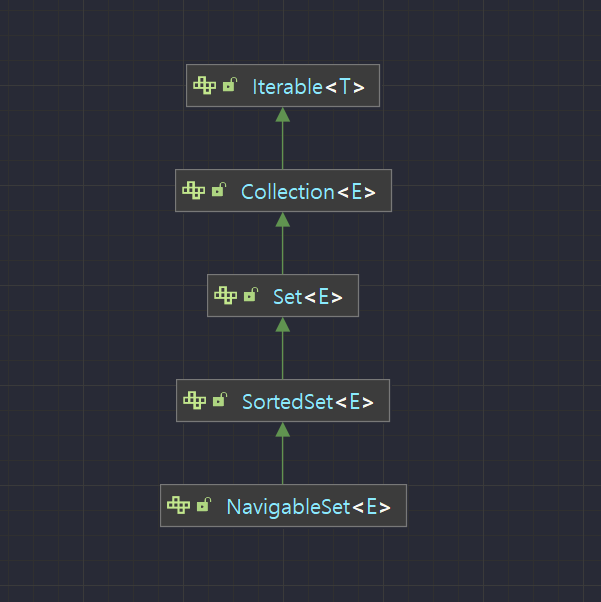

## **NavigableSet** 

- Java 컬렉션 프레임워크에서 제공하는 인터페이스 
- SortedSet 인터페이스의 확장 
- 정렬된 집합(Set)에 대한 탐색 및 탐색 기반의 연산 지원 
- TreeSet은 NavigableSet 인터페이스를 구현하여 네비게이션 기능 제공 

```java
public interface NavigableSet<E> extends SortedSet<E> 
```

---

## **NavigableSet 계층 구조** 



---

## **NavigableSet 메서드 정리** 

- lower(E e) : 주어진 요소 e 보다 작은 요소 중에서 가장 큰 요소를 반환한다.
- floor(E e) : 주어진 요소 e 와 같거나 작은 요소 중에서 가장 큰 요소를 반환 
- ceiling(E e) : 주어진 요소 e 와 같거나 큰 요소 중에서 가장 작은 요소를 반환 
- higher(E e) : 주어진 요소 e 보다 큰 요소 중에서 가장 작은 요소를 반환 
- pollFirst() : 가장 작은 요소를 제거하고 반환 
- pollLast() : 가장 큰 요소를 제거하고 반환 
- desecendingSet() : 이 집합의 역순 집합을 반환 
- desecendingIterator() : 이 집합을 역순으로 반복하는 반복자 반환 
- headSet(E toElement, boolean inclusive)  : 지정된 요소보다 작은 요소들로 이루어진 부분 집합 반환 
- tailSet(E toElement, boolean inclusive) : 지정된 요소 이상의 요소들로 이루어진 부분 집합 반환 
- subSet(E fromElement, boolean fromInclusive, E toElement, boolean toInclusive) 
지정된 범위의 요소들로 이루어진 부분 집합을 반환

집합을 반환하는 메서드들은 boolean 매개변수로 포함 여부를 선택이 가능하다. 

---

## 느낀점 

자바의 데이터 구조는 정말 인터페이스 분리 법칙(ISP)를 잘 지킨다.

