---

---

# 프로그래머스 + 백준

[https://school.programmers.co.kr/learn/courses/30/lessons/389480](https://school.programmers.co.kr/learn/courses/30/lessons/389480)

# 문제 설명

A도둑과 B도둑이 팀을 이루어 모든 물건을 훔친다.

물건 “i”를 훔칠 때, A도둑이 훔치면 info[i][0]개의 A에 대한 흔적을 남긴다.

B도둑이 훔치면 info[i][1]개의 B에 대한 흔적을 남긴다.

A도둑이 남긴 흔적의 개수가 n개 이상이면 경찰에 붙잡힌다.

B도둑은 자신이 남긴 흔적의 개수가 m개 이상이면 경찰에 붙잡힌다.

두 도둑이 모두 경찰에 붙잡히지 않도록 모든 물건을 훔쳤을 때, A도둑이 남긴 흔적의 누적 개수의 최솟값 return

어떠한 방법으로도 두 도둑 모두 경찰에 붙잡히지 않게 할 수 없다면 -1 return

---

# 문제 접근

완전 탐색으로 풀이가 불가능한 문제 → info(최대 40) → 2^40 경우의 수

DP(Dynamic Programming) / KnapSack

```java
int [][] dp = new int [items + 1][m];

// 행: 처리한 물건의 개수(0 ~ items)
// 열: B도둑이 남긴 흔적의 수 (0 ~ m - 1)
// 값: 해당 상태에서 A도둑의 최소 흔적 수 
```

# 정답 코드

```java
import java.util.*;
class Solution {
    static final int INF = 120;
    public int solution(int[][] info, int n, int m) {
        int size = info.length; 
        int [][] dp = new int [size + 1][m];
        for(int i = 0; i <= size; i++) {
            Arrays.fill(dp[i], INF);
        }
        dp[0][0] = 0;
        for(int i = 1; i <= size; i++) {
            int a = info[i-1][0];
            int b = info[i-1][1];
            for(int j = 0; j < m; j++) {
                // a를 선택한 경우
                dp[i][j] = Math.min(dp[i][j], dp[i-1][j] + a);
                // b를 선택한 경우
                if(j + b < m) {
                    dp[i][j+b] = Math.min(dp[i][j+b], dp[i-1][j]);
                }
            }
        }
        int min = INF;
        for(int i = 0; i < m; i++) {
            min = Math.min(min, dp[size][i]);
        }
        return min < n ? min : -1;
    }
}
```

[https://www.acmicpc.net/problem/12865](https://www.acmicpc.net/problem/12865)

    - 0-1 knapsack problem

[https://www.acmicpc.net/problem/12920](https://www.acmicpc.net/problem/12920)

    - bounded knapsack

[https://www.acmicpc.net/problem/7579](https://www.acmicpc.net/problem/7579)

    - 메모리와 비용 최적화

[https://www.acmicpc.net/problem/2629](https://www.acmicpc.net/problem/2629)

Meet in the Middle + knapsack

[https://www.acmicpc.net/problem/2091](https://www.acmicpc.net/problem/2091)

[https://www.acmicpc.net/problem/2293](https://www.acmicpc.net/problem/2293)

### **문제 설명**

    - n가지 종류의 동전 존재
    - 각각의 동전이 나타내는 가치는 다르다
    - 가치의 합이 k원이 되도록 하는 경우의 수 구하기
    - 사용한 동전의 구성은 같은데, 순서만 다른 것은 같은 경우

### **문제 제한**

    - 1 <= n <= 100
    - 1 <= k <= 10,000
    - 1 <= 각 동전의 가치 <= 100,000
    - 경우의 수는 2^31보다 작다.

### 정답 코드

```java
import java.io.*;
public class BOJ2293_2 {
	static int n, k;
	static int [] coins;
	public static void main(String[] args) throws IOException {
		init();
		core();
	}
	public static void init() throws IOException {
		try(BufferedReader br = new BufferedReader(new InputStreamReader(System.in))) {
			String [] input = br.readLine().split(" ");
			n = Integer.parseInt(input[0]); k = Integer.parseInt(input[1]);
			coins = new int [n];
			for (int i = 0; i < n; i++) {
				coins[i] = Integer.parseInt(br.readLine());
			}
		}
	}
	public static void core() {
		int [] dp = new int [k + 1];
		dp[0] = 1;
		for (int i = 0; i < n; i++) {
			int cur = coins[i];
			for (int j = 0; j <= k; j++) {
				if(j + cur <= k) {
					dp[j + cur] += dp[j];
				}
			}
		}
		System.out.println(dp[k]);
	}
}
```

[https://www.acmicpc.net/problem/2294](https://www.acmicpc.net/problem/2294)

### **정답 코드**

```java
import java.io.*;
import java.util.*;
public class BOJ2294_2 {
	static final int INF = 10001;
	static int n, k;
	static int [] coins;
	public static void main(String[] args) throws IOException {
		init();
		core();
	}
	public static void init() throws IOException{
		try(BufferedReader br = new BufferedReader(new InputStreamReader(System.in))) {
			String [] input = br.readLine().split(" ");
			n = Integer.parseInt(input[0]); k = Integer.parseInt(input[1]);
			HashSet<Integer> set = new HashSet<>();
			for (int i = 0; i < n; i++) {
				set.add(Integer.parseInt(br.readLine()));
			}
			coins = set.stream().mapToInt(Integer::valueOf).toArray();
		}
	}
	public static void core() {
		int [] dp = new int [k + 1];
		Arrays.fill(dp, INF);
		dp[0] = 0;
		for(int cur : coins) {
			for (int i = 0; i <= k; i++) {
				if(i + cur <= k) {
					dp[i + cur] = Math.min(dp[i + cur], dp[i] + 1);
				}
			}
		}
		System.out.println(dp[k] == INF ? -1 : dp[k]);
	}
}
```

[https://school.programmers.co.kr/learn/courses/30/lessons/389479](https://school.programmers.co.kr/learn/courses/30/lessons/389479)

[https://school.programmers.co.kr/learn/courses/30/lessons/388353](https://school.programmers.co.kr/learn/courses/30/lessons/388353)

일반적인 BFS 문제

---

# [DataStructure] 자료구조

## 자바 이진 검색 트리 기반 자료구조 

  - TreeSet
  - TreeMap
  - 이진 검색 트리에 대한 자세한 내용 

---

## TreeSet 

  - 정렬된 집합 (Set)을 구현한 클래스, 이진 검색 트리 기반 
  - 중복된 요소 허용 x - **SortedSet** 인터페이스의 확장
  - 요소들이 정렬된 순서로 저장 - **SortedSet** 인터페이스의 확장
  - 내부적으로 레드 - 블랙 트리 사용하여 구현(자가 균형 트리)
  - **NavigableSet** 인터페이스를 확장하고 있어서 네비게이션 기능도 제공


```java
public class TreeSet<E> extends AbstractSet<E>
    implements NavigableSet<E>, Cloneable, java.io.Serializable
```

## TreeSet 메서드 정리 

  - NavigableSet 을 확장한 클래스여서 해당 인터페이스의 메서드 또한 사용이 가능하다.

[Untitled](https://app.notion.com/p/6eec71fc2e794b4d96d587bd12918fdd) 

**생성자** 

  - TreeSet() : 빈 TreeSet 객체 생성 
  - TreeSet(Collection< ? extends E> c ): 지정된 컬렉션의 요소를 포함하는 TreeSet 객체 생성 
  - TreeSet(Comparator< ? super E > comparator ) : 지정된 비교자를 사용하여 요소를 정렬하는 TreeSet 객체를 생성 

**요소 추가 및 삭제**

  - boolean add(E e) : 지정된 요소를 이 TreeSet에 추가 
  - boolean remove(Object o ) : 지정된 요소를 제거  

**검색 및 조회** 

  - boolean contains(Object o) : 지정된 요소가 TreeSet에 포함되어 있는지 여부 확인
  - E first() : TreeSet의 첫 번째 요소(가장 작은) 요소를 반환 
  - E last() : TreeSet의 마지막 (가장 큰) 요소를 반환 

**정렬 및 범위 검색** 

  - Comparator<? super E> comparator() : 이 TreeSet에서 사용되는 비교자 Comparator를 반환 
  - SortedSet<E> subSet(E fromElement, E toEelemnt) : 지정된 범위의 요소들로 이루어진 부분 집합을 반환 
  - SortedSet<E> headSet(E toEelemnt) : 지정된 요소보다 작은 요소들로 이루어진 부분 집합 반환 
  - SortedSet<E> tailSet(E fromElement) : 지정된 요소 이상의 요소들로 이루어진 부분 집합 반환 

---

## TreeSet comparator 객체 출력하기 

테스트1 (기본)

```java
TreeSet<Integer> treeSet = new TreeSet<>();
System.out.println(treeSet.comparator());
```

결과1

```java
null
```

테스트2 (custom)

```java
TreeSet<Integer> treeSet = new TreeSet<>((o1,o2)->{
            return -(o1-o2);
         });
System.out.println(treeSet.comparator());      
```

결과 2

```java
DataStructure.BinarySearchTree.TreeSet.TreeSetPractice$$Lambda$16/0x0000000800c01a00@3b9a45b3
```

테스트3 (Collections 제공 Comparator)

```java
 TreeSet<Integer> treeSet = new TreeSet<>(Collections.reverseOrder());
```

결과 3

```java
java.util.Collections$ReverseComparator@7cca494b
```

 

---

## TreeMap

  - 정렬된 키-값 쌍을 저장하는 자료구조
  - 이진 검색 트리를 기반
  - 키를 기준으로 정렬
  -  중복된 키를 허용 x
  - 레드-블랙 트리(Red-Black Tree)를 사용하여 내부적으로 구현

```java
public class TreeMap<K,V> extends AbstractMap<K,V>
    implements NavigableMap<K,V>, Cloneable, java.io.Serializable
```

---

## TreeMap 계층 구조 

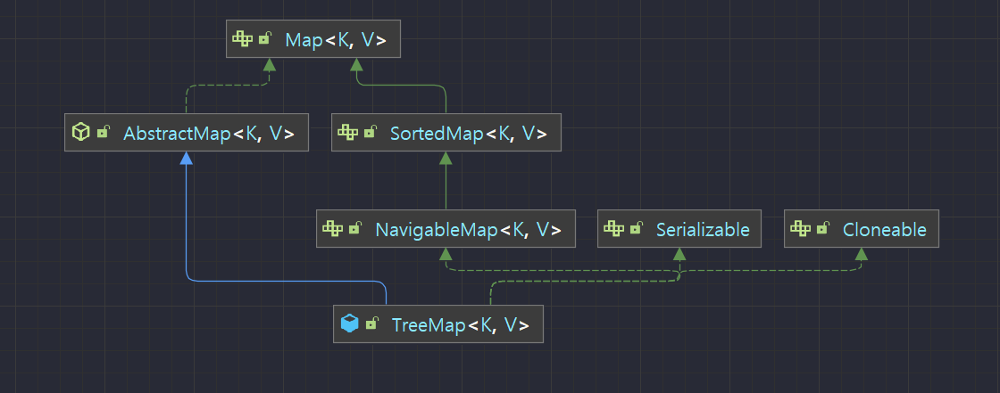

TreeSet - SortedSet, NavigableSet

TreeMap - SortedMap, NavigableMap

---

## TreeMap 메서드 정리 

**생성자** 

  - TreeMap() : 빈 TreeMap 객체 생성 
  - TreeMap(Map<? extends K, ? extends V> m) : 지정된 Map의 요소를 포함하는 TreeMap 객체 생성 
  - TreeMap(Comparator< ? super E > comparator ) : 지정된 비교자를 사용하여 요소를 정렬하는 TreeMap 객체를 생성 

**요소 추가 및 삭제**

  - V put(K key, V value) : 지정된 키 - 값 쌍을 이 TreeMap에 추가  
  - V remove(Object key) : 지정된 키에 매핑된 값을 이 TreeMap에서 제거  

**검색 및 조회** 

  - boolean contains(Object key) : 지정된 키가 TreeMap에 포함되어 있는지 여부 반환 
  - boolean containsValue(Object value) : 지정된 값이 TreeMap에 포함되어 있는지 여부 반환 
  - V get(Object key ) : 지정된 키에 매핑된 값 반환 
  - V getOrDefault(Object key, V defaultValue) : 지정된 키가 TreeMap에 있으면 매핑된 값 반환 없으면 defaultValue 반환 

**정렬 및 범위 검색** 

  - Comparator<? super E> comparator() : 이 TreeSet에서 사용되는 비교자 Comparator를 반환 
  - K firstKey() : 이 TreeMap에서 가장 작은 키를 반환 
  - K lastKey() : 이 TreeMap에서 가장 큰 키를 반환 

**하위 맵과 서브 맵 생성**

  - NavigableMap<K, V> headMap(K toKey, boolean inclusive):  지정된 키보다 작은 키들의 하위 맵을 반환
  - NavigableMap<K, V> tailMap(K fromKey, boolean inclusive): 지정된 키 이상의 키들의 하위 맵을 반환
  - NavigableMap<K, V> subMap(K fromKey, boolean fromInclusive, K toKey, boolean toInclusive): 지정된 범위의 키들의 서브 맵을 반환

---

## **NavigableSet** 

  - Java 컬렉션 프레임워크에서 제공하는 인터페이스 
  - SortedSet 인터페이스의 확장 
  - 정렬된 집합(Set)에 대한 탐색 및 탐색 기반의 연산 지원 
  - TreeSet은 NavigableSet 인터페이스를 구현하여 네비게이션 기능 제공 

```java
public interface NavigableSet<E> extends SortedSet<E> 
```

---

## **NavigableSet 계층 구조** 


---

## **NavigableSet 메서드 정리** 

  - lower(E e) : 주어진 요소 e 보다 작은 요소 중에서 가장 큰 요소를 반환한다.
  - floor(E e) : 주어진 요소 e 와 같거나 작은 요소 중에서 가장 큰 요소를 반환 
  - ceiling(E e) : 주어진 요소 e 와 같거나 큰 요소 중에서 가장 작은 요소를 반환 
  - higher(E e) : 주어진 요소 e 보다 큰 요소 중에서 가장 작은 요소를 반환 
  - pollFirst() : 가장 작은 요소를 제거하고 반환 
  - pollLast() : 가장 큰 요소를 제거하고 반환 
  - desecendingSet() : 이 집합의 역순 집합을 반환 
  - desecendingIterator() : 이 집합을 역순으로 반복하는 반복자 반환 
  - headSet(E toElement, boolean inclusive)  : 지정된 요소보다 작은 요소들로 이루어진 부분 집합 반환 
  - tailSet(E toElement, boolean inclusive) : 지정된 요소 이상의 요소들로 이루어진 부분 집합 반환 
  - subSet(E fromElement, boolean fromInclusive, E toElement, boolean toInclusive) 
지정된 범위의 요소들로 이루어진 부분 집합을 반환

집합을 반환하는 메서드들은 boolean 매개변수로 포함 여부를 선택이 가능하다. 

---

## 느낀점 

자바의 데이터 구조는 정말 인터페이스 분리 법칙(ISP)를 잘 지킨다.

## 목차 

  - **해시?**
  - **충돌?**
  - **충돌회피(Chaining)**
  - **충돌회피(OpenAddressing)**
  - **OpenAddressing (Linear Probing)**
  - **OpenAddressing (Quadratic Probing)**
  - **OpenAddressing (Double Hashing)**

---

## 해시

**해시 자료구조 : 키(Key)에 대응하는 값(Value)을 저장하는 자료구조** 


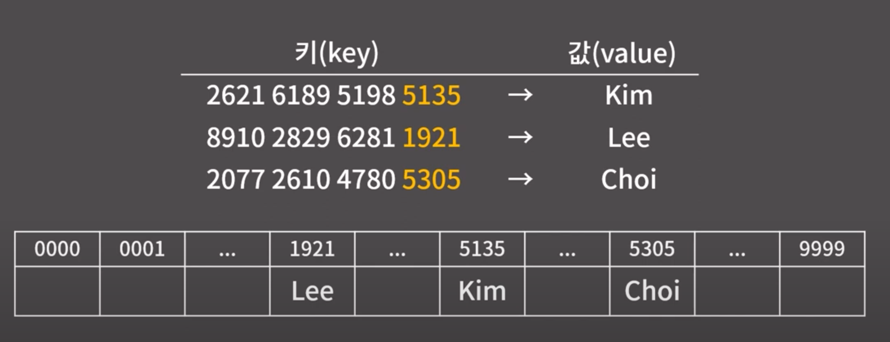

이러한 테이블을 해시 테이블이라고 한다. 

이렇게 해시 함수를 이용해서 해시 테이블을 구현하면 삽입(put), 삭제(remove), 검색(get) 등 모든 연산이 O(1)에 동작한다. 

---

## **충돌** 

충돌 현상 설명 

카드 번호 0000 0000 0000 5135 : kim 을 삽입

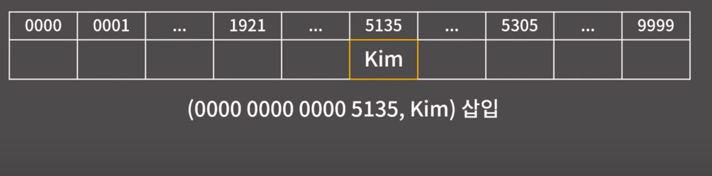

이때 카드 번호 9999 9999 9999 5135 는 누구의 카드 번호인가 질문

그럼 Kim이라고 대답한다. 

Kim의 카드 번호는 0000 0000 0000 5135 이다.  → **충돌 발생!** 

즉 서로 다른 값이 같은 키를 가지면 충돌이 발생한다. 

이렇게 충동을 방지하는 해시 함수를 구현하는 것이 해시 성능에 가장 영향을 끼친다.

---

## 충돌 회피 1 - Chaining

Chaining에서는 각 인덱스마다 연결 리스트를 하나씩 둔다. 

자 다시 충돌 part에서 했던 삽입을 반복 해보자.

  1. 9999 9999 9999 5135 : choi 
  1. 0000 0000 0000 5135 : kim


remove, put, get 모든 연산이 이 원리를 적용

각 index 마다 연결 리스트를 둬서 충돌 회피를 하는 방법을 Chaining이라고 한다. 

> 💡 자바의 HashMap은 충돌을 해결하기 위해 기본적으로 체이닝(chaining) 기법을 사용합니다. 충돌이 발생하면, 동일한 해시 코드를 갖는 키들을 연결 리스트로 연결하여 해결합니다. 이를 통해 각 버킷에 여러 개의 키-값 쌍을 저장할 수 있습니다. 이 외에도 자바의 HashMap은 자바 8부터는 충돌이 발생하면 연결 리스트 대신에 트리를 사용하여 성능을 더 향상시키는 기능도 도입되었습니다.

**Chaining 기법의 성능** 

만약 들어온 데이터들의 모든 key가 동일하다면 삽입은 O(1)이 걸리지만
remove, get은 해당 연결 리스트의 시간 복잡도를 가진다 즉 O(N)이 걸린다.

**이상적인 상황**(모든 key가 균등하게 index를 차지 == 각 index 연결 리스트 크기 ≤ 1)

에서는 O(1) 

**최악의 상황**(모든 해시 값이 같은 상황) O(N) 

→ 각 키의 해시 값이 최대한 균등하게 퍼져야 성능이 좋아진다. 그러기 위해서는 주어진 데이터에 대한 좋은 해시 함수를 정해야 한다. 

**자바 17 해시 코드 출력** 

```java
public class HashCode {
    public static void main(String[] args) {
        String str1 = "hello";
        String str2 = "hello2";

        int hashCode1 = str1.hashCode();
        int hashCode2 = str2.hashCode();

        System.out.println("HashCode of \"hello\": " + hashCode1);
        System.out.println("HashCode of \"hello2\": " + hashCode2);
    }
}
```

```java
HashCode of "hello": 99162322
HashCode of "hello2": -1220935264
```

---

## 충돌 회피 2 - Open Addressing

0000 0000 0000 3333 : kim 삽입


6278 5351 9104 3333 : Lee 삽입

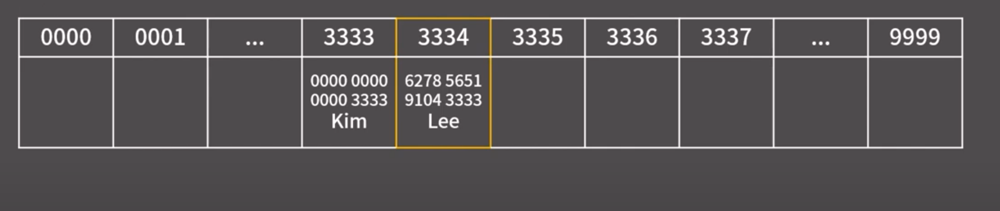

이미 3333 index에 값이 있으니 그 다음 index인 3334에 해당 값을 넣는다. 

7298 1127 6004 3334 : Bae 삽입 


이미 3334 index에 값이 있으니 그 다음 index인 3335에 삽입 

3492 0658 8348 3333 : Yang 삽입 

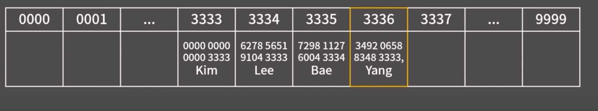

**3492 0658 8348 3333는 누구의 카드인가?**

3333 → 3334 → 3335 → [3336]에서 찾는다

**존재하지 않는 카드 번호를 찾는 상황** 

5555 6666 7777 3335는 누구의 카드인가?

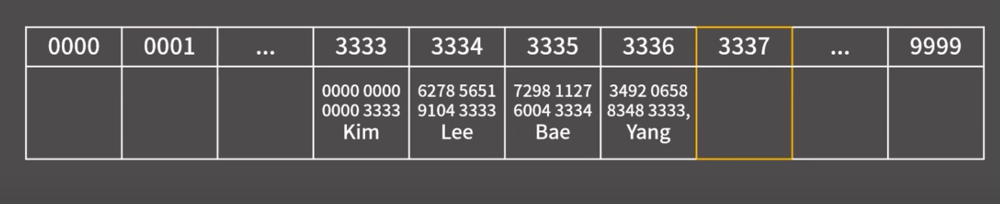

3335 → 3336 → [3337] stop 

이렇게 빈 곳에 도달하면 해당 번호가 저장이 안되어있다는걸 확신할 수 있다.

**6278 5651 9104 3333 삭제** 

find와 마찬가지로 삭제 또한 찾는게  먼저이다. 3333 → 3334

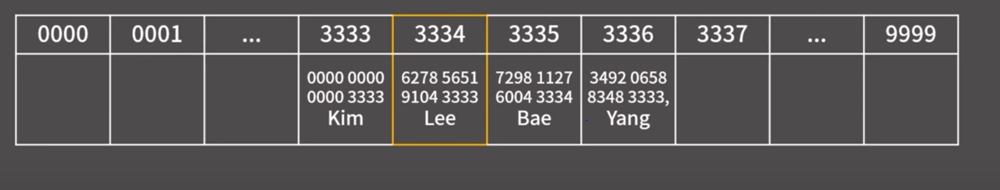

찾고 제거 완료!


이렇게 삭제를 하면 나중에 find에서 **심각한 오류**가 발생할 수 있다. 

ex) 7298 1127 6004 3334 카드 번호를 찾는 경우 

현재 7298 1127 6004 3334 는 3335에 저장 하지만 찾기를 시작하면 3334에서 찾기 시작하는데 

해당 원소가 없어서 바로 종료하며 즉 찾는 카드 번호가 없다고 결과가 나온다. 

**어떻게 해결?**

Open Addressing에서는 이런 오류를 방지하기 위해 삭제를 하는 칸을 실제로 삭제해서 빈 칸으로 만드는게 아닌 원래 값이 있었지만 제거된 상태임을 명시를 해준다. (DUMMY 데이터로 대체)

삽입을 한다고 하면 빈칸 OR DUMMY 데이터면 삽입

검색, 삭제 에서도 DUMMY 데이터를 만나면 종료가 아닌 다음 INDEX로 넘어가게 한다. 

---

## **OpenAddressing (Linear Probing)**


충돌 발생 시 오른쪽으로 1칸씩 이동하는 방식 

장점:

  - Cache hit rate가 높습니다. 인접한 메모리 위치에 저장되어 있기 때문에 CPU 캐시의 지역성(locality)을 활용하여 더 빠르게 접근할 수 있습니다.
  - 해시 테이블의 재구성 없이 데이터를 추가하거나 삭제할 수 있습니다. 새로운 키가 충돌 발생 지점 바로 다음에 저장되기 때문에 추가 연산이 더 효율적입니다.

단점:

  - 클러스터링(Clustering)이 발생할 수 있습니다. 선형 조사는 충돌이 발생한 위치에서 오른쪽으로 이동하면서 저장할 위치를 찾기 때문에 일부 버킷에 데이터가 밀집되는 현상이 발생할 수 있습니다. 이로 인해 해시 테이블의 일부 영역이 밀집되면 성능이 저하될 수 있습니다.
  - 군집(Clustering)으로 인해 선형 조사는 더 많은 충돌을 유발할 수 있습니다. 한 버킷에 데이터가 많이 모이면 다음 데이터가 저장될 위치를 찾기 위해 많은 이동이 필요하므로 충돌이 더 자주 발생할 수 있습니다. 따라서 군집화가 심각한 경우에는 성능이 저하될 수 있습니다.

---

## **OpenAddressing (Quadratic Probing)**


충돌 발생 시 오른쪽으로 1,3,5,…칸씩 이동하는 방식 

오픈 어드레싱에서의 다른 충돌 해결 전략 중 하나로는 Quadratic Probing(이차 조사)이 있습니다. Quadratic Probing은 충돌이 발생했을 때 선형 조사처럼 단순히 오른쪽으로 이동하는 것이 아니라, 이차 함수를 사용하여 새로운 위치를 찾는 방식입니다.

Quadratic Probing은 충돌 발생 시 현재 위치에서 일정한 간격(제곱수)으로 이동하여 다음 저장 위치를 찾습니다. 이동 간격은 제곱 수열을 따르기 때문에 Quadratic Probing이라는 이름이 붙었습니다.

장점:

  - Linear Probing에 비해 클러스터링(Clustering)의 가능성이 낮습니다. 선형 조사보다는 좀 더 골고루 버킷을 사용하기 때문에 클러스터링이 발생할 가능성이 줄어듭니다.
  - 선형 조사보다는 더 많은 범위를 탐색하므로 일부 영역에 데이터가 밀집되는 현상을 줄일 수 있습니다.

단점:

  - Quadratic Probing도 일부 클러스터링 문제를 가질 수 있습니다. 특정 충돌 해결 전략은 일부 특정한 패턴의 충돌을 완전히 제거할 수 없을 수 있습니다.
  - 선형 조사보다는 조금 더 복잡한 계산이 필요할 수 있습니다. Quadratic Probing은 이차 함수를 사용하기 때문에 이동할 위치를 계산하는데 조금 더 연산이 필요합니다.

---

## **OpenAddressing (Double Hashing)**


충돌 발생 시 이동할 칸의 수를 새로운 해시 함수로 계산하는 방식 

ex) 

지금까지 index 결정을 카드 번호의 뒷 4자리로 했다고 하면 이동할 칸의 자리는 카드 번호의 앞 4자리로 하기 

1234 2222 5555 5555가 충돌이 발생하면 다음 index는 5555 + 1234 

Double Hashing(이중 해싱)은 충돌을 해결하는 또 다른 방법으로, 두 개의 해시 함수를 사용하여 충돌이 발생한 경우에 새로운 위치를 결정하는 방법입니다.

Double Hashing은 충돌이 발생했을 때, 기본 해시 함수와 더불어 두 번째 해시 함수를 사용하여 새로운 위치를 찾습니다. 즉, 충돌이 발생한 위치에서 두 번째 해시 함수의 값을 이용하여 새로운 위치를 찾는 것입니다. 이 때 두 번째 해시 함수는 충돌을 해결하기 위한 적절한 값들을 생성하기 위해 사용됩니다.

Double Hashing의 핵심 아이디어는 다음과 같습니다:

  1. 충돌이 발생했을 때, 첫 번째 해시 함수를 통해 얻은 위치에서 두 번째 해시 함수를 사용하여 새로운 위치를 찾습니다.
  1. 두 번째 해시 함수의 값이 0이면, 즉 두 번째 해시 함수가 충돌 해결에 아무런 도움을 주지 못한다면, 간격을 조정하여 다음 위치를 찾습니다.

장점:

  - 충돌이 발생했을 때 선형 조사나 이차 조사보다 더 넓은 영역을 탐색할 수 있습니다.
  - 충돌을 해결하기 위한 다양한 조합의 위치를 시도할 수 있기 때문에, 클러스터링이 발생할 가능성이 낮아집니다.

단점:

  - 두 개의 해시 함수를 선택하고, 이를 통해 적절한 값을 찾는 과정이 복잡할 수 있습니다.
  - 일부 특정한 상황에서는 충돌을 완전히 해결하지 못할 수 있습니다.
  - Cache hit rate가 극악으로 안 좋아진다.

## 설명 + 시간 복잡도

우선순위 큐 = pop을 할 때 가장 먼저 들어온 원소가 나오는 대신 우선순위가 가장 높은 원소가 나오는 큐 

  1. 원소의 추가가 O(lg N)
  1. 우선순위가 가장 높은 원소의 확인 O(1)
  1. 우선순위가 가장 높은 원소의 제거가 O(lg N)

그냥 배열로 구현을 하면 세 연산의 시간복잡도가 O(1), O(N), O(N)이 되겠지만 

Heap 구조를 이용하면 O(lg N), O(1), O(lg N)에 가능하다. 

---

## Heap

이진 트리의 모양을 가지는 자료 구조 

이진 트리 : 각 정점의 자식이 최대 2개인 트리를 의미 

이진 검색 트리와는 다른 자료구조이다. 이진 트리라는 공통점만 가진다. 

우리는 힙을 최댓값 혹은 최솟값을 찾는 목적으로 쓸 수 있다.

최대 힙 : 최댓값을 찾기 위해 사용한는 힙

최소 힙 : 최솟값을 찾기 위해 사용하는 힙


최소 힙에서는 부모가 자식 보다 작아야 한다. → 루트가  최솟값 

최대 힙은 부모가 자식보다 커야 한다. → 루트가 최댓값 

---

## **Heap의 삽입 순서** 

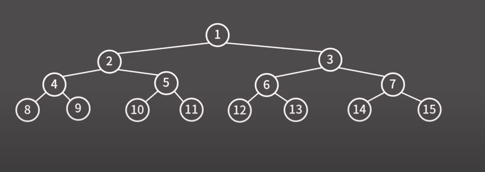

이런 순서로 값을 채워 나가니 이진 검색 트리와는 다르게 힙은 불균형이 발생하지 않고 늘 균형이 맞는 규형 이진 트리의 모양이다. 

---

## **Heap (삽입)Insert Simulation** 

  - 최소힙 

35 삽입 


55 삽입


15 삽입


35와 15에서 부모와 자식 간의 관계가 최소힙 조건에 위배된다.  (부모 < 자식)

→ 부모와 자식의 자리를 바꾼다. 


8 삽입

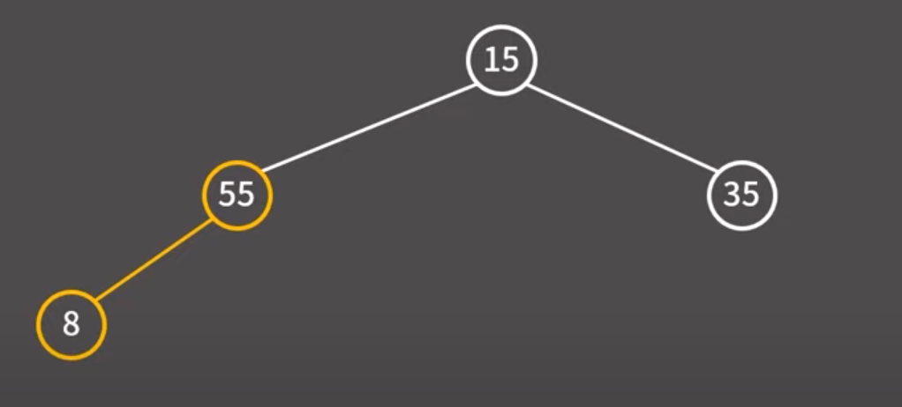

이번에도 마찬가지로 최고 힙의 조건이 위배된다. 

8 ↔ 55 


8 ↔ 15


32 삽입


정리

매번 삽입을 할 때 마다 아무리 비교를 많이 해도 최대 높이 만큼만 비교를 하고 문제가 있다면

올라가면서 자리를 바꿔주면 끝난다. 

힙의 구조상 균형 트리이기 때문에 삽입의 시간복잡도는 O(lg N)이다. 

---

## **Heap Find** 

최솟값 확인은 매우 간단하다. 그냥 루트에 값이 최솟값이다. 

단 최소 힙에서는 최솟값을 효율적으로 확인할 수 있지만, 열 번째로 작은 값의 확인이라던가 

최댓값의 확인은 모든 원소를 다 보는게 아닌 이상 불가능하다. 

최대 힙은 반대 

이런 특징은 이진 검색 트리와 힙의 차이다. 

---

## Heap Erase 


최솟값을 지우는 연산, 여기서는 루트(8)


트리의 구조를 지키기 위해서 트리의 순서상 가장 마지막인 원소와 자리 교체를 하고 8을 없앤다. 

여기서 8을 없애도 트리의 구조가 지켜지는 이유는 가장 마지막인 원소는 자식이 없기 때문이다. 

이제 52가 루트로 왔으니 다시 최소 힙의 조건을 맞춘다. 


12, 13, 52 중에서 가장 작은 값은 12니까 12 ↔ 52 바꾼다.


52, 16, 16에서는 어떻게 최소 힙 조건을 맞출까?

16, 16 둘 둥 어느 것을 올리더라도 문제가 없다! 


52 ↔ 16

52, 30, 22 에서 문제 발생 


52 ↔ 22 

끝!

---

## **자바 PriorityQueue 계층 구조** 


---

## 이진 검색 트리 기반 vs heap 기반 

TreeSet과 PriorityQueue를 비교해 보자 .

  - PriorityQueue에서 수행 가능한 기능은 TreeSet에서 모두 수행 가능하고 훨씬 더 다양한 기능을 제공하다. 
- ex) NavigableSet(인터페이스) 메서드
  - 삽입, 삭제, 검색 시간 복잡도 또한 동일하다 
- TreeSet의 검색은 평균이 O(lg N) 
    - first(), last() 는 O(1)이다.

다 맞는 말이다. 하지만 PriorityQueue가 똑같은 데이터 셋을 수행할 때 TreeSet 보다 더 빠르고 공간도 적게 차지한다. 빅오 표기법(O)로 하는건 평균적인 수치이다 . 너무 맹신하지 말자 

이런 수행 시간 차이가 나는건 이진 검색 트리는 트리 불균형에 대한 균형을 맞추기 위한 시간이 소비된다. (자바는 자가 균형 트리인 레드 블랙 트리) 

하지만 PriorityQueue의 이진 트리는 불균형이 존재하지 않는다. 항상 삽입 순서가 정해져 있다.

언제나 O(lg N)에 수행 

같은 연산을 할 때 비교를 해보면 속도가 2~4배 정도 차이 난다고 한다. 정확한 수치인진 모르고 

데이터마다 다 다를 것이다. 

그래서 PriortyQueue에서 제공하는 연산으로만 해결 가능한 데이터라면 

PriorityQueue를 사용하는 게 좋다!!

---

## 참고 자료 

바킹독 : [바킹독 우선순위 큐](https://www.youtube.com/watch?v=_9mbqoF9qzc&list=PLtqbFd2VIQv4O6D6l9HcD732hdrnYb6CY&index=24)

---

## 배열의 성질

    1. O(1)에 k번째 원소를 확인/변경이 가능
    1. 추가적으로 소모되는 메모리의 양(overhead)가 거의 없음
    1. Cache hit rate가 높다.
    1. 메모리 상에 연속한 구간을 잡아야 해서 할당에 제약이 걸린다.

## **Over Head?**

**정의** 

어떤 작업을 수행하기 위해 추가적으로 소요되는 부가적인 비용이나 자원을 의미한다.

**예시**

A라는 처리를 단순하게 실행한다면 10초 걸리는데, 안전성을 고려하고 부가적인 B라는 처리를 추가한 결과 처리시간이 15초 걸렸다면, 오버헤드는 5초가 된다.

B를 개선해 B'라는 처리를 한 결과, 처리시간이 12초가 되었다면, 이 경우 오버헤드가 3초 단축되었다고 말한다.

**그렇다면 배열에서는 왜 오버헤드가 거의 없을까?**

배열에서 추가적으로 소모되는 메모리의 양이 거의 없는 이유는 배열이 메모리에 연속적으로 할당되기 때문입니다. 배열은 연속된 메모리 블록에 데이터를 저장하므로 추가적인 포인터 등을 저장할 필요가 없습니다. 배열의 각 요소는 메모리에서 연속적으로 배치되므로 인덱스를 사용하여 요소에 직접 액세스할 수 있습니다.

그러나 다른 데이터 구조에는 오버헤드가 발생할 수 있습니다. 예를 들어, 링크드 리스트의 각 노드는 데이터 뿐만 아니라 다음 노드를 가리키는 포인터도 저장해야 합니다. 따라서 링크드 리스트는 각 요소 사이에 추가적인 포인터를 저장해야 하므로 메모리 오버헤드가 발생할 수 있습니다.

따라서 배열은 메모리 오버헤드가 거의 없고 직접적인 메모리 액세스가 가능한 반면, 다른 데이터 구조에는 데이터 구조 자체를 위한 추가적인 메모리가 필요할 수 있습니다.

## Cache hit rate?

참고 링크

[https://ikit.tistory.com/11](https://ikit.tistory.com/11)

[https://ndlessrain.com/entry/캐시메모리-적중률Hit-Rate](https://ndlessrain.com/entry/%EC%BA%90%EC%8B%9C%EB%A9%94%EB%AA%A8%EB%A6%AC-%EC%A0%81%EC%A4%91%EB%A5%A0Hit-Rate)

Cache?

캐시 메모리는 CPU의 처리 처리 속도와 주기억장치의 접근 속도를 줄이기 위해 사용하는 고속 Buffer Memory이다.

Cache 메모리 이용 효과

프로그램의 실행 과정을 분석해 보면, 주어진 시간 동안에 참조하는 메모리 영역은 국한된다는 사실을 알 수 있다. 따라서 자주 참조되는 프로그램의 일부를 속도가 빠른 기억 장치에 저장해 놓고 실행시키면 프로그램의 총 실행 시간을 단축시킬 수 있다. 이때 이용하는 기억장치를 캐시 메모리라고 한다.

Cache 메모리 특징

1. 캐시는 주기억장치와 CPU사이에 위치하며, 자주 사용하는 프로그램과 데이터를 기억한다.
        1. 캐시 메모리는 메모리 계층 구조에서 가장 빠른 소자이며, 처리 속도가 거의 CPU의 속도와 비슷할 정도이다.
        1. 캐시를 사용하면 주기억장치를 접근하는 횟수가 줄어듦으로써 컴퓨터의 처리속도가 향상된다.
        1. 캐시 주소표는 검색시간을 단축시키기 위해 주로 연관기억장치(CAM, Associative Memory)를 사용한다.

Cache Hit

메모리에서 데이터를 찾아 성공적으로 제공되는 것을 의미한다.

Cache Miss 

메모리를 검색했지만 데이터를 찾을 수 없는 경우를 나타낸다.

이 경우 콘테츠가 전송되어 캐시에 기록된다.

Cache Hit Ratio

말 그대로 캐시가 적중되는 정도를 뜻한다.

적중률 = 적중횟수 / 총 접근 횟수 (0.95 ~ 0.99 일 때 우수하다고 한다)

배열에서 Cache hit rate가 높은 이유?

메모리 접근 패턴 때문이다. 캐시는 데이터의 지역성(locality)의 원리를 기반으로 동작한다.

이것은 한 번에 특정 데이터 주변의 데이터에 엑세스하는 경향이 있다는 것을 의미한다.

배열은 메모리에 연속적으로 배치되므로 인접한 배열 요소는 물리적으로도 인접한 메모리 위치에 저장됩니다. 예를 들어 배열의 첫 번째 요소에 접근하면 다음 요소도 바로 뒤에 메모리에 저장되어 있다. 이런 배열의 특성으로 인해 Cache hit rate가 높아진다.

즉 배열에서는 인접한 요소에 대한 연속적인 엑세스 패턴이 캐시의 작동 방식과 잘 일치하여 

Cache hit rate가 높아진다.

## 시간 복잡도

원소 확인 / 변경

시간 복잡도 : O(1)

원소를 끝에 추가 

시간 복잡도 : O(1)

마지막 원소 제거

시간 복잡도 : O(1)

임의의 위치에 원소를 추가

시간 복잡도 : O(N)

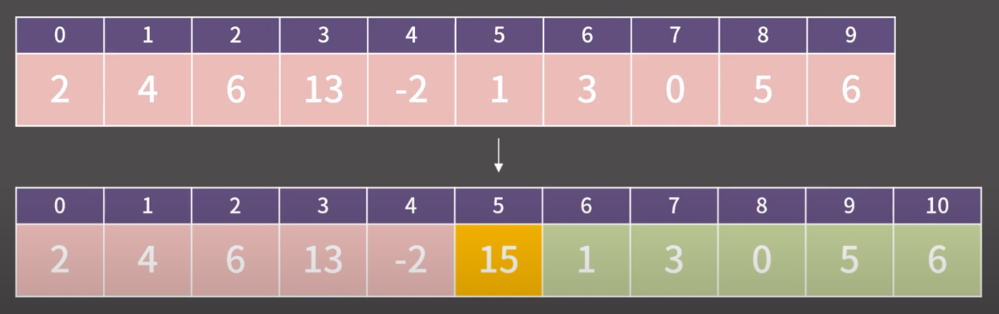

지금 보면 5번에 15를 추가했는데 이렇게 되면, 그 뒤의 원소들을 전부 한 칸씩 밀어야해서 O(N)이 필요하다. 추가하려는 인덱스가 끝에 갈수록 빨라지고 인덱스가 앞이면 더 드려지는데 평균적으로 O(N/2)가 걸린다. → O(N)

임의의 위치에 있는 원소를 제거

시간 복잡도 : O(N) 


임의의 위치에 원소와 마찬가지로 삭제된 인덱스 위치로 전부 1칸식 땡겨지니 O(N)이 걸린다.

## 연결 리스트의 성질

    1. k번째 원소를 확인/변경하기 위해 O(K)가 필요함


3번째 원소를 확인하고 싶으면 3 → 13 → 72 순서대로 접근 그래서 O(K)

    1. 임의의 위치에 원소를 추가/ 임의 위치의 원소 제거는 O(1)
    1. 원소들이 메모리 상에 연속해있지 않아 Cache hit rate가 낮지만 할당이 다소 쉽다.

## 연결 리스트의 종류 

    1. 단일 연결 리스트(Singly Linked List)

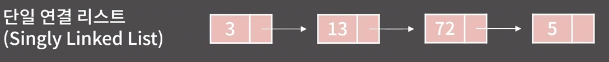

  각 원소가 자신의 다음 원소의 주소를 들고 있는 연결 리스트이다.

    1. 이중 연결 리스트(Doubly Linked List)


각 원소가 이전 원소와 다음 원소의 주소를 둘 다 들고 있다.

단일 연결 리스트에서는 원소의 이전 원소가 무엇인지를 알 수  없는데 이중 연결 리스트에서는 알 수 있다.

원소가 가지고 있어야 하는 정보가 1개 더 추가되니 메모리를 더 쓴다는 단점이 있다.

    1. 원형 연결 리스트 (Circular Linked List)


원형 연결 리스트는 처음과 끝이 연결됨 

그림에서는 단일 연결 리스트로 표현했지만 각 원소가 이전과 다음 원소의 주소를 들고 있어도 상관이 없다.

## 배열 vs 연결 리스트 (선형 자료구조)

배열과 연결 리스트는 메모리 상에 원소를 놓는 방법이 다르다고 해도 

원소들 사이의 선후 관계가 일대일로 정의가 된다. 

즉 원소들 사이에서 첫 번째 원소, 두 번째 원소, …. 이런 개념이 존재한다. 

그래서 배열과 연결 리스트는 선형 자료구조라고 부른다. 

트리, 그래프, 해쉬 등은 비선형 자료구조의 예시이다. 


연결 리스트는 N에 비례하는 만큼 메모리가 추가적으로 발생한다.

## 시간 복잡도

**임의의 위치에 있는 원소를 확인 / 변경 O(N)**

**임의의 위치에 원소를 추가 O(1)**

21 뒤에 84를 추가하고 싶은 case


21의 원소가 저장하고 있던 다음 원소의 주소를 84로 변경하고 84 원소가 17원소의 주소를 
저장하면 끝이다. 

배열처럼 그 뒤의 원소를 전부 옮기는 작업을 할 필요가 없다.

단 추가하고 싶은 위치의 주소를 알고 있을 경우에만 O(1)에 가능하다.

여기 2가지 명령이 있다.

    1. 21 뒤에 84를 추가해 O(N)
    1. 3번 인덱스 뒤에 84를 추가해 O(1)

21번 뒤에 84를 추가하라는 첫 번째 명령은 21의 주소를 모르기 때문에
21의 주소를 찾는 시간인 O(N)이 추가적으로 필요하다. 

**임의의 위치에 원소를 제거 O(1)**

remove(int idx) —> O(1)
remove(Object obj) —→ O(N)

임의의 위치에 원소를 추가하거나 삭제하는 연산이 많은 경우에는 연결 리스트를 사용하는게 좋다!

자바에서 연결 리스트는 이중 연결리스트로 구현되어 있다.


## 스택이란?

스택은 구조적으로 먼저 들어간 원소가 제일 나중에 나오게 되는데

이런 의미로 FILO(First In Last Out) 자료구조라고 부르기도 한다.

큐나 스택 덱도 스택처럼 특정 위치에서만 원소를 넣거나 뺄 수 있는 제한이 걸려 있다.

그래서 스택, 큐, 덱을 묶어서 Restricted Structure라고 부른다.

## 스택의 성질

    1. 원소의 추가 O(1)
    1. 원소의 제거 O(1)
    1. 제일 상단의 원소 확인이 O(1)
    1. 제일 상단이 아닌 나머지 원소들의 확인 / 변경이 원칙적으로 불가능

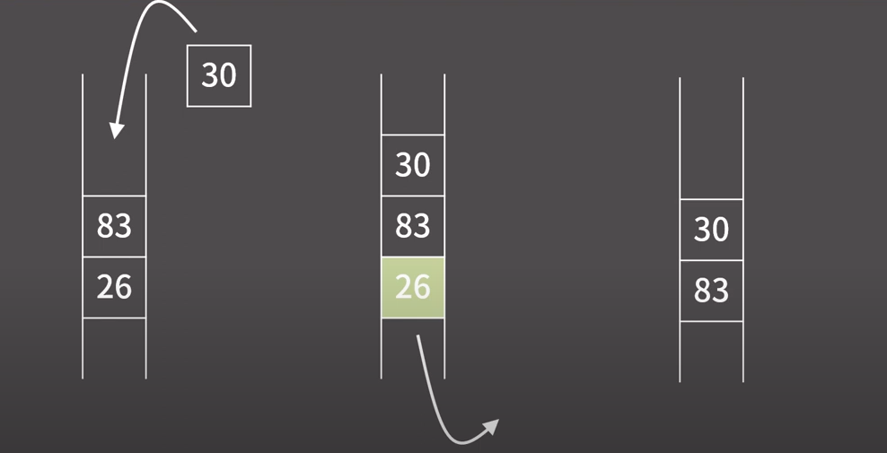

## 큐란?

먼저 들어간 원소가 먼저 나온다. 그래서 FIFO 구조이다. (First In First Out)

---

# 알고리즘 정리

## 나머지 (Modulo) 연산 분배법칙

```
(A + B) % p = ((A % p) + (B % p)) % p
(A * B) % p = ((A % p) * (B % p)) % p
(A - B) % p = ((A % p) - (B % p) + p) % p
```

[백준 곱셈 실버1](https://www.acmicpc.net/problem/1629)

문제 자연수 A를 B번 곱한 수를 알고 싶다. 

단 구하려는 수가 매우 커질 수 있으므로 이를 C로 나눈 나머지를 구하는 프로그램을 작성하시오.

예지 입력 : 10 11 12

예제 출력 : 4

(10^11 ) % 12 를 구하는 문제이다.  

(10^5 * 10^6) % 12 —> ((10^5 % 12 ) * (10^6 % 12)) % 12 

재귀를 통해서 구현 

시간 초과 코드  

```java
import java.io.*;
import java.util.*;
public class Main {
    static long a; static long b; static long c;
    public static void main(String[] args) throws IOException{
        BufferedReader br = new BufferedReader(new InputStreamReader(System.in));
        StringTokenizer st = new StringTokenizer(br.readLine());
        a = Long.parseLong(st.nextToken());
        b = Long.parseLong(st.nextToken());
        c = Long.parseLong(st.nextToken());
        System.out.println(calculate(b));
    }
    public static long calculate(long cur){
        if(cur == 1){
            return (a * cur) % c;
        }
        if(cur % 2 == 0){
            return ((calculate(cur/2) % c) * (calculate(cur/2) % c)) % c;
        }
        return ((calculate(cur/2 + 1) % c) * (calculate(cur/2) % c)) % c;
    }
}
```

메모제이션 + 재귀 코드 (통과) 코드는 생략 

## 하노이의 탑 

[프로그래머스 하노이의 탑](https://school.programmers.co.kr/learn/courses/30/lessons/12946)

[백준 하노이 탑 이동 순서 골드5](https://www.acmicpc.net/problem/11729)

하노이의 탑 원리 

n개의 원판이 있으면 

n-1개의 원판을 A→B 

1개의 원판 A→C

n-1개의 원판을 B→C

이걸 재귀로 구현한다. 

```java
public static void Hanoi(int n, int start, int mid, int end){
        if(n == 1){
            list.add(new int[]{start, end});
            return;
        }
        Hanoi(n-1, start, end, mid);
        list.add(new int[]{start, end});
        Hanoi(n-1, mid, start, end);
    }
```

## 백준 N - Quuen

[백준 9663 N-Quuen 골드4](https://www.acmicpc.net/problem/9663)

**문제** 

N-Queen 문제는 크기가 N × N인 체스판 위에 퀸 N개를 서로 공격할 수 없게 놓는 문제이다.

N이 주어졌을 때, 퀸을 놓는 방법의 수를 구하는 프로그램을 작성하시오.

첫째 줄에 퀸 N개를 서로 공격할 수 없게 놓는 경우의 수를 출력한다.

**문제 접근** 

열을 방문 했다는 의미의 boolean 배열 

대각선 x + y와 x - y 는 같은 대각선이면 값이 같다. 

이 3가지 조건으로 방문 유무를 확인하고 백트래킹을 한다.

```java
 public static void BackTracking(int count){
        if(count == n){
            answer++;
        }
        for (int i = 0; i < n ; i++) { // cnt 는 행을 의미한다. i = 열을 의미
            if(count - i < 0){
                if(col[i] || MinusDown[Math.abs(count - i)] || Up[count + i]) continue;
                col[i] = true; MinusDown[Math.abs(count - i)] = true; Up[count+i] = true;
                BackTracking(count + 1);
                col[i] = false; MinusDown[Math.abs(count - i)] = false; Up[count+i] = false;
            }
            else if(count - i >= 0){
                if(col[i] || Down[count - i] || Up[count + i]) continue;
                col[i] = true; Down[Math.abs(count - i)] = true; Up[count+i] = true;
                BackTracking(count + 1);
                col[i] = false; Down[Math.abs(count - i)] = false; Up[count+i] = false;
            }
        }
    }
```

for문에서 돌아가는 값이 열을 의미하고 count는 행을 의미한다. 

## 백준 비숍 골드1

[백준 비숍 골드1](https://www.acmicpc.net/problem/1799)

**문제**

첫째 줄에 체스판의 크기가 주어진다. 체스판의 크기는 10이하의 자연수이다. 둘째 줄부터 아래의 예와 같이 체스판의 각 칸에 비숍을 놓을 수 있는지 없는지에 대한 정보가 체스판 한 줄 단위로 한 줄씩 주어진다. 비숍을 놓을 수 있는 곳에는 1, 비숍을 놓을 수 없는 곳에는 0이 빈칸을 사이에 두고 주어진다.

첫째 줄에 주어진 체스판 위에 놓을 수 있는 비숍의 최대 개수를 출력한다.

**문제 접근**

N-Queen가 유사한 풀이 방법이지만 핵심은 체스판을 2가지 종류로 탐색한다는점이다.

  1. 검은색 판
  1. 하얀색 판

이렇게 2가지 판에서 위로 올라가는 대각선 아래로 내려가는 대삭선을 boolean 배열로 
만들고 check 하면서 백트래킹을 하면 풀린다.

## 1. 기초 정렬 (선택 정렬, S**election Sort)**

N개의 원소에서 가장 작은 원소를 찾고 배열 첫 번째로 

N-1개의 원소에서 가장 작은 원소를 찾고 배열 두 번째로

….

**시간 복잡도 O(N^2)**

```java

import java.util.Arrays;
// 기초 정렬 (선택 정렬)
public class Basic_Sort {
    public static void main(String[] args) {
        int [] arr = {3, 2, 7, 116, 62, 235, 1, 23, 55, 77};
        int n = arr.length;
        for (int i = 0; i < n; i++) {
            int idx = i;
            for (int j = i + 1; j < n; j++) {
                if(arr[j] < arr[idx]) idx = j;
            }
            int temp = arr[i];
            arr[i] = arr[idx];
            arr[idx] = temp;
        }
        System.out.println(Arrays.toString(arr));
    }
}
```

## 2. 버블 정렬(B**ubble Sort)**

앞에서부터 인접한 두 원소를 보면서 앞의 원소가 뒤의 원소보다 클 경우 자리를 바꾸는 것을 

반복하면 자연스럽게 제일 큰 것부터 오른쪽에 쌓이게 된다.

**시간 복잡도 O(N^2)**

```java
// 버블 정렬
import java.util.*;
public class Bubble_Sort {
    public static void main(String[] args) {
        int [] arr = {3, 2, 7, 116, 62, 235, 1, 23, 55, 77};
        int size = arr.length;
        for (int i = 0; i < size; i++) {
            for (int j = 0; j < size - 1; j++) {
                if(arr[j] > arr[j+1]){
                    int temp = arr[j+1];
                    arr[j+1] = arr[j];
                    arr[j] = temp;
                }
            }
        }
        System.out.println(Arrays.toString(arr));
    }
}
```

## 3. Merge Sort 

재귀적으로 수열을 나눠 정렬한 후 합치는 정렬법 

**시간 복잡도 O(NlgN)**

Merge Sort를 하기 위해서는 먼저 길이가 N과 M인 두 정렬된 리스트를 합쳐서 

길이 N+M의 리스트를 만드는 방법을 알아야 한다.


여기서 제일 앞에 와야하는 수는 뭘까?

제일 앞의 원소라는건 전체 중에 가장 작은 원소란건데 

가장 작은 원소를 찾기 위해서 N+M의 모든 원소를 다 봐야할까? → NO

두 리스트에서 각각에서 가장 작은 원소인 -9와 -7만 비교하면 끝이다. 

-9 이후로는 모든 원소가 -9보다 크고

-7 이후로는 모든 원소가 -7보다 크니까 

-9와 -7을 비교해서 더 작은 숫자인 -9를 리스트 첫 번째 원소로 넣는다. 

이건 시간복잡도 O(1)에 가능하다. 

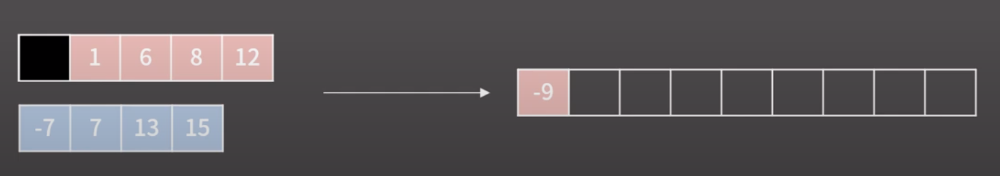

그런 다음에 넣을 원소는 어떻게 찾을까?

각 리스트에서 가장 작은 원소를 찾는다. 1, -7 

-7이 더 작으니 리스트에 -7을 넣는다. 

이렇게 반복하면 두 리스트가 오름차순으로 정렬된 리스트로 합쳐진다.

**BOJ 11728 배열 합치기로 연습해 보자**

[https://www.acmicpc.net/problem/11728](https://www.acmicpc.net/problem/11728)


**Merge Sort 과정** 

  1. 주어진 리스트를 2개로 나눈다. 
  1. 나눈 리스트 2개를 정렬한다.
  1. 정렬된 두 리스트를 합친다.

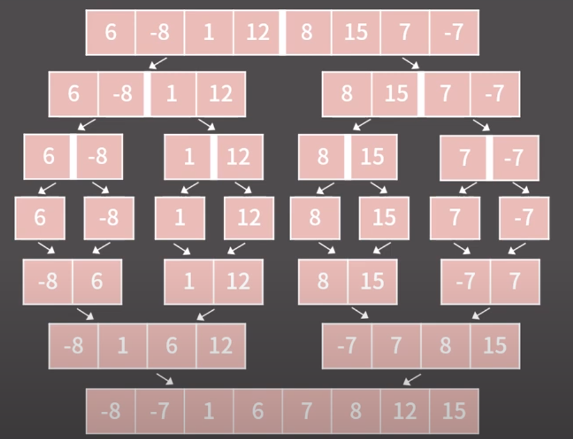

분할하는 과정의 시간복잡도는 O(N)

합쳐나가는 과정은 O(NlgN)

→ 최종 시간복잡도는 O(NlgN)

```java

// Merge_Sort 병합 정렬 O(NlogN)
import java.util.*;
public class Merge_Sort {
    static int [] arr = {-3, -1, 4, -5, 7, 5, 3, 0, 2, 9, 8};
    static int [] tmp = new int[arr.length];

    public static void main(String[] args) {
        func(0, arr.length);
        System.out.println(Arrays.toString(arr));
    }
    public static void func(int start, int end){
        if(end - start == 1){
            return;
        }
        int mid = (start + end) / 2;
        func(start, mid);
        func2(start, end);
    }
    public static void func2(int start, int end){
        int mid = (start + end) / 2;
        int idx1 = start;
        int idx2 = mid;
        for (int i = start; i < end; i++) {
            if(idx1 == mid){
                tmp[i] = arr[idx2++];
            }
            else if(idx2 == end){
                tmp[i] = arr[idx1++];
            }
            else{
                if(arr[idx1] <= arr[idx2]){
                    tmp[i] = arr[idx1++];
                }
                else{
                    tmp[i] = arr[idx2++];
                }
            }
        }
        for (int i = start; i < end; i++) {
            arr[i] = tmp[i];
        }
    }
}
```

**Stable Sort**

우선 순위가 같은 원소가 여러 개일 땐 정렬한 결과가 유일하지 않을 수 있다.

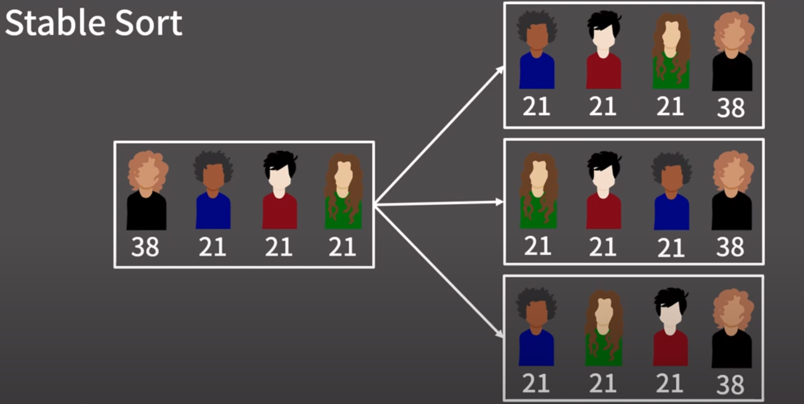

우선 순위가 같은 원소들끼리는 원래의 순서를 따라가도록 하는 정렬이 Stable Sort이다. 

즉 StableSort를 하면 첫 번째 처럼 파랑 빨강 초록 검은색 순서대로 정렬되어 있다.

하지만 두 번째나 세 번째 같은 정렬이 될 수도 있는 정렬 방법은 **Unstable Sort**이다. 

Merge Sort는 Stable Sort이다. 

EX) 파일을 정리할 때 파일의 크기 순서가 1순위 2순위가 파일 생성 시기라면 

파일 크기 순서대로 Stable Sort를 하면 자연스럽게 파일 생성 시기 또한 순서가 지켜져서 

정렬된다.

## 4. Quick Sort

퀵 소트가 거의 모든 정렬 알고리즘보다 빨라서 각종 라이브러리의 정렬은 대부분 

퀵 소트를 바탕으로 만들어져 있다.

코딩 테스트에서 라이브러리를 사용하지 못하고 정렬을 구현해야 한다면 

퀵 소트를 사용하지 않고 머지 소트를 사용해야 한다.

퀵 소트 또한 머지 소트처럼 재귀적으로 구현을 하는 정렬이다.

퀵 소트에서는 매 단계마다 pivot이라고 이름 붙은 원소 하나를 제자리로 

보내는 작업을 반복한다. 


지금 이 리스트를 보면 이 원소들 사이에서 pivot은 마음대로 잡으면 되지만 

편의상 제일 앞의 원소인 6을 pivot으로 잡겠다. 

여기서 어떻게든 pivot을 제자리로 보내고 싶다. pivot을 제자리로 보낸다는 의미는 

pivot을 올바른 자리에 넣고 pivot 왼쪽은 pivot보다 작은 원소가 pivot 보다 큰 원소는 

오른쪽에 위치 시키겠다는 뜻이다. 


비록 정렬이 되지는 않았지만 6의 왼쪽에는 6보다 작은 원소만 위치하고 

오른쪽에는 6보다 큰 원소만 위치하고 있다. 

pivot을 제자리로 보내고 나면 왼쪽 구간과 오른쪽 구간을 따로따로 정렬하면 되고 각 구간은 

머지 소트에서 하던 작업을 재귀적으로 생각하면 된다. 

왼쪽 구간과 오른쪽 구간을 어떻게 따로따로 정렬하는 건가요? 라고 질문을 던진다면 

머지 소트와 상황이 똑같다고 설명을 할 수 있다.

먼저 pivot을 제자리로 보내는 작업부터 해보자.

임시 배열 tmp를 만들고 

pivot보다 작은 원소들을 먼저 배열에 넣고 pivot을 넣은 다음에 pivot 보다 큰 원소들을 배열에 넣는다.

퀵 소트의 장점은 추가적인 공간이 필요하지 않다는 점에 있다. 

또 그렇게 그 배열 안에서의 자리 바꿈만으로 처리가 되기 떄문에 cache hit rate가 높아서 속도가 빠르다는 장점이 있다.  

그렇기 때문에 우리는 추가적인 공간을 사용하지 않고 pivot을 제자리로 보낼 방법을 고민해야 한다.

이렇게 추가적인 공간을 사용하지 않는 정렬을 **In-Place-Sort**라고 부른다.

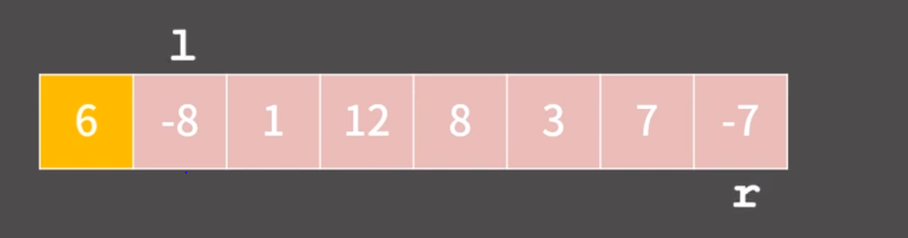

포인터 2개를 설정한다. l은 pivot보다 큰 값이 나올 때 까지 오른쪽으로 이동을 한다.

r은 pivot보다 작거나 같은 값이 나올 때 까지 왼쪽으로 이동을 한다.

그리고 각 포인터가 가리키는 원소를 스왑한다. 

이걸 l과 r이 교차할 때 까지 반복한다. 

```java
import java.util.Arrays;
// Quick Sort 구현하기
public class Quick_Sort {
    static  int[] arr = {6, -8, 1, 12, 8, 3, 7, -7};
    public static void main(String[] args) {
        int n = arr.length;
        QuickSort(0, n - 1);
        System.out.println(Arrays.toString(arr));
    }
    public static void QuickSort(int low, int high){
        if(low < high){
            int pivot_index = func(low, high);
            QuickSort(low, pivot_index - 1);
            QuickSort(pivot_index + 1, high);
        }
    }
    public static int func(int low, int high){
        int pivot = arr[low];
        int l = low + 1;
        int r = high;
        while (l <= r){
            while (l <= r && pivot > arr[l]) l++;
            while (l <= r && pivot <= arr[r]) r--;
            if(l < r){
                swap(l, r);
            }
        }
        swap(low, r);
        return r;
    }
    public static void swap(int l , int r){
        int temp = arr[r];
        arr[r] = arr[l];
        arr[l] = temp;
    }
}
```

시간복잡도는 평균적으로 O(NlogN)이지만 

최악의 경우 O(N^2)이다. 

pivot이 매번 제일 앞에 있으면 


실제 라이브러리를 보면 다양한 처리를 한다.

피벗을 랜덤하게 선택하거나 피벗 후보를 3개를 두고 3개중에 고르는 방법 등등..

**최종 정리**


# Counting Sort


표의 의미는?

1 5 4 2 3 1 4 3 수열 에서 

1 2 3 4 5 가 각각 몇번 나왔는지 count한 테이블이다. 

이게 바로 Counting Sort 이다. 

하지만 Counting Sort는 만능이 아니다.

각 수의 등장 횟수를 저장해야 하니까 미리 큰 테이블을 만들고 count 하면서 1씩 증가하는 방법인데
만약 수의 범위가 100억 이렇다면 100억 크기의 테이블을 만들고 

count 배열에 넣고 100억 크기의 테이블 전체를 돌면서 정렬된 수열을 만들어야 하니

너무 비효율적이다. 

> 💡 메모리 제한이 512MB 면 int 기준 대략 1.2억인 배열밖에 잡을 수 없다.

결론적으로 말해서 수의 범위가 어느정도 한정적일 때에만 카운팅 소트를 쓸 수 있다.

# Raix Sort(기수 정렬) 

  - 라딕스 소트는 자릿수를 이용해서 정렬을 수행하는 알고리즘으로 카운팅 소트를 응용한 알고리즘이라고도 생각할 수 있다. 


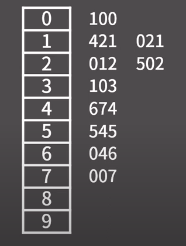

처음에는 수열에서 수를 하나씩 읽으면서 1의 자리에 따라 수를 넣는다.

즉 012는 1의 자리가 2니까 2번 리스트에 넣는다. 

이렇게 차례대로 수를 넣어준다. 이제 0번 리스트에서부터 보면서 수를 꺼내서 수열을 재배열 한다.


1의 자리의 크기에 따라서 재배열을 한 수열 

이제 10의 자리도 반복해서 진행 

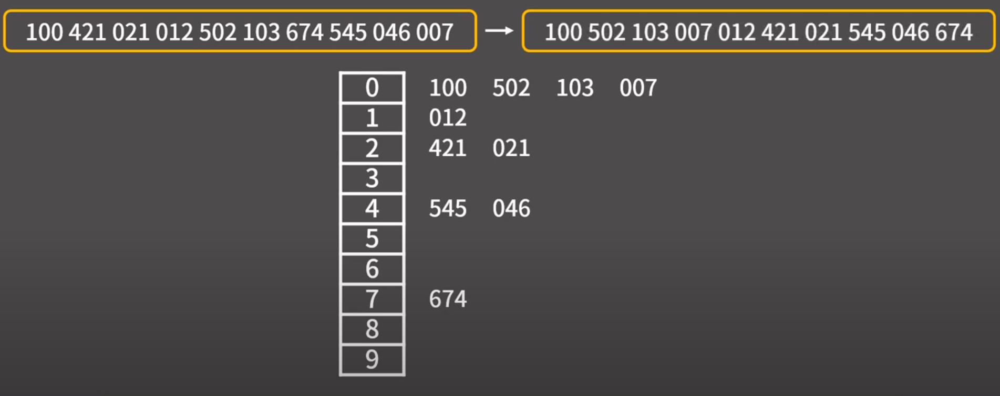

100의 자리

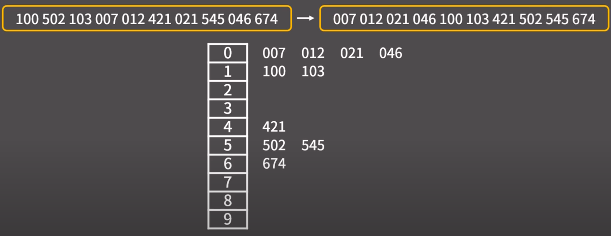

내가 정리한 수학 개념 정리1

[https://20240228.tistory.com/75](https://20240228.tistory.com/75)

내가 정리한 수학 개념 정리2 

[https://20240228.tistory.com/84](https://20240228.tistory.com/84)

이분탐색 = 정렬되어 있는 배열에서 특정 데이터를 찾기 위해 모든 데이터를 

순차적으로 확인하는 대신 탐색 범위를 절반으로 줄여가며 찾는 탐색 방법

선형 탐색 : O(N)

이분 탐색 : O(lgN)

  - 주의사항 
- 이분탐색을 하고자 한다면 주어진 값을 정렬
    - 무한 루프에 빠지지 않게 mid 값을 정해야 한다.
    - mid - (st+en+1)/2

**관련 문제 1 : 백준 1920 [수 찾기]**

**(1) 이분탐색 직접 구현** 

```java
import java.util.*;
import java.io.*;
public class Main {
    public static void main(String[] args) throws IOException{
        BufferedReader br = new BufferedReader(new InputStreamReader(System.in));
        int n = Integer.parseInt(br.readLine());
        StringTokenizer st;
        int [] A = new int[n];
        st = new StringTokenizer(br.readLine());
        for (int i = 0; i < n; i++) {
            A[i] = Integer.parseInt(st.nextToken());
        }

        Arrays.sort(A);

        int t = Integer.parseInt(br.readLine());
        int [] array = new int[t];
        st = new StringTokenizer(br.readLine());
        for (int i = 0; i < t; i++) {
            array[i] = Integer.parseInt(st.nextToken());
        }

        StringBuilder sb = new StringBuilder();
        for (int i = 0; i < t; i++) {
            int target = array[i];
            int start = 0;
            int end   = n - 1;
            int input = 0;
            while (start <= end){
                int mid = (start + end) / 2;
                if(A[mid] == target){
                    input = 1;
                    break;
                }
                else if(A[mid] < target){
                    start = mid + 1;
                }
                else end = mid - 1;
            }
            sb.append(input).append("\n");
        }
        System.out.println(sb);
    }
}
```

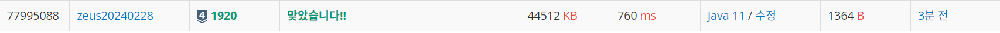

**(2) Arrays.binarySearch(int[] array , target)**

정렬된 배열에서 특정 요소를 찾아 인덱스를 반환합니다. 배열에 요소가 없으면 음수값을 반환합니다.

```java
import java.util.*;
import java.io.*;
public class Main {
    public static void main(String[] args) throws IOException{
        BufferedReader br = new BufferedReader(new InputStreamReader(System.in));
        int n = Integer.parseInt(br.readLine());
        StringTokenizer st;
        int [] A = new int[n];
        st = new StringTokenizer(br.readLine());
        for (int i = 0; i < n; i++) {
            A[i] = Integer.parseInt(st.nextToken());
        }

        Arrays.sort(A);

        int t = Integer.parseInt(br.readLine());
        int [] array = new int[t];
        st = new StringTokenizer(br.readLine());
        for (int i = 0; i < t; i++) {
            array[i] = Integer.parseInt(st.nextToken());
        }

        StringBuilder sb = new StringBuilder();
        for (int i = 0; i < t ; i++) {
            int target = array[i];
            int index = Arrays.binarySearch(A, target);
            if(index >= 0) sb.append(1);
            else sb.append(0);
            sb.append("\n");
        }
        System.out.println(sb);
    }
}
```


**(3) Collections.binarySearch(List<> list , target)**

정렬된 List에서 특정 요소를 찾아 인덱스를 반환합니다. List에 요소가 없으면 음수값을 반환합니다.


**관련 문제 2 : 백준 10816 [숫자 카드2] → 나중에 꼭 다시 한번 풀어보기**

```java
import java.io.*;
import java.util.*;
public class Main {
    static int [] cards;
    public static void main(String[] args) throws IOException {
        BufferedReader br = new BufferedReader(new InputStreamReader(System.in));
        StringTokenizer st;
        int n = Integer.parseInt(br.readLine());
        cards = new int[n];
        st = new StringTokenizer(br.readLine());
        for (int i = 0; i < n; i++) {
            cards[i] = Integer.parseInt(st.nextToken());
        }
        Arrays.sort(cards);
        int t = Integer.parseInt(br.readLine());
        st = new StringTokenizer(br.readLine());
        StringBuilder sb = new StringBuilder();
        for (int i = 0; i < t; i++) {
            int target = Integer.parseInt(st.nextToken());
            sb.append(upper_idx(target) - lower_idx(target)).append(" ");
        }
        System.out.println(sb);
    }
    public static int lower_idx(int target){
        int start = 0;
        int end   = cards.length;
        while (start < end){
            int mid = (start + end) / 2;
            if(cards[mid] < target){
                start = mid + 1;
            }
            else end = mid;
        }
        return start;
    }
    public static int upper_idx(int target){
        int start = 0;
        int end   = cards.length;
        while (start < end){
            int mid = (start + end) / 2;
            if(cards[mid] <= target){
                start = mid + 1;
            }
            else end = mid;
        }
        return  end;
    }
}
```

**관련 문제 3 : 백준 2295 [세 수의 합]** 

1) 시간 초과 코드

```java
import java.io.*;
import java.util.*;
public class Main {
    public static void main(String[] args) throws IOException{
        BufferedReader br = new BufferedReader(new InputStreamReader(System.in));
        int n = Integer.parseInt(br.readLine());

        int [] arr = new int[n];
        for (int i = 0; i < n; i++) {
            arr[i] = Integer.parseInt(br.readLine());
        }
        // 원소의 최대 크기는 2억 2억 * 3 = 6억 int 사용 가능
        Arrays.sort(arr);
        int size = arr.length;
        int max = 0;
        for (int i = 0; i < size; i++) {
            for (int j = 0; j < size; j++) {
                for (int k = 0; k < size; k++) {
                    int target = arr[i] + arr[j] + arr[k];
                    int st = 0;
                    int en = size - 1;
                    while (st <= en){
                        int mid = (st + en) / 2;
                        if(arr[mid] == target){
                            max = Math.max(max, target);
                            break;
                        }
                        else if(arr[mid] > target){
                            en = mid - 1;
                        }
                        else st = mid + 1;
                    }
                }
            }
        }
        System.out.println(max);
    }
}
```

2) 시간 초과 코드

```java
import java.io.*;
import java.util.*;
public class Main {
    public static void main(String[] args) throws IOException{
        BufferedReader br = new BufferedReader(new InputStreamReader(System.in));
        int n = Integer.parseInt(br.readLine());

        int [] arr = new int[n];
        for (int i = 0; i < n; i++) {
            arr[i] = Integer.parseInt(br.readLine());
        }

        // 원소의 최대 크기는 2억 2억 * 3 = 6억 int 사용 가능

        Arrays.sort(arr);

        Set<Integer> set = new HashSet<>();

        int size = arr.length;
        for (int i = 0; i < size - 1; i++) {
            for (int j = 0; j < size - 1; j++) {
                set.add(arr[i] + arr[j]);
            }
        }

        int [] check = set.stream().sorted((o1,o2)->{
            return o1.compareTo(o2);
        }).mapToInt(Integer::intValue).toArray();

        int size2 = check.length;

        int max = 0;
        for (int i = 0; i < size - 1; i++) {
            for (int j = 0; j < size2 - 1; j++) {
                int target = arr[i] + check[j];
                int st = 0;
                int et = size - 1;
                while (st <= et){
                    int mid = (st + et) / 2;
                    if(arr[mid] == target){
                        max = Math.max(max, target);
                        break;
                    }
                    else if(arr[mid] > target){
                        et = mid - 1;
                    }
                    else st = mid + 1;
                }
            }
        }
        System.out.println(max);
    }
}
```

3) 시간 초과 코드

```java
import java.io.*;
import java.util.*;
public class Main {
    public static void main(String[] args) throws IOException{
        BufferedReader br = new BufferedReader(new InputStreamReader(System.in));
        int n = Integer.parseInt(br.readLine());

        int [] arr = new int[n];
        for (int i = 0; i < n; i++) {
            arr[i] = Integer.parseInt(br.readLine());
        }

        // 원소의 최대 크기는 2억 2억 * 3 = 6억 int 사용 가능

        Arrays.sort(arr);

        Set<Integer> set = new HashSet<>();

        int size = arr.length;
        for (int i = 0; i < size - 1; i++) {
            for (int j = 0; j < size - 1; j++) {
                set.add(arr[i] + arr[j]);
            }
        }

        int [] check = set.stream().sorted((o1,o2)->{
            return o1.compareTo(o2);
        }).mapToInt(Integer::intValue).toArray();

        int size2 = check.length;

        int max = 0;
        for (int i = 0; i < size; i++) {
            for (int j = 0; j < size2; j++) {
                int target = arr[i] + check[j];
                int idx = Arrays.binarySearch(arr, target);
                if(idx <= -1) continue;
                max = Math.max(max, target);
            }
        }
        System.out.println(max);
    }
}
```

드디어 통과!

```java
import java.io.*;
import java.util.*;
public class BOJ2295 {
    public static void main(String[] args) throws IOException{
        BufferedReader br = new BufferedReader(new InputStreamReader(System.in));
        int n = Integer.parseInt(br.readLine());

        int [] arr = new int[n];
        for (int i = 0; i < n; i++) {
            arr[i] = Integer.parseInt(br.readLine());
        }

        // 원소의 최대 크기는 2억 2억 * 3 = 6억 int 사용 가능

        Arrays.sort(arr);

        Set<Integer> set = new HashSet<>();

        int size = arr.length;
        for (int i = 0; i < size - 1; i++) {
            for (int j = 0; j < size - 1; j++) {
                set.add(arr[i] + arr[j]);
            }
        }

        int [] check = set.stream().mapToInt(Integer::intValue).toArray();

        int size2 = check.length;

        for (int i = size - 1; i >= 0; i--) {
            for (int j = 0; j < size2; j++) {
                int target = arr[i] - check[j];
                int idx = Arrays.binarySearch(arr, target);
                if(idx >= 0){
                    System.out.println(arr[i]);
                    return;
                }
            }
        }
    }
} 
```

**핵심 로직** 

arr에 들어있는 배열의 값들을 2중 for문으로 미리 더해준다. 

arr배열의 제일 마지막 index 즉 제일 큰 값부터 새롭게 더해서 만든 배열을 빼서 

arr배열에 값이 있는지 이분 탐색을 통해 찾고 있으면 제일 큰 값이니 바로 return 

## **Parametric Search**

조건을 만족하는 최소/최댓값을 구하는 문제(최적화 문제)를 결정 문제로 변환해 이분탐색을 수행하는 방법 

관련 문제 백준 1654 [랜선 자르기]

배열에서 원래 이중 for문으로 O(N^2)에 처리되는 작업을 2개의 포인터의 움직임으로 O(N)에 해결하는 알고리즘

## 목차

  - 트리 용어 정리 
  - 이진 트리 
  - 이진 검색 트리 
  - 연산(Insert, Delete, Update, Find) 시뮬레이션
  - 이진 검색 트리 - 시간 복잡도 
  - 자가 균형 트리 

---

## 용어 정리 

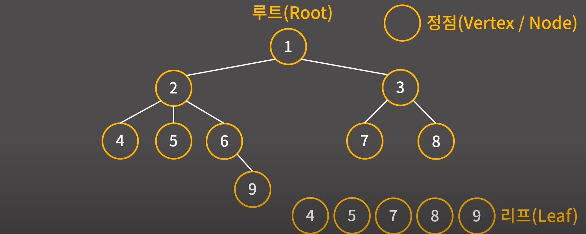

정점 : 트리에서의 각 원소 

루트 : 주어진 트리에서의 1번 정점 

리프 : 제일 말단에 위치해서 아래로 뻗은게 없는 정점 

간선 : 정점을 연결하는 선 


부모 - 자식 관계 : 간선으로 연결된 위 아래의 관계


서브 트리 : 어떤 한 정점에 대해 그 밑에 있는 정점과 간선만을 모은 트리 

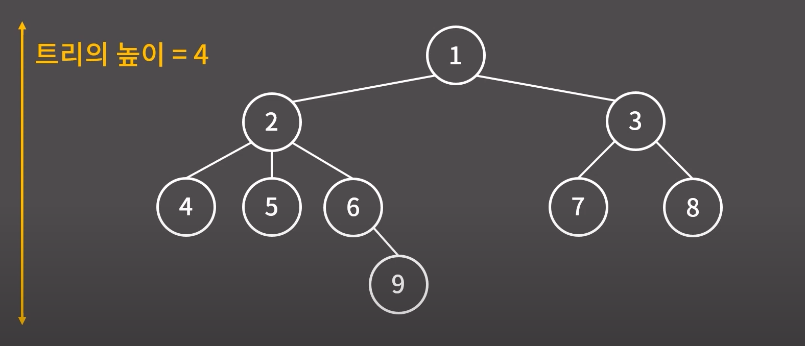

트리의 높이 : 위 아래로 뻗어있는 정도 

---

## 이진 트리 (Binary Tree) 

각 노드의 자식이 2개 이하인 트리 


---

## 이진 검색 트리 (Binary Search Tree)

왼쪽 서브트리의 모든 값은 부모의 값보다 작고 오른쪽 서브트리의 모든 값은 부모의 값보다 큰 이진 트리 


왜 이진 검색 트리를 사용하는가?

삽입(insert), 삭제(erase), 검색(find), 변경(update) → O(lgN)

→ 삭제, 검색, 변경이 빈번하다면 이진 검색 트리를 활용할 수 있다!

해시와 비교했을 때 해시는 최선의 경우 모든 연산이 O(1)인데 해시가 더 좋은 자료구조가 아닌가?

→ 이진 검색 트리의 강력한 특성 : 원소가 크기 순으로 정렬된다. 

ex) 1, 3, 5, 7, 9 

5보다 큰 최초의 원소가 무엇인지 알고 싶을 때 해시는 크기 순서대로 저장하는 자료구조가 아니어서 알 방법이 없지만 이진 검색 트리는 가능하다 O(lgN)

---

## BST 연산 시뮬레이션 

**Insert (삽입)**

45 삽입 


25 삽입 

이때 45를 기준으로 25는 왼쪽? 오른쪽 45보다 작으니까 왼쪽이다. 


35 삽입

이때 45를 기준으로 35는 왼쪽? 오른쪽? 45보다 작으니까 왼쪽 

이미 25가 있다. 25를 기준으로 35는 더 크니까 25의 오른쪽에 넣는다.


 

…. 중간 생략 

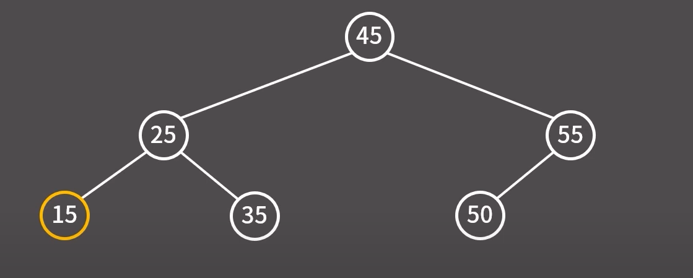

**Find(검색)**


35 검색 


45에서 35는 45보다 작으니까 왼쪽

25에서 35는 25보다 크니까 오른쪽 

 

**Erase(삭제)**


현재 그림처럼 무작정 삭제를 하면 트리 구조가 깨진다.  어떻게 제거를 수행?

**case 1 - 자식이 없는 정점** 


삭제를 해도 구조를 망가뜨리지 않는다.

**case 2 - 자식이 1개인 정점** 


이 경우엔 자식을 지워진 노드의 자리에 올리면 된다.

**case 3 - 자식이 2개인 정점**


32를 25 자리에 넣으면 된다.

왜 하필 32일까? 

그 이유는 32가 25 보다 크면서 가장 작은 원소이기 때문이다. 

그렇기 때문에 32는 25의 왼쪽 원소들 보다 크고 25의 오른쪽 원소들 보다 작다. 

실제 구현에서 32를 찾는 과정

지우고 싶은 원소(25)에서 일단 오른쪽 자식(35)을 보고 거기서부터 계속 왼쪽으로만 이동하고 

더이상 이동할 원소가 없으면 멈춘다. 

---

## 이진 검색 트리 - 시간 복잡도 


이진 검색 트리의 시간 복잡도는 트리의 높이가 얼마인지에 따라서 정해진다. 

만약 왼쪽 트리처럼 각 정점이 대부분 2개의 자식을 가지고 있다면 높이가 하나 내려갈 때 마다 

자식의 수가 1, 2, 4, 8 .. 이렇게 2배씩 증가하기 때문에 정점이 N개가 있다고 하면 높이가 대략 lg N이다. → O(lg N)

반면 오른쪽 트리처럼 트리가 편향되어 있다면 높이가 N에 가깝기 때문에 시간복잡도가 O(N)이다.

우리는 각 연산을 O(lg N)에 수행하려고 이진 검색 트리를 쓰는건데 그냥 사실상 LinkedList에서 하는 행위와 동일하다. 그래서 이진 검색 트리를 사용하는 의미가 없어진다. 

또한 1,2,3,4… 이렇게 크기 순으로 원소를 삽입하면 원소들이 오른쪽에 일직선으로 연결되는 편향된 트리가 되니 편향된 트리가 만들어지는 상황은 아주 잘 발생할 수 있다. 

그렇기 때문에 이진 검색 트리가 편향되면 그걸 해결해줄 필요가 있다. 이러한 트리를 자가 균형 트리라고 부르고 대표적으로 AVL 트리, Red Black 트리가 있다. 

---

## 자가 균형 트리 


아주 간단하게 설명하면 불균형이 발생하면 트리를 꺾어버린다. 

이렇게 편향성을 해소해주는 자가 균형 트리를 사용할 때 비로소 모든 연산이 O(lg N)에 동작한다. 

자바에서는 이진 검색 트리를 TreeMap 클래스로 구현을 했는데 

TreeMap 클래스는 레드-블랙 트리(Red-Black Tree)라는 특별한 형태의 이진 검색 트리를 내부적으로 사용하여 데이터를 관리한다.

## 트리 정의 


트리 : 무방향이면서 사이클이 없는 연결 그래프(Undirected Acyclic Connected Graph)

---

## 트리 특징 

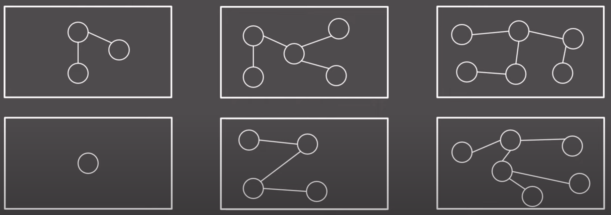

  - 임의의 간선을 제거하면 연결 그래프가 아니게 되는 그래프 
  - 임의의 두 점을 연결하는 simple path(정점이 중복해서 나오지 않는 경로)가 유일한 그래프 
  - V개의 정점을 가지고 V-1개의 간선을 가지는 연결 그래프 
  - 사이클이 없는 연결 그래프이면서 임의의 간선을 추가하면 사이클이 생기는 그래프 

---

## 임의의 정점을 루트로 만들기 


주어진 트리들은 모두 같은 트리이다. 

루트에 따라 트리 모양이 달라지고 각 노드의 부모 또한 달라진다. 

---

## 트리 BFS


트리에서의 BFS는 높이 순서대로 방문을 한다. 

1 → (2 / 3 / 4 ) → (5 / 6 ) → (7/ 8) 

트리에서는 BFS의 과정 속에서 자신의 자식들을 전부 큐에 넣어주기만 하면 된다. 

visited 배열의 필요가 없이 부모가 누구인지만 저장하고 있으면 된다. 

→ 해당 자식 정점으로 왔다면 이미 그 정점의 부모 정점은 방문을 한 상태이다.

---

## 트리 DFS


1 → 2 → 5 → 3 → 4 → 6 → 7 → 8 순서대로 방문 

일단 갈 수 있는 곳 까지 쭉쭉 들어가다가 더 이상 갈 수 없으면 돌아나와 다른 곳으로 간다

---

## 이진 트리의 순회 


  - 그림처럼 배열을 통해서 정의하기 
  - 구조체를 만들어서 하기 

```java
class Node{
	  int data;
	  Node left;
	  Node right; 
}
```

---

## 레벨 순회(Level-order Traversal)


루트에서 BFS를 돌리면 자연스럽게 레벨 순회가 된다. 

1 → 2 → 3 → 4 → 5 → 6 → 7 → 8

---

## 전위 순회(Preorder Traversal) 


  1. 현재 정점을 방문한다.
  1. 왼쪽 서브트리를 전위 순회한다. 
  1. 오른쪽 서브트리를 전위 순회한다. 

순회 순서 

1 → 2 → 4 → 5 → 8 → 3 → 6 → 7 

전위 순회는 DFS와 방문 순서가 동일하다. 

---

## 중위 순회(Inorder Traversal) 

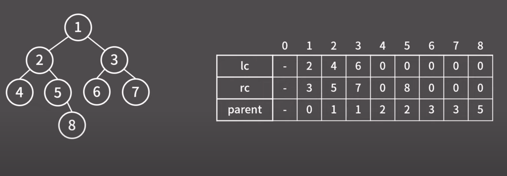

  1. 왼쪽 서브 트리를 중위 순회한다.
  1. 현재 정점을 방문한다.
  1. 오른쪽 서브 트리를 중위 순회한다. 

순회 순서 

4 → 2 → 5 → 8 → 1 → 6 → 3 → 7

---

## 후위 순회(Postorder Traversal) 


  1. 왼쪽 서브 트리를 후위 순회한다. 
  1. 오른쪽 서브 트리를 후위 순회한다.
  1. 현재 정점을 방문한다.

순회 순서 

4 → 8 → 5 → 2 → 6 → 7 → 3 → 1

---

## 구현 코드

```java
public class Tree {
    static class Node{
        int data;
        Node left;
        Node right;

        public Node(int data){
            this.data  = data;
            this.left  = null;
            this.right = null;
        }
        public void addLeft(Node node){
            this.left = node;
        }
        public void addRight(Node node){
            this.right = node;
        }

        public static void PreOrder(Node node){ // 전위 순회
            if(node == null) return;
            System.out.println(node.data);
            PreOrder(node.left);
            PreOrder(node.right);
        }
        public static void InOrder(Node node){ // 중위 순회
            if(node == null) return;
            InOrder(node.left);
            System.out.println(node.data);
            InOrder(node.right);
        }
        public static void PostOrder(Node node){ // 후위 순회
            if(node == null) return;
            PostOrder(node.left);
            PostOrder(node.right);
            System.out.println(node.data);
        }
    }
    /*
             1
         2       3
       4   5    6  7
             8
     */
    public static void main(String[] args) {
        Node node1 = new Node(1);
        Node node2 = new Node(2);
        Node node3 = new Node(3);
        Node node4 = new Node(4);
        Node node5 = new Node(5);
        Node node6 = new Node(6);
        Node node7 = new Node(7);
        Node node8 = new Node(8);

        node1.addLeft(node2);
        node1.addRight(node3);

        node2.addLeft(node4);
        node2.addRight(node5);

        node5.addRight(node8);

        node3.addLeft(node6);
        node3.addRight(node7);

        Node.PreOrder(node1);
        System.out.println("------");
        Node.InOrder(node1);
        System.out.println("------");
        Node.PostOrder(node1);

    }
}
```

---

## 신장 트리 

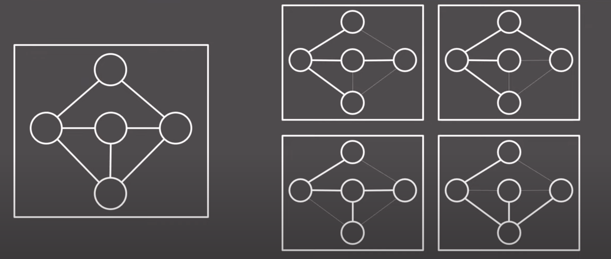

**신장 트리** 

주어진 방향성이 없는 그래프에서 부분 그래프(Subgraph)들 중에서 모든 정점을 포함하는 트리를 의미한다. 

→ 무방향이면서 사이클이 없는 → 트리

신장 트리는 v개의 정점을 가질때 v-1개의 정점을 가진다. (트리의 성질) 

**부분 그래프**

일부 정점과 간선만을 선택해서 구성한 새로운 그래프 

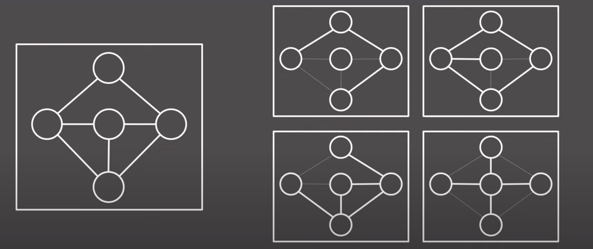

신장 트리가 아닌 그래프 예시 

---

## 최소 신장 트리 


신장 트리 중에서 간선의 합이 최소인 트리를 의미 

최소 신장 트리는 동일한 그래프에서 한 개로 정해지지 않고 여러 개일 수 있다. 

---

## 유니온 파인드(Union - Find) 알고리즘 

  - 그래프/트리의 대표적 알고리즘 
  - 서로소인 부분집합의 표현 
  - 여러 노드가 있을 때, 두 노드가 같은 그래프에 속해있는지 알 수 있음 
  - union(x, y) / find(x) 연산 
- union(x, y) : x와 y그래프를 합친다. 
    - find(x) : x가 어느 그래프에 속하는지 연산한다.

```java
// 유니온 파인드 알고리즘 구현 하기
public class UnionFind {
    public static int [] parent = new int[11];

    public static int find(int x){
        if(x == parent[x]){
            return x;
        }
        else return parent[x] = find(parent[x]);
    }

    public static void union(int x, int y){
        x = find(x);
        y = find(y);
        if(x < y) group[y] = x;
        else group[x] = y;
    }

    public static boolean isSameParent(int x, int y){
        x = find(x);
        y = find(y);
        if(x == y) return true;
        return false;
    }

    public static void main(String[] args) {
        for (int i = 1; i <= 8; i++) {
            parent[i] = i;
        }
        union(1, 2);
        union(2, 3);
        System.out.println(isSameParent(1, 3)); // 그래프 연결?
    }
}
```

---

## 크루스칼(Kruskal) 알고리즘 

크루스칼 알고리즘은 **Union Find 알고리즘**을 알고 있다고 가정할 때 

뒤에 나올 프림 알고리즘보다 구현이 쉽다. 

  1. 간선의 크기를 오름차순으로 정렬하고 제일 낮은 비용의 간선을 선택 
  1. 현재 선택한 간선이 정점 u,v를 연결하는 간선이라고 할 때 만약 u와 v가 같은 그룹이라면 아무 것도 하지 않고 넘어감, u, v가 다른 그룹이라면 같은 그룹으로 만들고 현재 선택한 간선을 최소 신장 트리에 추가 
  1. 최소 신장 트리에 v-1개의 간선을 추가시켰다면 과정을 종료, 그렇지 않다면 그 다음으로 비용이 작은 간선을 선택한 후  2번 과정을 반복 


맨 처음에는 모든 정점이 서로 다른 그룹에 속해 있는 상태로 시작 


간선을 오름차순으로 정렬하고 제일 낮은 비용의 간선을 선택 

1과 4를 연결하는 간선을 선택 

1과 4는 다른 그룹이다 그렇기 때문에 같은 그룹으로 만들고 1과 4를 연결하는 간선을 최소 신장 트리에 추가한다. 


제일 낮은 비용의 간선 선택 

1 → 3 간선 마찬가지로 다른 그룹이다 같은 그룹으로 만들고 간선을 최소 신장 트리에 추가 


제일 낮은 비용의 간선 선택 

3 → 4 간선 이번 case는 같은 그룹이다. 그렇기 때문에 아무 것도 하지 않는다. 

당연히 이 간선은 최소 신장 트리에 추가하지 않는다. 


제일 낮은 비용의 간선 선택 

1 → 4 마찬가지로 다른 그룹이다 같은 그룹으로 만들고 간선을 최소 신장 트리에 추가 


제일 낮은 비용의 간선 선택 

3 → 5 마찬가지로 다른 그룹이다 같은 그룹으로 만들고 간선을 최소 신장 트리에 추가 

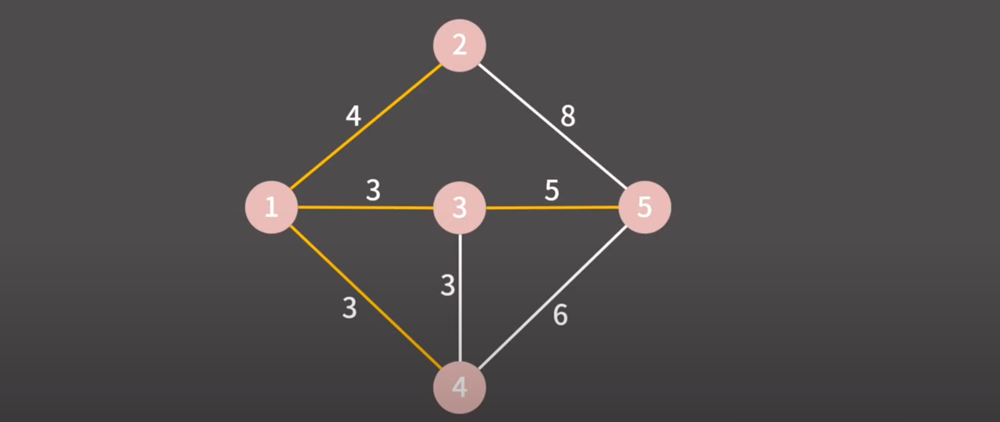

정점이 총 5개인데 4개의 간선을 최소 신장 트리에 추가했다. 

최소 신장 트리를 만들어내는데 성공했고 알고리즘이 종료된다. 

이 알고리즘은 그냥 사이클을 만들어내지 않는 선에서 비용이 작은 간선부터 최소 신장 트리에 편입시키는 그리디 알고리즘이다. 

같은 그룹의 정점을 최소 신장 트리에 넣지 않는 이유는 해당 간선으로 인해 사이클이 생기기 때문이다.

그런데 특정 두 정점이 같은 그룹인지 다른 그룹인지를 어떻게 판단할 수 있을까? 

→ Union Find 

---

## 백준 1197 최소 스패닝 트리 [골드4] - 크루스칼 

```java
import java.io.*;
import java.util.*;
public class Main  {
    static int [] parent = new int[10001]; // 정점의 최대 개수 10000
    static int n, e; // 정점, 간선의 개수
    public static void main(String[] args) throws IOException{
        BufferedReader br = new BufferedReader(new InputStreamReader(System.in));
        StringTokenizer st;
        st = new StringTokenizer(br.readLine());
        n = Integer.parseInt(st.nextToken());
        e = Integer.parseInt(st.nextToken());

        List<int []> edges = new ArrayList<>();
        for (int i = 0; i < e ; i++) {
            st = new StringTokenizer(br.readLine());
            int a = Integer.parseInt(st.nextToken()); // 정점
            int b = Integer.parseInt(st.nextToken()); // 정점
            int c = Integer.parseInt(st.nextToken()); // 가중치  // -1000000 ~ 1000000
            edges.add(new int[]{a,b,c});
        }
        // Collections.sort(edges, Comparator.comparingInt(o -> o[2]));
        Collections.sort(edges, (o1, o2)->{
            return o1[2] - o2[2];
        });

        for (int i = 1; i <= n; i++) {
            parent[i] = i;
        }

        int cnt = 0;
        int ans = 0;
        for (int[] edge : edges) {
            if(cnt == n - 1) break;
            if(isSameGroup(edge[0], edge[1])) continue;
            ans += edge[2];
            cnt++;
            union(edge[0], edge[1]);
        }
        System.out.println(ans);

    }
    public static void union(int x, int y){
        x = find(x);
        y = find(y);
        if(x < y){
            parent[y] = x;
        }
        else{
            parent[x] = y;
        }
    }
    public static int find(int x){
        if(x == parent[x]) return x;
        return parent[x] = find(parent[x]);
    }

    public static boolean isSameGroup(int x, int y){
        x = find(x);
        y = find(y);
        if(x == y) return true;
        return false;
    }
}
```

---

## 프림(Prim) 알고리즘 

  1. 임의의 정점을 선택해 최소 신장 트리에 추가 
  1. 최소 신장 트리에 포함된 정점과 최소 신장 트리에 포함되지 않은 정점을 연결하는 간선 중 비용이 가장 적은 것을 최소 신장 트리에 추가 
  1. 최소 신장 트리에 v-1개의 간선이 추가될 때 까지 2번 과정을 반복 

**Kruskal vs prim**

**크루스칼 알고리즘**은 가장 비용이 낮은 간선부터 시작해 서로 떨어져 있던 정점들을 합쳐나가며 총 v-1 개의 간선을 택하는 알고리즘 

**프림 알고리즘**은 한 정점에서 시작해 확장해 나가는 알고리즘이다. 


우선 하나의 정점을 잡아 최소 신장 트리에 추가 → 1번 선택 

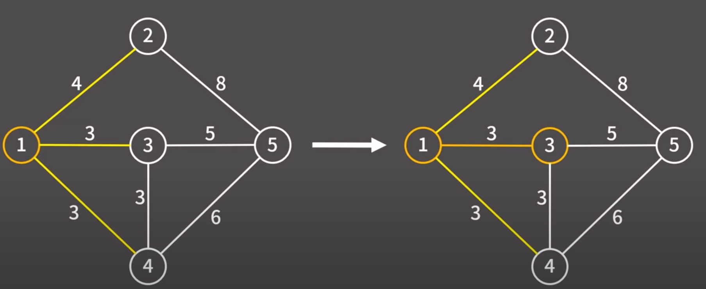

현재 최소 신장 트리에 포함된 정점과 최소 신장 트리에 포함되지 않은 정점을 연결하는 간선은

1 → 2 /  1 → 3 / 1 → 4  총 3개가 있다. 

여기서 비용이 가장 낮은 간선은 1 → 3 (3) / 1 → 4 (3) 인데 

1 → 3 간선을 택하겠다. 해당 간선을 택했기 때문에 해당 간선과 정점을 최소 신장 트리에 추가 


현재 최소 신장 트리에 포함된 정점과 최소 신장 트리에 포함되지 않은 정점을 연결하는 간선은

1 → 2 (4) / 1 → 4 (3) / 3 → 4(3) / 3 → 5 (5) 총 4개이다. 

이들 중에서 비용이 가장 낮은 간선은 1 → 4 (3) / 3 → 4(3) 2개이다. 

3 → 4 간선을 택하겠다. 해당 간선을 택했기 때문에 해당 간선과 정점을 최소 신장 트리에 추가 

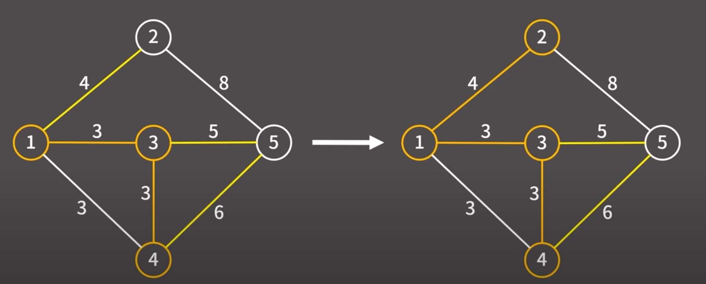

현재 최소 신장 트리에 포함된 정점과 최소 신장 트리에 포함되지 않은 정점을 연결하는 간선은

1 → 2 (4) / 3 → 5 (5) / 4 → 5 (6) 총 3개이다.

이들 중에서 비용이 가장 낮은 간선은 1 → 2 이다. 

해당 간선을 택했기 때문에 해당 간선과 정점을 최소 신장 트리에 추가 


현재 최소 신장 트리에 포함된 정점과 최소 신장 트리에 포함되지 않은 정점을 연결하는 간선은

2 → 5 (8) / 3 → 5 (5) / 4 → 5 (6) 총 3개이다. 

이들 중에서 비용이 가장 낮은 간선은 3 → 5이다. 

3 → 5 간선을 택하겠다. 해당 간선을 택했기 때문에 해당 간선과 정점을 최소 신장 트리에 추가 


정점이 총 5개인데 4개의 간선을 최소 신장 트리에 추가했다.

이제 알고리즘은 종료한다. (트리 : 간선의 개수 = 정점 - 1) 

프림 알고리즘을 효율적으로 구현하기 위해서는 우선순위 큐가 필요하다. 

우선순위 큐에 적절히 간선을 넣어두면 매 순간마다 최소 신장 트리에 포함된 정점과 최소 신장 트리에 포함되지 않은 정점을 연결하는 간선 중에서 최소를 효율적으로 알아낼 수 있다. 

---

## 백준 1197 최소 스패닝 트리 [골드4] - 프림 

```java
public class Main {
    public static void main(String[] args) throws IOException{
        BufferedReader br = new BufferedReader(new InputStreamReader(System.in));
        StringTokenizer st;
        st = new StringTokenizer(br.readLine());
        int n = Integer.parseInt(st.nextToken()); // 정점의 개수
        int m = Integer.parseInt(st.nextToken()); // 간선의 개수
        ArrayList<int []>[] graph = new ArrayList[n+1];
        for (int i = 0; i <= n; i++) {
            graph[i] = new ArrayList<>();
        }
        while (m-->0){
            st = new StringTokenizer(br.readLine());
            int v1 = Integer.parseInt(st.nextToken());
            int v2 = Integer.parseInt(st.nextToken());
            int c = Integer.parseInt(st.nextToken());
            graph[v1].add(new int[]{v2, c});
            graph[v2].add(new int[]{v1, c});
        }

        PriorityQueue<int[]> pq = new PriorityQueue<>(Comparator.comparingInt(o -> o[1])); // o[2]가 낮은 순서대로
        boolean [] visited = new boolean[n+1];
        visited[1] = true;
        int cnt = 0;
        int ans = 0;

        for (int[] ints : graph[1]) {
            pq.add(ints);
        }

        while (cnt < n - 1){
            int [] temp = pq.poll();
            if(visited[temp[0]]) continue; // 방문한 정점과 방문하지 않은 정점
            visited[temp[0]] = true;
            cnt++;
            ans += temp[1];
            for (int i = 0; i < graph[temp[0]].size(); i++) {
                int [] next = graph[temp[0]].get(i);
                if(visited[next[0]]) continue;
                pq.add(next);
            }
        }
        System.out.println(ans);

    }
}
```

---

## 참고 자료 

Union - Find : [유니온 파인드 알고리즘 참고 자료](https://velog.io/@suk13574/%EC%95%8C%EA%B3%A0%EB%A6%AC%EC%A6%98Java-%EC%9C%A0%EB%8B%88%EC%98%A8-%ED%8C%8C%EC%9D%B8%EB%93%9CUnion-Find-%EC%95%8C%EA%B3%A0%EB%A6%AC%EC%A6%98)

최소 신장 트리 강의 : [바킹독: MST 강의](https://www.youtube.com/watch?v=4wA3bncb64E&list=PLtqbFd2VIQv4O6D6l9HcD732hdrnYb6CY&index=29)

---

## 목차

  - 플로이드 설명 
  - 플로이드 알고리즘 과정 
  - 플로이드 알고리즘 시간 복잡도
  - 백준 11404 플로이드 골드4 
  - 백준 11780 플로이드2 골드2
  - 참고 자료 

---

## 플로이드 설명 

Folyd(플로이드) 알고리즘은 그래프 최단 경로를 찾는 알고리즘 중 하나이다. 


정점1 → 정점3 : 최단경로는 1이다. 

정점3 → 정점5 : 최단경로는 3 → 4 + 4 → 5 = 3 + 6 = 9 이다. 

플로이드 알고리즘 = 모든 정점 쌍 사이의 최단 거리를 구하는 알고리즘 

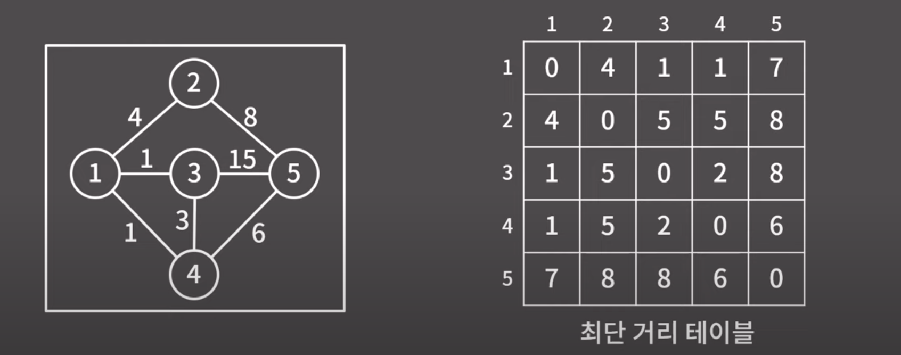

현재 그래프는 무방향(양방향) 그래프 이지만 그래프가 방향 그래프이건, 무방향 그래프이건 상관이 없다. 

간선의 값이 음수여도 잘 동작하지만, 음수인 사이클이 있으면 문제가 생긴다. 

하지만 애초에 간선의 값이 음수인 상황이 일반적이지는 않다. 

플로이드 알고리즘의 구현 난이도는 MST에 비해 비교적 쉬운 편이다. 

---

## 플로이드 알고리즘 과정 


일단 현재 그래프에서 테이블에 당장 채울수 있는 것만 채우겠다. 

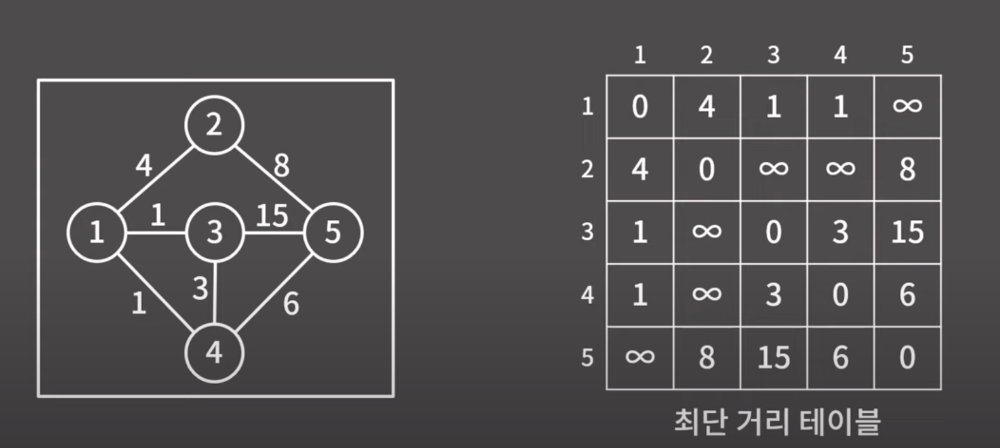

자기 자신으로 가는 거리는 0 

간선 1개로 바로 건너갈 수 있는 곳 또한 간선의 값으로 바로 채울 수 있다. 

그래프에 간선이 많기 때문에 자명한 것들만 채워도 꽤 많이 채워진다. 

하지만 현재 최단 거리 테이블은 문제가 많다. 

예를 들어 3에서 5로 가는 최단 경로는 9이다. 지금은 간선 1개 짜리만 보니 15로 채워져있다.

일단 현재의 최단 거리 테이블은 중간에 다른 정점을 거치지 않았을 때의 최단 거리가 저장되어 있는 테이블이라고 생각하면 된다. 

이제 중간에 다른 정점을 거치지 않았거나 1번 정점을 거쳐서 갈 때의 최단 거리가 저장되도록 수정해보겠다. 


현재 2 → 4의 최단 경로는 ∞ 이다. 

이때 1을 거쳐서 가면 2에서 1로 가는 간선, 1에서 4로 가는 간선을 이용해 거리 5로 갈 수 있으니까 해당 칸의 값을 5로 갱신하고 싶다.

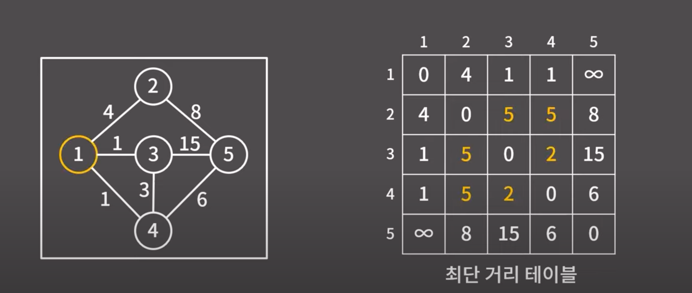

s에서 t로 갈 때 1번 정점을 거쳐가는 최단 거리는 D[s][1] + D[1][t]이다. 

D[s][1] + D[1][t]가 의미하는 바는 s에서 1까지 최단 경로로 가고 그 후 1부터 1부터 t까지 다시 최단 경로로 갔을 때의 값이다.

D[s][t] 보다 D[s][1] + D[1][t]가 더 작은 경우, 즉 1번 정점을 거쳐가는 것이 더 효율적일 때에만 

D[s][t] = D[s][1] + D[1][t] 이렇게 갱신을 해준다. 


현재 테이블은 다른 정점 x / 1번 정점 / 2번 정점을 거쳐갔을 때의 최단 거리 테이블이다. 

→ D[s][t] > D[s][2] + D[2][t]  →   D[s][t] = D[s][2] + D[2][t]  갱신

중간에 다른 정점을 거치지 않았거나 3번 정점을 거쳐갔을 때의 최단 거리 

중간에 다른 정점을 거치지 않았거나 4번 정점을 거쳐갔을 때의 최단 거리 

…..

마지막 n번 정점을 거쳐갔을 때의 최단 거리 까지 갱신하면 끝이다.


최종 결과

---

## 플로이드 알고리즘 시간 복잡도 

정점이 V개라고 할 때, 총 v단계에 걸쳐 갱신이 이루어지고 각 k=1,2,3,…,V번째 단계마다 

총 V^2개의 모든 D[s][t]값을 D[s][k] + D[k][t]값과 비교하기 때문에 

플로이드 알고리즘의 시간 복잡도는 **O(V^3)**이다. 

보통 컴퓨터는 1초에 3~4억 정도의 연산이 가능하다고 알고 있지만 

플로이드 알고리즘은 단순 사칙 연산만 있어서 정점이 1000개까지도 가능하다.

**상수시간 최적화 - (연산 < 대입)** 

  - 대입이 더 시간이 오래 걸리니까 min을 사용하지 않고 연산을 해서 꼭 필요한 경우에만 대입을 하도록 하자 

---

## 백준 11404 플로이드 골드4 

```java
import java.io.*;
import java.util.*;
public class Main {
    public static final int INF = 100000 * 100;
    public static void main(String[] args) throws IOException {
        BufferedReader br = new BufferedReader(new InputStreamReader(System.in));
        StringTokenizer st;
        int n = Integer.parseInt(br.readLine()); // 도시의 개수
        int m = Integer.parseInt(br.readLine()); // 버스의 개수
        int [][] D = new int[n][n];
        for (int i = 0; i < n; i++) {
            for (int j = 0; j < n; j++) {
                if(i == j){
                    D[i][j] = 0;
                    continue;
                }
                D[i][j] = INF;
            }
        }
        while (m-->0){
            st = new StringTokenizer(br.readLine());
            int v1 = Integer.parseInt(st.nextToken()) - 1;
            int v2 = Integer.parseInt(st.nextToken()) - 1;
            int cost = Integer.parseInt(st.nextToken());
            if(D[v1][v2] > cost) D[v1][v2] = cost;
        }

        for (int i = 0; i < n; i++) {
            for (int j = 0; j < n; j++) {
                for (int k = 0; k < n; k++) {
                    if(D[j][k] > D[j][i] + D[i][k]){
                        D[j][k] = D[j][i] + D[i][k];
                    }
                }
            }
        }
        StringBuilder sb = new StringBuilder();
        for (int i = 0; i < n; i++) {
            for (int j = 0; j < n; j++) {
                if(D[i][j] == INF) D[i][j] = 0;
                sb.append(D[i][j]).append(" ");
            }
            sb.append("\n");
        }
        System.out.println(sb);
    }
}
```

---

## 백준 11780 플로이드2 골드2

```java
import java.io.*;
import java.util.*;
public class Main {
    public static final int INF = 100000 * 99;
    public static void main(String[] args) throws IOException{
        BufferedReader br = new BufferedReader(new InputStreamReader(System.in));
        StringTokenizer st;
        int n = Integer.parseInt(br.readLine()); // 도시의 개수
        int m = Integer.parseInt(br.readLine()); // 버스의 개수
        int [][] D = new int[n][n];
        int [][] next = new int[n][n];

        for (int i = 0; i < n; i++) {
            for (int j = 0; j < n; j++) {
                if(i == j){
                    D[i][j] = 0;
                    continue;
                }
                D[i][j] = INF;
            }
        }
        while (m-->0){
            st = new StringTokenizer(br.readLine());
            int v1 = Integer.parseInt(st.nextToken()) - 1;
            int v2 = Integer.parseInt(st.nextToken()) - 1;
            int cost = Integer.parseInt(st.nextToken());
            if(D[v1][v2] > cost){
                D[v1][v2] = cost;
                next[v1][v2] = v2;
            }
        }

        for (int i = 0; i < n; i++) {
            for (int j = 0; j < n; j++) {
                for (int k = 0; k < n; k++) {
                    if(D[j][k] > D[j][i] + D[i][k]){
                        D[j][k] = D[j][i] + D[i][k];
                        next[j][k] = next[j][i];
                    }
                }
            }
        }
        StringBuilder sb = new StringBuilder();
        for (int i = 0; i < n; i++) {
            for (int j = 0; j < n; j++) {
                if(D[i][j] == INF) D[i][j] = 0;
                sb.append(D[i][j]).append(" ");
            }
            sb.append("\n");
        }
        for (int i = 0; i < n; i++) {
            for (int j = 0; j < n; j++) {
                if(D[i][j] == 0){
                    sb.append(0).append("\n");
                    continue;
                }
                Queue<Integer> q = new LinkedList<>();
                q.add(i + 1);
                int cur = i;
                while (cur != j){
                    cur = next[cur][j];
                    q.add(cur + 1);
                }
                sb.append(q.size()).append(" ");
                while (!q.isEmpty()){
                    sb.append(q.poll()).append(" ");
                }
                sb.append("\n");
            }
        }
        System.out.println(sb);
    }
}
```

---

## 참고 자료 

[https://www.youtube.com/watch?v=dDDy2bEZRA8&list=PLtqbFd2VIQv4O6D6l9HcD732hdrnYb6CY&index=29](https://www.youtube.com/watch?v=dDDy2bEZRA8&list=PLtqbFd2VIQv4O6D6l9HcD732hdrnYb6CY&index=29)

---

## 목차 

  - 다익스트라?
  - 다익스트라 진행 과정 
  - 우선순위 큐를 이용한 다익스트라 알고리즘 
  - 백준 1753 최단경로 골드4
  - 백준 11779 최소비용 구하기2 골드3 - 다익스트라 경로 복원
  - 참고 자료 

---

## 다익스트라?

다익스트라 알고리즘 = 하나의 시작점으로부터 다른 모든 정점까지의 최단 거리를 구하는 알고리즘 


다익스트라 알고리즘을 돌리면 최단 거리 테이블을 채울 수 있다. 

**플로이드  VS 다익스트라 VS 벨만 포드** 

  - 플로이드: 모든 정점 쌍 사이의 최단 거리를 구하는 알고리즘 
- 음수인 간선 허용 O
    - 음수인 사이클 허용 X
  - 다익스트라: 하나의 시작점으로부터 다른 모든 정점까지의 최단 거리를 구하는 알고리즘 
- 음수인 간선 허용 X 
    - 플로이드 보다 훨씬 효율적
    - 음수인 간선이 있는데 하나의 시작점으로부터 모든 정점까지의 거리를 구하고 싶으면 벨만포드 알고리즘을 사용한다. 
    - 네트워크에서 사용한다.

---

## 다익스트라 진행 과정 

다익스트라는 시작 정점과 도착 정점까지의 최단 거리를 확정하면서 모든 정점과의 최단 거리를 구하는 알고리즘이다. 

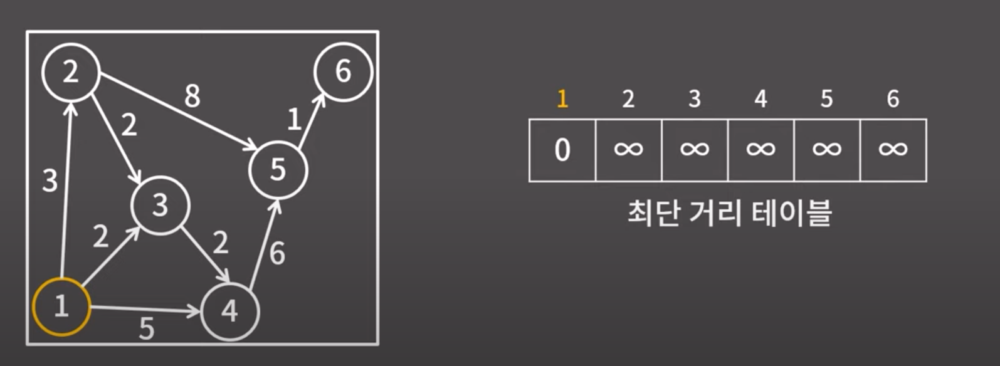

1번 정점에서 다른 모든 정점까지의 최단 거리를 구해보자.

자기 자신과의 거리는 0일 테니 1번 인덱스의 값은 0으로 둔다. 


현재 1번 정점에서는 2, 3, 4번 정점으로만 갈 수 있는데 각 정점까지의 최단 거리는 3, 2, 5 이다.

그러면 2, 3, 4번 정점 중에서 가장 가까운 건 3번 정점이기 때문에 3번 정점까지의 거리를 2로 확정한다. 

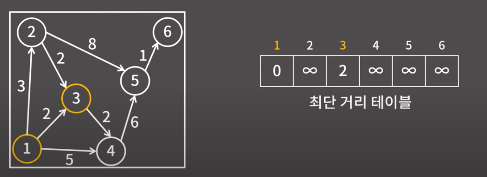

이제 1번과 3번 정점에서 갈 수 있는 정점은 2번 정점과 4번 정점이 있다. 

2번 정점까지의 거리는 3이고 4번 정점까지의 거리는 1→3 + 3→4 = 4 이다. 

둘 중에서 더 가까운건 2번 정점이여서 2번 정점까지의 거리를 3으로 확정한다. 


1번, 2번, 3번 정점에서 갈 수 있는 정점은 4, 5번 정점이다. 

둘 중에서 더 가까운건 4번 정점이여서 4번 정점까지의 거리를 4로 확정한다. 

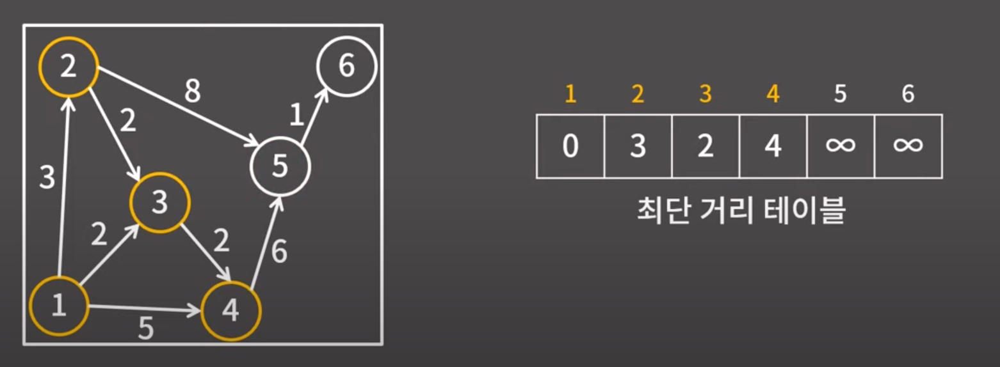

1, 2, 3, 4 정점에서 갈 수 있는 정점은 5번 정점만 존재한다. 5번 정점의 거리는 10으로 바로 확정 가능하다. 


마지막으로 1, 2, 3, 4, 5 정점에서 갈 수 있는 정점은 6번 정점만 존재한다. 6번 정점의 거리는 11으로 바로 확정 가능하다. 


최종 결과 

---

## 우선순위 큐를 이용한 다익스트라 알고리즘 

  1. 우선순위 큐에 (0, 시작점) 추가 
  1. 우선순위 큐에서 거리가 가장 작은 원소를 선택, 해당 거리가 최단 거리 테이블에 있는 값과 다를 경우 넘어감 
  1. 원소가 가리키는 정점을 V라고  할 때, V와 이웃한 정점들에 대해 최단 거리 테이블 값보다 V를 거쳐가는 것이 더 작은 값을 가질 경우 최단 거리 테이블의 값을 갱신하고 우선순위 큐에(거리, 이웃한 정점의 번호) 추가 
  1. 우선순위 큐가 빌 때 까지 2, 3번 과정을 반복 

---

## 백준 1753 최단경로 골드4

```java
import java.io.*;
import java.util.*;
public class Main {
    static final int INF = 10 * 20000; // 간선의 최대 가중치 * 정점의 개수
    public static void main(String[] args) throws IOException {
        BufferedReader br = new BufferedReader(new InputStreamReader(System.in));
        StringTokenizer st;
        st = new StringTokenizer(br.readLine());
        int v = Integer.parseInt(st.nextToken()); // 정점의 개수  1 <= v <= 20000
        int e = Integer.parseInt(st.nextToken()); // 간선의 개수  1 <= e <= 300/000

        int s = Integer.parseInt(br.readLine());  // 시작 정점

        ArrayList<int[]>[] graph = new ArrayList[v+1]; // 그래프 초기화
        for (int i = 0; i <= v; i++) {
            graph[i] = new ArrayList<>();
        }

        // 방향 그래프
        while (e-->0){
            st = new StringTokenizer(br.readLine());
            int sv = Integer.parseInt(st.nextToken()); // 시작 정점
            int ev = Integer.parseInt(st.nextToken()); // 도착 정점
            int c = Integer.parseInt(st.nextToken());  // 가중치
            graph[sv].add(new int[]{ev, c});
        }

        int [] min = new int[v+1];
        Arrays.fill(min, INF);
        min[s] = 0;
        PriorityQueue<int[]> pq = new PriorityQueue<>(Comparator.comparingInt(o -> o[1]));
        pq.add(new int[]{s, 0});
        while (!pq.isEmpty()){
            int [] temp = pq.poll();
            if(min[temp[0]] != temp[1]) continue; // 확정된 정점인데 값이 다른 경우
            for (int i = 0; i < graph[temp[0]].size(); i++) {
                int [] next = graph[temp[0]].get(i);
                if(min[next[0]] <= min[temp[0]] + next[1]) continue;
                min[next[0]] = min[temp[0]] + next[1];
                pq.add(new int[]{next[0], min[next[0]]});
            }
        }
        StringBuilder sb = new StringBuilder();
        for (int i = 1; i <= v; i++) {
            if(min[i] == INF){
                sb.append("INF").append("\n");
                continue;
            }
            sb.append(min[i]).append("\n");
        }
        System.out.println(sb);
    }
}
```

---

## 백준 11779 최소비용 구하기2 골드3 - 다익스트라 경로 복원

```java
import java.io.*;
import java.util.*;
public class Main {
    static final int INF = 1000 * 100000; // 1000개의 정점 * 버스 최대 비용 100000
    public static void main(String[] args) throws IOException{
        BufferedReader br = new BufferedReader(new InputStreamReader(System.in));
        StringTokenizer st;
        int n = Integer.parseInt(br.readLine()); // 도시의 개수
        int m = Integer.parseInt(br.readLine()); // 버스의 개수

        // 그래프 초기화
        ArrayList<int []> [] graph = new ArrayList[n+1];
        for (int i = 0; i <= n; i++) {
            graph[i] = new ArrayList<>();
        }

        // 간선 input 무방향? 방향?
        while (m-->0){
            st = new StringTokenizer(br.readLine());
            int s = Integer.parseInt(st.nextToken());
            int e = Integer.parseInt(st.nextToken());
            int c = Integer.parseInt(st.nextToken());
            graph[s].add(new int[]{e,c});
        }

        st = new StringTokenizer(br.readLine());
        int start = Integer.parseInt(st.nextToken()); // 시작 정점
        int end   = Integer.parseInt(st.nextToken()); // 도착 정점

        int [] min  = new int[n+1]; // 최단 거리 테이블
        int [] next = new int[n+1]; // 경로 복원용

        Arrays.fill(min, INF);
        min[start] = 0;

        PriorityQueue<int[]> pq = new PriorityQueue<>(Comparator.comparingInt(o -> o[1]));
        pq.add(new int[]{start, 0});
        while (!pq.isEmpty()){
            int [] temp = pq.poll();
            if(min[temp[0]] != temp[1]) continue; // 확정된 정점의 거리와 다른 경우
            for (int i = 0; i < graph[temp[0]].size(); i++) {
                int [] nx = graph[temp[0]].get(i);
                if(min[nx[0]] <= min[temp[0]] + nx[1]) continue;
                min[nx[0]] = min[temp[0]] + nx[1];
                next[nx[0]] = temp[0];
                pq.add(new int[]{nx[0], min[nx[0]]});
            }
        }

        Stack<Integer> stack = new Stack<>();
        stack.push(end);
        int s = start;
        int e = end;
        while (s != e){
            e = next[e];
            stack.push(e);
        }
        StringBuilder sb = new StringBuilder();
        sb.append(min[end]).append("\n");
        sb.append(stack.size()).append("\n");
        while (!stack.isEmpty()){
            sb.append(stack.pop()).append(" ");
        }
        System.out.println(sb);
    }
}
```

---

## 참고 자료 

[https://www.youtube.com/watch?v=o9BnvwgPT-o&list=PLtqbFd2VIQv4O6D6l9HcD732hdrnYb6CY&index=30](https://www.youtube.com/watch?v=o9BnvwgPT-o&list=PLtqbFd2VIQv4O6D6l9HcD732hdrnYb6CY&index=30)

---

## 목차 

  - 알고리즘 설명 
  - 알고리즘 Simulation 
  - 알고리즘 구현 
  - 백준 2252 줄 세우기 골드3
  - 참고자료 

---

## 알고리즘 설명 

실생활에서 예시 : 교과 이수 제도 

대학교에는 선수 과목이라는 개념이 존재한다. 

→ 프로그래밍1 → 프로그래밍2 / 일반수학 → 공업수학 

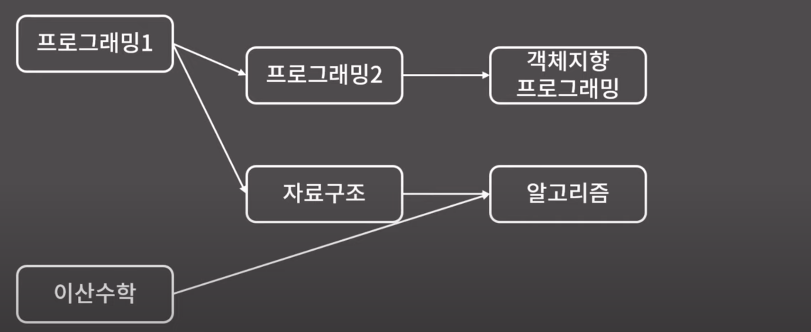

여기 내가 대학교에서 수업을 들어야 하는 과목들이 있다. 

모든 과목을 수강하고 싶다고 하면 어떤 순서로 과목을 들어야 할까?   

수강을 하는 순서로는 다양한 방법들이 존재한다. 

1) 이산수학, 프로그래밍1, 프로그래밍2, 자료구조, 알고리즘, 객체지향 프로그래밍 

2) 프로그래밍1, 프로그래밍2, 객체지향 프로그래밍, 자료구조, 이산수학, 알고리즘 

……

이 때 과목을 정점으로 나타내고 과목의 선후 관계를 간선으로 나타낸 상황을 생각해보자.


그러면 이런 그래프가 나온다.

**위상 정렬(Topological Sorting) : 방향 그래프에서 간선으로 주어진 정점 간 선후관계를 위배하지** 

**않도록 나열하는 정렬** 

하나의 그래프에는 여러 개의 위상 정렬 결과가 있을 수 있다. 

ABDEEF, ACEDBF, BADCEF, BADFCE 등이 전부 올바른 위상 정렬이다.


이렇게 그래프 안에 사이클이 존재할 경우에는 올바른 위상 정렬이 존재할 수 없다.

ABC 중에 그 어떤 것이 먼저 나오더라도 간선으로 주어진 정점 간 선후관계에 모순이 발생하기 때문이다.

그렇기 때문에 위상정렬은 사이클이 존재하지 않는 방향 그래프에서만 동작한다.

사이클이 없는 방향 그래프를 **DAG(Directed Acyclic Graph)**라고 줄여서 부르기도 한다.

 

---

## 알고리즘 Simulation 


해당 그래프를 위상 정렬을 해서 결과를 도출해 보자.


위상 정렬 상에서 제일 앞에 오는 원소로 가능한 게 무엇인지를 먼저 생각해 보자.

제일 앞에 오려면 자신의 정점 보다 앞에 있는 정점이 없어야 한다. 

즉 자신에게 들어오는 간선이 없어야 한다.

A → B 간선을 분석해 보자.

B 정점은 A 정점 이후에 등장할 수 있다.

그래서 B정점은 제일 앞에 올수 없다.

자신에게 들어오는 간선의 개수를 **indegree** 라고 표현을 하면 

위상 정렬 시작 정점은 indegree가 0인 A,C,G가 가능하다.


셋 중 어느 것이 제일 앞에 오더라도 전혀 상관이 없겠지만 임의로 A를 택한다.

A를 추가한 이후로는 A에서 다른 정점으로 나가는 간선은 의미가 없다.

그렇기에 주어진 그래프에서 정점 A와 A에서 뻗어나가는 간선을 모두 지운 후

위상 정렬을 이어나가면 된다. 


정점 A가 제거된 후 B,C,D,E,F,G로 이루어진 그래프에서 제일 앞에 위치할 수 있는 정점, 

즉 자신에게 돌아오는 간선이 없는 정점은 C, G 

임의로 C를 택한다.


A에서 했던 동작과 마찬가지로 정점C와 C에서 뻗어나가는 간선을 모두 지운다.

정점 C가 제거된 후 B,D,E,F,G로 이루어진 그래프에서 제일 앞에 위치할 수 있는 정점은 

D와 G이다. 

임의로 D를 택한다.


정점D와 D에서 뻗어나가는 간선을 모두 지운다.

정점 D가 제거된 후 B,E,F,G로 이루어진 그래프에서 제일 앞에 위치할 수 있는 정점은 

B와 G이다. 

임의로 G를 택한다.


정점G와 G에서 뻗어나가는 간선을 모두 지운다.

정점 G가 제거된 후 B,E,F로 이루어진 그래프에서 제일 앞에 위치할 수 있는 정점은 

B와 E 정점이다.

임의로 E를 택한다.

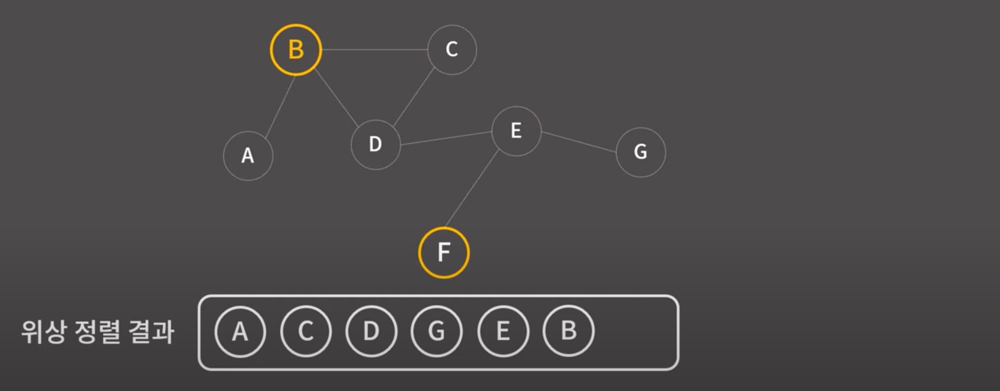

정점E와 E에서 뻗어나가는 간선을 모두 지운다.

정점 E가 제거된 후 B,F로 이루어진 그래프에서 제일 앞에 위치할 수 있는 정점은 

B와 F이다. 

임의로 B를 택한다.


위상 정렬 완료

---

## 알고리즘 구현 

**구현의 편의를 위한 성질** 

  1. 정점과 간선을 실제로 지울 필요 없이 미리 indegree의 값을 저장했다가 매번 뻗어나가는 정점들의 indegree 값만 1 감소시켜도 과정을 수행 가능
  1. indegree가 0인 정점을 구하기 위해 매번 모든 정점들을 다 확인하는 대신에 목록을 따로 저장하고 있다가 직전에 제거한 정점에서 연결된 정점들만 추가 

**위상 정렬 알고리즘**

  1. 맨 처음 모든 간선을 읽으며 indegree 테이블을 채운다.
  1. indegree가 0인 정점을 모두 큐에 넣는다.
  1. 큐에서 정점을 꺼내어 위상 정렬 결과에 추가
  1. 해당 정점으로부터 연결된 모든 정점의 indegree 값을 1 감소시킴 이 때 indegree가 0인 정점은 그 정점을 큐에 추가
  1. 큐가 빌 때 까지 3, 4번 과정을 반복 

---

## 백준 2252 줄 세우기 골드3

```java
import java.util.*;
import java.io.*;
public class Main {
    public static void main(String[] args) throws IOException {
        BufferedReader br = new BufferedReader(new InputStreamReader(System.in));
        StringTokenizer st;

        st = new StringTokenizer(br.readLine());
        int n = Integer.parseInt(st.nextToken()); // 학생의 수 1 ~ n
        int m = Integer.parseInt(st.nextToken()); // 간선

        // 그래프 초기화
        ArrayList<Integer> [] graph = new ArrayList[n+1];
        for (int i = 0; i <= n; i++) {
            graph[i] = new ArrayList<>();
        }

        // indegree
        int [] indegree = new int[n+1];

        // 그래프 입력
        while (m-->0){
            st = new StringTokenizer(br.readLine());
            int start = Integer.parseInt(st.nextToken());
            int end = Integer.parseInt(st.nextToken());
            graph[start].add(end);

            // indegree up
            indegree[end]++;
        }

        // StringBuilder 결과 출력용
        StringBuilder sb = new StringBuilder();

        // indegree 0인 정점 추가
        Queue<Integer> q = new LinkedList<>();
        for (int i = 1; i <= n; i++) {
            if(indegree[i] == 0) q.add(i);
        }

        // 위상 정렬 알고리즘
        while (!q.isEmpty()){
            int cur = q.poll();
            sb.append(cur).append(" ");
            for (int i = 0; i < graph[cur].size(); i++) {
                int next = graph[cur].get(i);
                indegree[next]--;
                if(indegree[next] == 0) q.add(next);
            }
        }

        System.out.println(sb);

    }
}
```

---

## 참고 자료 

[https://www.youtube.com/watch?v=Th-gLZUrd04&list=PLtqbFd2VIQv4O6D6l9HcD732hdrnYb6CY&index=27](https://www.youtube.com/watch?v=Th-gLZUrd04&list=PLtqbFd2VIQv4O6D6l9HcD732hdrnYb6CY&index=27)

---

---

## 틀린 문제 정리

# [프로그래머스] 섬 연결하기

**탐욕법(Greedy), LEVEL3** 

### 크루스칼 알고리즘 풀이

```java
import java.util.*;
class Solution {
    static int [] group;
    static int answer = 0;
    public int solution(int n, int[][] costs) {
        init(n);
        core(n, costs);
        return answer;
    }
    static void init(int n) {
        group = new int [n];
        for(int i = 1; i < n; i++) {
            group[i] = i;
        }
    }
    static void core(int n, int[][] costs) {
        Arrays.sort(costs, Comparator.comparingInt(o -> o[2]));
        int cnt = 0; // 연결된 간선의 개수
        int idx = 0;
        while(cnt < n - 1) {
            int [] cur = costs[idx++];
            if(find(cur[0]) == find(cur[1])) continue;
            union(cur[0], cur[1]);
            answer += cur[2];
            cnt++; // 간선 추가 
        }
    }
    static int find(int x) {
        if(group[x] == x) return x;
        return group[x] = find(group[x]);
    }
    static void union(int x, int y) {
        x = find(x);
        y = find(y);
        if(x > y) group[x] = y;
        else group[y] = x;
    }
}
```

### 프림 알고리즘 풀이

```java
import java.util.*;
class Solution {
    static int answer = 0;
    static ArrayList<int[]>[] graph;
    public int solution(int n, int[][] costs) {
        init(n, costs);
        core(n);
        return answer;
    }
    static void init(int n, int [][] costs) {
        graph = new ArrayList[n];
        // 그래프 초기화
        for(int i = 0; i < n; i++) {
            graph[i] = new ArrayList<>();
        }
        // 그래프 (양방향)연결
        for(int [] cur : costs) {
           graph[cur[0]].add(new int [] {cur[1], cur[2]});
           graph[cur[1]].add(new int [] {cur[0], cur[2]}); 
        }
    }
    static void core(int n) {
        int cnt = 0; // 연결된 간선의 개수
        boolean [] visited = new boolean [n]; // 방문 체크용
        visited[0] = true; // 0번으로 시작
        PriorityQueue<int[]> pq = new PriorityQueue<>(Comparator.comparingInt(o -> o[1]));
        for(int [] start : graph[0]) {
            pq.add(start);
        }
        while(cnt < n - 1) {
            int [] cur = pq.poll();
            if(visited[cur[0]]) continue;
            visited[cur[0]] = true;
            answer += cur[1];
            cnt++;
            for(int [] next : graph[cur[0]]) {
                if(visited[next[0]]) continue;
                pq.add(next);
            }
        }
    }
}
```

# [프로그래머스] 도둑질

[https://school.programmers.co.kr/learn/courses/30/lessons/42897](https://school.programmers.co.kr/learn/courses/30/lessons/42897)

**동적계획법(Dynamic Programming), LEVEL 4**

---

# 핵심 아이디어

```
DP 배열을 0번집을 선택 가능한 경우와 아닌 경우로 나눈다. -> 원형이기 때문에

점화식
int [][] dp = new int [2][n];

dp[0][?] = 0번집 선택이 가능한 경우
dp[1][?] = 0번집 선택이 불가능한 경우

?: 해당 번수 집을 선택하는 경우에 최댓값
```

---

# 코드(다시 풀어보기)

---

## 바킹독 복습

### 바킹독 문제집

### 학습 목표

*연습 문제 → 기본 문제 → 응용 문제*

*응용 문제의 경우 1시간 이상 고민한 후에도 풀이를 모르겠다면 정답 코드나 풀이 확인 & 재시도*

### 바킹독 정리

### 배열?

*메모리 상에 원소를 연속하게 배치한 자료구조*

### 배열의 성질

*O(1)에 k번째 원소를 확인/변경 가능*

*추가적으로 소모되는 메모리의 양(overhead)가 거의 없다*

*Cache hit rate가 높다*

*메모리 상에 연속한 구간을 잡아야 해서 할당에 제약이 걸린다*

***index가 0부터 시작하는 핵심 이유?***

*배열 인덱스가 0부터 시작하는 가장 핵심적인 이유는* ***주소 산술의 단순화 즉, 오프셋 계산의 편의성*** *때문이다.*

*Java 같은 언어에서 배열은 힙 메모리에 연속적으로 할당*

*특정 원소를 가져올 때 배열 주소 + (index * type 크기)로 원하는 위치를 빠르게 산출할 수 있다*

*만약 인덱스가 1부터 시작한다면, 계산식에 항상 -1 보정이 추가돼 복잡해진다*

### 배열의 시간 복잡도

*임의의 위치에 있는 원소를 확인/변경 = O(1)*

*원소를 끝에 추가 = O(1)*

*마지막 원소를 제거 = O(1)*

*임의의 위치에 원소를 추가/임의 위치의 원소 제거 = O(N)*

### 유투브 강의

[https://www.youtube.com/watch?v=mBeyFsHqzHg&list=PLtqbFd2VIQv4O6D6l9HcD732hdrnYb6CY&index=4](https://www.youtube.com/watch?v=mBeyFsHqzHg&list=PLtqbFd2VIQv4O6D6l9HcD732hdrnYb6CY&index=4)

### 문제 풀이 정리

*연습 문제 / 10808 / 알파벳 개수 / 브론즈 4 / 해결*

*기본 문제 / 2577 / 숫자의 개수 / 브론즈 2 / 해결*

*기본 문제 / 1475 / 방 번호 / 실버 5 / 해결*

*기본 문제 / 3273 / 두 수의 합 / 실버 3 / 해결*

*기본 문제 / 10807 / 개수 세기 / 브론즈 5 / 너무 쉬워서 pass*

*기본 문제 / 13300 / 방 배정 / 브론즈 2 / 해결*

*기본 문제 / 11328 / Strfry / 브론즈 2 / 해결*

*기본 문제 / 1919 / 애너그램 만들기 / 브론즈 2 / 해결*

### [Java] ArrayList vs LinkedList: 특징 & 성능 비교

[https://inpa.tistory.com/entry/JCF-%F0%9F%A7%B1-ArrayList-vs-LinkedList-%ED%8A%B9%EC%A7%95-%EC%84%B1%EB%8A%A5-%EB%B9%84%EA%B5%90](https://inpa.tistory.com/entry/JCF-%F0%9F%A7%B1-ArrayList-vs-LinkedList-%ED%8A%B9%EC%A7%95-%EC%84%B1%EB%8A%A5-%EB%B9%84%EA%B5%90)

### 유투브 강의

[https://www.youtube.com/watch?v=C6MX5u7r72E&list=PLtqbFd2VIQv4O6D6l9HcD732hdrnYb6CY&index=5](https://www.youtube.com/watch?v=C6MX5u7r72E&list=PLtqbFd2VIQv4O6D6l9HcD732hdrnYb6CY&index=5)

### 문제 풀이 정리

*연습 문제 / 1406 / 에디터 / 실버2 / 해결*

*기본 문제 / 5397 / 키로거 /  실버2 / 해결*

*기본 문제 / 1158 / 요세푸스 문제 / 실버4 / 해결*

### 유투브 강의

[https://www.youtube.com/watch?v=0DsyCXIN7Wg&list=PLtqbFd2VIQv4O6D6l9HcD732hdrnYb6CY&index=6](https://www.youtube.com/watch?v=0DsyCXIN7Wg&list=PLtqbFd2VIQv4O6D6l9HcD732hdrnYb6CY&index=6)

[https://www.youtube.com/watch?v=cdjjk-ryPKc&list=PLtqbFd2VIQv4O6D6l9HcD732hdrnYb6CY&index=9](https://www.youtube.com/watch?v=cdjjk-ryPKc&list=PLtqbFd2VIQv4O6D6l9HcD732hdrnYb6CY&index=9)

### 문제 풀이 정리

### 스택 

*연습 문제 / 10828 / 스택 / 실버4 / 너무 쉬워서 pass*

*기본 문제 / 10773 / 제로 / 실버4  / 해결*

*응용 문제 / 1874 / 스택 수열 / 실버2  / 해결*

*응용 문제 / 2493 / 탑 / 골드5  / 해결*

*응용 문제 / 6198 / 옥상 정원 꾸미기 / 골드5  / 해결*

*응용 문제 / 17298 / 오큰수 / 골드4  / 해결*

*응용 문제 / 3015 / 오아시스 재결합 / 플레티넘5  / 실패*

*응용 문제 / 6549 / 히스토그램에서 가장 큰 직사각형 / 시작 X*

### 스택 활용

*문제 너무 쉬워서 pass*

*연습 문제 / 10866 / 덱 / 실버4 / pass*

*기본 문제 / 1021 / 회전하는 큐 / 실버3 / 해결*

*응용 문제 / 5430 / AC / 골드5 / 해결*

*응용 문제 / 11003 / 최솟값 찾기 / 플레티넘5 / 실패*

### 유투브 강의

[https://www.youtube.com/watch?v=ftOmGdm95XI&list=PLtqbFd2VIQv4O6D6l9HcD732hdrnYb6CY](https://www.youtube.com/watch?v=ftOmGdm95XI&list=PLtqbFd2VIQv4O6D6l9HcD732hdrnYb6CY)

### 문제 풀이 정리

*연습 문제 / 1926 / 그림 / 실버1  / 해결* 

*연습 문제 / 2178 / 미로 탐색 / 실버1  / 해결* 

*연습 문제 / 2178 / 토마토 / 골드5  / 해결* 

*연습 문제 / 4179 / 불! / 골드3  / 해결* 

*연습 문제 / 1679 / 숨바꼭질 / 실버1 / 해결*

*기본 문제 / 1012 / 유기농 배추 / 실버2 / 해결*

*기본 문제 / 10026 / 적록색약 / 골드5 / 해결*

*기본 문제 / 7569 / 토마토 / 골드5 / 해결*

*기본 문제 / 7562 / 나이트의 이동 / 실버1 / 해결*

*기본 문제 / 5427 / 불 / 골드3 / 해결*

*기본 문제 / 2583 / 영역 구하기 / 실버1 / 해결*

***기본 필수 아닌 나머지 문제 pass***

*응용 문제 / 2206 / 벽 부수고 이동하기 / 골드3 / 해결*

*응용 문제 / 9466 / 텀 프로젝트 / 골드3 /*

---

## 유투브 강의

[https://www.youtube.com/watch?v=nW5y7PFLR3M&t=1050s](https://www.youtube.com/watch?v=nW5y7PFLR3M&t=1050s)

[https://www.youtube.com/watch?v=LcOIobH7ues&list=PLtqbFd2VIQv4O6D6l9HcD732hdrnYb6CY](https://www.youtube.com/watch?v=LcOIobH7ues&list=PLtqbFd2VIQv4O6D6l9HcD732hdrnYb6CY)

