# ***Redis(Remote Dictionary Server)***

*In-Memory 기반의 Dictionary(key-value) 구조 데이터 관리 서버 시스템*

*MySQL 같은 RDBMS와 다르게 관계형 데이터가 아닌 비 관계형 구조로서 데이터를 그저 키-값 형태단순하게 저장하는 구조를 가진다.* 

*그래서 쿼리 연산을 지원하지는 않지만. 대신 데이터의 고속 읽기와 쓰기에 최적화 되어 있다.* 

***→ 따라서 Redis는 일종의 NoSQL(Not Only SQL)로 분류된다.*** 

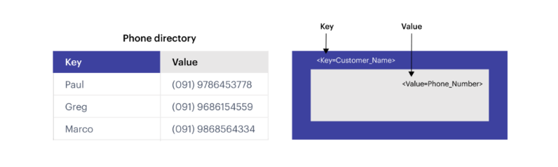

***Redis 사용 용도*** 

- *캐싱*
- *세션 관리*
- *실시간 데이터 처리(채팅, 게임 순위 등)*
- *Message Queue*
- *Shared Memory*

***Redis 작업 속도*** 

*일반 DBMS 같이 디스크(hdd, ssd)에 데이터를 쓰는 구조가 아니라 메모리(ram)에서 데이터를 처리하기 때문에 작업 속도가 상당히 빠르다.* 

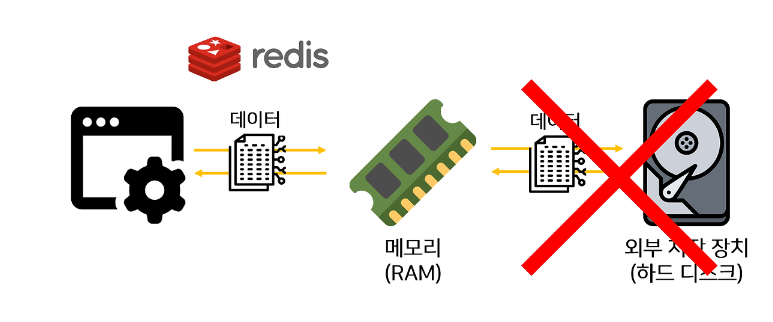

***Redis 인기 이유***

*Java, Python, PHP, C, C++, JavaScript, Node.js 등등.. 많은 프로그래밍 언어 프레임워크에 대한 API를 폭넓게 지원한다.* 

- [https://redis.io/docs/latest/develop/clients/](https://redis.io/docs/latest/develop/clients/)

***Redis 특징 정리*** 

- *NoSql DBMS(비관계형 데이터베이스)로 분류 In Memory 기반의 Key - Value 구조를 가진 데이터 관리 시스템*
- *메모리 기반이라 모든 데이터들을 메모리에서 저장하고 → 조회에 매우 빠르다.* 
- *메모리에 상주하면서 서비스의 상황에 따라 데이터베이스로 사용될 수 있으며, Cache로 사용될 수 있다.* 
- *Remote Data Storage로 여러 서버에서 같은 데이터를 공유해서 보고 싶을 때 사용할 수 있다.* 
- *다양한 자료구조를 지원한다* 
- *Strings*
  - *Set*
  - *Sorted-Set*
  - *Hashes*
  - *List*
- *쓰기 성능 증대를 위한 클라이언트 측 샤딩(Sharding)을 지원한다* 
- *Sharding: 같은 테이블 스키마를 가진 데이터(row)를 다수의 데이터베이스에 분산하여 저장하는 방법* 
  - [https://20240228.tistory.com/417](https://20240228.tistory.com/417)
- *메모리 기반이지만 Redis는 영속적인 데이터 보존(Persistence)이 가능하다.* 
- *스냅샷 기능을 제공해 메모리 내용을 *.rdb 파일로 저장하여 해당 시점으로 복구할 수 있다.*
- *여러 프로세스에서 동시에 같은 key에 대한 갱신을 요청하는 경우, 데이터 부정합 방지 Atomic 처리 함수를 제공한다.(원자성)*
- *Redis는 기본적으로 1개의 싱글 쓰레드로 수행되기 때문에, 안정적인 인프라를 구축하기 위해서는 Reflication(Master-Slave 구조)는 필수이다.*

# ***Redis 활용하기 - 캐시(Cache)***

## ***what is cache?***

*Cache란 한번 조회된 데이터를 미리 특정 공간에 저장해놓고, 똑같은 요청이 발생하게 되면 서버에게 다시 요청하지 말고 저장해놓은 데이터를 제공해서 빠르게 서비스를 제공해 주는 것을 의미한다.*

*즉, 미리 결과를 저장하고 나중에 요청이 오면 그 요청에 대해서 DB 또는 API를 참조하지 않고 Cache를 접근하여 요청을 처리하는 기법이다.* 

*서비스를 처음 운영할 때는 WEB-WAS-DB 정도로 간단하게 인프라를 구축하는데, 사용자가 늘어나면 DB에 무리가 간다.*

*DB는 데이터를 디스크에 직접 쓰기 때문에 서버에 문제가 발생해도 데이터가 손실되지는 않지만, 매 트랜잭션마다 디스크에 접근해야 하므로 부하가 많아지면 성능이 떨어진다.* 

*MySQL은 버퍼 풀(메모리)에 데이터 페이지를 캐시 해두고 이미 데이터가 있다면 바로 반환하고 데이터 페이지가 변경된 페이지 즉, Dirty Page는 리두 로그에 저장하여 쓰기 지연 방식으로 성능을 올린다.* 

*→ 즉, 매 트랜잭션마다 디스크 I/O를 하지는 않을 수 있다.*

***BUT!!***

*하지만 사용자가 계속 늘어나서 DB 부하가 심해지면 DB를 스케일 인(버퍼 풀 크기 확장 & 리두 로그 크기 확장) 또는 스케일 아웃(Reflication, Sharding)하는 방식 외에도 캐시 서버를 검토하게 된다.*

*Redis Cache는 메모리 단(In - Memory)에 위치한다. 따라서 용량은 적지만 접근 속도가 빠르다* 

*다만 저장하려는 데이터 셋이 주어진 메모리 크기보다 크면 디스크를 쓰는 것이 올바른 선택이다.* 

## *캐시의 구조 패턴* 

### *Look aside Cache 패턴* 

*look aside cache는 캐시를 한 번 접근하여 데이터가 있는지 판단한 후, 있다면 캐시의 데이터를 사용하고 없으면 실제 DB 또는 API를 호출한다.* 

***Look aside Cache 동작 순서*** 

1. *클라이언트가 데이터 요청* 
1. *서버에서 캐시에 데이터 존재 유무 확인* 
1. *데이터가 있다면 캐시의 데이터 사용(빠른 조회 / Cache Hit)*
1. *데이터가 없다면 실제 DB 데이터에 접근(Cache Miss)*
1. *DB에서 받아온 데이터를 캐시에 저장하고 클라이언트에게 반환* 

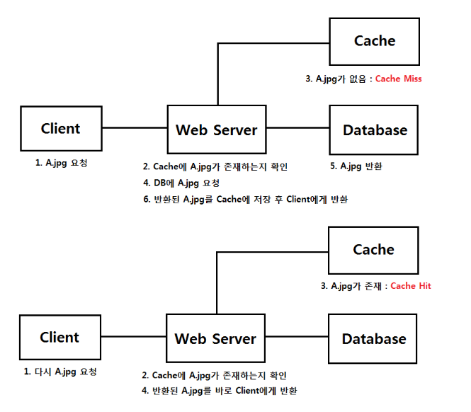

### *Write Back 패턴* 

*write back 패턴은 주로 쓰기 작업이 많아서 INSERT 쿼리를 일일이 날리지 않고 한꺼번에 배치 처리를 하기 위해 사용한다.* 

***example***

*영어 듣기 평가를 온라인으로 진행하는 서비스가 있을 때 여러 학생이 동시에 제출 버튼을 누르면 DB에 갑작스럽게 엄청난 쓰기 요청이 몰리게 되면 DB 서버가 죽을 수도 있다.* 

*이때 write back 기반의 캐시를 사용하면 캐시 메모리에 데이터를 저장해 놓고, 이후 DB 디스크에 업데이트 해주면 안전하게 쓰기 작업을 이행할 수 있는 것이다.* 

*즉, insert 쿼리를 1개씩 500번 수행하는 것보다 500개를 한번에 삽입하는 동작이 훨씬 빠르기 때문에 write back 방식은 빠른 속도로 서비스가 가능하다.* 

***why 쿼리를 1개씩 500번 수행하는 것보다 500개를 한번에 삽입하는 동작이 더 빠를까?***

- *500개의 트랜잭션 VS 1개의 트랜잭션 배치 처리* 
- *데이터 처리를 1개의 트랜잭션 단위로 묶어서 데이터 무결성과 일관성을 보장* 
- *디스크 I/O 감소 각각 하면 매번 로그 기록 및 디스크 동기화 작업이 발생하지만 1개로 묶으면 중간 단계에서 디스크 I/O가 줄어들고 커밋 시점에 한 번만 동기화된다.* 
- *네트워크 부하 감소 (통신 횟수)*
- *DB 최적화 → 내부에서 배치 작업(Batch Processing)으로 처리되어 더 빠르게 실행* 

***Write Back 패턴 문제점***

- *DB에 데이터를 저장하기 전에 캐시 서버가 죽으면 데이터가 유실된다.* 
- *그래서 재생 가능한 데이터나, 극단적으로 무거운 데이터에서 해당 패턴을 사용한다.* 
- *EX) 로그를 캐시에 저장하고 특정 시점에 DB에 한번에 저장* 

***Write Back 동작 순서*** 

1. *모든 데이터를 캐시 서버에 저장* 
1. *캐시의 데이터를 일정 주기마다 DB에 한꺼번에 저장(배치 작업)*
1. *그리고 DB에 저장했으니 잔존 데이터를 캐시에서 제거* 

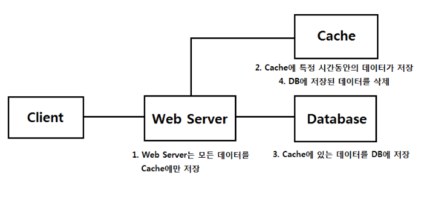

# *Redis 캐시의 활용 사례*

### ***Twitter***

*트위터는 140자 정도의 짧은 글을 올릴 수 있는 SNS이다.* 

*트위터에서의 타임라인은 사용자가 구독하는 사용자들의 최근 트윗을 확인할 수 있는 페이지이다.* 

*2012년 당시 트위터는 15만 명이 넘는 동시 접속자와 초당 30만 건이 넘는 타임라인 요청이 발생했었다.*

*이러한 규모의 타임라인 요청을 DB에 직접 접근하는 방식으로 처리하면 Query가 복잡해짐에 따라 속도가 현저히 떨어지는 문제가 발생한다.* 

*트위터는 해당 문제를 해결하기 위해서 Redis를 사용하였다고 한다.* 

*트위터는 데이터 센터에 존재하는 방대한 양의 Redis Cluster는 각 사용자의 타임라인에 노출될 트윗의 정보(Tweet ID, 작성자 ID)를 List 형태로 약 800개 정도 캐싱한다.* 

*발생하는 타임라인 요청은 바로 데이터베이스로 접근하지 않고 Redis에 캐싱된 타임라인 정보를 먼저 가져와서, 이를 토대로 Query를 단순화하여 DB에 접근하여 처리한다.* 

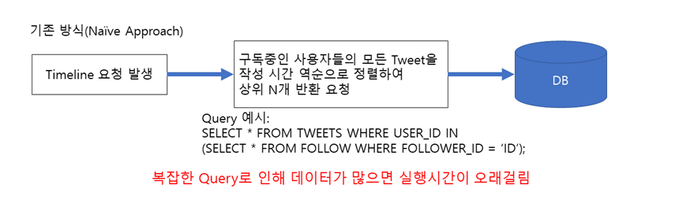

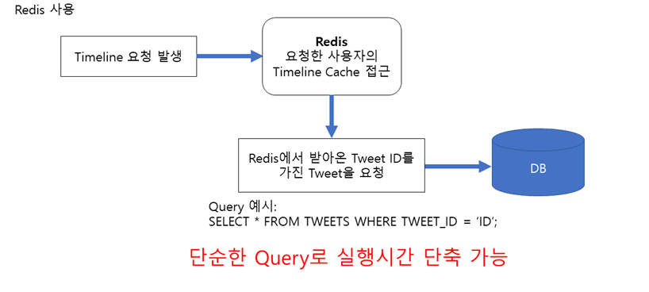

*단, 모든 사용자의 타임라인을 캐싱하면 메모리가 부족해질 수 있으므로, 로그인을 안한 지 30일이 지난 사용자의 타임라인은 Redis Cluster에서 삭제하도록 설정하였다.*

*Redis Cluster에서 삭제된 사용자의 Timeline 정보는 해당 사용자가 다시 로그인 할 시에 재생성 하는데 이때 데이터베이스에 직접 접근하는 과정이 필요하기에 시간이 다소 소요될 수도 있다.*

### ***Redis 사용하는 곳*** 

- *인증 토큰 저장(Strings or Hash)*
- *Ranking 보드로 저장(Sorted-Set)*
- *유저 API Limit*

### ***Redis Cache 중간 정리*** 

*이처럼 Redis는 RDBMS의 캐시 솔루션으로 사용 용도가 굉장히 높다.*

*일반적으로 데이터베이스는 저장장치에 저장이 되는데, 데이터베이스를 조회하려면 저장장치로 i/o가 발생하게 된다.*

*RDBMS에서 SELECT 쿼리문을 날려 특정 데이터들을 FETCH했을 때, RDBMS의 구조상 DISK에서 데이터를 꺼내오는 데 Memory에서 읽어들이는 것보다 천배 가량 더 느리다.*

*예를 들어 데이터베이스에 접근하여 10,000개의 레코드를 읽는다고 가정했을 때 disk에 저장되어 있다면 약 30초의 시간이 걸리는 반면 RAM에서 읽을 경우엔 약 0.0002초 밖에 걸리지 않는다.*

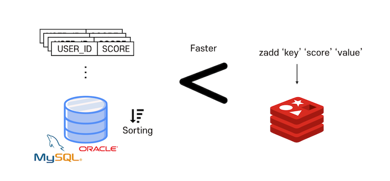

*따라서 Redis같은 유연한 자료구조를 가지는 인메모리 Key-Value 솔루션을 사용하여 DB 부하의 Read 연산의 부하를 분산시키는 데 적용한다.*

*또한 RAM은 휘발성인데 그럼 실행중인 Redis를 끄면 데이터가 전부 날라간다고 생각이 들게 되는데,*

*Redis는 In-Memory 이지만 persistant on-disk 데이터베이스 이기도 하다.*

*Redis는 특정한 때에 현재까지의 in-memory 상태를 disk에 저장해 두었다가 Redis를 다시 시작했을 때 disk에 저장해 두었던 dump 파일들을 load 하기 때문에 데이터의 손실 발생을 방지할수도 있다.*

# *Redis 활용하기 - 세션 스토어(Session Store)*

### *분산 서버 처리 환경에서의 세션 불일치* 

*실무에서는 트래픽 부하를 방지하기 위해 로드밸런서에 서버를 여러대 운영한다.* 

*그러나 서버를 여러대를 운영하게 되면 클라이언트의 세션이 서로 서버마다 달라 서비스 이용에 지장을 줄 수 있다는 문제점을 가지게 된다.*

[https://inpa.tistory.com/entry/WEB-%F0%9F%8C%90-%EC%84%B8%EC%85%98Session-%EB%B6%88%EC%9D%BC%EC%B9%98-%EB%AC%B8%EC%A0%9C-%ED%95%B4%EA%B2%B0%EB%B2%95-%E2%B8%A2%EC%84%9C%EB%B2%84-%EB%8B%A4%EC%A4%91%ED%99%94-%ED%99%98%EA%B2%BD-%E2%B8%A5](https://inpa.tistory.com/entry/WEB-%F0%9F%8C%90-%EC%84%B8%EC%85%98Session-%EB%B6%88%EC%9D%BC%EC%B9%98-%EB%AC%B8%EC%A0%9C-%ED%95%B4%EA%B2%B0%EB%B2%95-%E2%B8%A2%EC%84%9C%EB%B2%84-%EB%8B%A4%EC%A4%91%ED%99%94-%ED%99%98%EA%B2%BD-%E2%B8%A5)

## ***Redis vs Memcached***

*세션을 저장하는데 있어, In-memory DB를 활용하는 것이 효율적이라는 것을 배웠다.*

*같은 RDBMS라도 MySQL, MSSQL, Oracle 등의 종류가 있듯이 In-memory DB에도 다양한 DB가 존재한다.*

*그 중에서도 세션 저장소로 가장 많이 사용되는 In-Memory 기반의 디비로는 Redis와 Memcached가 있다.* 

***공통 특징*** 

- *무료 오픈소스 데이터베이스* 
- *In-Memory 기반* 
- *Key-Value 형태로 저장되기 때문에 같은 Key-Value 형태로 저장되는 세션 데이터를 다루는데 적합하다* 

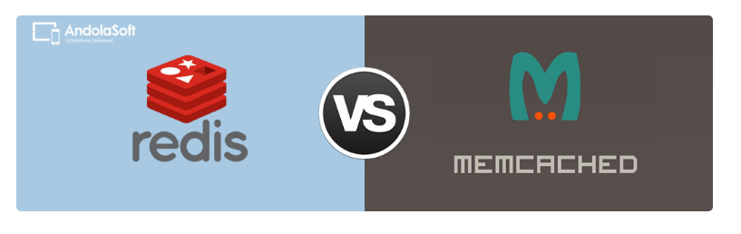

***비교*** 

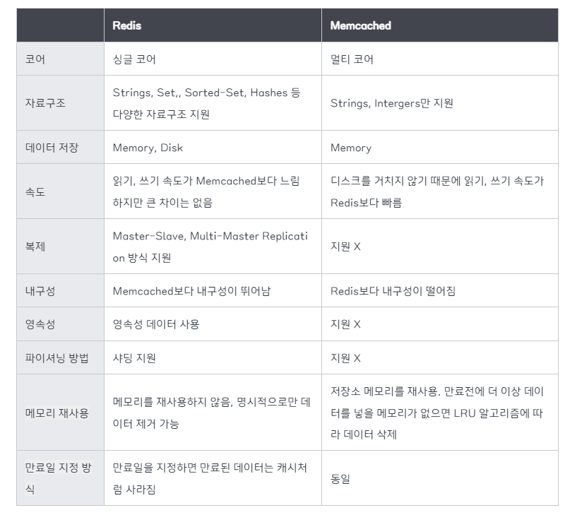

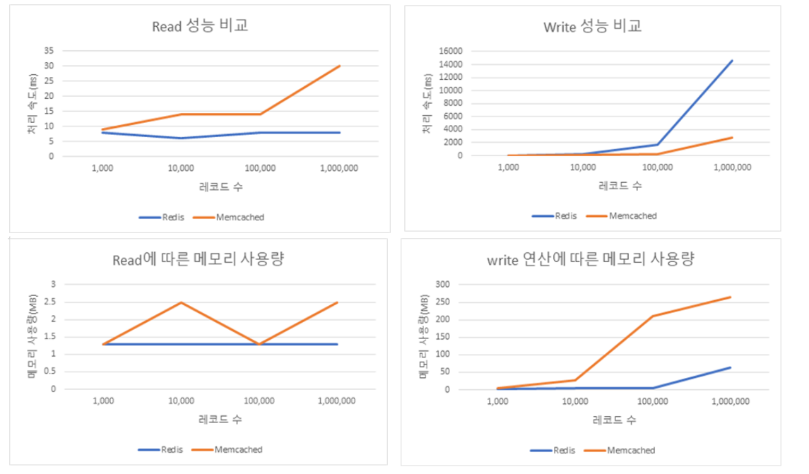

***READ 성능  - Redis > Memcached***

***WRITE 성능 - Memcached > Redis***

*세션 관련 작업의 경우, 쓰기 연산보다는 읽기 연산이 압도적으로 높은 작업이다.* 

*따라서 Redis를 사용하는 게 합리적이다.* 

*또한 Redis가 READ/WRITE에 있어서 메모리 또한 효율적으로 사용하는 것을 볼 수 있다.* 

*정리하면 쓰기 성능에서는 Memcached가 앞서지만 메모리 사용 효율과 처리속도, 다양한 자료구조 지원과 아키텍처 지원을 모두 고려하면 Redis가 상대적으로 합리적인 선택임을 알 수 있었다.*

# ***Redis 문제점(주의점)***

## *시간 복잡도* 

***레디스는 싱글 스레드 기반으로 돌아간다.*** 

*그래서 한 번에 딱 하나의 명령어만 실행하기 때문에, 긴 처리시간이 필요한 명령어를 쓰면 불리하고 요청 건을 처리하기 전까지 다른 서비스 요청을 받아들일 수 없고 서버가 다운되는 현상이 일어날 수 있다.* 

*따라서 전체 데이터를 다루는 시간 복잡도를 가진 O(N) 명령어* *`keys`* *,* *`flush`* *,* *`getall`* *는 주의해서 사용할 필요가 있다.*

- *`KEYS`**: 특정 패턴에 맞는 모든 키를 검색한다. 키 수가 많을 경우 심각한 성능 저하를 초래* 
- *`FLUSHALL`* */* *`FLUSHDB`* *: Redis의 모든 키를 삭제한다. 데이터 크기에 따라 처리 시간이 오래 걸릴 수 있다.* 
- *`HGETALL`* *: 특정 해시 키의 모든 필드와 값을 가져온다. 해시에 저장된 필드 수에 따라 시간이 증가한다.* 

## *메모리 파편화*

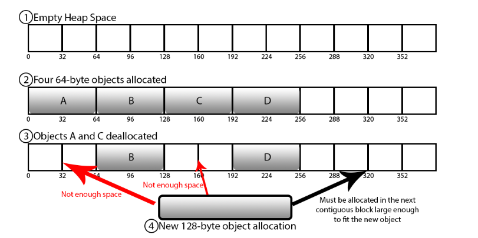

*메모리를 할당받고 해제하는 과정에서 아래 그림과 같이 부분부분 빈 공간이 생기게 되는데, 4번같이 새로운 메모리를 할당할 때 알맞는 공간(4칸)이 없기 때문에 마지막 부분(우측) 부분에 프로세스가 위치해야 되고, 그러면 빈 공간 메모리가 남아 낭비가 발생하게 된다.*

*그리고 이 현상이 계속되면 실제 physical 메모리가 커져 프로세스가 죽는 현상이 발생 할 수도 있다.또한 쓰기 연산이 copy on wirte 방식으로 동작하기 때문에 최대 메모리를 2배 이상까지 사용하기도 한다.*

*그래서 redis를 사용할 때 메모리를 적당히 여유 있게 사용하는 것이 좋다.*

