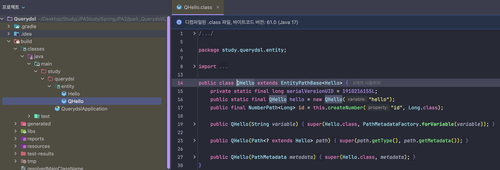
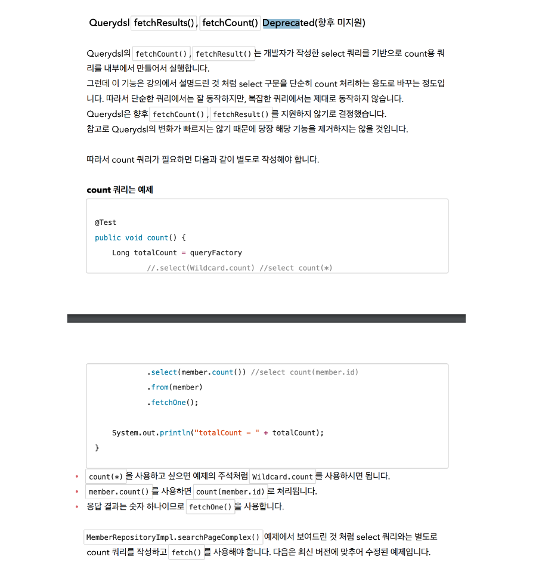
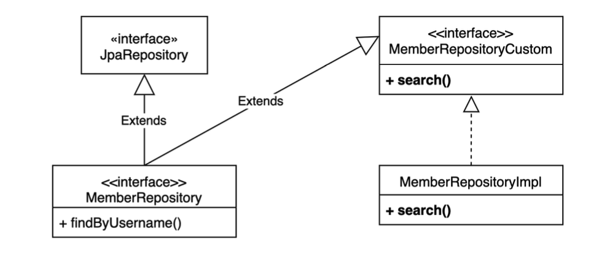

# *Querydsl* ***설정과 검증***

***build.gradle 설정*** 

```java
// Querydsl 추가
implementation 'com.querydsl:querydsl-jpa:5.0.0:jakarta'
annotationProcessor "com.querydsl:querydsl-apt:${dependencyManagement.importedProperties['querydsl.version']}:jakarta"
annotationProcessor "jakarta.annotation:jakarta.annotation-api"
annotationProcessor "jakarta.persistence:jakarta.persistence-api"
```

### *Querydsl* ***환경설정 검증***

***검증용 엔티티*** 

```java
@Entity
@Getter @Setter
public class Hello {
    @Id @GeneratedValue(strategy = GenerationType.IDENTITY)
    private Long id;
}

```

***검증용 Q 타입 생성*** 

  - *Gradle  → Tasks →  build  → clean*
  - *Gradle → Tasks → build → build*



  - ***같은 경로에 Q엔티티명 파일 생성 확인하면 끝*** 

***테스트로 실행 검증*** 

```java
@SpringBootTest
@Transactional
class QuerydslApplicationTests {

    @Autowired EntityManager em;

    @Test
    void contextLoads() {
        Hello hello = new Hello();
        em.persist(hello);

        JPAQueryFactory query = new JPAQueryFactory(em);
        QHello qHello = QHello.hello;

        Hello result = query
                .selectFrom(qHello)
                .fetchOne();

        assertThat(result).isEqualTo(hello);
        assertThat(result.getId()).isEqualTo(hello.getId());
    }
}
```

# *H2 데이터베이스* 

  - *권한 주기: chmod 755 h2.sh*
  - *데이터베이스 파일 생성* 
- *jdbc:h2:~/querydsl(최소 한번)*
    - *~/querydsl.mv.db 파일 생성 확인*
    - *접속 방법: jdbc:h2:tcp://localhost/~/querydsl*

# ***스프링 부트 설정*** *- JPA, DB*

*application.yaml*

```yaml
spring:
  datasource:
    url: jdbc:h2:tcp://localhost/~/querydsl
    username: sa
    password:
    [REDACTED] org.h2.Driver
  jpa:
    hibernate:
      ddl-auto: create
    properties:
      hibernate:
        format_sql: true
      # show_sql: true
      
logging.level:
  org.hibernate.SQL: debug
#  org.hibernate.type: trace
```

  - *show_sql : 옵션은 System.out에 하이버네이트 실행 SQL을 남긴다.* 
  - *org.hibernate.SQL : 옵션은 logger를 통해 하이버네이트 실행 SQL을 남긴다.*

***쿼리 파라미터 로그 남기기***

```groovy
implementation 'com.github.gavlyukovskiy:p6spy-spring-boot-starter:1.9.0'
```

  - *org.hibernate.type : SQL 실행 파라미터를 로그로 남긴다*

***Querydsl - JPQL 확인 방법*** 

```java
spring.jpa.properties.hibernate.use_sql_comments: true
```

- *스프링 부트 3.0 Querydsl 설정*
- *스프링 부트 - JPA, DB 설정 - yaml 설정* 

***Member Entity***

```java
@Entity
@Getter @Setter
@NoArgsConstructor(access = AccessLevel.PROTECTED)
@ToString(of = {"id", "username", "age"})
public class Member {
    @Id @GeneratedValue(strategy = GenerationType.IDENTITY)
    @Column(name = "member_id")
    private Long id;

    private String username;
    private int age;

    @ManyToOne(fetch = FetchType.LAZY)
    @JoinColumn(name = "team_id")
    private Team team;
    
    public Member(String username) {
        this(username, 0);
    }
    
    public Member(String username, int age) {
        this(username, age, null);
    }
    
    public Member(String username, int age, Team team) {
        this.username = username;
        this.age = age;
        if(team != null){
            changeTeam(team);
        }
    }

    public void changeTeam(Team team) {
        this.team = team;
        team.getMembers().add(this);
    }
}
```


***Team Entity***

```java
@Entity
@NoArgsConstructor(access = AccessLevel.PROTECTED)
@Getter @Setter
@ToString(of = {"id", "name"})
public class Team {
    @Id @GeneratedValue(strategy = GenerationType.IDENTITY)
    @Column(name = "team_id")
    private Long id;

    private String name;

    @OneToMany(mappedBy = "team")
    List<Member> members = new ArrayList<>();

    public Team(String name) {
        this.name = name;
    }
}
```

# *기본 문법* 

***init data*** 

```java
@Transactional
@SpringBootTest
public class QuerydslBasicTest {

    @Autowired
    EntityManager em;

    @BeforeEach
    public void setUp() {
        Team teamA = new Team("teamA");
        Team teamB = new Team("teamB");
        em.persist(teamA);
        em.persist(teamB);

        Member member1 = new Member("member1", 10, teamA);
        Member member2 = new Member("member2", 20, teamA);
        Member member3 = new Member("member3", 30, teamB);
        Member member4 = new Member("member4", 40, teamB);
        em.persist(member1);
        em.persist(member2);
        em.persist(member3);
        em.persist(member4);

        em.clear();
    }
```

***JPQL***

```java
@Test
public void startJPQL(){
    Member findMember = em.createQuery("select m from Member m where m.username = :username"
                    , Member.class)
            .setParameter("username", "member1")
            .getSingleResult();

    assertThat(findMember.getUsername()).isEqualTo("member1");
}
```

***Querydsl***

```java
@Test
public void startQuerydsl(){
    JPAQueryFactory queryFactory = new JPAQueryFactory(em);
    QMember m = new QMember("m");

    Member findMember = queryFactory
            .select(m)
            .from(m)
            .where(m.username.eq("member1"))
            .fetchOne();

    assertThat(findMember.getUsername()).isEqualTo("member1");
}
```

### ***정리*** 

  - *EntityManager 로 JPAQueryFactory 생성*
  - *Querydsl은 JPQL 빌더이다.*
  - *JPQL: 문자(실행 시점 오류), Querydsl: 코드(컴파일 시점 오류)*
  - *JPQL: 파라미터 직접 바인딩, Querydsl: 파라미터 바인딩 자동 처리*

### *JPAQueryFactory****를 필드로***

```java
@Transactional
@SpringBootTest
public class QuerydslBasicTest {

    @Autowired
    EntityManager em;

    JPAQueryFactory queryFactory;
    
		@BeforeEach
    public void setUp() {
		    queryFactory = new JPAQueryFactory(em);
    }	
}
```

*JPAQueryFactory를 필드로 제공하면 동시성 문제는 어떻게 될까?*

*동시성 문제는 JPAQueryFactory를 생성할 때 제공하는 EntityManager(em)에 달려있다.* 

*스프링 프레임워크는 여러 쓰레드에서 동시에 같은 EntityManager에 접근해도, 트랜잭션 마다 별도의 영속성 컨텍스트를 제공하기 때문에, 동시성 문제는 걱정하지 않아도 된다.*

### ***Q클래스 인스턴스를 사용하는 2가지 방법***


```java
QMember qMember = new QMember("m"); // 별칭 직접 지정 
QMember qMember = QMember.member;   // 기본 인스턴스 사용
```

### ***기본 인스턴스를 static import와 함께 사용*** 

```java
import static study.querydsl.entity.QMember.*;

@Test
public void startQuerydsl(){
    Member findMember = queryFactory
            .select(member)
            .from(member)
            .where(member.username.eq("member1"))
            .fetchOne();

    assertThat(findMember.getUsername()).isEqualTo("member1");
}
```

***실행되는 JPQL 확인 방법***  

```java
spring.jpa.properties.hibernate.use_sql_comments: true
```

  - *application.properties, yaml*

***참고*** 

  - *같은 테이블을 조인해야 하는 경우가 아니면 static import 한 Qtype인 기본 인스턴스를 사용하자*

### ***기본 검색 쿼리*** 

```java
@Test
public void search(){
    Member findMember = queryFactory
            .selectFrom(member)
            .where(member.username.eq("member1")
                    .and(member.age.eq(10)))
            .fetchOne();

    assertThat(findMember.getUsername()).isEqualTo("member1");
}
```

  - *검색 조건은 .and(), .or()를 메소드 체인으로 연결할 수 있다.*
  - *selectFrom → select + from* 

### *JPQL****이 제공하는 모든 검색 조건 제공***

```java
member.username.eq("member1") // username = 'member1'

member.username.ne("member1") //username != 'member1'

member.username.eq("member1").not() // username != 'member1'

member.username.isNotNull() //이름이 is not null

member.age.in(10, 20)    // age in (10,20)

member.age.notIn(10, 20) // age not in (10, 20)

member.age.between(10,30) //between 10, 30

member.age.goe(30) // age >= 30

member.age.gt(30)  // age > 30

member.age.loe(30) // age <= 30

member.age.lt(30) // age < 30

member.username.like("member%") // like 검색 

member.username.contains("member") // like ‘%member%’ 검색 

member.username.startsWith("member") //like ‘member%’ 검색
```

### *AND* ***조건을 파라미터로 처리***

```java
@Test
public void searchAndParam(){
    Member findMember = queryFactory
            .selectFrom(member)
            .where(
                    member.username.eq("member1"),
                    member.age.eq(10)
            )
            .fetchOne();
    
    assertThat(findMember.getUsername()).isEqualTo("member1");
}
```

  - *where()에 파라미터로 검색 조건을 추가하면 AND 조건이 추가된다*
  - *이 경우 null 값은 무시한다 → 메소드 추출을 통해서 동적 쿼리를 깔끔하게 만들 수 있다.*

- *fetch(): 리스트 조회, 데이터 없으면 빈 리스트 반환*
  - *fetchOne(): 단 건 조회* 
- *결과가 없으면: null* 
    - *결과가 둘 이상이면: com.querydsl.core.NonUniqueResultException*
  - *fetchFirtst(): limit(1).fetchOne()*
  - *fetchResults(): 페이징 정보 포함, total count 쿼리 추가 실행* 
  - *fetchCount(): count 쿼리로 변경해서 count 수 조회* 

```java
**@Test**
public void resultFetch(){
    // List
    List<Member> fetch = queryFactory
            .selectFrom(member)
            .fetch();

    // 단 건
    Member fetchOne = queryFactory
            .selectFrom(member)
            .where(member.username.eq("member6"))
            .fetchOne();

    // limit(1) + fetchOne
    Member fetchFirst = queryFactory
            .selectFrom(member)
            .fetchFirst();

    // 페이징 쿼리
    QueryResults<Member> results = queryFactory
            .selectFrom(member)
            .fetchResults();

    long count = results.getTotal();
    List<Member> content = results.getResults();

    // count 쿼리로 변경
    long cnt = queryFactory
            .selectFrom(member)
            .fetchCount();
}
```

*fetchResults(), fetchCount() → Deprecated* 



```java
/**
 * 회원 정렬 순서
 * 1. 회원 나이 desc
 * 2. 회원 이름 asc
 * -> 회원 이름이 없으면 nulls last
 */
 @Test
 public void sort(){
     em.persist(new Member(null, 100));
     em.persist(new Member("member5", 100));
     em.persist(new Member("member6", 100));


     List<Member> result = queryFactory
             .selectFrom(member)
             .where(member.age.eq(100))
             .orderBy(member.age.desc(), member.username.asc().nullsLast())
             .fetch();

     assertThat(result.stream().map(Member::getUsername)
					     .collect(Collectors.toList()))
	             .containsExactly("member5", "member6", null);

 }
 
 ------------------------------------------------------------------------------
select
    m1_0.member_id,
    m1_0.age,
    m1_0.team_id,
    m1_0.username 
from
    member m1_0 
where
    m1_0.age=? 
order by
    m1_0.age desc,
    m1_0.username asc nulls last
```

  - *desc(), asc() : 일반 정렬*
  - *nullsLast() , nullsFirst() : null 데이터 순서 부여*

```java
@Test
public void paging(){
   Long count = queryFactory
           .select(member.count())
           .from(member)
           .fetchOne();

   List<Member> result = queryFactory
           .selectFrom(member)
           .orderBy(member.username.desc())
           .offset(1)
           .limit(2)
           .fetch();

   assertThat(count).isEqualTo(4);
   assertThat(result).hasSize(2);
}
```

*fetchResults(), fetchCount() → Deprecated*

*count 쿼리, 조회 건수 제한 쿼리를 각각 사용하자*


### *집합 함수*

```java
@Test
public void aggregation(){
	   Tuple tuple = queryFactory
	           .select(
	                   member.count(),
	                   member.age.sum(),
	                   member.age.avg(),
	                   member.age.max(),
	                   member.age.min()
	           )
	           .from(member)
	           .fetchOne();
	
	   assertThat(tuple.get(member.count())).isEqualTo(4);
	   assertThat(tuple.get(member.age.sum())).isEqualTo(100);
	   assertThat(tuple.get(member.age.avg())).isEqualTo(25);
	   assertThat(tuple.get(member.age.max())).isEqualTo(40);
	   assertThat(tuple.get(member.age.min())).isEqualTo(10);
}
```

  - *JPQL이 제공하는 모든 집합 함수를 제공한다.*

### *GroupBy* ***사용***

  - *팀의 이름과 각 팀의 평균 연령을 구해라.*	

```java
@Test
public void groupBy(){

    List<Tuple> result = queryFactory
            .select(team.name, member.age.avg())
            .from(member)
            .join(member.team, team)
            .groupBy(team.name)
            .fetch();

    Tuple teamA = result.get(0);
    Tuple teamB = result.get(1);

    assertThat(teamA.get(team.name)).isEqualTo("teamA");
    assertThat(teamB.get(team.name)).isEqualTo("teamB");
    assertThat(teamA.get(member.age.avg())).isEqualTo(15);
    assertThat(teamB.get(member.age.avg())).isEqualTo(35);
}

select
    t1_0.name,
    avg(cast(m1_0.age as float(53))) 
from
    member m1_0 
join
    team t1_0 
        on t1_0.team_id=m1_0.team_id 
group by
    t1_0.name 
```

  - ***team → QTeam***

*groupBy, 그룹화된 결과를 제한하려면 having*

```java
@Test
public void groupByHaving() {

    List<Tuple> result = queryFactory
            .select(team.name, member.age.avg())
            .from(member).join(member.team, team)
            .groupBy(team.name)
            .having(team.name.eq("teamA"))
            .fetch();

    Tuple teamA = result.get(0);

    assertThat(teamA.get(team.name)).isEqualTo("teamA");
    assertThat(teamA.get(member.age.avg())).isEqualTo(15);
}

select
    t1_0.name,
    avg(cast(m1_0.age as float(53))) 
from
    member m1_0 
join
    team t1_0 
        on t1_0.team_id=m1_0.team_id 
group by
    t1_0.name 
having
    t1_0.name=?
```

### 기본 조인

*조인의 기본 문법은 첫 번째 파라미터에 조인 대상을 지정하고, 
두 번째 파라미터에 별칭(alias)으로 사용할 Q 타입을 지정하면 된다.*

```java
join(조인 대상, 별칭으로 사용할 Q타입)
join(member.team, QTeam.team)
```

***팀 A에 속한 모든 회원*** 

```java
@Test
public void join(){
    List<Member> result = queryFactory
            .select(member)
            .from(member)
            .join(member.team, team)
            .where(team.name.eq("teamA"))
            .fetch();

    assertThat(result.stream().map(Member::getUsername))
            .containsExactly("member1", "member2");

    assertThat(result)
            .extracting("username")
            .containsExactly("member1", "member2");
}
```

  - *join(), innerJoin() → 내부 조인(inner join)*
  - *leftJoin() → left outer join*
  - *rightJoin() → right outer join*

### *세타 조인*

  - *연관관계가 없는 필드로 조인* 

```java
/**
 * 회원의 이름이 팀 이름과 같은 회원 조회
 */
@Test
public void theta_join(){
    em.persist(new Member("teamA", 100));
    em.persist(new Member("teamB", 200));

    List<Member> result = queryFactory
            .select(member)
            .from(member, team)
            .where(member.username.eq(team.name))
            .fetch();

    assertThat(result).extracting("age")
            .containsExactly(100, 200);
}
```

  - *카르테시안 곱(Cartesian Product)을 발생 → 성능이 떨어진다.* 

***on 절을 활용*** 

```java
@Test
public void theta_join2(){
    em.persist(new Member("teamA", 100));
    em.persist(new Member("teamB", 200));

    List<Member> result = queryFactory
            .select(member)
            .from(member)
            .join(team).on(member.username.eq(team.name))
            .fetch();

    assertThat(result).extracting("age")
            .containsExactly(100, 200);
}
```

  - *필요한 데이터만 조합해서 INNER JOIN하기 때문에 성능이 더 좋다.*

| 테스트 | 조인 방식 | 성능 |
| --- | --- | --- |
| theta_join() | **암시적 조인 (카르테시안 곱)** | ❌ 성능 나쁨 |
| theta_join2() | **명시적 조인 (INNER JOIN)** | ✅ 성능 좋음 |

### *개요*

*ON절을 활용한 조인*

  - *조인 대상을 필터링* 
  - *연관관계 없는 엔티티 외부 조인*

### ***조인 대상을 필터링*** 

*ex) 회원과 팀을 조인하면서, 팀 이름이 teamA인 팀만 조인, 회원은 모두 조회* 

```java
@Test
public void join_on_filtering(){
    List<Tuple> result = queryFactory
            .select(member, team)
            .from(member)
            .leftJoin(member.team, team).on(team.name.eq("teamA"))
            .fetch();

    for (Tuple tuple : result) {
        System.out.println("tuple = " + tuple);
    }
}

tuple = [Member(id=1, username=member1, age=10), Team(id=1, name=teamA)]
tuple = [Member(id=2, username=member2, age=20), Team(id=1, name=teamA)]
tuple = [Member(id=3, username=member3, age=30), null]
tuple = [Member(id=4, username=member4, age=40), null]


select
    m1_0.member_id,
    m1_0.age,
    m1_0.team_id,
    m1_0.username,
    t1_0.team_id,
    t1_0.name 
from
    member m1_0 
left join
    team t1_0 
        on t1_0.team_id=m1_0.team_id 
        and t1_0.name=?
```

### *연관관계 없는 엔티티 외부 조인*

*회원의 이름과 팀의 이름이 같은 대상 외부 조인* 

```java
@Test
public void theta_join2(){
    em.persist(new Member("teamA", 100));
    em.persist(new Member("teamB", 200));

    List<Member> result = queryFactory
            .select(member)
            .from(member)
            .join(team).on(member.username.eq(team.name))
            .fetch();

    assertThat(result).extracting("age")
            .containsExactly(100, 200);
}
```

***문법을 주의하자*** 

  - *일반조인 → from(member).leftJoin(member.team, team)* 
- *member.team_id = team.id O*
  - *on 조인 → from(member).leftJoin(team).on(xxx)*
- *member.team_id = team.id X*

- ***join(member) vs join(member.team, team)*** 

*페치 조인은 SQL에서 제공하는 기능은 아니다.*

*SQL 조인을 활용해서 연관된 엔티티를 SQL한번에 조회하는 기능이다.*

→ 주로 성능 최적화에 사용하는 방법 

***페치 조인 미적용***

```java
@Test
public void fetchJoinNo(){
    em.clear();

    Member findMember = queryFactory
            .selectFrom(member)
            .where(member.username.eq("member1"))
            .fetchOne();

    boolean loaded = em.getEntityManagerFactory()
                            .getPersistenceUnitUtil()
                            .isLoaded(findMember.getTeam());
    assertThat(loaded).isFalse();
}

select
    m1_0.member_id,
    m1_0.age,
    m1_0.team_id,
    m1_0.username 
from
    member m1_0 
where
    m1_0.username=?

```

  - *지연 로딩 → isLoaded → False*

***페지 조인 적용*** 

```java
@Test
public void fetchJoin(){
    em.clear();

    Member findMember = queryFactory
            .select(member)
            .from(member)
            .join(member.team, team).fetchJoin()
            .where(member.username.eq("member1"))
            .fetchOne();

    boolean loaded = em.getEntityManagerFactory()
            .getPersistenceUnitUtil()
            .isLoaded(findMember.getTeam());
    assertThat(loaded).isTrue();

}

select
    m1_0.member_id,
    m1_0.age,
    t1_0.team_id,
    t1_0.name,
    m1_0.username 
from
    member m1_0 
join
    team t1_0 
        on t1_0.team_id=m1_0.team_id 
where
    m1_0.username=?
```

  - *Member, Team 조인으로 한번에 조회 → isLoaded → True*

*사용 방법* 

  - *join(), leftJoin() 조인 기능 뒤에 fetchJoin()이라고 추가한다.*

***com.querydsl.jpa.JPAExpressions*** *사용*

***나이가 가장 많은 회원 조회*** 

```java
@Test
public void subQuery(){
    QMember memberSub = new QMember("memberSub");

    List<Member> result = queryFactory
            .selectFrom(member)
            .where(member.age.eq(
                    JPAExpressions.
                            select(memberSub.age.max())
                            .from(memberSub)
            )).fetch();

    assertThat(result).extracting("age")
            .containsExactly(40);
}
```

  - *QMember memberSub = new QMember("memberSub");*
- *동일한 별칭을 사용하지 않도록 새로운 QMember를 만들어준다.*
  - *서브 쿼리에서는 JPAExpressions를 사용*

***나이가 평균 나이 이상인 회원*** 

```java
@Test
public void subQuery2(){
    QMember memberSub = new QMember("memberSub");

    List<Member> result = queryFactory
            .selectFrom(member)
            .where(member.age.goe(
                    JPAExpressions.
                            select(memberSub.age.avg())
                            .from(memberSub)
            )).fetch();

    assertThat(result).extracting("age")
            .containsExactly(30, 40);
}
```

***서브 쿼리 - in 사용*** 

```java
@Test
public void subQuery3(){
    QMember memberSub = new QMember("memberSub");

    List<Member> result = queryFactory
            .selectFrom(member)
            .where(member.age.in(
                    JPAExpressions.
                            select(memberSub.age)
                            .from(memberSub)
                            .where(memberSub.age.gt(10))
            )).fetch();

    assertThat(result).extracting("age")
            .containsExactly(20, 30, 40);
}
```

***스칼라 서브 쿼리 - select 서브 쿼리*** 

```java
@Test
public void subQuery4(){
    QMember memberSub = new QMember("memberSub");

    List<Tuple> result = queryFactory
            .select(member.username,
                    JPAExpressions
                            .select(memberSub.age.avg())
                            .from(memberSub))
            .from(member)
            .fetch();

    for (Tuple tuple : result) {
        System.out.println("tuple = " + tuple);
    }
}

tuple = [member1, 25.0]
tuple = [member2, 25.0]
tuple = [member3, 25.0]
tuple = [member4, 25.0]
```

| 서브 쿼리 위치 | 명칭 | 설명 |
| --- | --- | --- |
| **SELECT 절** | **스칼라 서브쿼리 (Scalar Subquery)** | 하나의 값을 반환하는 서브쿼리 |
| **FROM 절** | **인라인 뷰 (Inline View)** | 테이블처럼 동작하는 서브쿼리 |
| **WHERE 절** | **서브쿼리 (Subquery) 또는 서브셀렉트 (Subselect)** | 특정 조건을 필터링하는 서브쿼리 |

*from 절 서브쿼리 한계*

*JPA JPQL 서브쿼리 한계점으로 from 절의 서브쿼리(인라인 뷰)는 지원하지 않는다.*

→ 해결방안

  - *서브쿼리를 → join으로 변경*
  - *애플리케이션에서 쿼리를 2번 분리해서 실행*
  - *nativeSQL을 사용한다.*

*select, 조건절(where), order by에서 사용 가능* 

***단순한 조건***

```java
@Test
public void basicCase(){
    List<Tuple> result = queryFactory
            .select(member, member.age
                    .when(10).then("열살")
                    .when(20).then("스무살")
                    .otherwise("기타"))
            .from(member)
            .fetch();

    for (Tuple tuple : result) {
        System.out.println("tuple = " + tuple);
    }
}

tuple = [Member(id=1, username=member1, age=10), 열살]
tuple = [Member(id=2, username=member2, age=20), 스무살]
tuple = [Member(id=3, username=member3, age=30), 기타]
tuple = [Member(id=4, username=member4, age=40), 기타]
```

***복잡한 조건***

```java
@Test
public void complexCase(){
    List<String> result = queryFactory
            .select(new CaseBuilder()
                    .when(member.age.between(0, 20)).then("0~20살")
                    .when(member.age.between(21, 30)).then("21~30살")
                    .otherwise("기타")
            )
            .from(member)
            .fetch();
    System.out.println("result = " + result);
}
```

  - ***CaseBuilder 사용*** 

```java
/**
 * 0~30살이 아닌 회원을 가장 먼저 출력
 * 0~20살 회원 출력
 * 1~30살 회원 출력
 */
@Test
public void complexCase2(){
    NumberExpression<Integer> rank = new CaseBuilder()
            .when(member.age.between(0, 20)).then(2)
            .when(member.age.between(21, 30)).then(3)
            .otherwise(1);

    List<Tuple> result = queryFactory
            .select(member, rank)
            .from(member)
            .orderBy(rank.asc())
            .fetch();
    for (Tuple tuple : result) {
        System.out.println("tuple = " + tuple);
    }
}
```

  - *select, orderBy 함께 사용*

***상수가 필요하면 Expressions.constant(xxx) 사용*** 

```java
@Test
public void constant(){
    List<Tuple> result = queryFactory
            .select(member.username, Expressions.constant("A"))
            .from(member)
            .fetch();
    for (Tuple tuple : result) {
        System.out.println("tuple = " + tuple);
    }
}
```

  - *참고: 위와 같이 최적화가 가능하면 SQL에 constant 값을 넘기지 않는다. 
상수를 더하는 것 처럼 최적화가 어려우면 SQL에 constant 값을 넘긴다.* 

***문자 더하기 concat***

```java
@Test
public void concat(){
    List<String> result = queryFactory
            .select(member.username.concat("_").concat(member.age.stringValue()))
            .from(member)
            .where(member.username.eq("member1"))
            .fetch();
    for (String s : result) {
        System.out.println("s = " + s);
    }
}

member1_10
```

  - *member.age.string.Value() → 문자가 아닌 다른 타입들은 해당 메소드를 통해서 문자로 변환할 수 있다.*
- *해당 방법은 ENUM을 처리할 때도 자주 사용한다.*

# *중급 문법* 

### *프로젝션 대상이 하나*

```java
@Test
public void singleProjection(){
    List<String> result = queryFactory
            .select(member.username)
            .from(member)
            .fetch();

    for (String s : result) {
        System.out.println("s = " + s);
    }
}
```

  - *프로젝션 대상이 하나면 타입을 명확하게 지정할 수 있다*
- *엔티티 1개 → 프로젝션 대상 하나*
  - *프로젝션 대상이 둘 이상이면 튜플이나 DTO로 조회*

### *튜플 조회* 

```java
@Test
public void tupleProjection(){
    List<Tuple> result = queryFactory
            .select(member.username, member.age)
            .from(member)
            .fetch();

    for (Tuple tuple : result) {
        String username = tuple.get(member.username);
        Integer age = tuple.get(member.age);
    }
}
```

  - *프로젝션 대상이 둘 이상일 때 사용*
  - *com.querydsl.core.Tuple*

*Tuple은 패키지명에서 보이듯이 Querydsl 기술에 종속적인 자료구조이다.* 

*데이터 접근 계층인 Repository Layer에서 Tuple을 사용하는 것은 괜찮지만, 
Service, Controller에 Tuple을 반환하면 해당 계층에서 Querydsl이라는 기술에 종속적이게 된다.* 

***그러니 DTO로 반환하자***

### *MemberDto*

```java
@Data
public class MemberDto {
    private String username;
    private int age;
    
    public MemberDto(){
    }

    public MemberDto(String username, int age) {
        this.username = username;
        this.age = age;
    }
}
```

### *순수 JPA DTO 조회* 

```java
@Test
public void findDtoByJPQL(){
    List<MemberDto> result = 
            em.createQuery("select new study.querydsl.dto.MemberDto(m.username, m.age) " +
                    "from Member m", MemberDto.class)
            .getResultList();
    
    for (MemberDto memberDto : result) {
        System.out.println("memberDto = " + memberDto);
    }
}
```

  - *순수 JPA에서 DTO를 조회할 때는 new 명령어를 사용해야함*
  - *DTO의 FQCN을 다 적어줘야해서 지저분함*
  - *생성자 방식만 지원*

# *Querydsl* ***빈 생성****(Bean population)*

*3가지 방법을 지원한다*

  - *프로퍼티 접근* 
  - *필드 직접 접근* 
  - *생성자 사용* 

### *프로퍼티 접근 - Setter* 

```java
List<MemberDto> result = queryFactory
            .select(Projections.bean(MemberDto.class,
                    member.username,
                    member.age))
            .from(member)
            .fetch();
```

  - *setter, default Constructor 필요* 
  - *Projections.bean*

### ***필드 직접 접근***

```java
List<MemberDto> result = queryFactory
            .select(Projections.fields(MemberDto.class,
                    member.username,
                    member.age))
            .from(member)
            .fetch();
```

  - *default Constructor 필요* 
  - *Projections.fields*

### ***생성자 접근***

```java
List<MemberDto> result = queryFactory
            .select(Projections.constructor(MemberDto.class,
                    member.username,
                    member.age))
            .from(member)
            .fetch();
```

  - *프로젝션 대상에 맞는 생성자가 필요하다*
  - *Projections.constructor*

### *별칭이 다를 때*

```java
@Data
@NoArgsConstructor(access = AccessLevel.PUBLIC)
public class UserDto {
    private String name;
    private int age;
}

@Test
public void findUserDto(){
    List<UserDto> result = queryFactory
            .select(Projections.fields(UserDto.class,
                    member.username,
                    member.age))
            .from(member)
            .fetch();

    for (UserDto userDto : result) {
        System.out.println("userDto = " + userDto);
    }
}

userDto = UserDto(name=null, age=10)
userDto = UserDto(name=null, age=20)
userDto = UserDto(name=null, age=30)
userDto = UserDto(name=null, age=40)
```

  - *현재 조회된 결과를 보면 name = null 이다.* 
  - *이유는 Member 엔티티의 필드 이름은 username인데 프로젝션 타입인 UserDto에는 username이 아닌 name 필드만 가지고 있기 때문이다.*

***별칭 적용*** 

```java
 List<UserDto> result = queryFactory
            .select(Projections.fields(UserDto.class,
                    member.username.as("name"),
                    member.age))
            .from(member)
            .fetch();
            
userDto = UserDto(name=member1, age=10)
userDto = UserDto(name=member2, age=20)
userDto = UserDto(name=member3, age=30)
userDto = UserDto(name=member4, age=40)        
```

### *별칭이 다를 때 - 서브 쿼리 별칭 주기* 

```java
@Test
public void findUserDtoSubQuery(){

    QMember memberSub = new QMember("memberSub");

    JPQLQuery<Integer> subQuery = JPAExpressions
            .select(memberSub.age.max())
            .from(memberSub);

    List<UserDto> result = queryFactory
            .select(Projections.fields(UserDto.class,
                    member.username.as("name"),
                    ExpressionUtils.as(subQuery, "age")))
            .from(member)
            .fetch();

    for (UserDto userDto : result) {
        System.out.println("userDto = " + userDto);
    }
}
```

  - 프로퍼티나, 필드 접근 생성 방식에서 이름이 다를 때 해결 방안 
  - ***ExpressionUtils.as(source, alias): 필드나, 서브 쿼리에 별칭 적용*** 
  - ***username.as(”memberName”): 필드에 별칭 적용*** 

### ***별칭이 다를 때 생성자 방식*** 

```java
@Data
@NoArgsConstructor(access = AccessLevel.PUBLIC)
public class UserDto {
    private String name;
    private int age;

    public UserDto(String name, int age) {
        this.name = name;
        this.age = age;
    }
}


@Test
public void findUserDtoConstructor(){
    List<UserDto> result = queryFactory
            .select(Projections.constructor(UserDto.class,
                    member.username,
                    member.age))
            .from(member)
            .fetch();

    for (UserDto userDto : result) {
        System.out.println("userDto = " + userDto);
    }
}
```

  - *생성자의 타입, 순서를 보고 변환되기 때문에 별칭이 필요없다.*

***MemberDto***

```java
@Data
@NoArgsConstructor(access = AccessLevel.PUBLIC)
public class MemberDto {
    private String username;
    private int age;

    @QueryProjection
    public MemberDto(String username, int age) {
        this.username = username;
        this.age = age;
    }
}
```

  - ***생성자에 @QueryProjection 적용*** 
  - *gradle clean, build QMemberDto 생성 확인* 

***테스트*** 

```java
@Test
public void findDtoByQueryProjection(){
    List<MemberDto> result = queryFactory
            .select(new QMemberDto(member.username, member.age))
            .from(member)
            .fetch();

    for (MemberDto memberDto : result) {
        System.out.println("memberDto = " + memberDto);
    }
}
```

### *@QueryProjection 정리*

*해당 방법은 컴파일러로 타입을 체크할 수 있으므로 가장 안전한 방법이다.*

*하지만 DTO가 Querydsl 애노테이션을 사용하여 DTO까지 Q파일을 생성해야 하고* 

*해당 DTO를 사용하는 모든 layer 또한 Querydsl 기술에 종송적이게 된다는 단점이 존재한다.*

### *동적 쿼리를 해결하는 두가지 방식* 

  - *BooleanBuilder* 
  - *Where 다중 파라미터 사용*

```java
@Test
public void dynamicQuery_BooleanBuilder(){
    String usernameParam = "member1";
    Integer ageParam = 10;

    List<Member> result = searchMember1(usernameParam, ageParam);
    assertThat(result.size()).isEqualTo(1);
}

private List<Member> searchMember1(String usernameParam, Integer ageParam) {
    BooleanBuilder builder = new BooleanBuilder();
    
    if(StringUtils.hasText(usernameParam)) {
        builder.and(member.username.eq(usernameParam));
    }

    if(ageParam != null) {
        builder.and(member.age.eq(ageParam));
    }

    return queryFactory
            .selectFrom(member)
            .where(builder)
            .fetch();
}
```

  - *BooleanBuilder 생성자에 default 조건을 넣을 수 있다.*
  - *builder + builder and(), or() 가능*

```java
@Test
public void dynamicQuery_WhereParam(){
    String usernameParam = "member1";
    Integer ageParam = 10;

    List<Member> result = searchMember2(usernameParam, ageParam);
    assertThat(result.size()).isEqualTo(1);

}
private List<Member> searchMember2(String usernameParam, Integer ageParam) {
       return queryFactory
               .selectFrom(member)
               .where(usernameEq(usernameParam), ageEq(ageParam))
               .fetch();
}
private BooleanExpression ageEq(Integer ageParam) {
    if(ageParam != null) {
        return member.age.eq(ageParam);
    }
    return null;
}
private BooleanExpression usernameEq(String usernameParam) {
    if(StringUtils.hasText(usernameParam)){
        return member.username.eq(usernameParam);
    }
    return null;
}
```

  - *where 조건에서 null 값은 무시된다.*
  - *메소드를 다른 쿼리에서도 재활용 할 수 있다.*
  - *쿼리 자체의 가독성이 높아진다.*

### *조합 가능* 

  - *null 체크는 주의해서 처리해야한다*

***Expressions.allOf***

```java
@Test
public void dynamicQuery_WhereParam(){
    String usernameParam = null;
    Integer ageParam = 10;

    List<Member> result = searchMember2(usernameParam, ageParam);
    assertThat(result.size()).isEqualTo(1);

}
private List<Member> searchMember2(String usernameParam, Integer ageParam) {
       return queryFactory
               .selectFrom(member)
               .where(allEq(usernameParam, ageParam))
               .fetch();
}
private BooleanExpression ageEq(Integer ageParam) {
    if(ageParam != null) {
        return member.age.eq(ageParam);
    }
    return null;
}
private BooleanExpression usernameEq(String usernameParam) {
    if(StringUtils.hasText(usernameParam)){
        return member.username.eq(usernameParam);
    }
    return null;
}

private BooleanExpression allEq(String usernameParam, Integer ageParam) {
    return Expressions.allOf(usernameEq(usernameParam), ageEq(ageParam));
}
```

  - *Expressions.allOf(…)가 내부적으로 null이 아닌 조건만 포함하여 and 연산을 수행하므로, 
null 체크 로직을 없앨 수 있다.* 

***eq() 자체가 null을 받으면 예외가 발생한다.***

*→ throw IllegalArgumentException*

- ***BooleanBuilder << Where 다중 파라미터 - 재사용성, 가독성***  

### ***쿼리 한번으로 대량 데이터 수정***

```java
long count = queryFactory
          .update(member)
          .set(member.username, "비회원")
          .where(member.age.lt(28))
          .execute();
```

### ***기존 숫자에 1 더하기*** 

```java
@Test
public void bulkAdd(){
    long count = queryFactory
            .update(member)
            .set(member.age, member.age.add(2))
            .execute();
}
```

  - *곱하기: multiply(x)*

### *대량 데이터 삭제*

```java
@Test
public void bulkDelete(){
    long count = queryFactory
            .delete(member)
            .where(member.age.gt(18))
            .execute();
}
```

### *주의*

*JPQL 배치와 마찬가지로, 영속성 컨테스트에 있는 엔티티를 무시하고 실행되기 때문에 배치 쿼리를 실행하고 나면 영속성 컨텍스트를 초기화 하는 것이 안전하다.*

*SQL function은 JPA와 같이 Dialect에 등록된 내용만 호출할 수 있다.*

### ***member → M으로 변경하는 replace 함수 사용***

```java
public void sqlFunction(){
    List<String> result = 
				    queryFactory
            .select(
	           Expressions.stringTemplate("function('replace', {0}, {1}, {2})",
                      member.username, "member", "M"))
            .from(member)
            .fetch();
    for (String s : result) {
        System.out.println("s = " + s);
    }
}
```

### *소문자로 변경해서 비교*

```java
@Test
public void sqlFunction2(){
    em.persist(new Member("AA123"));

    List<Member> result = queryFactory
            .select(member)
            .from(member)
            .where(member.username.eq(
                    Expressions.stringTemplate("function('lower', {0})", member.username)))
            .fetch();

    assertThat(result.size()).isEqualTo(4);
}
```

***lower() 같은 ansi 표준 함수들은 querydsl이 상당부분 내장하고 있다.***

```java
.selectFrom(member)
.where(member.username.eq(member.username.lower()))
.fetch();
```

  - *이렇게 처리해도 결과는 동일하다*

# *실무 활용 - 순수 JPA와 Querydsl*

### *JPAQueryFactory* ***스프링 빈 등록***

```java
@Configuration
public class SpringConfig {
    @Bean
    public JPAQueryFactory queryFactory(EntityManager em) {
        return new JPAQueryFactory(em);
    }
}
```

### *동시성 문제*

*스프링이 주입해주는 엔티티 매니저는 실제 동작 시점에 진짜 엔티티 매니저를 찾아주는 프록시용 가짜 엔티티 매니저다.*

*이 가짜 엔티티 매니저는 실제 사용 시점에 트랜잭션 단위로 엔티티 매니저(영속성 컨텍스트)를 할당해준다.*

```java
@Repository
@RequiredArgsConstructor
public class MemberJpaRepository {
    private final EntityManager em;
    private final JPAQueryFactory queryFactory;

    public void save(Member member) {
        em.persist(member);
    }

    public Optional<Member> findById(Long id) {
        return Optional.ofNullable(em.find(Member.class, id));
    }

    public List<Member> findAll() {
        return em.createQuery("select m from Member m", Member.class).
                getResultList();
    }

    public List<Member> findAll_Querydsl(){
        return queryFactory
                .selectFrom(member)
                .fetch();
    }

    public List<Member> findByUsername(String username) {
        return em.createQuery("select m from Member m where m.username = :username",
                Member.class)
                .setParameter("username", username)
                .getResultList();
    }

    public List<Member> findByUsername_Querydsl(String username) {
        return queryFactory
                .selectFrom(member)
                .where(member.username.eq(username))
                .fetch();
    }

}
```

### ***MemberTeamDto - 조회 최적화용 DTO 추가***

```java
@Data
@AllArgsConstructor
@NoArgsConstructor
public class MemberTeamDto {
    private Long memberId;
    private String username;
    private int age;
    private Long teamId;
    private String teamName;
}
```

  - *강의에서는 @QueryProjection을 사용했지만 DTO가 Querydsl을 의존하는게 싫어서 Projections 방식을 사용하겠다.*

### *회원 검색 조건*

```java
@Data
public class MemberSearchCondition {
    // 회원명, 팀명, 나이
    private String username;
    private String teamName;
    private Integer ageGoe;
    private Integer ageLoe;
}
```

### *동적쿼리 - Builder 사용* 

```java
public List<MemberTeamDto> searchByBuilder(MemberSearchCondition condition){
    BooleanBuilder builder = new BooleanBuilder();

    if(StringUtils.hasText(condition.getUsername())){
        builder.and(member.username.eq(condition.getUsername()));
    }
    if(StringUtils.hasText(condition.getTeamName())){
        builder.and(team.name.eq(condition.getTeamName()));
    }
    if(condition.getAgeGoe() != null){
        builder.and(member.age.goe(condition.getAgeGoe()));
    }
    if(condition.getAgeLoe() != null){
        builder.and(member.age.loe(condition.getAgeLoe()));
    }

    return queryFactory
            .select(Projections.constructor(MemberTeamDto.class,
                      member.id.as("memberId"),
                      member.username,
                      member.age,
                      team.id.as("teamId"),
                      team.name.as("teamName")
                    ))
            .from(member)
            .leftJoin(member.team, team)
            .where(builder)
            .fetch();
}
```

  - *참고로 생성자 사용 방식은 별칭을 맞추지 않아도 된다.*

```java
public List<MemberTeamDto> search(MemberSearchCondition condition){
    return queryFactory
            .select(Projections.constructor(MemberTeamDto.class,
                    member.id.as("memberId"),
                    member.username,
                    member.age,
                    team.id.as("teamId"),
                    team.name.as("teamName")
            ))
            .from(member)
            .leftJoin(member.team, team)
            .where(
                    ageGoe(condition.getAgeGoe()),
                    ageLoe(condition.getAgeLoe()),
                    usernameEq(condition.getUsername()),
                    teamNameEq(condition.getTeamName())
            )
            .fetch();
}
private BooleanExpression teamNameEq(String teamName){
    if(StringUtils.hasText(teamName)){
        return team.name.eq(teamName);
    }
    return null;
}
private BooleanExpression usernameEq(String username){
    if(StringUtils.hasText(username)){
        return member.username.eq(username);
    }
    return null;
}
private BooleanExpression ageLoe(Integer age){
    if(age != null){
        return member.age.loe(age);
    }
    return null;
}
private BooleanExpression ageGoe(Integer age){
    if(age != null){
        return member.age.goe(age);
    }
    return null;
}
```

### BooleanBuilder VS BooleanExpression

*BooleanExpression을 사용하는 방식은 이렇게 재사용, 조합이 가능하다.*

```java
private BooleanExpression ageBetween(int ageLoe, int ageGoe) {
    return Expressions.allOf(ageLoe(ageLoe), ageLoe(ageGoe));
}
```

*만약 프로젝션이 DTO → Entity로 바뀌더라도 where 조건의 메소드를 그대로 재사용 가능하다.*

# *샘플 데이터 추가* 

*샘플 데이터 추가가 테스트 케이스 실행에 영향을 주지 않도록 프로필을 설정하자* 

***프로필 설정 - src/main/resources/application.yml***

```yaml
 spring:
   profiles:
			active: local
```

***프로필 설정 - src/test/resources/application.yml***

```yaml
 spring:
   profiles:
			active: test
```

### *샘플 데이터 추가* 

```java
@Component
@Profile("local")
@RequiredArgsConstructor
public class InitSampleData {

    @PersistenceContext
    private final EntityManager em;

    @Transactional
    @EventListener(ApplicationReadyEvent.class)
    public void init() {
        Team teamA = new Team("teamA");
        Team teamB = new Team("teamB");
        em.persist(teamA);
        em.persist(teamB);

        for (int i = 1; i <= 100; i++) {
            Team selectedTeam = i % 2 == 1 ? teamA : teamB;
            em.persist(new Member("member"+i, i, selectedTeam));
        }
    }
}
```

### *조회 컨트롤러*

```java
@RestController
@RequiredArgsConstructor
public class MemberController {
    private final MemberJpaRepository memberJpaRepository;

    @GetMapping("/v1/members")
    public List<MemberTeamDto> searchMemberV1(MemberSearchCondition condition){
        return memberJpaRepository.search(condition);
    }

}
```

# *실무 활용 - 스프링 데이터 JPA와 Querydsl*

### ***스프링 데이터 JPA - MemberRepository 생성***

```java
public interface MemberRepository extends JpaRepository<Member, Long> {
    List<Member> findByUsername(String username);
}
```

*Querydsl 전용 기능인 회원 search를 작성할 수 없다.* 

*→ 사용자 정의 리포지토리 필요*

### *사용자 정의 리포지토리 사용법* 

  1. *사용자 정의 인터페이스 작성*
  1. *사용자 정의 인터페이스 구현* 
  1. *스프링 데이터 리포지토리에 사용자 정의 인터페이스 상속* 

***사용자 정의 리포지토리 구성*** 



***사용자 정의 인터페이스 작성*** 

```java
public interface MemberRepositoryCustom {
    List<MemberTeamDto> search(MemberSearchCondition condition);
}
```

***사용자 정의 인터페이스 구현*** 

```java
@RequiredArgsConstructor
public class MemberRepositoryCustomImpl implements MemberRepositoryCustom {

    private final JPAQueryFactory queryFactory;

    @Override
    public List<MemberTeamDto> search(MemberSearchCondition condition) {
        return queryFactory
                .select(Projections.constructor(MemberTeamDto.class,
                        member.id.as("memberId"),
                        member.username,
                        member.age,
                        team.id.as("teamId"),
                        team.name.as("teamName")
                ))
                .from(member)
                .leftJoin(member.team, team)
                .where(
                        ageGoe(condition.getAgeGoe()),
                        ageLoe(condition.getAgeLoe()),
                        usernameEq(condition.getUsername()),
                        teamNameEq(condition.getTeamName())
                )
                .fetch();
    }

    private BooleanExpression teamNameEq(String teamName){
        if(StringUtils.hasText(teamName)){
            return team.name.eq(teamName);
        }
        return null;
    }
    private BooleanExpression usernameEq(String username){
        if(StringUtils.hasText(username)){
            return member.username.eq(username);
        }
        return null;
    }
    private BooleanExpression ageLoe(Integer age){
        if(age != null){
            return member.age.loe(age);
        }
        return null;
    }
    private BooleanExpression ageGoe(Integer age){
        if(age != null){
            return member.age.goe(age);
        }
        return null;
    }
}
```

***스프링 데이터 리포지토리에 사용자 정의 인터페이스 상속*** 

```java
public interface MemberRepository extends 
							JpaRepository<Member, Long>, MemberRepositoryCustom {
							
    List<Member> findByUsername(String username);
}
```

### *개요*

  - *스프링 데이터의 Page, Pageable 활용하기* 
  - *전체 카운트를 한번에 조회하는 단순한 방법* 
  - *데이터 내용과 전체 카운트를 별도로 조회하는 방법* 

### *사용자 정의 인터페이스에 페이징 2가지 추가* 

```java
public interface MemberRepositoryCustom {
    List<MemberTeamDto> search(MemberSearchCondition condition);
    
    Page<MemberTeamDto> searchPageSimple(MemberSearchCondition condition, Pageable pageable);
    
    Page<MemberTeamDto> searchPageComplex(MemberSearchCondition condition, Pageable pageable);
}

```

  - ***searchPageSimple, searchPageComplex 추가*** 
  - *Simple → 페이징 쿼리, 카운트 쿼리 분리 X*
  - *Complex → 페이징 쿼리, 카운트 쿼리 분리 O*

### ***전체 카운트를 한번에 조회하는 단순한 방법***

```java
@Override
public Page<MemberTeamDto> searchPageSimple(MemberSearchCondition condition, Pageable pageable) {
    QueryResults<MemberTeamDto> result = queryFactory
            .select(Projections.constructor(MemberTeamDto.class,
                    member.id.as("memberId"),
                    member.username,
                    member.age,
                    team.id.as("teamId"),
                    team.name.as("teamName")
            ))
            .from(member)
            .leftJoin(member.team, team)
            .where(
                    ageGoe(condition.getAgeGoe()),
                    ageLoe(condition.getAgeLoe()),
                    usernameEq(condition.getUsername()),
                    teamNameEq(condition.getTeamName())
            )
            .offset(pageable.getOffset())
            .limit(pageable.getPageSize())
            .fetchResults();

    List<MemberTeamDto> content = result.getResults();
    long total = result.getTotal();

    return new PageImpl<>(content, pageable, total);
}
```

  - *return new PageImpl<>(content, pageable, total)*
  - ***fetchResults(): @Deprecated*** 
  - *fetchResults()는 카운트 쿼리와 페이징 쿼리가 2번 날아간다.*
  - *페이징 쿼리는 left join이 필요하지만 카운트 쿼리는 member.count()면 충분한다.
즉, 불필요한 join이 들어간다.* 

### ***데이터 내용과 전체 카운트를 별도로 조회하는 방법***

```java
@Override
public Page<MemberTeamDto> searchPageComplex(MemberSearchCondition condition, Pageable pageable) {
    List<MemberTeamDto> content = queryFactory
            .select(Projections.constructor(MemberTeamDto.class,
                    member.id.as("memberId"),
                    member.username,
                    member.age,
                    team.id.as("teamId"),
                    team.name.as("teamName")
            ))
            .from(member)
            .leftJoin(member.team, team)
            .where(
                    ageGoe(condition.getAgeGoe()),
                    ageLoe(condition.getAgeLoe()),
                    usernameEq(condition.getUsername()),
                    teamNameEq(condition.getTeamName())
            )
            .offset(pageable.getOffset())
            .limit(pageable.getPageSize())
            .fetch();

    Long total = queryFactory
            .select(member.count())
            .from(member)
            .where(
                    ageGoe(condition.getAgeGoe()),
                    ageLoe(condition.getAgeLoe()),
                    usernameEq(condition.getUsername()),
                    teamNameEq(condition.getTeamName())
            )
            .fetchOne();

    return new PageImpl<>(content, pageable, total);
}

```

  - *이제 fetchResults(), fetchCount() → @Deprecated*
  - *Querydsl로 페이징 쿼리를 작성한다면 무조건 분리해야 한다.*
  - *그리고 이렇게 전체 카운트를 분리하면 최적화 할 수 있다.*

```java
@Override
public Page<MemberTeamDto> searchPageComplex(MemberSearchCondition condition, Pageable pageable) {
    List<MemberTeamDto> content = queryFactory
            .select(Projections.constructor(MemberTeamDto.class,
                    member.id.as("memberId"),
                    member.username,
                    member.age,
                    team.id.as("teamId"),
                    team.name.as("teamName")
            ))
            .from(member)
            .leftJoin(member.team, team)
            .where(
                    ageGoe(condition.getAgeGoe()),
                    ageLoe(condition.getAgeLoe()),
                    usernameEq(condition.getUsername()),
                    teamNameEq(condition.getTeamName())
            )
            .offset(pageable.getOffset())
            .limit(pageable.getPageSize())
            .fetch();

    JPAQuery<Long> countQuery = queryFactory
            .select(member.count())
            .from(member)
            .where(
                    ageGoe(condition.getAgeGoe()),
                    ageLoe(condition.getAgeLoe()),
                    usernameEq(condition.getUsername()),
                    teamNameEq(condition.getTeamName())
            );

    // return new PageImpl<>(content, pageable, total);
    return PageableExecutionUtils.getPage(content, pageable, countQuery::fetchOne);
}
```

  - *스프링 데이터 라이브러리가 제공한다.*
- ***PageableExecutionUtils.getPage()***
  - *count 쿼리가 생략 가능한 경우 생략해서 처리한다.*
- *페이지 시작이면서 컨텐츠 사이즈가 페이지 사이즈보다 작을 때* 
    - *마지막 페이지 일 때(offset + 컨텐츠 사이즈를 더해서 전체 사이즈를 구한다)*

```java
@RestController
@RequiredArgsConstructor
public class MemberController {

    private final MemberJpaRepository memberJpaRepository;
    private final MemberRepository memberRepository

    @GetMapping("/v1/members")
    public List<MemberTeamDto> searchMemberV1(MemberSearchCondition condition){
        return memberJpaRepository.search(condition);
    }

    @GetMapping("/v2/members")
    public Page<MemberTeamDto> searchMemberV2(MemberSearchCondition condition, Pageable pageable){
        return memberRepository.searchPageSimple(condition, pageable);
    }

    @GetMapping("/v3/members")
    public Page<MemberTeamDto> searchMemberV3(MemberSearchCondition condition, Pageable pageable){
        return memberRepository.searchPageComplex(condition, pageable);
    }
}
```

### ***스프링 데이터 정렬****(Sort)*

*정렬(Sort)은 조건이 조금만 복잡해져도 Pageable의 Sort 기능을 사용하기 어렵다.* 

*루트 엔티티 범위를 넘어가는 동적 정렬 기능이 필요하면 스프링 데이터 페이징이 제공하는 Sort를 사용하기 보다는 파라미터 를 받아서 직접 처리하는 것을 권장한다.*

- ***스프링 데이터 정렬(Sort)***

