# In-Memory Storage 핵심 특징

### 메모리 중심 아키텍처 

  - 모든 데이터를 메모리(RAM)에 저장
  - 디스크가 아닌 메모리 기반으로 초고속 처리 가능
  - 읽기/쓰기 속도는 마이크로초(us)단위 수준

### 디스크 I/O 불필요

  - 전통적인 DBMS와 달리 디스크 접근이 없다
  - Latency: Disk I/O (ms 단위) >> RAM Access (us 단위)

### 메모리 용량이 데이터 저장 한계

  - 전체 데이터 크기는 할당된 메모리 내에 한정
  - 수십~수백 GB 메모리로 운영되는 경우가 많다
  - 메모리 부족 시 정책에 따라 데이터 제거 또는 쓰기 실패 발생

---

# 단일 스레드 기반 처리 모델

### 순차적 명령 처리

  - Redis는 **단일 스레드에서 명령을 순차적으로 실행**
  - 이벤트 큐에 도착한 순서대로 빠르게 처리
  - 명령 간 락(lock) 불필요, 순차 실행 자체로 동시성 해결

### 명령 단위 원자성

  - 하나의 명령이 실행되는 동안 다른 명령은 대기
  - 단일 명령은 중단 없이 완전히 실행
  - 결과적으로 Redis 명령은 기본적으로 **원자적(atomic)**

### 주의: CPU 바운드 작업

  - 무거운 계산, **대용량 Lua 스크립트** 등은 처리 지연 발생
  - 하나의 명령이 오래 걸리면 모든 명령 큐가 대기 상태가 된다
  - Redis는 빠른 처리를 전제로 설계됨 → **복잡한 로직은 외부 워커로 분리 필요**

---

# 이벤트 루프의 동작 방식

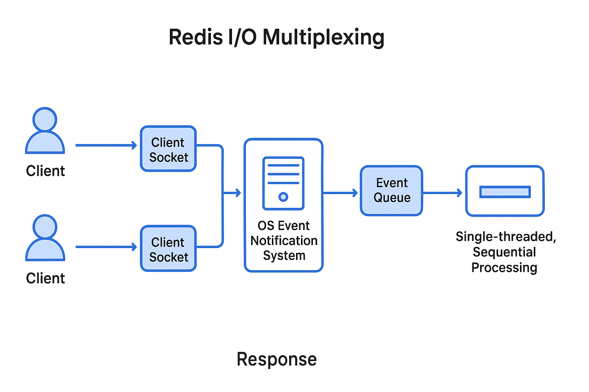

### OS 수준 이벤트 감지 시스템

  - epoll(Linux), kqueue(BSD/macOS) 등 고성능 이벤트 처리 기반
  - 수천 개 클라이언트 연결 상태를 비동기적으로 감지

### IO Multiplexing 방식

  - **Multiplexing:** 하나의 자원(채널, 장치, 스레드 등)을 통해 여러 개의 데이터 흐름(또는 작업)을 동시에 처리하는 기술적 개념
  - 클라이언트 I/O 이벤트를 감지해 이벤트 큐에 등록
  - Redis는 이 큐에서 순서대로 명령을 꺼내 실행
- **여러 클라이언트 요청을 한 개의 스레드가 관리**

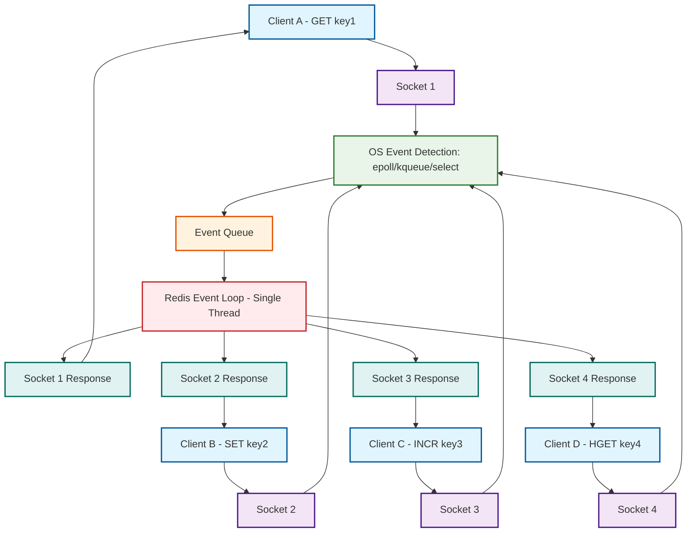

---

# String

### String: Redis에서 가장 기본이자 범용적인 타입

  - 문자열은 Redis 기본 데이터 타입이며, 실질적으로 임의의 값을 저장하는 컨테이너
  - 문자열, 숫자, JSON, 바이너리, 불리언 표현까지 모두 저장 가능
  - 최대 512MB까지 저장 가능 (SDS 기반 문자열)
  - Redis는 C언어로 구현되었으며, 문자열은 내부적으로 SDS(Simlple Dynamic String) 구조체로 저장됨

### 다양한 데이터 표현 예시

  - Redis는 인터페이스 레벨에서 값을 해석하지 않는다 → 모두 문자열로 취급
  - 명령어가 그 값을 숫자, 비트, JSON처럼 해석해서 활용할 수 있다

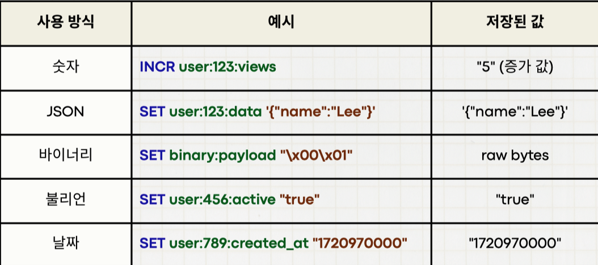

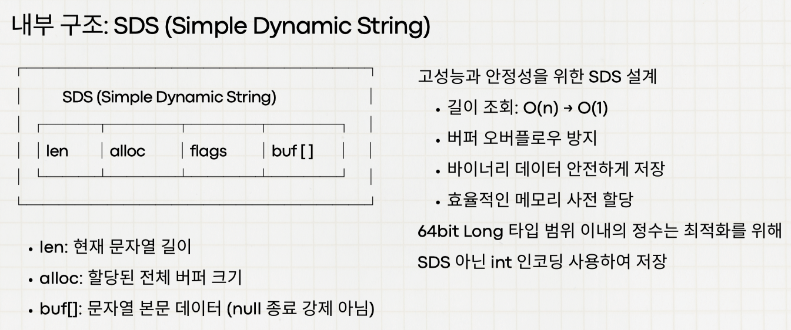

**64bit Long 타입 범위 이내의 정수는 최적화를 위해 SDS가 아닌 int 인코딩 사용하여 저장**

| 명령어 | 문법 | 설명 |
| --- | --- | --- |
| **INCR key** | 인자 1개 | **1씩 증가** |
| **INCRBY key increment** | 인자 2개 | **지정값만큼 증가** |
| **DECR key** | 인자 1개 | **1씩 감소** |
| **DECRBY key decrement** | 인자 2개 | **지정값만큼 감소** |

### 활용1: 사용자 로그인 횟수(정수형 카운터)

```bash
INCR user:123:login_count
```

### 활용2: 세션 정보 캐시(TTL 설정 포함)

```bash
SET session:abc123 '{"user_id":456, "expires_at":"2025.."}' EX 1800
```

  - **KEY:** session:abc123
  - **VALUE:** '{"user_id":456, "expires_at":"2025.."}'
  - **TTL:** 1800초 

### 활용3: 게시글 제목 캐시(단순 문자열)

```bash
SET article:789:title "Redis란?"
```

### String 타입 활용 정리

단순한 값 저장 외에도 다양한 연산을 효율적으로 처리 가능

  - 카운터: INCR, DECR, INCRBY, DECRBY 통해 정수 증가/감소 처리 
  - TTL 설정: SET key value EX time 만료 시간 함께 지정
  - 크기 제한 주의: 최대 512MB, 너무 크면 구조 분해 고려

---

# List

### List: 양방향 삽입/삭제가 가능한 순서형 컬렉션

  - Redis List는 값들의 순서를 유지하는 선형 구조
  - FIFO, LIFO 구조로 사용 가능
  - 동일한 키에 여러 값을 순차적으로 저장
  - 양쪽에서 삽입/삭제 가능 (LPUSH, RPUSH, LPOP, RPOP)

### 주요 연산 및 동작 방식

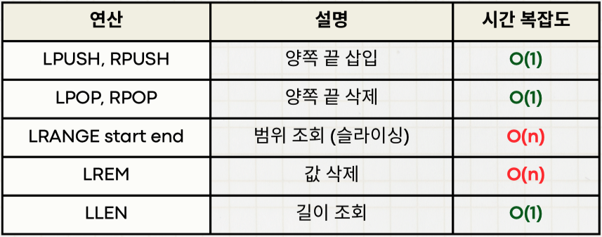

### 활용1: 작업 큐로 활용(왼쪽 삽입, 오른쪽 제거)

```bash
LPUSH task:queue "resize image #1"
LPUSH task:queue "resize image #2"
RPOP task:queue
```

  - KEY: task:queue
  - VALUE: resize image #2

### 활용2: 최근 본 항목 기록

```bash
RPUSH view:user:123 "item1"
RPUSH view:user:123 "item2"
RPUSH view:user:123 "item3"
...

LTRIM view:user:123 -2 -1 
```

  - LTRIM -2 -1: 최신 2개만 유지

### 활용3: 블로킹 큐(작업 대기열 처리)

```bash
BLPOP task:queue 5
```

  - 동작: 리스트에 데이터가 없으면 최대 5초 동안 대기(blocking)
  - 데이터가 들어오는 즉시 pop하여 반환
  - 프로듀서-컨슈머 패턴 구현

### List 타입 활용 정리

큐, 로그처럼 순서가 있는 데이터 처리에 적합하며 고정 길이 유지도 가능

  - 작업 큐: LPUSH + BRPOP 조합으로 소비자 대기 큐 구성
  - 최근 로그: LPUSH 후 LTRIM으로 최대 길이 유지
  - 키 분할: 너무 큰 리스트는 키에 샤딩 값 붙여 분산 처리
  - 양방향 처리: LPUSH, RPUSH, LPOP, RPOP 모두 O(1)

---

# Set

### Set: 중복 없는 집합형 자료 구조

  - Redis Set은 중복을 허용하지 않는 문자열 집합
  - 순서를 보장하지 않으며, 수학적 집합 개념과 동일
  - 삽입, 삭제, 존재 여부 확인이 빠르고, 교집합/합집합/차집합 같은 집합 연산 명령어도 기본 제공

### 내부 구조: intset 또는 hashtable

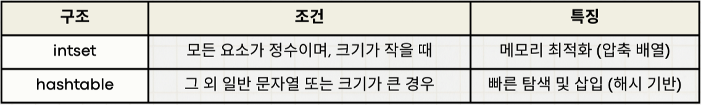

### 주요 연산 및 동작 방식

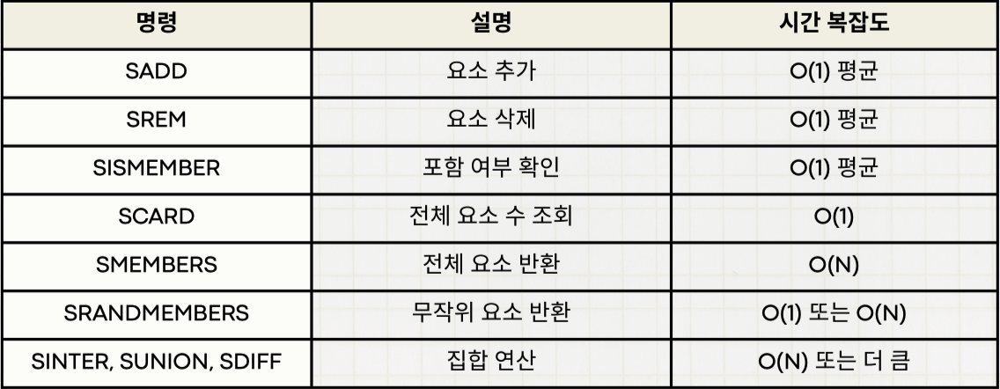

### 활용1: 사용자 태그 등록 (중복 없는 관심사 저장)

```bash
SADD user:123:tags sports music travel
```

  - KEY: user:123:tags
  - VALUE: {sports, music, travel}
- 중복 없음, 순서 없음

### 활용2: 교집합 연산 - 공통 태그 구하기

```bash
SADD user:1 sports music travel
SADD user:2 sports travel movies

SINTER user:1 user:2
```

  - 결과: sports, travel

### 활용3: 태그 목록 전체 조회

```bash
SMEMBERS user:1
```

  - 결과: {sports travel movies}

### 활용4: 랜덤 샘플링 - 관심 주제 무작위 선택

```bash
SRANDMEMBER user:1
```

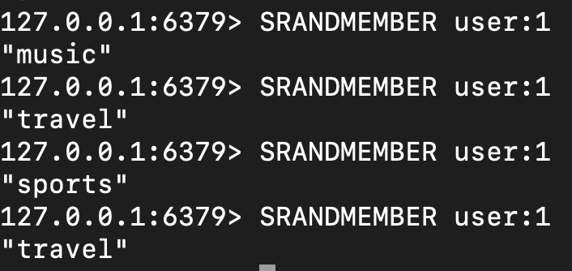

  - 무작위 추출

### Set 타입 활용 정리

중복 없는 집합 표현과 집합 연산 기능을 활용해 간단한 필터링과 샘플링 가능

  - 중복 제거: 자동으로 동일 값 제거
  - 태그 필터링: 교집합(SINTER)으로 조건 필터 구현
  - 랜덤 추출: SRANDMEMBER 랜덤 추천 구현
  - 키 사이즈 주의: 전체 데이터 셋 조회 시, 너무 큰 Set은 SCARD +SSCAN 조합 활용
- **SCARD:** 집합(Set)에 포함된 멤버(member)의 수를 반환
    - **SSCAN:** 집합(Set)에 저장된 멤버들을 부분적으로 반복하여 조회(Iterative Scan)

**SSCAN KEY 커서(시작 위치) COUNT 개수**

  - COUNT 개수로 힌트를 줄 수 있다.
  - COUNT 지정값 보다 더 많이 가져올 수 있다.
  - 다음 커서가 있다면 맨 처음에 응답으로 커서가 온다.

```bash
127.0.0.1:6379> SSCAN myset 0 COUNT 100
1) "1247"    # 다음 커서 (0이 아니면 더 있음)
2) 1) "data1"
   2) "data2"
   # ...

127.0.0.1:6379> SSCAN myset 1247 COUNT 100  
1) "0"       # 커서가 0 = 스캔 완료!
2) 1) "data_last"
   # ...
```

---

# Sorted Set(ZSet)

### ZSet: 점수 기반으로 정렬된 고유한 집합

  - Sorted Set은 중복 없는 요소들에 대해 정렬 기준(score)을 함께 부여하는 자료구조
  - 값은 고유하고, 정렬은 점수에 따라 자동 유지
  - 내부적으로 순서를 갖는 집합, 즉 정렬된 우선순위 큐와 유사
  - 점수를 기반으로 정렬, 범위 조회, 순위 검색이 가능

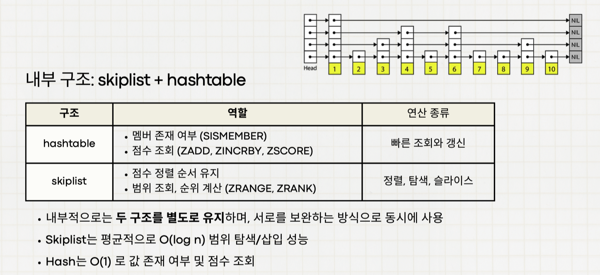

### 주요 연산 및 동작 방식

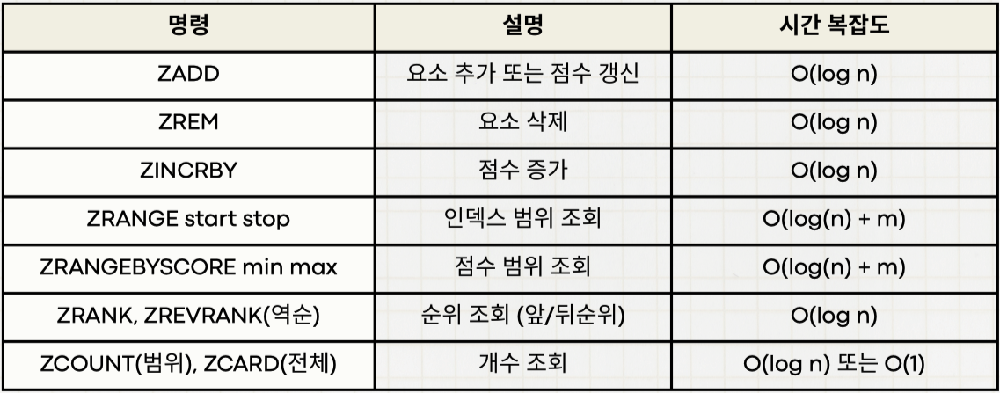

### example

```bash
ZADD leaderboard 100 "userA"
ZADD leaderboard 200 "userB"
ZADD leaderboard 150 "userC"
```

  - KEY: leaderboard
  - 정렬 기준: 점수(score) 오름차순
```bash
# 인덱스 범위 조회 조회
127.0.0.1:6379> ZRANGE leaderboard 0 -1
1) "userA"
2) "userC"
3) "userB"

# 개수 조회
127.0.0.1:6379> ZCOUNT leaderboard 0 300
(integer) 3

127.0.0.1:6379> ZCOUNT leaderboard 0 100
(integer) 1

127.0.0.1:6379> ZCARD leaderboard
(integer) 3

# 점수 범위 조회
127.0.0.1:6379> ZRANGEBYSCORE leaderboard 0 300
1) "userA"
2) "userC"
3) "userB"

# 특정 사용자 순위 조회
127.0.0.1:6379> ZRANK leaderboard userA
(integer) 0
127.0.0.1:6379> ZRANK leaderboard userB
(integer) 2
127.0.0.1:6379> ZRANK leaderboard userC
(integer) 1

# 상위 2명 조회(오름차순)
127.0.0.1:6379> ZRANGE leaderboard 0 1
1) "userA"
2) "userC"

# 상위 2명 조회(내림차순)
127.0.0.1:6379> ZREVRANGE leaderboard 0 1
1) "userB"
2) "userC"
```

### Sorted Set(ZSet) 타입 활용 정리

점수 기반 정렬된 집합으로 순위, 통계, 타임라인 등에 적합

  - 랭킹 시스템: 점수를 기반으로 정렬(ZADD, ZRANGE)
  - 최근순 정렬: timestamp를 score로 사용
- 데이터  제한: ZREMRANGEBYRANK, ZREMRANGEBYSCORE로 오래된 항목 정리
  - 통계 집계: ZUNIONSTORE(합집합), ZINTERSTORE(교집합)로 집계 처리 가능
- ZUNIONSTORE(합집합): 여러 그룹별 랭킹 합산하여 전체 랭킹 집계, 타임라인 머지/정렬
    - ZINTERSTORE(교집합): 이벤트 이력(공동 참여, 공통 활동 등)추출

### **추가 정리**

```bash
# 점수랑 함께 조회하는 방법
127.0.0.1:6379> ZREVRANGE leaderboard 0 -1 WITHSCORES
1) "userD"
2) "1000"
3) "userB"
4) "200"
5) "userC"
6) "150"
7) "userA"
8) "100"

# 점수 추가
127.0.0.1:6379> ZINCRBY leaderboard 100 userD
"1100"

# 존재하지 않았던 member 또한 추가 가능
127.0.0.1:6379> ZINCRBY leaderboard 100 userE
"100"
```

---

# Hash

### Hash: 필드-값 쌍의 소형 컬렉션

  - Redis의 Hash는 한 Key 안에 여러 개의 필드-값 쌍(field-value pair)을 저장하는 자료구조
  - 일반적인 해시맵 구조와 유사하지만, Redis에서는 복수 필드를 하나의 키 아래에 묶는 용도로 사용
  - JSON 유사한 구조, 사용자 정보, 설정값 캐싱에 적합
- 중첩(nested) 구조 저장 불가 
    - 내부적으로 field: string → value:string 구조

### 내부 구조: ziplist 또는 hashtable

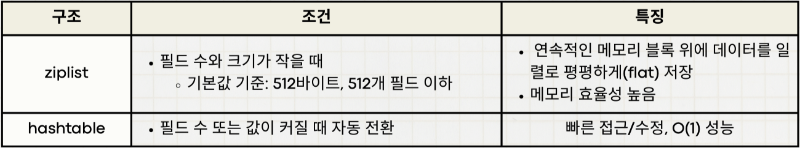

### 주요 연산 및 동작 방식

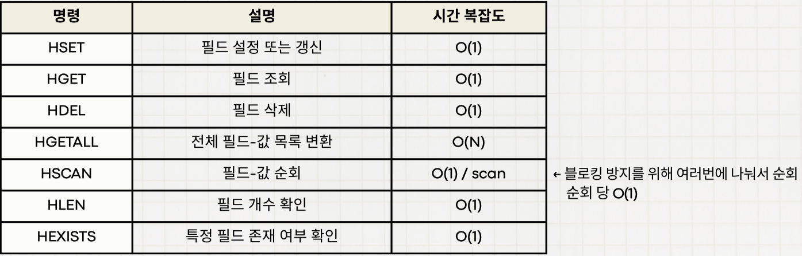

### Practice 

```bash
HSET user:123 name Alice
HSET user:123 email alice@example.com
HSET user:123 age 30

KEY -> user:123
VALUE -> {
	 name: Alice
   email: alice@example.com
   age: 30  
}
```

```bash
# 필드 조회
127.0.0.1:6379> HGET user:123 email
"alice@example.com"

# 전체 필드 조회
127.0.0.1:6379> HGETALL user:123
1) "name"
2) "Alice"
3) "email"
4) "alice@example.com"
5) "age"
6) "30"

# 필드 삭제 및 존재 확인
127.0.0.1:6379> HEXISTS user:123 email
(integer) 1
127.0.0.1:6379> HDEL user:123 email
(integer) 1
127.0.0.1:6379> HEXISTS user:123 email
(integer) 0

#대량 데이터 순회
127.0.0.1:6379> HSCAN user:123 0
1) "0"
2) 1) "name"
   2) "Alice"
   3) "age"
   4) "30"
   5) "email"
   6) "alice@exmaple.com"
```

### Hash 타입 활용 정리

한 키에 여러 필드를 저장할 수 있어 객체 저장이나 설정 캐시에 적합

  - 유저 세션/프로필 저장: HSET, HGET으로 필드별 접근
  - 소형 객체 최적화: **ziplist** 인코딩으로 메모리 절약
  - 필드 수 주의: 많아지면 **hashtable**로 전환되어 메모리 증가
  - 대량 순회: HSCAN 활용해 점진적 순회 가능

---

# Redis에서 영속성이 필요한 이유

### 기본 동작: 메모리 기반 저장

  - Redis는 모든 데이터를 메모리(RAM)에 저장
  - 서버를 재시작하면 데이터는 기본적으로 모두 사라짐
  - 디스크에는 아무것도 남지 않음(기본 설정 시)

### 영속성이 필요한 이유

  - 서버 장애, 재시작 등 예기치 못한 상황 발생 시 데이터 복구 필요
  - 휘발성 캐시가 아닌, 중요한 상태 저장소로 Redis를 활용할 경우
  - 수동 복원이나 백업 없이도 서비스 일관성을 유지하려면 필수

### 영속성이 필요한 케이스

  - **캐시 중심 서비스:** 데이터가 유실되어도 복원 가능 → 저장 생략 가능
  - **상태 중심 시스템:** 장애 발생 시 그대로 복원돼야 함 → 저장 필수
  - **데이터 보호가 중요한 환경:** 가능한 한 모든 변경 사항을 남겨야 함

---

# RDB(Redis Database)

### RDB(Redis Database): 스냅샥 기반 저장 방식

Redis의 전체 메모리 상태를 일정 시점에 저장하여, 빠른 복구를 지원하는 기본적인 영속화 메커니즘

  - **저장 대상:** Redis 전체 메모리 상태(snapshot)
  - **저장 트리거:** SAVE, BGSAVE, 또는 save 설정(redis.conf) 조건 충족 시
  - **저장 포맷:** .rdb 확장자, 바이너리 직렬화 포맷
  - **저장 파일 특징**
- **파일 크기 작음:** 명령 이력 없이 상태만 저장
    - **로딩 속도 빠름:** 일괄 읽기 → 바로 메모리에 복원
  - **저장 위치 및 파일명:** 기본 이름은 dump.rdb, 위치는 dir 설정 기준
  - **save 조건 예시**
- **save 900 1:** 900초 내 1건 이상 변경 시 저장
    - **save 300 10:** 5분 내 10건 이상 변경 시 저장
    - 다중 조건 동시 설정 가능

### 백그라운드 저장과 Copy-on-Write

Redis는 RDB 저장 중에도 요청 처리를 중단하지 않기 위해 fork() 기반 비차단 구조를 사용한다

  - 저장 실행: BGSAVE 명령 또는 설정 조건 충족 시 자동 실행
  - **fork() 호출: 자식 프로세스를 생성해 저장 작업 전담**
  - 역할 분리
- **부모 프로세스:** 클라이언트 요청 처리 계속 수행
    - **자식 프로세스:** 저장 시점의 메모리 상태를 .rdb 파일로 기록
  - **Copy-on-Write(CoW) 메커니즘**
- 메모리 페이지는 부모 - 자식이 공유
    - 부모가 페이지 수정 시 → 해당 페이지만 복사
  - 동시성 확보: 저장 중에도 읽기/쓰기 모두 처리 가능
  - 주의 사항
- 쓰기 트래픽이 많을수록 Cow 증가 → 메모리 급등
    - 메모리 부족 시 fork 실패 또는 OOM 가능성 존재

### RDB의 장단점 요약

스냅샷 기반의 구조적 특성을 기준으로 RDB의 장점과 제한점을 비교해 정리

  - **장점**
- **빠른 복구:** 전체 상태를 일괄 로딩 → 짧은 재시작 시간
    - **파일 크기 효율적:** 상태만 저장, 누적 로그 없음
    - **포맷 단순:** 바이너리 직렬화 → 외부 전송/이식성 유리
  - **단점**
- 마지막 저장 이후의 변경 데이터는 복구되지 않음
    - fork() 또는 디스크 병목 시 저장 실패 가능
    - 실시간 무결성 보장 불가 → 민감한 시스템에 단독 사용 어려움

---

# AOF(Append Only File)

### AOF(Append Only File) 개요: 변경 명렁어 로그 기록 방식

**명령어 로그**를 통해 Redis의 상태를 복구할 수 있도록 보장하는 **실시간 영속화 방식**

  - **영속화 방식:** 처리된 쓰기 명령어 자체를 로그에 기록하여 상태 복원 가능
  - **저장 포맷:** .aof 파일, 사람이 읽을 수 있는 명령어 나열 형식
  - **복구 방식:** 서버 재시작 시 **AOF 파일의 명령어를 순서대로 재실행하여 메모리 상태 복원**
  - **동작 시점:** 명령 처리 직후 버퍼에 기록, 설정에 따라 디스크에 반영
  - **RDB와 차이점:** 메모리 상태 저장이 아니라, **명령의 이력을 저장**하는 방식

### AOF 활성화와 설정 항목

AOF 기능을 사용하려면 명시적으로 활성화해야 하며, 관련 설정 항목들을 함께 지정해야 한다

  - **활성화 옵션:** appendonly yes 설정 시 AOF 기능이 켜진다(default: no)
  - **설정 위치:** redis.conf 파일 또는 CONFIG SET 명령을 통해 적용 가능
  - **주의 사항:** appendonly yes로 설정되기 전에는 AOF 관련 옵션이 적용되지 않음
  - **AOF 파일 이름:** appendfilename (default: appendonly.aof)
  - **저장 디렉터리:** dir 옵션으로 지정
  - **영구 적용 방법:** CONFIG REWRITE 명령으로 현재 설정을 redis.conf에 반경 가능

### AOF 설정 예시 (redis.conf)

```
# AOF 기능 활성화
appendonly yes

# AOF 파일 이름 설정
appendfilename appendonly.aof

# AOF fsync 정책: 1초마다 디스크 반영
appendfsync eversec

# 저장 경로(RDB와 공유)
dir /var/lib/redis

# AOF 리라이팅 조건 설정
auto-aof-rewrite-percentage 100
auto-aof-rewrite-min-size 64mb
```

### 내부 동작 흐름: 버퍼, flush, fsync

AOF는 **명령 실행 후 버퍼에 기록되고, 설정에 따라 디스크에 반영**되는 단계적 흐름을 가진다.

```
1. 클라이언트 쓰기 명령 실행
2. Redis 명령어를 AOF 내부 버퍼에 먼저 기록
3. 이후 OS 파일 시스템 캐시에 flush (write 또는 writev) 호출
4. fsync 또는 fdataasync로 디스크에 물리적 반영
```

  - **버퍼:** Redis 내부에 존재, 여러 명령어를 일시적으로 쌓아둔다
  - **flush:** 버퍼 내용을 OS 파일 시스템 캐시(RAM)에 쓰는 단계
  - **fsync:** 파일 시스템 캐시의 내용을 디스크에 강제 반영(write-through)
  - flsuh/fsync 호출 시점은 appendfsync 설정에 따라 결정된다

### appendfsync 옵션 설명

fsync 호출 시점을 제어하며 AOF의 데이터 안정성과 쓰기 성능 사이의 균형을 조절하는 설정

**설정 항목: appendfsync**

AOF 내부 버퍼의 내용을 OS 파일 시스템 캐시 flush 후 언제 디스크에 반영할지를 결정

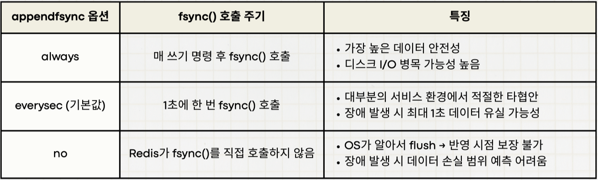

### **AOF 파일 리라이팅**

명령 누적으로 커진 AOP 파일을 정리하여, **상태 재현에 필요한 최소 명령어 집합으로 재작**성하는 최적화 과정

  - **필요 이유**
- AOF는 모든 쓰기 명령을 누적 기록 → 시간이 지날수록 파일 크기 지속 증가
    - 예: SET * 1 → SET * 2 → SET * 3 → 최종 상태는 SET * 3 하나면 충분
  - **동작 방식**
- Redis는 현재 메모리 상태를 기준으로 최소 명령 집합을 생성
    - 새 AOF 파일을 백그라운드에서 작성한 뒤, 기존 파일과 교체
  - **자동 트리거 조건**
- 설정 항목: auto-aof-rewrite-percentage, auto-aof-rewrite-min-size
    - 예: 이전 파일보다 100% 이상 커지고, 64MB 이상일 때 자동 실행
  - **중단 없는 리라이팅 보장**
- 리라이팅 중에도 Redis는 명령어를 계속 처리하고, diff buffer에 변경사항 기록 후 최종 병합
    - 전체 무중단 운영 가능

### AOF 장단점 요약

  - **장점**
- **높은 데이터 보존성:** everysec 기준으로도 최대 1초 이내 손실 → RDB 보다 유실 가능성 낮음
    - **명령어 기반 복원:** 사람이 읽을 수 있어 수동 분석 및 복구 용이
    - **실시간 반영:** 모든 쓰기 명령 즉시 기록 → 상태 변경 직후에도 복원 가능
    - **RDB와 병행 가능:** 빠른 재시작(RDB) + 정밀 복원(AOF) 조합 구성 가능
  - **단점**
- **파일 크기 증가:** 명령 누적으로 RDB보다 훨씬 커질 수 있음
    - **복구 속도 저하:** 재시작 시 명령어 순차 실행 → RDB보다 느림
    - **명령 오류 전파 위험:** 잘못된 명령도 그대로 기록 → 복구 시 재현
    - **디스크 I/O 영향 민감:** 설정에 따라 TPS 성능 저하 가능

---

# 하이브리드 방식(RDB + AOF)

### 하이브리드 구성의 실제 동작 구조

Redis는 RDB, AOF 병행 설정하면, 각 방식의 역할을 명확히 분리하여 함께 운영한다

  - **구성 목적**
- RDB: 메모리 상태를 정기적으로 스냅샷 저장
    - AOF: RDB 저장 이후의 변경 명령을 지속적으로 기록
  - **저장 동작**
- save 설정 조건 충족 시 .rdb 생성
    - 이후 발생한 쓰기 명령은 .aof에 순차적으로 기록됨
  - **복구 시 동작 순서**
1. Redis가 .rdb 파일로 메모리 상태를 먼저 복원
    1. .aof 파일의 전체 명령어(=RDB 이후 기록된 명령)를 순차 실행하여 최신 상태 반영
  - **중복 여부** 
- .aof에는 RDB에 포함된 명령은 기록되지 않음
    - Redis는 AOF 전체를 실행하지만, 그 내용은 RDB 이후의 것만 포함

### **설정 방식과 구성 예시** 

하이브리드 방식은 RDB, AOF 설정을 함께 활성화하여 운영한다

  - **설정 항목 예시(redis.conf)**
- save 900 1
    - save 300 10
    - appendonly yes
    - appendfsync everysec
  - **저장 위치:** .rdb와 .aof 파일 모두 dir 설정 경로에 저장
  - **복구 흐름은 고정**
- .rdb 로드
    - .aof 명령 전체 재실행
  - AOF에는 RDB 이후 명령만 포함되므로 중복 실행 없음

### 하이브리드 구성의 장단점

**두 방식의 특성을 결합하여 복구 성능과 데이터 정합성 모두를 확보할 수 있다.**

  - **장점**
- RDB로 빠른 재시작 가능
    - AOF로 정밀한 복구 가능(최대 1초 단위 보존)
    - 중복 저장 없이 명확한 복구 흐름 확보
  - **단점**
- 디스크 사용량 증가(두 파일 모두 저장됨)
    - 설정 관리 복잡도 증가(주기, 경로, 정책 등 이중 관리 필요)

---

# Maxmemory 정책

### Redis에서 메모리 제거 정책이 필요한 이유

Redis는 모든 데이터를 메모리에 저장하므로, **메모리 한도 초과 시 명확한 제거 전략**이 필요

  - **메모리 기반 구조:** 디스크가 아닌 RAM에 저장하므로 공간 유한
  - **maxmemory 설정:** Redis에 메모리 상한을 명시적으로 지정 가능
  - **쓰기 요청 처리 조건:** 메모리 한도 초과 시 **eviction 정책** 없으면 쓰기 거부
  - **정책 필요성:** 어떤 키를 우선 제거할지 기준 없으면 서비스 불안정

### Eviction 정책 개요

Eviction 정책은 **두 가지 기준(제거 대상과 제거 알고리즘)**을 조합해 동작하는 메커니즘

  - 정책 구성 = 제거 대상 범위 + 제거 알고리즘
  - **Redis 내 사용 예시**
- allkeys-lru, volatile-lru, alkeys-random, noeviction 등
  - **설정 방식**
- **제거 대상:** allkeys / volatile
    - **알고리즘:** lru / lfu / random / noeviction

### 제거 대상 범위 기준

Eviction은 먼저 어떤 키들을 제거 대상으로 삼을지를 결정하며, 이 범위에 따라 제거 알고리즘이 적용

  - **allkeys-*:** 모든 키를 제거 후보로 포함(TTL 여부 무관)
- ex:allkeys-lru, allkeys-lfu
  - **volatile-*:** TTL이 설정된 키만 제거 대상
- ex:volatile-lru, volatile-random
  - **차이점**
- allkeys: 캐시 전체를 관리할 때 사용
    - volatile: 임시 데이터, 만료 데이터만 선별 정리할 때 사용

### 주요 제거 알고리즘

어떤 기준으로 제거할 키를 선택할지를 정의하는 알고리즘

  - **LRU: Least Recently Used** - 가장 오랫동안 사용되지 않은 키 제거
- Redis는 정확한 LRU 대신 샘플 기반 근사 사용
  - **LFU: Least Frequently Used** - 가장 적게 사용된 키 제거
- 내부 카운터 + decay 기반, Redis 4.0 이상
  - **Random:** 제거 대상 중 무작위로 선택
- 계산 비용은 낮지만 예측 불가능
  - **noeviction:** 제거하지 않고 쓰기 실패
- 저장소처럼 사용할 때 적용 가능

### 정책 적용 시 고려사항

Eviction 정책은 설정 후에도 동작 조건과 모니터링 방법을 함께 고려해야 한다.

  - **기본값:** Redis 기본 정책은 noeviction
  - **동작 조건 설정 명령어**
- maxmemory, maxmemory-policy
  - **작동 조건**
- **maxmemory 미설정 시 eviction 자체 미작동**
    - **volatile 정책은 TTL 키가 없으면 작동 안 함**
  - **확인 명령어**
- INFO memory, MEMORY STATS, evicted_keys 지표
  - **운영 팁** 
- eviction trigger 상황 로그 추적(MONITOR, SLOWLOG 활용)
    - 목적 기반 정책 선택: 캐시 → allkeys-lru / 저장소 → noeviction

### 사용 가능한 Eviction 정책 목록 정리

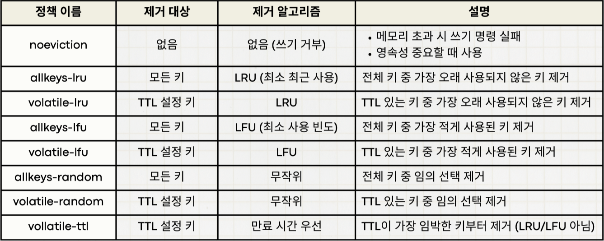

---

# Redis에서의 복제와 고가용성 개요

### 단일 인스턴스의 한계

Redis는 기본적으로 단일 프로세스 기반의 인메모리 데이터베이스

이 구조는 빠르지만 단일 장애지점(SPOF)이 존재

  - **메모리 기반 특성:** 장애 시 데이터 손실 가능
  - **서버 자체 장애:** Redis 프로세스 크래시, OS 문제 등
  - **네트워크 단절:** 클라이언트와 연결 불가 상황
  - **운영 환경:** 단일 인스턴스만으로는 안정성 확보 어려움

### 복제의 도입 목적

복제는 Redis가 고가용성과 확장성을 갖추기 위해 가장 먼저 적용할 수 있는 기본 전략

  - **고가용성 확보:** 장애 시 Replica를 통해 빠른 복구 가능
  - **읽기 분산:** Replica를 통해 read 처리 분산 가능
  - **백업/테스트 분리:** Replica를 활용한 비파괴 테스트 및 데이터 스냅샷
  - **지역 복제:** 멀티 리전 환경에서의 데이터 복제 구성 가능

### Redis 고가용성 구성 전략

  - **단순 복제:** Master → Replica 구성을 통한 기본 복제
  - **Sentinel 구성:** 장애 감지 및 자동 failover 수행
  - **Redis Cluster:** 파티셔닝 + 복제 + 자동 장애 전환 포함된 고급 구성
  - **Hybrid 구성:** 복제 + Sentinel 또는 Cluster 병행 사용

### 구성 전략별 비교

Redis 고가용성 구성 방식들 비교

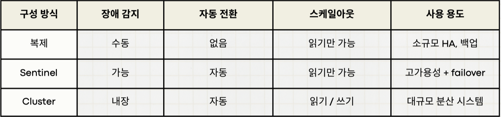

Replication + Sentinel이 현실적인 기본값

Cluster는 쓰기 확장성과 자동 파티셔닝이 필요한 경우에만 선택

---

# Master-Slave 복제

### 복제의 기본 개념

Redis는 단방향 **Master → Replica 복제**를 통해 **읽기 부하 분산과 장애 대비**를 지원

  - **복제 방향:** Master → Replica (쓰기 → 읽기 복제)
  - **쓰기/읽기 분리:** Master는 쓰기 전용, Replica는 기본 읽기 전용
  - **복제 목적:** 장애 복구, 읽기 부하 분산
  - **구조 특성:** 단순하고 빠르지만 실시간 일관성 보장 불가

### 복제의 작동 원리

Redis 복제는 **full sync**와 **명령어 스트리밍**으로 구성

  - **최초 연결 시:** Replica가 Master로부터 RDB 스냅샷을 수신 (full sync)
  - **이후 실시간 복제:** Redis 프로토콜 기반 명령어 스트리밍
  - **명령어 버퍼링:** RDB 전송 중에도 명령어는 별도 버퍼에 저장
  - **중단 복구:** PSYNC 또는 PSYNC2 통해 부분 복제 가능

### 일관성 모델 

| 일관성 모델 | 설명 | 장점 | 단점 | 사용 예시 |
| --- | --- | --- | --- | --- |
| **Strong Consistency** | 모든 노드가 항상 동일한 최신 데이터 보장 | • 데이터 정확성 완벽<br>• 예측 가능한 동작 | • 성능 저하<br>• 가용성 감소 | 은행 잔액, 재고 관리 |
| **Eventual Consistency** | 일시적 불일치 허용, <br>시간이 지나면 일치 | • 높은 성능<br>• 높은 가용성 | • 일시적 데이터 불일치<br>• 복잡한 충돌 해결 | SNS 좋아요, 댓글 수 |
| **Weak Consistency** | 일관성 보장 없음 | • 최고 성능<br>• 최고 가용성 | • 데이터 불일치 가능<br>• 예측 불가능 | 실시간 게임, 로그 수집 |

### 비동기 복제와 데이터 일관성

Redis 복제는 성능을 우선해 기본적으로 비동기 방식으로 동작

  - **비동기 구조:** Master는 Replica 반응을 기다리지 않는다
  - **Replica 지연 가능성:** 최신 데이터 반영 시점에 차이 발생
  - **일관성 모델:** **eventual consistency**
  - **보완 기능:** WAIT 명령어로 지정 수 Replica 반영까지 대기 가능

### 복제의 한계와 장애 복구

**복제 구조만으로는 자동 장애 복구가 불가능**하며, 보완 도구가 필요

```
# 1. Replica를 Master로 승격
redis-cli -p 6380
> REPLICAOF NO ONE

# 2. 애플리케이션 설정 변경
spring.redis.host=replica-server  # 코드 수정 + 재배포

# 3. 기존 Master 복구 후 새로운 Replica로 설정
redis-cli -p 6379
> REPLICAOF replica-server 6380
```

  - **장애 시 동작:** Replica는 연결 유지하지만 승격은 수동 수행
  - **자동 전환 없음:** replicaof no one 등 수동 명령 필요
  - **구조적 한계:** 복제는 데이터 전달 경로일 뿐, failover 로직 없음
  - **보완 도구:** **Sentinel 또는 Redis Cluster 필요**

### 애플리케이션 개발자의 관점

  - Replica는 실시간 일관성을 보장하지 않음
  - 읽기 확장은 가능하지만 쓰기 확장은 불가능
  - Master 장애 시 자동 전환은 없음 → Sentinel 필요
  - 중요 쓰기 이후 확인 필요 시 WAIT 명령 사용 고려

```
# 2개 replica에 복제 완료까지 최대 1000ms 대기
WAIT 2 1000

# 사용 예시
SET user:1000:balance 500
WAIT 1 5000  # 최소 1개 replica 반영까지 5초 대기
```

---

# Redis Sentinel

### Sentinel의 역할과 개념

Sentinel은 Redis **고가용성을 위한 외부 감시자 프로세스**로, 

기존 Master-Replica 구조에 추가로 구성되는 별도 노드

  - **역할: 장애 감지, 자동 전환, 구성 재조정**
  - **구성 위치:** Redis 인스턴스 외부에 독립 배치
  - **감시 대상:** Redis Master, Replica
  - **실행 방식:** Redis 프로토콜 기반의 독립 프로세스

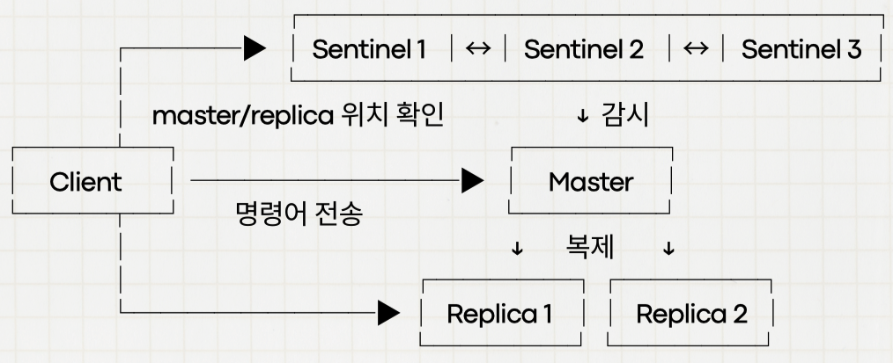

### 장애 감지와 자동 전환 방식

Sentinel은 **네트워크 기반 상태 감시와 합의 기반 트리거를 통해 장애를 판단하고 전환 수행**

  - **감시 대상:** Master + 모든 Replica
  - **감지 기준:** 일정 시간 동안 응답 없음, 연결 실패
  - **failover 조건:** 복수 Sentinel 합의(quorum) 필요
  - **전환 흐름:** 최신 상태 Replica → Master 승격, 나머지 재지정

### 클라이언트와 Sentinel 연동 구조

Sentinel은 단순 감시 도구가 아니라, 클라이언트 측의 Master 탐색 기능도 제공한다.

  - Sentinel은 Redis 프로토콜 기반 API 제공 
  - 클라이언트는 Sentinel에게 현재 Master 주소를 질의
  - 장애 발생 시점마다 새로운 Master를 자동 인식 가능
  - 대표 명령어: SENTINEL get-master-addr-by-name <group>

### Sentinel 구성 시 고려사항

  - 최소 3개 이상 구성 권장 → quorum(의사 결정에 필요한 최소 투표 수)안정 확보
```
# Sentinel 2개일 때 문제
Sentinel A: "Master 죽었어!" 
Sentinel B: 네트워크 끊어져서 응답 없음
→ 혼자서는 failover 못함 (과반수 동의 필요)

# Sentinel 3개일 때
Sentinel A: "Master 죽었어!"
Sentinel B: "맞아, 죽었어!" 
Sentinel C: 네트워크 끊어짐
→ 2/3 과반수로 failover 진행 가능
```
  - Sentinel은 Redis와 노드 분리 배치 → 장애 전파 방지
```
# 나쁜 예: 같은 서버에 배치
Server A: Redis Master + Sentinel A
Server B: Redis Replica + Sentinel B
→ Server A 죽으면 Master와 Sentinel 동시 사망

# 좋은 예: 분리 배치  
Server A: Redis Master
Server B: Redis Replica  
Server C: Sentinel A
Server D: Sentinel B
Server E: Sentinel C
→ Redis 서버 죽어도 Sentinel은 살아있음
```
  - split-brain 방지 → 각 Sentinel의 네트워크 가시성 중요
```
# 네트워크 분할 상황
그룹 1: Master + Sentinel A,B (여전히 Master라고 생각)
  |
 --- 네트워크 단절 ---
  |  
그룹 2: Replica + Sentinel C (새 Master로 승격)

→ 두 개의 Master 존재! 데이터 충돌!
```
  - 원래 Master 복구 시 동기화 순서 주의 → 쓰기 유실 감지 필요
```
# 위험한 상황
1. 원래 Master 죽음
2. Replica가 새 Master로 승격
3. 새 Master에 데이터 쌓임: [A, B, C, D, E]
4. 원래 Master 복구: 여전히 [A, B, C]만 가지고 있음
5. 잘못 연결하면 새 데이터 [D, E] 유실!

# 올바른 복구
1. 원래 Master를 Replica로 강등
2. 새 Master로부터 전체 데이터 동기화
3. 최신 데이터 [A, B, C, D, E] 완전히 받은 후 서비스 투입
```

---

# Redis Cluster 

### Redis Cluster의 개념과 등장 배경

Redis Cluster는 **수평 확장(쓰기 포함)과 내장형 고가용성(failover)**을 동시에 해결하기 위해 도입된 Redis 분산 구조

  - **수평 확장 지원:** 데이터를 노드 간 **분산(sharding)**하여 저장
  - **내장 고가용성:** 각 **노드마다 Replica**를 설정해 장애 발생 시 자동 전환
  - **중앙 관리 없음:** 분산 노드 간 직접 통신으로 클러스터 상태 유지
  - **데이터 모델 특성:** 키 공간을 **16384개의 hash slot**으로 나눠 분배

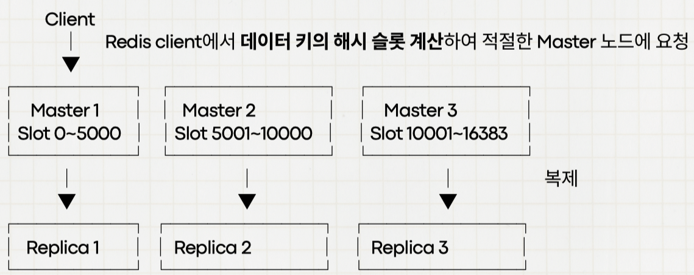

### Cluster 구조와 구성 요소

데이터를 여러 노드에 분산 저장, 각 노드마다 자체적으로 장애 대응이 가능한 구조

  - **키 분산 단위:** 전체 키 공간(16384 slots)을 노드 단위로 분할
  - **Master 노드:** 각 slot 범위를 담당하며 읽기/쓰기를 처리
  - **Replica 노드:** 각 Master 복제본, 장애 시 자동 승격 가능
  - **노드 통신:** Redis Cluster 프로토콜 기반 ping/gossip 주기적 송수신
  - **구성 예시:** 최소 3 Master + 3 Replica = 6개 노드 이상 권장

### 키 분산 원리와 Hash Slot 구조

키 공간 전체를 16384개의 해시 슬롯(hash slots)으로 분할, 해시 슬롯을 Master 노드들에 균등 분배

  - 키 → CRC16 해시 → 0 ~ 16383 슬롯 번호 계산
  - 각 Master 노드는 슬롯 범위를 담당 (예: 05460, 546110922, …)
  - 클라이언트는 슬롯 번호 기반으로 요청 대상 노드 결정
  - **슬롯 이동 가능:** 운영 중에도 slot reassignment 가능 (resharding)

### 클러스터의 장애 처리와 자동 복구

각 Master 노드에 대한 Replica를 두고, 장애 발생 시 클러스터 내부에서 자동으로 복구 절차 수행

  - **Master 장애 감지:** 노드 간 ping/pong 실패, **타 노드의 판단 quorum**
  - **자동 승격:** 해당 Master의 Replica 중 우선순위가 높은 노드가 자동 승격
  - **클라이언트 리다이렉션:** 기존 연결 노드는 무응답, 재요청 시 -MOVED 반환
  - **상태 반영:** 다른 노드들이 새로운 Master 정보를 gossip을 통해 공유

```
# T0: 정상 상태
Master A (0-5460) + Replica A1
Master B (5461-10922) + Replica B1  
Master C (10923-16383) + Replica C1

# T1: Master B 장애
Master A ✓ + Replica A1
Master B ✗ + Replica B1
Master C ✓ + Replica C1

# T2: 장애 감지 (quorum)
A,C가 "B 죽었다" 합의

# T3: 자동 승격
Replica B1 → 새 Master B

# T4: Gossip 전파
모든 노드가 "B1이 새 Master" 정보 공유

# T5: 클라이언트 적응
기존 B로 가던 요청들이 자동으로 B1로 리다이렉션
```

# 캐싱 전략과 패턴

### Redis 캐싱 전략의 실전 중요성

Redis는 단순히 메모리 저장소가 아니라, 캐시 운영에 필요한 **일관성과 안정성**을 제공하는 핵심 요소

  - 캐시 데이터 **갱신/무효화/일관성** 전략이 실제 운영에 큰 영향
  - **Redis는** **TTL, eviction, persistence** **등 전략 구현 기능을 모두 제공**
  - 전략에 따라 캐시 데이터의 신뢰성, 복구 가능성, 응답 지연이 결정됨

### Cache-Aside(Lazy Loading)

**필요할 때만 DB에서 데이터를 불러와 캐시에 저장**하는 가장 일반적인 캐시 전략

  - **기본 흐름**
- 캐시 조회 
    - 없으면 DB 조회
    - 조회 결과를 캐시에 저장 후 반환
  - **장점:** 자주 접근하는 데이터만 캐시됨 → 메모리 효율 높음
  - **단점:** 첫 조회 시 느림, 데이터 변경 시 캐시 삭제 필요
  - **활용 예시:** 사용자 프로필, 게시글, 상세 정보 캐시 등

### Write-Through

**쓰기 요청이 들어올 때 캐시와 DB를 동시에 업데이트**하는 전략

  - **흐름:** 클라이언트 → 캐시와 DB 동시에 쓰기
  - **장점:** 항상 최신 데이터 유지됨 → 캐시 일관성 보장
  - **단점:** 쓰기 지연 발생, 장애 시 롤백/재시도 로직 필요
  - **활용 예시:** 환경 설정, 계정 설정, 상태값 등

### Write-Behind(Write-Back)

**캐시에 먼저 쓰고, 나중에 비동기로 DB에 반영**하는 전략

  - **흐름:** 클라이언트는 Redis에만 쓰고 → Redis가 비동기로 DB 갱신
  - **장점:** 응답 속도 빠름, 대량 쓰기 처리에 유리
  - **단점:** Redis 장애 시 DB 누락 발생 가능
  - **활용 예시:** 로그 수집, 임시 통계, 비동기 큐

### 대표 캐싱 전략 비교 요약

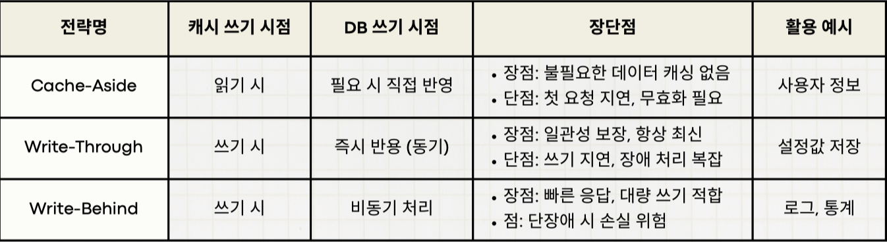

# 파이프 라이닝 성능 최적화 기법 

### 파이프라이닝: 개념과 효과

**여러 Redis 명령을 한 번에 서버로 전송해** **RTT(Round Trip Time)를 줄이고 처리량을 높이는** 네트워크 최적화 기법

  - **동작 방식:** 여러 명령을 요청 큐에 쌓아 한 번에 Redis 서버로 전송
  - **기대 효과:**
- RTT 횟수 감소 → 네트워크 지연 감소화
    - 대량 연산 시 throughtput 개선
  - **유의 사항:**
- 실행은 순차 처리 → 명령 간 종속성 주의
    - 응답 순서는 클라이언트가 직접 관리

### 파이프라이닝: 실전 예시와 적용 시점

  - **적용 적합 상황**
- 대량 SET/INCR/DEL
    - 통계 적재, 마이그레이션, 이벤트 처리 등
  - **비적합 상황**
- 명령 결과를 즉시 필요로 하는 경우
    - 트랜잭션 보장이 필요한 경우

---

# Redis 서버 설정을 통한 연결 제어

### Redis 서버 설정을 통한 연결 제어

Redis는 가벼운 연결 모델을 기반으로 하며, 설정을 통해 **불필요한 연결을 제어** 가능

  - **주요 설정 옵션**
- **timeout 300:** 비활성 연결 유지 시간(초)
    - **maxclients 10000:** 최대 허용 클라이언트 수
    - **tcp-keepalive 60:** TCP 수준 연결 유지 주기
  - **모니터링 명령어**
- **INFO client:** 연결 수, rejected 연결 수 등 확인
    - **CLIENT LIST:** 각 연결 상세 정보 조회

---

# 클라이언트 연결 풀 구성과 운영 전략

### 클라이언트 연결 풀 구성과 운영 전략

Redis **클라이언트에서도 연결을 풀(pool)로 관리하면 성능과 자원 효율성 향상**

```java
GenericObjectPoolConfig config = new GenericObjectPoolConfig();
config.setMaxTotal(100);
config.setMinIdle(10);
config.setMaxIdle(50);
```

**클라이언트 풀 도입 효과**

  - 재사용 가능한 연결로 응답 속도 향상
  - 빈번한 연결/해제 비용 제거
  - 서버의 maxclients 소모 감소

---

# Redis 트랜잭션 

### Redis 트랜잭션: 기본 구조와 동작 원리

Redis 트랜잭션은 여러 명령을 하나의 묶음으로 큐잉하고, 원자적으로 실행하는 방식

  - **기본 흐름**

```bash
MULTI
SET KEY1 VALUE1
INCR counter
EXEC
```

  - 명령은 MULTI 이후 큐에 저장되고, EXEC으로 일괄 실행됨
  - 명령 간 실패가 발생해도, 중단 없이 전체 실행
  - 명령 순서와 수에 따라 실행 속도, 부하 달라짐

### WATCH: 조건 기반 낙관적 락

**트랜잭션 전 특정 키의 변화를 감시하여,** **동시성 충돌 시 트랜잭션 실행을 차단****하는 방법**

  - 사용 흐름
```bash
WATCH balance
MULTI
DECR balance
EXEC
```
  - WATCH로 등록한 키가 EXEC 전 변경되면 → **EXEC는 실패**하고 null 반환
  - 실정 활용 예
- 선착순 처리, 이체 트랜잭션
    - 잔고 부족 시 중복 감소 방지

### 트랜잭션 실패 처리와 실전 적용 주의점

Reids 트랜잭션은 RDBMS 수준의 일관성을 보장하지 않으므로, 설계 상 제약과 우회 전략이 필요

  - **실패 처리 특성**
- EXEC 실패: 전혀 실행되지 않음
    - EXEC 성공 후 일부 명령 실패: 나머지는 그대로 실행
    - DISCARD: 전혀 실행되지 않음(큐에 명령어 다 버림)
  - **주의 사항**
- 롤백 없음: 명령 하나가 실패해도 취소 불가
    - 상태 불일치 가능성 → 로직 상 복구 전략 필요
  - **적용 패턴**
- WATCH + 재시도 로직 → 분산 환경 동시성 문제 보안
    - Lua로 통합 → 원자성 + 조건 분기 동시 처리
  - **실패 케이스**
```bash
MULTI
DECR balance   // 실패
LPUSH history  // 성공
EXEC
```

---

# Lua 스크립트 

### Lua 스크립트: Redis에서의 역할과 장점

**Lua**는 Redis 서버 내에서 **실행 가능한 스크립트 언어,** **복잡한 로직을 단일 명령처럼 처리** 가능

  - **사용 명령:** EVAL, EVALSHA, SCRIPT LOAD, SCRIPT EXISTS
  - **주요 특성**
- **원자성 보장:** 스크립트 전체가 하나의 명령처럼 실행됨
    - **조건 분기, 루프 가능:** 일반 Redis 명령으로 불가능한 로직 처리
    - **네트워크 지연 없음:** 서버 내부에서 직접 연산 처리

### Lua 스크립트: 구문 구조와 핵심 개념

스크립트는 Redis 명령을 Lua 문법 안에 포함해 호출하는 방식으로 작성

  - **주요 개념**
- **redis.call():** Redis 명령 실행 (오류 시 중단)
    - **redis.pcall():** 오류 발생해도 nil 반환 (예외 방지)
    - **KEYS, ARGV:** 외부에서 넘긴 인자
  - **기본 구조**
- EVAL “return redis.call(’GET’, KEYS[1])” 1 mykey
    - EVAL “return redis.call(’SET, KEYS[1], ARGV[1])” 1 mykey myval
  - **예시 설명**
- “1”은 KEYS 배열의 길이
    - “mykey”는 KEYS[1]에 바인딩

### Lua 스크립트: 실전 예제와 구문 해석

“키의 값이 특정 값일 때만 삭제”하는 조건 삭제 예시

**예제 스크립트**

```lua
EVAL "
   if redis.call('GET', KEYS[1]) == ARGV[1] then
      return redis.call('DEL', KEYS[1])
   else 
      return 0
   end
   "1 lock_key expected_value       
```

  - GET으로 현재 값 조회
  - 기대값과 일치하면 DEL, 아니면 아무 일도 하지 않음
  - 반환값: 삭제 성공 → 1, 삭제 안됨 → 0

### Lua 스크립트: 운영 상 주의사항과 한계

스크립트는 강력하지만, **리소스 소비와 유지보수 측면에서 고려**할 점이 많다.

  - **성능 한계**
- 긴 실행 시간 → Redis 전체 블로킹(단일 스레드)
    - 기본 제한: lua-time-limit (기본 5초)
  - **디버깅 어려움**
- 에러 메시지 단순, 로그 출력 불가
    - 멀티라인 스크립트는 외부 파일 분리 권장
  - **보안 및 버전 이슈**
- **외부 코드 injection 주의**
    - 일부 명령은 Lua 내부에서 지원 안 함 (예: MONITOR)

---

### Redis 클러스터 구조 개요

Redis 클러스터: 데이터를 **키 해시 기반으로 자동 분산 저장, 고가용성과 수평 확장을 동시에 달성**

  - **슬롯 기반 분산:** 전체 16384개의 해시 슬롯 사용
  - 각 키 → CRC16(key) % 16384 → 슬롯 결정
- **CRC16:** 빠르고 예측 가능한 해시 알고리즘
  - 슬롯 → 특정 마스터 노드에 매핑됨
  - **노드 구성:** 마스터에 여러 개 + 각 마스터당 0개 이상의 복제본(Slave)
  - Redis 클러스터는 여러 노드에 데이터 분산 저장을 해야하기 때문에, **해시 슬롯을 기반으로 키의 위치(노드)를 결정**

### 클러스터 샤딩 전략

데이터는 키의 해시값을 기반으로 자동 샤딩, 일부 **제어를 위해 해시 태그(hash tag) 활용**

  - 자동 샤딩 구조: CRC16(key) % 16384 → 슬롯 결정 (사용자 임의 지정 불가능)
  - **해시 태그 활용**
- 키 중 {…} 내부의 값만 해시 대상
    - user:{123}:profile → {123} 기준 해시
    - user:{123}:orders → {123} 기준 해시
  - **키 분산 주의**
- 동시 접근 키가 동일 슬롯으로 몰리면 **hotspot** 발생
    - 슬롯 분산 균형 유지가 중요
  - **다중 키 연산 강제적 제약사항**
- 모든 키가 동일한 해시 슬롯에 속해야만 다중 키 연산 가능
    - **키들이 서로 다른 슬롯에 있을 시에 오류 발생(CROSSSLOT Keys in request don't hash to the same slot)**
  - **다중 키 연산**
- MGET, MSET: 여러 키 동시 읽기 / 쓰기
    - SUNION, SINTER, SDIFF 등: Set 자료구조간 집합 연산
    - MULTI/EXEC: 트랜잭션 연산

### 읽기 부하 분산 전략

클러스터 내 복제본 노드를 활용해 읽기 요청을 분산할 수 있지만, 일관성과 지연 문제는 고려 필수

  - **마스터-레플리카 구조**
- 쓰기 → 마스터
    - 읽기 → 복제본(replica) 가능
  - **설정 방식**
- 클라이언트 설정에서 read from replica 옵션 설정
  - **고려 사항**
- 복제 지연 발생 가능 → eventually consistent
    - 실시간성이 중요한 데이터는 마스터에서 조회 권장

### 클러스터 장애 전환과 재구성

Redis 클러스터는 **노드 장애 시 자동 failover를 수행, slot 재배치 및 resharding** 기능도 제공

  - **장애 전환 구조**
- 마스터 노드 장애 발생
    - 슬레이브 중 하나가 승격 → 새 마스터
  - **재구성 도구**
- redis-cli —cluster reshard → slot 재배치
    - redis-cli —cluster failover → 수동 전환
  - **운영 시 고려 사항**
- slot 이동 시 서비스 중단 최소화 위해 단계적 처리
    - 클라이언트 MOVED 리다이렉션 자동 처리 필요

---

### Redis 진단 도구와 명령어

  - **INFO:** 서버 전반 상태 확인(섹션별로 구분 가능)
- INFO memory, INFO stats, INFO clients, INFO replication
  - **SLOWLOG:** 지정 시간(ms) 이상 소요된 명령 기록
  - **MONITOR:** Redis에 들어오는 명령을 실시간으로 출력 (주의: 운영환경 X)
  - **redis-cli —latency:** ping latency 측정용
  - **redis-benchmark:** TPS, 응답 시간 측정용 부하 테스트 도구
  - **외부 도구 연동**
- Prometheus Redis Exporter → Grafana 시각화
    - RedisInsight, Datadog, CloudWatch 등

### Redis 주요 지표 확인 방법 및 의미 정리

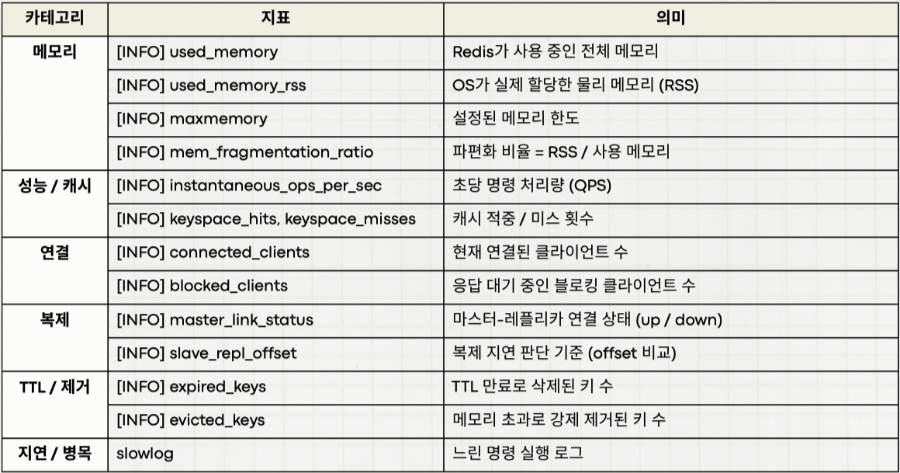

### 대표 문제 유형과 실전 대응 전략 

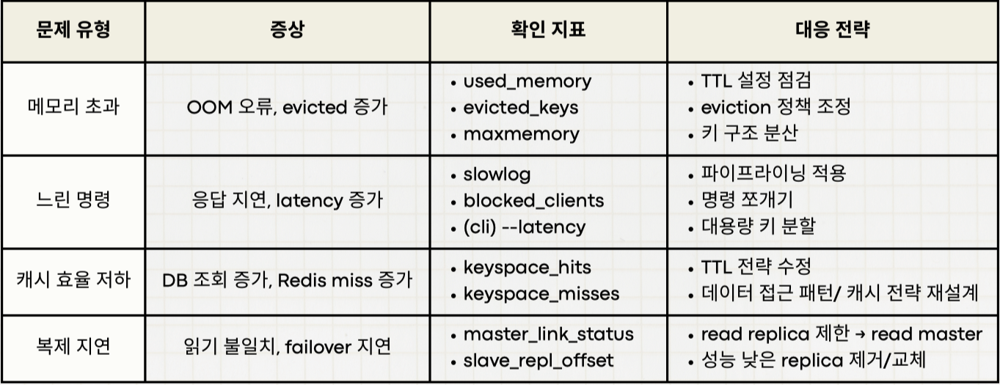

### 지표 해석 흐름과 장애 판단 사례

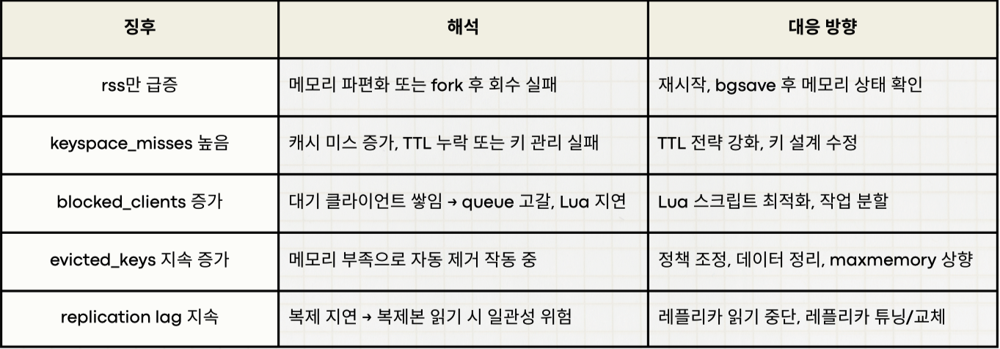

### 초고속 캐시: DB 응답 속도와 부하 문제를 해결할 때

읽기 지연 최소화와 요청 트래픽 완화를 위해 Redis를 캐시 계층으로 활용

**활용 사례**

  - REST API 응답 캐싱
  - 복잡한 DB 쿼리 결과 저장
  - 자주 조회되는 인기 콘텐츠 데이터 저장

**특징** 

  - 평균 응답 속도 < 1ms (명령 처리 시간)
  - TTL 기반 자동 만료 관리
  - key-value 기반으로 간단하게 구성 가능

### 세션 및 상태 저장소: 빠르게 사라지는 사용자 데이터를 저장할 때

사용자 로그인 세션, 장바구니, 일시적 설정 값을 빠르게 저장하고 자동 만료 처리

**활용 사례**

  - 로그인 토큰 및 세션 정보 저장
  - 장바구니, 최근 본 상품 목록
  - 사용자 설정 캐시(언어, 테마 등)

**특징** 

  - TTL 기반 세션 만료 자동 처리
  - 해시(Hash) 구조로 속성 단위 저장
  - 많은 연결에도 빠른 응답 보장

### 실시간 순위/통계 집계: 빠르게 변화하는 데이터를 정렬/집계할 때

ZSet을 활용해 실시간 인기 랭킹, 조회수 순위, 카운터 등을 빠르게 처리

**활용 사례** 

  - 인기 게시물 / 상품 랭킹
  - 실시간 검색어 / 해시태그 집계
  - 사용자 활동 점수 관리

**특징** 

  - INCR, ZINCRBY, ZREVRANGE로 실시간 계산
  - 수십만 건 데이터도 < 10ms 처리
  - TTL로 주기적 재집계도 가능

### 작업 큐 및 메시지 전달: 비동기 처리나 이벤트 기반 구조가 필요할 때

Redis List, Stream, Pub/Sub을 활용해 실시간 비동기 처리 구성

**활용 사례**

  - 작업 큐(배치, 알림, 이메일)
  - 이벤트 브로커(로그 수집, 감시 알림)
  - 사용자 간 실시간 메시징

**특징** 

  - LPUSH + BRPOP으로 간단한 큐 구성
  - Pub/Sub은 구독자에게 즉시 메시지 전송
  - Stream은 메시지 저장 + 소비 이력 관리 가능

## 1. Redis의 두 가지 메모리 개념

### used_memory vs used_memory_rss

```bash
INFO memory 명령어 결과

used_memory:        500MB  # Redis가 관리하는 논리적 메모리
used_memory_rss:    750MB  # OS가 할당한 실제 물리 메모리
```

### 메모리 구조 분석

```
used_memory (500MB)
├── 실제 데이터: 450MB
└── Redis 내부 구조: 50MB

used_memory_rss (750MB)
├── used_memory: 500MB
├── 메모리 단편화: 150MB
└── OS 할당 오버헤드: 100MB
```

## 2. 메모리 단편화(Memory Fragmentation)

### 단편화 발생 과정

```
# 시나리오
1. SET user:1 "매우긴데이터..." (100KB 할당)
2. SET user:2 "짧은데이터" (1KB 할당)
3. DEL user:1 (100KB 해제)
4. SET user:3 "중간데이터" (50KB 필요)

# 결과
- 100KB 공간 있지만 50KB만 사용
- 나머지 50KB = 단편화로 인한 낭비
```

### mem_fragmentation_ratio 해석

```
mem_fragmentation_ratio = used_memory_rss / used_memory

1.0 = 이상적 (현실적으로 불가능)
1.2 = 정상 범위 (20% 오버헤드)
1.5 = 주의 필요 (50% 메모리 낭비)
2.0 = 위험 수준 (메모리 절반이 낭비)
0.9 = 스왑 발생 (매우 위험한 상태)
```

## 3. ElastiCache에서 RSS가 중요한 이유

### OOM(Out of Memory) 발생 조건

```
일반적인 착각
- used_memory: 900MB
- maxmemory: 1000MB
- "아직 100MB 여유가 있다"

실제 위험 상황
- used_memory_rss: 1200MB
- 인스턴스 메모리: 1370MB
- AWS가 메모리 부족으로 Redis 재시작
```

### 실제 메모리 사용량 확인

```
redis-cli INFO memory

# 주요 지표
used_memory: 1073741824        # 1GB (논리적 사용량)
used_memory_human: 1.00G
used_memory_rss: 1503238144    # 1.4GB (물리적 사용량)
used_memory_rss_human: 1.40G
mem_fragmentation_ratio: 1.40  # 40% 단편화
```

## 4. 모니터링 전략

### CloudWatch 알람 설정

```
DatabaseMemoryUsagePercentage:
  - 경고: 80% 이상
  - 위험: 90% 이상
  - 기준: RSS 메모리

MemFragmentationRatio:
  - 경고: 1.5 이상
  - 목표: 1.3 이하 유지

BytesUsedForCache:
  - used_memory 추적
  - 증가 추세 분석
```

### 메모리 계산 방법

```
인스턴스 선택 가이드:
1. 예상 데이터 크기: 500MB (used_memory)
2. 단편화 고려: 500MB × 1.3 = 650MB (RSS)
3. 안전 여유분 30%: 650MB × 1.3 = 845MB
4. 권장 인스턴스: cache.t3.small (1.37GB)

대응 시점:
- fragmentation_ratio > 1.5: 최적화 필요
- used_memory_rss > 80%: 스케일업 검토
- used_memory_rss > 90%: 즉시 대응
```

---

