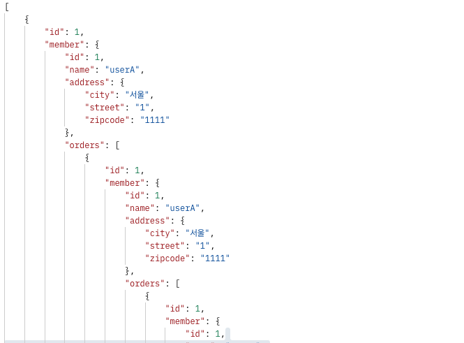
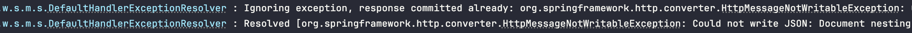
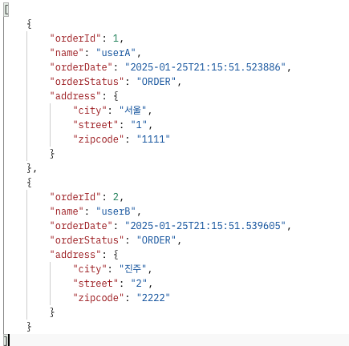
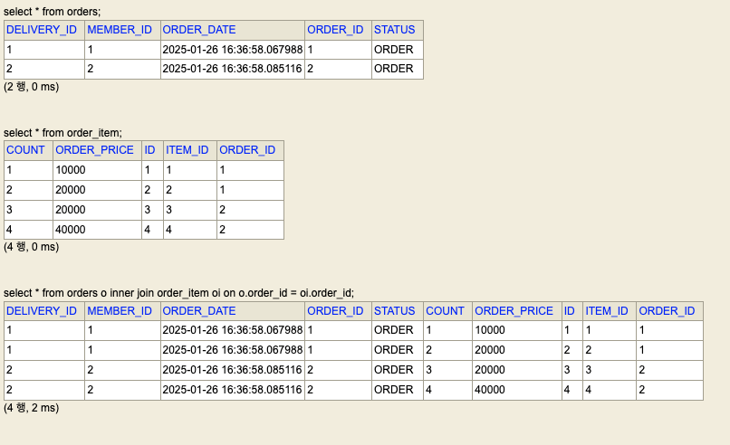
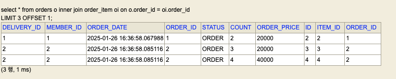
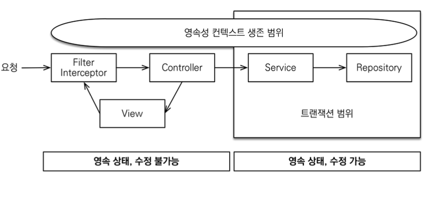
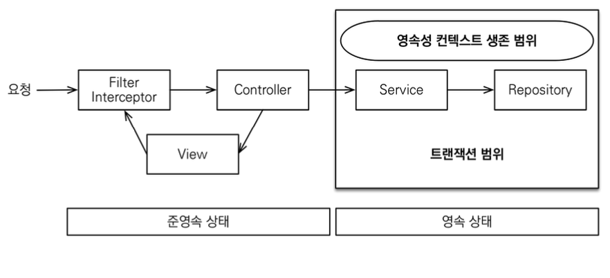

# *회원 등록 API* 

***MemberApiController***

```java
@RestController
@RequiredArgsConstructor
public class MemberApiController {
    private final MemberService memberService;

    @PostMapping("/api/v1/members")
    public CreateMemberResponse saveMemberV1(@RequestBody @Valid Member member){
        Long id = memberService.join(member);
        return new CreateMemberResponse(id);
    }

    @PostMapping("/api/v2/members")
    public CreateMemberResponse saveMemberV2(@RequestBody @Valid CreateMemberRequest request){
        Member member = new Member();
        member.setName(request.getName());

        Long id = memberService.join(member);
        return new CreateMemberResponse(id);
    }

    @Data
    static class CreateMemberRequest{
        @NotEmpty
        private String name;
    }

    @Data
    @AllArgsConstructor
    static class CreateMemberResponse{
        private Long id;
    }
}
```

### ***saveMemberV1  문제점 파악*** 

  - *요청 값으로 Member 엔티티를 직접 받는다.*
  - *엔티티에 프레젠테이션 계층을 위한 로직이 추가된다.*
- *엔티티에 API 검증을 위한 로직이 들어간다. → @NotEmpty 등등..* 
    - *실무에서는 엔티티를 위한 API가 다양하게 만들어지는데, 한 엔티티에 각각의 API를 위한 모든 요구사항을 담기는 어렵다.*
  - *엔티티가 변경되면 API 스펙이 변한다.* 

***→ API 요청 스펙에 맞추어 별도의 DTO를 파라미터로 받는다.***

### ***saveMemberV2***

  - *@RequestBody에 엔티티(Member) 대신 DTO인 CreateMemberRequest를 매핑하였다.*
  - *엔티티와 API 스펙을 명확하게 분리했다 → 엔티티가 변해도 API 스펙이 변하지 않는다.* 

# *회원 수정 API* 

***MemberController***

```java
@PutMapping("/api/v2/members/{id}")
public UpdateMemberResponse updateMember(
        @PathVariable("id") Long id,
        @RequestBody @Valid UpdateMemberRequest request
){
    memberService.update(id, request.getName());
    Member findMember = memberService.findOne(id);
    return new UpdateMemberResponse(findMember.getId(), findMember.getName());
}

@Data
static class UpdateMemberRequest{
    private String name;
}

@Data
@AllArgsConstructor
static class UpdateMemberResponse{
    private Long id;
    private String name;
}
```

  - *회원 수정도 DTO를 요청 파라미터에 매핑*

***MemberService***

```java
@Transactional
public void update(Long id, String name) {
    Member member = memberRepository.findOne(id);
    member.setName(name);
}
```

  - 변경 감지를 사용해서 데이터 수정 

### *Rest 스타일* 

  - *현재 회원 수정 API는 회원 정보를 부분 업데이트 한다. 그리고 PUT 방식을 사용하는데 PUT은 전체 업데이트를 사용할 때 사용하는 것이 맞다.*
  - *부분 업데이트를 하려면 PATCH를 사용하거나 POST 사용하는 것이 REST 스타일에 맞다.*

| **HTTP 메서드** | **기능** | **특징** | **사용 예시** |
| --- | --- | --- | --- |
| **GET** | 자원의 조회 | - 서버에서 데이터를 읽기만 함 (변경 없음)  <br>- 캐싱 가능 | `GET /users/1` <br>- 특정 사용자 조회 |
| **POST** | 자원의 생성 | - 서버에 새로운 리소스를 생성  <br>- 서버가 URI를 결정 | `POST /users` <br>- 새로운 사용자 생성 |
| **PUT** | 자원의 전체 업데이트 <br>(교체) | - 자원의 모든 데이터를 교체 <br> - 존재하지 않으면 새로 생성 (일부 경우) | `PUT /users/1` <br>- 사용자 정보 전체 수정 |
| **PATCH** | 자원의 부분 업데이트 | - 자원의 일부 필드만 수정  - 유연한 업데이트에 적합 | `PATCH /users/1` <br>- 특정 필드만 수정 |
| **DELETE** | 자원의 삭제 | - 서버에서 자원을 삭제  <br>- 상태 변경 없이 호출해도 결과가 동일해야 함 (idempotent) | `DELETE /users/1` <br>- 특정 사용자 삭제 |
| **HEAD** | 메타데이터 조회 | - 자원의 헤더만 반환 (본문 없음)  <br>- 캐싱 검증 등에 사용 | `HEAD /users/1` <br>- 사용자 리소스 존재 확인 |
| **OPTIONS** | 허용되는 메서드 조회 | - 리소스가 지원하는 HTTP 메서드 반환 | `OPTIONS /users` <br>- 허용된 메서드 확인 |
| **TRACE** | 요청-응답 경로 확인 | - 네트워크 디버깅용  <br>- 보안 이슈로 인해 일반적으로 비활성화 | `TRACE /users/1` |
| **CONNECT** | 프록시 서버와의 터널링 설정 | - HTTPS 연결 설정에 사용 | `CONNECT example.com:443` |

# *회원 조회 API* 

### ***회원조회*** *V1:* ***응답 값으로 엔티티를 직접 외부에 노출***

```java
@GetMapping("/api/v1/members")
public List<Member> findMembersV1(){
    return memberService.findMembers();
}
```

*v1: 응답 값으로 엔티티를 직접 노출한다.*

  - ***문제점***
- *엔티티에 프레젠테이션 계층을 위한 로직이 추가된다.*
- *@JsonIgnore: 직렬화 무시*
    - *기본적으로 엔티티의 모든 값이 노출*
- *어떤 API에서는 필요하지 않는 필드가 있을 수 있다.*
    - *실무에서는 같은 엔티티에 대해 API가 용도에 따라 다양하게 만들어지는데, 한 엔티티에 각각의 API를 위
한 프레젠테이션 응답 로직을 담기는 어렵다*
    - *엔티티가 변경되면 API 스펙이 변한다. → 사이드 effect* 
    - *컬렉션으로 직접 반환하면 향후 API 스펙을 변경하기 어렵다.*
- *ex) 전체 결과 개수를 count로 반환해 주세요~*
  - ***해결 방법***
- ***API 응답 스펙에 맞추어 별도의 DTO를 반환한다.***

### ***회원조회*** *V2:* ***응답 값으로 엔티티가 아닌 별도의*** *DTO* ***사용***

```java
@GetMapping("/api/v2/members")
public Result findMembersV2(){

    List<MemberDto> collect =
            memberService.findMembers()
            .stream().map(m -> new MemberDto(m.getName()))
            .collect(Collectors.toList());

    return new Result(collect);
}

@Data
@AllArgsConstructor
static class Result<T> {
    private T data;
}

@Data
@AllArgsConstructor
static class MemberDto{
    private String name;
}
```

***정리*** 

  - *엔티티를 DTO를 변환해서 반환한다.*
  - *엔티티가 변해도 API 스펙이 변경되지 않는다.*
  - *추가로 Result 클래스로 컬렉션을 감싸서 향후 필요한 필드를 추가할 수 있다.*

- ***엔티티 dto 분리***
- ***rest 스타일***
- ***컬렉션 + 엔티티 응답 → 응답 클래스 + DTO 응답*** 

# ***샘플 데이터 생성*** 

  - *userA*
- *JPA1 BOOK*
    - *JPA2 BOOK*
  - *userB*
- *SPRING1 BOOK* 
    - *SPRING2 BOOK*

```java
@Component
@RequiredArgsConstructor
public class InitDb {

    private final EntityManager em;

    @Transactional
    @EventListener(ApplicationReadyEvent.class)
    public void init1() {
        Member member = createMember("userA", "서울", "1", "1111");
        em.persist(member);

        Book book1 = createBook("JPA1 BOOK", 10000, 100);
        em.persist(book1);

        Book book2 = createBook("JPA2 BOOK", 20000, 100);
        em.persist(book2);

        OrderItem orderItem1 = OrderItem.createOrderItem(book1, 10000, 1);
        OrderItem orderItem2 = OrderItem.createOrderItem(book2, 20000, 2);

        Delivery delivery = new Delivery();
        delivery.setAddress(member.getAddress());
        Order order = Order.createOrder(member, delivery, orderItem1, orderItem2);
        em.persist(order);
    }

    @Transactional
    @EventListener(ApplicationReadyEvent.class)
    public void init2() {
        Member member = createMember("userB", "진주", "2", "2222");
        em.persist(member);

        Book book1 = createBook("SPRING1 BOOK", 20000, 200);
        em.persist(book1);

        Book book2 = createBook("SPRING2 BOOK", 40000, 300);
        em.persist(book2);

        OrderItem orderItem1 = OrderItem.createOrderItem(book1, 20000, 3);
        OrderItem orderItem2 = OrderItem.createOrderItem(book2, 40000, 4);

        Delivery delivery = new Delivery();
        delivery.setAddress(member.getAddress());
        Order order = Order.createOrder(member, delivery, orderItem1, orderItem2);
        em.persist(order);
    }

    private static Book createBook(String name, int price, int stockQuantity) {
        Book book1 = new Book();
        book1.setName(name);
        book1.setPrice(price);
        book1.setStockQuantity(stockQuantity);
        return book1;
    }

    private static Member createMember(String name, String city, String street, String zipcode) {
        Member member = new Member();
        member.setName(name);
        member.setAddress(new Address(city, street, zipcode));
        return member;
    }
}
```

- *샘플 데이터 추가* 

### *개요* 

*주문 + 배송정보 + 회원을 조회하는 API를 만들자* 

*v1 ~ v3 까지 발생하는 성능 문제와 엔티티 ↔ 표현 계층 스펙 문제를 단계적으로 해결하자* 

*Order ↔ Delivery (1:1 관계)*

*Order ↔ Member (N:1 관계)*

***이번 챕터는 xToOne 관계 최적화에 대한 내용이다.***

# ***간단한 주문 조회*** *V1:* ***엔티티를 직접 노출***

```java
@RestController
@RequiredArgsConstructor
public class OrderSimpleApiController {
    private final OrderRepository orderRepository;

    @GetMapping("/api/v1/simple-orders")
    public List<Order> ordersV1() {
        return orderRepository.findAllByString(new OrderSearch());
    }
}
```

  - *엔티티를 직접 노출하는 것은 좋지 않다. (앞장에서 설명)*
  - order → member, order → delivery 지연 로딩 

### ***테스트*** 

*order ↔ member, order ↔ delivery 서로 양방향 관계여서 무한 루프에 빠진다.* 

*그래서 양방향 관계에서 한쪽은 @JsonIgnore를 적용해야 한다.*



  - *무한루프에 빠져서 예외가 발생하는데 최신 스프링에서는 해당 예외를 잡아서 처리하고 로그를 남긴다.*



### ***@JsonIgnore 적용*** 

*Order를 기준으로 Order에 대한 참조를 가지는 양방향 관계에 전부 @JsonIgnore를 적용*

*당연하지만 이렇게 엔티티가 현재 개발하는 api 스펙에 의존하게된다.*

*더 큰 문제는 이렇게 @JsonIgnore를 적용해도 jackson 라이브러리는 지연로딩된 프록시 객체를 어떻게 json으로 어떻게 생성해야 하는지 모른다 → 예외가 발생한다.* 

*Hibernate 모듈을 통해서 지연 로딩된 프록시 객체에 대한 문제의 해결이 가능하다.* 

*하지만 엔티티 직접 노출하는 방식은 여전히 다른 문제들은 해결 불가능하다.*

# ***간단한 주문 조회*** *V2:* ***엔티티를*** *DTO****로 변환***

```java
@GetMapping("/api/v2/simple-orders")
public List<SimpleOrderDto> ordersV2(){
    return orderRepository.findAllByString(new OrderSearch())
            .stream()
            .map(SimpleOrderDto::new)
            .collect(Collectors.toList());
}

@Data
static class SimpleOrderDto {
    private Long orderId;
    private String name;
    private LocalDateTime orderDate;
    private OrderStatus orderStatus;
    private Address address;
    public SimpleOrderDto(Order o){
        this.orderId = o.getId();
        this.name = o.getMember().getName();      // 지연 초기화
        this.orderDate = o.getOrderDate();
        this.orderStatus = o.getStatus();
        this.address = o.getDelivery().getAddress();   // 지연 초기화 
    }
}
```

***응답 결과*** 



***실행된 쿼리 개수 → 5개*** 

```java
Hibernate: 
    select
        o1_0.order_id,
        o1_0.delivery_id,
        o1_0.member_id,
        o1_0.order_date,
        o1_0.status 
    from
        orders o1_0 
    join
        member m1_0 
            on m1_0.member_id=o1_0.member_id 
    fetch
        first ? rows only
        
Hibernate: 
    select
        m1_0.member_id,
        m1_0.city,
        m1_0.street,
        m1_0.zipcode,
        m1_0.name 
    from
        member m1_0 
    where
        m1_0.member_id=?   
             
Hibernate: 
    select
        d1_0.delivery_id,
        d1_0.city,
        d1_0.street,
        d1_0.zipcode,
        d1_0.status 
    from
        delivery d1_0 
    where
        d1_0.delivery_id=?     

Hibernate: 
    select
        m1_0.member_id,
        m1_0.city,
        m1_0.street,
        m1_0.zipcode,
        m1_0.name 
    from
        member m1_0 
    where
      m1_0.member_id=?    
      
Hibernate: 
select
    d1_0.delivery_id,
    d1_0.city,
    d1_0.street,
    d1_0.zipcode,
    d1_0.status 
from
    delivery d1_0 
where
    d1_0.delivery_id=?            
```

*처음 쿼리 → 조회된 Order 개수 2개 

Delivery, Member 지연 초기화 시점* 

  - *this.name = o.getMember().getName();*
  - *this.address = o.getDelivery().getAddress();*

### *정리*

  - *쿼리가 1 + N + N번 실행된다.*
- *order → member N번*
    - *order → delivery N번*
  - *엔티티를 직접 노출하는 문제는 Dto로 변환해서 반환하여 해결했지만 쿼리가 너무 많이 날아가서 성능이 떨어진다.*

# ***주문 조회*** *V3:* ***엔티티를*** *DTO****로 변환*** *-* ***페치 조인 최적화***

```java
public List<Order> findAllWithMemberDelivery(){
    return em.createQuery("select o " +
                    "from Order o " +
                    "join fetch o.member m " +
                    "join fetch o.delivery d", Order.class)
            .setMaxResults(1000)
            .getResultList();
}


@GetMapping("/api/v3/simple-orders")
public List<SimpleOrderDto> ordersV3() {
    return orderRepository.findAllWithMemberDelivery()
            .stream()
            .map(SimpleOrderDto::new)
            .collect(Collectors.toList());
}

@Data
static class SimpleOrderDto {
    private Long orderId;
    private String name;
    private LocalDateTime orderDate;
    private OrderStatus orderStatus;
    private Address address;
    public SimpleOrderDto(Order o){
        this.orderId = o.getId();
        this.name = o.getMember().getName();
        this.orderDate = o.getOrderDate();
        this.orderStatus = o.getStatus();
        address = o.getDelivery().getAddress();
    }
}
```

  - ***fetch join 적용*** 
  - *결과도 v2와 동일* 

*만약 fetch join 없이 직접 조인 했으면 필요한 select 프로젝션에 맞는 클래스를 직접 생성해서 가져와야 한다.*

*하지만 Lazy 로딩 + fetch join 조합으로 간단하게 로직 작성이 가능하고 추가로 성능도 좋다*

***실행된 쿼리 개수 → 1개***

```java
  select
      o1_0.order_id,
      d1_0.delivery_id,
      d1_0.city,
      d1_0.street,
      d1_0.zipcode,
      d1_0.status,
      m1_0.member_id,
      m1_0.city,
      m1_0.street,
      m1_0.zipcode,
      m1_0.name,
      o1_0.order_date,
      o1_0.status 
  from
      orders o1_0 
  join
      member m1_0 
          on m1_0.member_id=o1_0.member_id 
  join
      delivery d1_0 
          on d1_0.delivery_id=o1_0.delivery_id 
  fetch
      first ? rows only

```

# ***간단한 주문 조회*** *V4: JPA****에서*** *DTO****로 바로 조회***


***OrderSimpleQueryDto***

```java
@Data
public class OrderSimpleQueryDto {
    private Long orderId;
    private String name;
    private LocalDateTime orderDate;
    private OrderStatus orderStatus;
    private Address address;

    public OrderSimpleQueryDto(Long orderId,
                               String name,
                               LocalDateTime orderDate,
                               OrderStatus orderStatus,
                               Address address) {
        this.orderId = orderId;
        this.name = name;
        this.orderDate = orderDate;
        this.orderStatus = orderStatus;
        this.address = address;
    }
}
```

  - *기존에 사용하던 Dto는 컨트롤러 내부에 있던 클래스였다. 서비스에서 컨트롤러 내부 클래스를 의존하게 되면 의존관계가 꼬인다.*
- *컨트롤러 → 서비스, 서비스 → 컨트롤러(dto)*
  - *그래서 서비스에서 의존하는 리포지토리 패키지에 dto를 만들었다.*
- *서비스 → 리포지토리 , 서비스 → 리포지토리(dto)*

***OrderService - findOrderDto()*** 

```java
public List<OrderSimpleQueryDto> findOrderDto() {
    return em.createQuery("select new jpabook.jpashop.repository.OrderSimpleQueryDto(o.id, m.name, " +
                    "o.orderDate, o.status, d.address)" +
            " from Order o" +
            " join o.member m" +
            " join o.delivery d", OrderSimpleQueryDto.class)
            .getResultList();
}
```

  - *직접 조인 쿼리 작성 (fetch x)*
  - *DTO로 바로 조회를 하려면 FQCN이 필요하다.*
  - *일반적인 SQL을 사용할 때 처럼 원하는 값을 선택해서 조회*
  - *new 명령어를 사용해서 JPQL의 결과를 DTO로 즉시 변환* 

***실행된 쿼리*** 

```java
  
  // v4 쿼리 
  select
      o1_0.order_id,
      m1_0.name,
      o1_0.order_date,
      o1_0.status,
      d1_0.city,
      d1_0.street,
      d1_0.zipcode 
  from
      orders o1_0 
  join
      member m1_0 
          on m1_0.member_id=o1_0.member_id 
  join
      delivery d1_0 
          on d1_0.delivery_id=o1_0.delivery_id
          
          
  // v3 쿼리 - fetch join      
	
  select
    o1_0.order_id,
    d1_0.delivery_id,
    d1_0.city,
    d1_0.street,
    d1_0.zipcode,
    d1_0.status,
    m1_0.member_id,
    m1_0.city,
    m1_0.street,
    m1_0.zipcode,
    m1_0.name,
    o1_0.order_date,
    o1_0.status 
from
    orders o1_0 
join
    member m1_0 
        on m1_0.member_id=o1_0.member_id 
join
    delivery d1_0 
        on d1_0.delivery_id=o1_0.delivery_id 
fetch

```

  - *v3, v4 비교를 하면 실행되는 쿼리의 개수는 동일하지만 가져오는 프로젝션의 개수가 적기 때문에 네트워크 비용이 v4가 더 적다는 걸 확인할 수 있었다.*

### *그렇다면 무조건 v4가 v3보다 좋을까?*

*아니다. v3는 엔티티를 조회하고 v4는 dto를 조회한다.* 

*즉, v3는 여러 api에서 재사용성이 높지만 v4는 특정 api 종속되어서 사용만 가능하다.*

*그리고 애플리케이션 네트워크 용량 최적화는 특수한 케이스가 아닌 이상 생각보다 미비하다.*

*또한 v3는 개발이 단순해진다.*

***그럼 어떻게 해야할까? (권장 방식 순서)*** 

  1. *먼저 엔티티를 dto로 변환하는 방법을 선택한다. → v2*
  1. *필요하면(N+1 problem) 페치 조인을 통해 성능을 최적화 한다. → v3* 
  1. *DTO로 직접 조회 → v4*
  1. *JPA 제공 네이티브 쿼리나 스프링 JDBC Template를 사용해서 직접 SQL을 사용한다.*

- ***fetch join 최적화, DTO 바로 조회, 권장 방식*** 

### *개요* 

*이번에는 주문내역에서 추가한 주문한 상품 정보를 추가로 조회하자.* 

*Order 기준으로 컬렉션인 OrderItem과 Item이 필요하다.*

*Order → OrderItem (1:N) → Item(N:1)*

***이번에는 일대다 관계(OneToMany)를 조회하고, 최적화하는 방법을 알아보자***

# ***주문 조회*** *V1:* ***엔티티 직접 노출***

*엔티티를 직접 노출하면 양방향 연관관계면 무한 루프에 걸리지 않게 한곳에 @JsonIgnore를 추가한다.*

*또헌 Hibernate5Module 설정을 통해 지연 로딩된 프록시 객체를 반환하지 않도록 한다.* 

*반환하고 싶은 객체는 직접 객체를 초기화한다.*

*하지만 이렇게 엔티티를 직접 노출하는 방식은 많은 단점이 존재한다.*

*그래서 코드는 생략한다.* 

# 
***주문 조회*** *V2:* ***엔티티를*** *DTO****로 변환***

```java
@GetMapping("/api/v2/orders")
public List<OrderDto> ordersV2() {
    List<Order> orders = orderRepository.findAllByString(new OrderSearch());
    return orders.stream()
            .map(OrderDto::new)
            .collect(Collectors.toList());
}

@Data
static class OrderDto {
    private Long orderId;
    private String name;
    private LocalDateTime orderDate;
    private OrderStatus orderStatus;
    private Address address;
    private List<OrderItemDto> orderItems;

    public OrderDto(Order order) {
        orderId = order.getId();
        name = order.getMember().getName();
        orderDate = order.getOrderDate();
        orderStatus = order.getStatus();
        address = order.getDelivery().getAddress();
        orderItems = order.getOrderItems()
                .stream()
                .map(OrderItemDto::new)
                .collect(Collectors.toList());
    }
}

@Data
static class OrderItemDto{
    private String itemName;
    private int orderPrice;
    private int count;
    public OrderItemDto(OrderItem orderItem){
        itemName = orderItem.getItem().getName();
        orderPrice = orderItem.getOrderPrice();
        count = orderItem.getCount();
    }
}
```

*코드를 보면 OrderItem(엔티티) 또한 OrderItemDto(dto)로 변환하고 있다.*

***v2의 문제점*** 

  - ***SQL 실행 수*** 
- *order 1번*
    - *member, delivery N번 (order 조회 수 만큼)*
    - *orderItem N번 (order 조회 수 만큼)*
    - *item N번 (orderItem 조회 수 만큼)*

# ***주문 조회*** *V3:* ***엔티티를*** *DTO****로 변환*** *-* ***페치 조인 최적화***

```java
// OrderRepository
public List<Order> findAllWithItem() {
    return em.createQuery("select distinct o from Order o " +
            "join fetch o.member m " +
            "join fetch o.delivery d " +
            "join fetch o.orderItems oi " +
            "join fetch oi.item i", Order.class).getResultList();
}

// Controller

@GetMapping("/api/v3/orders")
public List<OrderDto> ordersV3() {
    List<Order> orders = orderRepository.findAllWithItem();
    return orders.stream()
            .map(OrderDto::new)
            .collect(Collectors.toList());
}

// OrderDto 부분 v2와 동일 생략 
```

  - *컬렉션 fech 조인으로 SQL이 1번만 실행된다.*
  - distinct를 적용하면 2가지 효과가 적용된다. 
- *database SQL query에 distinct 추가*  
    - *Hibernate가 중복 프로젝션 제거*
  - *DB에 distinct는 적용되지 않지만 List<Order>에는 중복이 없게된다.* 

***Hibernate 6*** 

*Hibernate 6버전은 페치 조인 사용 시 자동으로 중복 제거를 하도록 변경*

*즉, JPQL에 distinct 명시 없이 중복이 제거된다.* 
	

***단점*** 

  - *페이징이 불가능하다.*
  - *하이버네이트는 경고 로그를 남기면서 모든 데이터를 DB에서 읽어오고, 메모리에서 페이징을 해버린다.*
- *이는 매우 위험하다.*
  - *컬렉션 패치 조인은 1개만 사용할 수 있다. 컬렉션 둘 이상에 패치 조인을 사용하면 안된다.* 
- *데이터가 부정합하게 조회될 수 있다.*

***1:N에서 페이징이 불가능한 이유*** 



*아래는 order, order_item 조인 결과이다. - Order, OrderItem 1:N 관계* 

*order를 기준으로 1:N 컬렉션 패치 조인을 하고 페이징 적용 → setFirstResult(1):offset , maxResult(3):limit* 



*그럼 ORDER_ITEM_ID를 기준으로 3개가 2, 3, 4 이렇게 나온다. 
이건 Order를 기준으로 하는 페이징이 아니다. (DB 결과 반환: OrderItem 기준으로 페이징 적용)* 

*그래서 하이버네이트는 조인된 모든 결과를 페이징 적용 없이 가져와서 메모리에서 페이징을 적용한다.*

*→ 이는 매우 위험하다. 하이버네이트는 로그로 경고를 남긴다.* 

# ***주문 조회*** *V3+ :****엔티티를*** *DTO****로 변환*** *-* ***페이징과 한계 돌파***

*그렇다면 1:N 관계에서 페이징을 어떻게 해야 할까?*

*대부분의 페이징 + 컬렉션 엔티티 조회 문제를 이 방법으로 해결이 가능하다.*

  - *toOne 관계는 페치 조인을 적용한다.  N:1, 1:1* 
  - *컬렉션은 지연 로딩으로 조회한다.*
  - *지연 로딩 성능 최적화를 위해* ***hibernate.default_batch_fetch_size****,* ***@BatchSize****를 적용하다.*
- ***hibernate.default_batch_fetch_size: 글로벌 설정*** 
    - *@BatchSize: 개별 최적화*
    - *해당 옵션을 사용하면 컬렉션이나, 프록시 객체를 한꺼번에 설정한 size 만큼 IN 쿼리로 조회한다.*
- *IN 쿼리 → array contains*

```java
public List<Order> findAllWithMemberDelivery(int offset, int limit) {
    return em.createQuery("select o " +
                    "from Order o " +
                    "join fetch o.member m " +
                    "join fetch o.delivery d", Order.class)
            .setFirstResult(offset)
            .setMaxResults(limit)
            .getResultList();
}
```

  - ***toOne 관계 fetch 조인 + 페이징 적용*** 

```java
@GetMapping("/api/v3_page/orders")
public List<OrderDto> ordersV3_page() {
    List<Order> orders = orderRepository.findAllWithMemberDelivery(0, 2);
    System.out.println("orders.size() = " + orders.size());
    return orders.stream()
            .map(OrderDto::new)
            .collect(Collectors.toList());
}
```

  - *findAllWithMemberDelivery 사용* 
  - *N + 1 문제 발생한다.* 
- *Order 1:N OrderItem* 
    - *OrderItem N:1 Item* 
    - *OrderItem 개수만큼 쿼리가 날아간다*

***application.yaml***

```yaml
spring:
  datasource:
    url: jdbc:h2:tcp://localhost/~/jpashop
    username: sa
    password:
    [REDACTED] org.h2.Driver
  jpa:
    hibernate:
      ddl-auto: create
    properties:
        hibernate:
          # show_sql: true
          format_sql: true
          default_batch_fetch_size: 100

logging:
  level:
    org.hibernate.SQL: debug
  # org.hibernate.orm.jdbc.bind: trace

```

  - ***spring.jpa.properties.hibernate.default_batch_fetch_size: 100 추가*** 
- *글로벌 설정*

***실행된 쿼리*** 

```java
 select
      o1_0.order_id,
      d1_0.delivery_id,
      d1_0.city,
      d1_0.street,
      d1_0.zipcode,
      d1_0.status,
      m1_0.member_id,
      m1_0.city,
      m1_0.street,
      m1_0.zipcode,
      m1_0.name,
      o1_0.order_date,
      o1_0.status 
  from
      orders o1_0 
  join
      member m1_0 
          on m1_0.member_id=o1_0.member_id 
  join
      delivery d1_0 
          on d1_0.delivery_id=o1_0.delivery_id 
  offset
      ? rows 
  fetch
      first ? rows only

select
    oi1_0.order_id,
    oi1_0.id,
    oi1_0.count,
    oi1_0.item_id,
    oi1_0.order_price 
from
    order_item oi1_0 
where
    oi1_0.order_id in (?, ?, ?, ?, ?, ?, ?, ?, ?, ?, ?, ?, ?, ?, ?, ?, ?, ?, ? ..

select
    i1_0.item_id,
    i1_0.type,
    i1_0.name,
    i1_0.price,
    i1_0.stock_quantity,
    i1_0.artist,
    i1_0.etc,
    i1_0.author,
    i1_0.isbn,
    i1_0.actor,
    i1_0.director 
from
    item i1_0 
where
    i1_0.item_id in (?, ?, ?, ?, ?, ?, ?, ?, ?, ?, ?, ?, ?, ?, ?, ?, ?, ?, ?, ..
```

  - *먼저 Order, Member, Delivery에 대한 쿼리가 날아간다.* 
- *Order N:1 Member*
    - *Order 1:1 Delivery*
    - *toOne 관계여서 페이징 쿼리를 날려도 문제없다.*
  - *이후 지연로딩된 OrderItem, Item 쿼리가 날아간다.* 
  - *즉, 총 3개의 쿼리가 날아간다.* 

*개별로 설정하려면 @BatchSize를 적용하면 된다.* 

  - *컬렉션은 컬렉션 필드* 
  - *엔티티는 엔티티 클래스에 적용* 

### ***정리*** 👍

***장점***

  - *N + 1 문제 해결* 
  - *조인보다 DB 데이터 전송량이 최적화 된다. (Order, OrderItem을 조인하면 Order가 OrderItem만큼 중복해서 조회된다.)* 
  - *페치 조인 방식과 비교해서 쿼리 호출 수가 약간 증가하지만, 데이터 전송량은 줄어든다.*
  - *컬렉션 페치 조인은 페이징이 불가능 하지만 이 방법은 페이징이 가능하다.*

***결론***

  - *toOne 관계는 페치 조인해도 페이징에 영향을 주지 않는다. 따라서 페치 조인으로 쿼리 수를 줄여서 해결하고 
나머지는 hibernate_default_batch_fetch_size로 최적화 하자.* 

***default_batch_fetch_size 적당한 크기?*** 

*100 ~ 1000 사이를 선택하는 것을 권장한다.*

*IN 파라미터를 데이터베이스에 따라 1000으로 제한하기도 한다.*

*1000으로 설정하는 것이 성능상 가장 좋지만 애플리케이션과 DB 모두 순간 부하가 커지기 때문에* 

*어디까지 견딜 수 있는지로 결정하면 된다.*

### ***참고*** *-* ***스프링 부트*** *3.1 -* ***하이버네이트*** *6.2* ***변경사항*** *- array_contains*

*스프링 부트 3.1 부터는 하이버네이트 6.2를 사용한다.*  	

*하이버네이트 6.2부터는 where in 문법 대신에 array_contains를 사용한다.* 

***where in 문법*** 

```java
where item.item_id in(?,?,?,?)
```

***array_contains 문법*** 

```java
where array_contains(?,item.item_id)
```

*where in, array_contains를 사용하도록 변경해도 결과는 완전히 동일하다.* 

*이렇게 변경한 이유는 성능 최적화 때문이다.* 

`select  … where item.item_id in (?)`

*이러한 SQL을 실행할 때 데이터베이스는 SQL 구문을 이해하기 위해 SQL을 파싱하고 분석하는 등 여러가지 복잡한 일을 처리해야 한다. (SQL 파서 모듈, 실행 계획)*

*그래서 성능을 최적화하기 위해 이미 실행된 SQL 구문은 파싱된 결과를 내부에 캐싱하고 있다* 

*이렇게 해두면 이후에 같은 모양의 SQL이 실행되어도 이미 파싱된 결과를 그대로 사용해서 성능을 최적화 할 수 있다.*

*SQL 구문 차제를 캐싱하기 때문에 여기서 ?에 바인딩 되는 데이터는 변경되어도 캐싱된 SQL 결과(구문 파싱 결과)를 그대로 사용할 수 있다.*

*where in 쿼리는 동적으로 데이터가 변하는 것을 넘어서 SQL구문 자체가 변해버리는 문제가 발생한다.*

```java
where item.item_id in(?)
where item.item_id in(?,?)
where item.item_id in(?,?,?,?)
```

  - *in에 들어가는 데이터 숫자에 따라서 3개의 다른 SQL 구문이 생성된다.*
  - *즉, 캐싱도 3개를 따로한다. → 성능 관점에서 좋지않다.*

*array_contains를 사용하면 이런 문제를 깔끔하게 해결할 수 있다*

```java
*i1_0.item_id in (?, ?, ?, ?)*
```

  - *글로벌 배치 사이즈를 4로 줄였다.*
  - *데이터가 동적으로 늘어나도 항상 같은 SQL 구문을 사용해서 성능을 최적화 할 수 있다.*
  - *또한 특정 데이터베이스에서는 배열의 데이터 숫자가 같아야 최적화가 되기 때문에 null 값을 추가한다.*

# 
***주문 조회*** *V4: JPA****에서*** *DTO* ***직접 조회***

***조회 목록*** 

Order 1:N OrderItem 

Order 1:1 Delivery

Order N:1 Member

OrderItem N:1 Item  

***Dto***

```java
@Data
@AllArgsConstructor
public class OrderItemQueryDto {
    @JsonIgnore
    private Long orderId;
    private String itemName;
    private int orderPrice;
    private int count;
}

@Data
public class OrderQueryDto {
     private Long orderId;
     private String name;
     private LocalDateTime orderDate;
     private OrderStatus orderStatus;
     private Address address;
     private List<OrderItemQueryDto> orderItems;

     public OrderQueryDto(Long orderId, String name, LocalDateTime orderDate, OrderStatus orderStatus, Address address) {
         this.orderId = orderId;
         this.name = name;
         this.orderDate = orderDate;
         this.orderStatus = orderStatus;
         this.address = address;
     }
}
```

  - *OrderQueryDto → Member, Delivery, Order 정보* 
  - *OrderItemQueryDto → OrderItem, Item 정보* 

***Repository***

```java
@Repository
@RequiredArgsConstructor
public class OrderQueryRepository {

    private final EntityManager em;

    public List<OrderQueryDto> findOrderQueryDto(){
        List<OrderQueryDto> result = findOrders();

        result.forEach(o -> {
            List<OrderItemQueryDto> orderItems = findOrderItems(o.getOrderId());
            o.setOrderItems(orderItems);
        });

        return result;
    }
    private List<OrderItemQueryDto> findOrderItems(Long orderId) {
        return em.createQuery("select new jpabook.jpashop.repository.order.query.OrderItemQueryDto(oi.order.id, i.name, oi.orderPrice, oi.count) " +
                " from OrderItem oi " +
                " join oi.item i" +
                " where oi.order.id = :orderId", OrderItemQueryDto.class)
                .setParameter("orderId", orderId)
                .getResultList();
    }

    private List<OrderQueryDto> findOrders() {
        return em.createQuery("select new" +
                        " jpabook.jpashop.repository.order.query.OrderQueryDto(o.id, m.name, o.orderDate, o.status, d.address)" +
                        " from Order o" +
                        " join o.member m" +
                        " join o.delivery d", OrderQueryDto.class)
                .getResultList();
    }
}
```

  - *findOrders를 통해서 toOne(N:1, 1:1) 관계들을 먼저 조회한다.* 
  - *findOrderItems()를 통해서 Order를 기준으로 1:N 관계를 조회한다.*
  - *총 findOrders에서 쿼리 1번 findOrderItems()에서 쿼리 N번(order 개수) 실행된다.* 
- *N+1 문제 발생*

***Controller***

```java
@GetMapping("/api/v4/orders")
public List<OrderQueryDto> ordersV4() {
    return orderQueryRepository.findOrderQueryDto();
}
```

# ***주문 조회*** *V5: JPA****에서*** *DTO* ***직접 조회*** *-* ***컬렉션 조회 최적화***

***DTO - v4와 동일*** 

  - OrderItemQueryDto, OrderQueryDto

***findOrders()***

```java
private List<OrderQueryDto> findOrders() {
      return em.createQuery("select new" +
          " jpabook.jpashop.repository.order.query.OrderQueryDto(o.id, m.name, o.orderDate, o.status, d.address)" +
          " from Order o" +
          " join o.member m" +
          " join o.delivery d", OrderQueryDto.class)
          .getResultList();
 }
 
  
```

  - *v4와 동일 findOrders()*

***findOrderQueryDtoOptimization()***

```java
public List<OrderQueryDto> findOrderQueryDtoOptimization(){
    List<OrderQueryDto> result = findOrders();

    List<Long> orderIds = result
            .stream()
            .map(OrderQueryDto::getOrderId)
            .collect(Collectors.toList());

    List<OrderItemQueryDto> orderItems = findOrderItems(orderIds);

    Map<Long, List<OrderItemQueryDto>> orderItemMap = orderItems.stream()
            .collect(Collectors.groupingBy(OrderItemQueryDto::getOrderId));

    result.forEach(o -> {
         o.setOrderItems(orderItemMap.get(o.getOrderId()));
    });

    return result;
}

private List<OrderItemQueryDto> findOrderItems(List<Long> orderIds) {
    return em.createQuery("select new jpabook.jpashop.repository.order.query.OrderItemQueryDto(oi.order.id, i.name, oi.orderPrice, oi.count) " +
                    " from OrderItem oi " +
                    " join oi.item i" +
                    " where oi.order.id in :orderIds", OrderItemQueryDto.class)
            .setParameter("orderIds", orderIds)
            .getResultList();
}
```

  - *v4의 최적화 버전* 
  - *v4에서는 Order를 조회하고 Order 개수(N) 만큼 추가로 쿼리가 날아가는 N+1 문제가 있었다.*
  - *v5는 batch_size in 문법처럼 where in을 통해 쿼리 2개로 해결하는 방법이다.* 

```java
List<Long> orderIds = result
            .stream()
            .map(OrderQueryDto::getOrderId)
            .collect(Collectors.toList());
```

  - *orderIds → 조회된 Order Id만 collect* 

```java
List<OrderItemQueryDto> orderItems = findOrderItems(orderIds);

private List<OrderItemQueryDto> findOrderItems(List<Long> orderIds) {
    return em.createQuery("select new jpabook.jpashop.repository.order.query.OrderItemQueryDto(oi.order.id, i.name, oi.orderPrice, oi.count) " +
                    " from OrderItem oi " +
                    " join oi.item i" +
                    " where oi.order.id in :orderIds", OrderItemQueryDto.class)
            .setParameter("orderIds", orderIds)
            .getResultList();
}
```

  - *orderIds where 조건에 넣어서 조회한다.* 
- *oi1_0.order_id in (?, ?)*

```java
List<OrderItemQueryDto> orderItems = findOrderItems(orderIds);

Map<Long, List<OrderItemQueryDto>> orderItemMap = orderItems.stream()
        .collect(Collectors.groupingBy(OrderItemQueryDto::getOrderId));
```

  - *where in 조건으로 최적화하여 가져온 orderItems를 List에서 Map으로 바꾼다.*
- *key: orderId value: List<OrderItemQueryDto>*

```java
result.forEach(o -> {
       o.setOrderItems(orderItemMap.get(o.getOrderId()));
  });
```

  - *orderId = result를 기준으로 OrderQueryDto에 List<OrderItemQueryDto>를 set 한다.*
  - *이전에 Map으로 바꿔놔서 매칭에 걸리는 시간이 O(1)이다.*

# ***주문 조회*** *V6: JPA****에서*** *DTO****로 직접 조회****,* ***플랫 데이터 최적화***

 ***OrderFlatDto*** 

```java
@Data
public class OrderFlatDto {
    private Long orderId;
    private String name;
    private LocalDateTime orderDate;
    private OrderStatus orderStatus;
    private Address address;

    private String itemName;
    private int orderPrice;
    private int count;

    public OrderFlatDto(Long orderId, String name, LocalDateTime orderDate, OrderStatus orderStatus, Address address, String itemName, int orderPrice, int count) {
        this.orderId = orderId;
        this.name = name;
        this.orderDate = orderDate;
        this.orderStatus = orderStatus;
        this.address = address;
        this.itemName = itemName;
        this.orderPrice = orderPrice;
        this.count = count;
    }
}

```

***OrderQueryRepository - findOrderFlatDto()***

```java
public List<OrderFlatDto> findOrderFlatDto() {
    return em.createQuery("select new jpabook.jpashop.repository.order.query.OrderFlatDto" +
            "(o.id, m.name, o.orderDate, o.status, d.address, i.name, oi.orderPrice, oi.count) " +
            " from Order o " +
            " join o.member m " +
            " join o.delivery d " +
            " join o.orderItems oi " +
            " join oi.item i ", OrderFlatDto.class).getResultList();
}	

```

***OrderQueryDto***

```java
@Data
@EqualsAndHashCode(of = "orderId")
public class OrderQueryDto {
     private Long orderId;
     private String name;
     private LocalDateTime orderDate;
     private OrderStatus orderStatus;
     private Address address;
     private List<OrderItemQueryDto> orderItems;
```

  - *@EqualsAndHashCode(of = "orderId") 추가* 

***ordersV6()***

```java
@GetMapping("/api/v6/orders")
public List<OrderQueryDto> ordersV6() {
    List<OrderFlatDto> result = orderQueryRepository.findOrderFlatDto();
    return result.stream().collect(
		Collectors.groupingBy(o -> 
                new OrderQueryDto(
                      o.getOrderId(), 
                      o.getName(), 
                      o.getOrderDate(), 
                      o.getOrderStatus(), 
                      o.getAddress()),
        Collectors.mapping(o -> 
                new OrderItemQueryDto(
                        o.getOrderId(), 
                        o.getItemName(), 
                        o.getOrderPrice(), 
                        o.getCount()), 
                Collectors.toList())))
            .entrySet().stream()
            .map(o -> {
                OrderQueryDto orderQueryDto = o.getKey();
                orderQueryDto.setOrderItems(o.getValue());
                return orderQueryDto;
            })
            .collect(Collectors.toList());
}
```

### ***(1) 데이터 조회***

```java
List<OrderFlatDto> result = orderQueryRepository.findOrderFlatDto();
```

  - *findOrderFlatDto() 메서드를 통해* ***플랫한 데이터****를 조회.*
- *예: 동일한 orderId를 가진 행이 주문 상품 개수만큼 중복되어 나타남.*
    - ***데이터 예시***
```java
orderId | name | orderDate  | status   | address | itemName | orderPrice | 
	1     | A    | 2025-01-01 | ORDERED  | addr1   | Item1    | 100        | 
  1     | A    | 2025-01-01 | ORDERED  | addr1   | Item2    | 200        | 
  2     | B    | 2025-01-02 | SHIPPED  | addr2   | Item3    | 150        | 
```

---

### ***(2) 데이터 그룹화***

```java
result.stream().collect(
Collectors.groupingBy(o -> 
                new OrderQueryDto(
                      o.getOrderId(), 
                      o.getName(), 
                      o.getOrderDate(), 
                      o.getOrderStatus(), 
                      o.getAddress()),
        Collectors.mapping(o -> 
                new OrderItemQueryDto(
                        o.getOrderId(), 
                        o.getItemName(), 
                        o.getOrderPrice(), 
                        o.getCount()), 
                Collectors.toList())))
```

  1. ***groupingBy***
- *OrderFlatDto 리스트를* ***orderId를 기준으로 그룹화****.*
    - *그룹화 키는 OrderQueryDto 객체를 생성하여 만들었다.*
    - *OrderQueryDto는 @EqualsAndHashCode(of = "orderId")를 사용해 orderId로만 비교되므로, 
동일한 주문 ID의 데이터가 같은 그룹으로 묶인다.*
  1. ***mapping****:*
- *그룹화된 데이터에서 각 주문의 상품 정보를 추출.*
    - *OrderItemQueryDto 객체로 변환하여 List<OrderItemQueryDto> 형태로 저장.*
    - *그룹화 벨류가 된다.*

---

### ***(3) Map<OrderQueryDto, List<OrderItemQueryDto>>을 List<OrderQueryDto>로 변환***

```java
.entrySet()
.stream()
.map(o -> {
    OrderQueryDto orderQueryDto = o.getKey();
    orderQueryDto.setOrderItems(o.getValue());
    return orderQueryDto;
})
.collect(Collectors.toList());
```

  - *groupingBy의 결과는 Map<OrderQueryDto, List<OrderItemQueryDto>> 형태*
- *key: OrderQueryDto (주문 메타 정보)*
    - *value: List<OrderItemQueryDto> (상품 정보)*
  - ***map***
- *각 Map.Entry를 처리하여 OrderQueryDto에 orderItems를 추가(set)*
    - *최종적으로 완전한 OrderQueryDto 리스트 생성.*

### *예시 출력*

```json
[
    {
        "orderId": 1,
        "name": "A",
        "orderDate": "2025-01-01",
        "orderStatus": "ORDERED",
        "address": "addr1",
        "orderItems": [
            {
                "itemName": "Item1",
                "orderPrice": 100,
                "count": 1
            },
            {
                "itemName": "Item2",
                "orderPrice": 200,
                "count": 2
            }
        ]
    },
    {
        "orderId": 2,
        "name": "B",
        "orderDate": "2025-01-02",
        "orderStatus": "SHIPPED",
        "address": "addr2",
        "orderItems": [
            {
                "itemName": "Item3",
                "orderPrice": 150,
                "count": 1
            }
        ]
    }
]
```

### ***정리***

  - *장점: 쿼리 1번*
  - *단점*
- *쿼리는 한번이지만 조인으로 인해 DB에서 애플리케이션에 전달하는 데이터에 중복 데이터가 추가되고 애플리케이션 추가 작업이 커서 v5보다 더 느릴 수도 있다.* 
    - *페이징이 불가능하다.*

- ***hibernate6 fetch join distinct***
- ***컬렉션 패치 조인 페이징 불가능 이유 정리*** 
- ***new + Dto로 직접 조회해서 성능 향상 시키기*** 
- *stream 활용으로 성능 향상*

*Open Session In View: 하이버네이트*

*Open EntityManager In View: JPA*

# ***OSIV on***



  - ***spring.jpa.open-in-view: true 기본값***

***스프링 부트 경고***

```java
spring.jpa.open-in-view is enabled by default. Therefore, database queries may be performed during view rendering. Explicitly configure spring.jpa.open-in-view to disable this warning
```

***OSIV ON?***

*OSIV on 전략은 데이터베이스 커넥션과 영속성 컨텍스트를 서비스 계층에서 획득하여 트랜잭션 시작부터 클라이언트에게 화면 또는 API 응답까지 유지하는 전략이다.*

*그래서 지금까지 View Template이나 API 컨트롤러에서 지연 로딩이 가능했던 것이다.* 

*지연 로딩은 영속성 컨텍스트가 살아있어야 가능하고, 영속성 컨텍스트는 기본적으로 데이터베이스 커넥션을 유지한다.*

*만약 OSIV off 상태에서 트랜잭션 이후에 지연 로딩된 객체를 초기화 시도하면 초기화 예외가 발생한다.*

*문제는 이 전략은 너무 오랫시간동안 데이터베이스 커넥션 리소스를 사용하기 때문에, 실시간 트래픽이 중요한 애플리케이션에서는 커넥션이 모자랄 수 있다. → 장애 발생* 

# *OSIV OFF*



  - *spring.jpa.open-in-view: false OSIV 종료*

*OSIV를 끄면 트랜잭션을 종료할 때 영속성 컨텍스트를 닫고, 데이터베이스 커넥션도 반환한다.* 

*따라서 커넥션 리소스를 낭비하지 않는다.
문제는 OSIV를 끄면 모든 지연로딩을 트랜잭션 안에서 처리해야 한다.* 

*따라서 지금까지 작성한 많은 지연 로딩 코드를 트랜잭션 안으로 넣어야 하는 단점이 있다.* 

# ***커멘드와 쿼리 분리***

*실무에서* ***OSIV를 끈 상태****로 복잡성을 관리하는 좋은 방법이 있다. 
바로 Command와 Query를 분리하는 것이다.*

*보통 비즈니스 로직은 특정 엔티티를 몇 개 등록하거나 수정하는 것이므로 성능이 크게 문제가 되지 않는다.* 

*하지만 복잡한 화면을 출력하기 위한 쿼리는 화면에 맞추어 성능을 최적화 하는 것이 중요하다.*

*하지만 그 복잡성에 비해 핵심 비즈니스에 큰 영향을 주는 것은 아니다.* 

*그래서 둘의 관심사를 명확하게 분리하는 선택은 유지보수 관점에서 충분히 의미가 있다.* 

***OrderService***

  - ***OrderService: 핵심 비즈니스 로직***
  - ***OrderQueryService: 화면이나 API에 맞춘 서비스(주로 읽기 전용 트랜잭션)***

- ***OSIV 성능 최적화***

