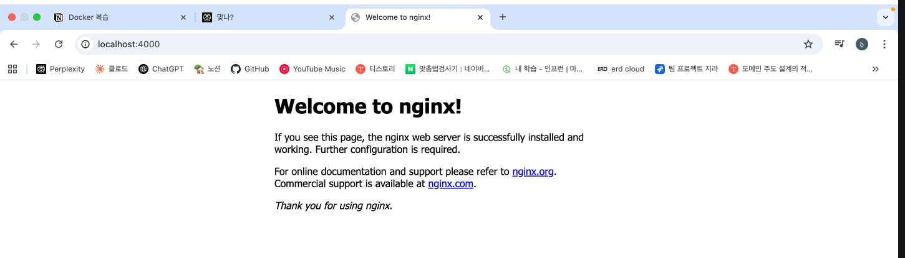
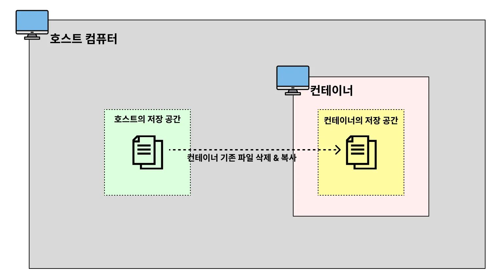
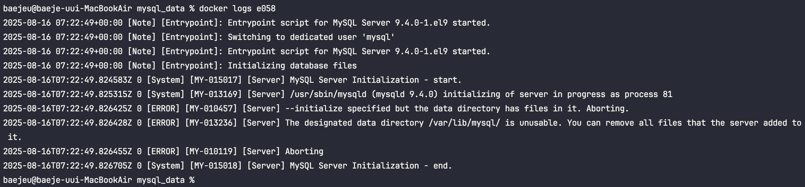
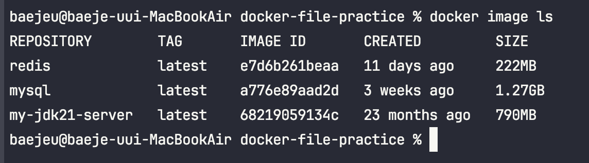
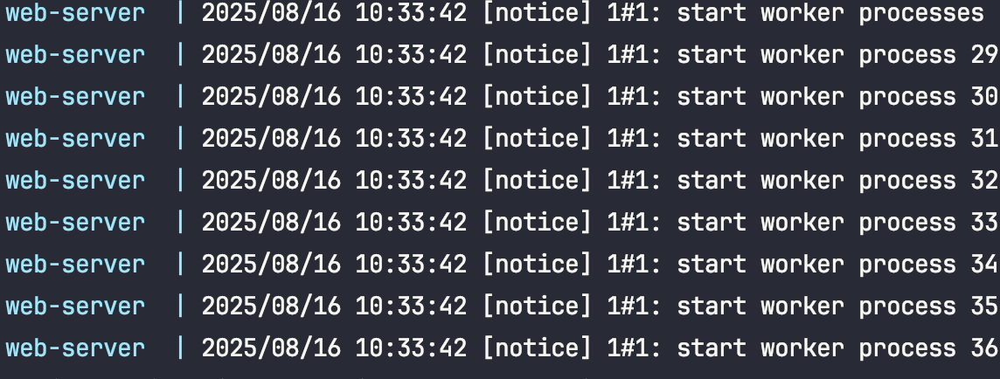
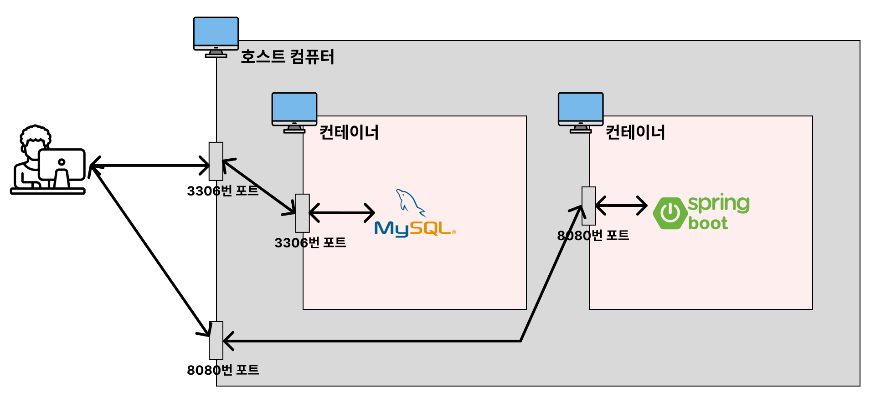
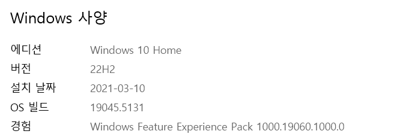

### Docker 명령어 모음

```bash
**# 도커 이미지 조회
docker image ls

# 도커 이미지 삭제(실행중인 컨테이너가 있으면 삭제 불가능)
docker image rm [image ID]

# 도커 이미지 강제 삭제
docker image rm -f [image ID]

# 실행중이거나 중단된 컨테이너를 제외한 사용되지 않는 모든 이미지 삭제
docker image rm $(docker images -q)

# 모든 도커 이미지 삭제
docker image rm -f $(docker images -q)

# 도커 이미지 도커 허브에서 다운 (tag 생략 -> latest)
docker pull [image]:[tag] 

# 실행중인 도커 컨테이너 조회
docker ps 

# 모든 도커 컨테이너 조회
docker ps -a

# 도커 컨테이너 생성: 로컬 환경에 없으면 자동으로 docker hub에서 다운
docker create [image ID 또는 image name]

# 도커 컨테이너 시작
docker start [container ID 또는 container name]

# start + run 명령어 (로컬에 없으면 다운까지 진행)
docker run [image ID 또는 image name]

# 포그라운드로 nginx 실행
docker run nginx 

# 백그라운드로 nginx 실행
docker run -d nginx 

# 이름 지정해서 nginx 실행 
docker run -d --name my-nginx nginx

# 호스트 포트와 컨테이너 포트 연결하기 (이미지 참고하기)
docker run -d -p 4000:80 nginx

# 컨테이너 종료 
docker stop [컨테이너 ID 또는 컨테이너 이름]

# 컨테이너 강제로 종료 
docker kill [컨테이너 ID 또는 컨테이너 이름]

# 컨테이너 삭제 
docker rm [컨테이너 ID 또는 컨테이너 이름]

# 실행중인 컨테이너 강제 삭제 
docker rm -f [컨테이너 ID 또는 컨테이너 이름]

# 중지된 컨테이너 전부 삭제 
docker rm $(docker ps -qa)

# 컨테이너 모든 로그 조회
docker logs [컨테이너 ID 또는 컨테이너 이름]

# 컨테이너 최근 로그 순으로 개수 정해서 조회
docker logs --tail 5 [컨테이너 ID 또는 컨테이너 이름]

# 컨테이너 로그 실시간으로 조회
docker logs -f [컨테이너 ID 또는 컨테이너 이름]

# 컨테이너 로그 실시간 조회 + 기존 로그 안보기
docker logs --tail 0 -f [컨테이너 ID 또는 컨테이너 이름]

# 컨테이너 내부 접속하기 
docker exec -it [컨테이너 ID 또는 컨테이너 이름] [bash, mysql]**
```

### 호스트 포트와 컨테이너 포트 연결 개념



**사용자 → 호스트 컴퓨터(4000포트) → 내부 컨테이너(80포트) → Nginx 접속** 

### 추가 정리

```bash
# 컨테이너 실행 및 이미지 다운까지 한번에
docker run -d -p 6379:6379 redis

# 컨테이너 내부 접속 
docker exec -it [redis 컨테이너 ID] bash

# 컨테이너 내부에서 redis cli 실행
redis-cli 

# 바로 redis-cli 실행
docker exec -it [redis 컨테이너 ID] redis-cli

```

```bash
# 특정 포트를 사용하고 있는 프로세스 확인
lsof -i : [포트 번호]

# 프로세스 강제 종료 
kill -9 [프로세스 아이디]

# 관리자 권한 명령 실행
sudo [명령어]

# 파일 삭제
rm [파일]

# 디렉토리 삭제
rm -r [디렉토리]
```

```bash
# mysql 같은 경우 환경변수로 비밀번호를 지정하지 않고 시작하면 에러가 발생한다.
docker run -e MYSQL_ROOT_PASSWORD=[REDACTED] -d -p 3306:3306 mysql

---------------------------------------------------------------------------------
# 1. 컨테이너 내부 접속하기
docker exec -it [컨테이너 ID] bash

# 2. 비밀번호(환경 변수) 출력하기
echo $MYSQL_ROOT_PASSWORD
---------------------------------------------------------------------------------

# 컨테이너 mysql 바로 접속하기
docker exec -it [컨테이너 ID] mysql -u root -p 
```

### 컨테이너가 가진 문제점

Docker 컨테이너를 교체하면, 기존 컨테이너 내부에 있던 데이터도 같이 삭제된다.

만약 컨테이너가 MySQL을 실행시키는 컨테이너 였다면 MySQL에 저장된 데이터도 같이 삭제 돼버린다.

**따라서 컨테이너 내부에 저장된 데이터가 삭제되면 안 되는 경우에는 볼륨(Volume)이라는 개념을 활용해야 한다.**

---

### 도커 볼륨이란?

컨테이너 자체의 저장 공간을 사용하지 않고, 호스트 자체의 저장 공간을 공유해서 사용하는 형태이다.

---

### 도커 볼륨 사용 2가지 케이스

**호스트의 디렉터리 절대 경로에 디렉토리가 이미 존재할 경우, 호스트의 디렉토리가 컨테이너의 디렉토리를 덮어씌운다.**



**호스트의 디렉토리 절대 경로에 디렉토리가 존재하지 않을 경우, 호스트의 디렉토리 절대 경로에 디렉토리를 새로 만들고 컨테이너의 디렉토리에 있는 파일들을 호스트의 디렉토리로 복사해온다.**


---

### 볼륨을 활용해서 MySQL 실행

```bash
# 현재 디렉토리 경로 출력
pwd

# docker 볼륨 활용해서 컨테이너 실행
docker run -e MYSQL_ROOT_PASSWORD=[REDACTED] -d -p 3306:3306 --name mysql_docker -v /Users/baejeu/Desktop/Study/docker/docker-mysql/mysql_data:/var/lib/mysql 
mysql 
```

    -  /Users/baejeu/Desktop/Study/docker/docker-mysql/mysql_data [호스트 디렉토리 경로]
    - /var/lib/mysql [컨테이너 디렉토리 경로]

**데이터베이스 생성 및 컨테이너 날리기**

```bash
# mysql 접속 
docker exec -it [컨테이너 ID] mysql -u root -p 

# 데이터베이스 생성 

# 컨테이너 삭제 
docker rm -f [컨테이너 ID]
```

**다시 컨테이너 실행 후 확인하기**

```bash
# 컨테이너 실행
docker run -e MYSQL_ROOT_PASSWORD=[REDACTED] -d -p 3306:3306 --name mysql_docker -v /Users/baejeu/Desktop/Study/docker/docker-mysql/mysql_data:/var/lib/mysql 
mysql 


# mysql 접속 
docker exec -it [컨테이너 ID] mysql -u root -p 

# 데이터베이스 확인
```

### **자주하는 실수1**

처음 MySQL 컨테이너를 실행할 때 v옵션으로 볼륨을 마운트하여 데이터가 호스트 디렉토리에 저장된다.

MySQL 초기 설정(루트 비밀번호 포함)은 첫 실행 때만 적용되어 데이터베이스 데이터 디렉토리에 저장된다.

이후 컨테이너를 삭제하고 다시 같은 호스트 볼륨을 마운트해 컨테이너를 새로운 비밀번호로 실행해도,

기존 데이터베이스 데이터에 저장된 비밀번호가 유지되어 새로운 비밀번호가 적용되지 않는다.

이렇게 동작하는 이유는 MySQL 공식 도커 이미지는 초기화 스크립트를 최초 데이터 디렉토리가 비어 있을 때만 실행하기 때문이다.  즉, 기존 데이터가 이미 있다면 환경변수로 넘긴 비밀번호 설정이 무시되고, 기존 데이터(과거 비밀번호)가 그대로 사용된다.

호스트 볼륨 또는 디렉토리를 비우고 컨테이너를 새로 실행하면 초기화 과정에서 새 비밀번호가 적용된다.

### 자주하는 실수2

```bash
# 현재 경로에 빈 파일 생성
vi empty.txt

# 빈 파일을 가지고 컨테이너 실행 
docker run -d -p 3306:3306 --name test -e MYSQL_ROOT_PASSWORD=[REDACTED] -v /Users/baejeu/Desktop/Study/docker/docker-mysql/mysql_data:/var/lib/mysql mysql

# 컨테이너 조회
docker ps 
```

**조회하면 컨테이너 정보가 나오지 않는다.**

로그를 살펴보자



MySQL 컨테이너가 초기화 과정에서 /var/lib/mysql/ 데이터 디렉토리에 이미 파일이 존재하는 것을 감지했습니다. 이 디렉터리가 비어 있어야만 MySQL이 제대로 초기화(설치)됩니다.

기존 데이터가 남아 있어서, 새로 시작할 수 없고 서버가 중단(aborting)되었습니다.

즉, 호스트 볼륨에 empty.txt가 있어서 호스트 볼륨에 있는 empty.txt가 컨테이너 볼륨 경로인 var/libs/mysql

에 복사됐다. 즉, 초기화에 필요한 데이터가 존재하지 않는다.

**즉, 컨테이너를 올바르게 초가화하고 컨테이너의 데이터를 호스트 볼륨에 백업을 하려면 해당 디렉토리가 비어있어야 한다.**

# Dockerfile이란? 

Docker 이미지는 Dockerhub을 통해 다운받아서 사용할 수 있다. 이 Docker 이미지들도 누군가 만들어서 Dockerhub에 올려놓은 것이다. 그럼 도대체 이 Dcoker 이미지는 어떻게 만드는 걸까? 

> **Dockerfile**이라는 걸 활용해서 Docker 이미지를 만들 수 있다. 

Dockerhub에 올려놓은 Docker 이미지가 아닌, 나만의 Docker 이미지를 만들고 싶을 수 있다. 예를 들어, 내가 만든 Spring Boot 프로젝트가 있다. 내가 만든 Spring Boot 프로젝트 자체를 Docker 이미지로 만들고 싶을 수 있다. 이럴 때에도 Dockerfile을 활용하면 나만의 Docker 이미지를 만들 수 있게 된다. 

정리하자면, **Dockerfile**이란 **Docker 이미지를 만들게 해주는 파일**이다.

---

# DockerFile 전체 개념 및 명령어 정리

### DockerFile: FROM 

FROM은 베이스 이미지를 생성하는 역할을 한다. Docker 컨테이너를 **특정 초기 이미지**를 기반으로 추가적인 셋팅을 할 수 있다. 여기서 얘기한 ‘특정 초기 이미지’가 곧 **베이스 이미지**이다. 

```bash
**# 문법
FROM [이미지명]
FROM [이미지명]:[태그명]**
```

**DockerFile**

```bash
**FROM openjdk:21-jdk**
```

```bash
**# 이미지 생성  
docker build -t [이미지 이름] . 

# example
docker build -t my-jdk21-server .**
```

    - **`build`** **명령어를 통해 이미지를 생성한다.**
    - **`t`****: t옵션은 생성할 이미지의 이름을 의미한다.**
    - **`.`****: DockerFile의 경로를 의미한다.**

**생성한 도커 이미지 조회 결과**



```bash
**# 이미지 태그 붙여서 생성하기
docker build -t my-jdk21-server:v1 .** 
```

---

### DockerFile: ENTRYPOINT

**컨테이너의 특성상 명령어 처리가 다 끝나는대로 컨테이너가 바로 종료된다. 그래서 아래 ENTRYPOINT 없이 이미지를 실행시키면 바로 종료된다.**

**DockerFile 수정** 

```bash
FROM openjdk:21-jdk

# 500초 동안 시스템을 일시정지 시키는 명령어
ENTRYPOINT ["/bin/bash", "-c", "sleep 500"]
```

```bash
# 수정된 도커파일로 이미지 생성 
docker build -t file 

# 이미지 조회 
docker image ls

# 컨테이너 실행 
docker run -d file 

# 컨테이너 접속
docker exec -it [컨테이너 ID] bash

# 자바 버전 확인하기
java -version
```


---

### DockerFile: COPY

**DockerFile (**COPY 사용)

```bash
FROM ubuntu

COPY app.txt /app.txt

ENTRYPOINT ["bin/bash", "-c", "sleep 500"]
```

```bash
docker build -t test .

docker run -d test 

docker exec -it test bash

# app.txt 파일 확인 
ls

# app.txt 내용 출력 확인
cat app.txt
```

**DockerFile**

```bash
FROM ubuntu

COPY myapp /myapp/

ENTRYPOINT ["bin/bash", "-c", "sleep 500"]
```

파일과 다르게 디렉토리 전체를 복사하면 끝에 `/` 를 붙여야 한다.

**DockerFile**

```bash
FROM ubuntu

COPY *.txt /texts/

ENTRYPOINT ["bin/bash", "-c", "sleep 500"]
```

txt 파일 모두 복사하기

**특정 파일 제외하려면 .dockerignore 파일 사용**

---

### Spring Boot Project  도커 이미지로 만들고 실행하기

**DockerFile** 

```bash
FROM openjdk:21-jdk

COPY build/libs/*SNAPSHOT.jar app.jar

ENTRYPOINT ["java", "-jar", "/app.jar"]
```

---

### RUN VS ENTRYPOINT

**RUN:** 이미지 생성 과정에서 필요한 명령어를 실행시킬 때 사용

**ENTRYPOINT:** 생성된 이미지를 기반으로 컨테이너를 생성한 직후에 명령어를 실행시킬 때 사용 

**DockerFile**

```bash
FROM ubuntu

RUN apt update && apt install -y git

ENTRYPOINT ["/bin/bash", "-c", "sleep 500"]
```

---

### **WORKDIR** 

작업할 베이스 경로 설정

**DockerFile**

```bash
FROM ubuntu

WORKDIR /my-dir

COPY ./ ./

ENTRYPOINT ["/bin/bash", "-c", "sleep 500"]
```

---

### NGINX로 웹 서빙하기

```bash
FROM nginx

COPY ./ /usr/share/nginx/html
```

---

**compose.yml → nginx 컨테이너 띄우기**

```yaml
services:
  my-web-server:
    container_name: web-server
    image: nginx:latest
    ports:
      - 80:80
```

```bash
# 도커 컴포즈 시작
docker compose up 

# 도커 컴포즈 백그라운드로 시작 
docker compose up -d 

# 도커 컴포즈 컨테이너 삭제
docker compose down

# 도커 컴포즈 컨테이너중에 실행중인 컨테이너 확인
docker compose ps 

# 도커 컴포즈 모든 컨테이너 확인
docker compose ps -a

# 도커 컴포즈 컨테이너들 모든 로그를 볼 수 있다.
docker compose logs
```



    - 로그를 보면 왼쪽에 컨테이너 이름이 붙어있다.

```bash
# 최신 도커 이미지를 가져와서 도커 컴포즈를 실행시킨다.
docker compose pull
```

    - **docker compose up:** 로컬에 이미지가 있으면 바로 실행시키고 없으면 pull 받아서 실행
    - **docker compose pull:** 로컬에 이미지가 있더라도 항상 최신 도커 이미지를 pull 받아서 실행

**compose.yml → redis 컨테이너 띄우기** 

```yaml
services:
  my-cache-server:
    container_name: redis
    image: redis:latest
    ports:
      - 6379:6379
```

**compose.yml → mysql 컨테이너 띄우기** 

```yaml
services:
  my-db:
    container_name: mysql-db
    image: mysql:latest
    environment:
      MYSQL_ROOT_PASSWORD: [REDACTED]
    volumes:
      - ./mysql-data:/var/lib/mysql
    ports:
      - 3306:3306
```

---

### Spring Boot Project Docker Compose 통해서 띄우기

**DockerFile** 

```bash
FROM openjdk:21-jdk

COPY build/libs/*SNAPSHOT.jar /app.jar

EXPOSE 8080

ENTRYPOINT ["java", "-jar", "/app.jar"]
```

```yaml
services:
  my-server:
    container_name: my-server
    build: .
    ports:
      - 8080:8080
```

```bash
# 도커 컴포즈 빌드하고 컨테이너 띄우기
docker compose up -d --build
```

---

### **mysql + redis 컨테이너 띄우기**

```yaml
services:
  my-db:
    container_name: mysql-db
    image: mysql:latest
    environment:
      MYSQL_ROOT_PASSWORD: [REDACTED]
    volumes:
      - ./mysql-data:/var/lib/mysql
    ports:
      - 3306:3306
  my-cache-server:
    container_name: redis-cache
    image: redis:latest
    ports:
      - 6379:6379
```

---

### **spring + mysql 컨테이너 띄우기**

**spring docker file**

```bash
FROM openjdk:21-jdk

COPY build/libs/*SNAPSHOT.jar /app.jar

EXPOSE 8080

ENTRYPOINT ["java", "-jar", "/app.jar"]
```

**spring yml**

```yaml
spring:
  datasource:
    driver-class-name: com.mysql.cj.jdbc.Driver
    url: jdbc:mysql://my-db:3306/mydb
    username: root
    password: [REDACTED]
```

    - url을 보면 아래 compose.yml에 작성한 서비스의 이름을 명시했다.

**compose.yml**

```yaml
services:
  my-server:
    container_name: my-server
    build: .
    ports:
      - 8080:8080
    depends_on:
      - my-db

  my-db:
    container_name: my-db
    image: mysql:latest
    environment:
      MYSQL_ROOT_PASSWORD: [REDACTED]
      MYSQL_DATABASE: mydb
    ports:
      - 3306:3306
    volumes:
      - ./mysql-data:/var/lib/mysql
    healthcheck:
      test: ["CMD", "mysqladmin", "ping"]
      interval: 5s
      retries: 10

volumes:
    mysql-data:
```

    - **depends_on:** spring 서버는 mysql 서버가 올라간 이후에 올라가야한다.
    - **healthcheck:** health check를 통해 mysql 서버가 정상적으로 실행중이면 my-server 컨테이너가 올라간다.

---

### 컨테이너로 실행시킨 Spring Boot가 MySQL에 연결이 안 되는 이유



각각의 컨테이너는 **자신만의 네트워크망과 IP 주소**를 가지고 있다. 호스트 컴퓨터 입장에서 localhost는 호스트 컴퓨터를 가리키지만, Spring Boot 컨테이너 입장에서 localhost는 Spring Boot 컨테이너를 가리킨다. 

그런데 Spring Boot의 코드를 작성할 때 DB 정보를 아래와 같이 입력했었다. Spring Boot가 실행되는 환경인 컨테이너 입장에서 [localhost:3306](http://localhost:3306/)라는 주소는, Spring Boot 컨테이너 내부에 있는 3306번 포트와 연결을 시도하게 된다. 하지만 Spirng Boot가 실행되는 컨테이너 내부의 3306번 포트에는 아무것도 실행되고 있지 않다. 이러한 구조상의 문제 때문에 Spring Boot가 MySQL에 연결이 안 되고 있었던 것이다. 

**application.yml**

```yaml
spring:
  datasource:
    url: jdbc:mysql://**localhost**:3306/mydb
    username: root
    password: [REDACTED]
    driver-class-name: com.mysql.cj.jdbc.Driver
```

> **그럼 어떻게 Spring Boot의 컨테이너에서 다른 컨테이너에 존재하는 MySQL에 연결을 할 수 있을까?**

**compose.yml에서 정의한 Service 이름으로 서로 통신할 수 있다.** 

---

[https://hub.docker.com/](https://hub.docker.com/)

---

[Untitled](https://app.notion.com/p/a9affdeece4b45efb1424835d9c2da46) 

# 자주 사용하는 명령어 

**컨테이너 접속** 

```bash
docker exec -it [컨테이너 ID] bash
```

**redis cli 실행** 

```bash
docker exec -it [redis 컨테이너 ID] redis-cli

-----------------------------------------------------
docker exec -it [redis 컨테이너 ID] bash
redis-cli
```

  - 물론 컨테이너를 접속해서 내부에서 실행하는 방식도 가능

**mysql 실행** 

```bash
docker exec -it [mysql 컨테이너 ID] mysql -u root -p 

-----------------------------------------------------
docker exec -it [mysql 컨테이너 ID] bash
mysql -u root -p
```

  - 물론 컨테이너를 접속해서 내부에서 실행하는 방식도 가능

**여러가지 옵션** 

```bash
--name: 
컨테이너 이름 붙이기 

-d: 
백그라운드 스레드로 실행 

-p: 
host 포트, 컨테이너 포트 매핑

-f: 
force 

-i: 
"interactive" 모드로 컨테이너와 상호작용할 수 있도록 한다. 입력을 받을 수 있게 한다.

-t: 
"tty" (터미널)를 할당하여 가상 터미널을 제공. 
이는 컨테이너 내에서 명령어를 실행할 때 마치 실제 터미널을 사용하는 것처럼 보이게 해준다

-v:
볼륨 설정 [호스트 경로]:[컨테이너 경로]
```

 **로그** 

```bash
# 실시간 로그 
docker logs -f [컨테이너 ID]

# 로그 
docker logs [컨테이너 ID]

# 로그 원하는 길이(10)
docker logs --tail 10 [컨테이너 ID]

# 응용: 이전 로그 X & 실시간 로그 
docker logs -f --tail 0 [컨테이너 ID]
```

**자주 사용하는 명령어** 

```bash
# 실행중인 컨테이너 
docker ps 

# 모든 컨테이너 조회 
docker ps -a 

# 컨테이너 실행 
docker start [컨테이너 ID]

# 컨테이너 중지
docker stop [컨테이너 ID]

# 컨테이너 강제 중지 (컴퓨터 렉걸려서 강제 종료)
docker kill [컨테이너 ID]

# 컨테이너 삭제
docker rm [컨테이너 ID]

# 실행중인 컨테이너 삭제
docker rm -f [컨테이너 ID]

# 이미지 조회 
docker image ls 

# 이미지 삭제
docker rmi [이미지 ID]

# 이미지 다운 이미지이름:테그 (테그 생략하면 latest)
docker pull redis 

# 실행(이미지 없으면 다운하고 실행)
docker run redis 

# 백그라운드 실행 
docker run -d redis

# host, container 포트 맵핑 
docker run -p 6379:6379 redis

# 컨테이너 이름 붙이기
docker run --name redis 

# 특정 포트 사용하고 있는 프로세스 조회
sudo lsof -i:3306

# 프로세스 강제 종료
kill [PID]

# 환경 변수 출력 
echo $MYSQL_ROOT_PASSWORD

# 이미지 생성 (Dockerfile 존재하는 경로 기준)
docker build -t [이미지 NAME]:[이미지 TAG] . 

# 파일 복사(로컬 -> 컨테이너)
docker cp <로컬 경로> <컨테이너 이름 또는 ID>:<컨테이너 내부 경로>
```

---

# 이미지 생성

**Dockerfile** 

```yaml
# 파일 복사
COPY app.txt /app.txt

# 디렉터리 복사
COPY my-app /my-app/

# txt 확장자 파일 전부 복사
COPY *.txt /text-files/

# 전부 복사
COPY ./ /

# 500초 동안 시스템을 일시정지 시키는 명령어
ENTRYPOINT ["/bin/bash", "-c", "sleep 500"]

ENTRYPOINT ["java", "-jar", "/app.jar"]
```

  - **.dockerignore 사용 가능**

**RUN : 이미지를 생성하는 과정에서 사용할 명령문 실행**

```yaml
FROM ubuntu

RUN apt update && apt install -y git

ENTRYPOINT ["/bin/bash", "-c", "sleep 500"]
```

# Windows 에디션 확인하기 

**PC 정보** 



# **Windows Home Edition VS Windows Pro Edition**

`Hyper-V` 기능의 지원 여부

Window Home 버전에서는 `Hyper-V` 기능을 사용할 수 없다. 

[https://learn.microsoft.com/ko-kr/virtualization/hyper-v-on-windows/about/](https://learn.microsoft.com/ko-kr/virtualization/hyper-v-on-windows/about/)

  - Windows 10/11 Professional / Education / Enterprise 에디션
- `WSL2` 기반 Docker Engine 사용 가능
    - `Hyper-V` 기반 Docker Engine 사용 가능
  - Windows 10/11 Home 에디션
- `WSL2`기반 Docker Engine 사용 가능

### **WSL2?**

Windows Subsystem for Linux 2 줄임말 

윈도우에서 리눅스를 사용할 수 있게 해주는 기능이다. 

# **WSL2를 설치**

WSL(Windows Subsystem for Linux)은 윈도우의 가상화 기능을 사용해, 윈도우에서 리눅스를 사용할 수 있게 도와주는 도구

가상머신을 따로 구성하지 않고도, 윈도우에서 리눅스를 사용할 수 있다. 


WSL2를 설치하기 위해서는 터미널 앱을 사용해야한다. PowerShell을 사용해도 무방하지만 

윈도우 터미널 사용을 추천한다. 

### **윈도우 터미널(Windows Terminal) 설치**

검색창에서 PowerShell 검색하고 관리자 권한으로 실행한다. 

그리고 아래의 명령어를 실행 

```powershell
$ winget install --id=Microsoft.WindowsTerminal -e
```


### **윈도우 터미널(Windows Terminal) 실행**

검색창에서 Terminal을 입력해 애플리케이션을 찾아 실행한다. 

Windows Terminal은 기본적으로 Windows PowerShell로 실행된다.

윈도우 터미널은 명령 프롬프트보다 훨씬 더 나은 사용자 경험을 제공한다.


### WSL2 설치하기 (PowerShell)

PowerShell 관리자 권한으로 실행

아래 2개의 명령어 입력 

```powershell
dism.exe /online /enable-feature /featurename:Microsoft-Windows-Subsystem-Linux /all /norestart
dism.exe /online /enable-feature /featurename:VirtualMachinePlatform /all /norestart
```

컴퓨터 재부팅 이후 아래 명령어 입력 

```powershell
.\wsl --install
```

사용 가능한 목록 확인

```powershell
.\wsl --list --online
```


Ubuntu 설치

```powershell
.\wsl --install -d Ubuntu
```

Docker 설치 

  - [Docker Desktop for Mac and Windows | Docker](https://www.docker.com/products/docker-desktop)
  - WINDOWS AMD 선택 

**나머지는 Docker 설치 완벽 가이드 Reference 참고** 

# Reference

[https://www.lainyzine.com/ko/article/a-complete-guide-to-how-to-install-docker-desktop-on-windows-10/](https://www.lainyzine.com/ko/article/a-complete-guide-to-how-to-install-docker-desktop-on-windows-10/)

[https://www.lainyzine.com/ko/article/how-to-install-wsl2-and-use-linux-on-windows-10/](https://www.lainyzine.com/ko/article/how-to-install-wsl2-and-use-linux-on-windows-10/)

[https://www.lainyzine.com/ko/article/how-to-install-windows-terminal-powershell-wsl2/](https://www.lainyzine.com/ko/article/how-to-install-windows-terminal-powershell-wsl2/)

[https://cha-coding.tistory.com/entry/Docker-%EC%9C%88%EB%8F%84%EC%9A%B010-Home-Docker-%EC%84%A4%EC%B9%98%ED%95%98%EA%B8%B0](https://cha-coding.tistory.com/entry/Docker-%EC%9C%88%EB%8F%84%EC%9A%B010-Home-Docker-%EC%84%A4%EC%B9%98%ED%95%98%EA%B8%B0)

[https://www.youtube.com/watch?v=eRfHp16qJq8](https://www.youtube.com/watch?v=eRfHp16qJq8)

# ***docker-compose?***

*docker-compse는 여러 개의 Docker 컨테이너를 쉽게 정의하고 실행할 수 있는 도구. 
주로 다수의 서비스를 필요로 하는 애플리케이션(예: 웹 서버, 데이터베이스 서버 등)을 여러 개의 Docker 컨테이너로 실행할 때 유용*

***docker-compose.yaml?***

*docker-compse는 docker-compse.yaml 파일을 통해 여러 컨테이너들의 설정을 한 번에 정의하고 관리할 수 있게 도와준다. 
이 파일은 YAML 형식으로 작성되며, 각 서비스의 빌드 설정, 네트워크, 볼륨, 환경 변수 등을 정의*

***이미지 다운로드***

```shell
 docker pull mysql:latest
 
 docker pull redis:latest
```

***다운로드된 이미지 확인***

```shell
docker images
```


***MySQL 컨테이너 실행***

```shell
docker run --name mysql-container -e MYSQL_ROOT_PASSWORD=[REDACTED] -d -p 3306:3306 mysql:latest
```

  - *-name mysql-container: 컨테이너 이름 설정*
  - *e MYSQL_ROOT_PASSWORD=[REDACTED] MySQL root 비밀번호 설정*
  - *d: 백그라운드 실행*
  - *p 3306:3306: 호스트와 컨테이너 간 포트 매핑*
  - *mysql:latest: 다운로드한 MySQL 이미지로 실행*

***나는 이미 3306 포트에 MySQL 서버가 실행되고 있다. (ERROR RESPONSE)***

```shell
docker: Error response from daemon: Ports are not available: exposing port TCP 0.0.0.0:3306 -> 0.0.0.0:0: listen tcp 0.0.0.0:3306: bind: Only on
e usage of each socket address (protocol/network address/port) is normally permitted.
```

*→ 호스트 포트 3307로 변경*


***MySQL 최초 실행 이후***

```shell
docker exec -it mysql-container mysql -u root -p
```

  - *docker exec: 이미 실행 중인 컨테이너 내에서 명령을 실행하는 Docker 명령어*
  - *-it*
- *-i: "interactive" 모드로 컨테이너와 상호작용할 수 있도록 한다. 입력을 받을 수 있게 한다.*
    - -t: *"tty" (터미널)를 할당하여 가상 터미널을 제공. 이는 컨테이너 내에서 명령어를 실행할 때 마치 실제 터미널을 사용하는 것처럼 보이게 해준다. 이 두 옵션을 함께 사용하면, 컨테이너 내에서 터미널처럼 명령을 입력하고 결과를 볼 수 있다.*
  - *p: 비밀번호를 묻는 프롬프트를 띄우기 위한 옵션. 이 옵션을 사용하면 MySQL 클라이언트가 접속을 시도할 때 비밀번호를 입력하라는 메시지를 표시. 이때 비밀번호는 이전에 설정한 루트 비밀번호*


***Redis 컨테이너 실행***

```shell
docker run --name redis-container -d -p 6379:6379 redis:latest
```

  - *-name redis-container: 컨테이너 이름 설정*
  - *d: 백그라운드 실행*
  - *p 6379:6379: 호스트와 컨테이너 간 포트 매핑*
  - *redis:latest: 다운로드한 Redis 이미지로 실행*

***Redis CLI 접속***

```shell
docker exec -it redis-container redis-cli
```

# ***관리 명령어***

***실행중인 컨테이너 확인*** 

```shell
docker ps
```

***컨테이너 정지***

```shell
docker stop mysql-container 
```

***컨테이너 재시작*** 

```shell
docker start mysql-container 
```

***컨테이너 삭제***

```shell
docker rm mysql-container 
```

***docker compose 버전 확인***

```shell
docker-compose -v
```
