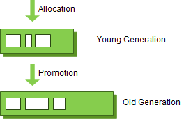
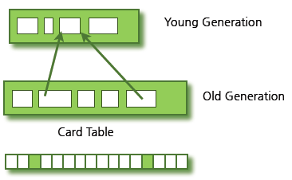
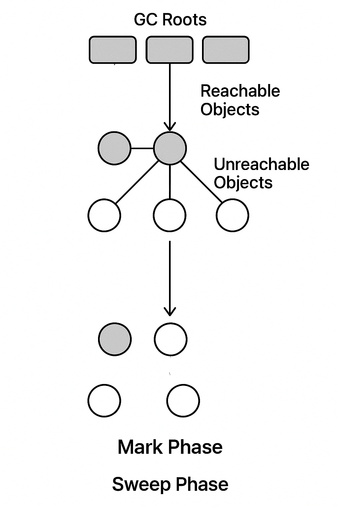
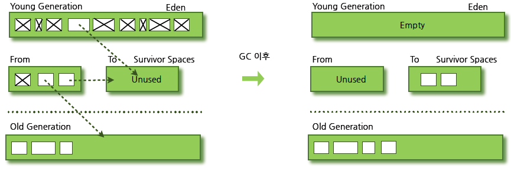

### Minor GC, Major GC

JVM Heap 영역은 처음 설계될 때 다음 2가지를 전제로 설계되었다.

- 대부분의 객체는 금방 접근 불가능한 상태(Unreachable)가 된다.
- 오래된 객체에서 새로운 객체로의 참조는 아주 적게 존재한다.

즉, 객체는 대부분 일회성이며, 메모리에 오랫동안 남아있는 경우가 드물다는 것이다. 

그래서 객체의 생존 기간에 따라 물리적인 Heap 영역을 나누게 되었고, Young, Old 총 2가지 영역으로 설계되었다. 초기에는 Perm 영역이 존재하였지만 Java8부터 제거되었다.

Perm 영역에서는 클래스의 메타데이터와 같은 정보를 저장했으나, Metaspace로 Java8에 대체되었다.

**Metaspace는 Heap이 아닌 네이티브 메모리 영역에서 관리**된다.

**Young 영역(Young Generation)**

- 새롭게 생성된 객체가 할당(Allocation)되는 영역
- 대부분의 객체가 금방 Unreachable 상태가 되기 때문에, 많은 객체가 Young 영역에 생성되었다가 사라진다.
- Young 영역에 대한 가비지 컬렉션(Garbage Collection)을 **Minor GC**라고 부른다.

**Old 영역(Old Generation)**

- Young 영역에서 Reachable 상태를 유지하여 살아남은 객체가 복사되는 영역
- Young 영역보다 크게 할당되며, 영역의 크기가 큰 만큼 가비지는 적게 발생한다.
- Old 영역에 대한 가비지 컬렉션을 **Major GC**라고 부른다.

Old 영역이 Young 영역보다 크게 할당되는 이유는 Young 영역의 수명이 짧은 객체들은 큰 공간이 필요로 하지 않으며 사이즈가 큰 객체들(메모리를 많이 차지하는)은 바로 Old 영역에 할당되기 때문이다.

예외적인 상황으로 Old 영역에 있는 객체가 Young 영역의 객체를 참조하는 경우도 존재할 것이다.

이러한 경우를 대비해서 Old 영역에는 512 bytes의 덩어리(Chunk)로 되어 있는 카드 테이블이 존재한다.

카드 테이블에는 Old 영역에 있는 객체가 Young 영역의 객체를 참조할 때 마다 그에 대한 정보가 표시된다.

Young 영역에서 가비지 컬렉션(Minor GC)가 실행될 때 모든 Old 영역에 존재하는 객체를 검사하여 참조되지 않는 Young 영역의 객체를 식별하는 것이 비효율적이기 때문에 카드 테이블만 조회하여 GC의 대상인지 식별할 수 있도록 하고 있다.

---

### Garbage Collection의 동작 방식

Young 영역과, Old 영역은 서로 다른 메모리 구조이다. 그래서 세부적인 동작 방식이 다르다. 하지만 기본적으로 가비지 컬렉션이 실행된다고 하면 다음 2가지 공통적인 단계를 따르게 된다.

1. Stop The World
1. Mark and Sweep

**Stop The World**

Stop The World 단계는 **가비지 컬렉션을 실행하기 위해 JVM이 애플리케이션의 실행을 멈추는 작업**이다.

GC가 실행될 때는 GC를 실행하는 쓰레드를 제외한 모든 쓰레드들의 작업이 중단되고, GC가 완료되면 작업이 재개된다. GC의 성능 개선을 위해 튜닝을 한다고 하면 보통 stop-the-world 시간을 줄이는 작업을 하는 것이다.

또한 JVM에서도 이러한 문제를 해결하기 위한 다양한 실행 옵션을 제공하고 있다.

**Mark and Sweep(표시하고 쓸어낸다?)**

**Mark: 사용되는 메모리와 사용되지 않는 메모리를 식별하는 작업**

**Sweep: Mark 단계에서 사용되지 않음으로 식별된 메모리를 해제하는 작업**

Stop The World를 통해 GC 스레드를 제외한 모든 작업을 중단시키면, GC는 스택의 모든 변수 또는 Reachable 객체를 스캔하면서 각각이 어떤 객체를 참고하고 있는지를 탐색하게 된다.

그리고 사용되는 메모리를 식별하는데, 이러한 과정을 Mark라고 한다. 이후에 Mark되지 않은 객체들을 메모리에서 제거하는데, 이러한 과정을 Sweep라고 한다.

---

### Minor GC의 동작 방식

Minor GC를 이해하기 위해서는 Young 영역의 구조에 대한 이해를 해야 한다.

Young 영역은 1개의 Eden 영역과 2개의 Survivor 영역 즉, 총 3가지로 나눠진다.

- Eden 영역: 새로 생성된 객체가 할당(Allocation)되는 영역
- Survivor 영역: 최소 1번의 GC 이상 살아남은 객체가 존재하는 영역

객체가 새롭게 생성되면 Young 영역 중에서도 Eden 영역에 할당이 된다.

그리고 **Eden 영역이 꽉 차면 Minor GC가 발생하게 되는데, 사용되지 않는 메모리는 해제되고 Eden 영역에 존재하는 객체는 Survivor 영역으로 옮겨지게 된다.**

Survivor 영역은 총 2개이지만 반드시 1개의 영역에만 데이터가 존재해야 하는데, Young 영역의 동작 순서는 아래와 같다.

1. 새로 생성된 객체가 Eden 영역에 할당
1. 객체가 계속 생성되어 Eden 영역이 꽉차게 되고 Minor GC가 실행된다.
1. Eden 영역에서 사용되지 않는 객체의 메모리가 해제된다. (stop-the-world → mark-sweep)
  1. Eden 영역에서 살아남은 객체는 1개의 Survivor 영역으로 이동된다.
1. 1~2번의 과정이 반복되다가 Survivor 영역이 가득 차게 되면 Survivor 영역의 살아남은 객체를 다른 Survivor 영역으로 이동시킨다.(1개의 Survivor 영역은 반드시 빈 상태가 된다.)
1. 이러한 과정을 반복하여 계속해서 살아남은 객체는 Old 영역으로 이동(Promotion)된다.

객체의 생존 횟수를 카운트하기 위해 Minor GC에서 **객체가 살아남은 횟수를 의미하는 age를 Object Header에 기록한다.** 그리고 Minor GC 때 Object Header에 기록된 age를 보고 Promotion 여부를 결정한다.

또한 Survivor 영역 중 1개는 반드시 사용이 되어야 한다.

**만약 두 Survivor 영역에 모두 데이터가 존재하거나, 모두 사용량이 0이라면 현재 시스템이 정상적인 상황이 아님을 파악할 수 있다.**

HotSpot JVM에서는 Eden 영역에 객체를 빠르게 할당하기 위해 bump the pointer, TLABs(Thread-Local Allocation Buffers)라는 기술을 사용하고 있다. bump the pointer란 Eden 영역에 마지막으로 할당된 객체의 주소를 캐싱해두는 것이다. bump the pointer를 통해 새로운 객체를 위한 유효한 메모리를 탐색할 필요 없이 마지막 주소의 다음 주소를 사용하게 함으로써 속도를 높이고 있다. 이를 통해 새로운 객체를 할당할 때 해당 객체의 크기가 Eden 영역에 적합한지만 판별하면 되므로 빠르게 메모리 할당을 할 수 있다.

하지만 싱글 쓰레드 환경이라면 bump the pointer 방식이 문제가 없겠지만 멀티 쓰레드 환경에서는 Eden 영역에 할당할 때 락(Lock)을 걸어 동기화를 해주어야 한다.

멀티 쓰레드 환경에서의 성능 문제를 해결하기 위해 HotSpot JVM은 추가로 TLABs 기술을 사용하게 되었다.

TLABs(Thread-Local-Allocation Buffers)란 각각의 쓰레드마다 Eden 영역에 객체를 할당하기 위한 주소를 부여함으로써 동기화 작업 없이 빠르게 메모리를 할당하도록 하는 기술이다. 각각의 쓰레드는 자신이 갖는 주소에만 객체를 할당함으로써 bump the pointer를 통해 빠르게 객체를 할당하도록 하고 있다.

---

### Major GC의 동작 방식

Young 영역에서의 오래 살아남은 객체는 Old 영역으로 Promotion(이동)됨을 확인할 수 있었다.

그리고 Major GC는 객체들이 계속 Promotion되어 Old 영역의 메모리가 부족해지면 발생하게 된다.

Young 영역은 일반적으로 Old 영역보다 크기가 작기 때문에 GC가 보통 0.5에서 1초 사이에 끝난다.

그렇기 때문에 Minor GC는 애플리케이션에 크게 영향을 주지 않는다. 하지만 Old 영역은 Young 영역보다 크며 Young 영역을 참조할 수도 있다. 그렇기 때문에 일반적으로 Major GC는 Minor GC보다 10배 이상의 시간을 사용한다.

동시에 Young 영역과 Old 영역을 처리하는 GC는 Full GC라고 한다.

---

### 가비지 컬렉션 알고리즘 (참고 자료 2/2)

취직하고 나중에… ㅎㅎ

---

### 참고 자료

[https://mangkyu.tistory.com/118](https://mangkyu.tistory.com/118)

[https://mangkyu.tistory.com/119](https://mangkyu.tistory.com/119)

---
