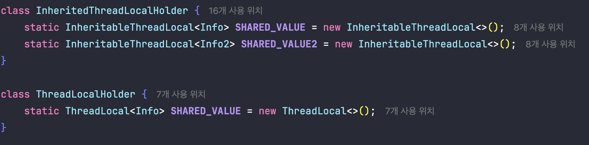
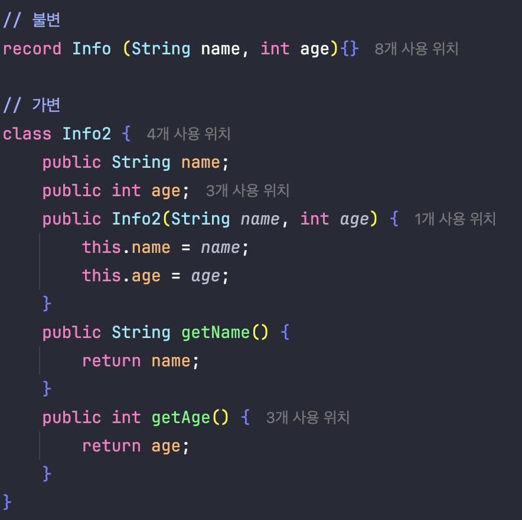
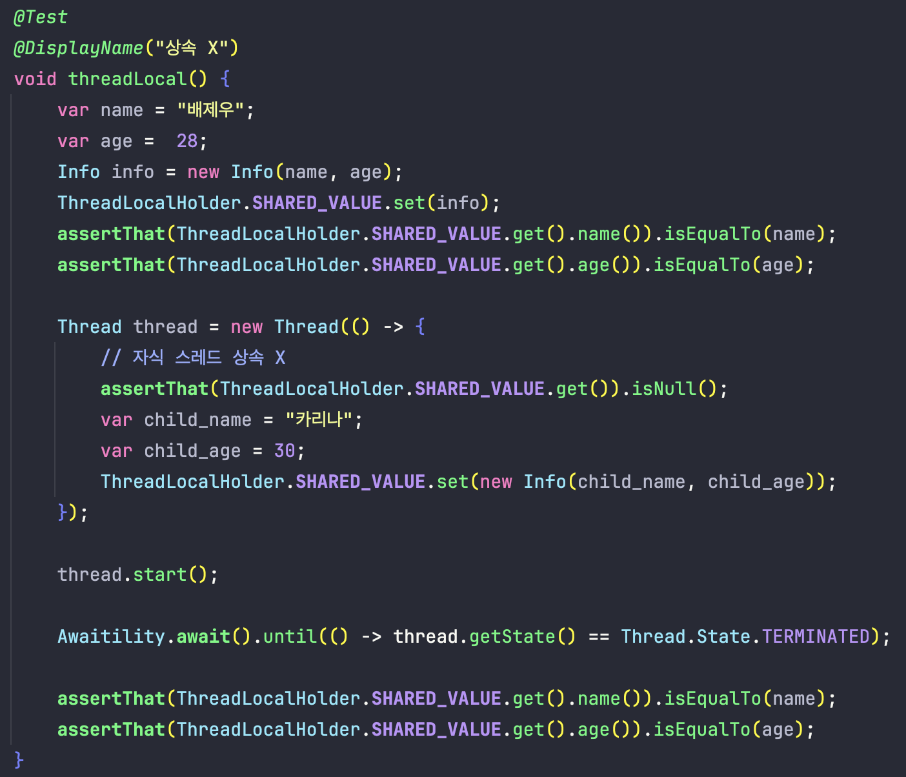
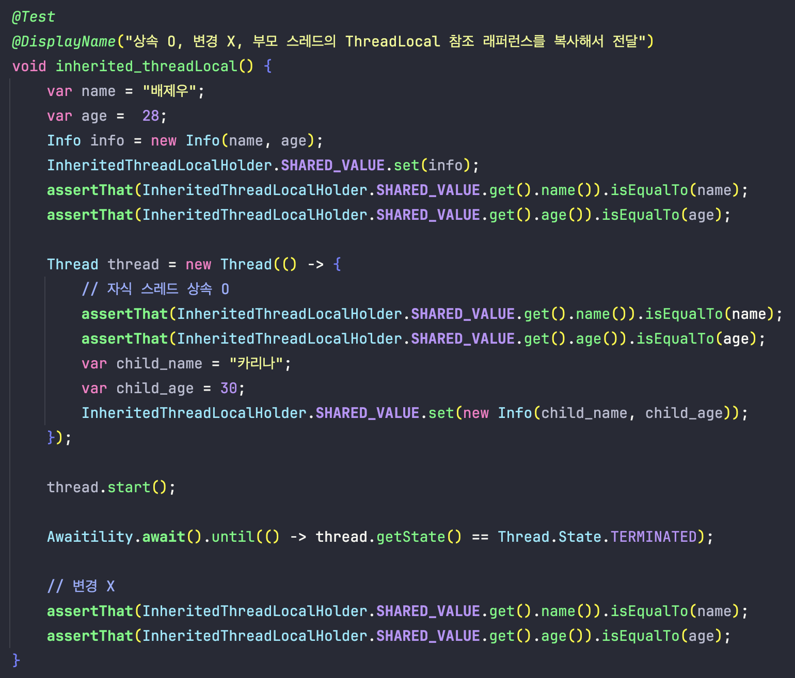
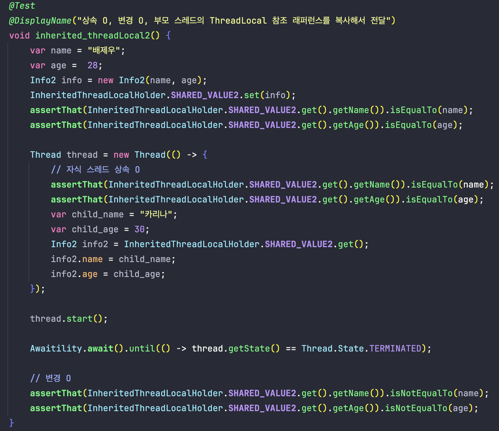

자바는 객체의 참조를 복사하여 전달한다. 따라서 부모 스레드와 자식 스레드가 갖는 객체의 참조는 복사되어 존재하지만, 동일한 힙 영역의 객체를 가리키고 있으므로 자식 스레드에서 값을 변경하는 것이 부모에게도 영향을 줄 수 있으므로 주의가 필요하다.

**테스트1**

- ThreadLocal 
- Info 사용, 부모 스레드의 값 전달 X

**테스트2**

- InheritedThreadLocal
- Info 사용, 자식 스레드에서 new Info() set

**테스트3**

- InheritedThreadLocal
- Info2 사용, 자식 스레드에서 Info2 값 변경

---

### 참고 자료

[https://mangkyu.tistory.com/333](https://mangkyu.tistory.com/333)

