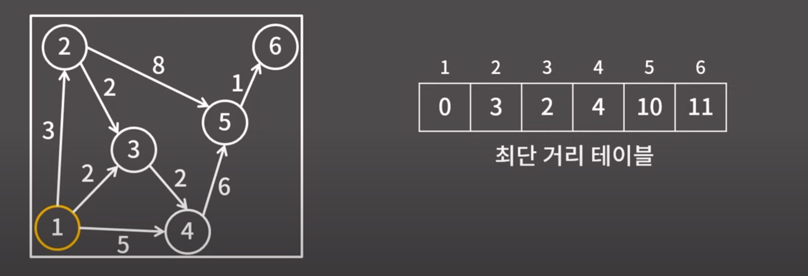
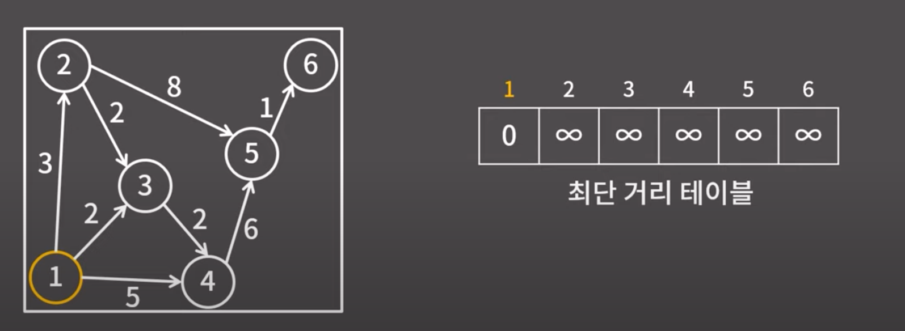
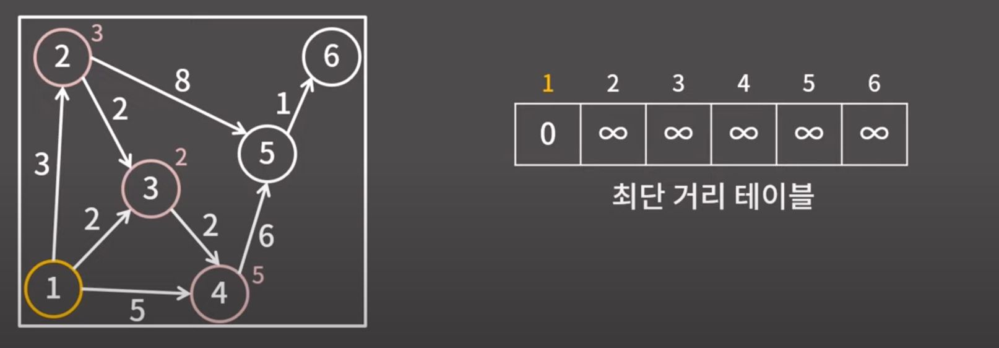
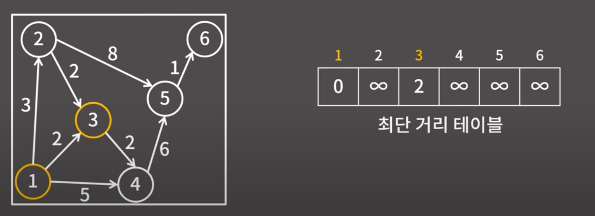
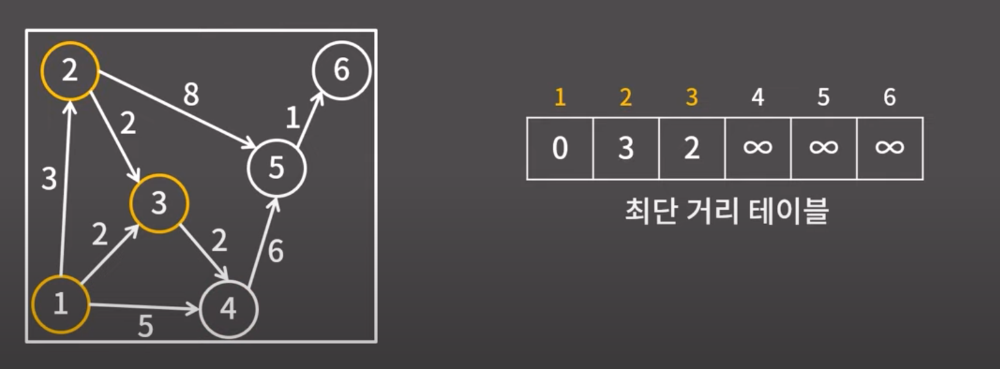
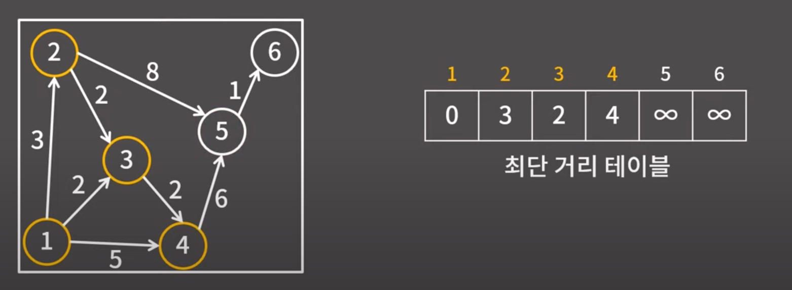
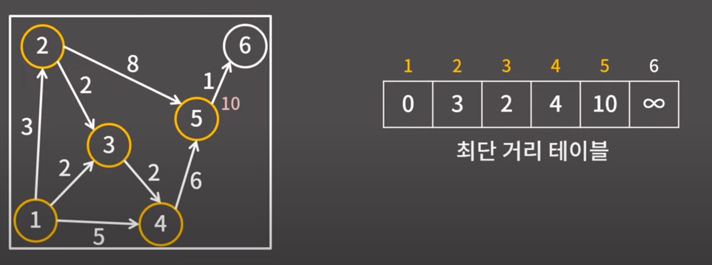
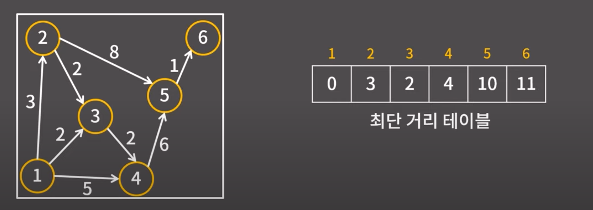

## 목차 

- 다익스트라?
- 다익스트라 진행 과정 
- 우선순위 큐를 이용한 다익스트라 알고리즘 
- 백준 1753 최단경로 골드4
- 백준 11779 최소비용 구하기2 골드3 - 다익스트라 경로 복원
- 참고 자료 

---

## 다익스트라?

다익스트라 알고리즘 = 하나의 시작점으로부터 다른 모든 정점까지의 최단 거리를 구하는 알고리즘 



다익스트라 알고리즘을 돌리면 최단 거리 테이블을 채울 수 있다. 

**플로이드  VS 다익스트라 VS 벨만 포드** 

- 플로이드: 모든 정점 쌍 사이의 최단 거리를 구하는 알고리즘 
- 음수인 간선 허용 O
  - 음수인 사이클 허용 X
- 다익스트라: 하나의 시작점으로부터 다른 모든 정점까지의 최단 거리를 구하는 알고리즘 
- 음수인 간선 허용 X 
  - 플로이드 보다 훨씬 효율적
  - 음수인 간선이 있는데 하나의 시작점으로부터 모든 정점까지의 거리를 구하고 싶으면 벨만포드 알고리즘을 사용한다. 
  - 네트워크에서 사용한다.

---

## 다익스트라 진행 과정 

다익스트라는 시작 정점과 도착 정점까지의 최단 거리를 확정하면서 모든 정점과의 최단 거리를 구하는 알고리즘이다. 



1번 정점에서 다른 모든 정점까지의 최단 거리를 구해보자.

자기 자신과의 거리는 0일 테니 1번 인덱스의 값은 0으로 둔다. 



현재 1번 정점에서는 2, 3, 4번 정점으로만 갈 수 있는데 각 정점까지의 최단 거리는 3, 2, 5 이다.

그러면 2, 3, 4번 정점 중에서 가장 가까운 건 3번 정점이기 때문에 3번 정점까지의 거리를 2로 확정한다. 



이제 1번과 3번 정점에서 갈 수 있는 정점은 2번 정점과 4번 정점이 있다. 

2번 정점까지의 거리는 3이고 4번 정점까지의 거리는 1→3 + 3→4 = 4 이다. 

둘 중에서 더 가까운건 2번 정점이여서 2번 정점까지의 거리를 3으로 확정한다. 



1번, 2번, 3번 정점에서 갈 수 있는 정점은 4, 5번 정점이다. 

둘 중에서 더 가까운건 4번 정점이여서 4번 정점까지의 거리를 4로 확정한다. 



1, 2, 3, 4 정점에서 갈 수 있는 정점은 5번 정점만 존재한다. 5번 정점의 거리는 10으로 바로 확정 가능하다. 



마지막으로 1, 2, 3, 4, 5 정점에서 갈 수 있는 정점은 6번 정점만 존재한다. 6번 정점의 거리는 11으로 바로 확정 가능하다. 



최종 결과 

---

## 우선순위 큐를 이용한 다익스트라 알고리즘 

1. 우선순위 큐에 (0, 시작점) 추가 
1. 우선순위 큐에서 거리가 가장 작은 원소를 선택, 해당 거리가 최단 거리 테이블에 있는 값과 다를 경우 넘어감 
1. 원소가 가리키는 정점을 V라고  할 때, V와 이웃한 정점들에 대해 최단 거리 테이블 값보다 V를 거쳐가는 것이 더 작은 값을 가질 경우 최단 거리 테이블의 값을 갱신하고 우선순위 큐에(거리, 이웃한 정점의 번호) 추가 
1. 우선순위 큐가 빌 때 까지 2, 3번 과정을 반복 

---

## 백준 1753 최단경로 골드4

```java
import java.io.*;
import java.util.*;
public class Main {
    static final int INF = 10 * 20000; // 간선의 최대 가중치 * 정점의 개수
    public static void main(String[] args) throws IOException {
        BufferedReader br = new BufferedReader(new InputStreamReader(System.in));
        StringTokenizer st;
        st = new StringTokenizer(br.readLine());
        int v = Integer.parseInt(st.nextToken()); // 정점의 개수  1 <= v <= 20000
        int e = Integer.parseInt(st.nextToken()); // 간선의 개수  1 <= e <= 300/000

        int s = Integer.parseInt(br.readLine());  // 시작 정점

        ArrayList<int[]>[] graph = new ArrayList[v+1]; // 그래프 초기화
        for (int i = 0; i <= v; i++) {
            graph[i] = new ArrayList<>();
        }

        // 방향 그래프
        while (e-->0){
            st = new StringTokenizer(br.readLine());
            int sv = Integer.parseInt(st.nextToken()); // 시작 정점
            int ev = Integer.parseInt(st.nextToken()); // 도착 정점
            int c = Integer.parseInt(st.nextToken());  // 가중치
            graph[sv].add(new int[]{ev, c});
        }

        int [] min = new int[v+1];
        Arrays.fill(min, INF);
        min[s] = 0;
        PriorityQueue<int[]> pq = new PriorityQueue<>(Comparator.comparingInt(o -> o[1]));
        pq.add(new int[]{s, 0});
        while (!pq.isEmpty()){
            int [] temp = pq.poll();
            if(min[temp[0]] != temp[1]) continue; // 확정된 정점인데 값이 다른 경우
            for (int i = 0; i < graph[temp[0]].size(); i++) {
                int [] next = graph[temp[0]].get(i);
                if(min[next[0]] <= min[temp[0]] + next[1]) continue;
                min[next[0]] = min[temp[0]] + next[1];
                pq.add(new int[]{next[0], min[next[0]]});
            }
        }
        StringBuilder sb = new StringBuilder();
        for (int i = 1; i <= v; i++) {
            if(min[i] == INF){
                sb.append("INF").append("\n");
                continue;
            }
            sb.append(min[i]).append("\n");
        }
        System.out.println(sb);
    }
}
```

---

## 백준 11779 최소비용 구하기2 골드3 - 다익스트라 경로 복원

```java
import java.io.*;
import java.util.*;
public class Main {
    static final int INF = 1000 * 100000; // 1000개의 정점 * 버스 최대 비용 100000
    public static void main(String[] args) throws IOException{
        BufferedReader br = new BufferedReader(new InputStreamReader(System.in));
        StringTokenizer st;
        int n = Integer.parseInt(br.readLine()); // 도시의 개수
        int m = Integer.parseInt(br.readLine()); // 버스의 개수

        // 그래프 초기화
        ArrayList<int []> [] graph = new ArrayList[n+1];
        for (int i = 0; i <= n; i++) {
            graph[i] = new ArrayList<>();
        }

        // 간선 input 무방향? 방향?
        while (m-->0){
            st = new StringTokenizer(br.readLine());
            int s = Integer.parseInt(st.nextToken());
            int e = Integer.parseInt(st.nextToken());
            int c = Integer.parseInt(st.nextToken());
            graph[s].add(new int[]{e,c});
        }

        st = new StringTokenizer(br.readLine());
        int start = Integer.parseInt(st.nextToken()); // 시작 정점
        int end   = Integer.parseInt(st.nextToken()); // 도착 정점

        int [] min  = new int[n+1]; // 최단 거리 테이블
        int [] next = new int[n+1]; // 경로 복원용

        Arrays.fill(min, INF);
        min[start] = 0;

        PriorityQueue<int[]> pq = new PriorityQueue<>(Comparator.comparingInt(o -> o[1]));
        pq.add(new int[]{start, 0});
        while (!pq.isEmpty()){
            int [] temp = pq.poll();
            if(min[temp[0]] != temp[1]) continue; // 확정된 정점의 거리와 다른 경우
            for (int i = 0; i < graph[temp[0]].size(); i++) {
                int [] nx = graph[temp[0]].get(i);
                if(min[nx[0]] <= min[temp[0]] + nx[1]) continue;
                min[nx[0]] = min[temp[0]] + nx[1];
                next[nx[0]] = temp[0];
                pq.add(new int[]{nx[0], min[nx[0]]});
            }
        }

        Stack<Integer> stack = new Stack<>();
        stack.push(end);
        int s = start;
        int e = end;
        while (s != e){
            e = next[e];
            stack.push(e);
        }
        StringBuilder sb = new StringBuilder();
        sb.append(min[end]).append("\n");
        sb.append(stack.size()).append("\n");
        while (!stack.isEmpty()){
            sb.append(stack.pop()).append(" ");
        }
        System.out.println(sb);
    }
}
```

---

## 참고 자료 

[https://www.youtube.com/watch?v=o9BnvwgPT-o&list=PLtqbFd2VIQv4O6D6l9HcD732hdrnYb6CY&index=30](https://www.youtube.com/watch?v=o9BnvwgPT-o&list=PLtqbFd2VIQv4O6D6l9HcD732hdrnYb6CY&index=30)

---

