**깃허브** 

**공부 정리** 

서버가 기동되면 스프링 시큐리티의 초기화 작업 및 보안 설정이 이루어진다

별도의 설정이나 코드를 작성하지 않아도 기본적인 웹 보안 기능이 현재 시스템에 연동되어 작동한다 

    - 모든 요청 경로에 대해 인증여부를 검증하고 인증이 승인되어야 자원에 접근이 가능 
    - 인증 방식은 폼 로그인 방식과 httpBasic 로그인 방식을 제공 
    - 인증을 시도할 수 있는 로그인 페이지와 로그아웃 페이지가 자동적으로 생성되어 렌더링 
    - 인증 승인이 이루어질 수 있도록 계정 하나가 기본적으로 제공된다 
- **SecurityProperties** 설정 클래스에서 생성 
      - username: user
      - password: [REDACTED] 문자열

### **SpringBootWebSecurityConfiguration**

자동 설정에 의한 기본 보안 설정 클래스 생성

```java
@Configuration(proxyBeanMethods = false)
@ConditionalOnDefaultWebSecurity
static class SecurityFilterChainConfiguration {

	@Bean
	@Order(SecurityProperties.BASIC_AUTH_ORDER)
	SecurityFilterChain defaultSecurityFilterChain(HttpSecurity http) throws Exception {
		http.authorizeHttpRequests((requests) -> requests.anyRequest().authenticated());
		http.formLogin(withDefaults());
		http.httpBasic(withDefaults());
		return http.build();
	}

}
```

**SpringBootWebSecurityConfiguration** 클래스 내부(static)클래스 **SecurityFilterChainConfiguration**

**SecurityFilterChain** 타입의 빈을 등록한다.  

어떤 조건에 맞으면 동작하는지 알아보자 

**@ConditionalOnDefaultWebSecurity**

```java
@Target({ ElementType.TYPE, ElementType.METHOD })
@Retention(RetentionPolicy.RUNTIME)
@Documented
@Conditional(DefaultWebSecurityCondition.class)
public @interface ConditionalOnDefaultWebSecurity {

}
```

**DefaultWebSecurityCondition**

```java
class DefaultWebSecurityCondition extends AllNestedConditions {
	DefaultWebSecurityCondition() {
		super(ConfigurationPhase.REGISTER_BEAN);
	}
	@ConditionalOnClass({ SecurityFilterChain.class, HttpSecurity.class })
	static class Classes {
	}
	@ConditionalOnMissingBean({ SecurityFilterChain.class })
	static class Beans {
	}
}
```

**@ConditionalOnClass({ SecurityFilterChain.class, HttpSecurity.class })**

특정 클래스가 클래스패스(Classpath)에 존재할 때만 해당 조건이 만족되도록 설정하는 데 사용된다

즉, SecurityFilterChain 클래스와 HttpSecurity 클래스가 모두 클래스패스에 존재할 때만 활성화 

**@ConditionalOnMissingBean({ SecurityFilterChain.class })**

SecurityFilterChain 타입의 빈이 스프링 컨테이너에 없으면 조건 통과

**SecurityBuilder** 

    - 빌더 클래스로서 웹 보안을 구성하는 빈 객체와 설정클래스들을 생성하는 역할을 한다 
    - WebSecurity, HttpSecurity 
    - SecurityBuilder는 SecurityConfigurer를 참조하고 있으며 인증 및 인가 초기화 작업은 SecurityConfigurer에 의해 진행된다 

**SecurityConfigurer**

    - Http 요청과 관련된 보안처리를 담당하는 필터들을 생성하고 여러 초기화 설정에 관여 

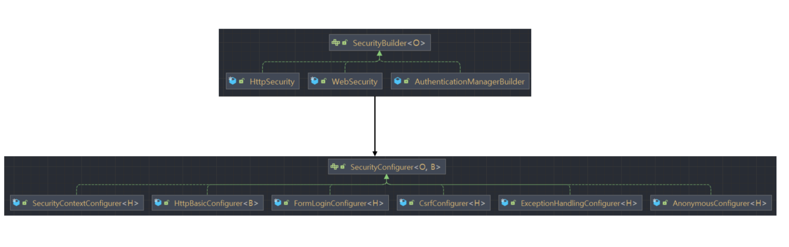

**초기화 작업 순서** 

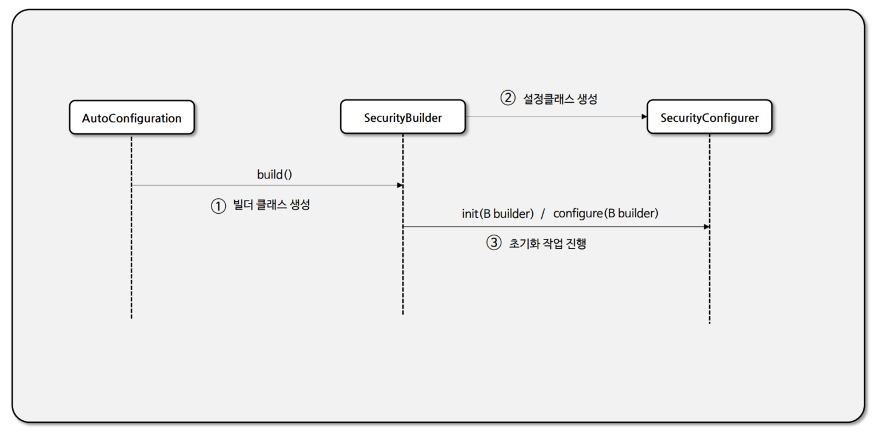

AutoConfiguration SpringBoot 자동 구성 SecurityBuilder 클래스 생성 

SecurityBuilder(ex: HttpSecurity)를 통해서 여러가지 필터를 생성하는 SecurityConfigurer 생성 

SecurityBuilder build() 메소드가 호출되면 init(), configure()를 통해 초기화 작업이 진행 

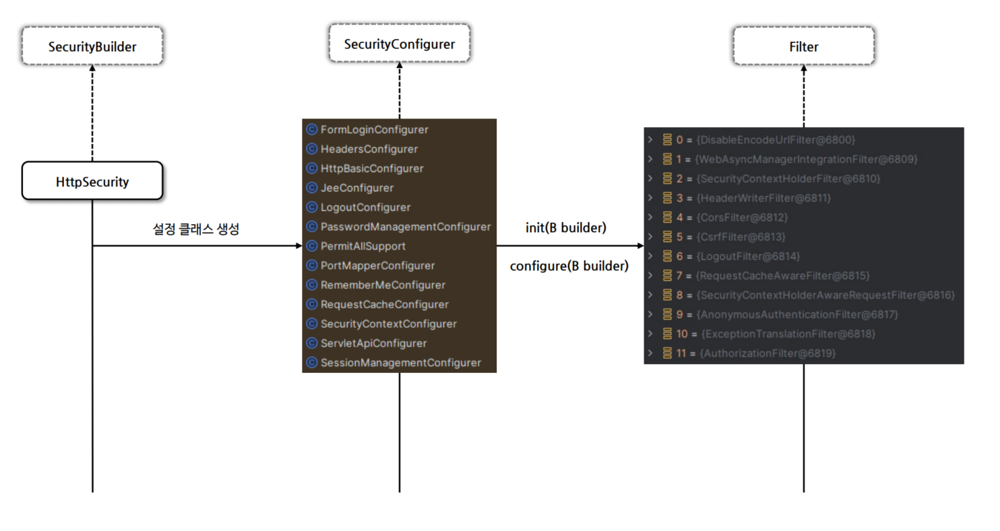

```java
@Configuration(proxyBeanMethods = false)
class HttpSecurityConfiguration {

		@Bean(HTTPSECURITY_BEAN_NAME)
		@Scope("prototype")
		HttpSecurity httpSecurity() throws Exception {
			// 생략 ... 
			http
				.csrf(withDefaults())
				.addFilter(webAsyncManagerIntegrationFilter)
				.exceptionHandling(withDefaults())
				.headers(withDefaults())
				.sessionManagement(withDefaults())
				.securityContext(withDefaults())
				.requestCache(withDefaults())
				.anonymous(withDefaults())
				.servletApi(withDefaults())
				.apply(new DefaultLoginPageConfigurer<>());
			http.logout(withDefaults());
		
			applyCorsIfAvailable(http);
			applyDefaultConfigurers(http);
			return http;
		}

}
```

**http.csrf() 메소드** 

```java
public HttpSecurity csrf(Customizer<CsrfConfigurer<HttpSecurity>> csrfCustomizer) throws Exception {
		ApplicationContext context = getContext();
		csrfCustomizer.customize(getOrApply(new CsrfConfigurer<>(context)));
		return HttpSecurity.this;
	}
```

CsrfConfigurer 즉, SecurityConfigurer 인터페이스를 구현한 클래스가 설정된다. 

[자동 설정 기본 보안 작동](/26b7d6692ca881d58171ea4e3ca046c6)

SecurityBootWebSecurityConfiguration 클래스에서는 여기서 생성하는 

HttpSecurity 빈을 주입받게 된다. 

defaultSecurityFilterChain 메소드에서 

3개의 Configurer를 추가하고 

http.build()가 호출된다. 

SecurityBuilder(인터페이스) 

AbstractConfiguredSecurityBuilder(추상클래스)

HttpSecurity(클래스)

AbstractConfiguredSecurityBuilder에 정의된 doBuild() 호출

```java
@Override
protected final O doBuild() throws Exception {
	synchronized (this.configurers) {
		this.buildState = BuildState.INITIALIZING;
		beforeInit();
		init();
		this.buildState = BuildState.CONFIGURING;
		beforeConfigure();
		configure();
		this.buildState = BuildState.BUILDING;
		O result = performBuild();
		this.buildState = BuildState.BUILT;
		return result;
	}
}
```

configurers(설정 클래스들) for문을 돌면서 init(), configure() 호출

# HttpSecurity

    - HttpSecurityConfiguration에서 HttpSecurity를 생성하고 초기화를 진행한다 
    - HttpSecurity는 보안에 필요한 각 설정 클래스와 필터들을 생성하고 최종적으로 SecurityFilterChain 타입의 빈을 생성한다 

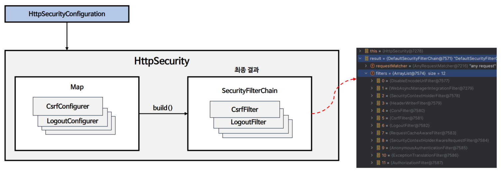

# SecurityFilterChain

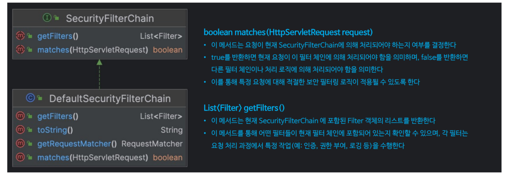

**SecurityFilterChain matches(HttpServletRequest)**

SecurityFilterChain은 FilterChainProxy가 1개 이상을 가질 수 있다. 

이때 현재 요청이 SecurityFilterChain에 의해 처리되어야 하는지 여부를 결정한다 

이는 다중 보안(SecurityFilterChain ≥2)에서 중요하다 

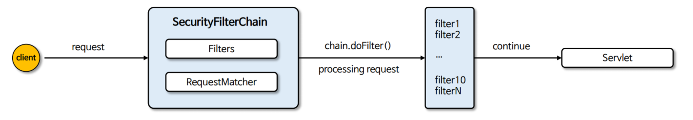

# WebSecurity

    - WebSecurityConfiguration에서 WebSecurity를 생성하고 초기화를 진행 
    - WebSecurity는 HttpSecurity에서 생성한 SecurityFilterChain 빈을 SecurityBuilder에 저장 
    - WebSecurity가 build()를 실행하면 SecurityBuilder에서 SecurityFilterChain을 꺼내서 FilterChainProxy 생성자에게 전달한다 

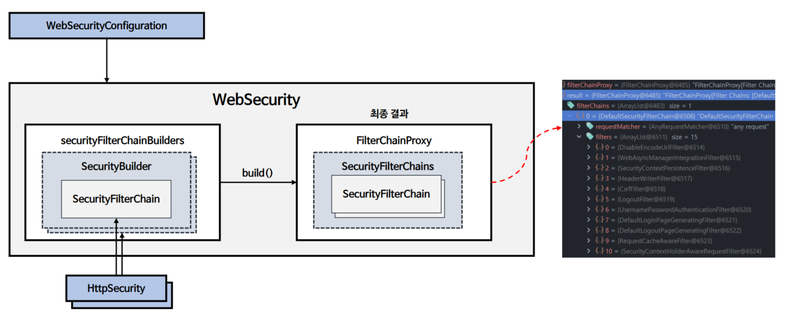

# **Filter**

    - 서블릿 필터는 웹 애플리케이션에서 클라이언트의 요청과 서버의 응답을 가공하거나 검사하는데 사용되는 구성 요소 
    - 서블릿 필터는 클라이언트의 요청이 서블릿에 도달하기 전이나 서블릿이 응답을 클라이언트에게 보내기 전에 특정 작업을 수행할 수 있다. 
    - 서블릿 필터는 서블릿 컨테이너(WAS)에서 생성되고 실행되고 종료된다 

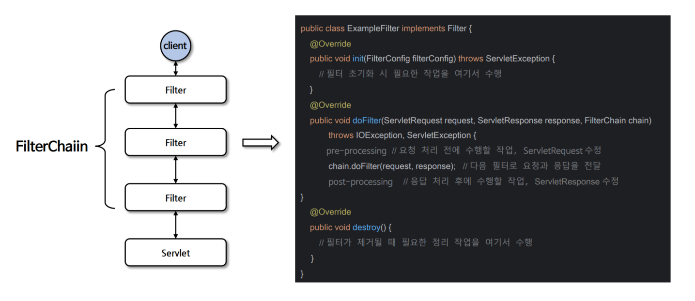

[디자인 패턴: 책임 연쇄 패턴](https://20240228.tistory.com/381)

# **DelegatingFilterProxy**

    - DelegatingFilterProxy는 스프링에서 사용되는 특별한 서블릿 필터로, 서블릿 컨테이너와 스프링 애플리케이션 컨텍스트 간의 연결고리 역할을 하는 필터이다. 
    - 서블릿 필터의 기능을 수행하는 동시에 스프링의 의존성 주입 및 빈 관리 기능과 연동되도록 설계한 필터라 할 수 있다 
    - springSecurityFilterChain 이름으로 생성된 빈을 AppicationContext에서 찾아 요청을 위임한다 그래서 이름이 Delegating이 붙는다. 
    - 실제 보안 처리를 수행하지 않고 단순히 요청을 위임한다 

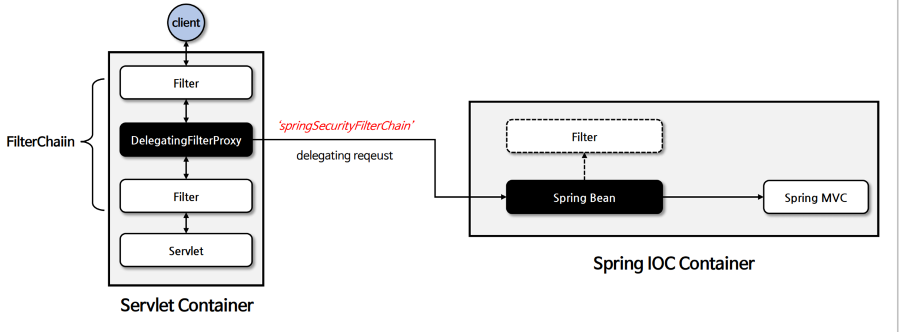

# **FilterChainProxy**

    - springSecurityFilterChain 이름으로 생성되는 필터 빈으로서 DelegatingFilterProxy으로 부터 요청을 위임 받고 보안 처리 역할을 한다 
    - 내부적으로 하나 이상의 SecurityFilterChain 객체들을 가지고 있으며 요청 URL 정보를 기준으로 적절한 SecurityFilterChain을 선택하여 필터들을 호출한다 
    - HttpSecurity를 통해서 API 추가 시 관련 필터들이 추가된다 
    - 사용자의 요청을 필터 순서대로 호출함으로 보안 기능을 동작시키고 필요 시 직접 필터를 생성해서 기존의 필터 전.후로 추가 가능하다 

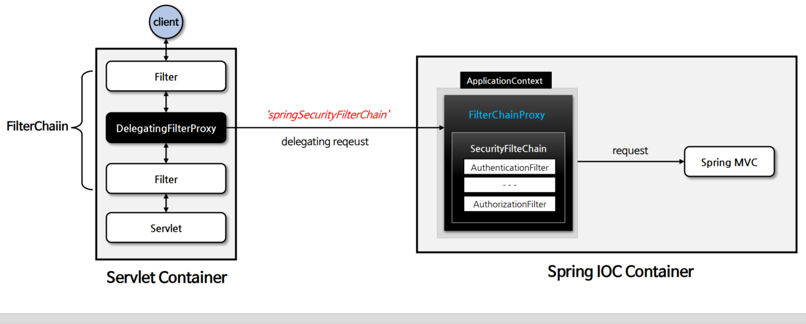

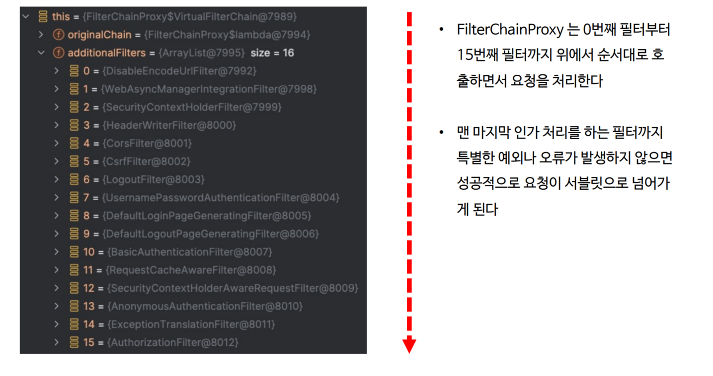

한 개 이상의 SecurityFilterChain 타입의 빈을 정의한 후 인증 API / 인가 API를 설정한다 

빈을 정의하지 않으면 자동으로 SecurityFilterChain 빈 생성해서 등록 

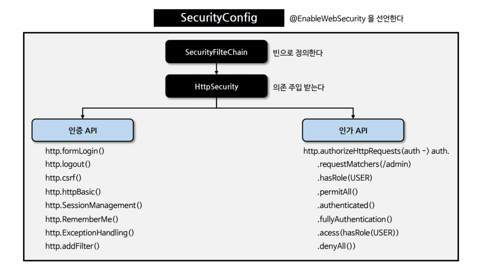

# **기본 구현 코드** 

```java
@EnableWebSecurity(debug = false) // default: false
@Configuration
public class SecurityConfig {
    @Bean
    public SecurityFilterChain securityFilterChain(HttpSecurity http) throws Exception {
        http
                .authorizeHttpRequests(auth -> auth.anyRequest().authenticated())
                .formLogin(Customizer.withDefaults());

        return http.build();
    }
}   
```

모든 설정 코드는 람다 형식으로 작성해야 한다 (스프링 시큐리티 7 버전부터는 람다 형식만 지원 할 예정)

SecurityFilterChain 을 빈으로 정의하게 되면 자동설정에 의한 SecurityFilterChain 빈은 생성되지 않는다

# 사용자 추가 설정 

**application.yaml** 

```yaml
spring:
  security:
    user:
      name: user
      password: [REDACTED]
      roles: USER
```

**자바 설정 클래스에 직접 정의**

```java
@Bean
public InMemoryUserDetailsManager inMemoryUserDetailsManager(){
		UserDetails user = User.withUsername("user")
			.password("{noop}1111")
			.authorities("ROLE_USER")
			.build();
		return new InMemoryUserDetailsManager(user);
}
```

설정 파일이랑 설정 클래스에 직접 정의 모두 하면 설정 클래스에 직접 정의하는 게 우선권을 가진다.

**InMemoryUserDetailsManager (UserDetailsService)**

유저 정보를 DB가 아닌 메모리에 저장하는 방식 

애플리케이션이 종료되면 날라간다. 

즉, 토이 프로젝트/ 테스트 환경에만 사용 가능

# **폼 인증** 

    - HTTP 기반의 폼 로그인 인증 메커니즘을 활성화하는 API
    - 사용자 인증을 위한 사용자 정의 로그인 페이지를 쉽게 구현할 수 있다 
    - 기본적으로 스프링 시큐리티가 제공하는 기본 로그인 페이지를 사용하며 사용자 이름과 비밀번호 필드가 포함된 간단한 로그인 양식을 제공한다 
    - 사용자는 웹 폼을 통해 자격 증명(사용자 이름과 비밀번호)를 제공하고 Spring Security는 HttpServletRequest에서 이 값을 읽어 온다 

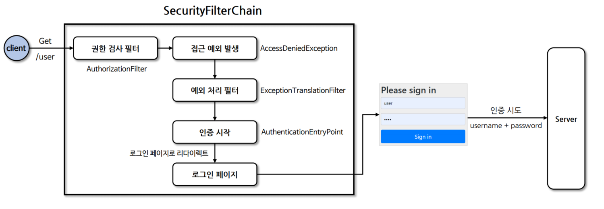

# **formLogin() API**

**FormLoginConfigurer** 설정 클래스를 통해 여러 API를 설정할 수 있다 

내부적으로 **UsernamePasswordAuthenticationFilter**가 생성되어 폼 방식의 인증 처리를 담당하게 된다 

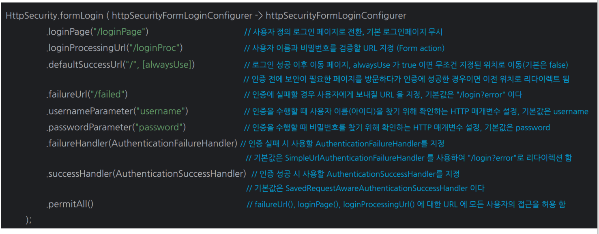

```java
@EnableWebSecurity(debug = false) // default: false
@Configuration
public class SecurityConfig {
    @Bean
    public SecurityFilterChain securityFilterChain(HttpSecurity http) throws Exception{
        http
                .authorizeHttpRequests(auth -> auth.anyRequest().authenticated())
                .formLogin(form -> form
                        .loginPage("/loginPage")
                        .loginProcessingUrl("/loginProc")
                        .defaultSuccessUrl("/", true)
                        .failureUrl("/failed")
                        .usernameParameter("userId")
                        .passwordParameter("passwd")
                        .successHandler((request, response, authentication) -> {
                            System.out.println("authentication = " + authentication);
                            response.sendRedirect("/home");
                        })
                        .failureHandler((request, response, exception) -> {
                            System.out.println("exception = " + exception.getMessage());
                            response.sendRedirect("/login");
                        })
                        .permitAll()
                );

        return  http.build();
    }
    @Bean
    public UserDetailsService userDetailsService(){
        UserDetails user = User.withUsername("user12")
                .password("{noop}1111")
                .roles("USER").build();
        return new InMemoryUserDetailsManager(user);
    }
}
```

**defaultSuccessUrl("/", true) vs successHandler**

`defaultSuccessUrl` 도 내부에서 `SavedRequestAwareAuthenticationSuccessHandler`를 사용한다.

내가 `successHanlder`를 커스텀하게 구현하면 해당 동작이 우선이다.

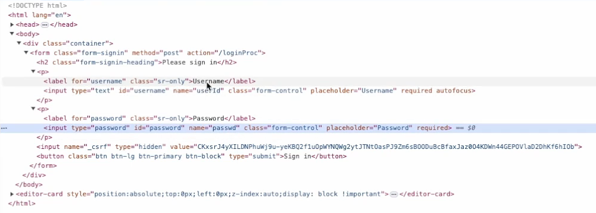

<form> 태그의 action을 보면 `processingUrl`인 `/loginProc` 이고

<input> 태그의 `name=userId, name=passwd` 이다. 

이는 `.usernameParameter("userId") .passwordParameter("passwd")` 2개의 설정 결과

- 스프링 시큐리티는 `AbstractAuthenticationProcessingFilter` 클래스를 사용자의 자격 증명을 인증하는 기본 필터로 사용 한다 
    - `UsernamePasswordAuthenticationFilter` 는 `AbstractAuthenticationProcessingFilter` 를 확장한 클래스로서 HttpServletRequest에서 제출된 사용자 이름과 비밀번호로부터 인증을 수행한다 
    - 인증 프로세스가 초기화 될 때 로그인 페이지와 로그아웃 페이지 생성을 위한 `DefaultLoginPageGeneratingFilter` 와 `DefaultLogoutPageGeneratingFilter` 가 초기화 된다 

# **구조** 

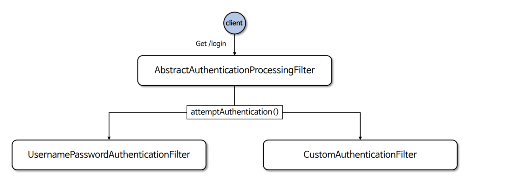

만약 Custom한 인증 필터를 만들고 싶으면 `AbstractAuthenticationProcessingFilter` or `UsernamePasswordAuthenticationFilter` 클래스를 확장하고 `attemptAuthentication()` 메소드를 재정의(오버라이딩)해야 한다 

또한 해당 필터를 SecurityConfig를 통해 추가해야 한다 

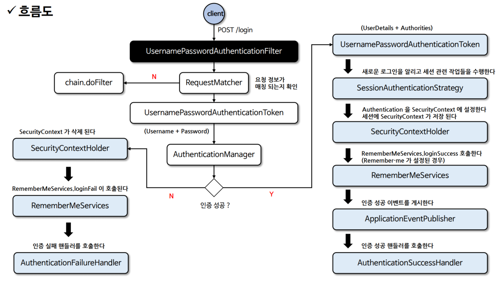

client가 `loginProcessingUrl()에 설정한 url`이거나 `시큐리티가 제공하는 기본 url: login`으로 요청을 하면 `UsernamePasswordAuthenticationFilter`는 인증을 시도하고 아니라면 바로 다음 filter로 넘어간다 

이 요청 URL에 대한 확인은 `RequestMatcher`를 통해서 한다

- HTTP는 액세스 제어와 인증을 위한 프레임워크를 제공하며 가장 일반적인 인증 방식은 `Basic` 인증 방식이다 
    - `RFC 7235 표준`이며 인증 프로토콜은 HTTP 인증 헤더에 기술되어 있다

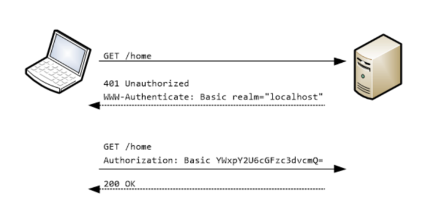

**HTTP basic 인증 프로세스** 

    1. 클라이언트는 인증 정보 없이 서버로 접속을 시도
    1. 서버가 클라이언트에게 인증 요구를 보낼 때 `401 Unauthorized` 응답과 함께 `WWW-Authenticate` 헤더를 기술해서 realm(보안 영역)과 Basic 인증 방법을 보낸다 
    1. 클라이언트가 서버로 접속할 때 Base64로 username과 password를 인코딩하고 `Authorization`헤더에 담아서 요청한다 
    1. 성공적으로 완료되면 정상적인 상태 코드를 반환한다 

**주의 사항** 

    - base-64 인코딩된 값은 디코딩이 가능하기 때문에 인증정보가 노출된다 
    - HTTP basic 인증은 반드시 `HTTPS` 같이 `TLS`기술과 함께 사용해야 한다 

# **httpBasic() API**

    - `HttpBasicConfigurer` 설정 클래스를 통해 여러 API들을 설정할 수 있다 
    - 내부적으로 `BasicAuthenticationFilter`가 생성되어 기본 인증 방식의 인증 처리를 담당하게 된다 

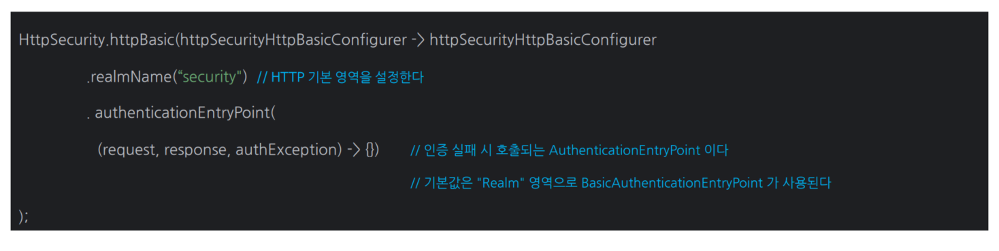

**CustomAuthenticationEntryPoint** 

```java
public class CustomAuthenticationEntryPoint implements AuthenticationEntryPoint {
    @Override
    public void commence(HttpServletRequest request, HttpServletResponse response, AuthenticationException authException) throws IOException, ServletException {
        response.setHeader("WWW-Authenticate", "Basic realm=security");
        response.sendError(HttpStatus.UNAUTHORIZED.value(), HttpStatus.UNAUTHORIZED.getReasonPhrase());
    }
}
```

`AuthenticationEntryPoint` 인터페이스를 구현하는 `CustomAuthenticationEntryPoint`  클래스 

응답 헤더에 `WWW-Authenticate` 를 설정한다 

만약 해당 응답 헤더가 잘못 설정되면 로그인 창이 뜨지 않는다. 

**CustomAuthenticationEntryPoint 등록** 

```java
@Bean
public SecurityFilterChain securityFilterChain(HttpSecurity http) throws Exception{
    http
            .authorizeHttpRequests(auth -> auth.anyRequest().authenticated())
            .httpBasic(basic -> basic.authenticationEntryPoint(new CustomAuthenticationEntryPoint()));

    return  http.build();
}
```

- 기본 인증 서비스를 제공하는 데 사용된다 
    - `BasicAuthenticationConverter`를 사용해서 요청 헤더에 기술된 인증정보의 유효성을 체크하며 Base64 인코딩된 username, password를 추출한다 
    - 인증 이후 세션을 사용하는 경우와 사용하지 않는 경우에 따라 처리되는 흐름에 차이가 있다.
세션을 사용하는 경우 매 요청 마다 인증과정을 거치지 않으나 세션을 사용하지 않는 경우 매 요청마다 인증과정을 거쳐야 한다

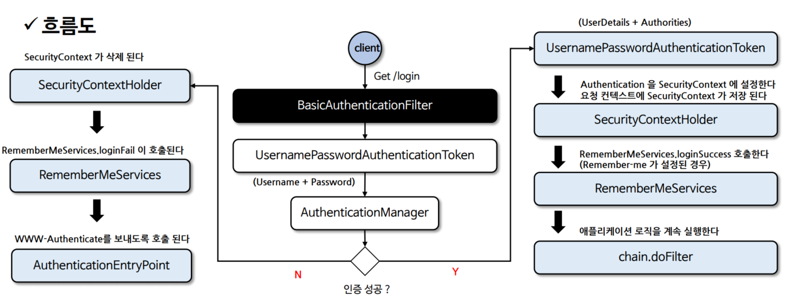

# **RememberMe 인증** 

    - 사용자가 웹 사이트나 애플리케이션에 로그인할 때 자동으로 인증 정보를 기억하는 기능이다 
    - `UsernamePasswordAuthenticationFilter` 와 함께 사용되며, `AbstractAuthenticationProcessingFilter` 슈퍼 클래스에서 훅을 통해 구현된다 
- 인증 성공 시 `RememberMeServices.loginSuccess()`를 통해 RememberMe 토큰을 생성하고 쿠키로 전달한다 
      - 인증 실패 시 `RememberMeServices.loginFail()`를 통해 쿠키를 지운다 
      - `LogoutFilter`와 연계해서 로그아웃 시 쿠키를 지운다

# **RememberMe 토큰** 

    - 기본적으로 암호화된 토큰으로 생성되어 브라우저에 쿠키를 보내고, 향후 세션에서 이 쿠키를 감지하여 자동 로그인이 이루어지는 방식으로 달성된다 
    - `base64(username + ":" + expirationTime + ":" + algorithmName + ":" + algorithmHex(username + ":" + expirationTime + ":" + password + ”:” + key))`
- username: UserDetailsService로 식별 가능한 사용자 이름 
      - password: [REDACTED] UserDetails에 일치하는 비밀번호 
      - expirationTime: remember-me 토큰이 만료되는 날짜와 시간, 밀리초로 표현 
      - key: remember-me 토큰의 수정을 방지하기 위한 개인 키 
      - algorithmName: remember-me 토큰 서명을 생성하고 검증하는 데 사용되는 알고리즘(SHA-256 알고리즘)

# **RememberMeServices 구현체** 

    - `TokenBasedRememberMeServices` - 쿠키 기반 토큰의 보안을 위해 해싱을 사용 
- 메모리 방식
    - `PersistentTokenBasedRememberMeServcies` - 생성된 토큰을 저장하기 위해 DB나 다른 영구 저장 매체를 사용한다 
    - 두 구현 모두 사용자의 정보를 검색하기 위한 `UserDetailsService`가 필요하다 

# **rememberMe() API**

    - `RememberMeConfigurer` 설정 클래스를 통해 여러 API들을 설정할 수 있다. 
    - 내부적으로 `RememberMeAuthenticationFilter`가 생성되어 자동 인증 처리를 담당하게 된다 

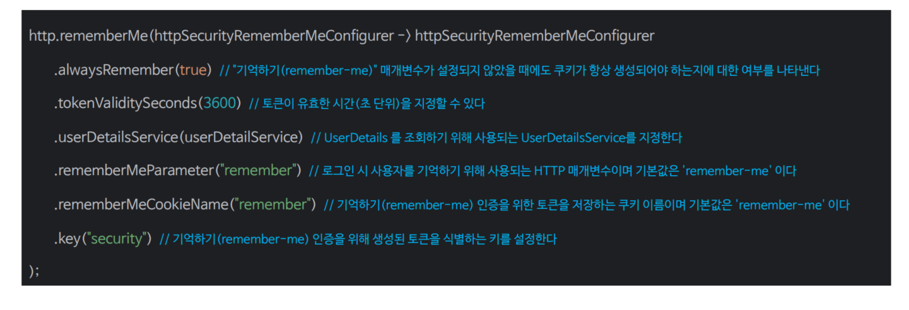

```java
@EnableWebSecurity
@Configuration
public class SecurityConfig {
    @Bean
    public SecurityFilterChain securityFilterChain(HttpSecurity http) throws Exception{
        http
                .authorizeHttpRequests(auth -> auth
                        .requestMatchers("/").permitAll()
                        .anyRequest().authenticated()
                )
                .formLogin(Customizer.withDefaults())
                .rememberMe(auth -> auth
                        // .alwaysRemember(true)
                        .tokenValiditySeconds(3600) // 1시간
                        .userDetailsService(userDetailsService())
                        .rememberMeParameter("remember")
                        .rememberMeCookieName("remember")
                        .key("security")
                );
        return  http.build();
    }
    @Bean
    public UserDetailsService userDetailsService(){
        UserDetails user = User.withUsername("user12")
                .password("{noop}1111")
                .roles("USER").build();
        return new InMemoryUserDetailsManager(user);
    }
}
```

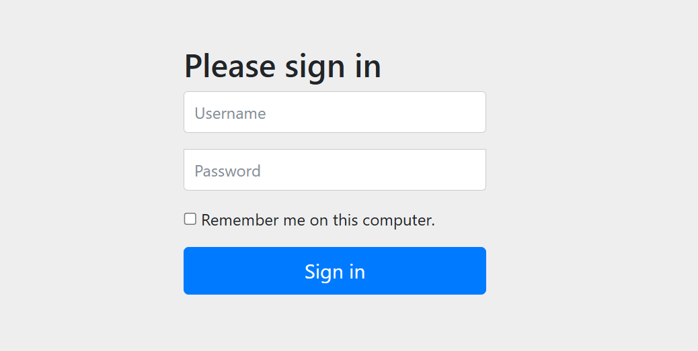

**alwaysRemeber(): default false**

remember me 체크박스 체크 여부에 상관 없이 항상 쿠키에 remember me 토큰이 저장된다 


**rememberMeParameter: default “remember-me”**

 “remember”로 설정해서 “remember”로 나온다.

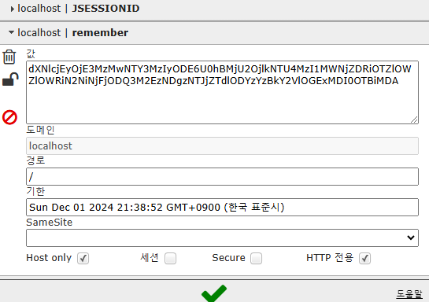

remember me 체크박스를 체크하고 로그인 하였다. 

현재 쿠키를 보면 `JSESSIONID (세션 ID)`와 `remember`쿠키가 보인다 

쿠키 이름은 default: “remember-me”이지만 “remember”로 설정했다.

또한 기한을 보면 2024년 9시 38분까지인데 내가 로그인 한 시각이 8시 38분이어서 

1시간 이후 만료되도록 설정했기 때문에 그렇다. 

세션 쿠키를 삭제해도 remember me 쿠키가 존재하면 별도의 로그인 과정 없이 

다시 로그인 된다. (세션 ID가 새로 생긴다.)

세션 쿠키, remember me 쿠키를 모두 삭제하면 인증을 요구한다 .

- `SecurityContextHolder`에 `Authenticaion`이 포함되지 않은 경우 실행되는 필터이다 
    - 세션이 만료되었거나 애플리케이션 종료로 인해 인증 상태가 소멸된 경우 토큰 기반 인증을 사용해 유효성을 검사하고 토큰이 검증되면 자동 로그인 처리를 수행한다 

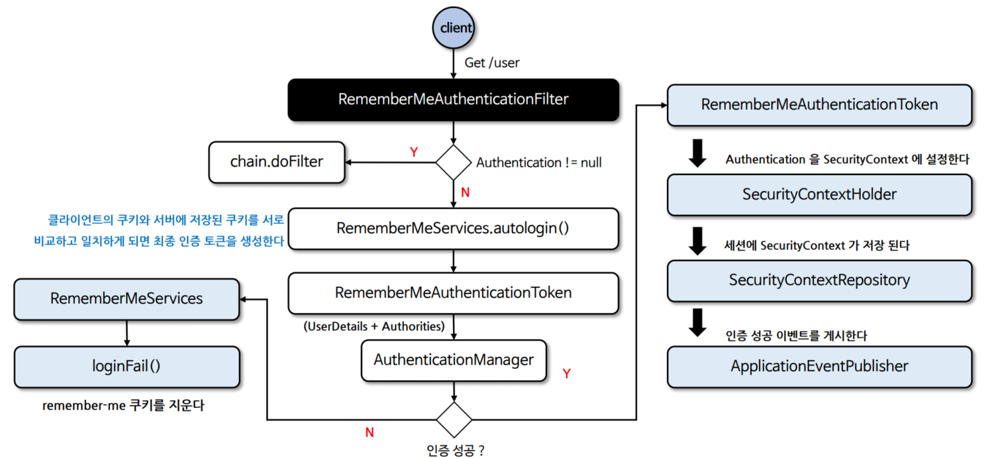

# **익명 사용자**

    - 스프링 시큐리티에서 `익명으로 인증된` 사용자와 인증되지 않은 사용자 간에 실제 개념적 차이는 없으며 단지 엑세스 제어 속성을 구성하는 더 편리한 방법을 제공한다고 볼 수 있다 
    - `SecurityContextHolder`가 항상 `Authentication` 객체를 포함하는 규칙을 세우게 되면 클래스를 더 견고하게 작성할 수 있다 
    - 인증 사용자와 익명 인증 사용자를 구분해서 어떤 기능을 수행하고자 할 때 유용할 수 있으며 익명 인증 객체를 세션에 저장하지 않는다 
    - 익명 인증 사용자의 권한을 별도로 운용할 수 있다. 즉 인증 된 사용자가 접근할 수 없도록 구성이 가능하다 

# **익명 사용자 API 및 구조**

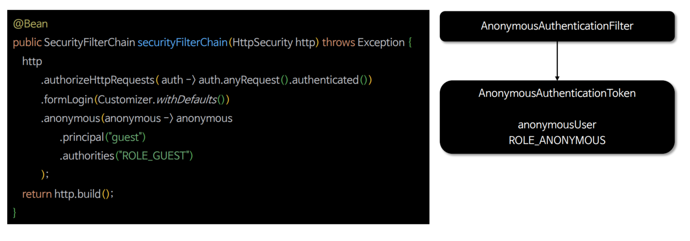

principal default: anonymousUser

authorities default: ROLE_ANONYMOUS

# **스프링 MVC 에서 익명 인증 사용하기**

**SecurityConfig**

```java
@EnableWebSecurity
@Configuration
public class SecurityConfig {
    @Bean
    public SecurityFilterChain securityFilterChain(HttpSecurity http) throws Exception{
        http
                .authorizeHttpRequests(auth -> auth
                        .requestMatchers("/").permitAll()
                        .requestMatchers("/test").permitAll()
                        .anyRequest().authenticated())
                .formLogin(Customizer.withDefaults())
                .anonymous(anonymous -> anonymous
                        .principal("guest")
                        .authorities("ROLE_GUEST"));

        return  http.build();
    }
    @Bean
    public UserDetailsService userDetailsService(){
        UserDetails user = User.withUsername("user12")
                .password("{noop}1111")
                .roles("USER").build();
        return new InMemoryUserDetailsManager(user);
    }
}
```

**IndexController**

```java
@Slf4j
@RestController
@RequiredArgsConstructor
public class IndexController {
    @GetMapping("/")
    public String index(Authentication authentication, HttpServletRequest request){
        log.info("request.getUserPrincipal={}", request.getUserPrincipal());
        log.info("authentication={}", authentication);
        if(authentication instanceof AnonymousAuthenticationToken) return "anonymous";
        return "not anonymous";
    }
    @GetMapping("/test")
    public String test(@CurrentSecurityContext SecurityContext context){
        log.info("authentication={}", context.getAuthentication());
        return context.getAuthentication().getName();
    }
}
```

현재 `/` , `/test` 경로는 인증 없이 접근이 가능한 상태

`/` 경로 

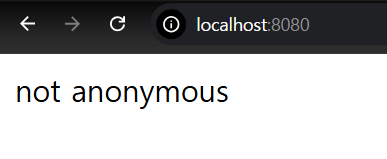

```java
request.getUserPrincipal=null
authentication=null
```

별도의 애노테이션 없이 `Authentication`객체를 받아오면 스프링 MVC는 `HttpServletRequest#getUserPrincipal`을 사용하여 파라미터를 해결하는데 요청이 익명일 때 이 값은 null 이다.

인증된 사용자

```java
authentication=UsernamePasswordAuthenticationToken [Principal=org.springframework.security.core.userdetails.User [Username=user12, Password=[REDACTED], Enabled=true, AccountNonExpired=true, CredentialsNonExpired=true, AccountNonLocked=true, Granted Authorities=[ROLE_USER]], Credentials=[PROTECTED], Authenticated=true, Details=WebAuthenticationDetails [RemoteIpAddress=0:0:0:0:0:0:0:1, SessionId=944B25A14F056107A4F71EA09FBBD787], Granted Authorities=[ROLE_USER]]
```

인증된 사용자는 `usernamePasswordAuthenticationToken`

`/test` 경로 

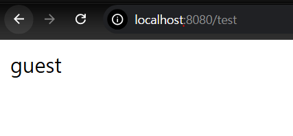

```java
authentication=AnonymousAuthenticationToken [Principal=guest, Credentials=[PROTECTED], Authenticated=true, Details=WebAuthenticationDetails [RemoteIpAddress=0:0:0:0:0:0:0:1, SessionId=944B25A14F056107A4F71EA09FBBD787], Granted Authorities=[ROLE_GUEST]]
```

    - 익명 요청에서 `Authentication`을 얻고 싶으면 `@CurrentSecurityContext` 를 사용하면 된다 
    - `CurrentSecurityContextArgumentResolver` 에서 요청을 가로채서 처리한다 

인증된 사용자

```java
authentication=UsernamePasswordAuthenticationToken [Principal=org.springframework.security.core.userdetails.User [Username=user12, Password=[REDACTED], Enabled=true, AccountNonExpired=true, CredentialsNonExpired=true, AccountNonLocked=true, Granted Authorities=[ROLE_USER]], Credentials=[PROTECTED], Authenticated=true, Details=WebAuthenticationDetails [RemoteIpAddress=0:0:0:0:0:0:0:1, SessionId=944B25A14F056107A4F71EA09FBBD787], Granted Authorities=[ROLE_USER]]
```

인증된 사용자는 `usernamePasswordAuthenticationToken`

# **AnonymousAuthenticationFilter**

`SecurityContextHolder`에 `Authentication` 객체가 없을 경우 감지하고 필요한 경우 새로운 

`Authentication` 객체로 채운다

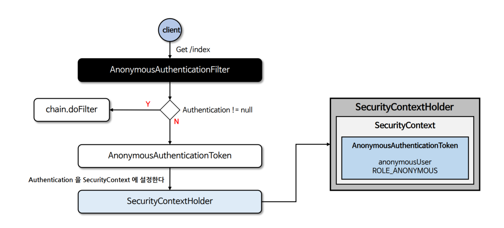

# **로그아웃**

    - 스프링 시큐리티는 기본적으로 `DefaultLogoutPageGeneratingFilter` 를 통해 로그아웃 페이지를 제공하며 `GET /logout` URL로 접근이 가능하다.
    - 로그아웃 실행은 기본적으로 `POST /logout` 으로만 가능하나 CSRF 기능을 비활성화 할 경우 혹은 `RequestMatcher` 를 사용할 경우 GET, PUT, DELETE 모두 가능하다 
    - 로그아웃 필터를 거치지 않고 스프링 MVC에서 커스텀 하게 구현할 수 있으며 로그인 페이지가 커스텀하게 생성될 경우 로그아웃 기능도 커스텀하게 구현해야 한다 

# **logout() API**

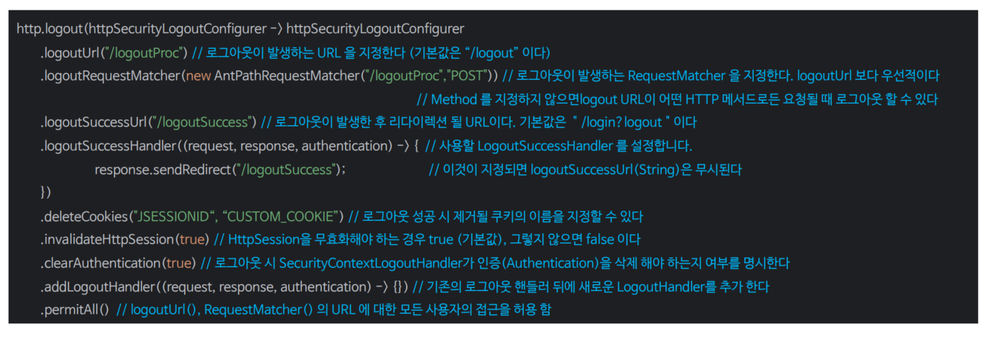

# **LogoutFilter**

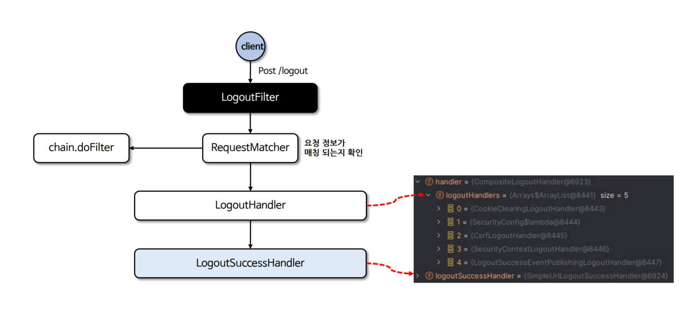

# **RequestCache**

인증 절차 문제로 리다이렉트 된 후에 이전에 했던 요청 정보를 담고 있는 `SavedRequest` 객체를 쿠키 or 세션에 저장하고 필요시 다시 가져와 실행하는 캐시 메커니즘이다 

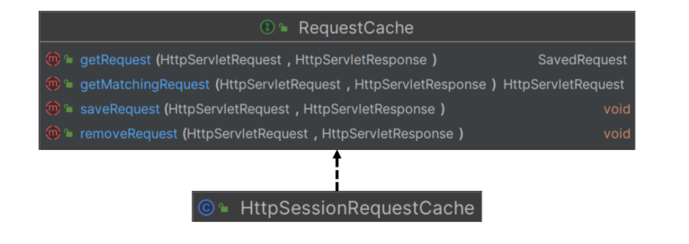

`HttpSessionRequestCahe`: 세션에(SavedRequest) 저장 

# **SavedRequest**

로그인 같은 인증 절차 이후 사용자를 인증 이전의 원래 페이지로 안내하며 이전 요청과 관련된 여러 정보를 저장한다 

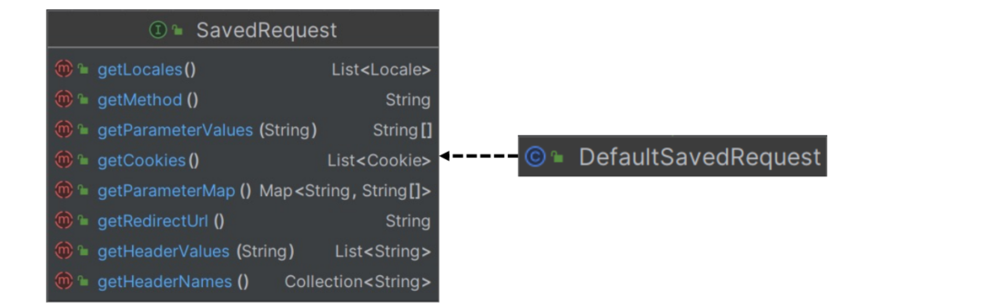

# **동작 방식**

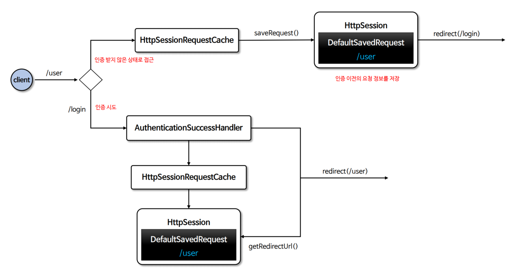

# **requestCache() API**

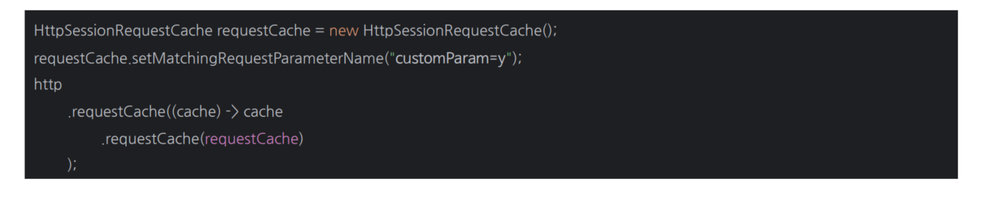

요청 Url에 `customParam=y` 라는 이름의 매개변수가 있는 경우에만 `HttpSession`에 저장된 

`SavedRequest`을 꺼내오도록 설정할 수 있다 (기본값은 `continue`)

즉, 인증에 성공하면 `localhost:8080/user?customParam=y` 형태로 보내준다. 

기본값은 `localhost:8080/user?continue` 

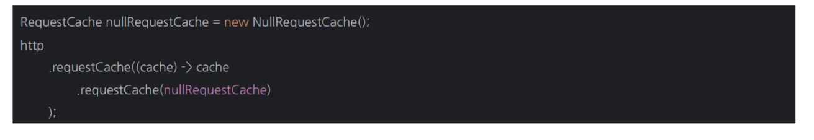

요청을 저장하지 않도록 하려면 `NullRequestCache` 구현을 사용할 수 있다.

# **RequestCacheAwareFilter**

`RequestCacheAwareFilter`는 이전에 저장했던 웹 요청을 다시 불러오는 요청을 한다 

`SavedRequest` 가 현재 Request와 일치하면 `SavedRequest` 요청을 필터 체인의 doFilter 메소드에 전달하고 `SavedRequest`가 없으면 필터는 원래 Request를 그대로 진행시킨다 

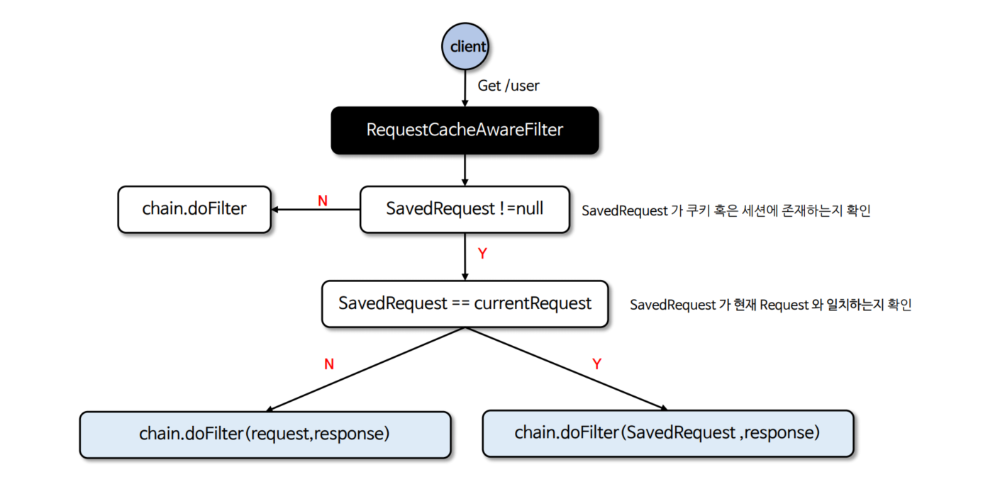

`SavedRequest`가 쿠키 혹은 세션에 존재하는지 확인은 

custom한 파라미터나 기본값인 continue 파라미터가 존재하면 동작한다 

# **흐름 정리1** 

`ExceptionTranslationFilter` 

```java
private void doFilter(HttpServletRequest request, HttpServletResponse response, FilterChain chain)
			throws IOException, ServletException {
		try {
			chain.doFilter(request, response);
		}
		catch (IOException ex) {
			throw ex;
		}
		catch (Exception ex) {
			// 생략 ...
		}
		handleSpringSecurityException(request, response, chain, securityException);
}		
```

인증 없이 인증이 필요한 경로에 접근하면 `AuthenticationException`이 발생한다.

즉, 다음 필터들에서 `AuthenticationException` 예외가 올라온다 

```java
/// 호출1
private void handleSpringSecurityException(HttpServletRequest request, HttpServletResponse response,
		FilterChain chain, RuntimeException exception) throws IOException, ServletException {
		if (exception instanceof AuthenticationException) {
			handleAuthenticationException(request, response, chain, (AuthenticationException) exception);
		}
		else if (exception instanceof AccessDeniedException) {
			handleAccessDeniedException(request, response, chain, (AccessDeniedException) exception);
		}
}

// 호출2
private void handleAuthenticationException(HttpServletRequest request, HttpServletResponse response,
			FilterChain chain, AuthenticationException exception) throws ServletException, IOException {
		this.logger.trace("Sending to authentication entry point since authentication failed", exception);
		sendStartAuthentication(request, response, chain, exception);
}
	
// 호출3
protected void sendStartAuthentication(HttpServletRequest request, HttpServletResponse response, FilterChain chain,
			AuthenticationException reason) throws ServletException, IOException 
		SecurityContext context = this.securityContextHolderStrategy.createEmptyContext();
		this.securityContextHolderStrategy.setContext(context);
		this.requestCache.saveRequest(request, response);
		this.authenticationEntryPoint.commence(request, response, reason);
}	
```

호출 순서대로 메소드를 나열했다. 

`this.requestCache.saveRequest(request, response)`

`RequestCache`기본 구현체는 `HttpSessionRequestCache` 

`SecurityConfig` 에서 `RequestCache` 구현체를 바꿀 수 있다. 

`HttpSessionRequestCache`

```java
  @Override
	public void saveRequest(HttpServletRequest request, HttpServletResponse response) {
		if (!this.requestMatcher.matches(request)) {
			if (this.logger.isTraceEnabled()) {
				this.logger
					.trace(LogMessage.format("Did not save request since it did not match [%s]", this.requestMatcher));
			}
			return;
		}

		if (this.createSessionAllowed || request.getSession(false) != null) {
			// Store the HTTP request itself. Used by
			// AbstractAuthenticationProcessingFilter
			// for redirection after successful authentication (SEC-29)
			DefaultSavedRequest savedRequest = new DefaultSavedRequest(request, this.portResolver,
					this.matchingRequestParameterName);
			request.getSession().setAttribute(this.sessionAttrName, savedRequest);
			if (this.logger.isDebugEnabled()) {
				this.logger.debug(LogMessage.format("Saved request %s to session", savedRequest.getRedirectUrl()));
			}
		}
		else {
			this.logger.trace("Did not save request since there's no session and createSessionAllowed is false");
		}
	}
```

세션에 `DefaultSavedRequest` 객체를 저장한다.

**세션에 SavedRequest 저장 흐름 정리** 

인증 없이 페이지에 접근 → Exception(Authentication) 발생 →  `ExceptionTranslationFilter`  →

`HttpSessionRequestCache` 세션에 저장 

# **흐름 정리2**

`RequestCacheAwareFilter`

```java
public class RequestCacheAwareFilter extends GenericFilterBean {

	private RequestCache requestCache;

	public RequestCacheAwareFilter() {
		this(new HttpSessionRequestCache());
	}

	public RequestCacheAwareFilter(RequestCache requestCache) {
		Assert.notNull(requestCache, "requestCache cannot be null");
		this.requestCache = requestCache;
	}

	@Override
	public void doFilter(ServletRequest request, ServletResponse response, FilterChain chain)
			throws IOException, ServletException {
		HttpServletRequest wrappedSavedRequest = this.requestCache.getMatchingRequest((HttpServletRequest) request,
				(HttpServletResponse) response);
		chain.doFilter((wrappedSavedRequest != null) ? wrappedSavedRequest : request, response);
	}

}
```

`RequestCache 인터페이스` `getMatchingRequest()` 를 통해서 

반환하는 HttpServletRequest 객체가 null 이면 기존 request를 다음 필터로 넘기고 아니라면 

RequestCache가 반환하는 HttpServletRequest 즉, 이전 요청에 대한 정보가 담긴 객체를 다음 필터로 넘긴다. 

`HttpSessionRequestCache`

```java
@Override
public HttpServletRequest getMatchingRequest(HttpServletRequest request, HttpServletResponse response) {
	if (this.matchingRequestParameterName != null) {
		if (!StringUtils.hasText(request.getQueryString())
				|| !UriComponentsBuilder.fromUriString(UrlUtils.buildRequestUrl(request))
					.build()
					.getQueryParams()
					.containsKey(this.matchingRequestParameterName)) {
			this.logger.trace(
					"matchingRequestParameterName is required for getMatchingRequest to lookup a value, but not provided");
			return null;
		}
	}
	SavedRequest saved = getRequest(request, response);
	if (saved == null) {
		this.logger.trace("No saved request");
		return null;
	}
	if (!matchesSavedRequest(request, saved)) {
		if (this.logger.isTraceEnabled()) {
			this.logger.trace(LogMessage.format("Did not match request %s to the saved one %s",
					UrlUtils.buildRequestUrl(request), saved));
		}
		return null;
	}
	removeRequest(request, response);
	if (this.logger.isDebugEnabled()) {
		this.logger.debug(LogMessage.format("Loaded matching saved request %s", saved.getRedirectUrl()));
	}
	return new SavedRequestAwareWrapper(saved, request);
}
```

getMatchingRequest 에서는 현재 요청에 쿼리 스트링 default: continue가 존재하는지 확인하고 

저장된 요청 객체 가져오기 가져온 요청 객체 비교까지 통과하면 이전에 요청했던 객체를 반환(세션에 저장된) 아니라면 null을 반환한다.

# **시큐리티 인증 / 인가 흐름도** 

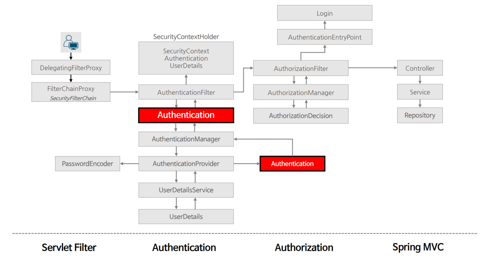

# **Authentication**

    - 인증은 특정 자원에 접근하려는 사람의 신원을 확인하는 방법을 의미한다 
    - 사용자 인증의 일반적인 방법은 사용자 이름과 비밀번호를 입력하게 하는 것으로서 인증이 수행되면 신원을 알고 권한 부여(인가)를 할 수 있다
    - Authentication은 사용자의 인증 정보를 저장하는 토큰 개념의 객체로 활용되며 인증 이후 `SecurityContext` 에 저장되어 전역적으로 참조가 가능하다 

# **구조**

**Principal(interface)**

    - package: `java.security`

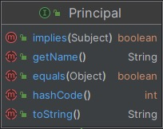

                    ⬆️

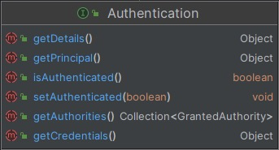

**Authenticaion(interface)**

    - package: `org.springframework.security.core` 
    - extends Principal, Serializable
    - **getPrincipal()**
- 인증 주체를 의미하며 인증 요청의 경우 사용자 이름을, 인증 후에는 `UserDetails`  타입의 객체가 될 수 있다
    - **getCredentials()**
- 인증 주체가 올바른 것을 증명하는 자격 증명으로서 대개 비밀번호를 의미한다
    - **getAuthorities()**
- 인증 주체에게 부여된 권한을 나타낸다
    - **getDetails()**
- 인증 요청에 대한 세부적인 사항을 저장한다 
      - IP 주소, 인증서 일련 번호 등…
    - **isAuthenticated()**
- 인증 상태를 반환한다
    - **setAuthenticated(boolean)**
- 인증 상태를 설정한다

# **인증 절차 흐름**

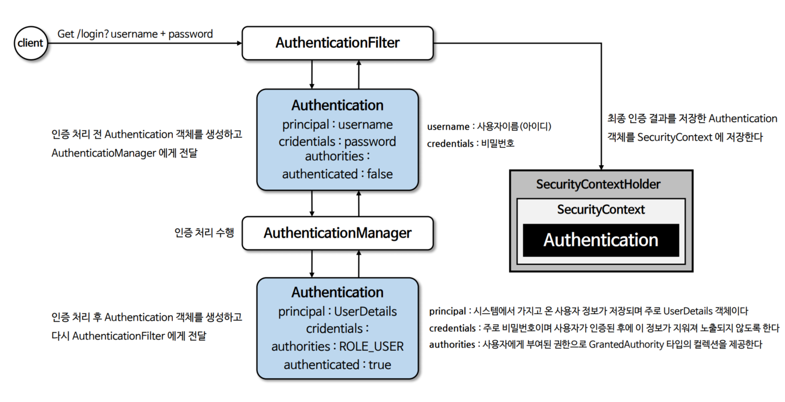

# **시큐리티 인증 / 인가 흐름도**

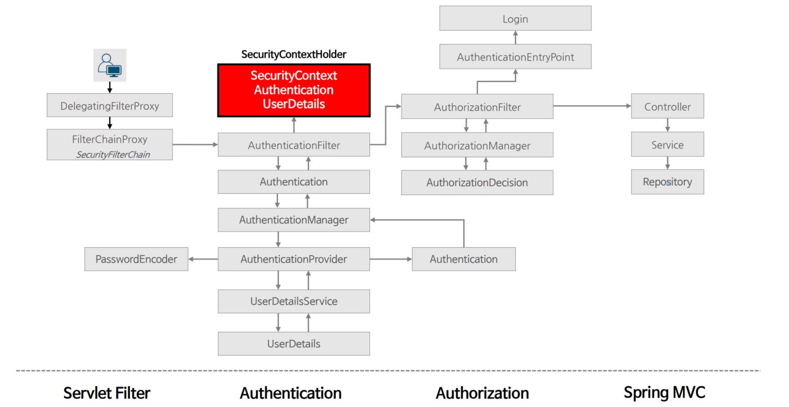

# **SecurityContext**

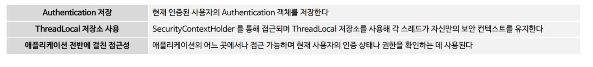

# SecurityContextHolder

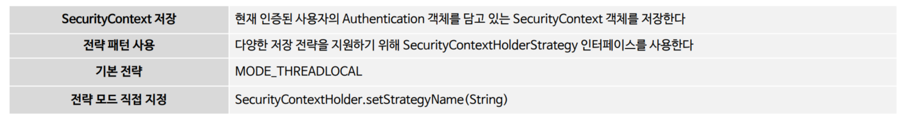

# **SecurityContextHolder 저장 모드**


# **구조**

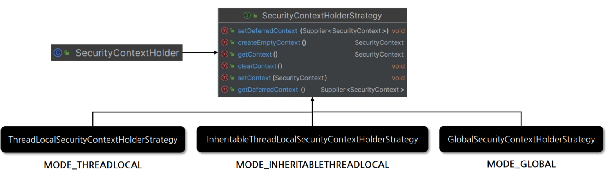

**SecurityContextHolderStrategy - 인터페이스** 

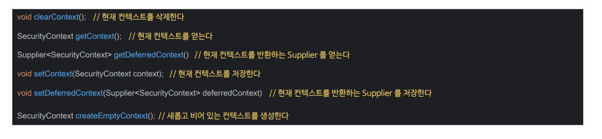

[디자인 패턴 - 전략 패턴 정리 ](https://20240228.tistory.com/425)

# **SecurityContext 참조 및 삭제**

    - **SecurityContext 참조 - SecurityContextHolder.getContextHolderStrategy().getContext()**
    - **SecurityContext 삭제 - SecurityContextHolder.getContextHolderStrategy().clearContext()**

# SecurityContextHolder & SecurityContext 구조

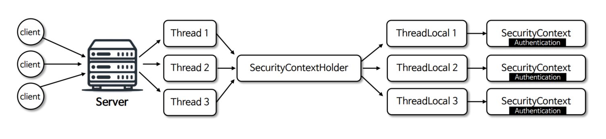

    - 스레드마다 할당되는 전용 저장소(ThreadLocal)에 SecurityContext를 저장하기 때문에 동시성 문제가 없다 
    - 스레드 풀에서 운용되는 스레드일 경우 새로운 요청이더라도 기존의 ThreadLocal이 재사용될 수 있기 때문에 클라이언트 응답 직전에 항상 SecurityContext를 삭제해 주고 있다 

# **SecurityContextHolderStrategy 사용하기**

**기존 방식**

```java
SecurityContext context = SecurityContextHolder.createEmptyContext(); 
context.setAuthentication(authentication); 
SecurityContextHolder.setContext(context);
```

위 코드는 SecurityContextHolder를 통해 SecurityContext에 접근할 때 여러 애플리케이션 컨텍스트가 SecurityContextHolderStrategy를 지정하려고 할 때 경쟁 조건(race condition)을 만들 수 있다 

**변경 방식**

```java
SecurityContextHolderStrategy securityContextHolderStrategy = SecurityContextHolder.getContextHolderStrategy();
SecurityContext context = securityContextHolderStrategy.createEmptyContext(); 
context.setAuthentication(authentication); 
securityContextHolderStrategy.setContext(context); 
```

애플리케이션이 SecurityContext를 정적으로 접근하는 대신 SecurityContextHolderStrategy를 자동 주입이 될 수 있도록 한다 각 애플리케이션 컨텍스트는 자신에게 가장 적합한 보안 전략을 사용할 수 있게 된다

# **메모**

    - **SecurityContextHolder**
    - **SecurityContextHolderStrategy - 전략 인터페이스** 
- **ThreadLocalSecurityContextHolderStrategy** 
- ThreadLocal 기반 
        - Supplier<SecurityContext> 사용
      - **InheritableThreadLocalSecurityContextHolderStrategy**

# **시큐리티 인증 / 인가 흐름도**

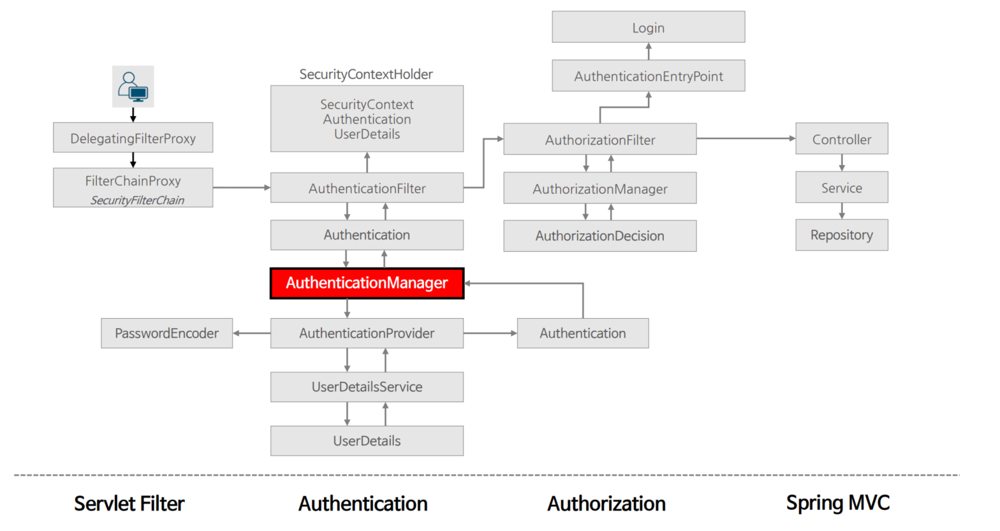

# **AuthenticationManager**

    - 인증 필터로부터 `Authentication` 객체를 전달 받아 인증을 시도하며 인증에 성공할 경우 사용자 정보, 권한 등을 포함한 완전히 채워진 `Authentication` 객체를 인증 필터로 반환한다
    - `AuthenticationManager` 는 여러 `AuthenticationProvider` 들을 관리하며 `AuthenticationProvider` 목록을 순차적으로 순회하며 인증 요청을 처리한다 
    - `AuthenticationProvider` 목록 중에 인증 처리 요건에 맞는 적절한 `AuthenticationProvider` 를 찾아 인증처리를 위임한다 
    - `AuthenticationManagerBuilder` 에 의해 객체가 생성되며 주로 사용하는 구현체로 `ProviderManager` 가 제공된다 

# **AuthenticationManagerBuilder**

    - `AuthenticationManager` 객체를 생성하며 `UserDetailsService` 및 `AuthenticationProvider` 를 추가할 수 있다
    - `HttpSecurity.getSharedObject(AuthenticationManagerBuilder.class)`를 통해 객체를 참조할 수 있다

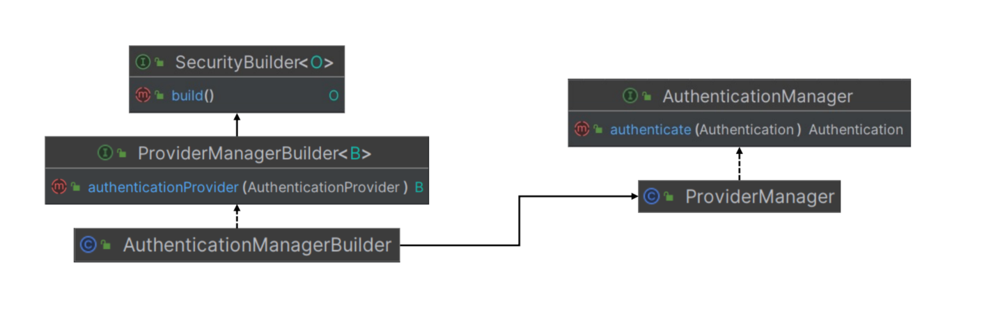

**SecurityBuilder**

    - HttpSecurity
    - WebSecurity
    - AuthenticationManagerBuilder

# **AuthenticationManager 흐름도**

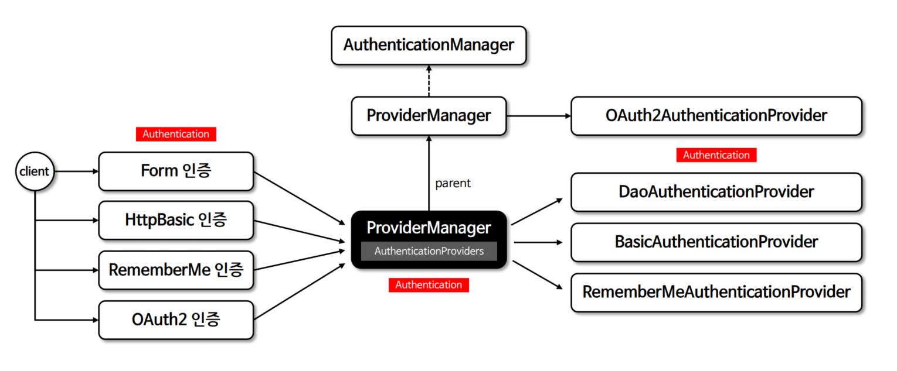

    - 선택적으로 부모 `AuthenticationManager`를 구현할 수 있으며 이 부모는 모든`AuthenticationProvider`가 인증을 수행할 수 없는 경우에 추가적으로 탐색할 수 있다 
    - 일반적으로 `AuthenticationProvider` 로 부터 null 이 아닌 응답을 받을 때 까지 차례대로 시도하며 응답을 받지 못하면 `ProviderNotFoundException`과 함께 인증이 실패한다 

# **AuthenticationManager 사용 방법­ - HttpSecurity 사용**

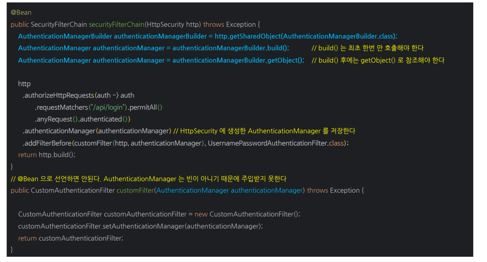

```java
@EnableWebSecurity
@Configuration
@Slf4j
public class SecurityConfig {
    @Bean
    public SecurityFilterChain securityFilterChain(HttpSecurity http) throws Exception{
        AuthenticationManagerBuilder authenticationManagerBuilder = http.getSharedObject(AuthenticationManagerBuilder.class);
        // build()는 최초 한번만 호출
        AuthenticationManager authenticationManager1 = authenticationManagerBuilder.build();
        // build()이후 getObject()로 참조해야 한다
        AuthenticationManager authenticationManager2 = authenticationManagerBuilder.getObject();

        http
                .authorizeHttpRequests(auth -> auth
                        .requestMatchers("/").permitAll()
                        .anyRequest().authenticated())
                .authenticationManager(authenticationManager1) // HttpSecurity 생성한 AuthenticationManager 저장
                .formLogin(Customizer.withDefaults());
        return  http.build();
    }
    @Bean
    public UserDetailsService userDetailsService(){
        UserDetails user = User.withUsername("user12")
                .password("{noop}1111")
                .roles("USER").build();
        return new InMemoryUserDetailsManager(user);
    }
}
```

# **AuthenticationManager 사용 방법­ - 직접 생성** 


# **실습1**

**CustomAuthenticationFilter** 

```java
public class CustomAuthenticationFilter extends AbstractAuthenticationProcessingFilter {
    public CustomAuthenticationFilter(HttpSecurity http) {
        super(new AntPathRequestMatcher("/api/login", "GET"));
        setSecurityContextRepository(getSecurityContextRepository(http));
    }
    private SecurityContextRepository getSecurityContextRepository(HttpSecurity http) {
        SecurityContextRepository securityContextRepository = http.getSharedObject(SecurityContextRepository.class);
        if (securityContextRepository == null) {
            securityContextRepository = new DelegatingSecurityContextRepository(
                    new RequestAttributeSecurityContextRepository(), new HttpSessionSecurityContextRepository());
        }
        return securityContextRepository;
    }
    @Override
    public Authentication attemptAuthentication(HttpServletRequest request, HttpServletResponse response) throws AuthenticationException, IOException, ServletException {
        String username = request.getParameter("username");
        String password = [REDACTED];
        UsernamePasswordAuthenticationToken token = [REDACTED], password);
        return this.getAuthenticationManager().authenticate(token);
    }
}

```

**SecurityConfig**

```java
@EnableWebSecurity
@Configuration
@Slf4j
public class SecurityConfig {
    @Bean
    public SecurityFilterChain securityFilterChain(HttpSecurity http) throws Exception{
        AuthenticationManagerBuilder authenticationManagerBuilder = http.getSharedObject(AuthenticationManagerBuilder.class);
        AuthenticationManager authenticationManager = authenticationManagerBuilder.build();
        http
                .authorizeHttpRequests(auth -> auth
                        .requestMatchers("/", "/api/login").permitAll()
                        .anyRequest().authenticated())
                .authenticationManager(authenticationManager) // HttpSecurity 생성한 AuthenticationManager 저장
                .addFilterBefore(customFilter(http, authenticationManager), UsernamePasswordAuthenticationFilter.class);
        return  http.build();
    }
    public CustomAuthenticationFilter customFilter(HttpSecurity http, AuthenticationManager authenticationManager){
        CustomAuthenticationFilter customAuthenticationFilter = new CustomAuthenticationFilter(http);
        customAuthenticationFilter.setAuthenticationManager(authenticationManager);
        return customAuthenticationFilter;
    }
    @Bean
    public UserDetailsService userDetailsService(){
        UserDetails user = User.withUsername("user12")
                .password("{noop}1111")
                .roles("USER").build();
        return new InMemoryUserDetailsManager(user);
    }
}
```


현재 디버깅 break point: `CustomAuthenticationFilter`

return this.getAuthenticationManager().authenticate(token);

`AuthenticationManager`에 있는 `ProviderManager`에 provider에 `AnonymousAuthenticationProvider`가 있고 parents ProviderManager에 `DaoAuthenticationProvider`가 존재한다. 

즉, HttpSecurity 초기화 과정에서 2개의 default `AuthenticationProvider` 가 `AuthenticationManager` 가 존재하게 된다. 


`GET /api/login` 하면 `CustomAuthenticationFilter` RequestMatcher 조건에 맞고 

parameter로 올바른 password, username을 쿼리 String 으로 보내면 `DaoAuthenticationProvider`

에서 `UsernamePaswordAuthenticationToken`을 반환한다. 

# **실습2**

**CustomAuthenticationProvider**

```java
public class CustomAuthenticationProvider implements AuthenticationProvider {
    @Override
    public Authentication authenticate(Authentication authentication) throws AuthenticationException {
        String loginId = authentication.getName();
        String password = [REDACTED];

        // 생략된 과정: UserDetailsService 통해서 UserDetails 받고 password 검증을 해야함
        return new UsernamePasswordAuthenticationToken(
                loginId, null, List.of(new SimpleGrantedAuthority("ROLE_USER")));
    }
    @Override
    public boolean supports(Class<?> authentication) {
        return authentication.isAssignableFrom(UsernamePasswordAuthenticationToken.class);
    }
}

```

**SecurityConfig**

```java
@EnableWebSecurity
@Configuration
@Slf4j
public class SecurityConfig2 {
    @Bean
    public SecurityFilterChain securityFilterChain(HttpSecurity http) throws Exception{
        http
                .authorizeHttpRequests(auth -> auth
                        .requestMatchers("/").permitAll()
                        .anyRequest().authenticated())
                .addFilterBefore(customFilter(http), UsernamePasswordAuthenticationFilter.class);

        return  http.build();
    }
    public CustomAuthenticationFilter customFilter(HttpSecurity http){
        CustomAuthenticationFilter customAuthenticationFilter = new CustomAuthenticationFilter(http);

        List<AuthenticationProvider> list1 = List.of(new DaoAuthenticationProvider());
        AuthenticationManager parent = new ProviderManager(list1);

        List<AuthenticationProvider> list2 = List.of(new AnonymousAuthenticationProvider("key"), new CustomAuthenticationProvider());
        AuthenticationManager providerManager = new ProviderManager(list2, parent);
        customAuthenticationFilter.setAuthenticationManager(providerManager);
        return customAuthenticationFilter;
    }
    @Bean
    public UserDetailsService userDetailsService(){
        UserDetails user = User.withUsername("user12")
                .password("{noop}1111")
                .roles("USER").build();
        return new InMemoryUserDetailsManager(user);
    }
}
```

CustomAuthenticaionFilter에 AuthenticationManager를 직접 만들어서 넣었다.

ProviderManager에는 부모 ProviderManager를 넣을 수 있다.

ProviderManager에 있는 AuthenticaionProviders 목록에서 모든 Provider가 정상적인 Authentication 을 반환하지 않으면 부모 ProviderManager에 있는 AuthenticaionProviders 에서 찾는다 

현재 CustomAuthenticationProvider는 어떤 아이디 비밀번호든 UsernamePasswordAuthenticationToken을 반환하고 있어서 무조건 인증에 성공한다

# **시큐리티 인증 / 인가 흐름도**


# **AuthenticationProvider**

    - 사용자의 자격 증명을 확인하고 인증 과정을 관리하는 클래스로서 사용자가 시스템에 엑세스하기 위해 제공한 정보(아이디/비빌번호)가 유효한지 검증하는 과정을 포함한다 
    - 다양한 유형의 인증 메커니즘을 지원할 수 있는데, 기본적인 사용자 이름과 비밀번호를 기반으로 한 인증, 토큰 기반 인증, 지문 인식 등을 처리할 수 있다 
    - 성공적인 인증 후에는 `Authentication` 객체를 반환하며 이 객체에는 사용자의 신원 정보와 인증된 자격 증명을 포함한다 
    - 인증 과정 중에 문제가 발생한 경우 `AuthenticatioException` 과 같은 예외를 발생시켜 문제를 알리는 역할을 한다 


    - `AuthenticationManager`로부터 `Authentication` 객체를 받아 인증을 수행한다 
    - 인증을 수행할 수 있는 조건인지를 `supports 메소드`를 통해 검사한다 

# **AuthenticationProvider 흐름도**


# **AuthenticationProvider사용 방법 ­- 일반 객체로 생성**


**HttpSecurity - addAuthenticationProvider 활용** 

`http.authenticationProvider(new CustomAuthenticationProvider()))`

**ManagerBuilder 활용** 

`AuthenticationManagerBuilder managerBuilder = http.getSharedObject(AuthenticationMnagerBuilder.class`

`managerBuilder.addAuthenticationProvider(new CustomAuthenticationProvider())`

**저장 위치** 


`AuthenticationManager`는 `AuthenticationProvider` 목록인 `providers`와 추가적으로 

`AuthenticationManager(parent)`를 가질 수 있다

일반 객체로 생성해서 추가되는 위치는 `providers`

`AnonymousAuthenticationProvider`, `DaoAuthenticationProvider` 2개의 `Provider`는 시큐리티가 기본적으로 넣어준다.

# **AuthenticationProvider 사용 방법 -­ 빈으로 생성**

## **빈을 한 개만 정의하는 경우** 

`AuthenticationProvider`를 빈으로 정의하면 `DaoAuthenticationProvider`를 자동으로 대체하게 된다

```java
@Bean
public AuthenticationProvider customAuthenticationProvider(){
	 return new CustomAuthenticationProvider();
}
```


하지만 상황에 따라서 내가 Custom한 `AuthenticationProvider` 뿐만 아니라 

`DaoAuthenticationProvider`도 필요할 수 있다. 

→ ex: 인증 방식이 (Custom한 방식 / 폼 로그인 방식) 2가지가 있는 경우 

```java
@Bean
public SecurityFilterChain securityFilterChain(HttpSecurity http, AuthenticationManagerBuilder builder, AuthenticationConfiguration configuration) 
throws Exception {
		 AuthenticationManagerBuilder managerBuilder = http.getSharedObject(AuthenticationManagerBuilder.class);
		 managerBuilder.authenticationProvider(customAuthenticationProvider());
		 ProviderManager providerManager = (ProviderManager)configuration.getAuthenticationManager();
		 providerManager.getProviders().remove(0);
		 builder.authenticationProvider(new DaoAuthenticationProvider());
		 http.authorizeHttpRequests(auth -> auth.anyRequest().authenticated());
		 return http.build();
}

@Bean
public AuthenticationProvider customAuthenticationProvider(){
		 return new CustomAuthenticationProvider();
}
```

**결과** 


```java
AuthenticationManagerBuilder managerBuilder = http.getSharedObject(AuthenticationManagerBuilder.class);
managerBuilder.authenticationProvider(customAuthenticationProvider());
```

`HttpSecurity` 객체를 통해 `getSharedObject(AuthenticationManagerBuilder.class)` ManagerBuilder 가져오기 

가져온 `builder.authenticationProvider(customAuthenticationProvider())` 

이렇게 하면 `AuthenticationManager providers` 목록에 `CustomAuthenticationProvider`가 들어간다.

`parent`에 있는 `ProviderManager`가 아니다!

```java
ProviderManager providerManager = (ProviderManager)configuration.getAuthenticationManager();
providerManager.getProviders().remove(0);
```

`AuthenticationConfiguration configuration` 주입 받았다.

configuration에서 `getAuthenticationManager`는 `parent`에 해당하는 `ProviderManager`이다 

여기서 첫 번째 인덱스에 해당하는 `AuthenticationProvider`를 삭제한다

삭제하는 `Provider`는 우리가 빈으로 등록한 `CustomAuthenticationProvider` 이다.

```java
 builder.authenticationProvider(new DaoAuthenticationProvider());
```

`AuthenticationManagerBuilder builder` 주입 받았다. 

`builder.authenticationProvider` 에 `DaoAuthenticationProvider`를 추가한다 

이때 `DaoAuthenticationProvider`가 추가되는 `AuthenticationManager`는 `patent`이다

그래서 최종적으로 아래 결과가 나온다 


## **빈을 두 개 이상 정의하는 경우** 


# **테스트1**

CustomAuthenticationProvider 일반 객체로 생성해서 사용하기 

```java
@EnableWebSecurity
@Configuration
@Slf4j
public class SecurityConfig {
    @Bean
    public SecurityFilterChain securityFilterChain(HttpSecurity http, AuthenticationConfiguration configuration) throws Exception{

        AuthenticationManagerBuilder managerBuilder = http.getSharedObject(AuthenticationManagerBuilder.class);
        managerBuilder.authenticationProvider(new CustomAuthenticationProvider());

        ProviderManager providerManager = (ProviderManager) configuration.getAuthenticationManager();
        providerManager.getProviders().add(new CustomAuthenticationProvider());

        http
            .authorizeHttpRequests(auth -> auth
                        .requestMatchers("/").permitAll()
                        .anyRequest().authenticated());

        //http.authenticationProvider(new CustomAuthenticationProvider2());

        http
            .formLogin(Customizer.withDefaults());

        return  http.build();
    }
    @Bean
    public UserDetailsService userDetailsService(){
        UserDetails user = User.withUsername("user12")
                .password("{noop}1111")
                .roles("USER").build();
        return new InMemoryUserDetailsManager(user);
    }
}
```

`AuthenticationConfiguration` 에서 가져온 `ProviderManager` 는 `Parent` 

`HttpSecurity.getSharedObject(AuthenticationManagerBuilder.class)` 를 통해서

가져온 `ProviderManager` 는 `Parent` 를 가지는 `ProviderManager` 이다.


# **테스트2**

CustomAuthenticationProvider 빈으로만 등록 다른 설정 X

```java
@EnableWebSecurity
@Configuration
@Slf4j
public class SecurityConfig {
    @Bean
    public SecurityFilterChain securityFilterChain(HttpSecurity http) throws Exception{
        http
            .authorizeHttpRequests(auth -> auth
                        .anyRequest().authenticated());
        http
            .formLogin(Customizer.withDefaults());

        return  http.build();
    }
    @Bean
    public CustomAuthenticationProvider customAuthenticationProvider(){
        return new CustomAuthenticationProvider();
    }
    @Bean
    public UserDetailsService userDetailsService(){
        UserDetails user = User.withUsername("user12")
                .password("{noop}1111")
                .roles("USER").build();
        return new InMemoryUserDetailsManager(user);
    }
}
```


`CustomAuthenticationProvider`를 빈으로만 등록해도 `DaoAuthenticationProvider` 존재하지 않는다.

# **테스트3**

빈으로 등록하고 `HttpSecurity`를 통해서 추가하기 

```java
@EnableWebSecurity
@Configuration
@Slf4j
public class SecurityConfig {
    @Bean
    public SecurityFilterChain securityFilterChain(HttpSecurity http) throws Exception{
        AuthenticationManagerBuilder managerBuilder = http.getSharedObject(AuthenticationManagerBuilder.class);
        managerBuilder.authenticationProvider(customAuthenticationProvider());
        
        http
            .authorizeHttpRequests(auth -> auth
                        .anyRequest().authenticated());
        http
            .formLogin(Customizer.withDefaults());

        return  http.build();
    }
    @Bean
    public CustomAuthenticationProvider customAuthenticationProvider(){
        return new CustomAuthenticationProvider();
    }
    @Bean
    public UserDetailsService userDetailsService(){
        UserDetails user = User.withUsername("user12")
                .password("{noop}1111")
                .roles("USER").build();
        return new InMemoryUserDetailsManager(user);
    }
}
```

`CustomProviderManager`가 2곳에 들어간다.


역시 `DaoAuthenticationProvider` 존재하지 않는다.

# **테스트4**

CustomProviderManager를 빈으로 등록하면서 1개만 존재하게 하고 

`DaoAuthenticationProvider` 또한 등록하기

```java
@EnableWebSecurity
@Configuration
@Slf4j
public class SecurityConfig {
    @Bean
    public SecurityFilterChain securityFilterChain(HttpSecurity http, AuthenticationConfiguration configuration) throws Exception{

        ProviderManager providerManager = (ProviderManager) configuration.getAuthenticationManager();
        providerManager.getProviders().add(new DaoAuthenticationProvider());

        http
            .authorizeHttpRequests(auth -> auth
                        .anyRequest().authenticated());
        http
            .formLogin(Customizer.withDefaults());

        return  http.build();
    }
    @Bean
    public CustomAuthenticationProvider customAuthenticationProvider(){
        return new CustomAuthenticationProvider();
    }
    @Bean
    public UserDetailsService userDetailsService(){
        UserDetails user = User.withUsername("user12")
                .password("{noop}1111")
                .roles("USER").build();
        return new InMemoryUserDetailsManager(user);
    }
}
```


`DaoAuthenticationProvider` 를 `Parent ProviderManager` 에 등록 

등록 위치를 바꾸고 싶으면 `HttpSecurity`를 통해서 추가하면 된다

# **테스트5**

CustomProvider 2개 빈으로 등록만 하기 

```java
@EnableWebSecurity
@Configuration
@Slf4j
public class SecurityConfig {
    @Bean
    public SecurityFilterChain securityFilterChain(HttpSecurity http) throws Exception{
        http
            .authorizeHttpRequests(auth -> auth
                        .anyRequest().authenticated());
        http
            .formLogin(Customizer.withDefaults());

        return  http.build();
    }
    @Bean
    public CustomAuthenticationProvider customAuthenticationProvider(){
        return new CustomAuthenticationProvider();
    }
    @Bean
    public CustomAuthenticationProvider2 customAuthenticationProvider2(){
        return new CustomAuthenticationProvider2();
    }
    @Bean
    public UserDetailsService userDetailsService(){
        UserDetails user = User.withUsername("user12")
                .password("{noop}1111")
                .roles("USER").build();
        return new InMemoryUserDetailsManager(user);
    }
}
```


빈을 2개 등록하고 추가하지 않으면 기본 Provider만 존재한다 

# **테스트6**

CustomProvider 2개 빈으로 등록하고 HttpSecurity, AuthenticationConfiguration 통해서 

서로 다른 ProviderManager에 Provider 등록하기 

```java
@EnableWebSecurity
@Configuration
@Slf4j
public class SecurityConfig {
    @Bean
    public SecurityFilterChain securityFilterChain(HttpSecurity http, AuthenticationConfiguration configuration) throws Exception{

        AuthenticationManagerBuilder managerBuilder = http.getSharedObject(AuthenticationManagerBuilder.class);
        managerBuilder.authenticationProvider(customAuthenticationProvider());

        ProviderManager providerManager = (ProviderManager) configuration.getAuthenticationManager();
        providerManager.getProviders().add(customAuthenticationProvider2());

        http
            .authorizeHttpRequests(auth -> auth
                        .anyRequest().authenticated());
        http
            .formLogin(Customizer.withDefaults());

        return  http.build();
    }
    @Bean
    public CustomAuthenticationProvider customAuthenticationProvider(){
        return new CustomAuthenticationProvider();
    }
    @Bean
    public CustomAuthenticationProvider2 customAuthenticationProvider2(){
        return new CustomAuthenticationProvider2();
    }
    @Bean
    public UserDetailsService userDetailsService(){
        UserDetails user = User.withUsername("user12")
                .password("{noop}1111")
                .roles("USER").build();
        return new InMemoryUserDetailsManager(user);
    }
}
```


# **시큐리티 인증 / 인가 흐름도**


# **UserDetailsService**

    - `UserDetailsService`의 주요 기능은 사용자와 관련된 상세 데이터를 로드하는 것이며 사용자의 신원, 권한, 자격 증명 등과 같은 정보를 포함할 수 있다 
    - 이 인터페이스를 사용하는 클래스는 주로 `AuthenticationManager`이며 사용자가 시스템에 존재하는지 여부와 사용자 데이터를 검색하고 인증 과정을 수행한다 


    - 사용자의 이름을 통해 사용자 데이터를 검색하고, 해당 데이터를 `UsersDetails`객체로 반환한다

# **UserDetailsService 흐름도**


# **UserDetailsService 사용 방법**


위 코드는 `HttpSecurity` 객체를 통해서 `UserDetailsService` 를 주입하는 2가지 방식을 보여준다

`UserDetailsService`를 하나의 빈으로 사용하면 굳이 

`HttpSecurity`객체를 통해 설정하지 않아도 자동으로 `AuthenticationProvider`에게 주입된다

하지만 `AuthenticationProvider` 를 커스터 마이징 한다고 하면 `AuthenticationProvider`에 직접 주입해서 사용한다 

# **CustomUserDetailsService 적용** 

**CustomUserDetailsService**

```java
public class CustomUserDetailsService implements UserDetailsService {
    @Override
    public UserDetails loadUserByUsername(String username) throws UsernameNotFoundException {
        return User.withUsername("user").password("{noop}1111").roles("USER").build();
    }
}
```

**SecurityConfig**

```java
@EnableWebSecurity
@Configuration
@Slf4j
public class SecurityConfig {
    @Bean
    public SecurityFilterChain securityFilterChain(HttpSecurity http, AuthenticationConfiguration configuration) throws Exception{
        http
            .authorizeHttpRequests(auth -> auth
                        .anyRequest().authenticated());
        http
            .formLogin(Customizer.withDefaults());

        return  http.build();
    }
    @Bean
    public UserDetailsService userDetailsService(){
        return new CustomUserDetailsService();
    }
}
```


빈으로 등록한 `CustomUserDetailsService`가 `DaoAuthenticationProvider`에 주입되어 있는 걸 확인할 수 있다. 

# **CustomAuthenticationProvider 적용** 

**SecurityConfig, CustomUserDetailsService 그대로 재사용** 

**CustomAuthenticationProvider**

```java
@Component
@RequiredArgsConstructor
public class CustomAuthenticationProvider implements AuthenticationProvider {
    private final UserDetailsService userDetailsService;
    @Override
    public Authentication authenticate(Authentication authentication) throws AuthenticationException {
        String username = authentication.getName();

        // 사용자 정보 조회
        UserDetails userDetails = userDetailsService.loadUserByUsername(username);

        // 비밀번호 검증 생략

        return new UsernamePasswordAuthenticationToken(
                userDetails.getUsername(), null, userDetails.getAuthorities());
    }
    @Override
    public boolean supports(Class<?> authentication) {
        return authentication.isAssignableFrom(UsernamePasswordAuthenticationToken.class);
    }
}
```


이전 `AuthenticationProvider`에서 알아봤던 동작 원리 그대로 

1개의 `CustomAuthenticationProvider`를 빈으로 등록하면 `DaoAuthenticationProvider`를 대체한다 

또한 스프링 DI를 통해서 커스터 마이징 한 `UserDetailsService`인 `CustomUserDetailsService`가 필드에 있는 걸 확인할 수 있었다

# **시큐리티 인증 / 인가 흐름도**


# **UserDetails**

    - 사용자의 기본 정보를 저장하는 인터페이스로서 Spring Security 에서 사용하는 사용자 타입이다 
    - 저장된 사용자 정보는 추후에 인증 절차에서 사용되기 위해 `Authentication`객체에 포함되며 구현체로 `User` 클래스가 제공된다 


# **SecurityContextRepository**

    - 스프링 시큐리티에서 사용자가 인증을 한 이후 요청에 대해 사용자의 인증을 유지하기 위해 사용되는 클래스이다 
    - 인증 상태의 영속 메커니즘은 사용자가 인증을 하게되면 해당 사용자의 인증 정보와 권한이 `SecurityContext`에 저장되고 `HttpSession`을 통해 요청 간 영속이 이루어 지는 방식이다 


#  **구조**


    - **HttpSessionSecurityContextRepository**
- 요청 간에 `HttpSession`에 보안 컨텍스트를 저장한다
      - 후속 요청 시 컨텍스트 영속성을 유지한다
    - **RequestAttributeSecurityContextRepository**
- ServletRequest에 보안 컨텍스트를 저장한다
      - 후속 요청 시 컨텍스트 영속성을 유지할 수 없다
    - **NullSecurityContextRepository**
- 세션을 사용하지 않는 인증(JWT, OAuth2)일 경우 사용한다 
      - 컨텍스트 관련 아무런 처리를 하지 않는다
    - **DelegatingSecurityConextRepository**
- **RequestAttributeSecurityContextRepository**, **HttpSessionSecurityContextRepository**를 동시에 사용할 수 있도록 위임된 클래스로서 초기화 시 기본으로 설정된다

# **SecurityContextHolderFilter**

    - `SecurityContextRepository`를 사용하여 `SecurityContext`를 얻고 이를 `SecurityContextHolder`에 설정하는 필터 클래스이다
    - 이 필터 클래스는 사용자가 `SecurityContextRepository.saveContext()` 를 명시적으로 호출해야 `SecurityContext` 를 저장할 수 있는데 이는 `SecurityContextPersistenceFilter` 와 다른점이다
    - 인증이 지속되어야 하는지를 각 인증 메커니즘이 독립적으로 선택할 수 있게 하여 더 나은 유연성을 제공하고 `HttpSession` 에 필요할 때만 저장함으로써 성능을 향상시킨다 

# **SecurityContext 생성, 저장, 삭제**

**익명 사용자**

    - `SecurityContextRepository`를 사용하여 `SecurityContext` 객체를 생성하여 `SecurityContextHolder`에 저장 후 다음 필터로 전달 
    - `AnonymousAuthenticationFilter` 에서 `AnonymousAuthenticationToken` 객체를 `SecurityContext`에 저장 

**인증 요청** 

    - `SecurityContextRepository`를 사용하여 `SecurityContext` 객체를 생성하여 `SecurityContextHolder`에 저장 후 다음 필터로 전달 
    - `UsernamePasswordAuthenticationFilter` 에서 인증 성공 후 `SecurityContext`에 `UsernamePasswordAuthentication` 객체를 `SecurityContext`에 저장 
    - `SecurityContextRepository` 를 사용하여 `HttpSession` 에 `SecurityContext` 를 저장 

**인증 후 요청** 

    - `SecurityContextRepository` 를 사용하여 `HttpSession` 에서 `SecurityContext` 를 꺼내어 `SecurityContextHolder` 에 저장 후 다음 필터로 전달 
    - `SecurityContext` 안에 `Authentication` 객체가 존재하면 인증을 유지한다 

**클라이언트 응답 시 공통** 

    - `SecurityContextHolder.clearContext()`로 컨텍스트를 삭제한다 (스레드 풀의 스레드일 경우 반드시 필요)

# **SecurityContextHolderFilter 흐름도**


# **SecurityContextHolderFilter & SecurityContextPersistanceFilter**


스프링 시큐리티 6 버전은 `SecurityContextPersistenceFilter` 대신 `SecurityContextHolderFilter`를 사용한다. `SecurityContextPersistenceFilter`는 무조건 응답 시점에 `HttpSession`에 `SecurityContext`를 저장한다 

만약 내가 세션 기반이 아닌 토큰 기반(JWT) 인증 메커니즘을 사용한다면 세션이 필요하지 않는다 

세션을 사용하지 않고 토큰을 사용하는 이유 중에는 세션이 메모리를 잡아먹어 서버 부하의 원인이 되기 때문도 있는데 `SecurityContextPersistenceFilter`를 사용하면 토큰 기반을 사용하는데도 세션에 저장하는 의미 없는 행동을 하기 때문이다. (서버의 리소스를 잡아먹는 행위)

그래서 스프링 시큐리티 6 버전부터는  `SecurityContextHolderFilter`를 사용하여 유연성을 제공한다. 만약 세션 기반이고 커스텀 필터를 만든다면 세션에 컨텍스트를 저장하는 로직을 명시적으로 넣어야 한다 

# **securityContext() API**

```java
@Bean
public SecurityFilterChain securityFilterChain(HttpSecurity http) throws Exception {
	 http.securityContext(securityContext -> securityContext
													 .requireExplicitSave(true)); 
	 return http.build();
}
```

    - `SecurityContext`를 명시적으로 저장할 것인지 아닌지의 여부를 설정 
    - default value: true
    - true: `SecurityContextHolderFilter`
    - false: `SecurityContextPersistanceFilter` 
    - 현재 `SecurityContextPersistanceFilter`는 Deprecated 되었기 때문에 레거시 시스템 외에는 `SecurityContextHolderFilter`를 사용하면 된다

# **CustomAuthenticationFilter & SecurityContextRepository**

    - 세션 기반으로 시큐리티를 운영할 계획이고 커스텀한 인증 필터를 구현하는 경우 
    - 커스텀한 인증 필터를 구현할 경우 인증이 완료된 후 `SecurityContext` 를 `SecurityContextHolder` 에 설정한 후 `securityContextRepository`에 저장하기 위한 코드를 명시적으로 작성해 주어야 한다

```java
securityContextHolderStrategy.setContext(context);
securityContextRepository.saveContext(context, request, response);
```

    - `securityContextRepository` 는 `HttpSessionSecurityContextRepository`혹은 `DelegatingSecurityContextRepository` 를 사용하면 된다

# **개요** 

    - 동시 세션 제어는 사용자가 동시에 여러 세션을 생성하는 것을 관리하는 전략이다 
    - 이 전략은 사용자의 인증 후에 활성화된 세션의 수가 설정된 `maximumSessions` 값과 비교하여 제어 여부를 결정한다 

# **동시 세션 제어 2 가지 유형**


# **sessionManagement() API ­ 동시 세션 제어**

```java
@Bean
public SecurityFilterChain securityFilterChain(HttpSecurity http) throws Exception {
	 http.sessionManagement(session -> session
				   .invalidSessionUrl("/invalidSessionUrl") 
					 .maximumSessions(1) 
					 .maxSessionsPreventsLogin(true) 
					 .expiredUrl("/expired") 
	 );
	 return http.build();
}
```

    - **invalidSessionUrl(String url)**
- 이미 만료된 세션으로 요청을 하는 사용자를 특정 엔드포인트로 리다이렉션 할 Url을 지정한다
    - **maximumSessions(int sessionCount)**
- 사용자당 최대 세션 수를 제어한다 
      - default: 무제한 세션을 허용
    - **maxSessionPreventsLogin(boolean)**
- `true`: 최대 세션 수(maximumSessions(int))에 도달했을 때 사용자의 인증을 차단한다
      - `false(default)`: 인증하는 사용자에게 접근을 허용하고 기존 사용자의 세션은 만료된다
    - **expiredUrl(String url)**
- 세션을 만료하고 나서 리다이렉션 할 Url을 지정한다

# **세션 만료 후 리다이렉션 전략**


`invalidSessionUrl`, `expiredUrl` API는 인증을 차단하는 전략과 관계가 없다. 

그래서 `maxSessionPreventsLogin(true)` 설정이면 항상 결과는 인증 차단이다 

만약 내가 인증 만료 방식을 사용하고 설정한다고 하면 `expiredUrl()`만 설정해서 

`expiredUrl()` 에 설정한 엔드 포인트로 리다이렉션 하도록 해야겠다 

# **테스트1**

**maxSession = 1, 인증 만료 전략** 

```java
@EnableWebSecurity
@Configuration
@Slf4j
public class SecurityConfig {
    @Bean
    public SecurityFilterChain securityFilterChain(HttpSecurity http, AuthenticationConfiguration configuration) throws Exception{
        http
                .authorizeHttpRequests(auth -> auth
                        .anyRequest().authenticated());
        http
                .formLogin(Customizer.withDefaults());

        http
                .sessionManagement(session -> session
                        .maximumSessions(1)
                        .maxSessionsPreventsLogin(false)
                );

        return  http.build();
    }
    @Bean
    public UserDetailsService userDetailsService(){
        UserDetails user = User
                .withUsername("user")
                .password("{noop}1111")
                .roles("USER")
                .build();
        return new InMemoryUserDetailsManager(user);
    }
}

@Slf4j
@RestController
@RequiredArgsConstructor
public class IndexController {
    @GetMapping("/")
    public  Authentication index(){
        Authentication authentication = SecurityContextHolder.getContextHolderStrategy().getContext().getAuthentication();
        log.info("authentication={}", authentication);
        return authentication;
    }
}
```

**사용자1**


현재 1개의 세션이 생성

**사용자2**


세션 최대 허용 개수는 1을 초과하는 상태 

**사용자1**


→ 처음 세션을 만들었던 크롬창을 새로고침 하니까 나오는 결과 

**사용자2**

크롬창을 새로고침해도 인증이 유지되어 있다 

# **테스트2**

**maxSession = 1, 인증 차단 전략** 

**Security Config 수정** 

```java
http
          .sessionManagement(session -> session
                  .maximumSessions(1)
                  .maxSessionsPreventsLogin(true)
          );
```

**사용자1**


**사용자2**


로그인 시도를 했지만 인증 차단 전략이기 때문에 로그인에 실패한다 

# **테스트3**

**maxSession = 1, 인증 만료 전략, 인증이 만료되면 로그인 페이지로 리다이렉트**

```java
@EnableWebSecurity
@Configuration
@Slf4j
public class SecurityConfig {
    @Bean
    public SecurityFilterChain securityFilterChain(HttpSecurity http, AuthenticationConfiguration configuration) throws Exception{
        http
                .authorizeHttpRequests(auth -> auth
                        .anyRequest().authenticated());
        http
                .formLogin(Customizer.withDefaults());

        http
                .sessionManagement(session -> session
                        .maximumSessions(1)
                        .maxSessionsPreventsLogin(false)
                        .expiredUrl("/login")
                );

        return  http.build();
    }
    @Bean
    public UserDetailsService userDetailsService(){
        UserDetails user = User
                .withUsername("user")
                .password("{noop}1111")
                .roles("USER")
                .build();
        return new InMemoryUserDetailsManager(user);
    }
}
```

**사용자1**


**사용자2**


세션 허용 개수 초과 → 사용자1: 세션 만료 

**사용자1**


새로고침 하니까 `expiredUrl("/login")` 경로로 리다이렉트 된다 

만약 실제 서비스에서 세션 만료 전략을 사용한다면 “다른 사용자가 계정에 접속했습니다” 같은 메시지를 만료된 사용자에게 보여줘야 할듯 싶다

# **세션 고정 보호 전략** 

    - 세션 고정 공격은 악의적인 사용자가 사이트에 접근하여 세션을 생성한 다음 다른 사용자가 같은 세션으로 로그인하도록 유도하는 위험을 말한다 
    - 스프링 시큐리티는 사용자가 로그인할 때 새로운 세션을 생성하거나 세션 ID를 변경함으로써 이러한 공격에 자동으로 대응한다 

# **세션 고정 공격 (Session Fixation Attack)**


    1. 공격자가 웹사이트 방문 세션 ID를 얻는다. 
    1. 공격자는 일반 사용자의 쿠키에 세션 ID를 설정한다
    1. 사용자는 쿠키에 공격자의 세션 ID를 가진 상태로 웹사이트에 로그인을 한다 
    1. 서버는 해당 세션 ID를 가지고 사용자의 세션을 생성해서 서버에 저장한다 
    1. 공격자는 이제 세션 ID를 통해서 사용자의 권한을 가지고 활동이 가능하다 

# **sessionManagement() API ­ 세션 고정 보호**

```java
@Bean
public SecurityFilterChain securityFilterChain(HttpSecurity http) throws Exception {
	 http.sessionManagement((session) -> session
		          .sessionFixation(sessionFixation -> sessionFixation.newSession()));
	 return http.build();
}
```

# **세션 고정 보호 전략**

    - **changeSessionId()**
- 기존 세션을 유지하면서 세션 ID만 변경해서 인증 과정에서 세션 고정 공격을 방지하는 방식이다 
      - 기본 값으로 설정되어 있다
    - **newSession()**
- 새로운 세션을 생성하고 기존 세션 데이터를 복사하지 않는 방식이다
    - **migrateSession()**
- 새로운 세션을 생성하고 모든 기존 세션 속성을 새로운 세션으로 복사한다
    - **none()**
- 기존 세션을 그대로 사용한다 
      - 세션 고정 공격에 무방비하다

- 스프링 시큐리티에서는 인증된 사용자에 대한 세션 생성 정책을 설정하여 어떻게 세션을 관리할지 결정할 수 있으며 이 정책은 `SessionCreationPolicy` 로 설정된다 

# **세션 생성 정책 전략** 

    - **SessionCreationPolicy.ALWAYS**
- 인증 여부에 상관없이 항상 세션을 저장한다 
      - `ForceEagerSessionCreationFilter` 클래스를 추가 구성하고 세션을 강제로 생성시킨다
    - **SessionCreationPolicy.NEVER**
- 스프링 시큐리티가 세션을 생성하지 않지만 애플리케이션이 이미 생성한 세션은 사용할 수 있다 
      - 애플리케이션이 이미 생성한 세션 → ex) 톰캣이 생성하는 세션
    - **SessionCreationPolicy.IF_REQUIRED**
- 필요한 경우에만 세션을 생성한다 
      - 인증이 필요한 자원에 접근할 때 세션을 생성한다
    - **SessionCreationPolicy.STATLESS**
- 세션을 전혀 생성하거나 사용하지 않는다 
      - 인증 필터는 인증 완료 후 `SecurityContext`를 세션에 저장하지 않으며 JWT 같이 세션을 사용하지 않는 방식으로 인증을 관리할 때 유용할 수 있다 
      - `SecurityContextHolderFilter`는 세션 단위가 아닌 요청 단위로 항상 새로운 `SecurityContext`를 생성하므로 컨텍스트 영속성이 유지되지 않는다

# **sessionManagement() API ­ 세션 생성 정책**

```java
@Bean
public SecurityFilterChain securityFilterChain(HttpSecurity http) throws Exception {
	 http.sessionManagement((session) -> session
						 .sessionCreationPolicy(SessionCreationPolicy.STATELESS));
	 return http.build();
}
```

# **STATELESS 설정에도 세션이 생성될 수 있다**

    - 스프링 시큐리티에서 CSRF 기능이 활성화 되어 있고 CSRF 기능이 수행 될 경우 사용자의 세션을 생성해서 CSRF 토큰을 저장하게 된다 
    - 세션은 생성되지만 CSRF 기능을 위해서 사용될 뿐 인증 프로세스의 `SecurityContext` 영속성에 영향을 미치지는 않는다.

# **SessionManagementFilter**

    - 요청이 시작된 이후 사용자가 인증되었는지를 검사하고, 인증된 경우에는 세션 고정 메커니즘을 활성화하거나 동시 다중 로그인을 확인하는 등 세션 관련 활동을 수행하기 위해 설정된 세션 인증 전략(SessionAuthenticationStrategy)을 호출하는 필터 클래스이다 
    - 스프링 시큐리티 6 이상에서는 `SessionManagementFilter` 가 기본적으로 설정되지 않으며 세션관리 API를 설정을 통해 생성할 수 있다 

# **세션 구성 요소**


# **ConcurrentSessionFilter**

    - 각 요청에 대해 `SessionRegistry` 에서 `SessionInformation` 을 검색하고 세션이 표시되었는지 확인하고 만료로 표시된 경우 로그아웃 처리를 수행한다(세션 무효화)
    - 각 요청에 대해 `SessionRegistry.refreshLastRequest(String)`를 호출하여 등록된 세션들이 항상 마지막 업데이트 날짜/시간을 가지도록 한다 

# **흐름도**


# **시퀀스 다이어그램**


# **개요**

    - 예외 처리는 필터 체인 내에서 발생하는 예외를 의미하며 크게 인증 예외(AuthenticationException)`와 인가 예외(AccessDeniedException)로 나눌 수 있다 
    - 예외를 처리하는 필터로서 `ExceptionTranslationFilter`가 사용되며 사용자의 인증 및 인가 상태에 따라 로그인 재시도, 401, 403 코드 등으로 응답할 수 있다 

# **예외 처리 유형**

**AuthenticationException**

    - `SecurityContext`에서 인증 정보 삭제 
- 기존의 `Authentication`이 더 이상 유효하지 않다고 판단하고 `Authentication`을 초기화 한다
    - `AuthenticationEntryPoint`호출
- `AuthenticationException`이 감지되면 필터는 `authenticationEntryPoint`를 실행하고 이를 통해 인증 실패를 공통적으로 처리할 수 있으며 일반적으로 인증을 시도할 수 있는 화면으로 이동한다
    - 인증 프로세스의 요청 정보를 저장하고 검색 
- `RequestCache` & `SavedRequest` - 인증 프로세스 동안 전달되는 요청을 세션 혹은 쿠키에 저장 
      - 사용자가 인증을 완료한 이후 요청을 검색하여 재 사용할 수 있다 
      - 기본 구현은 `HttpSessionRequestCache`

**AccessDeniedException**

    - `AccessDeniedHandler` 호출 
- `AccessDeniedException`이 감지되면 필터는 사용자가 익명 사용자인지 판단하고 익명 사용자인 경우 인증 예외 처리가 실행되고 익명 사용자가 아닌 경우 필터는 `AccessDeniedHandler`에게 위임한다

# **exceptionHandling() API**

```java
@Bean
public SecurityFilterChain securityFilterChain(HttpSecurity http) throws Exception {
	 http.exceptionHandling(exception -> exception
			 .authenticationEntryPoint((request, response, authException) 
					 System.out.println(authException.getMessage());
			 })
			 .accessDeniedHandler((request, response, accessDeniedException) 
					 System.out.println(accessDeniedException.getMessage());
			 })
	 );
	 return http.build();
}
```

`authenticationEntryPoint((request, response, authException)` 

    - 커스텀하게 사용할 `AuthenticationEntryPoint`를 설정한다

`accessDeniedHandler((request, response, accessDeniedException)`

    - 커스텀하게 사용할 `AccessDeniedHandler`를 설정한다

---

`AuthenticationEntryPoint`**는 인증 프로세스마다 기본적으로 제공되는 클래스들이 설정된다**

    - `UsernamePasswordAuthenticationFIlter` ­ → `LoginUrlAuthenticationEntryPoint` 
    - `BasicAuthenticationFilter` →  `BasicAuthenticationEntryPoint` 
    - 아무런 인증 프로세스가 설정 되지 않으면 기본적으로 `Http403ForbiddenEntryPoint`가 사용된다
    - 사용자 정의 `AuthenticationEntryPoint` 구현이 가장 우선적으로 수행되며 이 때는 기본 로그인 페이지 생성이 무시된다

`AccessDeniedHandler` **는 기본적으로** `AccessDeniedHandlerImple` **클래스가 사용된다**

# **예외처리 흐름도**


인증을 받았지만 권한이 부족하면 `AccessDeniedHandler`가 처리한다. 

인증을 받지 않은 상태(Anonoymous) 또는 아이디 & 비밀번호 입력이 아닌 RememberMe 통한 인증이면 인증 예외 처리 로직이 동작한다

**CORS(교차 출처 리소스 공유)**

    - 웹에서는 보안을 위해 기본적으로 한 웹페이지 (출처 A)에서 다른 웹 페이지(출처 B)의 데이터를 직접 불러오는 것을 제한하는데 이를 `동일 출처 정책(Same-Origin-Policy)` 이라고 한다 
    - 만약 다른 출처의 리소스를 안전하게 사용하고자 할 경우 `CORS`가 등장하며 `CORS` 는 특별한 HTTP 헤더를 통한 한 웹페이지가 다른 출처의 리소스에 접근할 수 있도록 허가를 구하는 방법이라 할 수 있다 
    - 웹 애플리케이션이 다른 출처의 데이터를 사용하고자 할 때, 브라우저가 그 요청을 대신해서 해당 데이터를 사용해도 되는지 다른 출처에게 물어보는 것이라 할 수 있다 
    - 출처를 비교하는 로직은 서버에 구현된 스펙이 아닌 브라우저에 구현된 스펙 기준으로 처리되며 브라우저는 클라이언트의 요청 헤더와 서버의 응답 헤더를 비교해서 최종 응답을 결정한다 
    - 두개의 출처를 비교하는 방법은 URL 구성요소 중 `Protocol`, `Host`, `Port` 이 세가지가 동일한지 확인하면 되고 나머지는 틀려도 상관없다


# **CORS 종류**

## 1. Simple Request

**Simple Request?**

`Simple Request`는 예비 요청(Preflight) 과정 없이 자동으로 `CORS` 가 작동하여 서버에 본 요청을 한 후, 서버가 응답 헤더에 `Access-Control-Allow-Origin` 과 같은 값을 전송하면 브라우저는 서로 비교 후 CORS 정책 위반여부를 검사하는 방식이다 

**제약 사항** 

    - GET, POST, HEAD 중의 한가지 Method를 사용해야 한다 
    - 헤더는 Accept, Accept-Language, Content-Language, Content-Type, DPR, Downlink, Save-Data, Viewport-Width Width 만 가능하고 Custom Header 는 허용되지 않는다
    - Content-type 은 application/x-www-form-urlencoded, multipart/form-data, text/plain 만 가능하다


## 2. Preflight Request (예비요청)

**Preflight Request?**

    - 브라우저는 요청을 한번에 보내지 않고, 예비 요청과 본 요청으로 나누어 서버에 전달하는데 브라우저가 예비요청을 보내는 것을 `Preflight` 라고 하며 이 예비요청의 메소드에는 `OPTIONS`가 사용된다 
    - 예비 요청의 역할은 본 요청을 보내기 전에 브라우저 스스로 안전한 요청인지 확인하는 것으로 요청 사양이 `Simple Request` 에 해당하지 않을 경우 브라우저가 `Preflight Request`을 실행한다 


# **Preflight Request (예비요청)**


# **동일 출처 기준**


# **CORS 해결 - 서버에서 Access-Control-Allow-* 세팅**

    - **Access-Control-Allow-Origin**
- 헤더에 작성된 출처만 브라우저가 리소스를 접근할 수 있도록 허용한다 
      - `*`, `https://security.io`
    - **Access-Control-Allow-Methods**
- **preflight request**에 대한 응답으로 실제 요청중에 사용할 수 있는 메소드를 나타낸다 
      - `기본값: GET, POST, HEAD, OPTIONS` , `*`
    - **Access-Control-Allow-Headers**
- **preflight request**에 대한 응답으로 실제 요청중에 사용할 수 있는 헤더 필드 이름을 나타낸다 
      - `기본값:Origin, Accept, X-Requested-With, Content-Type, Access-Control-Request-Method, Access-Control-Request-Headers` , `CustomHeader`, `*`
    - **Access-Control-Allow-Credentials**
- 실제 요청에 쿠키나 인증 등의 사용자 자격 증명이 포함될 수 있음을 나타낸다
    - A**ccess-Control-Max-Age**
- preflight 요청 결과를 캐시 할 수 있는 시간을 나타내는 것으로 해당 시간동안은 preflight 요청을 다시 하지 않게 된다

# **cors() & CorsFilter**

    - CORS의 사전 요청(pre-flight request)에는 쿠키(JSESSIONID)가 포함되어 있지 않기 때문에 SpringSecurity 이전에 처리되어야 한다 
    - 사전 요청에 쿠키가 없고 Spring Security가 가장 먼저 처리되면 요청은 사용자가 인증되지 않았다고 판단하고 거부할 수 있다
    - CORS가 먼저 처리되도록 하기 위해서 `CorsFilter`를 사용할 수 있으며 `CorsFilter`에 `CorsConfigurationSource`를 제공함으로써 Spring Security와 통합 할 수 있다 

```java
@Bean
SecurityFilterChain defaultSecurityFilterChain(HttpSecurity http) throws Exception {
	 http.cors(cors -> cors.configurationSource(corsConfigurationSource()));
	 return http.build();
}

@Bean
public CorsConfigurationSource corsConfigurationSource() {
	 CorsConfiguration configuration = new CorsConfiguration();
	 configuration.addAllowedOrigin("https://example.com"));
	 configuration.addAllowedMethod("GET","POST"));
	 configuration.setAllowCredentials(true);
	 UrlBasedCorsConfigurationSource source = new UrlBasedCorsConfigurationSource();
	 source.registerCorsConfiguration("/**", configuration);
	 return source;
}
```

    - 커스텀하게 사용할 `CorsConfigurationSource`를 설정한다.
    - `CorsConfigurationSource`를 설정하지 않으면 Spring MVC 의 CORS 구성을 사용한다

[https://imbf.github.io/spring/2020/10/01/CORS-with-Spring.html](https://imbf.github.io/spring/2020/10/01/CORS-with-Spring.html)

# **CSRF(Cross Site Request Forgery, 사이트 간 요청 위조)**

    - 웹 애플리케이션의 보안 취약점으로 공격자가 사용자로 하여금 이미 인증된 다른 사이트에 대해 원치 않는 작업을 수행하게 만드는 기법을 말한다 
    - 이 공격은 사용자의 브라우저가 자동으로 보낼 수 있는 인증 정보, 예를 들어 쿠키나 기본 인증 세션을 이용하여 사용자가 의도하지 않은 요청을 서버로 전송하게 만든다 
    - 이는 사용자가 로그인한 상태에서 악의적인 웹사이트를 방문하거나 이메일 등을 통해 악의적인 링크를 클릭할 때 발생할 수 있다 

# **CSRF 진행 순서**


# **CSRF 기능 활성화**

```java
@Bean
SecurityFilterChain defaultSecurityFilterChain(HttpSecurity http) throws Exception {
	 http.csrf(Customizer.withDefaults()); 
	 return http.build();
}
```

    - `csrf` 기능을 활성화 한다. 별도 설정하지 않아도 활성화 상태로 초기화 된다 
    - 토큰은 서버에 의해 생성되어 클라이언트 세션에 저장되고 폼을 통해 서버로 전송되는 모든 변경 요청에 포함되어야 하며 서버는 이 토큰을 검증하여 요청의 유효성을 확인한다 
    - 기본 설정은 `GET, HEAD, TRACE, OPTIONS` 같은 안전한 메소드를 무시하고 `POST, PUT, DELETE` 와 같은 변경 요청 메소드에 대해서만 `CSRF 토큰` 검사를 수행한다 
    - 중요한 점은 실제 `CSRF 토큰`이 브라우저에 의해 자동으로 포함되지 않는 요청 부분에 위치해야 한다는 것으로서 `HTTP 매개변수`나 `헤더`에 `CSRF 토큰`을 요구하는 것이 `CSRF 공격`을 방지하는데 효과적이라 할 수 있다 
    - 반면에 쿠키에 토큰을 요구하는 것은 브라우저가 쿠키를 자동으로 요청에 포함시키기 때문에 효과적이지 않다고 볼 수 있다 

# **CSRF 기능 비활성화**

**csrf 의 기능 전체 비활성화**

```java
@Bean
SecurityFilterChain defaultSecurityFilterChain(HttpSecurity http) throws Exception {
		http.csrf(csrf -> csrf.disabled()
		return http.build();
}
```

**csrf 보호가 필요하지 않은 특정 엔드포인트만 비활성화**

```java
@Bean
SecurityFilterChain defaultSecurityFilterChain(HttpSecurity http) throws Exception {
		http.csrf(csrf -> csrf.ignoringRequestMatchers("/api/*")); 
		return http.build();
}
```

# **CSRF 기능 테스트**

```java
@EnableWebSecurity
@Configuration
@Slf4j
public class SecurityConfig {
    @Bean
    public SecurityFilterChain securityFilterChain(HttpSecurity http, AuthenticationConfiguration configuration) throws Exception{
        http
                .authorizeHttpRequests(auth -> auth
				                .requestMatchers("/csrf").permitAll()
                        .anyRequest().authenticated());
        http
                .formLogin(Customizer.withDefaults());

        return  http.build();
    }
    @Bean
    public UserDetailsService userDetailsService(){
        UserDetails user = User
                .withUsername("user")
                .password("{noop}1111")
                .roles("USER")
                .build();
        return new InMemoryUserDetailsManager(user);
    }
}

@Slf4j
@RestController
@RequiredArgsConstructor
public class IndexController {
    // 생략 ..
    @PostMapping("/csrf")
    public String csrf(){
        return "csrf 적용";
    }
}
```

    - 현재 SecurityConfig 코드를 보면 CSRF 관련 설정을 하지 않았다. 
- → Spring Security는 자동으로 CSRF 검증을 활성화 한다.
    -  `/csrf` 경로는 인증이 필요하지 않는다. 

**테스트1**

```java
### Send POST request
POST http://localhost:8080/csrf
Content-Type: application/json
```

**테스트1 결과**

```java
POST http://localhost:8080/csrf

Redirections:
-> http://localhost:8080/login

<input name="_csrf" type="hidden"
       value="8Oq2OU71Z5nmfhngyebVjH916WMIIsD9nJSTOxOTvRGA7_67lt-CC3uXAa3LR3qD_8vh6UcXxAI5FqHQrqGqWnL1jCi51s2L"/>
<button class="btn btn-lg btn-primary btn-block" type="submit">Sign in</button>
```

결과를 보면 로그인 페이지(`/login`)로 리다이렉트 하였다. 

그리고 로그인 페이지에 `hidden` 타입으로 `input` 태그가 생겼다. 

그리고 `CSRF 토큰`이 보인다.

 

**테스트2**

```java
### Send POST request with csrf token
POST http://localhost:8080/csrf
Content-Type: application/x-www-form-urlencoded

_csrf=8Oq2OU71Z5nmfhngyebVjH916WMIIsD9nJSTOxOTvRGA7_67lt-CC3uXAa3LR3qD_8vh6UcXxAI5FqHQrqGqWnL1jCi51s2L
```

    -  CSRF 토큰을 넣어서 다시 요청 

**테스트2 결과** 

```java
POST http://localhost:8080/csrf

csrf 적용
```

**SecurityConfig - SecurityFilterChain 수정** 

```java
@Bean
public SecurityFilterChain securityFilterChain(HttpSecurity http) throws Exception{
    http
            .csrf(csrf -> csrf.disable());
    http
            .authorizeHttpRequests(auth -> auth
                    .requestMatchers("/csrf").permitAll()
                    .anyRequest().authenticated());
    http
            .formLogin(Customizer.withDefaults());

    return  http.build();
}
```

    - CSRF 비활성화 

**테스트**

```java
### Send POST request
POST http://localhost:8080/csrf
Content-Type: application/x-www-form-urlencoded
```

**테스트 결과**

```java
POST http://localhost:8080/csrf

csrf 적용
```

CSRF를 비활성화 하니까 이제 CSRF 토큰 없이도 POST 요청이 가능하다.

**SecurityConfig - SecurityFilterChain 수정** 

```java
@Bean
public SecurityFilterChain securityFilterChain(HttpSecurity http) throws Exception{
    http
            .csrf(csrf -> csrf.ignoringRequestMatchers("/csrf"));
    http
            .authorizeHttpRequests(auth -> auth
                    .requestMatchers("/csrf").permitAll()
                    .anyRequest().authenticated());
    http
            .formLogin(Customizer.withDefaults());

    return  http.build();
}
```

    - `/csrf` 경로만 CSRF 검증을 하지 않도록 설정 
    - 테스트 결과는 동일하다 CSRF 토큰 없이 요청이 정상 응답

# **CSRF 토큰 유지 - ­CsrfTokenRepository**

    - `CsrfToken`은 `CsrfTokenRepository` 를 사용하여 영속화하며 `HttpSessionCsrfTokenRepository` 와 `CookieCsrfTokenRepository` 를 지원한다 
    - 두 군데 중 원하는 위치에 토큰을 저장하도록 설정을 통해 지원할 수 있다 

# **세션에 토큰 저장 - HttpSessionCsrfTokenRepository**

```java
@Bean
SecurityFilterChain defaultSecurityFilterChain(HttpSecurity http) throws Exception {
		 HttpSessionCsrfTokenRepository repository = new HttpSessionCsrfTokenRepository();
		 http.csrf(csrf -> csrf.csrfTokenRepository(repository));
		 return http.build();
}
```

    - 기본적으로 토큰을 세션에 저장하기 위해 `HttpSessionCsrfTokenRepository` 를 사용한다 
    - `HttpSessionCsrfTokenRepository` 는 기본적으로 HTTP 요청 헤더인 `X-CSRF-TOKEN` 또는 요청 매개변수인 `_csrf`에서 토큰을 읽는다 
- `_csrf`: `Query String`, `Content-Type: application/x-www-form-urlencoded`


# **쿠키에 토큰 저장 - CookieCsrfTokenRepository**

```java
@Bean
SecurityFilterChain defaultSecurityFilterChain(HttpSecurity http) throws Exception {
		CookieCsrfTokenRepository repository = new CookieCsrfTokenRepository();
		// 1번 방식 
		http.csrf(csrf -> csrf.csrfTokenRepository(repository));
		// 2번 방식 
		http.csrf(csrf -> csrf.csrfTokenRepository(CookieCsrfTokenRepository.withHttpOnlyFalse()));
		return http.build();
}
```

    - JavaScript 기반 애플리케이션을 지원하기 위해 `CsrfToken`을 쿠키에 유지할 수 있으며 구현체로 `CookieCsrfTokenRepository`를 사용할 수 있다
    - `CookieCsrfTokenRepository`는 기본적으로 `XSRF-TOKEN`명을 가진 쿠키에 작성하고 HTTP 요청 헤더인 `X-XSRF-TOKEN` 또는 요청 매개변수인 `_csrf`에서 읽는다


    - JavaScript 에서 쿠키를 읽을 수 있도록 `HttpOnly`를 명시적으로 false로 설정할 수 있다
    - JavaScript로 직접 쿠키를 읽을 필요가 없는 경우 보안을 개선하기 위해 `HttpOnly`를 생략하는 것이 좋다

# **CSRF 토큰 처리­ CsrfTokenRequestHandler**

    - `CsrfToken` 은 `CsrfTokenRequestHandler` 를 사용하여 토큰을 생성 및 응답하고 HTTP 헤더 또는 요청 매개변수로부터 토큰의 유효성을 검증하도록 한다 
    - `XorCsrfTokenRequestAttributeHandler`와 `CsrfTokenRequestAttributeHandler`를 제공하며 사용자 정의 핸들러를 구현할 수 있다 

```java
@Bean
SecurityFilterChain defaultSecurityFilterChain(HttpSecurity http) throws Exception {
		 XorCsrfTokenRequestAttributeHandler csrfTokenHandler = new XorCsrfTokenRequestAttributeHandler();
		 http.csrf(csrf -> csrf.csrfTokenRequestHandler(csrfTokenHandler));
		 return http.build();
}

```

    - `_csrf` 및 `CsrfToken.class.getName()` 명으로 `HttpServletRequest` 속성에 `CsrfToken`을 저장하며 `HttpServletRequest` 으로부터 `CsrfToken`을 꺼내어 참조할 수 있다
    - 토큰 값을 요청 헤더 `기본적으로 X-CSRF-TOKEN 또는 X-XSRF-TOKEN 중 하나` 또는 요청 매개변수 `_csrf` 중 하나로부터 토큰의 유효성 비교 및 검증을 해결한다
    - 클라이언트의 매 요청마다 `CSRF 토큰 값(UUID)`에 난수를 인코딩하여 변경한 `CsrfToken` 이 반환 되도록 보장한다. 세션에 저장된 원본 토큰 값은 그대로 유지한다
    - 헤더 값 또는 요청 매개변수로 전달된 인코딩 된 토큰은 원본 토큰을 얻기 위해 디코딩되며, 그런 다음 세션 혹은 쿠키에 저장된 영구적인 `CsrfToken`과 비교된다

# **CSRF 토큰 지연 로딩**

    - 기본적으로 Spring Security 는 `CsrfToken`을 필요할 때까지 로딩을 지연시키는 전략을 사용한다. 그러므로 `CsrfToken`은 `HttpSession`에 저장되어 있기 때문에 매 요청마다
세션으로부터 `CsrfToken` 을 로드할 필요가 없어져 성능을 향상시킬 수 있다
    - `CsrfToken` 은 POST 와 같은 안전하지 않은 HTTP 메서드를 사용하여 요청이 발생할 때와 CSRF 토큰을 응답에 렌더링하는 모든 요청에서 필요하기 때문에 그 외 요청에는 지연로딩
하는 것이 권장된다

```java
@Bean
SecurityFilterChain defaultSecurityFilterChain(HttpSecurity http) throws Exception {
	 XorCsrfTokenRequestAttributeHandler handler = new XorCsrfTokenRequestAttributeHandler();
	 handler.setCsrfRequestAttributeName(null); // 지연된 토큰을 사용하지 않고 CsrfToken 을 모든 요청마다 로드한다
	 http.csrf(csrf -> csrf
			 .csrfTokenRequestHandler(handler));
	 return http.build();
}
```

# **CorsFilter 분석하기** 

```java
@Override
protected void doFilterInternal(HttpServletRequest request, HttpServletResponse response, FilterChain filterChain)
		throws ServletException, IOException {
		DeferredCsrfToken deferredCsrfToken = [REDACTED], response);
		request.setAttribute(DeferredCsrfToken.class.getName(), deferredCsrfToken);
		this.requestHandler.handle(request, response, deferredCsrfToken:[REDACTED];
		if (!this.requireCsrfProtectionMatcher.matches(request)) {
			if (this.logger.isTraceEnabled()) {
				this.logger.trace("Did not protect against CSRF since request did not match "
						+ this.requireCsrfProtectionMatcher);
			}
			filterChain.doFilter(request, response);
			return;
		}
		CsrfToken csrfToken = [REDACTED];
		String actualToken = [REDACTED], csrfToken);
		if (!equalsConstantTime(csrfToken.getToken(), actualToken)) {
			boolean missingToken = [REDACTED];
			this.logger
				.debug(LogMessage.of(() -> "Invalid CSRF token found for " + UrlUtils.buildFullRequestUrl(request)));
			AccessDeniedException exception = (!missingToken) ? new InvalidCsrfTokenException(csrfToken, actualToken)
					: new MissingCsrfTokenException(actualToken);
			this.accessDeniedHandler.handle(request, response, exception);
			return;
		}
		filterChain.doFilter(request, response);
}
```

**1.** 

```java
DeferredCsrfToken deferredCsrfToken = [REDACTED], response);
request.setAttribute(DeferredCsrfToken.class.getName(), deferredCsrfToken);
this.requestHandler.handle(request, response, deferredCsrfToken:[REDACTED];
```

    - 성능 향상을 위해서 세션으로부터 CSRF 토큰을 가져오는 행위를 초기화 지연과 여러 `Supplier`를 통해서 감싼다. 

**2.**

```java
if(!this.requireCsrfProtectionMatcher.matches(request)) {
		if (this.logger.isTraceEnabled()) {
			this.logger.trace("Did not protect against CSRF since request did not match "
					+ this.requireCsrfProtectionMatcher);
		}
		filterChain.doFilter(request, response);
		return;
}
```

    - `!this.requireCsrfProtectionMatcher.matches(request)` 
- 해당 조건은 요청 HTTP 메소드를 파악하고 `GET, OPTIONS, HEAD, TRACE` 에 해당하면 true가 되어서 CSRF 토큰 검증 작업 없이 바로 다음 필터로 넘어간다.
      - `requireCsrfProtectionMatcher` : `CsrfFilter` 내부 클래스로 존재한다. `DefaultRequiresCsrfMatcher` implements `RequestMatcher`

**3.**

```java
CsrfToken csrfToken = [REDACTED];
String actualToken = [REDACTED], csrfToken);
if (!equalsConstantTime(csrfToken.getToken(), actualToken)) {
	boolean missingToken = [REDACTED];
	this.logger
		.debug(LogMessage.of(() -> "Invalid CSRF token found for " + UrlUtils.buildFullRequestUrl(request)));
	AccessDeniedException exception = (!missingToken) ? new InvalidCsrfTokenException(csrfToken, actualToken)
			: new MissingCsrfTokenException(actualToken);
	this.accessDeniedHandler.handle(request, response, exception);
	return;
}
filterChain.doFilter(request, response);
```

    - CSRF 토큰 검증 로직을 시작한다 
    - `CsrfToken csrfToken = [REDACTED];` 
- `Supplier`를 통해서 초기화가 지연되고 있던 CSRF 토큰 로딩 작업이 `Supplier.get()`을 통해서 실행된다
    - `String actualToken = [REDACTED], csrfToken);` 
- 요청 헤더 또는 HTTP 매개변수에서 CSRF 토큰을 가져온다
    - `if (!equalsConstantTime(csrfToken.getToken(), actualToken))`
- 세션 OR 쿠키에 저장된 CSRF 토큰과 클라이언트가 보낸 CSRF 토큰을 비교한다 
      - 이때 인코딩 작업이 필요하면 인코딩 작업을 한다 
      - 만약 해당 조건의 결과 true면 다음 필터로 넘어가지 않고 `accessDeniedHandler`가 처리를 한다 
      - 만약 해당 조건의 결과가 false면 CSRF 토큰 검증을 통과한 것이고 다음 필터로 넘어간다

# **CsrfFilter 흐름도** 


# **개요** 

    - CSRF 공격을 방지하기 위한 토큰 패턴을 사용하려면 실제 CSRF 토큰을 HTTP 요청에 포함해야 한다 
    - 그래서 브라우저에 의한 HTTP 요청에 자동으로 포함되지 않는 부분 (폼 매개변수, HTTP 헤더)중 하나에 포함되어야 한다 
    - 클라이언트 애플리케이션이 CSRF로 보호된 백엔드 애플리케이션과 통합하는 여러 가지 방법을 살펴보자 

# **HTML Forms**

    - HTML 폼을 서버에 제출하려면 CSRF 토큰을 hidden 값으로 Form 에 포함해야 한다

```html
<form action="/memberJoin" method="post">
<input type="hidden" name="${_csrf.parameterName}" value="${_csrf.token}"/>
</form>
<input type="hidden" name="_csrf" value="4bfd1575-3ad1-4d21-96c7-4ef2d9f86721"/>
```

    - 폼에 실제 CSRF 토큰을 자동으로 포함하는 뷰는 다음과 같다 
- Thymeleaf
      - Spring 의 폼 태그 라이브러리 
- `<%@ taglib prefix="form"uri="`[`http://www.springframework.org/tags/form`](http://www.springframework.org/tags/form)`" %>`

# **JavaScript Applications**

**Single Page Application**

    1. `CookieCsrfTokenRepository.withHttpOnlyFalse`를 사용해서 클라이언트가 서버가 발행한 쿠키로 부터 CSRF 토큰을 읽을 수 있도록 한다
    1. 사용자 정의 `CsrfTokenRequestHandler`을 만들어 클라이언트가 요청 헤더나 요청 파라미터로 CSRF 토큰을 제출할 경우 이를 검증하도록 구현한다
    1. 클라이언트의 요청에 대해 CSRF 토큰을 쿠키에 렌더링해서 응답할 수 있도록 필터를 구현한다


# **Multi Page Application**

    - JavaScript 가 각 페이지에서 로드되는 멀티 페이지 애플리케이션의 경우 CSRF 토큰을 쿠키에 노출시키는 대신 HTML 메타 태그 내에 CSRF 토큰을 포함시킬 수 있다

**HTML 메타 태그에 CSRF 토큰 포함한다**

```html
<!DOCTYPE html>
<html xmlns:th="http://www.thymeleaf.org">
<meta name="_csrf" th:content="${_csrf.token}"/>
<meta name="_csrf_header" th:content="${_csrf.headerName}"/>
</html>
```

**AJAX 요청에서 CSRF 토큰 포함**

```javascript
function login() {
		const csrfHeader = $('meta[name="_csrf_header"]').attr('content');
		const csrfToken = [REDACTED]
		fetch('/api/login', {
		method: 'POST',
		headers: {[csrfHeader]: csrfToken }
})
```

# Thymeleaf 적용 

**form.html**

```html
<!DOCTYPE html>
<html xmlns:th="http://www.thymeleaf.org">
<head>
    <title>Dashboard</title>
    <link rel="stylesheet" href="https://stackpath.bootstrapcdn.com/bootstrap/4.3.1/css/bootstrap.min.css">
    <link href="https://fonts.googleapis.com/css2?family=Roboto:wght@300;400;500&display=swap" rel="stylesheet">
    <style>
        body {
            font-family: 'Roboto', sans-serif;
            background-color: #ffffff; /* 밝은 배경색 변경 */
            color: #000000; /* 어두운 글자색 변경 */
        }
        .navbar-custom {
            background-color: #ffffff; /* 밝은 네이비 변경 */
            color: #000000;
            margin-bottom: 0;
        }
        .container-fluid {
            padding: 0; /* container의 패딩 제거 */
        }
        .navbar-custom .navbar-brand, .navbar-custom .nav-link {
            color: #000000;
        }
        .sidebar {
            background-color: #ffffff; /* 밝은 네이비 변경 */
            min-height: 100vh;
            color: #000000;
        }
        .sidebar a {
            color: #000000;
            transition: background-color 0.3s ease, color 0.3s ease;
        }
        .sidebar a:hover {
            background-color: #cccccc; /* 마우스 오버시 밝은 회색 */
            color: #000000;
        }
        .content {
            padding: 20px;
            background-color: #ffffff; /* 밝은 그레이 변경 */
            border-radius: 10px;
            box-shadow: 0 0 10px rgba(0, 0, 0, 0.1); /* 박스 그림자 색상 변경 */
            margin-top: 0;
        }
        .footer {
            background-color: #ffffff; /* 밝은 네이비 변경 */
            color: #000000;
            padding: 10px 0;
            border-top: 1px solid #cccccc; /* 경계선 색상 변경 */
        }
        .sidebar .list-group-item {
            color: #000000; /* 글자색 변경 */
            background-color: #ffffff; /* 배경색 변경 */
            transition: background-color 0.3s ease, color 0.3s ease;
        }

        .sidebar .list-group-item:hover {
            background-color: #cccccc; /* 마우스 오버시 밝은 회색 */
            color: #000000;
        }
        /* 중앙 로그인 폼 스타일 변경 */
        .login-form {
            max-width: 400px;
            margin: 30px auto;
            padding: 20px;
            background-color: #ffffff; /* 밝은 폼 배경색 변경 */
            border-radius: 5px;
            border: 1px solid #000000; /* 검은색 테두리 추가 */
            box-shadow: 0 0 15px rgba(0, 0, 0, 0.1); /* 박스 그림자 색상 변경 */
        }
        .login-form h2 {
            color: #000000; /* 어두운 글자색 변경 */
            margin-bottom: 20px;
        }
        .login-form .form-control {
            background-color: #ffffff; /* 밝은 입력 필드 배경색 변경 */
            color: #000000; /* 어두운 입력 필드 글자색 변경 */
            border: 1px solid #cccccc; /* 입력 필드 경계선 색상 변경 */
        }
        .login-form .btn-primary {
            background-color: #4e73df; /* 밝은 버튼 색상 유지 */
            border: none;
        }
    </style>
    <script src="https://code.jquery.com/jquery-3.3.1.slim.min.js"></script>
    <script src="https://cdnjs.cloudflare.com/ajax/libs/popper.js/1.14.7/umd/popper.min.js"></script>
    <script src="https://stackpath.bootstrapcdn.com/bootstrap/4.3.1/js/bootstrap.min.js"></script>
</head>
<body>
<div class="container-fluid">
    <div class="row">
        <div class="col-md-10 content">
            <div class="login-form">
                <form th:action="@{/formCsrf}" method="post">
                    <div class="form-group">
                        <label for="username">Username</label>
                        <input type="text" class="form-control" id="username" name="username" required>
                    </div>
                    <div class="form-group">
                        <label for="password">Password</label>
                        <input type="password" class="form-control" id="password" name="password" required>
                    </div>
                    <button type="submit" class="btn btn-primary">Login</button>
                </form>
            </div>
        </div>
    </div>
</div>
</body>
</html>
```

    - `<form th:action="@{/formCsrf}" method="post">` 
- <form> 태그 안에 타임리프 문법을 사용 
      - 현재는 <input> 태그, hidden 으로 CSRF 토큰을 넣는 코드가 없지만 나중에 브라우저에서 보면 보일 것 이다.

**ViewController**

```java
@Controller
public class ViewController {
    @GetMapping("/form")
    public String form(){
        return "form";
    }
}
```

```java
@Slf4j
@RestController
@RequiredArgsConstructor
public class IndexController {
    /**
     * CsrfFiler: HTTP 메소드 상관없이 토큰을 지연 초기화를 적용해서 가져옴 by (세션/쿠키)
     * 현재 메소드는 GET 그래서 아직 초기화 과정이 진행되지 않고 넘어온 상태
     * getToken() 하는 순간 여러 Supplier 감싸진 CsrfToken 초기화 과정 진행
     */
    @GetMapping("/supplier")
    public String tokenSupplier(HttpServletRequest request){
        CsrfToken csrfToken1 = (CsrfToken) request.getAttribute("_csrf");
        CsrfToken csrfToken2 = (CsrfToken) request.getAttribute(CsrfToken.class.getName());
        log.info("{}", csrfToken1 == csrfToken2);
        return csrfToken1.getToken();
    }
    /**
     * CsrfFilter: Post 요청이어서 세션에 저장된 토큰과 클라이언트가 보낸 토큰을 이미 비교했음
     * 즉, CsrfToken 초기화 완료된 상태
     */
    @PostMapping("/formCsrf")
    public CsrfToken formCsrf(CsrfToken csrfToken){
        return csrfToken;
    }
}
```

**SecurityConfig**

```java
@EnableWebSecurity
@Configuration
@Slf4j
public class SecurityConfig {
    @Bean
    public SecurityFilterChain securityFilterChain(HttpSecurity http) throws Exception{
        http
                .csrf(Customizer.withDefaults());

        http
                .authorizeHttpRequests(auth -> auth
                        .requestMatchers("/csrf", "/form", "/formCsrf", "/supplier").permitAll()
                        .anyRequest().authenticated());
        http
                .formLogin(Customizer.withDefaults());

        return  http.build();
    }
    @Bean
    public UserDetailsService userDetailsService(){
        UserDetails user = User.withUsername("user").password("{noop}1111").roles("USER").build();
        return new InMemoryUserDetailsManager(user);
    }
}
```

    - CSRF 설정은 default 사용 
    - handler:  default 설정은 `XorCsrfTokenRequestAttributeHandler` 사용한다 
- 스프링 시큐리티가 제공하는 Handler는 2개이다 `CsrfTokenRequestAttributeHandler`
`XorCsrfTokenRequestAttributeHandler`
      - `XorCsrfTokenRequestAttributeHandler` 해당 Handler 는 인코딩해서 토큰을 응답하고 요청 객체 있는 토큰을 디코딩하는 기능이 있다.
    - `CsrfTokenRepository` : default 설정은 `HttpSessionCsrfTokenRepository` 
- `CookieCsrfTokenRepository` : 쿠키에 저장 
      - `HttpSessionCsrfTokenRepository` : 세션에 저장

[**localhost:8080/form**](http://localhost:8080/form) **경로 테스트** 


    - 타임리프가 자동으로 CSRF 삽입 부분을 만들어 줬다. 

로그인 버튼을 누른 결과 **localhost:8080/formCsrf**


# **쿠키에 저장 & Javascript**

**SpaCsrfTokenRequestHandler - CustomCsrfTokenHandler**

```java
public class SpaCsrfTokenRequestHandler extends CsrfTokenRequestAttributeHandler {
    /**
     * 헤더에서 온 값은 인코딩되지 않고 그대로 온다
     * 하지만 쿠키처럼 다른 값들은 인코딩되어서 오기 때문에 인코딩된 CsrfToken 디코딩할 수 있는 XorCsrfTokenRequestAttributeHandler 위임
     */
    private final CsrfTokenRequestHandler delegate = new XorCsrfTokenRequestAttributeHandler();
    @Override
    public String resolveCsrfTokenValue(HttpServletRequest request, CsrfToken csrfToken) {
        if(StringUtils.hasText(request.getHeader(csrfToken.getHeaderName()))){
            return super.resolveCsrfTokenValue(request, csrfToken);
        }
        return delegate.resolveCsrfTokenValue(request, csrfToken);
    }
    @Override
    public void handle(HttpServletRequest request, HttpServletResponse response, Supplier<CsrfToken> csrfToken) {
        delegate.handle(request, response, csrfToken);
    }
}
```

    - `CsrfTokenRequestHandler` 인터페이스 구현체 
- `CsrfTokenRequestAttributeHandler` 
- 클라이언트가 보내주는 토큰을 원본 토큰 그대로 비교
      - `XorCsrfTokenRequestAttributeHandler` 
- 클라이언트가 보내주는 인코딩된 토큰을 디코딩하여 원본 토큰과 비교
    - `SpaCsrfTokenRequestHandler` 
- 커스텀하게 만든 Handler
      - 인코딩 된 토큰 비교는 `XorCsrfTokenRequestAttributeHandler` 에게 위임
      - 인코딩 되지 않은 토큰은 부모 클래스인  `CsrfTokenRequestAttributeHandler` 에서 한다
    - 인코딩 된 토큰 / 그냥 토큰 
- 쿠키에 있는 CSRF 토큰을 Javascript에서 가져와서 그냥 헤더에 넣으면 인코딩 되어있지 않다 그래서 헤더에 CSRF 토큰이 있으면 `XorCsrfTokenRequestAttributeHandler`  처리 
      - 헤더에 있지 않고 HTTP 매개변수를 통해서 전달되었다면 디코딩된 값이기 때문에 
`CsrfTokenRequestAttributeHandler` 처리 
- `application/x-www-form-urlencoded`

**Cookie.html**

```java
<!DOCTYPE html>
<html xmlns:th="http://www.thymeleaf.org">
<head>
    <meta charset="UTF-8">
    <title>Fetch Example</title>
    <script>
        // fetch 요청을 실행하는 함수
        function sendRequest() {
            fetch('/cookieCsrf', {
                method: 'POST', // 요청 메소드
                headers: {
                    'Content-Type': 'application/json', // 컨텐츠 타입 지정
                    'X-XSRF-TOKEN': getCookie('XSRF-TOKEN') // CSRF 토큰 헤더에 추가
                },
                body: JSON.stringify({/* 데이터 객체 */}), // 서버로 보낼 데이터
                credentials: 'include' // 쿠키를 포함시키기 위해 필요
            })
                .then(response => {
                    if (!response.ok) {
                        throw new Error('Network response was not ok');
                    }
                    return response.json(); // 여기에서 서버 응답을 처리
                })
                .then(data => {
                    console.log('Success:', data); // 성공 처리 로직
                })
                .catch(error => {
                    console.error('Error:', error); // 에러 처리 로직
                });
        }

        // 쿠키 값을 가져오는 함수
        function getCookie(name) {
            let cookieValue = null;
            if (document.cookie && document.cookie !== '') {
                const cookies = document.cookie.split(';');
                for (let i = 0; i < cookies.length; i++) {
                    const cookie = cookies[i].trim();
                    if (cookie.substring(0, name.length + 1) === (name + '=')) {
                        cookieValue = decodeURIComponent(cookie.substring(name.length + 1));
                        break;
                    }
                }
            }
            return cookieValue;
        }
    </script>
</head>
<body>
<!-- 버튼 요소 -->
<button onclick="sendRequest()">Send Request</button>
</body>
</html>
```

**Controller** 

```java
@Slf4j
@RestController
@RequiredArgsConstructor
public class IndexController {
    @PostMapping("/cookieCsrf")
    public CsrfToken cookieCsrf(CsrfToken csrfToken){
        return csrfToken;
    }
}

@Controller
public class ViewController {
    @GetMapping("/cookie")
    public String cookie(){
        return "cookie";
    }
}
	
```

**CsrfCookieFilter**

```javascript
public class CsrfCookieFilter extends OncePerRequestFilter {
  @Override
  protected void doFilterInternal(HttpServletRequest request, HttpServletResponse response, FilterChain filterChain) throws ServletException, IOException {
      CsrfToken csrfToken = [REDACTED] request.getAttribute("_csrf");
      if(csrfToken != null){
          csrfToken.getToken();
      }
      filterChain.doFilter(request, response);
  }
}

```

    - 단순하게 `getToken()`을 통해서 초기화 작업을 진행한다 

**SecurityConfig**

```java
@EnableWebSecurity
@Configuration
@Slf4j
public class SecurityConfig {
    @Bean
    public SecurityFilterChain securityFilterChain(HttpSecurity http) throws Exception{
        http
                .csrf(csrf -> csrf
                        .csrfTokenRepository(CookieCsrfTokenRepository.withHttpOnlyFalse())
                        .csrfTokenRequestHandler(new SpaCsrfTokenRequestHandler())
                );
        http
                .authorizeHttpRequests(auth -> auth
                        .requestMatchers("/cookie", "/cookieCsrf").permitAll()
                        .anyRequest().authenticated());

        http.addFilterBefore(new CsrfCookieFilter(), BasicAuthenticationFilter.class);

        http
                .formLogin(Customizer.withDefaults());
        return  http.build();
    }

    @Bean
    public UserDetailsService userDetailsService(){
        UserDetails user = User.withUsername("user").password("{noop}1111").roles("USER").build();
        return new InMemoryUserDetailsManager(user);
    }
}
```

    - `.csrfTokenRepository(CookieCsrfTokenRepository.withHttpOnlyFalse())` 
- `CookieCsrfTokenRepository`는 쿠키에 CSRF Token을 저장한다. 
      - HttpOnly false 설정으로 쿠키에 CSRF Token을 저장한다 
      - 그래서 javascript를 통해 쿠키에 있는 값을 읽을 수 있다.
    - `.csrfTokenRequestHandler(new SpaCsrfTokenRequestHandler())` 
- custom 하게 만든 `csrfTokenRequestHandler` 를 추가한다. 
      - CsrfFilter는 이제 해당 Handler를 사용

[localhost:8080/cookie](http://localhost:8080/cookie) 요청


Cookie에 `XSRF-TOKEN` 이름으로 CSRF 토큰이 존재한다.

Send Request 버튼 (JS Function)

```javascript
function sendRequest() {
      fetch('/cookieCsrf', {
          method: 'POST', // 요청 메소드
          headers: {
              'Content-Type': 'application/json', // 컨텐츠 타입 지정
              'X-XSRF-TOKEN': getCookie('XSRF-TOKEN') // CSRF 토큰 헤더에 추가
          },
          body: JSON.stringify({/* 데이터 객체 */}), // 서버로 보낼 데이터
          credentials: 'include' // 쿠키를 포함시키기 위해 필요
      })
          .then(response => {
              if (!response.ok) {
                  throw new Error('Network response was not ok');
              }
              return response.json(); // 여기에서 서버 응답을 처리
          })
          .then(data => {
              console.log('Success:', data); // 성공 처리 로직
          })
          .catch(error => {
              console.error('Error:', error); // 에러 처리 로직
          });
  }
```

Send Request 요청 결과(console)


# **개요**

    - `SameSite`는 최신 방식의 CSRF 공격 방어 방법 중 하나로서 서버가 쿠키를 설정할 때 `SameSite`속성을 지정하여 크로스 사이트 간 쿠키 전송에 대한 제어를 핸들링 할 수 있다 
    - `Spring Security`는 세션 쿠키의 생성을 직접 제어하지 않기 때문에 `SameSite` 속성에 대한 지원을 제공하지 않지만 `Spring Session` 은 `SameSite` 속성을 지원한다 

# **Samesite 속성**


# **SameSite 예시**


    - 대부분의 현대 브라우저는 `SameSite` 속성을 지원하지만, 여전히 사용 중인 오래된 브라우저는 지원하지 않을 수 있다 
    - `SameSite`를 CSRF 공격에 대한 유일한 방어 수단으로서가 아니라 심층적으로 강화된 방어의 일환으로 사용하는 것을 권장하고 있다

# **Spring Session 으로 SameSite 적용하기**

**build.gragle 추가** 

```java
dependencies {
		implementation 'org.springframework.session:spring-session-core'
}	
```

**HttpSessionConfig** 

```java
@Configuration
@EnableSpringHttpSession
public class HttpSessionConfig {
    @Bean
    public CookieSerializer cookieSerializer(){
        DefaultCookieSerializer serializer = new DefaultCookieSerializer();
        serializer.setUseHttpOnlyCookie(true); // default: true
        serializer.setUseSecureCookie(true);   // default: true
        serializer.setSameSite("None");        // default: Lax
        return serializer;
    }
    @Bean
    public SessionRepository<MapSession> sessionRepository(){
        return new MapSessionRepository(new ConcurrentHashMap<>());
    }
}
```

    - 이제 세션 관리를 `HttpSession`을 통해서 한다 


    - 이제 세션 쿠키 이름이 `JSESSIONID`가 아니라 `SESSION`이다 
    - `CookieSerializer` 를 통해서 설정했던 값들이 정상적으로 설정되었다.
- `HttpOnly`: true
      - `Secure`: true
      - `SameSite`: None

# **개요**

    - Spring Security는 요청 기반 권한 부여(Request Based Authorization)와 메소드 기반 권한 부여(Method Based Authorization)를 통해 자원에 대한 심층적인 방어를 제공한다 
    - 요청 기반 권한 부여는 클라이언트의 요청 즉 `HttpServletRequest` 에 대한 권한 부여를 모델링 하는 것이며 이를 위해 `HttpSecurity` 인스턴스를 사용하여 권한 규칙을 선언 할 수 있다 

# **요청 기반 권한 부여 - HttpSecurity.authorizeHttpRequests()**

```java
@Bean
SecurityFilterChain defaultSecurityFilterChain(HttpSecurity http) throws Exception {
		http.authorizeHttpRequests(authorize -> authorize
					.anyRequest().authenticated()); 
		return http.build();
	}
```

    - `authorizeHttpRequests()`는 사용자의 자원접근을 위한 요청 엔드포인트와 접근에 필요한 권한을 매핑시키기 위한 규칙을 설정하는 것으로서 서블릿 기반 엔드포인트에 접근하려면 `authorizeHttpRequests()` 에 해당 규칙들을 포함해야 한다 
    - `authorizeHttpRequests()` 을 통해 요청과 권한 규칙이 설정되면 내부적으로 `AuthorizationFilter` 가 요청에 대한 권한 검사 및 승인 작업을 수행한다

# **authorizeHttpRequests() API** 

**requestMatchers()**

    - `requestMatchers()` 메소드는 HTTP 요청의 URL 패턴, HTTP 메소드, 요청 파라미터 등을 기반으로 어떤 요청에 대해서는 특정 보안 설정을 적용하고 다른 요청에 대해서는 적용하지 않도록 세밀하게 제어할 수 있게 해 준다 
    - 예를 들어 특정 API 경로에만 CSRF 보호를 적용하거나, 특정 경로에 대해 인증을 요구하지 않도록 설정할 수 있다. 이를 통해 애플리케이션의 보안 요구 사항에 맞춰서 유연한 보안 정책을 구성할 수 있다 
    1. **requestMatchers(String... urlPatterns)**
• 보호가 필요한 자원 경로를 한 개 이상 정의한다
    1. **requestMatchers(RequestMatcher... requestMatchers)**
• 보호가 필요한 자원 경로를 한 개 이상 정의한다. `AntPathRequestMatcher`, `MvcRequestMatcher` 등의 구현체를 사용할 수 있다
    1. r**equestMatchers(HttpMethod method, String... utlPatterns)**
• `Http Method`와 보호가 필요한 자원 경로를 한 개 이상 정의한다

**엔드 포인트 & 권한 부여**


# **보호 자원과 권한 규칙 설정하기**


**주의 사항**

    - 스프링 시큐리티는 클라이언트의 요청에 대하여 위에서 아래로 나열된 순서대로 처리하며 요청에 대하여 첫 번째 일치만 적용되고 다음 순서로 넘어가지 않는다. 
    - `/admin/**` 가 `/admin/db` 요청을 포함하므로 의도한 대로 권한 규칙이 적용되지 않을 수 있다. 그렇기 때문에 엔드 포인트 설정 시 좁은 범위의 경로를 먼저 정의하고 그것 보다 큰 범위의 경로를 다음 설정으로 정의 해야 한다 

# **권한 규칙 종류**


    - 권한 규칙은 내부적으로 `AuthorizationManager` 클래스에 의해 재구성되며 모든 요청은 여러 종류의 `AuthorizationManager` 에 설정된 권한 규칙에 따라 승인 혹은 거부된다 

# **테스트** 

**SecurityConfig**

```java
@EnableWebSecurity
@Configuration
public class SecurityConfig {
    @Bean
    public SecurityFilterChain securityFilterChain(HttpSecurity http, HandlerMappingIntrospector introspector) throws Exception {
        http
                .authorizeHttpRequests(authorize -> authorize
                        .requestMatchers("/","/login").permitAll()
                        // "/user" 엔드포인트에 대해 "USER" 권한을 요구합니다.
                        .requestMatchers("/user").hasAuthority("ROLE_USER")
                        // "/mypage" 및 하위 디렉터리에 대해 "USER" 권한을 요구합니다. Ant 패턴 사용.
                        .requestMatchers("/myPage/**").hasRole("USER")
                        // POST 메소드를 사용하는 모든 요청에 대해 "write" 권한을 요구합니다.
                        .requestMatchers(HttpMethod.POST).hasAuthority("ROLE_WRITE")
                        // "/manager" 및 하위 디렉터리에 대해 "MANAGER" 권한을 요구합니다. AntPathRequestMatcher 사용.
                        .requestMatchers(new AntPathRequestMatcher("/manager/**")).hasAuthority("ROLE_MANAGER")
                        // "/manager" 및 하위 디렉터리에 대해 "MANAGER" 권한을 요구합니다. AntPathRequestMatcher 사용.
                        .requestMatchers(new MvcRequestMatcher(introspector, "/admin/payment")).hasAuthority("ROLE_ADMIN")
                        // "/admin" 및 하위 디렉터리에 대해 "ADMIN" 또는 "MANAGER" 권한 중 하나를 요구합니다.
                        .requestMatchers("/admin/**").hasAnyAuthority("ROLE_ADMIN", "ROLE_MANAGER")
                        // 정규 표현식을 사용하여 "/resource/[A-Za-z0-9]+" 패턴에 "MANAGER" 권한을 요구합니다.
                        .requestMatchers(new RegexRequestMatcher("/resource/[A-Za-z0-9]+", null)).hasAuthority("ROLE_MANAGER")
                        // 위에서 정의한 규칙 외의 모든 요청은 인증을 필요로 합니다.
                        .anyRequest().authenticated())

                .formLogin(Customizer.withDefaults())
                .csrf(AbstractHttpConfigurer::disable);

        return http.build();
    }
    @Bean
    public UserDetailsService userDetailsService(){
        UserDetails user = User.withUsername("user").password("{noop}1111").roles("USER").build();
        UserDetails manager = User.withUsername("manager").password("{noop}1111").roles("MANAGER").build();
        UserDetails admin = User.withUsername("admin").password("{noop}1111").roles("ADMIN","WRITE").build();
        return  new InMemoryUserDetailsManager(user, manager, admin);
    }
}
```

**IndexController, ViewController**

```java
@Slf4j
@RestController
public class IndexController {
    @GetMapping("/user")
    public String user(){
        return "user";
    }

    @GetMapping("/myPage/points")
    public String myPage(){
        return "myPage";
    }

    @GetMapping("/manager")
    public String manager(){
        return "manager";
    }

    @GetMapping("/admin")
    public String admin(){
        return "admin";
    }

    @GetMapping("/admin/payment")
    public String adminPayment(){
        return "adminPayment";
    }

    @GetMapping("/resource/address_01")
    public String address_01(){
        return "address_01";
    }

    @GetMapping("/resource/address01")
    public String address01(){
        return "address01";
    }

    @PostMapping("/post")
    public String post(){
        return "post";
    }
}

@Controller
public class ViewController {
    @GetMapping("/")
    public String index(){
        return "index";
    }
}
```

**index.html**

```java
<!DOCTYPE html>
<html xmlns:th="http://www.thymeleaf.org">
<head>
    <meta charset="UTF-8">
    <title>Spring Security Test Page</title>
</head>
<body>
<h2>Spring Security 요청 테스트</h2>
<a href="/login">로그인</a>
<a href="/logout">로그아웃</a>
<button onclick="fetchAndDisplay('/user')">User 페이지 접근</button>
<button onclick="fetchAndDisplay('/myPage/points')">MyPage 페이지 접근</button>
<button onclick="fetchAndDisplay('/manager')">Manager 페이지 접근</button>
<button onclick="fetchAndDisplay('/admin/payment')">Admin Payment 접근</button>
<button onclick="fetchAndDisplay('/admin')">Admin 페이지 접근</button>
<button onclick="fetchAndDisplay('/resource/address_01')">인증자 페이지 접근</button>
<button onclick="fetchAndDisplay('/resource/address01')">Manager 페이지 접근</button>
<button onclick="sendPostRequest()">POST 요청 보내기</button>

<script>
    function fetchAndDisplay(url) {
        fetch(url)
            .then(response => {
                if (!response.ok) throw new Error('Request failed');
                return response.text();
            })
            .then(data => alert('Response: ' + data))
            .catch(error => alert('Error: ' + error));
    }

    function sendPostRequest() {
        fetch('/post', {
            method: 'POST',
            headers: {
                'Content-Type': 'application/json',
                // 'Authorization': 'Bearer YOUR_TOKEN_HERE' // 필요한 경우 인증 토큰 추가
            },
            body: JSON.stringify({ data: 'yourDataHere' })
        })
            .then(response => {
                if (!response.ok) throw new Error('Post request failed');
                return response.text();
            })
            .then(data => alert('Post Response: ' + data))
            .catch(error => alert('Post Error: ' + error));
    }
</script>
</body>
</html>
```

# **표현식 권한 규칙 설정**

    - 스프링 시큐리티는 표현식을 사용해서 권한 규칙을 설정하도록 `WebExpressionAuthorizationManager`를 제공한다 
    - 표현식은 시큐리티가 제공하는 권한 규칙을 사용하거나 사용자가 표현식을 커스텀하게 구현해서 설정 가능하다 

# **사용 방법**

`requestMatchers().access(new WebExpressionAuthorizationManager("expression"))`

# **적용 하기** 

```java
// 요청으로부터 값을 추출할 수 있다
requestMatchers("/resource/{name}").access(new WebExpressionAuthorizationManager("#name == authentication.name")

// 여러개의 권한 규칙을 조합할 수 있다
requestMatchers("/admin/db").access(new WebExpressionAuthorizationManager("hasAuthority('DB') or hasRole('ADMIN')"))

// 2번 예시와 동일한 적용 
requestMatchers("/admin/db").access(anyOf(hasAuthority("db"), hasRole("ADMIN")))
```

# **커스텀 권한 표현식 구현**

```java
// 사용자 정의 빈 
@Component("customWebSecurity")
public class CustomWebSecurity {
		public boolean check(Authentication authentication, HttpServletRequest request) {
				return authentication.isAuthenticated(); //사용자가 인증되었는지를 검사
		}
}

@EnableWebSecurity
@Configuration
public class SecurityConfig {
		 @Bean
	   public SecurityFilterChain securityFilterChain(HttpSecurity http, ApplicationContext context) throws Exception {
			  
			  DefaultHttpSecurityExpressionHandler expressionHandler = new DefaultHttpSecurityExpressionHandler();
				expressionHandler.setApplicationContext(context);
				
				WebExpressionAuthorizationManager expressManager = 
				// 빈 이름을 참조하고 접근 제어 로직을 수행한다 
				new WebExpressionAuthorizationManager("@customWebSecurity.check(authentication,request)");
				expressManager.setExpressionHandler(expressionHandler);
				
				http.authorizeHttpRequests(authorize -> authorize
							.requestMatchers("/resource/**").access(expressManager));
				
				return http.build();
		 }
}
```

# **커스텀 RequestMatcher 구현**


    - `RequestMatcher`의 macher 및 matches 메서드를 사용하여 클라이언트의 요청객체로부터 값을 검증하도록 커스텀한 `RequestMatcher`를 구현하고 `requestMatchers()`메서드에 설정한다

**CustomRequestMatcher**

```java
public class CustomRequestMatcher implements RequestMatcher {
		private final String urlPattern;
		
		public CustomRequestMatcher(String urlPattern) {
				this.urlPattern = urlPattern;
		}
		
		@Override
		public boolean matches(HttpServletRequest request) {
				String requestURI = request.getRequestURI();
				return requestURI.startsWith(urlPattern);
		}
}

// Security Filter Chain 적용 
http .authorizeHttpRequests((authorize) -> authorize
		.requestMatchers(new CustomRequestMatcher("/api/**)).hasAuthority("USER")
		.anyRequest().authenticated());
```

# **실습 1 - Security 기본 제공 권한 표현식** 

```java
@EnableWebSecurity
@Configuration
public class SecurityConfig {
    @Bean
    public SecurityFilterChain securityFilterChain(HttpSecurity http) throws Exception {
        http
                .authorizeHttpRequests(authorize -> authorize
                        .requestMatchers("/user/{name}")
                        .access(new WebExpressionAuthorizationManager("#name == authentication.name"))

                        .requestMatchers("/admin/db")
                        .access(new WebExpressionAuthorizationManager("hasAuthority('ROLE_DB') or hasRole('ADMIN')"))
                        .anyRequest().authenticated());
        http

                .formLogin(Customizer.withDefaults())
                .csrf(AbstractHttpConfigurer::disable);

        return http.build();
    }
    @Bean
    public UserDetailsService userDetailsService(){
        UserDetails user = User.withUsername("user").password("{noop}1111").roles("USER").build();
        UserDetails manager = User.withUsername("manager").password("{noop}1111").roles("MANAGER").build();
        UserDetails admin = User.withUsername("admin").password("{noop}1111").roles("ADMIN","WRITE").build();
        return  new InMemoryUserDetailsManager(user, manager, admin);
    }
}
```

# **실습 2 - 커스텀 권한 표현식 구현**

```java
@Component("customWebSecurity")
public class CustomWebSecurity {
    public boolean check(Authentication authentication, HttpServletRequest request){
        return authentication.isAuthenticated();
    }
}

@EnableWebSecurity
@Configuration
public class SecurityConfig {
    
    @Bean
    public SecurityFilterChain securityFilterChain(HttpSecurity http, ApplicationContext context) throws Exception {

        DefaultHttpSecurityExpressionHandler expressionHandler = new DefaultHttpSecurityExpressionHandler();
        expressionHandler.setApplicationContext(context);

        WebExpressionAuthorizationManager authorizationManager =
                new WebExpressionAuthorizationManager("@customWebSecurity.check(authentication, request)");
        authorizationManager.setExpressionHandler(expressionHandler);

        http
                .authorizeHttpRequests(authorize -> authorize
                        .requestMatchers("/custom/**").access(authorizationManager)
                        .anyRequest().authenticated());
        http
                .formLogin(Customizer.withDefaults())
                .csrf(AbstractHttpConfigurer::disable);

        return http.build();
    }
    @Bean
    public UserDetailsService userDetailsService(){
        UserDetails user = User.withUsername("user").password("{noop}1111").roles("USER").build();
        UserDetails manager = User.withUsername("manager").password("{noop}1111").roles("MANAGER").build();
        UserDetails admin = User.withUsername("admin").password("{noop}1111").roles("ADMIN","WRITE").build();
        return  new InMemoryUserDetailsManager(user, manager, admin);
    }
}
```

# **실습 3 - CustomRequestMatcher**

```java
public class CustomRequestMatcher implements RequestMatcher {
    private final String urlPattern;
    public CustomRequestMatcher(String urlPattern) {
        this.urlPattern = urlPattern;
    }
    @Override
    public boolean matches(HttpServletRequest request) {
        String requestURI = request.getRequestURI();
        return requestURI.startsWith(urlPattern);
    }
}

@EnableWebSecurity
@Configuration
public class SecurityConfig {
    @Bean
    public SecurityFilterChain securityFilterChain(HttpSecurity http) throws Exception {
        http
                .authorizeHttpRequests(authorize -> authorize
                        .requestMatchers(new CustomRequestMatcher("/admin")).hasRole("ADMIN")
                        .anyRequest().authenticated());
        http
                .formLogin(Customizer.withDefaults())
                .csrf(AbstractHttpConfigurer::disable);

        return http.build();
    }
    @Bean
    public UserDetailsService userDetailsService(){
        UserDetails user = User.withUsername("user").password("{noop}1111").roles("USER").build();
        UserDetails manager = User.withUsername("manager").password("{noop}1111").roles("MANAGER").build();
        UserDetails admin = User.withUsername("admin").password("{noop}1111").roles("ADMIN","WRITE").build();
        return  new InMemoryUserDetailsManager(user, manager, admin);
    }
}
```

# **securityMatcher()**

    - securityMatcher 메소드는 특정 패턴에 해당하는 요청에만 보안 규칙을 적용하도록 설정할 수 있으며 중복해서 정의할 경우 마지막에 설정한 것으로 대체한다 
    1. **securityMatcher(String... urlPatterns)**
• 특정 자원 보호가 필요한 경로를 정의한다
    1. **securityMatcher(RequestMatcher... requestMatchers)**
• 특정 자원 보호가 필요한 경로를 정의한다. `AntPathRequestMatcher`, `MvcRequestMatcher` 등의 구현체를 사용할 수 있다

# **패턴 설정**


    - `SecurityFilterChain`은 다중 설정이 가능하다
    - `SecurityFilterChain` 각각 `RequestMatcher`, `Filters`를 가지고 있다.
    - `SecurityFilterChain` 2개 이상 존재하고 클라이언트로부터 요청이 오면 `securityMatcher` 를 통해 지정한 `RequestMatcher`에 해당하는 `SecurityFilterChain` 이 동작한다 
    - `SecurityFilterChain`  `RequestMatcher`에 해당하지 않으면 요청은 다음 `ServletFilter`로 넘어가거나 존재하지 않으면 바로 `스프링 MVC(DispatcherSevlet)`에 넘어간다. 

# **securityMatchers(Customizer<RequestMatcherConfigurer>)**

**다중 패턴 설정**

    - `securityMatchers` 메소드는 특정 패턴에 해당하는 요청을 단일이 아닌 다중 설정으로 구성해서 보안 규칙을 적용할 수 있으며 현재의 규칙은 이전의 규칙을 대체하지 않는다

**패턴 유형**

```java
// 패턴 1
http. securityMatchers((matchers) -> matchers.requestMatchers("/api/**", "/oauth/**"));

// 패턴 2
http. securityMatchers((matchers) -> matchers.requestMatchers("/api/**").requestMatchers("/oauth/**"));

// 패턴 3
http.securityMatchers((matchers) -> matchers.requestMatchers("/api/**")
 .securityMatchers((matchers) -> matchers.requestMatchers("/oauth/**"))
```


# **테스트** 

**SecurityConfig**

```java
@EnableWebSecurity
@Configuration
public class SecurityConfig {
    @Bean
    @Order(2)
    public SecurityFilterChain securityFilterChain1(HttpSecurity http) throws Exception{
        http
                .authorizeHttpRequests(authorize -> authorize
                        .anyRequest().authenticated())
                .formLogin(Customizer.withDefaults());

        return http.build();
    }
    @Bean
    @Order(1)
    public SecurityFilterChain securityFilterChain2(HttpSecurity http) throws Exception{

        http.securityMatchers(matches -> matches.requestMatchers("/api/**", "/oauth/**"));
        http
                .authorizeHttpRequests(authorize -> authorize
                        .anyRequest().permitAll())
                .formLogin(Customizer.withDefaults());

        return http.build();
    }
    @Bean
    public UserDetailsService userDetailsService(){
        UserDetails user = User.withUsername("user").password("{noop}1111").roles("USER").build();
        UserDetails manager = User.withUsername("manager").password("{noop}1111").roles("MANAGER").build();
        UserDetails admin = User.withUsername("admin").password("{noop}1111").roles("ADMIN","WRITE").build();
        return  new InMemoryUserDetailsManager(user, manager, admin);
    }
}
```

**IndexController**

```java
@RestController
public class IndexController {
    @GetMapping("/")
    public String index(){
        return "index";
    }
    @GetMapping("/user")
    public String user(){
        return "user";
    }
    @GetMapping("/user/{name}")
    public String userName(@PathVariable(value = "name") String name){
        return name;
    }
    @GetMapping("/admin/db")
    public String admin(){
        return "admin";
    }
    @GetMapping("/api/photos")
    public String photos(){
        return "photos";
    }
    @GetMapping("/oauth/login")
    public String oauth(){
        return "oauthLogin";
    }
}

```

[http://localhost:8080/api/photos](http://localhost:8080/api/photos)


[http://localhost:8080/oauth/login](http://localhost:8080/oauth/login)


`/api` , `/api/**` , `/oauth` , `/oauth/**` 경로는 `securityMathcer`를 통해서 `securityFilterChain2` 에서 처리한다 해당 경로들은 모두 `permitAll()` 이기 때문에 인증 없이 접근이 가능하다

`/user` , `/` , `/user/{name}` , `/admin/db` 경로들은 `securityFilterChain1` 에서 처리하여 모두 `authenticated()` 이기 때문에 인증이 필요하고 따라서 접근하면 `/login` 경로로 리다이렉트 

```java
@EnableWebSecurity
@Configuration
public class SecurityConfig {
    @Bean
    @Order(1)
    public SecurityFilterChain securityFilterChain1(HttpSecurity http) throws Exception{
        http
                .authorizeHttpRequests(authorize -> authorize
                        .anyRequest().authenticated())
                .formLogin(Customizer.withDefaults());

        return http.build();
    }
    @Bean
    @Order(2)
    public SecurityFilterChain securityFilterChain2(HttpSecurity http) throws Exception{

        http.securityMatchers(matches -> matches.requestMatchers("/api/**", "/oauth/**"));
        http
                .authorizeHttpRequests(authorize -> authorize
                        .anyRequest().permitAll())
                .formLogin(Customizer.withDefaults());

        return http.build();
    }
    @Bean
    public UserDetailsService userDetailsService(){
        UserDetails user = User.withUsername("user").password("{noop}1111").roles("USER").build();
        UserDetails manager = User.withUsername("manager").password("{noop}1111").roles("MANAGER").build();
        UserDetails admin = User.withUsername("admin").password("{noop}1111").roles("ADMIN","WRITE").build();
        return  new InMemoryUserDetailsManager(user, manager, admin);
    }
}
```

우선순위를 이렇게 바꾸면 모든 경로에 인증이 필요하다.

  - `SecurityFilterChain` 다중 설정 

# **개요**

    - Spring Security는 요청 수준의 권한 부여뿐만 아니라 메소드 수준에서의 권한 부여를 지원한다 
    - 메서드 수준 권한 부여를 활성화 하기 위해서는 설정 클래스에 `@EnableMethodSecurity` 애노테이션을 추가해야 한다
    - `SpEL(Spring Expression Language)` 표현식을 사용하여 다양한 보안 조건을 정의할 수 있다

# **@EnableMethodSecurity**

```java
@EnableMethodSecurity
@Configuration
public class SecurityConfig {}
```


    - `jsr250Enabled()` 
- true 설정이면 JSR-250 관련 어노테이션들(`@RolesAllowed`, `@PermitAll`, `@DenyAll`)을 활성화 한다
      - default: false
    - `prePostEnabled()` 
- true 설정이면 `@PreAuthorize, @PostAuthorize, @PreFilter, @PostFilter`를 활성화 한다. 
      - default: true
    - `securedEnabled()` 
- true 설정이면 `@Secured` 를 활성화 한다
      - default: false

# **@PreAuthorize**

`@PreAuthorize` 애노테이션은 메소드가 실행되기 전에 특정한 보안 조건이 충족되는지 확인하는  데 사용되며 보통 서비스 혹은 컨트롤러 레이어의 메소드에 적용되어 메소드가 호출되기 전에 사용자의 인증 정보와 권한을 검사한다 

```java
@PreAuthorize("hasAuthority('ROLE_ADMIN')")
public void adminOnlyMethod() {
/* 관리자 역할을 가진 사용자만 실행할 수 있는 메소드 */
}

@PreAuthorize("hasAnyAuthority('ROLE_ADMIN', 'ROLE_USER')")
public void adminOrUserMethod() {
/* 관리자 또는 일반 사용자 역할을 가진 사용자가 실행할 수 있는 메소드 */
}

@PreAuthorize("isAuthenticated()")
public void authenticatedUserOnlyMethod() {
/* 인증된 사용자만 실행할 수 있는 메소드 */
}

@PreAuthorize("#id == authentication.name")
public void userSpecificMethod(String id) {
/* 인증된 사용자가 자신의 ID에 해당하는 작업을 수행할 수 있는 메소드 */
}
```

# **@PostAuthorize**

    - `@PostAuthorize` 애노테이션은 메소드가 실행된 후에 보안 검사를 수행하는 데 사용된다 
    - `@PreAuthorize` 와 다르게, `@PostAuthorize` 는 메소드 실행 후 결과에 대한 보안 조건을 검사하여 특정 조건을 만족하는 경우에만 사용자가 결과를 받을 수 있도록 한다 

```java
@PostAuthorize("returnObject.owner == authentication.name")
public BankAccount getAccount(Long id) {
	 // 계정를 반환하지만 계정의 소유자만 결과를 볼 수 있음
	 return new BankAccount();
}

@PostAuthorize("hasAuthority('ROLE_ADMIN') and returnObject.isSecure")
public BankAccount getSecureAndAdminAccount(Long id) {
		// 계정을 반환하지만 계정이 기밀이고 사용자가 관리자일 경우에만 결과를 볼 수 있음
		return new BankAccount();
}

@PostAuthorize("returnObject != null and (returnObject.status == 'APPROVED' or hasAuthority('ROLE_ADMIN'))")
public BankAccount updateRequestStatus() {
		return new BankAccount();
}
```

# **실습 -** @PreAuthorize

**SeucirtyConfig**

```java
@EnableWebSecurity
@EnableMethodSecurity
@Configuration
public class SecurityConfig {
    @Bean
    public SecurityFilterChain securityFilterChain1(HttpSecurity http) throws Exception{
        http
                .authorizeHttpRequests(authorize -> authorize
                        .anyRequest().authenticated())
                .formLogin(Customizer.withDefaults());
        return http.build();
    }
    @Bean
    public UserDetailsService userDetailsService(){
        UserDetails user = User.withUsername("user").password("{noop}1111").roles("USER").build();
        UserDetails manager = User.withUsername("manager").password("{noop}1111").authorities("ROLE_DB").build();
        UserDetails admin = User.withUsername("admin").password("{noop}1111").roles("ADMIN","WRITE").build();
        return  new InMemoryUserDetailsManager(user, manager, admin);
    }
}

```

    - `@EnableMethodSecurity` 

```java
@RestController
public class MethodController {
    @GetMapping("/")
    public String index(){
        return "index";
    }
    @GetMapping("/admin")
    @PreAuthorize("hasAuthority('ROLE_ADMIN')")
    public String admin(){
        return "admin";
    }
    @GetMapping("/user")
    @PreAuthorize("hasAnyAuthority('ROLE_ADMIN', 'ROLE_USER')")
    public String user(){
        return "user";
    }
    @GetMapping("/isAuthenticated")
    @PreAuthorize("isAuthenticated()")
    public String isAuthenticated(){
        return "isAuthenticated";
    }
    @GetMapping("/user/{id}")
    @PreAuthorize("#id == authentication.name")
    public String authentication(@PathVariable String id){
        return "id";
    }
}
```

# **실습 -** @PostAuthorize

    - Security Config 동일 

**MethodController**

```java
@RestController
public class MethodController {
    @GetMapping("/owner")
    @PostAuthorize("returnObject.owner == authentication.name and hasAnyAuthority('ROLE_USER', 'ROLE_ADMIN')")
    public Account owner(String name){
        return new Account(name, false);
    }
    @GetMapping("/isSecure")
    @PostAuthorize("returnObject.owner == authentication.name and returnObject.isSecure")
    public Account isSecure(String name, String isSecure){
        return new Account(name, "Y".equals(isSecure));
    }
}
```

# **@PreFilter**

    - `@PreFilter` 어노테이션은 메소드가 실행되기 전에 메소드에 전달된 컬렉션 타입의 파라미터에 대한 필터링을 수행하는데 사용된다 
    - `@PreFilter` 어노테이션은 주로 사용자가 보내온 컬렉션(배열, 리스트, 맵, 스트림)내의 객체들을 특정 기준에 따라 필터링하고 그 중 보안 조건을 만족하는 객체들에 대해서만 메소드가 처리하도록 할 때 사용된다 

```java
@PreFilter("filterObject.owner == authentication.name")
public Collection<BankAccount> updateAccounts(BankAccount[] data){
		return data;
}
@PreFilter("filterObject.owner == authentication.name")
public Collection<BankAccount> updateAccounts(Collection<BankAccount> data){
		return data;
}
@PreFilter("filterObject.value.owner == authentication.name")
public Collection<BankAccount> updateAccounts(Map<String, BankAccount> data){
		return data;
}
@PreFilter("filterObject.owner == authentication.name")
public Collection<BankAccount> updateAccounts(Stream<BankAccount> data){
		return data;
}
```

# **@PostFilter**

    - `PostFilter` 어노테이션은 메소드가 반환하는 컬렉션 타입의 결과에 대해 필터링을 수행하는 데 사용된다 
    - `PostFilter` 어노테이션은 메소드가 컬렉션을 반환할 때 반환되는 각 객체가 특정 보안 조건을 충족하는지 확인하고 조건을 만족하지 않는 객체들을 결과에서 제거한다 

```java
@PostFilter("filterObject.owner == authentication.name")
public List<BankAccount> readAccounts1(){
		return dataService.readList();
}
@PostFilter("filterObject.value.owner == authentication.name")
public Map<String, BankAccount> readAccounts2(){
		return dataService.readMap();
}
```

# **실습** 

**SecurityConfig**

```java
@EnableWebSecurity
@EnableMethodSecurity
@Configuration
public class SecurityConfig {
    @Bean
    public SecurityFilterChain securityFilterChain1(HttpSecurity http) throws Exception{
        http
                .csrf(AbstractHttpConfigurer::disable)
                .authorizeHttpRequests(authorize -> authorize
                        .anyRequest().authenticated())
                .formLogin(Customizer.withDefaults());
        return http.build();
    }
    @Bean
    public UserDetailsService userDetailsService(){
        UserDetails user = User.withUsername("user").password("{noop}1111").roles("USER").build();
        UserDetails manager = User.withUsername("manager").password("{noop}1111").authorities("ROLE_DB").build();
        UserDetails admin = User.withUsername("admin").password("{noop}1111").roles("ADMIN","WRITE").build();
        return  new InMemoryUserDetailsManager(user, manager, admin);
    }
}
```

**ViewController**

```java
@Controller
public class ViewController {
    @GetMapping("/method")
    public String method(){
        return "method";
    }
}
```

**method.html**

```javascript
<!DOCTYPE html>
<html xmlns:th="http://www.thymeleaf.org">
<head>
    <meta charset="UTF-8">
    <meta name="viewport" content="width=device-width, initial-scale=1.0">
    <title>Button Click Example</title>
    <script>
        function sendRequest(url) {
            const dataItems = [
                { "owner": "user", "isSecure": "N" },
                { "owner": "admin", "isSecure": "Y" },
                { "owner": "db", "isSecure": "N" }
            ];
            fetch(url, {
                method: 'POST',
                headers: {
                    'Content-Type': 'application/json'
                },
                body: JSON.stringify(dataItems),
            })
                .then(response => {
                    if (response.ok) {
                        return response.text();
                    }
                    throw new Error('Network response was not ok.');
                })
                .then(text => console.log(text))
                .catch(error => console.error('There was a problem with your fetch operation:', error));
        }
    </script>
</head>
<body>
<p><button onclick="sendRequest('/writeList')">Pre Account List</button></p>
<p><button onclick="sendRequest('/writeMap')">Pre Account Map</button></p>
<p><a href="/readList">Post Account List</a></p>
<p><a href="/readMap">Post Account Map</a></p>
</body>
</html>
```

**Account - DTO** 

```java
@NoArgsConstructor
@AllArgsConstructor
@Getter  @Setter
public class Account {
    private String owner;
    private boolean isSecure;
}

```

**MethodController**

```java
@RestController
@RequiredArgsConstructor
public class MethodController {
    private final DataService dataService;
    @GetMapping("/")
    public String index(){
        return "index";
    }
    @PostMapping("/writeList")
    public List<Account> writeList(@RequestBody List<Account> data) {
        return dataService.writeList(data);
    }
    @PostMapping("/writeMap")
    public Map<String, Account> writeMap(@RequestBody List<Account> data) {
        Map<String, Account> dataMap = data.stream()
                .collect(Collectors.toMap(Account::getOwner, account -> account));
        return dataService.writeMap(dataMap);
    }
    @GetMapping("/readList")
    public List<Account> readList() {
        return dataService.readList();
    }
    @GetMapping("/readMap")
    public Map<String, Account> readMap() {
        return dataService.readMap();
    }
}
```

**DataService**

```java
@Service
public class DataService {
    @PreFilter("filterObject.owner == authentication.name")
    public List<Account> writeList(List<Account> data) {
        return data;
    }
    @PreFilter("filterObject.value.owner == authentication.name")
    public Map<String, Account> writeMap(Map<String, Account> data) {
        return data;
    }
    @PostFilter("filterObject.owner == authentication.name")
    public List<Account> readList() {
        return new ArrayList<>(List.of(
                new Account("user",false),
                new Account("db",false),
                new Account("admin",false)
        ));
    }
    @PostFilter("filterObject.value.owner == authentication.name")
    public Map<String, Account> readMap() {
        return new HashMap<>(Map.of("user", new Account("user", false),
                "db", new Account("db", false),
                "admin", new Account("admin", false)));
    }
}

```

    - `@PostFilter`는 DB로부터 읽은 데이터를 보안 조건에 맞게 반환이 가능하다 
- 현재 사용자가 작성한 글만 return 
      - 현재 사용자가 작성한 글만 return 보단 DB에 날리는 쿼리에 where 절 통한 필터링이 더 성능상 좋을듯하다
    - `@PreFilter` 같은 경우 클라이언트에서 보내는 요청 데이터를 알아서 필터링이 가능하니 사용할 가능성이 좀 더 있어 보인다.

# **@Secured**

    - `@Secured` 어노테이션을 메소드에 적용하면 지정된 권한(역할)을 가진 사용자만 해당 메소드를 호출할 수 있으며 더 풍부한 형식을 지원하는 `@PreAuthorize` 사용을 권장한다
    - `@Secured` 어노테이션을 사용하려면 스프링 시큐리티 설정에서 `@EnableMethodSecurity(securedEnabled = true)` 설정을 활성화해야 한다

```java
@Secured("ROLE_USER")
public void performUserOperation() {
		// ROLE_USER 권한을 가진 사용자만 이 메소드를 실행할 수 있습니다.
}
```

# **JSR-250**

    - JSR-250 기능을 적용하면 `@RolesAllowed`, `@PermitAll` 및 `@DenyAll` 어노테이션 보안 기능이 활성화 된다
    - JSR-250 어노테이션을 사용하려면 스프링 시큐리티 설정에서 `@EnableMethodSecurity(jsr250Enabled = true)` 설정을 활성화해야 한다

```java
@RolesAllowed("USER")
public void editDocument() {
		// 'ROLE_USER' 권한을 가진 사용자만 문서를 편집할 수 있습니다.
}

@PermitAll
public void viewDocument() {
		// 모든 사용자가 문서를 볼 수 있습니다.
}

@DenyAll
public void hiddenMethod() {
		// 어떠한 사용자에게도 접근이 허용되지 않습니다.
}
```

# **메타 주석 사용**

    - 메서드 보안은 애플리케이션의 특정 사용을 위해 편리성과 가독성을 높일 수 있는 메타 주석을 지원한다

```java
@Target({ ElementType.METHOD, ElementType.TYPE })
@Retention(RetentionPolicy.RUNTIME)
@PreAuthorize("hasRole('ADMIN')")
public @interface IsAdmin {}

@IsAdmin
public BankAccount readAccount(Long id) {
		// ADMIN 권한을 가진 사용자에게 메소드 호출이 승인 될 수 있다
}
```

    - `@PreAuthorize("hasRole('ADMIN')")`를 다음과 같이 `@IsAdmin`으로 간소화할 수 있다

```java
@Target({ ElementType.METHOD, ElementType.TYPE })
@Retention(RetentionPolicy.RUNTIME)
@PostAuthorize("returnObject.owner == authentication.name")
public @interface RequireOwnership 

@RequireOwnership
public Account readAccount(Long id) {
	 // 'Account'가 로그인한 사용자에게 속할 경우에만 반환된다
}
```

# **특정 주석 활성화** 

```java
@EnableMethodSecurity(prePostEnabled = false)
class MethodSecurityConfig {
		@Bean
		@Role(BeanDefinition.ROLE_INFRASTRUCTURE)
		Advisor postAuthorize() {
				return AuthorizationManagerAfterMethodInterceptor.postAuthorize();
		}
}
```

    - `@EnableMethodSecurity` -  `prePostEnabled default: true` 
- 4개의 주석이 활성화 
- `@PreAuthorize, @PostAuthorize, @PreFilter, @PostFilter`
    - `@EnableMethodSecurity(prePostEnabled = false)` 
- 4개의 주석이 모두 비활성화 

```java
@Bean
@Role(BeanDefinition.ROLE_INFRASTRUCTURE)
Advisor postAuthorize() {
		return AuthorizationManagerAfterMethodInterceptor.postAuthorize();
}
```

      - `@PostAuthroize` 주석만 활성화

# **커스텀 빈을 사용하여 표현식 구현하기**

```java
@GetMapping("/delete")
@PreAuthorize("@authorizer.isUser(#root)") 
public void delete(){
		System.out.println("delete");
}

@Component("authorizer")
class MyAuthorizer{
		public boolean isUser(MethodSecurityExpressionOperations root){
				boolean decision = root.hasAuthority("ROLE_USER");
				return decision;
		}
}
```

    - `@PreAuthorize("@authorizer.isUser(#root)")`
- 빈 이름을 참조하고 접근 제어 로직을 수행한다
    - `booleandecision=root.hasAuthority("ROLE_USER")`
- 인증된 사용자가 `ROLE_USER`권한을 가지고 있는지를 검사

# **클래스 레벨 권한 부여**

```java
@Controller
@PreAuthorize("hasAuthority('ROLE_USER')")
public class MyController {
		@GetMapping("/endpoint")
		public String endpoint() {
			  return "endpoint";
		}
}
```

    - 모든 메소드는 클래스 수준의 권한 처리 동작을 상속한다

```java
@Controller
@PreAuthorize("hasAuthority('ROLE_USER')")
public class MyController {
		@GetMapping("/endpoint")
		@PreAuthorize("hasAuthority('ROLE_ADMIN')") 
		public String endpoint() {
			  return "endpoint";
		}
}
```

    - 메서드에 어노테이션을 선언한 메소드는 클래스 수준의 어노테이션을 덮어쓰게 된다
- 즉, `/endpoint` 경로는 `ADMIN` 권한을 가진 사용자만 접근이 가능하다
    - 인터페이스에도 동일한 규칙이 적용되지만 클래스가 두 개의 다른 인터페이스로부터 동일한 메서드의 어노테이션을 상속받는 경우에는 시작할 때 실패한다. 그래서 구체적인 메소드에
어노테이션을 추가함으로써 모호성을 해결할 수 있다

# **개요** 

    - 스프링 시큐리티는 `RequestMather` 인스턴스를 등록하여 무시해야 할 요청을 지정할 수 있다 
    - 주로 정적 자원(이미지, CSS, JavaScript 파일 등)에 대한 요청이나 특정 엔드포인트가 보안 필터를 거치지 않도록 설정할 때 사용된다 

# 사용 방법

```java
@Bean
public WebSecurityCustomizer webSecurityCustomizer() {
		 return (webSecurity) -> {
				 webSecurity.ignoring().requestMatchers(PathRequest.toStaticResources().atCommonLocations());
		 };
}
```

    - `StaticResourceLocation` 


# **Ignoring 보다 permitAll 권장**

```java
http.authorizeHttpRequests(auth -> auth
	 .requestMatchers("/css/**", "/images/**", "/js/**", "/webjars/**", "/favicon.*", "/*/icon-*").permitAll()
	 .requestMatchers(PathRequest.toStaticResources().atCommonLocations()).permitAll()
	 .anyRequest().authenticated());
```

    - 이전에는 모든 요청마다 세션을 확인해야 해서 성능 저하가 있었지만 스프링 시큐리티 6 부터는 권한 부여 규칙에서 필요한 경우를 제외하고는 세션을 확인하지 않는다.
    - 성능 문제가 해결되었기 때문에 모든 요청에 대해서 `permitAll` 을 사용할 것을 권장하며 정적 자원에 대한 요청일지라도 안전한 헤더를 작성할 수 있어 더 안전하다

# **개요**

    - 기본적으로 스프링 시큐리티에서 권한과 역할은 계층적이거나 상하 관계로 구분하지 않는다. 그래서 인증 주체가 다양한 역할과 권한을 부여 받아야 한다. 
    - `RoleHirerachy` 는 역할 간의 계층 구조를 정의하고 관리하는 데 사용되며 보다 간편하게 역할 간의 계층 구조를 설정하고 이를 기반으로 사용자에 대한 엑세스 규칙을 정의할 수 있다 

```java
ROLE_A>ROLE_B
ROLE_B>ROLE_C
ROLE_C>ROLE_D
```

    - `ROLE_A`를 가진 모든 사용자는 `ROLE_B, ROLE_C 및 ROLE_D`도 가지게 된다
    - `ROLE_B`를 가진 모든 사용자는 `ROLE_C 및 ROLE_D`도 가지게 된다
    - 계층적 역할을 사용하면 액세스 규칙이 크게 줄어들 뿐만 아니라 더 간결하고 우아한 형태로 규칙을 표현할 수 있다

# **구조**


    - `setHirerachy`
- 역할 계층을 설정하고 각 역할에 대해 해당 역할의 하위 계층에 속하는 모든 역할 집합을 미리 정해 놓는다
      - 역할 계층 :ROLE_A>ROLE_B>ROLE_C
    - `getReachableGrantedAuthorities` 
- 모든 도달 가능한 권한의 배열을 반환한다
      - 도달 가능한 권한은 직접 할당된 권한에 더해 역할 계층에서 이들로부터 도달 가능한 모든 권한을 의미한다
- 직접 할당된 권한 : ROLE_B
        - 도달 가능한 권한 : ROLE_B, ROLE_C

**RoleHierarchyImpl() - setHierarchy: @deprecated**

```java
@Bean
public RoleHierarchy roleHierarchy(){
    RoleHierarchyImpl hierarchy = new RoleHierarchyImpl();
    hierarchy.setHierarchy(
            "ROLE_ADMIN > ROLE_MANAGER\n"+
            "ROLE_MANAGER > ROLE_USER \n"+
            "ROLE_USER > ROLE_GUEST");
    return hierarchy;
}
```

    - `new RoleHierarchyImpl()` - `@Deprecated`
- `RoleHierarchyImpl` 기본 생성자가 `@Deprecated` 되었다.
    - `setHierarchy` - `@Deprecated`
- `RoleHierarchyImpl` `setHierarchy` 메소드 또한 `@Deprecated` 되었다.

**RoleHierarchyImpl.fromHierarchy() static 메소드** 

```java
@Bean
public RoleHierarchy roleHierarchy() {
    return RoleHierarchyImpl.fromHierarchy(
            "ROLE_ADMIN > ROLE_DB\n" +
            "ROLE_DB > ROLE_USER\n" +
            "ROLE_USER > ROLE_ANONYMOUS");
}
```

# **테스트** 

**SecurityConfig**

```java
@EnableWebSecurity
@Configuration
public class SecurityConfig {
    @Bean
    public SecurityFilterChain securityFilterChain(HttpSecurity http) throws Exception{
        
        http.authorizeHttpRequests(authorize -> authorize
                .requestMatchers("/user").hasRole("USER")
                .requestMatchers("/db").hasRole("DB")
                .requestMatchers("/admin").hasRole("ADMIN")
                .anyRequest().authenticated())
                .formLogin(Customizer.withDefaults())
                .csrf(AbstractHttpConfigurer::disable);

        return http.build();
    }
    @Bean
    public RoleHierarchy roleHierarchy() {
        return RoleHierarchyImpl.fromHierarchy(
                "ROLE_ADMIN > ROLE_DB\n" +
                "ROLE_DB > ROLE_USER\n" +
                "ROLE_USER > ROLE_ANONYMOUS");
    }
    
    @Bean
    public UserDetailsService userDetailsService(){
        UserDetails user = User.withUsername("user").password("{noop}1111").roles("USER").build();
        UserDetails db = User.withUsername("db").password("{noop}1111").authorities("ROLE_DB").build();
        UserDetails admin = User.withUsername("admin").password("{noop}1111").roles("ADMIN","SECURE").build();
        return  new InMemoryUserDetailsManager(user, db, admin);
    }
}
```

    - `/user` 경로에는 ROLE_USER, ROLE_DB, ROLE_ADMIN 권한을 가진 사용자가 접근이 가능하다 
    - `/db` 경로에는 ROLE_DB, ROLE_ADMIN 권한을 가진 사용자가 접근이 가능하다 
    - `/admin` 경로에는  ROLE_ADMIN 권한을 가진 사용자만 접근이 가능하다 

**IndexController**

```java
@RestController
public class IndexController {
    @GetMapping("/")
    public String index(){
        return "index";
    }
    @GetMapping("/user")
    public String user(){
        return "user";
    }
    @GetMapping("/db")
    public String db(){
        return "db";
    }
    @GetMapping("/admin")
    public String admin(){
        return "admin";
    }
}
```

# **Authorization**

    - 인가 즉 권한 부여는 특정 자원에 접근할 수 있는 사람을 결정하는 것을 의미한다 
    - Spring Security는 `GrandAuthority` 클래스를 통해 권한 목록을 관리하고 있으며 사용자의 `Authentication` 객체와 연결한다 


# **GrantedAuthority**

    - 스프링 시큐리티는 `Authentication`에 `GrantedAuthority` 권한 목록을 컬렉션 타입으로 저장하며 이를 통해 인증 주체에게 부여된 권한을 사용하도록 한다 
    - `GrantedAuthority` 객체는 `AuthenticationManager` 에 의해 `Authentication` 객체에 삽입되며 스프링 시큐리티는 인가 결정을 내릴 때 `AuthorizationManager` 를 사용하여 `Authentication` 즉, 인증 주체로부터 `GrantedAuthority` 객체를 읽어들여 처리하게 된다 

# **구조**


# **사용자 정의 역할 접두사**

    - 기본적으로 역할 기반의 인가 규칙은 역할 앞에 `ROLE_`를 접두사로 사용한다.
    - 즉, `USER` 역할을 가진 보안 컨텍스트가 필요한 인가 규칙이 있다면 Spring Security는 기본적으로 `ROLE_USER`를 반환하는 `GrantedAuthority#getAuthority`를 찾는다
    - `GrantedAuthorityDefaults`로 사용자 지정할 수 있으며 `GrantedAuthorityDefaults`는 역할 기반 인가 규칙에 사용할 접두사를 사용자 정의하는 데 사용된다

```java
@Bean
static GrantedAuthorityDefaults grantedAuthorityDefaults() {
	 return new GrantedAuthorityDefaults("MYPREFIX_");
}
```


# **실습** 

```java
@EnableWebSecurity
@Configuration
public class SecurityConfig {
    @Bean
    public SecurityFilterChain securityFilterChain(HttpSecurity http) throws Exception{

        http.authorizeHttpRequests(authorize -> authorize
                .requestMatchers("/user").hasRole("USER")
                .requestMatchers("/db").hasRole("DB")
                .requestMatchers("/admin").hasRole("ADMIN")
                .anyRequest().authenticated())
                .formLogin(Customizer.withDefaults())
                .csrf(AbstractHttpConfigurer::disable);
        return http.build();
    }
    @Bean
    public UserDetailsService userDetailsService(){
        UserDetails user = User.withUsername("user").password("{noop}1111").roles("USER").build();
        UserDetails db = User.withUsername("db").password("{noop}1111").authorities("ROLE_DB").build();
        UserDetails admin = User.withUsername("admin").password("{noop}1111").roles("ADMIN","SECURE").build();
        return  new InMemoryUserDetailsManager(user, db, admin);
    }
}
```

    - roles → 접두사로 `ROLE_`가 붙는다.
- `roles("USER")` → `ROLE_USER`
    - authorities → 그대로 사용 
- `authorities("ROLE_DB")` → `ROLE_DB`

# **사용자 정의 역할 접두사** 

```java
@EnableWebSecurity
@Configuration
public class SecurityConfig {
    @Bean
    public SecurityFilterChain securityFilterChain(HttpSecurity http) throws Exception{

        http.authorizeHttpRequests(authorize -> authorize
                .requestMatchers("/user").hasRole("USER")
                .requestMatchers("/db").hasRole("DB")
                .requestMatchers("/admin").hasRole("ADMIN")
                .anyRequest().authenticated())
                .formLogin(Customizer.withDefaults())
                .csrf(AbstractHttpConfigurer::disable);
        return http.build();
    }
    @Bean
    public GrantedAuthorityDefaults grantedAuthorityDefaults(){
        return new GrantedAuthorityDefaults("PREFIX_");
    }
    @Bean
    public UserDetailsService userDetailsService(){
        UserDetails user = User.withUsername("user").password("{noop}1111").roles("USER").build();
        UserDetails db = User.withUsername("db").password("{noop}1111").authorities("ROLE_DB").build();
        UserDetails admin = User.withUsername("admin").password("{noop}1111").roles("ADMIN","SECURE").build();
        return  new InMemoryUserDetailsManager(user, db, admin);
    }
}
```

    - `GrantedAuthorityDefaults` 객체를 빈으로 만들었다. 
    - 접두사를 `PREFIX_` 로 바꿨다. 
    - **UserDetails** 
- `roles("USER")` → `ROLE_USER`
      - `authorities("ROLE_DB")` → `ROLE_DB` 
      - `roles("ADMIN","SECURE")` → `ROLE_ADMIN, ROLE_SECURE`
    - **authorizeHttpRequests**
- `.requestMatchers("/user").hasRole("USER")` → `PREFIX_USER`
      - `.requestMatchers("/db").hasRole("DB")` → `PREFIX_DB` 
      - `.requestMatchers("/admin").hasRole("ADMIN")` → `PREFIX_ADMIN`

즉, `GrantedAuthorityDefaults` 는 인가쪽 접두사를 바꾸지 `UserDetails`에서 사용하는 roles() 메소드의 접두사는 고정이다

# **개요**

    - `AuthorizationManager`는 인증된 사용자가 요청 자원에 접근할 수 있는지 여부를 결정하는 인터페이스로서 인증된 사용자의 권한 정보와 요청 자원의 보안 요구 사항을 기반으로 권한 부여 결정을 내린다
    - `AuthorizationManager`는 Spring Security 의 요청 기반, 메소드 기반의 인가 구성 요소에서 호출되며 최종 액세스 제어 결정을 수행한다
    - `AuthorizationManager`는 Spring Security의 필수 구성 요소로서 권한 부여 처리는 `AuthorizationFilter`를 통해 이루어지며 `AuthorizationFilter`는 `AuthorizationManager`를 호출하여 권한 부여 결정을 내린다

# **구조**


    - **check()**
- 권한 부여 결정을 내릴 때 필요한 모든 관련 정보(인증객체, 체크 대상(권한정보, 요청정보, 호출정보 등..)가 전달된다
      - 액세스가 허용되면 `true`를 포함하는 `AuthorizationDecision`, 거부되면 `false`를 포함하는 `AuthorizationDecision`, 결정을 내릴 수 없는 경우 `null`을 반환한다
    - **verify()**
- **check()**를 호출해서 반환된 값이 `false` 가진 `AuthorizationDecision`인 경우 `AccessDeniedException`을 throw 한다

# **AuthorizationManager 클래스 계층 구조**


    - `RequestMatcherDelegatingAuthorizationManager` 
- 3가지의 인가 매니저를 참조한다 
      - 인가 심사를 하는 매니저가 아닌 클라이언트의 요청을 확인하고 가장 적합한 인가 매니저를 호출(위임)하는 역할을 한다

# **AuthorizationManager 구현체 종류 및 특징**

**요청 기반 권한 부여 관리자** 

    - `AuthorityAuthorizationManager` 
- 특정 권한을 가진 사용자에게만 접근을 허용한다.
      - 주로 사용자의 권한(예: ROLE_USER, ROLE_ADMIN)을 기반으로 접근을 제어한다
    - `AuthenticatedAuthorizationManager` 
- 인증된 사용자에게 접근을 허용한다. 이 클래스는 사용자가 시스템에 로그인했는지 여부를 기준으로 결정한다
      - ex: `anyRequest().authenticated()`
    - `WebExpressionAuthorizationManager` 
- 웹 보안 표현식을 사용하여 권한을 관리한다.
      -  `"hasRole('ADMIN')` 또는 `hasAuthority('WRITE_PERMISSIONS')`과 같은 표현식을 사용할 수 있다
    - `RequestMatcherDelegatingAuthorizationManager` 
- 인가설정에서 지정한 모든 요청패턴과 권한 규칙을 매핑한 정보를 가지고 있으며 권한 검사 시 가장 적합한 `AuthorizationManager`구현체를 선택해 위임한다

**메소드 기반 권한 부여 관리자** 

    - `PreAuthorizeAuthorizationManager` 
- 메소드 실행 전에 권한을 검사한다. 
      - `@PreAuthorize`어노테이션과 함께 사용되며, 메소드 실행 전에 사용자의 권한을 확인한다
    - `PostAuthorizeAuthorizationManager` 
- 메소드 실행 후에 권한을 검사한다. 
      - `@PostAuthorize` 어노테이션과 함께 사용되며, 메소드 실행 후 결과에 따라 접근을 허용하거나 거부한다
    - `Jsr250AuthorizationManager` 
- JSR-250 어노테이션(`@RolesAllowed`, `@DenyAll`, `@PermitAll`)을 사용하여 권한을 관리한다
    - `SecuredAuthorizationManager` 
- `@Secured` 어노테이션을 사용하여 메소드 수준의 보안을 제공한다.
      - 이 어노테이션은 특정 권한을 가진 사용자만 메소드에 접근할 수 있게 한다

# **개요**

    - 스프링 시큐리티는 요청 기반의 인증된 사용자 및 특정권한을 가진 사용자의 자원접근 허용여부를 결정하는 인가 관리자 클래스들을 제공한다
    - 대표적으로 `AuthorityAuthorizationManager`, `AuthenticatedAuthorizationManager` 와 대리자인 `RequestMatcherDelegatingAuthorizationManager` 가 있다

# **스프링 시큐리티 인가처리**


# **내부 구조 이해** 


# **AuthenticatedAuthorizationManager 구조**


    - `AuthenticatedAuthorizationManager`는 내부적으로 네 개의 `AbstractAuthorizationStrategy` 구현을 통해 인증 여부 확인 전략을 세운다
- `FullyAuthenticatedAuthorizationStrategy` → `anyRequest().fullyAuthenticated()` 
- 아이디, 비밀번호
      - `AuthenticatedAuthorizationStrategy` → `anyRequest().authenticated()` 
- 어떤 방식이든 인증을 받은 경우
      - `RememberMeAuthorizationStrategy` → `anyRequest().rememberMe()`
- 기억하기 인증을 통해 인증 받은 경우
      - `AnonymousAuthorizationStrategy` → `anyRequest().anonymous()` 
- 익명 사용자 인증 (로그인 X 사용자)

# **AuthenticatedAuthorizationManager 매핑**


# **AuthenticatedAuthorizationManager 흐름도**


```
현재 그림에서는 mappings에 존재하는 RequestMatcher가 isMatch() -> fasle 결과라면 
바로 AccessDeniedException 예외가 던져지는 것처럼 보일 수 있지만
mappings = ArrayList 이고 List를 순회하면서 모든 RequestMatcher가 isMatch() -> false면  
AccessDeniedException 예외가 던져진다. 

isMatch() -> true -> getEntry() 
AuthenticatedAuthorizationManager가 가지고 있는 전략에 따라서 다르게 동작한다 
```

# 
**AuthorityAuthorizationManager 구조**


    - `AuthorityAuthorizationManager`는 내부적으로 `AuthoritiesAuthorizationManager`를 사용하여 권한 여부 결정을 위임한다

# **AuthorityAuthorizationManager 매핑**


# **AuthorityAuthorizationManager 흐름도**


# **디버깅을 통해서 초기화 과정 이해** 

**SecurityConfig**

```java
@EnableWebSecurity
@Configuration
public class SecurityConfig {
    @Bean
    public SecurityFilterChain securityFilterChain(HttpSecurity http) throws Exception{

        http.authorizeHttpRequests(authorize -> authorize
                .requestMatchers("/user").hasRole("USER")
                .requestMatchers("/db").access(new WebExpressionAuthorizationManager("hasRole('DB')"))
                .requestMatchers("/admin").hasAuthority("ROLE_ADMIN")
                .anyRequest().authenticated())
                .formLogin(Customizer.withDefaults())
                .csrf(AbstractHttpConfigurer::disable);
        return http.build();
    }
    @Bean
    public UserDetailsService userDetailsService(){
        UserDetails user = User.withUsername("user").password("{noop}1111").roles("USER").build();
        UserDetails db = User.withUsername("db").password("{noop}1111").authorities("ROLE_DB").build();
        UserDetails admin = User.withUsername("admin").password("{noop}1111").roles("ADMIN","SECURE").build();
        return  new InMemoryUserDetailsManager(user, db, admin);
    }
}
```


 **RequestMatcherDelegatingAuthorizationManager**


**.requestMatchers("/user").hasRole("USER")**


    - mappings size = 1
    - requestMatcher = “/user”
    - entry = AuthroityAuthorizationManager [ROLE_USER]

**.requestMatchers("/db").access(new WebExpressionAuthorizationManager("hasRole('DB')"))**


    - mappings size = 2
    - requestMatcher = “/db”
    - entry = WebExpressionAuthorizationManager 

**.requestMatchers("/admin").hasAuthority("ROLE_ADMIN")**


    - mappings size = 3
    - requestMatcher = “/admin”
    - entry = AuthroityAuthorizationManager [ROLE_ADMIN]

**.anyRequest().authenticated()**


    - mappings size = 4
    - requestMatcher = “any request”
    - entry = AuthenticatedAuthorizationManager
- authorizationStrategy = AuthenticatedAuthorizationStrategy(인증을 받으면 AuthorizationDecision = true)

# **개요**

    - 스프링 시큐리티 인가 설정 시 선언적 방식이 아닌 프로그래밍 방식으로 구현할 수 있으며 **access(AuthorizationManager) API** 를 사용한다
    - **access()**에는 `AuthorizationManager<RequestAuthorizationContext>`타입의 객체를 전달할 수 있으며 사용자의 요청에 대한 권한 검사를 **access()**에 지정한 `AuthorizationManager`가 처리하게 된다
    - **access()**에 지정한 `AuthorizationManager`객체는 `RequestMatcherDelegatingAuthorizationManager` 의 매핑 속성에 저장된다 

```java
http.authorizeHttpRequests(auth -> 
auth.requestMatcher().access(AuthorizationManager)
```

# **적용**

    - 특정한 엔드포인트에 대한 권한 검사를 수행하기 위해 `AuthorizationManager`를 구현하여 설정한다


    - `/user`, `/myPage`, `/admin` 요청 패턴의 권한 검사는 `AuthorityAuthorizationManager`가 처리한다
    - `/api`요청 패턴의 권한 검사는 `CustomAuthorizationManager`가 처리한다

# **CustomAuthorizationManager.java**


# **실습**

**CustomAuthorizationManager**

```java
public class CustomAuthorizationManager implements AuthorizationManager<RequestAuthorizationContext> {
    private final String REQUIRED_ROLE = "ROLE_SECURE";
    @Override
    public AuthorizationDecision check(Supplier<Authentication> authentication, RequestAuthorizationContext object) {
        Authentication auth = authentication.get();
        // null || 인증 X || 익명 사용자
        if(auth == null || !auth.isAuthenticated() || auth instanceof AnonymousAuthenticationToken){
            return new AuthorizationDecision(false);
        }
        // 권한 심사
        boolean hasRequiredRole = auth.getAuthorities().stream()
                .anyMatch(grantedAuthority -> REQUIRED_ROLE.equals(grantedAuthority.getAuthority()));

        return new AuthorizationDecision(hasRequiredRole);
    }
}
```

    - **stream API anyMatch(): 하나라도 일치하면 return true** 
- 내부 predicate 인터페이스 사용

**SecurityConfig**

```java
@EnableWebSecurity
@Configuration
public class SecurityConfig {
    @Bean
    public SecurityFilterChain securityFilterChain(HttpSecurity http) throws Exception{
        http.authorizeHttpRequests(authorize -> authorize
                .requestMatchers("/user").hasRole("USER")
                .requestMatchers("/db").access(new WebExpressionAuthorizationManager("hasRole('DB')"))
                .requestMatchers("/admin").hasAuthority("ROLE_ADMIN")
                .requestMatchers("/secure").access(new CustomAuthorizationManager())
                .anyRequest().authenticated())
                .formLogin(Customizer.withDefaults())
                .csrf(AbstractHttpConfigurer::disable);
        return http.build();
    }
    @Bean
    public UserDetailsService userDetailsService(){
        UserDetails user = User.withUsername("user").password("{noop}1111").roles("USER").build();
        UserDetails db = User.withUsername("db").password("{noop}1111").authorities("ROLE_DB").build();
        UserDetails admin = User.withUsername("admin").password("{noop}1111").roles("ADMIN","SECURE").build();
        return  new InMemoryUserDetailsManager(user, db, admin);
    }
}
```

    - `.requestMatchers("/secure").access(new CustomAuthorizationManager())`
    - admin 사용자만 `ROLE_SECURE` 
- → admin 사용자만 `/secure` 엔드포인트에 접근이 가능하다

# **개요** 

    - `RequestMatcherDelegatingAuthorizationManager`의 mappings 속성에 직접 `RequestMatcherEntry` 객체를 생성하고 추가한다 

**RequestMatcherEntry**


    - **RequestMatcherEntry 생성자** 
```java
public RequestMatcherEntry(RequestMatcher requestMatcher, T entry) {
		this.requestMatcher = requestMatcher;
		this.entry = entry;
	}
```

      - 매개변수: RequestMatcher, AuthorizationManager<T> 
      - 매개변수: MvcRequestMatcher(introspector, “/user”), AuthorityAuthorizationManager
- AuthorityAuthorizationManager.hasAuthority(”ROLE_USER”)
- hasAuthority: static 메소드를 통해 간편하게 생성 가능

**RequestMatcherDelegatingAuthorizationManager**

    - RequestMatcherDelegatingAuthorizationManager.builder().mappings(consumer) 통해 생성  

# **적용**

    - `RequestMatcherDelegatingAuthorizationManager`를 감싸는 `CustomRequestMatcherDelegatingAuthorizationManager`를 구현한다 


# **적용 후 구조**


# **SecurityConfig.java**


# **CustomRequestMatcherDelegatingAuthorizationManager**


    - 요청에 대한 권한 검사를 `RequestMatcherDelegatingAuthorizationManager` 객체가 수행하도록 한다
    - `RequestMatcherDelegatingAuthorizationManager` → `CustomRequestMatcherDelegatingAuthorizationManager` →
`RequestMatcherDelegatingAuthorizationManager` 
- 구조는 조금 더 개선이 필요하다

# 테스트

**SecurityConfig**

```java
@EnableWebSecurity
@Configuration
public class SecurityConfig {
    @Bean
    public SecurityFilterChain securityFilterChain(HttpSecurity http) throws Exception{
        http.authorizeHttpRequests(authorize -> authorize
                .anyRequest().access(authorizationManager(null)))
                .formLogin(Customizer.withDefaults())
                .csrf(AbstractHttpConfigurer::disable);
        return http.build();
    }
    @Bean
    public AuthorizationManager<RequestAuthorizationContext> authorizationManager(HandlerMappingIntrospector introspector){
        List<RequestMatcherEntry<AuthorizationManager<RequestAuthorizationContext>>> mappings = new ArrayList<>();

        RequestMatcherEntry<AuthorizationManager<RequestAuthorizationContext>> requestMatcherEntry1
                = new RequestMatcherEntry<>(
                        new MvcRequestMatcher(introspector, "/user"),
                        AuthorityAuthorizationManager.hasAuthority("ROLE_USER"));

        RequestMatcherEntry<AuthorizationManager<RequestAuthorizationContext>> requestMatcherEntry2
                = new RequestMatcherEntry<>(
                        new MvcRequestMatcher(introspector, "/db"),
                        AuthorityAuthorizationManager.hasAuthority("ROLE_DB"));

        RequestMatcherEntry<AuthorizationManager<RequestAuthorizationContext>> requestMatcherEntry3
                = new RequestMatcherEntry<>(
                        new MvcRequestMatcher(introspector, "/admin"),
                        AuthorityAuthorizationManager.hasAuthority("ROLE_ADMIN"));

        RequestMatcherEntry<AuthorizationManager<RequestAuthorizationContext>> requestMatcherEntry4
                        = new RequestMatcherEntry<>(
                                AnyRequestMatcher.INSTANCE,
                                // default strategy = AuthenticatedAuthorizationStrategy
                                new AuthenticatedAuthorizationManager<>());

        mappings.add(requestMatcherEntry1);
        mappings.add(requestMatcherEntry2);
        mappings.add(requestMatcherEntry3);
        mappings.add(requestMatcherEntry4);

        return new CustomRequestMatcherDelegatingAuthorizationManager(mappings);
    }

    @Bean
    public UserDetailsService userDetailsService(){
        UserDetails user = User.withUsername("user").password("{noop}1111").roles("USER").build();
        UserDetails db = User.withUsername("db").password("{noop}1111").authorities("ROLE_DB").build();
        UserDetails admin = User.withUsername("admin").password("{noop}1111").roles("ADMIN","SECURE").build();
        return  new InMemoryUserDetailsManager(user, db, admin);
    }
}
```

**SecurityConfig: @Configuration - 빈 자동 주입** 

```java
// SecurityFilterChain 빈을 만드는 코드 일부 
.anyRequest().access(authorizationManager(null)))

@Bean
public AuthorizationManager<RequestAuthorizationContext> authorizationManager(
HandlerMappingIntrospector introspector)
{
	// 생략 ...
}
```

    - 코드에서는 `null`을 넘기지만 `HandlerMappingIntrospector` 타입의 빈을 자동주입 하는걸 디버깅으로 확인했다. 왜 이렇게 동작할까?

### Spring의 빈 주입 방식

Spring은 `@Bean` 메서드에서 파라미터가 있는 경우, 해당 파라미터의 타입에 맞는 빈을 애플리케이션 컨텍스트에서 찾아 자동으로 주입한다

# **CustomRequestMatcherDelegatingAuthorizationManager**

```java
public class CustomRequestMatcherDelegatingAuthorizationManager implements AuthorizationManager<RequestAuthorizationContext> {
    private final RequestMatcherDelegatingAuthorizationManager delegate;
    public CustomRequestMatcherDelegatingAuthorizationManager(
            List<RequestMatcherEntry<AuthorizationManager<RequestAuthorizationContext>>> mappings) {
        this.delegate = RequestMatcherDelegatingAuthorizationManager.builder().mappings(maps -> maps.addAll(mappings)).build();
    }
    @Override
    public void verify(Supplier<Authentication> authentication, RequestAuthorizationContext object) {
        AuthorizationManager.super.verify(authentication, object);
    }
    @Override
    public AuthorizationDecision check(Supplier<Authentication> authentication, RequestAuthorizationContext object) {
        return delegate.check(authentication, object.getRequest());
    }
}
```

# **“/” 경로 요청 디버깅 (흐름 파악하기)**

**AuthorizationFilter**

```java
try {
		AuthorizationDecision decision = this.authorizationManager.check(this::getAuthentication, request);
		this.eventPublisher.publishAuthorizationEvent(this::getAuthentication, request, decision);
		if (decision != null && !decision.isGranted()) {
			throw new AccessDeniedException("Access Denied");
		}
		chain.doFilter(request, response);
	}
	finally {
		request.removeAttribute(alreadyFilteredAttributeName);
	}
```

    - 해당 코드는 doFilter 메소드의 일부이다. 
    - 내부에 가지고 있는 **authorizationManager.check()**를 통해 **AuthorizationDecision** 객체를 받는다.


    - `this.authorizationManager = RequestMatcherDelegatingAuthorizationManager@7154`
- mappings.size = 1
- requestMatcher = anyRequest
        - entry = CustomRequestMatcherDelegatingAuthorizationManager

**RequestMatcherDelegatingAuthorizationManager**

```java
for (RequestMatcherEntry<AuthorizationManager<RequestAuthorizationContext>> mapping : this.mappings) {
		RequestMatcher matcher = mapping.getRequestMatcher();
		MatchResult matchResult = matcher.matcher(request);
		if (matchResult.isMatch()) {
			AuthorizationManager<RequestAuthorizationContext> manager = mapping.getEntry();
			if (this.logger.isTraceEnabled()) {
				this.logger.trace(
						LogMessage.format("Checking authorization on %s using %s", requestLine(request), manager));
			}
			return manager.check(authentication,
					new RequestAuthorizationContext(request, matchResult.getVariables()));
		}
	}
```

    - 해당 코드는 check() 메소드의 일부분 
    - mappings for문을 돌면서 matchResult(요청 경로와 RequestMatcherEntry가 가지는 RequestMatcher가 일치하면  RequestMatcherEntry가 가지는 AuthorizationManager를 호출해서 
요청을 위임한다.
    - 현재 AuthorizationManager는 CustomRequestMatcherDelegatingAuthorizationManager


**CustomRequestMatcherDelegatingAuthorizationManager**

```java
private final RequestMatcherDelegatingAuthorizationManager delegate;

@Override
public AuthorizationDecision check(Supplier<Authentication> authentication, RequestAuthorizationContext object) {
    return delegate.check(authentication, object.getRequest());
}
```

**RequestMatcherDelegatingAuthorizationManager - CustomRequestMatcherDelegatingAuthorizationManager (delegate)**

    - mappings에는 4개의 RequestMatcherEntry가 존재한다. 
    - `/` 경로는 AnyRequestMatcher에 해당하는 경로여서 최종적으로 AuthenticatedAuthorizationManager가 처리하는데 이때 전략을 기본 전략인 AuthenticatedAuthorizationStrategy를 사용하기 때문에 최종적으로 AuthorizationDecision 내부는 false가 된다.
    - `AccessDeniedException`이 throw
    - 익명 사용자이기 때문에 `AuthenticatedException`으로 다시 throw


# **직접 구조 바꿔보기 (인프런 링크)**

[https://www.inflearn.com/course/lecture?courseSlug=%EC%8A%A4%ED%94%84%EB%A7%81-%EC%8B%9C%ED%81%90%EB%A6%AC%ED%8B%B0-%EC%99%84%EC%A0%84%EC%A0%95%EB%B3%B5&unitId=208608&tab=community&category=questionDetail&q=1457201](https://www.inflearn.com/course/lecture?courseSlug=%EC%8A%A4%ED%94%84%EB%A7%81-%EC%8B%9C%ED%81%90%EB%A6%AC%ED%8B%B0-%EC%99%84%EC%A0%84%EC%A0%95%EB%B3%B5&unitId=208608&tab=community&category=questionDetail&q=1457201)

```java
@EnableWebSecurity
@Configuration
public class SecurityConfig {
    @Bean
    public SecurityFilterChain securityFilterChain(HttpSecurity http, HandlerMappingIntrospector introspector) throws Exception{
        http
                .addFilterAt(authorizationFilter(introspector), AuthorizationFilter.class)
                .formLogin(Customizer.withDefaults())
                .csrf(AbstractHttpConfigurer::disable);
        return http.build();
    }
    @Bean
    public AuthorizationFilter authorizationFilter(HandlerMappingIntrospector introspector){
        List<RequestMatcherEntry<AuthorizationManager<RequestAuthorizationContext>>> mappings = new ArrayList<>();

        RequestMatcherEntry<AuthorizationManager<RequestAuthorizationContext>> requestMatcherEntry1
                = new RequestMatcherEntry<>(
                        new MvcRequestMatcher(introspector, "/user"),
                        AuthorityAuthorizationManager.hasAuthority("ROLE_USER"));

        RequestMatcherEntry<AuthorizationManager<RequestAuthorizationContext>> requestMatcherEntry2
                = new RequestMatcherEntry<>(
                        new MvcRequestMatcher(introspector, "/db"),
                        AuthorityAuthorizationManager.hasAuthority("ROLE_DB"));

        RequestMatcherEntry<AuthorizationManager<RequestAuthorizationContext>> requestMatcherEntry3
                = new RequestMatcherEntry<>(
                        new MvcRequestMatcher(introspector, "/admin"),
                        AuthorityAuthorizationManager.hasAuthority("ROLE_ADMIN"));

        RequestMatcherEntry<AuthorizationManager<RequestAuthorizationContext>> requestMatcherEntry4
                        = new RequestMatcherEntry<>(
                                AnyRequestMatcher.INSTANCE,
                                // default strategy = AuthenticatedAuthorizationStrategy
                                new AuthenticatedAuthorizationManager<>());

        mappings.add(requestMatcherEntry1);
        mappings.add(requestMatcherEntry2);
        mappings.add(requestMatcherEntry3);
        mappings.add(requestMatcherEntry4);

        RequestMatcherDelegatingAuthorizationManager manager = RequestMatcherDelegatingAuthorizationManager.builder()
                .mappings(maps -> maps.addAll(mappings)).build();
        return new AuthorizationFilter(manager);
    }

    @Bean
    public UserDetailsService userDetailsService(){
        UserDetails user = User.withUsername("user").password("{noop}1111").roles("USER").build();
        UserDetails db = User.withUsername("db").password("{noop}1111").authorities("ROLE_DB").build();
        UserDetails admin = User.withUsername("admin").password("{noop}1111").roles("ADMIN","SECURE").build();
        return  new InMemoryUserDetailsManager(user, db, admin);
    }
}
```

  - 인가 과정 상세한 디버깅 정리 
  - 스프링 `@Bean` 파라미터 자동 주입 

# **개요**

    - 스프링 시큐리티는 메서드 기반의 인증된 사용자 및 특정권한을 가진 사용자의 자원접근 허용여부를 결정하는 인가 관리자 클래스들을 제공한다
    - `PreAuthorizeAuthorizationManager`, `PostAuthorizeAuthorizationManager`, `Jsr250AuthorizationManager`, `SecuredAuthorizationManager`가 있다
    - 메서드 기반 권한 부여는 내부적으로 AOP 방식에 의해 초기화 설정이 이루어지며 메서드의 호출을 `MethodInterceptor`가 가로 채어 처리하고 있다

# **메소드 인가 처리**


# **메서드 권한 부여 초기화 과정**


    1. 스프링은 초기화 시 생성되는 전체 빈을 검사하면서 빈이 가진 메소드 중에서 보안이 설정된 메소드가 있는지 탐색한다
    1. 보안이 설정된 메소드가 있다면 스프링은 그 빈의 프록시 객체를 자동으로 생성한다 (기본적으로 **CGLIB** 방식으로 생성한다)
- 스프링 AOP는 JDK 동적 프록시 기술과 바이트 코드를 조작하는 CGLIB 라이브러리 2가지를 사용한다 인터페이스 기반이면 JDK 동적 프록시 클래스만 존재한다면 CGLIB 통해 상속해서 프록시 객체를 생성
    1. 보안이 설정된 메소드에는 인가처리 기능을 하는 `Advice`를 등록한다
    1. 스프링은 빈 참조시 실제 빈이 아닌 프록시 빈 객체를 참조하도록 처리한다
    1. 초기화 과정이 종료된다
    1. 사용자는 프록시 객체를 통해 메소드를 호출하게 되고 프록시 객체는 `Advice`가 등록된 메서드가 있다면 호출하여 작동 시킨다
    1. `Advice`는 메소드 진입 전 인가 처리를 하게 되고 인가 처리가 승인되면 실제 객체의 메소드를 호출하게 되고 인가 처리가 거부되면 예외가 발생하고 메소드 진입이 실패한다

# **메소드 인터셉터 구조**


# **초기화 과정 구성도**


    - `@PreAuthorize`, `@Secured`, `@PermitAll` 모두 `AuthorizationManagerBeforeMethodInterceptor`에서 처리한다 하지만 내부에서 처리하는 `AuthorizationManager`는 다르다 

# **@PreAuthorize 처리 구조 이해**


    1. 클라이언트가 UserService: Proxy users() 메소드를 호출 
    1. UserService Proxy는 `DefaultAdvisorChainFactory`에 class, method 정보를 넘기고 해당하는 `Advice`를 받는다.
    1. Proxy invoke() → Advice : `AuthorizationManagerBeforeMethodInterceptor` 
    1. `AuthorizationManagerBeforeMethodInterceptor` check() → `PreAuthorizeAuthorizationManager` 
    1. `PreAuthorizeAuthorizationManager` 권한 검사를 하고 `AuthorizationDecision` 반환 
    1. `AuthorizationDecision(true)` → MethodInvocation.proceed() → UserService.users()
`AuthorizationDecision(false)` → AccessDeniedException 

# **@PostAuthorize 처리 구조 이해**


# **실습** 

 **SecurityConfig**

```java
@EnableWebSecurity
@EnableMethodSecurity(securedEnabled = true, jsr250Enabled = true)
@Configuration
public class SecurityConfig {
    @Bean
    public SecurityFilterChain securityFilterChain(HttpSecurity http, HandlerMappingIntrospector introspector) throws Exception{
        http
                .authorizeHttpRequests(authorize -> authorize
                        .anyRequest().authenticated())
                .formLogin(Customizer.withDefaults())
                .csrf(AbstractHttpConfigurer::disable);
        return http.build();
    }
    @Bean
    public UserDetailsService userDetailsService(){
        UserDetails user = User.withUsername("user").password("{noop}1111").roles("USER").build();
        UserDetails db = User.withUsername("db").password("{noop}1111").authorities("ROLE_DB").build();
        UserDetails admin = User.withUsername("admin").password("{noop}1111").roles("ADMIN","SECURE").build();
        return  new InMemoryUserDetailsManager(user, db, admin);
    }
}
```

**IndexController**

```java
@RestController
@RequiredArgsConstructor
public class IndexController {
    private final DataService dataService;
    @GetMapping("/")
    public String index(){
        return "index";
    }
    @GetMapping("/user")
    public String user(){
        return dataService.getUser();
    }
    @GetMapping("/owner")
    public Account owner(String name){
        return dataService.getOwner(name);
    }
    @GetMapping("/display")
    public String display(){
        return dataService.display();
    }
}
```

**DataService**

```java
@Service
public class DataService {
    @PreAuthorize("hasAuthority('ROLE_USER')")
    public String getUser() {
        return "user";
    }
    @PostAuthorize("returnObject.owner == authentication.name")
    public Account getOwner(String name) {
        return new Account(name, false);
    }
    public String display() {
        return "display";
    }
}
```

# **개요**

    - 사용자 정의 `AuthorizationManager`를 생성함으로서 메소드 보안을 구현할 수 있다 

# 설정 클래스 정의

```java
@EnableMethodSecurity(prePostEnabled = false) 
public class MethodSecurityConfig {
		@Bean
		@Role(BeanDefinition.ROLE_INFRASTRUCTURE)
		public Advisor preAuthorize() {
				return AuthorizationManagerBeforeMethodInterceptor.preAuthorize(new MyPreAuthorizationManager());
		}
		@Bean
		@Role(BeanDefinition.ROLE_INFRASTRUCTURE)
		public Advisor postAuthorize() {
				return AuthorizationManagerAfterMethodInterceptor.postAuthorize(new MyPostAuthorizationManager());
		}
}
```

    - `@EnableMethodSecurity(prePostEnabled = false)`
- 시큐리티가 제공하는 클래스들을 비활성화 한다. 그렇지 않으면 중복해서 검사하게 된다.

# **사용자 정의 AuthorizationManager 구현**

```java
public class MyPreAuthorizationManager implements AuthorizationManager<MethodInvocation> {
    @Override
    public AuthorizationDecision check(Supplier<Authentication> authentication, MethodInvocation object) {
        return new AuthorizationDecision(authentication.get().isAuthenticated());
    }
}

public class MyPostAuthorizationManager implements AuthorizationManager<MethodInvocationResult> {
    @Override
    public AuthorizationDecision check(Supplier<Authentication> authentication, MethodInvocationResult result) {
        Authentication auth = authentication.get();
        if(auth instanceof AnonymousAuthenticationToken) return new AuthorizationDecision(false);
        Account account = (Account) result.getResult();
        boolean isGranted = account.getOwner().equals(authentication.get().getName());
        return new AuthorizationDecision(isGranted);
    }
}
```

    - 사용자 정의 `AuthorizationManager`는 여러 개 추가할 수 있으며 그럴 경우 체인 형태로 연결되어 각각 권한 검사를 하게 된다

# **인터셉터 순서 지정**


    - 메서드 보안 어노테이션에 대응하는 AOP 메소드 인터셉터들은 AOP 어드바이저 체인에서 특정 위치를 차지한다
    - 구체적으로 `@PreFilter` 메소드 인터셉터의 순서는 100, `@PreAuthorize`의 순서는 200 등으로 설정되어 있다
    - 이것이 중요한 이유는 `@EnableTransactionManagement`와 같은 다른 AOP 기반 어노테이션들이
Integer.MAX_VALUE 로 순서가 설정되어 있는데 기본적으로 이들은 어드바이저 체인의 끝에 위치하고 있다
    - 만약 스프링 시큐리티보다 먼저 다른 어드바이스가 실행 되어야 할 경우, 예를 들어 `@Transactional`과 `@PostAuthorize`가 함께 어노테이션 된 메소드가 있을 때 `@PostAuthorize`가 실행될 때 트랜잭션이 여전히 열려있어서 `AccessDeniedException`이 발생하면 롤백이 일어나게 하고 싶을 수 있다
    - 그래서 메소드 인가 어드바이스가 실행되기 전에 트랜잭션을 열기 위해서는 `@EnableTransactionManagement`의 순서를 설정해야 한다
    - **@EnableTransactionManagement(order = 0)**
    - 위의 order = 0 설정은 트랜잭션 관리가 `@PreFilter` 이전에 실행되도록 하며 `@Transactional` 어노테이션이 적용된 메소드가 스프링 시큐리티의 @PostAuthorize 와 같은 보안 어노테이션보다 먼저 실행되어 트랜잭션이 열린 상태에서 보안검사가 이루어지도록 할 수 있다. 이러한 설정은 트랜잭션 관리와 보안 검사의 순서에 따른 의도하지 않은 사이드 이펙트를 방지할 수 있다
    - `AuthorizationInterceptorsOrder`를 사용하여 인터셉터 간 순서를 지정할 수 있다

# **개요** 

    - 메서드 보안은 `AOP`를 기반으로 구축되었기 때문에 어노테이션이 아닌 패턴 형태로 권한 규칙을 선언할 수 있으며 이는 요청 수준의 인가와 유사한 방식이다
    - 자체 어드바이저(Advisor)를 발행하거나 포인트컷(PointCut)을 사용하여 AOP 표현식을 애플리케이션의 인가 규칙에 맞게 매칭할 수 있으며 이를 통해 어노테이션을 사용하지 않고도 메소드 수준에서 보안 정책을 구현할 수 있다

# **빈 정의하기 ­ 단일 포인터컷**


    - `MethodInterceptor`에 `PointCut, AuthorizationManager`를 넘긴다.

# **빈 정의하기 ­ 다중 포인터컷**


    - 표현식을 `execution(* io.security.`*`Service.`*`(..))` 설정하면 모든 메서드에 AOP 인터셉터가 등록된다

```java
@EnableWebSecurity
@EnableMethodSecurity(prePostEnabled = false)
@Configuration
public class SecurityConfig {
    @Bean
    @Role(BeanDefinition.ROLE_INFRASTRUCTURE)
    public Advisor pointCutAdvisor(){
        AspectJExpressionPointcut pointcut = new AspectJExpressionPointcut();
        pointcut.setExpression("execution(* spring.security.DataService.getUser(..))");
        AuthorityAuthorizationManager<MethodInvocation> manager = AuthorityAuthorizationManager.hasRole("USER");
        return new AuthorizationManagerBeforeMethodInterceptor(pointcut, manager);
    }
    @Bean
    @Role(BeanDefinition.ROLE_INFRASTRUCTURE)
    public Advisor pointCutAdvisor2(){
        AspectJExpressionPointcut pointcut1 = new AspectJExpressionPointcut();
        pointcut1.setExpression("execution(* spring.security.DataService.getUser(..))");

        AspectJExpressionPointcut pointcut2 = new AspectJExpressionPointcut();
        pointcut2.setExpression("execution(* spring.security.DataService.getOwner(..))");

        ComposablePointcut composablePointcut = new ComposablePointcut((Pointcut) pointcut1);
        composablePointcut.union((Pointcut) pointcut2);

        AuthorityAuthorizationManager<MethodInvocation> manager = AuthorityAuthorizationManager.hasRole("USER");
        return new AuthorizationManagerBeforeMethodInterceptor(composablePointcut, manager);
    }

    @Bean
    public SecurityFilterChain securityFilterChain(HttpSecurity http) throws Exception{
        http
                .authorizeHttpRequests(authorize -> authorize
                        .anyRequest().authenticated())
                .formLogin(Customizer.withDefaults())
                .csrf(AbstractHttpConfigurer::disable);
        return http.build();
    }
    @Bean
    public UserDetailsService userDetailsService(){
        UserDetails user = User.withUsername("user").password("{noop}1111").roles("USER").build();
        UserDetails db = User.withUsername("db").password("{noop}1111").authorities("ROLE_DB").build();
        UserDetails admin = User.withUsername("admin").password("{noop}1111").roles("ADMIN","SECURE").build();
        return  new InMemoryUserDetailsManager(user, db, admin);
    }
}
```

# ***개요***

    - *MethodInterceptor, Pointcut, Advisor, AuthorizationManager등을 커스텀하게 생성하여 AOP 메서드 보안을 구현 할 수 있다*

# ***AOP 요소 이해***

***Advisor(Advice + Pointcut)***

    - *AOP Advice 와 Advice 적용 가능성을 결정하는 포인트컷을 가진 기본 인터페이스*

***MethodInterceptor(Advice)***

    - *대상 객체를 호출하기 전과 후에 추가 작업을 수행하기 위한 인터페이스로서 수행 이후 실제 대상 객체의 조인포인트 호출(메소드 호출)을 위해* *`Joinpoint.proceed()`**를 호출한다*

***Pointcut***

    - *AOP 에서 Advice가 적용될 메소드나 클래스를 정의하는 것으로서 어드바이스가 실행되어야 하는 '적용 지점'이나 '조건'을 지정한다*
    - *ClassFilter와 MethodMatcher를 사용해서 어떤 클래스 및 어떤 메서드에 Advice를 적용할 것인지 결정한다*


# ***AOP 초기화***


    - *AnnotationAwareAspectJAutoProxyCreator → Bean Post Proceesor*

# ***구현 예제***


***CustomMethodInterceptor***

```java
@RequiredArgsConstructor
public class CustomMethodInterceptor implements MethodInterceptor {
    private final AuthorizationManager<MethodInvocation> authorizationManager;
    @Override
    public Object invoke(MethodInvocation invocation) throws Throwable {
        Authentication authentication = SecurityContextHolder.getContext().getAuthentication();
        if(authorizationManager.check(()-> authentication, invocation).isGranted()){
            return invocation.proceed(); // target or 다른 advice 호출
        }
        throw new AccessDeniedException("Access Denied");
    }
}
```

***SecurityConfig***

```java
@EnableWebSecurity
@EnableMethodSecurity(prePostEnabled = false)
@Configuration
public class SecurityConfig {
    @Bean
    public Advice customMethodInterceptor(){
        AuthorizationManager<MethodInvocation> authorizationManager = new AuthenticatedAuthorizationManager<>();
        return new CustomMethodInterceptor(authorizationManager);
    }
    @Bean
    public Pointcut pointcut(){
        AspectJExpressionPointcut pointcut = new AspectJExpressionPointcut();
        pointcut.setExpression("execution(* spring.security.DataService.*(..))");
        return pointcut;
    }
    @Bean
    public Advisor advisor(){
        DefaultPointcutAdvisor advisor = new DefaultPointcutAdvisor();
        advisor.setPointcut(pointcut());
        advisor.setAdvice(customMethodInterceptor());
        return advisor;
    }
    @Bean
    public SecurityFilterChain securityFilterChain(HttpSecurity http) throws Exception{
        http
                .authorizeHttpRequests(authorize -> authorize
                        .anyRequest().permitAll())
                .formLogin(Customizer.withDefaults())
                .csrf(AbstractHttpConfigurer::disable);
        return http.build();
    }
    @Bean
    public UserDetailsService userDetailsService(){
        UserDetails user = User.withUsername("user").password("{noop}1111").roles("USER").build();
        UserDetails db = User.withUsername("db").password("{noop}1111").authorities("ROLE_DB").build();
        UserDetails admin = User.withUsername("admin").password("{noop}1111").roles("ADMIN","SECURE").build();
        return  new InMemoryUserDetailsManager(user, db, admin);
    }
}
```

# **개요**

  - *스프링 시큐리티는 인증이 성공하거나 실패하게 되면* ***AuthenticationSuccessEvent*** *또는* ***AuthenticationFailureEvent*** *를 발생시킨다*
  - *이벤트를 수신하려면* ***ApplicationEventPublisher****를 사용하거나 시큐리티에서 제공하는* ***AuthenticationEventPublisher****를 사용해서 발행해야 한다*
  - ***AuthenticationEventPublisher****의 구현체로* ***DefaultAuthenticationEventPublisher****가 제공된다*

# ***이벤트 발행 방법***

  - *ApplicationEventPublisher.publishEvent(ApplicationEvent)*
  - *AuthenticationEventPublisher.publishAuthenticationSuccess(Authentication)*
  - *AuthenticationEventPublisher.publishAuthenticationFailure(AuthenticationException, Authentication)*

# ***이벤트 수신 방법***

```java
@Component
public class AuthenticationEvents {
		@EventListener
		public void onSuccess(AuthenticationSuccessEvent success) {…}
		
		@EventListener
		public void onFailure(AbstractAuthenticationFailureEvent failures) {…}
}
```

# ***인증 이벤트 종류***


  - *스프링의 이벤트 리스닝 메커니즘은 자바의 클래스 상속 구조를 따르기 때문에 특정 이벤트의 리스너는 해당 이벤트 뿐만 아니라 그 이벤트의 부모 클래스(또는 인터페이스)들로부터 발생하는 이벤트도 처리 할 수 있다*

# ***인증 성공 이벤트 발행 & 수신***


# ***인증 실패 이벤트 발행 & 수신***


# *개요*

    - *스프링 시큐리티는 다양한 프레임워크 및 API 와의 통합을 제공하고 있으며 Servlet3과 Spring MVC와 통합을 통해 여러 편리한 기능들을 사용할 수 있다*
    - *인증 관련 기능들을 필터가 아닌 서블릿 영역에서 처리할 수 있다*

# ***Servlet 3+ 통합***

    - ***SecurityContextHolderAwareRequestFilter***
- *HTTP 요청이 처리될 때 HttpServletRequest에 보안 관련 메소드를 추가적으로 제공하는* ***래퍼(SecurityContextHolderAwareRequestWrapper)****클래스를 적용한다*
      - *이를 통해 개발자는 서블릿 API 의 보안 메소드를 사용하여 인증, 로그인, 로그아웃 등의 작업을 수행할 수 있다*
    - ***HttpServlet3RequestFactory***
- *Servlet 3 API 와의 통합을 제공하기 위해* ***Servlet3SecurityContextHolderAwareRequestWrapper****객체를 생성한다*
    - ***Servlet3SecurityContextHolderAwareRequestWrapper***
- *HttpServletRequest의 래퍼 클래스로서 Servlet 3.0의 기능을 지원하면서 동시에 SecurityContextHolder와의 통합을 제공한다*
      - *이 래퍼를 사용함으로써 SecurityContext에 쉽게 접근할 수 있고 Servlet 3.0의 비동기 처리와 같은 기능을 사용하는 동안 보안 컨텍스트를 올바르게 관리할 수 있다*

# ***구조 및 API***

*클라이언트 요청 → 서블릿 필터(DelegatingFilterChainProxy) → 서블릿(DispatcherServlet) → 스프링 MVC* 

*DelegatingFilterChainProxy는 단순히 FilterChainProxy에게 요청을 위임* 

*FilterChainProxy에서의 필터중 SeucirtyContextHolderFilter는 HttpServletRequest/Response를 포함한 시큐리티의 중요 객체들을 HttpServlet3RequestFactory에 넘겨준다.  HttpServlet3RequestFactory에서는 해당 정보를 바탕으로 Servlet3SecurityContextHolderAwareRequestWrapper를 생성해서 다음 필터에게 넘겨주어 최종적으로 래핑된 ServletRequest/ServletResponse가 서블릿까지 가게된다.* 


# *코드 구현* 


    - *해당 request 객체는 Servlet3SecurityContextHolderAwareRequestWrapper이다.* 
    - *시큐리티 관련 API를 사용이 가능하고 간단한 메소드 호출을 통해 실행된다.* 

# *테스트*

***SecurityConfig***

```java
@EnableWebSecurity
@Configuration
public class SecurityConfig {
    @Bean
    public WebSecurityCustomizer webSecurityCustomizer() {
        return webSecurity -> webSecurity.ignoring().requestMatchers(PathRequest.toStaticResources().atCommonLocations());
    }
    @Bean
    public SecurityFilterChain securityFilterChain(HttpSecurity http) throws Exception {
        http
                .authorizeHttpRequests(authorize -> authorize
                        .requestMatchers("/user").hasAuthority("ROLE_USER")
                        .requestMatchers("/db").hasAuthority("ROLE_DB")
                        .requestMatchers("/admin").hasAuthority("ROLE_ADMIN")
                        .anyRequest().permitAll())
                //.formLogin(Customizer.withDefaults())
                .csrf(AbstractHttpConfigurer::disable);

        return http.build();
    }
    @Bean
    public UserDetailsService userDetailsService(){
        UserDetails user = User.withUsername("user").password("{noop}1111").roles("USER").build();
        UserDetails db = User.withUsername("db").password("{noop}1111").authorities("ROLE_DB").build();
        UserDetails admin = User.withUsername("admin").password("{noop}1111").roles("ADMIN","SECURE").build();
        return  new InMemoryUserDetailsManager(user, db, admin);
    }
}
```

***MemberDto***

```java
@Data
@AllArgsConstructor
public class MemberDto {
    private String username;
    private String password;
}
```

***IndexController***

```java
@RestController
public class IndexController {
    @GetMapping("/")
    public String index(HttpServletRequest request){
        return "index";
    }
    @GetMapping("/user")
    public String user(){
        return "user";
    }
    @GetMapping("/db")
    public String db(){
        return "db";
    }
    @GetMapping("/admin")
    public String admin(){
        return "admin";
    }

    @GetMapping("/login")
    public String login(HttpServletRequest request, MemberDto memberDto) throws ServletException, IOException {
        request.login(memberDto.getUsername(), memberDto.getPassword());
        System.out.println("login is successful");
        return "login";
    }
    @GetMapping("/users")
    public List<MemberDto> users(HttpServletRequest request, HttpServletResponse response) throws ServletException, IOException {
        boolean authenticate = request.authenticate(response);
        if (authenticate) {
            return List.of(new MemberDto("user","1111"));
        }
        return Collections.emptyList();
    }
}
```

*단순하게 시큐리티 필터에서 하던 인증 인가 프로세스가 ServletRequest Wrapper 클래스의API로 진행된다.*

# ***개요***

    - *Spring Security는 Spring MVC 인수에 대한 현재 Authentication.getPrincipal()을 자동으로 해결 할 수 있는* ***AuthenticationPrincipalArgumentResolver*** *를 제공한다*
    - *Spring MVC 에서 @AuthenticationPrincipal 을 메서드 인수에 선언하게 되면 Spring Security 와 독립적으로 사용할 수 있다*


    - *Authentication.getPrincipal()*

# ***@AuthenticationPrincipal(expression="표현식")***

    - Principal 객체 내부에서 특정 필드나 메서드에 접근하고자 할 때 사용할 수 있으며 사용자 세부 정보가 Principal 내부의 중첩된 객체에 있는 경우 유용하다
- Principal == UserDetails


# ***@AuthenticationPrincipal 메타 주석***


    - *@AuthenticationPrincipal을 자체 주석으로 메타 주석화 하여 Spring Security에 대한 종속성을 제거할 수도 있다*

***나의 의문점***

```java
*@AuthenticationPrincipal을 자체 주석으로 메타 주석화 하여 
Spring Security에 대한 종속성을 제거할 수도 있다

이게 종속성을 제거하는걸까?

종속성 제거보단 의존성을 감추는 캡슐화 효과가 아닐까 싶다*
```

# *테스트*

```java
AuthenticationTrustResolverImpl trustResolver = new AuthenticationTrustResolverImpl();
@GetMapping("/")
public String index(){
    Authentication authentication = SecurityContextHolder.getContextHolderStrategy().getContext().getAuthentication();
    return trustResolver.isAnonymous(authentication) ? "anonymous":"authenticated";
}
```

    - *`AuthenticationTrustResolverImpl`* 
- *Authentication 객체가 어떤 객체인지 알 수 있는 API를 제공한다.* 
      - *isAnonymous → 익명 사용자인지 boolean return*

```java
@GetMapping("/user2")
public User user2(@AuthenticationPrincipal User user){
    return user;
}
```

    - *스프링 시큐리티가 제공하는 UserDetails 구현체인 User를*  *`@AuthenticationPrincipal`* *통해서 가져왔다.*
    - *이는 Authentication.getPrincipal()과 동일하다.*
    - ***AuthenticationPrincipalArgumentResolver:*** *매개변수에* *`@AuthenticationPrincipal`* *있는지 판별해서 있으면  Authentication.getPrincipal() 통해 가져온다.* 

```java
@GetMapping("/username")
public String username(@AuthenticationPrincipal(expression = "username") String username){
    return username;
}
```

    - *expression을 통해서 UserDetails(User) 객체에 있는 필드를 가져올 수 있다.*

```java
@Target({ ElementType.PARAMETER, ElementType.TYPE })
@Retention(RetentionPolicy.RUNTIME)
@Documented
@AuthenticationPrincipal
public @interface CurrentUser {
}

@GetMapping("/user3")
public User user3(@CurrentUser User user){
    return user;
}
```

    - *메타 주석을 활용*  
    - *결과는 @AuthenticationPrincipal 단독 사용과 동일*

```java
@Target({ ElementType.PARAMETER, ElementType.TYPE })
@Retention(RetentionPolicy.RUNTIME)
@Documented
@AuthenticationPrincipal(expression = "#this == 'anonymousUser' ? null : username")
public @interface CurrentUserName {
}

@GetMapping("/username2")
public String username2(@CurrentUserName String username){
    return username;
}
```

    - *@AuthenticationPrincipal(expression = "#this == 'anonymousUser' ? null : username")*
- *여기서 this는 UserDetails를 말한다.* 
      - *만약 익명 사용자면 null 반환*
      - *인증된 사용자면 username 반환한다.*

# ***개요***

    - *Spring Security는 Spring MVC Controller에서 Callable을 실행하는 비동기 스레드에 SecurityContext를 자동으로 설정하도록 지원한다*
    - *Spring Security는 WebAsyncManager와 통합하여 SecurityContextHolder에서 사용 가능한 SecurityContext를 Callable 에서 접근 가능하도록 해 준다*

***What is Collable & 비동기 스레드 ?***

[https://20240228.tistory.com/307](https://20240228.tistory.com/307)

***SpringSecurty - SecurityContextHolder 기본전략***  


    - *기본은* *`MODE_THREADLOCAL`**이다.*
    - *따라서 부모 스레드가 비동기 스레드를 생성하면 해당 비동기 스레드 즉, 자식 스레드에는 SecurityContext가 저장되지 않는다.* 
    - *하지만 스프링 시큐리티는 Callable을 반환하면 자식 스레드의 스레드 로컬에 SecurityContext를 저장한다.*  

# ***WebAsyncManagerIntegrationFilter***

    - *SecurityContext와 WebAsyncManager사이의 통합을 제공하며 WebAsyncManager를 생성하고 SecurityContextCallableProcessingInterceptor를 WebAsyncManager에 등록한다*

# ***WebAsyncManager***

    - *스레드 풀의 비동기 스레드를 생성하고 Callable 를 받아 실행시키는 주체로서 등록된 SecurityContextCallableProcessingInterceptor를 통해 현재 스레드가 보유하고 있는 SecurityContext 객체를 비동기 스레드의 ThreadLocal에 저장시킨다*

# ***코드 구현***


    - *비동기 스레드가 수행하는 Callable 영역 내에서 자신의 ThreadLocal에 저장된 SecurityContext 를 참조할 수 있으며 이는 부모 스레드가 가지고 있는 SecurityContext와 동일한 객체이다*
    - ***@Async***나 다른 비동기 기술은 스프링 시큐리티와 통합되어 있지 않기 때문에 비동기 스레드에 SecurityContext 가 적용되지 않는다
- *@Async에 SecurityContext를 적용하려면* ***SecurityContextHolder*** *전략을 MODE_INHERITABLETHREADLOCAL 사용해야 한다.*

***What is @Async?***

[https://velog.io/@gillog/Spring-Async-Annotation%EB%B9%84%EB%8F%99%EA%B8%B0-%EB%A9%94%EC%86%8C%EB%93%9C-%EC%82%AC%EC%9A%A9%ED%95%98%EA%B8%B0](https://velog.io/@gillog/Spring-Async-Annotation%EB%B9%84%EB%8F%99%EA%B8%B0-%EB%A9%94%EC%86%8C%EB%93%9C-%EC%82%AC%EC%9A%A9%ED%95%98%EA%B8%B0)

# ***흐름도***


# ***테스트 개요*** 

***1. Callable + MODE_THREADLOCAL***

***2. @Async + MODE_THREADLOCAL***

***3. @Async + MODE_INHERITABLETHREADLOCAL*** 

# ***테스트1***

***SecurityConfig***

```java
@EnableWebSecurity
@Configuration
public class SecurityConfig {
    @Bean
    public WebSecurityCustomizer webSecurityCustomizer() {
        return webSecurity -> webSecurity.ignoring().requestMatchers(PathRequest.toStaticResources().atCommonLocations());
    }
    @Bean
    public SecurityFilterChain securityFilterChain(HttpSecurity http) throws Exception {
        http
                .authorizeHttpRequests(authorize -> authorize
                        .requestMatchers("/user").hasAuthority("ROLE_USER")
                        .requestMatchers("/db").hasAuthority("ROLE_DB")
                        .requestMatchers("/admin").hasAuthority("ROLE_ADMIN")
                        .anyRequest().permitAll())
                .formLogin(Customizer.withDefaults())
                .csrf(AbstractHttpConfigurer::disable);

        SecurityContextHolder.setStrategyName(SecurityContextHolder.MODE_THREADLOCAL);

        return http.build();
    }
    @Bean
    public UserDetailsService userDetailsService(){
        UserDetails user = User.withUsername("user").password("{noop}1111").roles("USER").build();
        UserDetails db = User.withUsername("db").password("{noop}1111").authorities("ROLE_DB").build();
        UserDetails admin = User.withUsername("admin").password("{noop}1111").roles("ADMIN","SECURE").build();
        return  new InMemoryUserDetailsManager(user, db, admin);
    }
}
```

    - `SecurityContextHolder.setStrategyName(SecurityContextHolder.MODE_THREADLOCAL)` 
- default

***IndexController***

```java
@Slf4j
@RestController
public class IndexController {
    @GetMapping("/")
    public Callable<Authentication> index(){
        Authentication authentication = SecurityContextHolder.getContextHolderStrategy().getContext().getAuthentication();
        log.info("currentThread={}", Thread.currentThread().getName());
        log.info("authentication={}", authentication);
        return () -> {
            Authentication auth = SecurityContextHolder.getContextHolderStrategy().getContext().getAuthentication();
            log.info("currentThread={}", Thread.currentThread().getName());
            log.info("authentication={}", auth);
            return auth;
        };
    }
    @GetMapping("/user")
    public String user(){
        return "user";
    }
}
```

    1. *Anoymous 즉, 로그인을 하지 않고 루트 경로 접근*


*2. ROLE_USER 권한으로 접근*


*비동기 스레드인 task - xx에도 Authentication이 정상적으로 들어간다.*

# ***테스트2***

***SecurityApplication***

```java
@SpringBootApplication
@EnableAsync
public class SecurityApplication {
	public static void main(String[] args) {
		SpringApplication.run(SecurityApplication.class, args);
	}
}
```

    - *@EnableAsync 추가* 

***SecurityConfig*** *설정 그대로 → SecurityContextHolder strategy* ***THREAD_LOCAL***

***IndexController, AyncService***

```java
@Slf4j
@RestController
@RequiredArgsConstructor
public class IndexController {
    private final AsyncService asyncService;
    @GetMapping("/")
    public String index(){
        Authentication authentication = SecurityContextHolder.getContextHolderStrategy().getContext().getAuthentication();
        log.info("currentThread={}", Thread.currentThread().getName());
        log.info("authentication={}", authentication);
        asyncService.async();
        return "index";
    }
    @GetMapping("/user")
    public String user(){
        return "user";
    }
}

@Service
@Slf4j
public class AsyncService {
    @Async
    public void async(){
        Authentication authentication = SecurityContextHolder.getContextHolderStrategy().getContext().getAuthentication();
        log.info("currentThread={}", Thread.currentThread().getName());
        log.info("authentication={}", authentication);
    }
}
```

    1. *Anoymous 즉, 로그인을 하지 않고 루트 경로 접근*


    1. *ROLE_USER 권한으로 접근*


*비동기 스레드인 task - xx에 Authentication이 null로 나온다.*

# ***테스트3***

*테스트2에서 SecurityConfig만 수정* 

```java
@Bean
public SecurityFilterChain securityFilterChain(HttpSecurity http) throws Exception {
    http
            .authorizeHttpRequests(authorize -> authorize
                    .requestMatchers("/user").hasAuthority("ROLE_USER")
                    .requestMatchers("/db").hasAuthority("ROLE_DB")
                    .requestMatchers("/admin").hasAuthority("ROLE_ADMIN")
                    .anyRequest().permitAll())
            .formLogin(Customizer.withDefaults())
            .csrf(AbstractHttpConfigurer::disable);

    SecurityContextHolder.setStrategyName(SecurityContextHolder.MODE_INHERITABLETHREADLOCAL);

    return http.build();
}
```

    - *SecurityContextHolder.setStrategyName(SecurityContextHolder.MODE_INHERITABLETHREADLOCAL);*
    - *MODE_THREADLOCAL → MODE_INHERITABLETHREADLOCAL*
    1. *Anoymous 즉, 로그인을 하지 않고 루트 경로 접근*


    1. *ROLE_USER 권한으로 접근*


*비동기 스레드인 task - xx에도 Authentication이 정상적으로 들어간다.*

# **정리**

*SpringSecurity + SpringMVC 프레임워크를 사용하고 비동기 프로그래밍을 한다고 하면* 

*@Aysnc 애노테이션을 사용할 때 자식 스레드(비동기 스레드)에 인증 객체(Authentication)이 필요하면 MODE_INHERITABLETHREADLOCAL을 사용하자 또는 Callable 반환을 하자*

# ***개요***

    - *Spring Security는 여러 SecurityFilterChain @Bean을 등록해서 다중 보안 기능을 구성 할 수 있다*


    - *@Order → FilterChainProxy 내부에 SecurityFilterChains 우선순위를 정한다.*
    - *@Order 숫자가 낮을수록 우선순위가 높다.*
    - *@Order가 지정되지 않으면 우선순위가 가장 낮다.*

# ***다중 보안 설정 초기화 구성***


# ***다중 보안 설정 요청 흐름도***


    - *요청에 따라 RequestMatcher와 매칭되는 필터가 작동된다*
    - *매칭 순위는 @Order를 통해서 정한다.*
    - *HttpSecurity 인스턴스 별로 보안 기능이 작동 한다*
- *HttpSecurity.build() → SecurityFilterChain*

```java
@EnableWebSecurity
@Configuration
public class SecurityConfig {
    @Bean
    public WebSecurityCustomizer webSecurityCustomizer() {
        return webSecurity -> webSecurity.ignoring().requestMatchers(PathRequest.toStaticResources().atCommonLocations());
    }
    @Bean
    @Order(2)
    public SecurityFilterChain securityFilterChain2(HttpSecurity http) throws Exception {
        http
                .authorizeHttpRequests(authorize -> authorize
                        .anyRequest().authenticated())
                .formLogin(Customizer.withDefaults());
        return http.build();
    }
    @Bean
    @Order(1)
    public SecurityFilterChain securityFilterChain1(HttpSecurity http) throws Exception {
        http
                .securityMatcher("/api/**")
                .authorizeHttpRequests(authorize -> authorize
                        .anyRequest().permitAll());

        return http.build();
    }
    @Bean
    public UserDetailsService userDetailsService(){
        UserDetails user = User.withUsername("user").password("{noop}1111").roles("USER").build();
        UserDetails db = User.withUsername("db").password("{noop}1111").authorities("ROLE_DB").build();
        UserDetails admin = User.withUsername("admin").password("{noop}1111").roles("ADMIN","SECURE").build();
        return  new InMemoryUserDetailsManager(user, db, admin);
    }
}
```

    - *WebSecurityCustomizer까지 총 3개의 SecurityFilterChain이 등록된다.*
    - *해당 설정은 정적 자원에 대한 접근 허용이다.*

***SecurityBuilder & Configurer***

    - *Spring Security 초기화 작업에 사용*
    - ***SecurityBuilder 인터페이스 구현체 WebSecurity, HttpSecurity***
- ***WebSecurity → FilterChainProxy***
      - ***HttpSecurity → SecurityFilterChain***
    - ***Configurer***
- ***인증, 인가 프로세스에서 사용하는 필터들을 생성 목적***

# ***개요***

    - *Spring Security는 사용자 정의 DSL을 구현할 수 있도록 지원한다*
    - *DSL을 구성하면 필터, 핸들러, 메서드, 속성 등을 한 곳에 정의하여 처리할 수 있는 편리함을 제공한다*

***What is DSLs?***

    - *API 단위로 어떤 특정한 기능을 만들어 놓고 개발 시 아주 간단하고 편리하게 각 API로 접근할 수 있도록 만든 체계*

# **AbstractHttpConfigurer<AbstractHttpConfigurer, HttpSecurityBuilder>**

*사용자 DSL 을 구현하기 위해서 상속받는 추상 클래스로서 구현 클래스는 두 개의 메서드를 오버라이딩 한다*

    - *init(B builder) ­ HttpSecurity 의 구성요소를 설정 및 공유하는 작업* 
    - *configure(B builder) ­ 공통클래스를 구성 하거나 사용자 정의 필터를 생성하는 작업* 

# ***API***

*HttpSecurity.with(C configurer, Customizer<C> customizer)*

    - *configurer는 AbstractHttpConfigurer을 상속하고 DSL을 구현한 클래스가 들어간다*
    - *customizer는 DSL 구현 클래스에서 정의한 여러 API를 커스트 마이징한다*
    - *동일한 클래스를 여러 번 설정하더라도 한번 만 적용 된다*

# ***코드 구현***


# ***코드*** 

***MyCustomFilter***

```java
@Slf4j
public class MyCustomFilter extends OncePerRequestFilter {
    private boolean flag;
    @Override
    protected void doFilterInternal(HttpServletRequest request, HttpServletResponse response, FilterChain filterChain) throws ServletException, IOException {
        if(flag){
            try {
                String username = request.getParameter("username");
                String password = [REDACTED];
                request.login(username, password);
            }
            catch (Exception e){
                log.info(e.getMessage());
            }
        }
        filterChain.doFilter(request, response);
    }
    public void setFlag(boolean flag){
        this.flag = flag;
    }
}
```

    - 인증 처리를 하는 필터이다.
    - 서블릿에서도 서블릿 API의 보안 메소드를 사용할 수 있도록 ***SecurityContextHolderAwareRequestFilter****에서는* ***HttpServletRequest*** *래퍼 클래스****SecurityContextHolderAwareRequestWrapper를 적용한다.*** 
    - 그래서 *현재* ***MyCustomFilter*** *서블릿 API를 통해 인증 처리를 하기 때문에* ***SecurityContextHolderAwareRequestFilter*** *이후에 있어야 한다.*
- [Servlet API 통합](https://app.notion.com/p/26b7d6692ca881d193fdf136f2042e47)
    - *설정에서 해당 필터의 인증 과정을 진행 여부 설정을 setFlag를 통해서 할 수 있다.* 

***MyCustomDsl - extends AbstractHttpConfigurer***

```java
public class MyCustomDsl extends AbstractHttpConfigurer<MyCustomDsl, HttpSecurity> {
    private boolean flag;
    @Override
    public void init(HttpSecurity http) throws Exception {
        super.init(http);
    }
    @Override
    public void configure(HttpSecurity http) throws Exception {
        MyCustomFilter myCustomFilter = new MyCustomFilter();
        myCustomFilter.setFlag(flag);
        http.addFilterAfter(myCustomFilter, SecurityContextHolderAwareRequestFilter.class);
        super.configure(http);
    }
    public boolean setFlag(boolean value){
        return flag = value;
    }
    public static MyCustomDsl customDsl(){
        return new MyCustomDsl();
    }
}
```

    - *SpringSecurity에서는 사용자 정의 설정 인증/인가 설정을 편하게 하도록 하였다.*
    - *개발자는 AbstractHttpConfigurer 클래스를 상속해서 구현체를 만들고 HttpSecurity 객체에 with API를 통해서 추가하면 된다.* 
    - *그럼 SpringSecurity는 초기화 과정에서  AbstractHttpConfigurer 클래스 메소드 init, configurer 통해 초기화를 한다.* 
    - ***MyCustomDsl*** *클래스에서는 configure 메소드에서* ***MyCustomFilter****를 추가하고 있다.*
    - ***MyCustomFilter*** *설명에서 말했듯이* ***MyCustomFilter****는 서블릿 보안 API를 사용하기 때문에* ***HttpServletRequest*** *객체의 래퍼인* ***SecurityContextHolderAwareRequestWrapper*** *객체가 필요하다. 따라서* ***SecurityContextHolderAwareRequestFilter*** *이후에 필터를 추가하고 있다.*

***SecurityConfig*** 

```java
@EnableWebSecurity
@Configuration
public class SecurityConfig {
    @Bean
    public WebSecurityCustomizer webSecurityCustomizer() {
        return webSecurity -> webSecurity.ignoring().requestMatchers(PathRequest.toStaticResources().atCommonLocations());
    }
    @Bean
    public SecurityFilterChain securityFilterChain(HttpSecurity http) throws Exception {
        http
                .authorizeHttpRequests(authorize -> authorize
                        .requestMatchers("/user").hasAuthority("ROLE_USER")
                        .requestMatchers("/db").hasAuthority("ROLE_DB")
                        .requestMatchers("/admin").hasAuthority("ROLE_ADMIN")
                        .anyRequest().authenticated());
    
        http    .with(MyCustomDsl.customDsl(), dsl -> dsl.setFlag(true));

        return http.build();
    }
    @Bean
    public UserDetailsService userDetailsService(){
        UserDetails user = User.withUsername("user").password("{noop}1111").roles("USER").build();
        UserDetails db = User.withUsername("db").password("{noop}1111").authorities("ROLE_DB").build();
        UserDetails admin = User.withUsername("admin").password("{noop}1111").roles("ADMIN","SECURE").build();
        return  new InMemoryUserDetailsManager(user, db, admin);
    }
}
```

    - *사용자 설정 DSL을 HttpSecurity.with API를 통해서 설정한다.* 
    - *MyCustomDsl static method customDsl 통해서 인스턴스를 생성한다.* 
    - *MyCustomDsl은 람다 표현식으로 미리 만들어둔 해당 클래스에 있는 API를 통해 간편하게 설정이 가능하다.* 
    - *MyCustomFilter가 인증 처리를 하도록 flag를 true로 설정하고 있다.*
    - *MyCustomDsl 비활성화* 
- `http.with(MyCustomDsl.`*`customDsl`*`(), AbstractHttpConfigurer::disable);`

# ***개요***

    - *이중화는 시스템의 부하를 분산하고,* ***단일 실패 지점(Single Point of Failure, SPOF)*** *없이 서비스를 지속적으로 제공하는 아키텍처를 구현하는 것을 목표로 하며 스프링 시큐리티는 이러한 이중화 환경에서 인증, 권한 부여, 세션 관리 등의 보안 기능을 제공한다*
    - *스프링 시큐리티는 사용자 세션을 안전하게 관리하며 이중화된 환경에서 세션 정보를 공유할 수 있는 메커니즘을 제공하며 대표적으로 레디스 같은 분산 캐시를 사용하여 세션 정보를 여러 서버 간에 공유할 수 있다*

# *테스트* 

***개요(시나리오)***

*동일한 스프링 애플리케이션을 2개 띄우고 하나의 원격 세션 서버(레디스)를 사용하자* 

*클라이언트는 1번 서버에서 인증 처리를 하고 이후 1번 서버를 강제로 종료하고 똑같은 클라이언트로 2번 서버에 인증이 필요한 경로에 접속해서 인가되는지 테스트해보자*

***build.gradle 추가***

```java
implementation 'org.springframework.session:spring-session-data-redis'
implementation 'org.springframework.boot:spring-boot-starter-data-redis'
```

***application.yaml***

```java
spring:
  data:
    redis:
      host: localhost
      port: 6379
```

***SecurityConfig***

```java
@EnableWebSecurity
@Configuration
public class SecurityConfig {
    @Bean
    public WebSecurityCustomizer webSecurityCustomizer() {
        return (webSecurity) -> {
            webSecurity.ignoring().requestMatchers(PathRequest.toStaticResources().atCommonLocations());
        };
    }
    @Bean
    public SecurityFilterChain securityFilterChain(HttpSecurity http) throws Exception {

        http
                .authorizeHttpRequests(authorize -> authorize
                        .requestMatchers("/user").hasAuthority("ROLE_USER")
                        .requestMatchers("/db").hasAuthority("ROLE_DB")
                        .requestMatchers("/admin").hasAuthority("ROLE_ADMIN")
                        .anyRequest().authenticated())
                .formLogin(Customizer.withDefaults());
        return http.build();
    }
    @Bean
    public UserDetailsService userDetailsService(){
        UserDetails user = User.withUsername("user").password("{noop}1111").roles("USER").build();
        UserDetails db = User.withUsername("db").password("{noop}1111").roles("DB").build();
        UserDetails admin = User.withUsername("admin").password("{noop}1111").roles("ADMIN","SECURE").build();
        return  new InMemoryUserDetailsManager(user, db, admin);
    }
}
```

***RedisConfig***

```java
@Configuration
@EnableRedisHttpSession
public class RedisConfig {
    @Value("${spring.data.redis.host}")
    private String host;
    
    @Value("${spring.data.redis.port}")
    private int port;
    @Bean
    public RedisConnectionFactory redisConnectionFactory(){
        return new LettuceConnectionFactory(host, port);
    }
}
```

***Copy Configuration*** 


    - *각각 port만 다르게 해서 2개 띄우자 (8080 / 8081)*

***port 변경***


    - *modify options → program arguments →* *`--server.port=8081`* *추가* 

***테스트***

    1. *8080 user 로그인*
    1. *8080 서버 종료*
    1. *8081 서버 인증이 필요한 페이지 접근 (이때 8080 서버에서 인증 받은 클라이언트 그대로)*
    1. *8081 서버 접근 성공* 

 *즉, 1개의 서버가 죽어도 각 서버는 해당 원격 서버(레디스)를 통해서 관리하기 때문에* 

*사용자는 재인증 할 필요가 없다.*

# *기본 구성*

***의존 관계 설정 - build.gradle***

```java
implementation 'org.springframework.boot:spring-boot-starter-security'
implementation 'org.springframework.boot:spring-boot-starter-web'
implementation group: 'org.springframework.boot', name: 'spring-boot-starter-thymeleaf', version: '3.2.2'
compileOnly 'org.projectlombok:lombok'
runtimeOnly 'org.postgresql:postgresql'
annotationProcessor 'org.springframework.boot:spring-boot-configuration-processor'
annotationProcessor 'org.projectlombok:lombok'
testImplementation 'org.springframework.boot:spring-boot-starter-test'
testImplementation 'org.springframework.security:spring-security-test'
developmentOnly 'org.springframework.boot:spring-boot-devtools'
```

    - *View Template: Thymeleaf*
    - *DB: PostgreSQL*

```java
@EnableWebSecurity
@Configuration
public class SecurityConfig {
    @Bean
    public SecurityFilterChain securityFilterChain(HttpSecurity http) throws Exception{
        http
                .authorizeHttpRequests(authorize -> authorize
                        .requestMatchers("/").permitAll()
                        .anyRequest().authenticated())
                .formLogin(Customizer.withDefaults());

        return http.build();
    }
    @Bean
    public UserDetailsService userDetailsService(){
        UserDetails user = User.withUsername("user").password("{noop}1111").roles("USER").build();
        return new InMemoryUserDetailsManager(user);
    }
}
```

# ***커스텀 로그인 페이지 설정***


# ***CSRF 코드 자동 생성 ­Thymeleaf 폼 태크***


# ***코드***

***SecurityConfig***

```java
@EnableWebSecurity
@Configuration
public class SecurityConfig {
    @Bean
    public SecurityFilterChain securityFilterChain(HttpSecurity http) throws Exception{
        http
                .authorizeHttpRequests(authorize -> authorize
                        .requestMatchers("/css/**", "/images/**",
                                "/js/**", "/favicon.*", "/*/icon/-*").permitAll()
                        .requestMatchers("/").permitAll()
                        .anyRequest().authenticated())
                .formLogin(form -> form.loginPage("/login").permitAll());

        return http.build();
    }
    @Bean
    public UserDetailsService userDetailsService(){
        UserDetails user = User.withUsername("user").password("{noop}1111").roles("USER").build();
        return new InMemoryUserDetailsManager(user);
    }
}
```

```java
.requestMatchers("/css/**", "/images/**", "/js/**", "/favicon.*", "/*/icon/-*").permitAll()
```

    - *정적 자원 permitAll*

```java
.formLogin(form -> form.loginPage("/login").permitAll());
```

    - *Custom 로그인 페이지* 
    - *loginPrcessingUrl 관련 설정은 하지 않았다 → default* *`POST "/login"`* 

***LoginController***

```java
@Controller
public class LoginController {
    @GetMapping("/login")
    public String login(){
        return "/login/login";
    }
}
```

***현재 CSRF 필터 설정은 on 이다. → SpringSecurity default***

→ *따라서 POST 요청이면 CSRF 토큰을 넣어줘야 한다.* 

***login.html 일부***

```html
<form th:action="@{/login}" method="post">
    <div class="form-group">
        <label for="username">Username</label>
        <input type="text" class="form-control" id="username" name="username" required>
    </div>
    <div class="form-group">
        <label for="password">Password</label>
        <input type="password" class="form-control" id="password" name="password" required>
    </div>
    <button type="submit" class="btn btn-primary">Login</button>
</form>
```

    - *Spring Security가 활성화된 상태에서* *`thymeleaf-spring`**을 사용하면,* *`th:action`**을 통해* *`POST`* *요청을 보낼 때 Spring Security가 자동으로 CSRF 토큰을 추가한다.* 
    - *이 동작은 Thymeleaf 템플릿 엔진이 Spring Security의 CSRF 설정을 인식하기 때문이다.*


***login.html 일부***

```html
<div th:if="${param.error}" class="form-group">
    <span th:text="${exception}?: '잘못된 아이디나 암호입니다'" class="alert alert-danger"></span>
</div>
```

    - *잘못된 회원 username or password 입력을 하면* *`/login?error`* 


# ***PasswordEncoder***

    - *스프링 시큐리티의 PasswordEncoder 인터페이스는 비밀번호를 안전하게 저장하기 위해 비밀번호의 단방향 변환을 수행하는 데 사용된다*
    - *일반적으로 PasswordEncoder는 사용자의 비밀번호를 암호화하여 저장하거나 인증 시 검증을 위해 입력한 비밀번호와 암호화 되어 저장된 비밀번호를 서로 비교해야 할 때 사용된다*


# ***DelegatingPasswordEncoder***

    - *DelegatingPasswordEncoder는 {id} 형식의 접두사를 사용하여 비밀번호가 어떤 방식으로 인코딩되었는지 식별하는 클래스로 예를 들어 {bcrypt} 접두사는 비밀번호가 BCrypt 방식으로 인코딩되었음을 나타낸다.*


    - *DelegatingPasswordEncoder는 어플리케이션에서 사용하는 기본 인코딩 방식을 변경할 수 있도록 해주며 새로운 인코딩 방식이 권장되거나 필요할 때 비밀번호 인코딩 전략을 유연하게 유지할 수 있다*

# ***DelegatingPasswordEncoder 빈 정의***

***기본 생성***

```java
@Bean
public PasswordEncoder passwordEncoder() {
		return PasswordEncoderFactories.createDelegatingPasswordEncoder(); 
}
```

    - *기본적으로 bcrypt 암호화 알고리즘의* ***BCryptPasswordEncoder*** *객체를 생성하고 사용하게 된다*

***PasswordEncoderFactories.createDelegatingPasswordEncoder()***


    - *많은 암호화 알고리즘의 PasswordEncoder를 생성하지만 default는 BCryptPasswordEncoder*
    - *시큐리티는 이렇게 많은 암호화 알고리즘을 지원한다.* 

***알고리즘 지정 생성***

```java
@Bean
public PasswordEncoder passwordEncoder() {
		 String encodingId = "pbkdf2";
		 Map<String, PasswordEncoder> encoders = new HashMap<>();
		 encoders.put(encodingId, Pbkdf2PasswordEncoder.defaultsForSpringSecurity_v5_8());
		 DelegatingPasswordEncoder delegatingPasswordEncoder = new DelegatingPasswordEncoder(encodingId, encoders);
		 return delegatingPasswordEncoder;
}
```

# ***사용자 생성과 비밀번호 암호화***

```java
@PostMapping(value="/signup")
public String signup(AccountDto accountDto) {
		ModelMapper mapper = new ModelMapper();
		Account account = mapper.map(accountDto, Account.class);
		account.setPassword(passwordEncoder.encode(accountDto.getPassword()));
		userService.createUser(account);
		return "redirect:/";
}
```

# *ModelMapper*

*ModelMapper는 객체 매핑 라이브러리* 

*주로 객체 간의 데이터를 변환하는 데 사용되며, 특히 DTO(Data Transfer Object)와 엔티티 간의 매핑을 간편하게 수행할 수 있도록 도와준다.*

***특징***

    - ***간결한 매핑****: 소스 객체와 대상 객체 간에 필드 이름이 일치하면 자동으로 매핑해준다.*
    - ***유연한 매핑****: 이름이 다르거나 복잡한 구조의 객체를 매핑할 때도 별도의 설정으로 지원한다.*
    - ***재사용 가능****: 매핑 규칙을 정의하면 여러 곳에서 재사용할 수 있다.*

# *설정* 

***application.yaml***

```java
spring:
  datasource:
    driver-class-name: com.mysql.cj.jdbc.Driver
    url: jdbc:mysql://127.0.0.1:3306/securitymaster
    username: "cos"
    password: [REDACTED]
  jpa:
    hibernate:
      ddl-auto: update
    properties:
      hibernate:
        format_sql: true
        jdbc:
          lob:
            non_contextual_creation: true
  thymeleaf:
    cache: false
```

  - ModelMapper

# *UserDetailsService 설정*


# ***UserDetailsService 구현***


# *구현*

***AccountContext - implements UserDetails***

```java
@RequiredArgsConstructor
public class AccountContext implements UserDetails {
    private final AccountDto accountDto;
    private final List<GrantedAuthority> authorities;
    @Override
    public boolean isAccountNonExpired() {
        return true;
    }
    @Override
    public boolean isAccountNonLocked() {
        return true;
    }
    @Override
    public boolean isCredentialsNonExpired() {
        return true;
    }
    @Override
    public boolean isEnabled() {
        return true;
    }
    @Override
    public Collection<? extends GrantedAuthority> getAuthorities() {
        return authorities;
    }
    @Override
    public String getPassword() {
        return accountDto.getPassword();
    }
    @Override
    public String getUsername() {
        return accountDto.getUsername();
    }
}
```

***FormUserDetailsService - implements UserDetailsService***

```java
@Service
@RequiredArgsConstructor
public class FormUserDetailsService implements UserDetailsService {
    private final UserRepository userRepository;
    @Override
    public UserDetails loadUserByUsername(String username) throws UsernameNotFoundException {
        Account account = userRepository.findByUsername(username)
                .orElseThrow(() -> new UsernameNotFoundException("Cant find User with username" + username));

        List<GrantedAuthority> authorities = List.of(new SimpleGrantedAuthority(account.getRoles()));
        ModelMapper modelMapper = new ModelMapper();
        AccountDto accountDto = modelMapper.map(account, AccountDto.class);

        return new AccountContext(accountDto, authorities);
    }
}
```

***SecurityConfig***

```java
@EnableWebSecurity
@Configuration
@RequiredArgsConstructor
public class SecurityConfig {
    private final FormUserDetailsService userDetailsService;
    @Bean
    public SecurityFilterChain securityFilterChain(HttpSecurity http) throws Exception{
        http
                .authorizeHttpRequests(authorize -> authorize
                        .requestMatchers("/css/**", "/images/**",
                                "/js/**", "/favicon.*", "/*/icon/-*").permitAll()
                        .requestMatchers("/", "/signup").permitAll()
                        .anyRequest().authenticated())

                .userDetailsService(userDetailsService)
                .formLogin(form -> form.loginPage("/login").permitAll());

        return http.build();
    }
    
    @Bean
    public PasswordEncoder passwordEncoder(){
        return PasswordEncoderFactories.createDelegatingPasswordEncoder();
    }
}
```

    - *`.userDetailsService(userDetailsService)`*  *→ customUserDetailsService 설정*

# ***AuthenticationProvider 설정***

***AuthenticationFilter → AuthenticatonManager → AuthenticationProvider → UserDetailsService***

    - *이전 custom 에서는 UserDetailsService만 custom 했다.* 
    - *이번에는 AuthenticationProvider를 custom 한다.*
    - *AuthenticationProvider는 UserDetailsService를 참조해서 사용하기 때문에 SecurityConfig 즉, SecurityFilterChain 에서 AuthenticationProvider 설정만 해주면 끝이다.* 


# ***AuthenticationProvider 구현***


# *코드*

***FormAuthenticationProvider***

```java
@Component("authenticationProvider")
@RequiredArgsConstructor
public class FormAuthenticationProvider implements AuthenticationProvider {
    private final PasswordEncoder passwordEncoder;
    private final UserDetailsService userDetailsService;
    @Override
    public Authentication authenticate(Authentication authentication) throws AuthenticationException {
        AccountContext accountContext = (AccountContext) userDetailsService.loadUserByUsername(authentication.getName());
        if(!passwordEncoder.matches((String) authentication.getCredentials(), accountContext.getPassword())){
            throw new BadCredentialsException("Invalid password");
        }
        return new UsernamePasswordAuthenticationToken(
                accountContext.getAccountDto(), null, accountContext.getAuthorities());
    }
    @Override
    public boolean supports(Class<?> authentication) {
        return authentication.isAssignableFrom(UsernamePasswordAuthenticationToken.class);
    }
}

```

***SecurityConfig***

```java
@EnableWebSecurity
@Configuration
@RequiredArgsConstructor
public class SecurityConfig {
    private final AuthenticationProvider authenticationProvider;
    @Bean
    public SecurityFilterChain securityFilterChain(HttpSecurity http) throws Exception{
        http
                .authorizeHttpRequests(authorize -> authorize
                        .requestMatchers("/css/**", "/images/**",
                                "/js/**", "/favicon.*", "/*/icon/-*").permitAll()
                        .requestMatchers("/", "/signup").permitAll()
                        .anyRequest().authenticated())

                .authenticationProvider(authenticationProvider)
                .formLogin(form -> form.loginPage("/login").permitAll());

        return http.build();
    }
}
```

# ***LoginController***


# ***build.gradle & header.html***


***build.gradle dependency 추가*** 

```java
implementation group: 'org.thymeleaf.extras', name: 'thymeleaf-extras-springsecurity6', version: '3.1.2.RELEASE'
```

    - *`thymeleaf-extras-springsecurity6`* *: Thymeleaf와 Spring Security 통합하기 위해 사용되는 추가 기능 모듈* 
    - *Spring Security 태그 지원* 
```html
<sec:authorize access="hasRole('ROLE_ADMIN')">
<p>관리자만 볼 수 있는 콘텐츠입니다.</p>
</sec:authorize>
```
    - *표현식 지원* 
```html
<p>현재 사용자: <span th:text="${#authentication.name}">사용자 이름</span></p>
```
    - *로그인 로그아웃 상태 확인* 
```html
<sec:authorize access="isAuthenticated()">
    <p>로그인 상태입니다.</p>
</sec:authorize>
<sec:authorize access="isAnonymous()">
    <p>비로그인 상태입니다.</p>
</sec:authorize>
```

# ***Thymeleaf 보안 표현식 종류***


***example***


# *구현하기*

***header.html***

```html
<!DOCTYPE html>
<html lang="ko" xmlns:th="http://www.thymeleaf.org"
      xmlns:sec="http://www.thymeleaf.org/thymeleaf-extras-springsecurity6">
<header th:fragment="header">
    <nav class="navbar navbar-expand-lg navbar-custom">
         <a class="navbar-brand" href="#">Spring Security Master</a>
        <div class="collapse navbar-collapse" id="navbarSupportedContent">
            <ul class="navbar-nav ml-auto">
                <li class="nav-item" sec:authorize="isAnonymous()">
                    <a class="nav-link" href="/login">로그인</a>
                </li>
                <li class="nav-item" sec:authorize="isAuthenticated()">
                    <a class="nav-link" href="/logout">로그아웃</a>
                </li>
                <li class="nav-item" sec:authorize="isAnonymous()">
                    <a class="nav-link" href="/signup">회원가입</a>
                </li>
            </ul>
        </div>
    </nav>
</header>
```

    - *`<li class="nav-item" sec:authorize="isAuthenticated()">`* 
- *인증 상태이면 나타난다.*
    - *`<li class="nav-item" sec:authorize="isAnonymous()">`* 
- *익명 사용자면 나타난다.*

***LoginController***

```java
@GetMapping("/logout")
public String logout(HttpServletRequest request, HttpServletResponse response){
    Authentication authentication = SecurityContextHolder.getContextHolderStrategy().getContext().getAuthentication();
    if(authentication != null){
        new SecurityContextLogoutHandler().logout(request, response, authentication);
    }
    return "redirect:/login";
}
```

# *나만의 Custom*

*Spring Security가 제공하는 기본* *`POST /logout`* *활용하기*

*굳이 LoginController 에서 로그아웃 API를 만들 필요 없이 SpringSecurity가 제공하는 default 로그아웃 동작을 사용한다.*

```html
<ul class="navbar-nav ml-auto">
    <li class="nav-item" sec:authorize="isAnonymous()">
        <a class="nav-link" href="/login">로그인</a>
    </li>
    <li class="nav-item" sec:authorize="isAuthenticated()">
        <form th:action="@{/logout}" method="post">
            <button type="submit" class="btn btn-primary">로그아웃</button>
        </form>
    </li>
    <li class="nav-item" sec:authorize="isAnonymous()">
        <a class="nav-link" href="/signup">회원가입</a>
    </li>
</ul>
```

    - *`<form th:action="@{/logout}" method="post">`*  *→ Spring Security 로그아웃 경로, HTTP method*

  - Thymeleaf + SpringSecurity 통합 

# *WebAuthenticationDetails*

    - *HTTP 요청과 관련된 인증 세부 정보를 포함하는 클래스로서 기본적으로 사용자의* ***IP 주소와 세션 ID****와 같은 정보를 가지고 있다*
    - *특정 인증 메커니즘에서 요청의 추가적인 정보를 인증 객체에 추가할 때 사용할 수 있으며 Authentication 객체와 함께 사용된다*

# ***AuthenticationDetailsSource***

    - *인증 과정 중에 Authentication 객체에 세부 정보를 제공하는 소스 역할을 한다*
    - *WebAuthenticationDetails 객체를 생성하는 데 사용되며 인증 필터에서 참조한다*


# ***AuthenticationDetailsSource 설정***


# *사용 예시*


# ***구현 하기***

***login.html 일부 <form> 태그*** 

```html
<form th:action="@{/login}" method="post">
    <input type="hidden" th:value="secret" th:name="secret_key"/>
    <div class="form-group">
        <label for="username">Username</label>
        <input type="text" class="form-control" id="username" name="username" required>
    </div>
    <div class="form-group">
        <label for="password">Password</label>
        <input type="password" class="form-control" id="password" name="password" required>
    </div>
    <button type="submit" class="btn btn-primary">Login</button>
</form>
```

    - `<input type="hidden" th:value="secret" th:name="secret_key"/>`


***SecretException***

```java
import org.springframework.security.core.AuthenticationException;

public class SecretException extends AuthenticationException {
    public SecretException(String message) {
        super(message);
    }
}
```

    - *extends AuthenticaionException(인증 예외) is RuntimeException*
    - *동일한 클래스명(AuthenticationException)이 많이 존재한다. → 주의하자*  


***FormAuthenticationDetails***

```java
@Getter
public class FormAuthenticationDetails extends WebAuthenticationDetails{
    private String secretKey;
    public FormAuthenticationDetails(HttpServletRequest request) {
        super(request);
        this.secretKey = request.getParameter("secret_key");
    }
}
```

    - *extends WebAuthenticationDetails*
    - *Authentication getDetails() → FormAuthenticationDetails*
- *인증 객체 내부의 추가적인 정보 is WebAuthenticaionDetails*
      - *host information*
      - *JSESSIONID → 세션 ID*

***FormWebAuthenticationDetailsSource*** 

```java
@Component
public class FormWebAuthenticationDetailsSource implements AuthenticationDetailsSource<HttpServletRequest, FormAuthenticationDetails> {
    @Override
    public FormAuthenticationDetails buildDetails(HttpServletRequest request) {
        return new FormAuthenticationDetails(request);
    }
}
```

    - *extends AuthenticationDetailsSource<HttpServletRequest, FormAuthenticationDetails>*
    - *역할: 인증 Filter가 Authentication에 details 객체를 생성하고 set하기 위해 참조하는 클래스*
- *details 생성의 역할을 담당한다.*

***FormAuthenticationProvider***

```java
@Component("authenticationProvider")
@RequiredArgsConstructor
public class FormAuthenticationProvider implements AuthenticationProvider {
    private final PasswordEncoder passwordEncoder;
    private final UserDetailsService userDetailsService;
    @Override
    public Authentication authenticate(Authentication authentication) throws AuthenticationException {
        AccountContext accountContext = (AccountContext) userDetailsService.loadUserByUsername(authentication.getName());

        if(!passwordEncoder.matches((String) authentication.getCredentials(), accountContext.getPassword())){
            throw new BadCredentialsException("Invalid password");
        }

        FormAuthenticationDetails details = (FormAuthenticationDetails) authentication.getDetails();
        String secretKey = details.getSecretKey();
        if(secretKey == null || !secretKey.equals("secret")){
            throw new SecretException("Invalid secret");
        }

        return new UsernamePasswordAuthenticationToken(
                accountContext.getAccountDto(), null, accountContext.getAuthorities());
    }
    @Override
    public boolean supports(Class<?> authentication) {
        return authentication.isAssignableFrom(UsernamePasswordAuthenticationToken.class);
    }
}
```

    - *extends AuthenticationProvider*
    - *AuthenticationFilter(ex: UsernamePasswordAuthenticationFilter) → AuthenticationManager → AuthenticationProvider(실제 인증 처리)*
    - *Authentication 객체에서 getDetails()를 통해서*  ***FormAuthenticationDetails*** *꺼내고 정상적인 Details에  “secret”이 있는지 확인하고 없으면 인증 예외인* ***SecretException****을 던진다.*
    - *supports method의 결과가 true가 되는 조건은 UsernamePasswordAuthenticationFilter에서 생성하는 UsernamePasswordAuthenticationToken 뿐이다.*

***SecurityConfig***

```java
@EnableWebSecurity
@Configuration
@RequiredArgsConstructor
public class SecurityConfig {
    private final AuthenticationProvider authenticationProvider;
    private final AuthenticationDetailsSource authenticationDetailsSource;
    @Bean
    public SecurityFilterChain securityFilterChain(HttpSecurity http) throws Exception{
        http
                .authorizeHttpRequests(authorize -> authorize
                        .requestMatchers("/css/**", "/images/**",
                                "/js/**", "/favicon.*", "/*/icon/-*").permitAll()
                        .requestMatchers("/", "/signup").permitAll()
                        .anyRequest().authenticated())
                .authenticationProvider(authenticationProvider)
                .formLogin(form -> form
                        .loginPage("/login")
                        .authenticationDetailsSource(authenticationDetailsSource)
                        .permitAll());

        return http.build();
    }
}
```

    - *formLogin → UsernamePasswordAuthenticationFilter 사용* 
    - *UsernamePasswordAuthenticationFilter는 AuthenticationDetailsSource로 내가 만든 FromAuthenticationDetailsSource를 참조하게 된다.* 
    - *또한 HttpSecurity.authenticationProvider 통해서 내가 custom한 AuthenticationProvider를 사용한다.*

  - WebAuthenticationDetails / AuthenticationDetailsSource

# ***AuthenticationSuccessHandler 설정***


# ***FormAuthenticationSuccessHandler***


# *구현*

***FormAuthenticationSuccessHandler***

```java
@Component
public class FormAuthenticationSuccessHandler extends SimpleUrlAuthenticationSuccessHandler {
    private final RequestCache requestCache = new HttpSessionRequestCache();
    private final RedirectStrategy redirectStrategy = new DefaultRedirectStrategy();
    @Override
    public void onAuthenticationSuccess(HttpServletRequest request, HttpServletResponse response, Authentication authentication) throws IOException, ServletException {
        setDefaultTargetUrl("/");
        SavedRequest savedRequest = requestCache.getRequest(request, response);
        if(savedRequest!=null){
            String redirectUrl = savedRequest.getRedirectUrl();
            redirectStrategy.sendRedirect(request, response, redirectUrl);
            return;
        }
        redirectStrategy.sendRedirect(request, response, getDefaultTargetUrl());
    }
}
```

    - *extends SimpleUrlAuthenticationSuccessHandler*
    - *인증에 성공하면 동작하는 handler 이다.*
    - *HttpSessionRequestCache 클래스를 통해서 이전 요청에 대한 기록(SavedRequest)이 있으면 이전 요청 url로 리다이렉트하고 없으면 defaultTargetUrl로 리다이렉트 한다.* 

***SecurityConfig***

```java
@EnableWebSecurity
@Configuration
@RequiredArgsConstructor
public class SecurityConfig {
    private final AuthenticationProvider authenticationProvider;
    private final AuthenticationDetailsSource authenticationDetailsSource;
    private final AuthenticationSuccessHandler successHandler;
    @Bean
    public SecurityFilterChain securityFilterChain(HttpSecurity http) throws Exception{
        http
                .authorizeHttpRequests(authorize -> authorize
                        .requestMatchers("/css/**", "/images/**",
                                "/js/**", "/favicon.*", "/*/icon/-*").permitAll()
                        .requestMatchers("/", "/signup").permitAll()
                        .anyRequest().authenticated())
                .authenticationProvider(authenticationProvider)
                .formLogin(form -> form
                        .loginPage("/login")
                        .authenticationDetailsSource(authenticationDetailsSource)
                        .successHandler(successHandler)
                        .permitAll());
        return http.build();
    }
}

```

  - AuthenticationSuccessHandler

# ***AuthenticationFailureHandler 설정***


# ***FormAuthenticationFailureHandler***


# ***구현***

***SecurityConfig***

```java
@EnableWebSecurity
@Configuration
@RequiredArgsConstructor
public class SecurityConfig {
    private final AuthenticationProvider authenticationProvider;
    private final AuthenticationDetailsSource authenticationDetailsSource;
    private final AuthenticationSuccessHandler successHandler;
    private final AuthenticationFailureHandler failureHandler;
    @Bean
    public SecurityFilterChain securityFilterChain(HttpSecurity http) throws Exception{
        http
                .authorizeHttpRequests(authorize -> authorize
                        .requestMatchers("/css/**", "/images/**",
                                "/js/**", "/favicon.*", "/*/icon/-*").permitAll()
                        .requestMatchers("/", "/signup").permitAll()
                        .anyRequest().authenticated())
                .authenticationProvider(authenticationProvider)
                .formLogin(form -> form
                        .loginPage("/login")
                        .authenticationDetailsSource(authenticationDetailsSource)
                        .successHandler(successHandler)
                        .failureHandler(failureHandler)
                        .permitAll());
        return http.build();
    }
}
```

***FormAuthenticationFailureHandler***

```java
@Component
public class FormAuthenticationFailureHandler extends SimpleUrlAuthenticationFailureHandler {
    @Override
    public void onAuthenticationFailure(HttpServletRequest request, HttpServletResponse response, AuthenticationException exception) throws IOException, ServletException {
        String errorMessage = "Invalid Username or Password";
        if(exception instanceof BadCredentialsException) {
            errorMessage = "Invalid Username or Password";
        }
        else if(exception instanceof UsernameNotFoundException) {
            errorMessage = "User not exists";
        }
        else if(exception instanceof CredentialsExpiredException) {
            errorMessage = "Expired password";
        }
        else if(exception instanceof SecretException) {
            errorMessage = "Invalid Secret key";
        }
        setDefaultFailureUrl("/login?error=true&exception=" + errorMessage);
        super.onAuthenticationFailure(request, response, exception);
    }
}
```

    - *현재 onAuthenticationFailure 메소드는 thread safe 하지 않다.* 
    - *`String errorMessage`**는 스레드의 지역 변수여서 thread safe 하지만 문제는*  *`setDefaultFailureUrl("/login?error=true&exception=" + errorMessage)`**에서 발생한다.* 
*부모 클래스의 String defaultFailureUrl 필드에 set 하기 때문에 thread not safe 하다..*
    - ***강의니까 그냥 빠르게 진행.. ㅎㅎ***

***LoginController***

```java
@GetMapping(value="/login")
public String login(@RequestParam(value = "error", required = false) String error,
                    @RequestParam(value = "exception", required = false) String exception, Model model){
    System.out.println("error = " + error);
    System.out.println("exception = " + exception);
    model.addAttribute("error", error);
    model.addAttribute("exception", exception);
    return "/login/login";
}
```

    - *login view에서 ux를 위해 로그인 에러 정보를 model 통해서 넘겨준다.*  

***login.html 일부*** 

```java
<div th:if="${param.error}" class="form-group">
    <span th:text="${exception}?: '잘못된 아이디나 암호입니다'" class="alert alert-danger"></span>
</div>
```

  - AuthenticationFailureHandler

# ***AccessDeniedHandler 설정***


# ***FormAccessDeniedHandler***


# *구현*

***SecurityConfig***

```java
@EnableWebSecurity
@Configuration
@RequiredArgsConstructor
public class SecurityConfig {
    private final AuthenticationProvider authenticationProvider;
    private final AuthenticationDetailsSource authenticationDetailsSource;
    private final AuthenticationSuccessHandler successHandler;
    private final AuthenticationFailureHandler failureHandler;
    @Bean
    public SecurityFilterChain securityFilterChain(HttpSecurity http) throws Exception{
        http
                .authorizeHttpRequests(authorize -> authorize
                        .requestMatchers("/css/**", "/images/**",
                                "/js/**", "/favicon.*", "/*/icon/-*").permitAll()
                        .requestMatchers("/", "/signup", "/login*").permitAll()
                        .requestMatchers("/user").hasRole("USER")
                        .requestMatchers("/admin").hasRole("ADMIN")
                        .requestMatchers("/manager").hasRole("MANAGER")
                        .anyRequest().authenticated())
                .authenticationProvider(authenticationProvider)
                .formLogin(form -> form
                        .loginPage("/login")
                        .authenticationDetailsSource(authenticationDetailsSource)
                        .successHandler(successHandler)
                        .failureHandler(failureHandler)
                        .permitAll())
                .exceptionHandling(ex -> ex.accessDeniedHandler(
                        new FormAccessDeniedHandler("/denied")));
        return http.build();
    }
}
```

***FormAccessDeniedHandler***

```java
public class FormAccessDeniedHandler implements AccessDeniedHandler {
    private final RedirectStrategy redirectStrategy = new DefaultRedirectStrategy();
    private final String errorPage;
    public FormAccessDeniedHandler(String errorPage) {
        this.errorPage = errorPage;
    }
    @Override
    public void handle(HttpServletRequest request, HttpServletResponse response, AccessDeniedException accessDeniedException) throws IOException, ServletException {
        String deniedUrl = errorPage + "?exception=" + accessDeniedException.getMessage();
        redirectStrategy.sendRedirect(request, response, deniedUrl);
    }
}
```

***LoginController***

```java
@GetMapping(value="/denied")
public String accessDenied(@RequestParam(value = "exception", required = false) String exception,
                           @AuthenticationPrincipal AccountDto accountDto, Model model) {
    model.addAttribute("username", accountDto.getUsername());
    model.addAttribute("exception", exception);
    return "login/denied";
}
```

    - `@AuthenticationPrincipal AccountDto accountDto` 
- *Authentication 내부의 Principal을 가져온다.*

***denied.html 일부***

```html
<div>
  <h3 th:text="${exception}"></h3>
  <br />
  <span th:text="${username} != null ? ${username} + ' 님은 접근 권한이 없습니다' : '비 정상적인 접근입니다'"></span>
</div>
```

  - AccessDeniedHandler

# ***Rest 인증 사용자 정의 보안 설정***


    - *@Order가 안 붙어있는 SecurityFilterChain은 FilterChainProxy 에서의 제일 후순위가 된다.*
    - *Rest 방식의 비동기 통신에서는 클라이언트에서 CSRF 토큰 값을 직접 전달해 주어야 한다. 일단 여기서는 비활성화*

# ***클라이언트 구현***


    - *'X-Requested-With': 'XMLHttpRequest'  → Ajax 통신임을 서버측에 전달하기 위한 헤더 설정* 

# ***구현***

***SecurityConfig***

```java
@EnableWebSecurity
@Configuration
@RequiredArgsConstructor
public class SecurityConfig {
    private final AuthenticationProvider authenticationProvider;
    private final AuthenticationDetailsSource authenticationDetailsSource;
    private final AuthenticationSuccessHandler successHandler;
    private final AuthenticationFailureHandler failureHandler;
    @Bean
    @Order(1)
    public SecurityFilterChain restSecurityFilterChain(HttpSecurity http) throws Exception {
        http
                .securityMatcher("/api/**")
                .authorizeHttpRequests(auth -> auth
                        .requestMatchers("/css/**", "/images/**",
                                "/js/**", "/favicon.*", "/*/icon/-*").permitAll()
                        .anyRequest().permitAll())
                .csrf(AbstractHttpConfigurer::disable);

        return http.build();
    }

    @Bean
    @Order(2)
    public SecurityFilterChain securityFilterChain(HttpSecurity http) throws Exception{
        http
                .authorizeHttpRequests(authorize -> authorize
                        .requestMatchers("/css/**", "/images/**",
                                "/js/**", "/favicon.*", "/*/icon/-*").permitAll()
                        .requestMatchers("/", "/signup", "/login*").permitAll()
                        .requestMatchers("/user").hasRole("USER")
                        .requestMatchers("/admin").hasRole("ADMIN")
                        .requestMatchers("/manager").hasRole("MANAGER")
                        .anyRequest().authenticated())
                .authenticationProvider(authenticationProvider)
                .formLogin(form -> form
                        .loginPage("/login")
                        .authenticationDetailsSource(authenticationDetailsSource)
                        .successHandler(successHandler)
                        .failureHandler(failureHandler)
                        .permitAll())
                .exceptionHandling(ex -> ex.accessDeniedHandler(
                        new FormAccessDeniedHandler("/denied")));
        return http.build();
    }
}
```

    - *`/api/...`* *경로는 @Order(1)에 해당하는 SecurityFilterChain이 처리한다.* 
    - *해당 SecurityFilterChain은 이제 비동기 통신을 위한 SecurityFilterChain*

***LoginController***

```java
@Controller
public class LoginController {
    @GetMapping(value="/login")
    public String login(@RequestParam(value = "error", required = false) String error,
                        @RequestParam(value = "exception", required = false) String exception, Model model){
        System.out.println("error = " + error);
        System.out.println("exception = " + exception);
        model.addAttribute("error", error);
        model.addAttribute("exception", exception);
        return "/login/login";
    }
    @GetMapping(value="/api/login")
    public String apiLogin(){
        return "/rest/login";
    }
    // 생략 ...
```

    - *`/api/login`* *에 매핑된 메소드는 비동기 통신으로 로그인을 처리하기 위한 view를 반환한다.*

***RestLoginController***

```java
@RestController
public class RestLoginController {
    @PostMapping("/api/login")
    public String restLogin(){
        return "restLogin";
    }
}
```

    - *비동기 통신으로 로그인을 처리하기 위한 api 이다.* 
    - *아직 비동기 통신을 구현하지 않았다.* 

***/api/login.html 일부***

```java
<script>
    function login() {
        const username = document.getElementById('username').value;
        const password = [REDACTED];

        fetch('http://localhost:8080/api/login', {
            method: 'POST',
            headers: {
                'Content-Type': 'application/json',
                'X-Requested-With': 'XMLHttpRequest'
            },
            body: JSON.stringify({ username, password }),
        })
            .then(response => {
                if(response.ok){
                    window.location.replace("/");
                    console.log(data);
                }
            })
            .catch(error => {
                console.error('Error during login:', error);
            });
    }
</script>


<div class="login-form">
    <h2>Login</h2>
    <div th:if="${param.error}" class="form-group">
        <span th:text="${exception} ?: '잘못된 아이디나 암호입니다'" class="alert alert-danger"></span>
    </div>
    <div class="form-group">
        <label for="username">Username</label>
        <input type="text" class="form-control" id="username" required>
    </div>
    <div class="form-group">
        <label for="password">Password</label>
        <input type="password" class="form-control" id="password" required>
    </div>
    <button onclick="login()" class="btn btn-primary">Login</button>
</div>
```

# ***스프링 시큐리티 필터 설정***

    - *스프링 시큐리티는 HttpSecurity 설정을 통해 애플리케이션의 보안 요구사항에 맞게 필터 체인을 추가 할 수 있도록 제공한다.* 
    - *필터 추가는 addFilterBefore, addFilterAfter, addFilter, addFilterAt 메소드를 사용하여 필터의 순서와 위치를 제어할 수 있다.* 

# ***스프링 시큐리티 필터 추가***


# ***필터 설정***


# ***필터 구현***


    - *UsernamePasswordAuthenticationFilter 또한 AbstractAuthenticationProcessingFilter를 상속해서 구현한다.*
    - *인증 처리에 필요한 공통 기능이 이미 많이 있다.* 
    - *생성자를 보면 부모 생성자에 new AntPathRequestMatcher(”/api/login”, POST) 넘기고 있는데*
*해당 경로와 해당 HTTP 메소드에만 RestAuthenticationFilter를 동작시키겠다는 의미이다.*

```java
if (!HttpMethod.POST.name().equals(request.getMethod()) || !WebUtil.isAjax(request)) {
		throw new IllegalArgumentException("Authentication method not supported");
}
```

    - *HTTP 메소드가 POST가 아니거나 Ajax 비동기 통신이 아니면 해당 필터를 사용하지 않겠다는 뜻이다. (예외를 던진다.)*
    - *WebUtil.isAjax(request)에서는 요청 헤더에* *`'X-Requested-With': 'XMLHttpRequest'`* *존재하는지 파악한다.* 

# ***구현*** 

***WebUtil***

```java
public class WebUtil {
    private static final String XML_HTTP_REQUEST = "XMLHttpRequest";
    private static final String X_REQUESTED_WITH = "X-Requested-With";
    private static final String CONTENT_TYPE = "Content-type";
    private static final String CONTENT_TYPE_JSON = "application/json";
    public static boolean isAjax(HttpServletRequest request) {
        return XML_HTTP_REQUEST.equals(request.getHeader(X_REQUESTED_WITH));
    }
    public static boolean isContentTypeJson(HttpServletRequest request) {
        return request.getHeader(CONTENT_TYPE).contains(CONTENT_TYPE_JSON);
    }
}
```

    - *Header: X_REQUESTED_WITH Value: XML_HTTP_REQUEST* 
    - *isAjax → request* *`"XMLHttpRequest"`* *헤더 존재 여부와 있으면* *`"X-Requested-With"`*  *value 체크를 한다.*

***RestAuthenticationToken***

```java
public class RestAuthenticationToken extends AbstractAuthenticationToken {
    private final Object principal;
    private final Object credentials;
    public RestAuthenticationToken(Collection<? extends GrantedAuthority> authorities, Object principal, Object credentials) {
        super(authorities);
        this.principal = principal;
        this.credentials = credentials;
        setAuthenticated(true);
    }
    public RestAuthenticationToken(Object principal, Object credentials){
        super(null);
        this.principal = principal;
        this.credentials = credentials;
        setAuthenticated(false);
    }
    @Override
    public Object getCredentials() {
        return this.credentials;
    }
    @Override
    public Object getPrincipal() {
        return this.principal;
    }
}
```

    - *UsernamePasswordAuthenticationToken과 같은 역할이다.* 

***RestAuthenticationFilter*** 

```java
public class RestAuthenticationFilter extends AbstractAuthenticationProcessingFilter {
    private final ObjectMapper objectMapper = new ObjectMapper();
    public RestAuthenticationFilter() {
        super(new AntPathRequestMatcher("/api/login", "POST"));
    }
    @Override
    public Authentication attemptAuthentication(HttpServletRequest request, HttpServletResponse response) throws AuthenticationException, IOException, ServletException {

        if(!HttpMethod.POST.matches(request.getMethod()) || !WebUtil.isAjax(request)){
            throw new IllegalArgumentException("Authentication method not supported");
        }

        AccountDto accountDto = objectMapper.readValue(request.getReader(), AccountDto.class);
        if(!StringUtils.hasText(accountDto.getUsername()) || !StringUtils.hasText(accountDto.getPassword())){
            throw new AuthenticationServiceException("Username or Password is not provided");
        }

        RestAuthenticationToken authenticationToken = [REDACTED] RestAuthenticationToken(accountDto.getUsername(), accountDto.getPassword());
        return getAuthenticationManager().authenticate(authenticationToken);
    }
}
```

***SecurityFilterChain***

```java
@EnableWebSecurity
@Configuration
@RequiredArgsConstructor
public class SecurityConfig {
    private final AuthenticationProvider authenticationProvider;
    private final AuthenticationDetailsSource authenticationDetailsSource;
    private final AuthenticationSuccessHandler successHandler;
    private final AuthenticationFailureHandler failureHandler;
    @Bean
    @Order(1)
    public SecurityFilterChain restSecurityFilterChain(HttpSecurity http) throws Exception {

        AuthenticationManagerBuilder authenticationManagerBuilder =
                http.getSharedObject(AuthenticationManagerBuilder.class);

        AuthenticationManager authenticationManager = authenticationManagerBuilder.build();
        http
                .securityMatcher("/api/**")
                .authorizeHttpRequests(auth -> auth
                        .requestMatchers("/css/**", "/images/**",
                                "/js/**", "/favicon.*", "/*/icon/-*").permitAll()
                        .anyRequest().permitAll())
                .csrf(AbstractHttpConfigurer::disable)
                .addFilterBefore(
                        restAuthenticationFilter(authenticationManager),
                        UsernamePasswordAuthenticationFilter.class)
                .authenticationManager(authenticationManager);

        return http.build();
    }
    private RestAuthenticationFilter restAuthenticationFilter(AuthenticationManager authenticationManager) {
        RestAuthenticationFilter restAuthenticationFilter = new RestAuthenticationFilter();
        restAuthenticationFilter.setAuthenticationManager(authenticationManager);
        return restAuthenticationFilter;
    }
    @Bean
    @Order(2)
    public SecurityFilterChain securityFilterChain(HttpSecurity http) throws Exception{
        http
                .authorizeHttpRequests(authorize -> authorize
                        .requestMatchers("/css/**", "/images/**",
                                "/js/**", "/favicon.*", "/*/icon/-*").permitAll()
                        .requestMatchers("/", "/signup", "/login*").permitAll()
                        .requestMatchers("/user").hasRole("USER")
                        .requestMatchers("/admin").hasRole("ADMIN")
                        .requestMatchers("/manager").hasRole("MANAGER")
                        .anyRequest().authenticated())
                .authenticationProvider(authenticationProvider)
                .formLogin(form -> form
                        .loginPage("/login")
                        .authenticationDetailsSource(authenticationDetailsSource)
                        .successHandler(successHandler)
                        .failureHandler(failureHandler)
                        .permitAll())
                .exceptionHandling(ex -> ex.accessDeniedHandler(
                        new FormAccessDeniedHandler("/denied")));
        return http.build();
    }
}

```

    - *현재 설정에서는 AuthenticationManager가 수행할 수 있는 AuthenticationProvider가 존재하지 않는다.* 
    - *Form 방식 Provider는 UsernamePasswordAuthenticationToken만 지원하고 익명 사용자를 위한 Provider는 AnonymousAuthenticaionToken만 지원한다.* 
    - *즉, RestAuthenticationToken 처리가 가능한 Provider가 존재하지 않는다.*
    - *이번 파트에서는 Filter 구현과 설정에 집중하고 다음 파트에서 Provider를 직접 구현하여 인증 처리를 할 수 있도록 하겠다.*

***중요!***

*`.authenticationManager(authenticationManager);`* *restSecurityFilterChain 메소드를 보면 HttpSecurity에 AuthenticationManger 설정을 해주고 있다.*

*만약 하지 않으면 AuthenticationManager를 중복으로 생성하기 때문에 에러가 발생한다.*

# ***RestAuthenticationProvider 구현***


# ***RestAuthenticationProvider 설정***


# *구현*

***RestAuthenticationProvider***

```java
@Component("restAuthenticationProvider")
@RequiredArgsConstructor
public class RestAuthenticationProvider implements AuthenticationProvider {
    private final PasswordEncoder passwordEncoder;
    private final UserDetailsService userDetailsService;
    @Override
    public Authentication authenticate(Authentication authentication) throws AuthenticationException {
        String username = authentication.getName();
        String password = [REDACTED] authentication.getCredentials();

        AccountContext accountContext = (AccountContext) userDetailsService.loadUserByUsername(username);

        if(!passwordEncoder.matches(password, accountContext.getPassword())){
            throw new BadCredentialsException("Invalid password");
        }

        return new RestAuthenticationToken(accountContext.getAuthorities(), accountContext.getAccountDto(), null);
    }
    @Override
    public boolean supports(Class<?> authentication) {
        return authentication.isAssignableFrom(RestAuthenticationToken.class);
    }
}
```

***SecurityConfig*** 

```java
@EnableWebSecurity
@Configuration
@RequiredArgsConstructor
public class SecurityConfig {
    private final AuthenticationProvider authenticationProvider;
    private final AuthenticationProvider restAuthenticationProvider;
    private final AuthenticationDetailsSource authenticationDetailsSource;
    private final AuthenticationSuccessHandler successHandler;
    private final AuthenticationFailureHandler failureHandler;
    @Bean
    @Order(1)
    public SecurityFilterChain restSecurityFilterChain(HttpSecurity http) throws Exception {

        AuthenticationManagerBuilder authenticationManagerBuilder =
                http.getSharedObject(AuthenticationManagerBuilder.class);

        authenticationManagerBuilder.authenticationProvider(restAuthenticationProvider);

        AuthenticationManager authenticationManager = authenticationManagerBuilder.build();
        http
                .securityMatcher("/api/**")
                .authorizeHttpRequests(auth -> auth
                        .requestMatchers("/css/**", "/images/**",
                                "/js/**", "/favicon.*", "/*/icon/-*").permitAll()
                        .anyRequest().permitAll())
                .csrf(AbstractHttpConfigurer::disable)
                .addFilterBefore(
                        restAuthenticationFilter(authenticationManager),
                        UsernamePasswordAuthenticationFilter.class)
                .authenticationManager(authenticationManager);

        return http.build();
    }
    private RestAuthenticationFilter restAuthenticationFilter(AuthenticationManager authenticationManager) {
        RestAuthenticationFilter restAuthenticationFilter = new RestAuthenticationFilter();
        restAuthenticationFilter.setAuthenticationManager(authenticationManager);
        return restAuthenticationFilter;
    }
    @Bean
    @Order(2)
    public SecurityFilterChain securityFilterChain(HttpSecurity http) throws Exception{
        http
                .authorizeHttpRequests(authorize -> authorize
                        .requestMatchers("/css/**", "/images/**",
                                "/js/**", "/favicon.*", "/*/icon/-*").permitAll()
                        .requestMatchers("/", "/signup", "/login*").permitAll()
                        .requestMatchers("/user").hasRole("USER")
                        .requestMatchers("/admin").hasRole("ADMIN")
                        .requestMatchers("/manager").hasRole("MANAGER")
                        .anyRequest().authenticated())
                .authenticationProvider(authenticationProvider)
                .formLogin(form -> form
                        .loginPage("/login")
                        .authenticationDetailsSource(authenticationDetailsSource)
                        .successHandler(successHandler)
                        .failureHandler(failureHandler)
                        .permitAll())
                .exceptionHandling(ex -> ex.accessDeniedHandler(
                        new FormAccessDeniedHandler("/denied")));
        return http.build();
    }
}
```

# ***필터 설정***


# ***RestAuthenticationSuccessHandler 구현***


# ***RestAuthenticationFailureHandler 구현***


# *구현* 

***RestAuthenticationSuccessHandler***

```java
@Component("restSuccessHandler")
public class RestAuthenticationSuccessHandler implements AuthenticationSuccessHandler {
    @Override
    public void onAuthenticationSuccess(HttpServletRequest request, HttpServletResponse response, Authentication authentication) throws IOException, ServletException {
        ObjectMapper mapper = new ObjectMapper();

        AccountDto principal = (AccountDto) authentication.getPrincipal();
        principal.setPassword(null);

        response.setContentType(MediaType.APPLICATION_JSON_VALUE);
        response.setStatus(HttpStatus.OK.value());

        mapper.writeValue(response.getWriter(),principal);

        clearAuthenticationAttributes(request);
    }
    private void clearAuthenticationAttributes(HttpServletRequest request) {
        HttpSession session = request.getSession(false);
        if(session == null) return;
        session.removeAttribute(WebAttributes.AUTHENTICATION_EXCEPTION);
    }
}
```

***RestAuthenticationFailureHandler*** 

```java
@Component("restAuthenticationFailureHandler")
public class RestAuthenticationFailureHandler implements AuthenticationFailureHandler {
    @Override
    public void onAuthenticationFailure(HttpServletRequest request, HttpServletResponse response, AuthenticationException exception) throws IOException, ServletException {
        ObjectMapper mapper = new ObjectMapper();

        response.setStatus(HttpStatus.UNAUTHORIZED.value()); // 인증 실패 401 / 권한 부족 403
        response.setContentType(MediaType.APPLICATION_JSON_VALUE);

        if(exception instanceof BadCredentialsException){
            mapper.writeValue(response.getWriter(), "Invalid username or password");
            return;
        }

        mapper.writeValue(response.getWriter(), "Authentication failed");
    }
}
```

***SecurityConfig***

```java
@EnableWebSecurity
@Configuration
@RequiredArgsConstructor
public class SecurityConfig {
    private final AuthenticationProvider authenticationProvider;
    private final AuthenticationProvider restAuthenticationProvider;
    private final AuthenticationDetailsSource authenticationDetailsSource;
    private final FormAuthenticationSuccessHandler successHandler;
    private final RestAuthenticationSuccessHandler restSuccessHandler;
    private final FormAuthenticationFailureHandler failureHandler;
    private final RestAuthenticationFailureHandler restFailureHandler;
    @Bean
    @Order(1)
    public SecurityFilterChain restSecurityFilterChain(HttpSecurity http) throws Exception {

        AuthenticationManagerBuilder authenticationManagerBuilder =
                http.getSharedObject(AuthenticationManagerBuilder.class);

        authenticationManagerBuilder.authenticationProvider(restAuthenticationProvider);

        AuthenticationManager authenticationManager = authenticationManagerBuilder.build();
        http
                .securityMatcher("/api/**")
                .authorizeHttpRequests(auth -> auth
                        .requestMatchers("/css/**", "/images/**",
                                "/js/**", "/favicon.*", "/*/icon/-*").permitAll()
                        .anyRequest().permitAll())
                .csrf(AbstractHttpConfigurer::disable)
                .addFilterBefore(
                        restAuthenticationFilter(authenticationManager),
                        UsernamePasswordAuthenticationFilter.class)
                .authenticationManager(authenticationManager);

        return http.build();
    }
    private RestAuthenticationFilter restAuthenticationFilter(AuthenticationManager authenticationManager) {
        RestAuthenticationFilter restAuthenticationFilter = new RestAuthenticationFilter();
        restAuthenticationFilter.setAuthenticationManager(authenticationManager);
        restAuthenticationFilter.setAuthenticationSuccessHandler(restSuccessHandler);
        restAuthenticationFilter.setAuthenticationFailureHandler(restFailureHandler);
        return restAuthenticationFilter;
    }
    @Bean
    @Order(2)
    public SecurityFilterChain securityFilterChain(HttpSecurity http) throws Exception{
        http
                .authorizeHttpRequests(authorize -> authorize
                        .requestMatchers("/css/**", "/images/**",
                                "/js/**", "/favicon.*", "/*/icon/-*").permitAll()
                        .requestMatchers("/", "/signup", "/login*").permitAll()
                        .requestMatchers("/user").hasRole("USER")
                        .requestMatchers("/admin").hasRole("ADMIN")
                        .requestMatchers("/manager").hasRole("MANAGER")
                        .anyRequest().authenticated())
                .authenticationProvider(authenticationProvider)
                .formLogin(form -> form
                        .loginPage("/login")
                        .authenticationDetailsSource(authenticationDetailsSource)
                        .successHandler(successHandler)
                        .failureHandler(failureHandler)
                        .permitAll())
                .exceptionHandling(ex -> ex.accessDeniedHandler(
                        new FormAccessDeniedHandler("/denied")));
        return http.build();
    }
}
```

# *인증 성공 이후 작업*

    1. *인증 객체를 Thread Local에 저장해서 요청 스코프 전체에서 SecurityContextHolder 통해 가져올 수 있게 한다.*
    1. *인증 객체를 세션에 저장(영속화)해서 다음 요청에 대한 인증처리를 하지 않게 해준다.*

# *SecurityContextRepository 설정* 


    - *인증 필터에서 인증에 성공한 이후 인증 객체를 세션에 저장할 수 있도록* ***HttpSessionSecurityContextRepository****를 지정 한다*
    - ***AbstractAuthenticationProcessingFilter****를 상속하면* ***RequestAttributesSecurityContextRepository****가 기본으로 설정 된다*

***AbstractAuthenticationProcessingFilter 인증 성공 이후 처리 로직*** 


[SecurityContextRepository / SecurityContextHolderFilter](https://app.notion.com/p/26b7d6692ca881459116c46b8082cca7) 

# *구현*

***SecurityConfig***

```java
@EnableWebSecurity
@Configuration
@RequiredArgsConstructor
public class SecurityConfig {
    private final AuthenticationProvider authenticationProvider;
    private final AuthenticationProvider restAuthenticationProvider;
    private final AuthenticationDetailsSource authenticationDetailsSource;
    private final FormAuthenticationSuccessHandler successHandler;
    private final RestAuthenticationSuccessHandler restSuccessHandler;
    private final FormAuthenticationFailureHandler failureHandler;
    private final RestAuthenticationFailureHandler restFailureHandler;
    @Bean
    @Order(1)
    public SecurityFilterChain restSecurityFilterChain(HttpSecurity http) throws Exception {

        AuthenticationManagerBuilder authenticationManagerBuilder =
                http.getSharedObject(AuthenticationManagerBuilder.class);

        authenticationManagerBuilder.authenticationProvider(restAuthenticationProvider);

        AuthenticationManager authenticationManager = authenticationManagerBuilder.build();
        http
                .securityMatcher("/api/**")
                .authorizeHttpRequests(auth -> auth
                        .requestMatchers("/css/**", "/images/**",
                                "/js/**", "/favicon.*", "/*/icon/-*").permitAll()
                        .anyRequest().permitAll())
                .csrf(AbstractHttpConfigurer::disable)
                .addFilterBefore(
                        restAuthenticationFilter(http, authenticationManager),
                        UsernamePasswordAuthenticationFilter.class)
                .authenticationManager(authenticationManager);

        return http.build();
    }
    private RestAuthenticationFilter restAuthenticationFilter(HttpSecurity http, AuthenticationManager authenticationManager) {
        RestAuthenticationFilter restAuthenticationFilter = new RestAuthenticationFilter(http);
        restAuthenticationFilter.setAuthenticationManager(authenticationManager);
        restAuthenticationFilter.setAuthenticationSuccessHandler(restSuccessHandler);
        restAuthenticationFilter.setAuthenticationFailureHandler(restFailureHandler);
        return restAuthenticationFilter;
    }
    @Bean
    @Order(2)
    public SecurityFilterChain securityFilterChain(HttpSecurity http) throws Exception{
        http
                .authorizeHttpRequests(authorize -> authorize
                        .requestMatchers("/css/**", "/images/**",
                                "/js/**", "/favicon.*", "/*/icon/-*").permitAll()
                        .requestMatchers("/", "/signup", "/login*").permitAll()
                        .requestMatchers("/user").hasRole("USER")
                        .requestMatchers("/admin").hasRole("ADMIN")
                        .requestMatchers("/manager").hasRole("MANAGER")
                        .anyRequest().authenticated())
                .authenticationProvider(authenticationProvider)
                .formLogin(form -> form
                        .loginPage("/login")
                        .authenticationDetailsSource(authenticationDetailsSource)
                        .successHandler(successHandler)
                        .failureHandler(failureHandler)
                        .permitAll())
                .exceptionHandling(ex -> ex.accessDeniedHandler(
                        new FormAccessDeniedHandler("/denied")));
        return http.build();
    }
}
```

***RestAuthenticationFilter***

```java
public class RestAuthenticationFilter extends AbstractAuthenticationProcessingFilter {
    private final ObjectMapper objectMapper = new ObjectMapper();
    public RestAuthenticationFilter(HttpSecurity http) {
        super(new AntPathRequestMatcher("/api/login", "POST"));
        setSecurityContextRepository(getSecurityContextRepository(http));
    }
    private SecurityContextRepository getSecurityContextRepository(HttpSecurity http) {
        SecurityContextRepository securityContextRepository = http.getSharedObject(SecurityContextRepository.class);
        if(securityContextRepository == null || securityContextRepository instanceof RequestAttributeSecurityContextRepository){
           return new DelegatingSecurityContextRepository(
                    new RequestAttributeSecurityContextRepository(), new HttpSessionSecurityContextRepository());
        }
        return securityContextRepository;
    }
    @Override
    public Authentication attemptAuthentication(HttpServletRequest request, HttpServletResponse response) throws AuthenticationException, IOException, ServletException {

        if(!HttpMethod.POST.matches(request.getMethod()) || !WebUtil.isAjax(request)){
            throw new IllegalArgumentException("Authentication method not supported");
        }

        AccountDto accountDto = objectMapper.readValue(request.getReader(), AccountDto.class);
        if(!StringUtils.hasText(accountDto.getUsername()) || !StringUtils.hasText(accountDto.getPassword())){
            throw new AuthenticationServiceException("Username or Password is not provided");
        }

        RestAuthenticationToken authenticationToken = [REDACTED] RestAuthenticationToken(accountDto.getUsername(), accountDto.getPassword());
        return getAuthenticationManager().authenticate(authenticationToken);
    }
}
```

# *개요*

    - *AuthenticationEntryPoint: 인증을 받지 않고 접근을 거부 당했을 때 동작 (401)*
*login page 이동*
    - *AccessDeniedHandler: 인증을 받았지만 권한이 부족할 때 (403)
Denied Page 이동*

# *RestAuthenticationEntryPoint / RestAccessDeniedHandler 설정*


# ***RestAuthenticationEntryPoint 구현***


# ***RestAccessDeniedHandler 구현***


# ***login.html 구현***


# ***구현***

***RestAuthenticationEntryPoint***

```java
public class RestAuthenticationEntryPoint implements AuthenticationEntryPoint {
    private final ObjectMapper mapper = new ObjectMapper();
    @Override
    public void commence(HttpServletRequest request, HttpServletResponse response, AuthenticationException authException) throws IOException, ServletException {
        response.setStatus(HttpStatus.UNAUTHORIZED.value());
        response.setContentType(MediaType.APPLICATION_JSON_VALUE);
        response.getWriter().write(mapper.writeValueAsString(HttpServletResponse.SC_UNAUTHORIZED));
    }
}
```

***RestAccessDeniedHandler***

```java
public class RestAccessDeniedHandler implements AccessDeniedHandler {
    private final ObjectMapper mapper = new ObjectMapper();
    @Override
    public void handle(HttpServletRequest request, HttpServletResponse response, AccessDeniedException accessDeniedException) throws IOException, ServletException {
        response.setStatus(HttpStatus.FORBIDDEN.value());
        response.setContentType(MediaType.APPLICATION_JSON_VALUE);
        response.getWriter().write(mapper.writeValueAsString(HttpServletResponse.SC_FORBIDDEN));
    }
}
```

***SecurityConfig***

```java
@EnableWebSecurity
@Configuration
@RequiredArgsConstructor
public class SecurityConfig {
    private final AuthenticationProvider authenticationProvider;
    private final AuthenticationProvider restAuthenticationProvider;
    private final AuthenticationDetailsSource authenticationDetailsSource;
    private final FormAuthenticationSuccessHandler successHandler;
    private final RestAuthenticationSuccessHandler restSuccessHandler;
    private final FormAuthenticationFailureHandler failureHandler;
    private final RestAuthenticationFailureHandler restFailureHandler;
    @Bean
    @Order(1)
    public SecurityFilterChain restSecurityFilterChain(HttpSecurity http) throws Exception {

        AuthenticationManagerBuilder authenticationManagerBuilder =
                http.getSharedObject(AuthenticationManagerBuilder.class);

        authenticationManagerBuilder.authenticationProvider(restAuthenticationProvider);

        AuthenticationManager authenticationManager = authenticationManagerBuilder.build();
        http
                .securityMatcher("/api/**")
                .authorizeHttpRequests(auth -> auth
                        .requestMatchers("/css/**", "/images/**",
                                "/js/**", "/favicon.*", "/*/icon/-*").permitAll()
                        .requestMatchers("/api", "/api/login").permitAll()
                        .requestMatchers("/api/user").hasAuthority("ROLE_USER")
                        .requestMatchers("/api/manager").hasAuthority("ROLE_MANAGER")
                        .requestMatchers("/api/admin").hasAuthority("ROLE_ADMIN")
                        .anyRequest().permitAll())
                .csrf(AbstractHttpConfigurer::disable)
                .addFilterBefore(
                        restAuthenticationFilter(http, authenticationManager),
                        UsernamePasswordAuthenticationFilter.class)
                .authenticationManager(authenticationManager)
                .exceptionHandling(exception -> exception
                        .authenticationEntryPoint(new RestAuthenticationEntryPoint())
                        .accessDeniedHandler(new RestAccessDeniedHandler()));

        return http.build();
    }
    private RestAuthenticationFilter restAuthenticationFilter(HttpSecurity http, AuthenticationManager authenticationManager) {
        RestAuthenticationFilter restAuthenticationFilter = new RestAuthenticationFilter(http);
        restAuthenticationFilter.setAuthenticationManager(authenticationManager);
        restAuthenticationFilter.setAuthenticationSuccessHandler(restSuccessHandler);
        restAuthenticationFilter.setAuthenticationFailureHandler(restFailureHandler);
        return restAuthenticationFilter;
    }
    @Bean
    @Order(2)
    public SecurityFilterChain securityFilterChain(HttpSecurity http) throws Exception{
        http
                .authorizeHttpRequests(authorize -> authorize
                        .requestMatchers("/css/**", "/images/**",
                                "/js/**", "/favicon.*", "/*/icon/-*").permitAll()
                        .requestMatchers("/", "/signup", "/login*").permitAll()
                        .requestMatchers("/user").hasRole("USER")
                        .requestMatchers("/admin").hasRole("ADMIN")
                        .requestMatchers("/manager").hasRole("MANAGER")
                        .anyRequest().authenticated())
                .authenticationProvider(authenticationProvider)
                .formLogin(form -> form
                        .loginPage("/login")
                        .authenticationDetailsSource(authenticationDetailsSource)
                        .successHandler(successHandler)
                        .failureHandler(failureHandler)
                        .permitAll())
                .exceptionHandling(ex -> ex.accessDeniedHandler(
                        new FormAccessDeniedHandler("/denied")));
        return http.build();
    }
}

```

    - *exceptionHandling: entryPoint, accessDeniedHandler 추가*

***HomeController - @Controller***

```java
@GetMapping(value = "/api")
public String restDashboard(){
    return "/rest/dashboard";
}
```

    - *view 랜더링*

***/rest/dashboard.html 일부*** 


```html
<script>
function restCall(url) {

  fetch(url, {
    method: 'GET',
    headers: {
      'Content-Type': 'application/json',
      'X-Requested-With': 'XMLHttpRequest'
    }
  })
          .then(response => {
            if(response.ok){
              response.json().then(function (data) {
                console.log(data);
                document.querySelector("#content").textContent=JSON.stringify(data, null, 2);
              })
            }else if(response.status === 401){
              console.log(response.statusText)
              document.querySelector("#content").textContent=response.status;
            }else if(response.status === 403){
              console.log(response.statusText)
              document.querySelector("#content").textContent=response.status;
            }
          })
          .catch(error => {
            console.error('Error during login:', error);
          });
}
</script>
<body>
<div th:replace="~{rest/layout/header::header}"></div>
<div class="container-fluid">
  <div class="row">
    <div class="col-md-2 sidebar">
      <div th:replace="~{rest/layout/sidebar::sidebar}"></div>
    </div>
    <div class="col-md-10 content">
      <div>
        <h2>대시보드</h2>
        <p id="content">환영합니다! 여기에 대시보드 관련 정보와 분석 데이터가 표시됩니다.</p>
      </div>
    </div>
  </div>
</div>
<div class="footer" th:replace="~{layout/footer::footer}"></div>
</body>
```

    - *header: 익명 사용자, 인증 사용자에 따라 다르게 로그아웃, 로그인 버튼을 보여준다.*
    - *sidebar: /api/user, /api/manager, /api/admin 경로 버튼 존재*

# ***로그아웃 구현***


# ***구현***

```java
@GetMapping("/logout")
public String logout(HttpServletRequest request, HttpServletResponse response){
    Authentication authentication = SecurityContextHolder.getContextHolderStrategy().getContext().getAuthentication();
    if(authentication != null){
        new SecurityContextLogoutHandler().logout(request, response, authentication);
    }
    return "logout";
}
```

# ***클라이언트 CSRF 구현***


# ***Rest DSLs 설정***


# ***Rest DSLs 구현***


# *구현*

***RestAuthenticationFilter***

```java
public class RestAuthenticationFilter extends AbstractAuthenticationProcessingFilter {
    private final ObjectMapper objectMapper = new ObjectMapper();
    public RestAuthenticationFilter() {
        super(new AntPathRequestMatcher("/api/login", "POST"));
    }
    public SecurityContextRepository getSecurityContextRepository(HttpSecurity http) {
        SecurityContextRepository securityContextRepository = http.getSharedObject(SecurityContextRepository.class);
        if(securityContextRepository == null || securityContextRepository instanceof RequestAttributeSecurityContextRepository){
           return new DelegatingSecurityContextRepository(
                    new RequestAttributeSecurityContextRepository(), new HttpSessionSecurityContextRepository());
        }
        return securityContextRepository;
    }
    @Override
    public Authentication attemptAuthentication(HttpServletRequest request, HttpServletResponse response) throws AuthenticationException, IOException, ServletException {

        if(!HttpMethod.POST.matches(request.getMethod()) || !WebUtil.isAjax(request)){
            throw new IllegalArgumentException("Authentication method not supported");
        }

        AccountDto accountDto = objectMapper.readValue(request.getReader(), AccountDto.class);
        if(!StringUtils.hasText(accountDto.getUsername()) || !StringUtils.hasText(accountDto.getPassword())){
            throw new AuthenticationServiceException("Username or Password is not provided");
        }

        RestAuthenticationToken authenticationToken = [REDACTED] RestAuthenticationToken(accountDto.getUsername(), accountDto.getPassword());
        return getAuthenticationManager().authenticate(authenticationToken);
    }
}
```

***RestApiDsl***

```java
public class RestApiDsl <H extends HttpSecurityBuilder<H>> extends
        AbstractAuthenticationFilterConfigurer<H, RestApiDsl<H>, RestAuthenticationFilter> {
    private AuthenticationSuccessHandler successHandler;
    private AuthenticationFailureHandler failureHandler;
    public RestApiDsl(){
        super(new RestAuthenticationFilter(),null);
    }
    @Override
    public void init(H http) throws Exception {
        super.init(http);
    }
    @Override
    public void configure(H http) {
        AuthenticationManager authenticationManager = http.getSharedObject(AuthenticationManager.class);
        getAuthenticationFilter().setAuthenticationManager(authenticationManager);
        getAuthenticationFilter().setAuthenticationSuccessHandler(successHandler);
        getAuthenticationFilter().setAuthenticationFailureHandler(failureHandler);
        getAuthenticationFilter().setSecurityContextRepository(getAuthenticationFilter().getSecurityContextRepository((HttpSecurity) http));

        SessionAuthenticationStrategy sessionAuthenticationStrategy = http.getSharedObject(SessionAuthenticationStrategy.class);
        if (sessionAuthenticationStrategy != null) {
            getAuthenticationFilter().setSessionAuthenticationStrategy(sessionAuthenticationStrategy);
        }
        
        RememberMeServices rememberMeServices = http.getSharedObject(RememberMeServices.class);
        if (rememberMeServices != null) {
            getAuthenticationFilter().setRememberMeServices(rememberMeServices);
        }
        
        http.setSharedObject(RestAuthenticationFilter.class,getAuthenticationFilter());
        http.addFilterBefore(getAuthenticationFilter(), UsernamePasswordAuthenticationFilter.class);
    }
    public RestApiDsl<H> restSuccessHandler(AuthenticationSuccessHandler successHandler) {
        this.successHandler = successHandler;
        return this;
    }
    public RestApiDsl<H> restFailureHandler(AuthenticationFailureHandler authenticationFailureHandler) {
        this.failureHandler = authenticationFailureHandler;
        return this;
    }
    public RestApiDsl<H> loginPage(String loginPage) {
        return super.loginPage(loginPage);
    }
    public RestApiDsl<H> setSecurityContextRepository(SecurityContextRepository securityContextRepository) {
        return super.securityContextRepository(securityContextRepository);
    }
    @Override
    protected RequestMatcher createLoginProcessingUrlMatcher(String loginProcessingUrl) {
        return new AntPathRequestMatcher(loginProcessingUrl, "POST");
    }
}
```

***SecurityConfig***

```java
@EnableWebSecurity
@Configuration
@RequiredArgsConstructor
public class SecurityConfig {
    private final AuthenticationProvider authenticationProvider;
    private final AuthenticationProvider restAuthenticationProvider;
    private final AuthenticationDetailsSource authenticationDetailsSource;
    private final FormAuthenticationSuccessHandler successHandler;
    private final RestAuthenticationSuccessHandler restSuccessHandler;
    private final FormAuthenticationFailureHandler failureHandler;
    private final RestAuthenticationFailureHandler restFailureHandler;
    @Bean
    @Order(1)
    public SecurityFilterChain restSecurityFilterChain(HttpSecurity http) throws Exception {

        AuthenticationManagerBuilder authenticationManagerBuilder =
                http.getSharedObject(AuthenticationManagerBuilder.class);

        authenticationManagerBuilder.authenticationProvider(restAuthenticationProvider);

        AuthenticationManager authenticationManager = authenticationManagerBuilder.build();
        http
                .securityMatcher("/api/**")
                .authorizeHttpRequests(auth -> auth
                        .requestMatchers("/css/**", "/images/**",
                                "/js/**", "/favicon.*", "/*/icon/-*").permitAll()
                        .requestMatchers("/api", "/api/login").permitAll()
                        .requestMatchers("/api/user").hasAuthority("ROLE_USER")
                        .requestMatchers("/api/manager").hasAuthority("ROLE_MANAGER")
                        .requestMatchers("/api/admin").hasAuthority("ROLE_ADMIN")
                        .anyRequest().permitAll())
                // .csrf(AbstractHttpConfigurer::disable)
                .authenticationManager(authenticationManager)
                .exceptionHandling(exception -> exception
                        .authenticationEntryPoint(new RestAuthenticationEntryPoint())
                        .accessDeniedHandler(new RestAccessDeniedHandler()))
                .with(new RestApiDsl<>(), restDsl -> restDsl
                        .restSuccessHandler(restSuccessHandler)
                        .restFailureHandler(restFailureHandler)
                        .loginPage("/api/login")
                        .loginProcessingUrl("/api/login"));

        return http.build();
    }
    @Bean
    @Order(2)
    public SecurityFilterChain securityFilterChain(HttpSecurity http) throws Exception{
        http
                .authorizeHttpRequests(authorize -> authorize
                        .requestMatchers("/css/**", "/images/**",
                                "/js/**", "/favicon.*", "/*/icon/-*").permitAll()
                        .requestMatchers("/", "/signup", "/login*").permitAll()
                        .requestMatchers("/user").hasRole("USER")
                        .requestMatchers("/admin").hasRole("ADMIN")
                        .requestMatchers("/manager").hasRole("MANAGER")
                        .anyRequest().authenticated())
                .authenticationProvider(authenticationProvider)
                .formLogin(form -> form
                        .loginPage("/login")
                        .authenticationDetailsSource(authenticationDetailsSource)
                        .successHandler(successHandler)
                        .failureHandler(failureHandler)
                        .permitAll())
                .exceptionHandling(ex -> ex.accessDeniedHandler(
                        new FormAccessDeniedHandler("/denied")));
        return http.build();
    }
}
```

### ***SpringSecurity 제공 UsernamePasswordFilter vs CustomFilter 인증 영속성*** 

*UsernameAuthenticationFilter는 Form 로그인을 처리하는 스프링 시큐리티 제공 필터이다.* 

*해당 필터는 초기화 과정에서 인증처리에 성공하면 세션에 인증 객체를 저장하는 인증 영속화 작업 초기화를 자동으로 해준다.*

*하지만 CustomFilter는 Security5 → Security6 버전이 업그레이드되면서 명시적으로 저장해야만 세션에 저장되면서 영속화가 되도록 바뀌었다.*

*즉, Security6 이상 버전을 사용하고 세션 메커니즘을 통해 인증/인가 처리를 하고 CustomFilter를 통해서 인증 처리를 한다면 세션에 인증 객체를 저장하는 작업을 구현해 줘야 한다.*

*물론 해당 작업은 JWT 같은 인증 메커니즘에서는 필요 없다.*

***관련 내용 정리*** 

[SecurityContextRepository / SecurityContextHolderFilter](https://app.notion.com/p/26b7d6692ca881459116c46b8082cca7)

# ***개요***

    - *회원, 권한, 자원 관리 기능을 스프링 시큐리티와 연동하여 구현하는 방법을 학습*
    - *설정 클래스에서 권한 규칙 코드 모두 제거하고 프로그래밍에 의한 동적 권한으로 전환*


***회원 관리 시스템 구현***

    - *회원 관리: ­ 회원 리스트, 회원 상세정보, 권한 부여*
    - *권한 관리: ­ 권한 리스트, 권한 생성, 수정, 삭제*
    - *자원 관리: ­ 자원 리스트, 자원 생성, 삭제, 수정, 권한 매핑*

# ***엔티티 관계도***


# ***테이블 관계도***


# *패키지*


# 
***실습 예제 화면***


---

# **시큐리티 미니 프로젝트**

- 세션 기반 미니 프로젝트 
- mustache 로그인 뷰 
- MySQL 
- Spring Data Jpa

---

- JWT 기반 미니 프로젝트 
- Spring Data Jpa
- MySQL 
- PostMan 

---

**일반적인 OAuth2.0 로그인 흐름 (Spring Security 기반)**

```
**[프론트] 
    ↓
1. 사용자가 /oauth2/authorization/google 등으로 소셜 로그인 요청
    ↓
[Spring Security OAuth2LoginAuthenticationFilter 작동]
    ↓
2. 로그인 성공 시 → 리디렉션 URI (e.g., /login/oauth2/code/google) 처리
    ↓
3. access_token 발급 + 사용자 정보 조회 (구글 리소스 서버 요청)
    ↓
4. OAuth2AuthenticationSuccessHandler 작동
    → JWT 발급
    → Set-Cookie or Response Body로 클라이언트에 전달**
```

**이후 요청** 

```
**[클라이언트] JWT 포함한 요청 (Header or Cookie)
    ↓
[JwtAuthenticationFilter]
    ↓
SecurityContext에 인증 객체 세팅
    ↓
Controller → Service 등 정상 처리**
```

