### **JDK 16 이전 instanceof 사용방법**

```java
public static void upperString(Object o) {
	if(o instanceof String) {
		String s = (String) o;
		System.out.println(s.toUpperCase());
	}
}
```

### **JDK 16 이후 instanceof 사용방법**

```java
public static void lowerString(Object o) {
	if(o instanceof String s) {
		System.out.println(s.toLowerCase());
	}
}
```

### 용어 정리

**패턴 매칭(pattern matching):** `if(o instanceof String s)`

**타입 패턴(type pattern):** `String s`

**패턴 변수(pattern variable):** `s` 

### 패턴 변수 scope(가시성)

**scope = if 문**

```java
public static void lowerString(Object o) {
	if(o instanceof String s) {
		System.out.println(s.toLowerCase());
	}
	else{
		// System.out.println(s); compiler error
	}
	// System.out.println(s); compiler error
}
```

```java
public static void lowerString(Object o) {
	if(!(o instanceof String s)) {
		throw new RuntimeException();
	}
	System.out.println(s.toLowerCase());
}
```

해당 예제의 경우 scope이 if 문 바깥으로 결정된다. 그 이유는  패턴 매칭에 실패하면 예외가 던져지기 때문에

if 문 이후의 경우 패턴 매칭에 성공한 케이스만 도달할 수 있기 때문이다.

**이걸 flow scoping 이라고 한다.**

[https://www.youtube.com/watch?v=HYW3uCDk5Gw&list=PLcXyemr8ZeoQRLFPZz3YKfudotIe-ZJFA&index=9](https://www.youtube.com/watch?v=HYW3uCDk5Gw&list=PLcXyemr8ZeoQRLFPZz3YKfudotIe-ZJFA&index=9)

### **Thread.yield()** 

  - 현재 실행 중인 스레드가 CPU 사용권(실행 시간)을 다른 스레드에게 양보하고, 실행 대기(RUNNABLE) 상태로 돌아간다.
  - 우선순위가 같은 다른 스레드가 있다면 그 스레드가 실행될 수 있도록 기회를 준다.
  - 실제로 어떤 스레드가 다음에 실행될지는 OS 스케줄러가 결정하므로, 반드시 양보가 일어난다고 보장되지 않는다.
  - static 메서드이므로 Thread.yield()로 사용한다.

### **Thread.join()**

  - 다른 스레드의 종료를 기다릴 때 사용한다.
  - 예를 들어, A.join()을 호출하면 현재 스레드는 A 스레드가 종료될 때까지 대기한다.
  - 오버로드된 버전으로 join(long millis), join(long millis, int nanos)가 있어, 지정한 시간만큼만 기다릴 수도 있다.
  - 반드시 InterruptedException 처리가 필요하다.

| **메서드** | **설명** |
| --- | --- |
| **start()** | 스레드 실행 시작 (run() 메서드 호출) |
| **run()** | 스레드가 실행할 코드 정의 |
| **sleep(long millis)** | 지정한 시간(ms) 동안 현재 스레드를 일시 정지(TIMED_WAITING 상태) |
| **interrupt()** | 일시정지(sleep, wait 등) 상태의 스레드에 인터럽트 신호를 보냄 |
| **wait()**, **notify()** | 동기화(synchronized) 블록에서 스레드 간 협력(모니터 락 관련) |
| **setPriority(int)** | 스레드 우선순위 설정 (1~10, 기본값 5) |
| **isAlive()** | 스레드가 아직 종료되지 않았는지 확인 |
| **setDaemon(boolean)** | 데몬 스레드(백그라운드)로 설정 |

```java
Integer a = 128;
Integer b = 128;
System.out.println(a == b); // false

Integer c = 127;
Integer d = 127;
System.out.println(c == d); // true
```

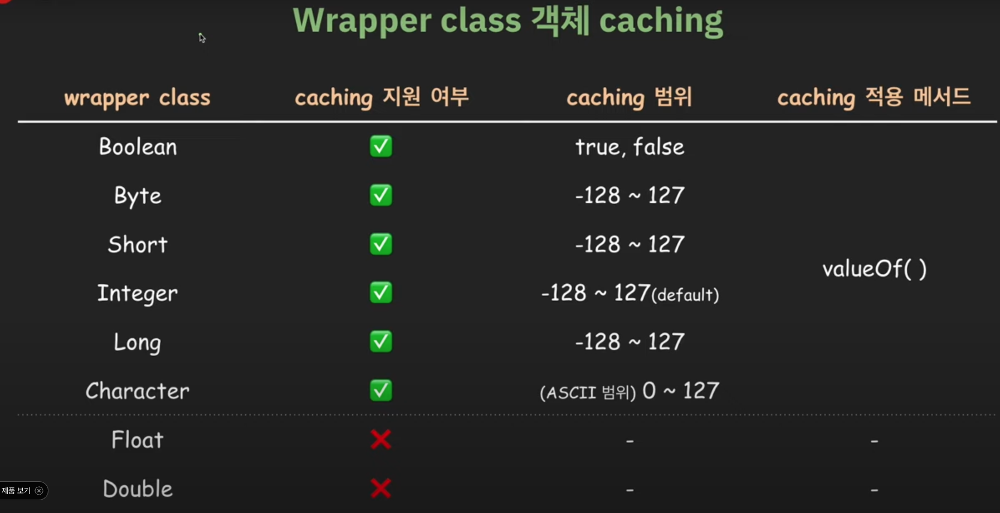

**valueOf 메서드만 캐싱 적용**

```java
Integer e = new Integer(127);
Integer f = new Integer(127);
System.out.println(e == f); // false: 캐싱 적용은 valueOf 메서드만 가능
```

**Integer caching 범위 튜닝하기**

```plain text
/**
 * Cache to support the object identity semantics of autoboxing for values between
 * -128 and 127 (inclusive) as required by JLS.
 *
 * The cache is initialized on first usage.  The size of the cache
 * may be controlled by the {@code -XX:AutoBoxCacheMax=<size>} option.
 * During VM initialization, java.lang.Integer.IntegerCache.high property
 * may be set and saved in the private system properties in the
 * jdk.internal.misc.VM class.
 *
 * WARNING: The cache is archived with CDS and reloaded from the shared
 * archive at runtime. The archived cache (Integer[]) and Integer objects
 * reside in the closed archive heap regions. Care should be taken when
 * changing the implementation and the cache array should not be assigned
 * with new Integer object(s) after initialization.
 */
 
 위 선택된 코드는 Integer 클래스의 내부 정적 클래스인 IntegerCache에 대한 설명입니다. 
 이 클래스는 자바 언어 명세(JLS)에 따라 -128에서 127 사이의 int 값을 
 자동 박싱(autoboxing)할 때 객체의 동일성을 보장하기 위해 사용됩니다. 
 즉, 이 범위의 값들은 동일한 객체를 재사용하여 메모리 사용을 최적화합니다.  
 
 캐시 초기화 및 사용
 IntegerCache는 처음 사용될 때 초기화됩니다. 
 캐시의 크기는 -XX:AutoBoxCacheMax=<size> 옵션을 통해 조정할 수 있습니다. 
 예를 들어, 이 옵션을 사용하면 캐시의 상한값을 변경할 수 있습니다. 
 초기화 과정에서 java.lang.Integer.IntegerCache.high 속성이 VM 초기화 중에 설정될 수 있으며, 
 이는 시스템 속성으로 저장됩니다.
```

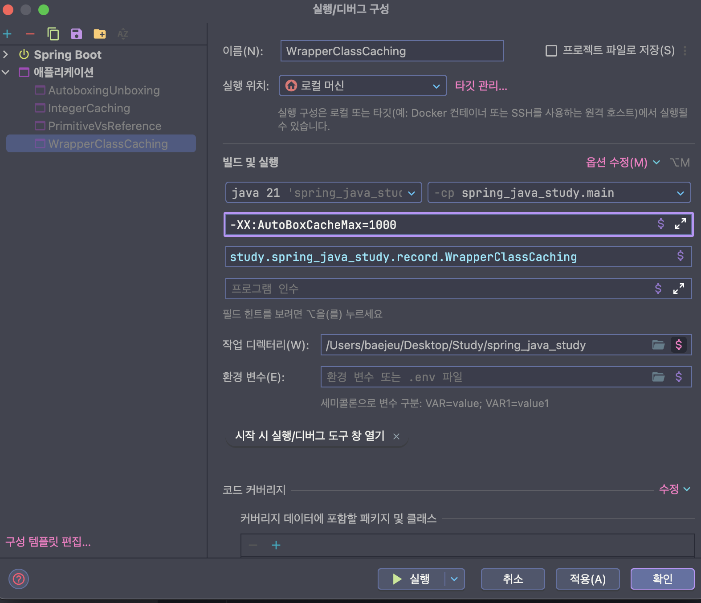

```java
Integer g = 1000;
Integer h = Integer.valueOf(1000);
System.out.println(g == h); // true: Integer 캐싱 범위 튜닝

Integer i = Integer.valueOf(1001);
Integer j = Integer.valueOf(1001);
System.out.println(i == j); // false: 캐싱 범위 밖의 값은 새로 생성됨
```

[https://www.youtube.com/watch?v=im17AoV0zOc&list=PLcXyemr8ZeoQRLFPZz3YKfudotIe-ZJFA&index=7](https://www.youtube.com/watch?v=im17AoV0zOc&list=PLcXyemr8ZeoQRLFPZz3YKfudotIe-ZJFA&index=7)

### AutoBoxing

자바 컴파일러가 primitive type 값을 자동으로 wrapper class object로 변환하는 기능

```java
Integer a = 199; // compiler -> Integer a = Integer.valueOf(199);
```

### **UnBoxing**

자바 컴파일러가 wrapper class object를 자동으로 해당하는 primitive type 값으로 변환하는 기능

```java
Integer a = 199; // compiler -> Integer a = Integer.valueOf(199);
int b = a;       // compiler -> int b = a.intValue();
```

### **AutoBoxing UnBoxing example** 

```java
public static void main(String[] args) {
		Integer a = 199; // compiler -> Integer a = Integer.valueOf(199);
		int b = a;       // compiler -> int b = a.intValue();
	
		List<Integer> ints  = new ArrayList<>();
		ints.add(123);  // compiler -> ints.add(Integer.valueOf(123));
		ints.add(b);    // compiler -> ints.add(Integer.valueOf(b));
		ints.add(a);	
}
```

```java
Integer a = 199; // compiler -> Integer a = Integer.valueOf(199);
int b = a;       // compiler -> int b = a.intValue();

a++; // a = a + 1; // compiler -> a = Integer.valueOf(a.intValue() + 1);
b++; // b = b + 1; // compiler -> b = b + 1;
```

Integer 더하기는 Integer 클래스는 래퍼 클래스이며 불변(immutable) 클래스이기 때문에 새로운 heap 객체를 생성한다. 또한 연산을 하기 위해서 메모리를 읽고 참조 타입 → 원시 타입 변환, 더하기, 새로운 heap 객체 생성, 기존에 참조하던 heap 객체에서 생성한 heap 객체 참조, 이전 heap 객체 GC 처리 등 원시 타입 더하기와 비교했을 때 상당히 많은 작업이 발생한다. 즉, 연산에서는 래퍼 클래스 보다는 원시 타입을 사용하는 게 더 성능상 좋다.

```java
// anti-pattern: using Integer in loop
Integer sum1 = 0;
for (int i = 0; i < 10; i++) {
	sum1 += i;
}

// better: use primitive int for performance
int sum2 = 0;
for (int i = 0; i < 10; i++) {
	sum2 += i;
}
```

### 비교 연산

```java
Integer c = a * a; // Integer c = Integer.valueOf(a.intValue() * a.intValue());
System.out.println(c); // 40000

System.out.println(b); // 200
// b is primitive int, c is Integer
System.out.println(c == b); // System.out.println(c.intValue() == b); // false
```

Integer == int → Integer.intValue() == int  

즉, 래퍼 클래스를 원시 타입으로 변환해서 비교한다.

```java
Integer x = 128;
Integer y = x;
System.out.println(x == y); // true, same reference
```

```java
Integer x = 128;
Integer y = x;
System.out.println(x == y); // true, same reference

x *= 1;
System.out.println(x == y); // false, x is now a new Integer object
```

[https://www.youtube.com/watch?v=iMeryQgAf-M&list=PLcXyemr8ZeoQRLFPZz3YKfudotIe-ZJFA&index=6](https://www.youtube.com/watch?v=iMeryQgAf-M&list=PLcXyemr8ZeoQRLFPZz3YKfudotIe-ZJFA&index=6)

**Wrapper Class** 

기본형 타입을 포장한 클래스, 즉 기본형 타입의 데이터를 객체로 쓸 수 있게 해주는 클래스

**제네릭**

클래스, 인터페이스, 메서드 등을 정의할 때 그 대상이 되는 타입을 파라미터처럼 선언해두고, 

실제 사용할 타입은 나중에 지정할 수 있도록 해주는 기능

**래퍼 클래스 사용 이유 3가지**

```java
public class WrapperClass {
	public static void main(String[] args) {
		int a = 1;
		Integer b = 1;

		// 1. generic must use reference type
		List<Integer> list = List.of(1, 2, 3, 4, 5);

		// 2. primitives cannot be null
		// a = null; compiler error

		// 3. wrapper class can use util methods
		Integer.parseInt("123");
	}
}
```

  - 제네릭은 참조 타입만 가능하다.
  - 원시 타입은 null 사용 불가능
  - 래퍼 클래스는 유틸성 메서드를 제공한다. 

**정리**

원시 타입이 당연히 성능은 더 좋다. use stack only 

참조 타입은 스택에 heap 객체 주소를 저장하고 실제 데이터는 heap에 저장, 결국 heap 메모리에 한번 더 접근해야함 메모리 차지도 더 많고 메모리 접근 횟수도 많아짐

원시 타입 사용이 기능하면 원시 타입을 사용하고 아니라면 참조 타입(래퍼 클래스)을 사용하자

[https://www.youtube.com/watch?v=9IZ42_YBQJ0&list=PLcXyemr8ZeoQRLFPZz3YKfudotIe-ZJFA&index=5](https://www.youtube.com/watch?v=9IZ42_YBQJ0&list=PLcXyemr8ZeoQRLFPZz3YKfudotIe-ZJFA&index=5)

### 시스템의 성능에 대한 이해, 성능은 어디에서 오는가? 

**트랜지스터?** 

컴퓨터와 전자기기의 핵심 부품으로, 주로 두 가지 역할을 한다. 신호의 증폭과 스위치(on/off) 역할을 한다.

  - 증폭 기능: 입력 전기 신호를 더 크게 만들어주는 역할 예를 들어, 소리의 크기를 키우는 오디오 장치 등에 사용
  - 스위치 기능: 전기의 흐름을 조절하여 0과 1 신호를 만든다. 컴퓨터에서는 수많은 트랜지스터가 논리 회로(게이트)로 연결되어 연산과 데이터 처리를 가능하게 한다.

**수백만 개의 트랜지스터가 집적된 칩의 성능 향상**

더 많은 트랜지스터를 사용하면 병렬 처리, 고속 연산, 다양한 기능을 동시에 수행할 수 있어 데이터 처리 속도가 크게 빨라진다.

**무어의 법칙과(Moore’s law)과 컴퓨터 구조 (Computer Architecture)**

무어의 법칙은 인텔의 창업자 중 한명인 고든 무어가 명명한 것으로, 경제적으로 생산 가능한 칩 위의 트랜지스터 수의 대략 2년마다 거의 2배로 증가함을 뜻한다.

**무어의 법칙이 성능이 아닌 트랜지스터 수를 기준으로 한다는 것은, 소프트웨어 엔지니어가 하드웨어 엔지니어로부터 얻어 낼 수 있는 성능이 2배가 아님을 의미**한다.

성능에는 여러 가지 복합적인 요소가 적용한다. 많은 요소중에서 **성능에 결정적인 요인 하나를 뽑으라면 “다음에 실행할 명령과 관련된 데이터를 얼마나 빠르게 찾을 수 있는가?”**이다.

명령어 실행 주기는 Fetch → Memory Access(필요하다면) → Execute 과정이 반복이다. CPU가 처리할 명령어를 기다리며 대기하는 시간(지연, latency)이 길면 아무리 트랜지스터가 많아도 전체 속도는 빨라지지 않는다.

사용자가 프로그램을 실행하면, 운영체제가 메모리에 처리할 명령어들과 다음에 실행할 명령어의 주소(프로그램 카운터, PC) 등을 올려둔다. 그러면 CPU가 PC에 해당하는 명령어를 캐시 또는 메모리에서 인출하는데 필요한 명령어가 어디에 위치하는가는 당연히 성능을 결정짓는 요인 중 하나이다.

**캐시 계층 구조(Cache Hierarchy)**

Level 0에 가까울수록 조회 속도는 빠른 반면, 저장 공간이 적다.

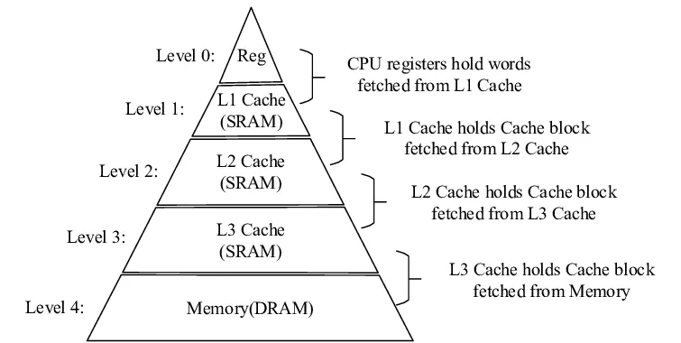

CPU는 명령어를 찾기 위해 CPU 내의 임시 저장 공간인(Register)에서부터 시작하여 없으면 다음 저장 공간에서 데이터 조회를 시도한다. 레지스터 이후에 데이터를 조회하는 공간은 코어 내부의 캐시에 해당하는데, L1/L2/L3 캐시라고 볼 수 있다.

  - L1캐시: 가장 빠르고 작은 캐시, 각 CPU 코어에 존재한다.
  - L2캐시: L1 캐시보다 크고 약간 느리며 각 CPU 코어에 존재한다.
  - L3캐시: 가장 크고 느린 캐시로, CPU의 모든 코어가 공유한다. 

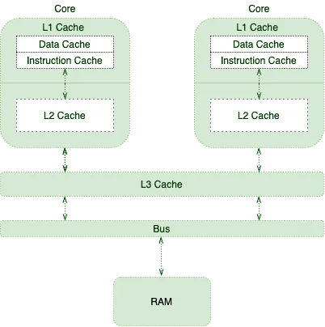

Register -> L1 → L2 → L3 → Memory

캐시에서 까지 데이터를 조회할 수 없다면 메모리(RAM)에서 데이터를 가져와야 하는데, 캐시에서 가져오는 속도와 다르게 메모리에서 데이터를 가져오는 속도는 많이 느리다. 메모리에서 가져오는 속도가 느린 이유는 애초에 가상 주소 → 물리 주소로 변환하는 작업이 추가적으로 필요하다. 물론 이 과정도 TLB라는 캐시가 존재한다. TLB Miss가 발생하면 커널 영역의 프로세스 페이지 테이블 엔트리로 접근하여 유저 영역의 페이지 주소를 찾아야 한다.

이 과정은 추가적인 메모리 접근(페이지 테이블 조회)이 필요하므로 더 느려진다.

그리고 메모리에 접근하고 조회 한다. 최악의 경우 메모리 주소가 담긴 페이지 테이블 엔트리가 디스크 영역으로 스왑 아웃 상태이거나 메모리 자체가 스왑 아웃인 경우 I/O 작업이 동반되기 때문에 더욱 느리다.

정리하면 메모리의 접근 속도의 개선은 트랜지스터 추가보다 더 느리게 개선됐다. 즉, 코어의 성능 처리 능력은 빠르지만 필요한 데이터를 처리할 수 없어서 작업이 중단되어 성능 저하가 오게되는 것이다.

**캐싱 여부에 따른 성능 차이 (L1 캐시 미스)**

int → 4byte 

아래의 예제는 8MB 배열에 대해 루프를 반복하는 데 걸리는 시간을 출력한다.

두 루프 중 “touchEveryItem”는 배열의 모든 데이터에 직접 접근하여 데이터를 조회한다.

반면에 “touchEveryLine”는 16개 항목마다 1개씩만 데이터에 접근한다.

```java
public class Caching {
	private final int SIZE = 2 * 1024 * 1024;
	private final int [] testData  = new int [SIZE];
	private void touchEveryItem(){
		for (int i = 0; i < SIZE; i++) {
			testData[i] = testData[i] + 1; // 모든 항목을 엑세스
		}
	}
	private void touchEveryLine(){
		for (int i = 0; i < SIZE; i += 16) {
			testData[i] = testData[i] + 1; // 각 캐시 라인을 엑세스
		}
	}
	private void run () {
		for (int i = 0; i < 100; i++) {
			long t0 = System.nanoTime();
			touchEveryLine();
			long t1 = System.nanoTime();
			touchEveryItem();
			long t2 = System.nanoTime();
			System.out.println("Line: " + (t1 - t0) + "ns Item: " + (t2 - t1) + "ns");
		}
	}
	public static void main(String[] args) {
		new Caching().run();
	}
}
```

**결과** 

“touvhEveryItem”은 배열 내의 모든 원소를 증가시키므로 “touchEveryLine” 보다 16배 더 많은 증가 작업을 수행하지만, 실행 결과를 확인해보면 둘 사이에 작업량 만큼의 큰 차이는 존재하지 않음을 확인할 수 있다

```java
Line: 1110166ns Item: 4236959ns
Line: 247500ns  Item: 3452958ns
Line: 149416ns  Item: 214542ns
Line: 123291ns  Item: 209667ns
Line: 125375ns  Item: 247292ns
Line: 128625ns  Item: 221208ns
Line: 122416ns  Item: 206292ns
Line: 122792ns  Item: 178708ns
Line: 130833ns  Item: 186542ns
Line: 133875ns  Item: 176542ns
Line: 127833ns  Item: 174667ns
Line: 128000ns  Item: 228958ns
Line: 139875ns  Item: 171583ns
Line: 126875ns  Item: 172375ns
Line: 122125ns  Item: 169208ns
Line: 121584ns  Item: 166875ns
Line: 122500ns  Item: 166375ns
Line: 124500ns  Item: 167291ns
Line: 121209ns  Item: 166166ns
Line: 121000ns  Item: 165958ns
```

성능적으로 차이가 크게 나지 않는 이유는 전반적인 성능에서 주요한 역할을 하는 것은 데이터의 조회이고, 둘은 동일한 수의 캐시 라인 읽기를 수행하기 때문이다. L1 캐시 라인은 일반적으로 64바이트에 해당하며, 자바에서 int 4바이트이므로 L1 캐시 라인 하나에는 16개의 int가 포함될 수 있다. 따라서 한 번에 16개의 데이터를 조회하여 L1 캐시에 데이터가 적재되고, 이후에 연산들은 캐시를 통해 처리하기 때문에 성능적으로 기대보다 큰 차이는 존재하지 않는 것이다. 따라서 CPU가 실제로 시간을 어떻게 소비하는지, 적어도 작동 수준에 대한 이해가 필요하다는 것을 알고 있어야 한다.

---

### 메모리 가시성 문제 (Memory Visibility Problem)

현재 우리의 컴퓨터는 성능을 위해 캐시를 적극적으로 활용하고 있는데, 문제는 현대의 컴퓨터 구조는 1개의 코어(Single Core)가 아닌 2개 이상의 다중 코어(Multi Core)이다.

먼저 마주할 수 있는 문제는 메모리 가시성(Memory Visibility)문제이다. 한 코어의 스레드에서 변경한 특정 메모리의 값이, 다른 코어의 스레드에서 제대로 읽혀지지 않는 문제라고 볼 수 있다. 멀티스레드 환경에서 스레드들은 각자의 캐시(L1, L2 캐시)를 가지는 코어에 할당되어 병렬 실행될 수 있는데, 스레드들이 하나의 변수를 공유하면 각각의 코어가 개별 캐시를 소유하게 되고, 이로 인해 한 코어의 스레드에서 변경한 값이 다른 코어 스레드의 값과 불일치(Cache inconsistency)하는 것이다.

```java
public class TaskRunner {
	private static int number;
	private static boolean ready;

	private static class Reader extends Thread {
		@Override
		public void run() {
			while (!ready) {
				Thread.yield();
			}
			System.out.println(number);
		}
	}

	public static void main(String[] args) {
		new Reader().start();
		number = 42;
		ready = true;
	}
}
```

해당 출력의 결과는 예측할 수 없어야 한다. 또는 무한 루프에 빠질 수도 있다. 왜냐하면 메인 쓰레드가 실행되는 코어에서 number → 42, ready → true로 변경한다고 하더라도, Reader 쓰레드를 실행시킨 2번 코어에서 캐싱된 데이터로 인해 변경 전의 데이터인 0과 false를 만날 수 있기 때문이다.

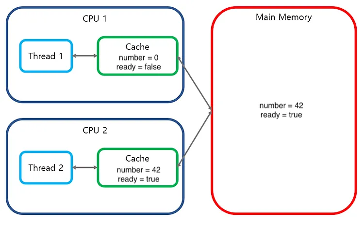

하지만 내가 실험하면 항상 42로 빠르게 나온다. 추측이지만 메인 쓰레드와 Reader 쓰레드가 동일한 코어에서 돌아가지 않을까 싶다. 

---

### Volatile 키워드

메모리 가시성 문제를 해결하는 데 도움을 주는 키워드가 바로 volatile이다. volatile은 모든 스레드가 항상 메인 메모리로부터 최신의 값을 읽도록 하여 volatile로 선언된 변수의 값이 바뀌어도 다른 스레드에서 항상 최신 값을 읽어갈 수 있도록 해준다.

volatile 키워드를 지정하면, 프로세서의 레지스터에 캐시되지도 않고, 프로세서 외부의 캐시에도 들어가지 않기 때문에 volatile 변수의 값을 읽으면 항상 다른 스레드가 보관해둔 최신의 값을 읽어갈 수 있다.

따라서 volatile을 올바르게 사용하는 것은 미묘한 버그를 방지하는데 필수적이라고 볼 수 있다.

하지만 이는 성능적인 이점을 포기하는 부분이 있으므로, 올바르게 인지하고 사용하는 것이 필요하다.

---

### 참고 자료

[https://mangkyu.tistory.com/415](https://mangkyu.tistory.com/415)

자바는 객체의 참조를 복사하여 전달한다. 따라서 부모 스레드와 자식 스레드가 갖는 객체의 참조는 복사되어 존재하지만, 동일한 힙 영역의 객체를 가리키고 있으므로 자식 스레드에서 값을 변경하는 것이 부모에게도 영향을 줄 수 있으므로 주의가 필요하다.

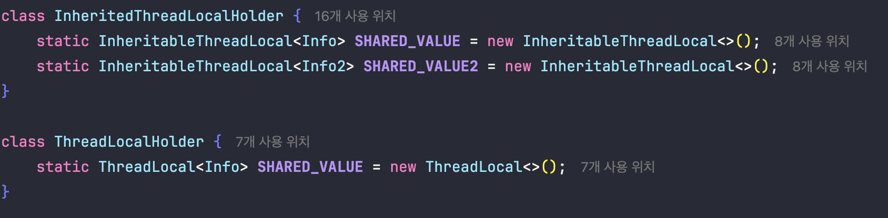

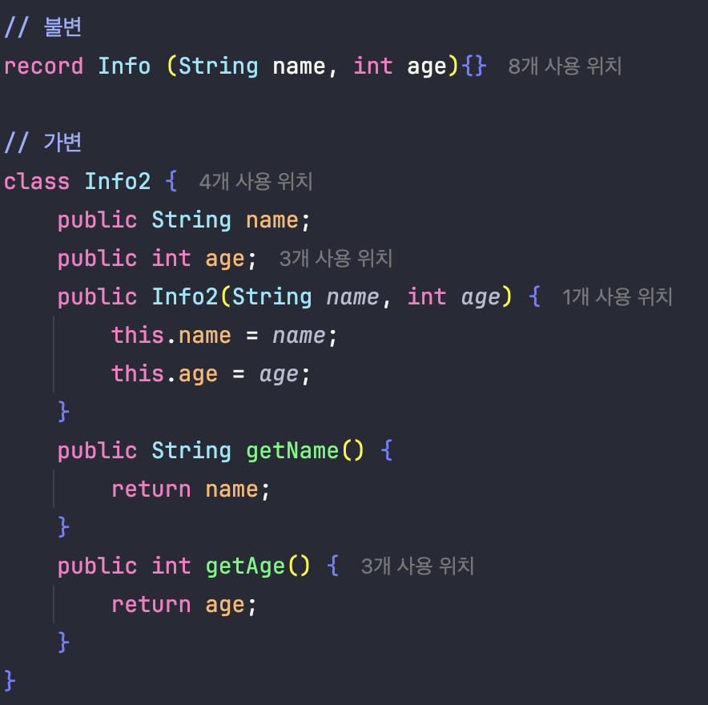

**테스트1**

  - ThreadLocal 
  - Info 사용, 부모 스레드의 값 전달 X

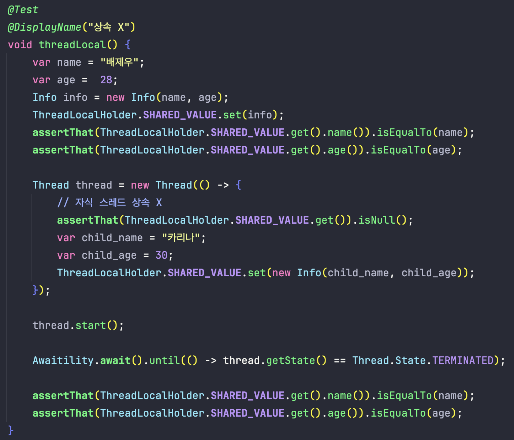

**테스트2**

  - InheritedThreadLocal
  - Info 사용, 자식 스레드에서 new Info() set

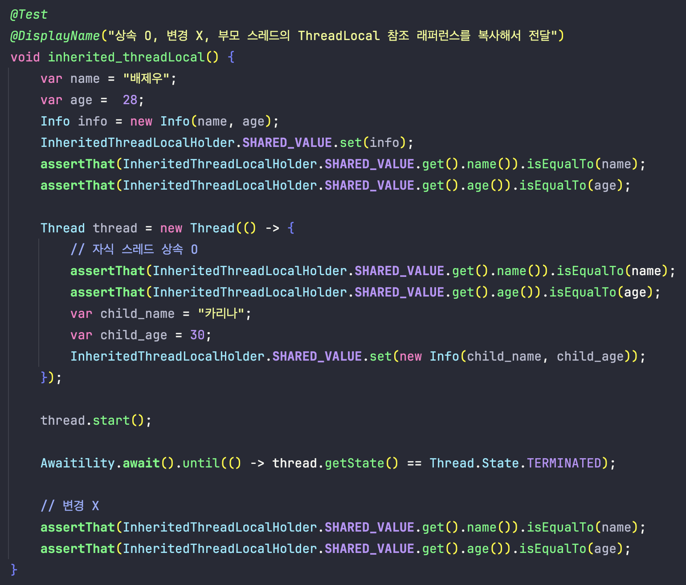

**테스트3**

  - InheritedThreadLocal
  - Info2 사용, 자식 스레드에서 Info2 값 변경

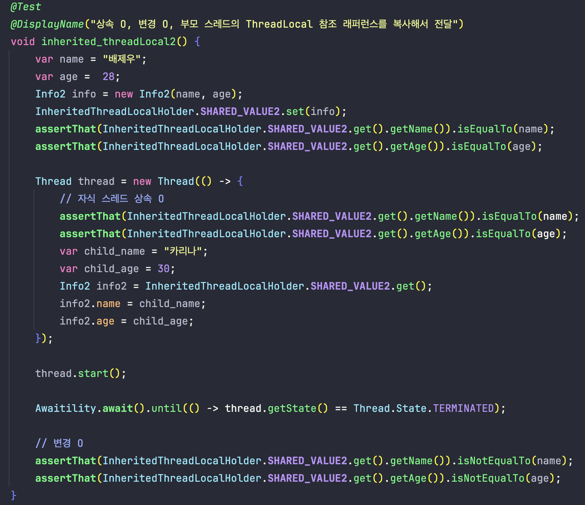

---

### 참고 자료

[https://mangkyu.tistory.com/333](https://mangkyu.tistory.com/333)

---

### 참고 자료 

[https://mangkyu.tistory.com/325](https://mangkyu.tistory.com/325)

### 인터페이스와 추상 클래스의 특징

인터페이스는 상호 작용 방식을 명세해둔 것이다.

인터페이스의 호출자는 인터페이스의 구현에 대한 지식 없이도 기능을 수행할 수 있어야 한다.

예를 들어 운전자는 자동차가 어떻게 움직이는지 세부 구현을 모르지만, 엑셀을 밟으면 앞으로 가고 브레이크를 밟으면 멈춘다는 약속을 통해 자동차를 운전할 수 있다. 따라서 인터페이스는 일종의 계약(contract)이라고 불린다.

추상 클래스는 인터페이스와 유사하다. 인터페이스와 마찬가지로 인스턴스화 할 수 없으며, 구현을 포함하거나 포함하지 않은 메서드 모두를 가질 수 있다.

하지만 인터페이스와 비교되는 특징 중 하나는 필드, 메서드에 자유롭게 접근제어자 설정이 가능하다는 점이다. 반면에 인터페이스는 모든 메서드가 public 이며, 모든 필드가 public static final(상수)으로 처리된다. 

또한 클래스는 하나의 클래스만 상속이 가능하지만 인터페이스는 다중 상속이 가능하다.

표로 요약하면 아래와 같다.

| **구분** | **인터페이스** | **추상 클래스** |
| --- | --- | --- |
| 인스턴스화 | 불가 | 불가 |
| 상속 | 다중 상속 가능 | 단일 상속만 가능 |
| 필드 | public static final(상수)만 가능 | 모든 접근제어자, 일반 변수 가능 |
| 메서드 | public abstract(기본), default, static | 추상 메서드 + 일반 메서드 |
| 생성자 | 없음 | 있음 |
| 목적 | 동작 규약(계약, contract) 명세 | 공통 기능 추상화, 확장 |

---

### 추상 클래스와 인터페이스의 의미

추상 클래스는 코드의 재사용을 위해 사용된다. 하위 클래스는 추상 클래스를 상속받아 추상 클래스의 속성가 메서드를 사용할 수 있으므로 동일한 코드를 재작성하지 않아도 된다. 이는 일반 클래스를 통해서도 가능하지만 추상 클래스를 사용하면 추상 메서드의 구현을 컴파일 시점에 확인할 수 있고, 구현 명세서 역할을 하는 추상 클래스의 객체 생성을 막을 수 있다는 점에서 유용하다.

이러한 역할은 인터페이스와 비슷해 보이지만 필요한 이유는 다르다. 추상 클래스가 코드 재사용에 초점을 맞춘다면, 인터페이스는 디커플링에 초점을 맞추고 있다. 인터페이스는 프로토콜 또는 계약을 추상화한 것이므로, 호출자는 인터페이스에만 주의를 기울이고 구현 방식 자체에 대해서는 알 필요가 없다 즉, 캡슐화 효과가 나타난다. 인터페이스를 통해 구현을 분리하면 코드의 결합도를 줄이고 확장성을 높일 수 있다.

그렇다면 모든 클래스를 인터페이스를 통해 추상화에 기반한 프로그래밍을 해야할까? 이런 추상화에는 언제나 비용이 따라온다. 설계의 비용, 관리의 비용 등등…

예를 들어 서비스 계층 처럼 구현이 하나 뿐이고 다른 구현으로 대체할 일이 없다면 굳이 정의할 필요가 없다. 모든 것에 인터페이스를 먼저 만든다면 개발에 부담이 되며 오히려 코드 추적을 어렵게 만드는 등의 단점이 있다.

---

### 언제 추상 클래스 또는 인터페이스를 사용할까?

추상 클래스는 상속을 사용하므로 is-a 관계인데 반해, 인터페이스는 특정 기능이 있음을 나타내는 has-a 관계이다. 따라서 판단하는 기준은 is-a 관계를 나타내며 코드 재사용 문제를 해결하려면 추상 클래스를 사용하고, has-a 관계를 나타내며 코드 재사용이 아닌 추상화 문제를 해결하려면 인터페이스를 사용하면 된다.

---

### 참고 자료

[https://mangkyu.tistory.com/321](https://mangkyu.tistory.com/321)

### 전통적인 스레드 모델

10개의 스레드 → 10개의 DB 조회: 블로킹 작업(캐시 X) → 전부 BLOCKED

이때 사용자 요청 100개 다른작업 → 톰캣 요청 큐에서 대기 사용 가능한 스레드 X 

최악의 경우 사용자 요청 유실(큐 크기 부족)

### 가상 스레드

가상 스레드 → 10개의 DB 조회: 블로킹 작업(캐시 X) → BLOCKED 실제 OS 스레드는 전통적인 스레드 모델과 다르게 다른 가상 스레드의 작업을 처리하러 이동하고 기존 가상 스레드는 JVM에 반환(unmount)

이때 사용자 요청 100개 다른 작업 → 가상 스레드 넘쳐남 처리 가능

즉, I/O Bound 잘 처리가 가능함

### 그럼 언제나 동기적 코드로 모든 코드를 처리할 수 있느냐?

아니다. 

가상 스레드는 I/O Bound 작업에서 동시 처리량을 극대화해주지만(I/O 작업에서 OS 스레드를 점유 X)

사용자에게 빠른 응답이 필요한 경우에는 별도의 비동기 코드를 사용해야 한다.

예를 들어 OTP 발급 같은 경우 사용자가 이메일을 서버에 전송 서버는 OTP를 발급하고 레디스 또는 데이터베이스에 저장하고 해당 이메일에 OTP를 전송할 때
전송 완료 응답을 서버가 받을 때 까지 기다렸다가 사용자에게 응답을 반환하면 사용자는 2~3초의 지연을 겪게 된다. 하지만 메일 전송 완료 응답을 기다릴 필요 없이 전송되었다는 응답을 빠르게 하려면 결국 비동기적 코드가 들어가야한다.

즉, 가상 스레드는 동기 코드로도 대량의 I/O 작업을 효율적으로 처리할 수 있게 해주지만, 사용자에게 빠른 응답이 필요한 경우에는 별도의 비동기 코드가 반드시 필요하다.

즉, 결과와 무관하게 즉시 응답이 필요한 서비스에서는 가상 스레드의 도입 여부와 상관없이 비동기적 아키텍처가 필수이다.

---

### 참고 자료

[https://mangkyu.tistory.com/309](https://mangkyu.tistory.com/309)

---

### 참고 자료

[https://mangkyu.tistory.com/308](https://mangkyu.tistory.com/308)

---

### 참고 자료

[https://mangkyu.tistory.com/280](https://mangkyu.tistory.com/280)

```java
@Test
void compareInteger(){
	Integer num1 = 128;
	assertThat(num1 == Integer.valueOf(128)).isFalse();

	Integer num2 = 127;
	assertThat(num2 == Integer.valueOf(127)).isTrue();
	
	assertThat(Integer.valueOf(127) == Integer.valueOf(127)).isTrue();
}
```

```java
@HotSpotIntrinsicCandidate
public static Integer valueOf(int i) {
    if (i >= IntegerCache.low && i <= IntegerCache.high)
        return IntegerCache.cache[i + (-IntegerCache.low)];
    return new Integer(i);
}
```

IntegerCache.low는 -128이고 IntegerCache.high는 127이다. 즉, Integer는 내부에서 -128 ~ 127까지의 Integer 객체를 미리 캐싱해두고, 해당 범위의 값을 요청하면 캐싱된 값을 반환하는 것이다.

```java
public static void main(String[] args) {
		Integer a = 127;
		Integer b = 127;
		Integer c = 128;
		Integer d = 128;
		// true, because both are within the cached range (-128 to 127)
		System.out.println(a == b);
		// false, because both are outside the cached range and new Integer objects are created
		System.out.println(c == d);
}
```

---

### 참고 자료

[https://mangkyu.tistory.com/273](https://mangkyu.tistory.com/273)

```java
public class TemplateMethod {
	public static void main(String[] args) {
		Abstract anonymousObject = new Abstract() {
			@Override
			protected void call(String name) {
				System.out.println(name);
			}
		};
		anonymousObject.execute("배제우"); // execute start -> "배제우" -> execute call

		/**
		 * 패키지.TemplateMethod$1@6d06d69c
		 * $: 해당 anonymous(익명) 객체는 TemplateMethod 클래스의 inner 클래스로 생성된다.
		 * 1: 익명 객체 생성된 순서대로 숫자가 붙여진다. 
		 */
		System.out.println(anonymousObject);

		Abstract anonymousObject2 = new Abstract() {
			@Override
			protected void call(String name) {
				System.out.println(name);
			}
		};

		/**
		 * 패키지.TemplateMethod$2@4e25154f
		 * $2
		 */
		System.out.println(anonymousObject2);

	}
}

abstract class Abstract {
	// 템플릿 메서드 패턴
	public void execute(final String name){
		System.out.println("execute start");
		call(name);
		System.out.println("execute end");
	}

	protected abstract void call (final String name);
}
```

---

### 참고 자료 

[https://mangkyu.tistory.com/227](https://mangkyu.tistory.com/227)

### 코드 소개 

아래 코드는 PREDEFINED_NAME에 포함된 이름(name)이면 그대로 리턴하고, 아니라면 UUID를 생성하여 반환한다.

```java
@Service
public class PrivateMethodSelfInvocationService {
	private final static List<String> PREDEFINED_NAME = List.of("배제우", "호박", "고구마");

	public String getName(final String name){
		if(isPredefined(name)) return name;
		return UUID.randomUUID().toString();
	}

	private boolean isPredefined(final String name){
		return PREDEFINED_NAME.stream().anyMatch(name::equals);
	}
}
```

isPredefined 메서드를 테스트하고자 하는데, 해당 코드의 접근 제어지가 “private”이라 일반적인 방법으로는 테스트가 불가능하다.

---

### Private 메서드를 테스트하는 방법1

아래 테스트는 Java에서 제공하는 리플렉션 API를 이용한다.

자바의 리플렉션은 런타임에 동작하는 기술이며, 클래스와 클래스 메서드, 클래스 필드 같은 메타정보를 위한 Class, Method 등을 정의해두었다.

리플렉션을 이용하면 정적으로 고정된 메서드의 코드를 메타정보로 추상화된 Method를 얻어낼 수 있으며 직접 호출 또한 가능하다.

```java
@ExtendWith(MockitoExtension.class)
class PrivateMethodSelfInvocationServiceTest {

	@InjectMocks
	private PrivateMethodSelfInvocationService service;
	private static final String METHOD_NAME = "isPredefined";

	@Test
	void withReflection() throws NoSuchMethodException, InvocationTargetException, IllegalAccessException {
		// given
		String name = "배제우";
		Method method = service.getClass().getDeclaredMethod(METHOD_NAME, String.class);     
		method.setAccessible(true);                             

		// when
		boolean result = (boolean)method.invoke(service, name);

		// then
		assertThat(result).isTrue();
	}
```

private 메서드는 기본적으로 접근 가능 여부가 false 이므로 이를 true로 변경한다.

그리고 직접 메서드를 호출(invoke)하면 테스트가 성공한다.

---

### Private 메서드를 테스트하는 방법2

스프링 프레임워크는 내부적으로 리플렉션을 상당히 많이 활용하고 있다.

그래서 테스트를 위해 직접 자바의 리플렉션 API를 사용하는 것 보다는 효율적으로 사용하기 위한 유틸성 클래스인 **ReflectionTestUtils**를 제공한다.

```java
@ExtendWith(MockitoExtension.class)
class PrivateMethodSelfInvocationServiceTest {

	@InjectMocks
	private PrivateMethodSelfInvocationService service;
	private static final String METHOD_NAME = "isPredefined";

	@Test
	void withReflectionTestUtils(){
		// given
		String notPredefinedName = "카리나";

		// when
		boolean result = ReflectionTestUtils.invokeMethod(service, METHOD_NAME, notPredefinedName);

		assertThat(result).isFalse();
	}
```

---

### Private 메서드 테스트를 리플렉션으로 하는 방식을 지양해야 하는 이유

리플렉션은 런타임에 동작하는 기술로, 클래스와 클래스 메서드, 클래스 필드 같은 메타정보를 사용해서 애플리케이션을 유연하게 만들 수 있다. 그래서 리플렉션을 사용하면 private 메서드를 invoke 할 수 있다.

하지만 이렇게 리플렉션을 활용하여 작성한 private 메서드 사용은 깨지기 위한 테스트가 된다.

private 메서드의 사용 이유를 다시 생각해 보자. private 메서드는 객체 내부 구현을 감추가 위해 즉, 캡슐화하기 위하여 존재한다. 이는 클라이언트와의 결합도를 낮춰준다. 테스트 코드쪽도 마찬가지로 클라이언트라고 볼 수 있다. 클라이언트가 리플렉션을 통해 클래스의 내부 메서드를 알고 있으니 결국 결합도가 높아진다.

즉, 메서드의 이름이나 파라미터 등을 변경할 때 실패하게 된다. 더 큰 문제점은 리플렉션은 컴파일 에러를 유발하지 않는다. 

private 메서드를 직접 테스트해야 한다면, 클래스의 책임 분리나 설계 자체를 다시 고민해볼 필요가 있다.

아래와 같이 private 메서드는 public 메서드를 통해 간접적으로 테스트되도록 설계하는 것이 바람직하다.

---

### private 메서드 간접적으로 테스트하기 

```java
@ExtendWith(MockitoExtension.class)
class PrivateMethodSelfInvocationServiceTest {

	@InjectMocks
	private PrivateMethodSelfInvocationService service;
	private static final String METHOD_NAME = "isPredefined";

	@ParameterizedTest
	@ValueSource(strings = {"배제우", "호박", "고구마"})
	@DisplayName("isPredefined true")
	void noReflection1(String name){
		String result = service.getName(name);
		assertThat(result).isEqualTo(name);
	}

	@ParameterizedTest
	@ValueSource(strings = {"카리나", "윈터", "지젤", "닝닝"})
	@DisplayName("isPredefined false")
	void noReflection2(String name){
		String result = service.getName(name);
		assertThat(result).isNotEqualTo(name);
	}

```

---

### 참고 자료

[https://mangkyu.tistory.com/235](https://mangkyu.tistory.com/235)

### 리스코프 치환 원칙(LSP)과 메서드 접근 범위 제한

리스코프 치환 원칙은 하위 클래스가 상위 클래스를 완전히 대체할 수 있어야 한다는 객체지향 설계 원칙이다.

이 원칙에 따라 하위 클래스는 상위 클래스의 메서드 접근 제어자를 더 좁은 범위로 변경할 수 없다.

**더 작은 범위는 불가능**

```java
class Parent {
    public void doSomething() {    // public 접근 제어
        System.out.println("Parent 작업");
    }
}

class Child extends Parent {
    @Override
    protected void doSomething() { // protected로 축소 → 컴파일 에러
        System.out.println("Child 작업");
    }
}

```

**같거나 더 넓은 범위는 가능**

```java
class Parent {
    protected void doSomething() { // protected 접근 제어
        System.out.println("Parent 작업");
    }
}

class Child extends Parent {
    @Override
    public void doSomething() {  // public으로 확대 → 허용됨
        System.out.println("Child 작업");
    }
}

```

**요약** 

Parent: public doSomething

Child: protected doSomething(method overriding)

Parent obj = new Parent(); → obj.doSomething(); 항상 동작 가능

Parent obj = new Child(); → obj.doSomething(); 패키지 외부나 상속 관계가 아닌곳에서는 동작 불가능

즉, 부모 타입으로 자식 객체를 대체했을 때 부모가 제공하던 인터페이스를 자식이 보장하지 못한다.

이런 상황은 리스코프 치환 원칙(LSP) 위반이다.

LSP는 **상위 타입의 객체를 하위 타입의 객체로 대체해도 프로그램이 정상적으로 동작해야 한다**고 정의한다.

---

### **결론**

리스코프 치환 원칙은 하위 클래스가 상위 클래스의 역할을 완전히 대체할 수 있도록 강제한다. 

접근 제어자 축소는 이 원칙을 위반하며, 자바 컴파일러가 이를 에러로 처리하는 이유도 여기에 있다.

---

### 참고 자료

[https://mangkyu.tistory.com/228](https://mangkyu.tistory.com/228)

### 참고 자료 

[https://mangkyu.tistory.com/164](https://mangkyu.tistory.com/164)

---

### **DTO(Data Transfer Object)**

계층 간(예: Controller ↔ Service, Service ↔ Repository) 데이터를 전달하기 위한 객체이다.

  - **특징**
- 주로 getter/setter만 있고, 별도의 비즈니스 로직이 없다.
    - 데이터의 전달과 변경에 초점을 둡니다.
    - 가변적일 수도 있고, 필요에 따라 불변으로 만들 수도 있다.
  - **언제 사용하나?**
- 여러 계층 간에 명확하게 정해진 구조의 데이터를 주고받을 때
    - API 요청/응답, 서비스 간 데이터 교환 등
    - 예시: 사용자 등록 요청/응답, 상품 정보 전달 등

---

### **VO(Value Object)**

특정 "값" 자체를 표현하는 객체이다.

  - **특징**
- **불변성**이 가장 중요한 특징. 한 번 생성되면 값이 바뀌지 않는다. (final 권장)
    - 모든 필드 값이 같으면 동일한 객체로 취급한다(즉, equals와 hashCode를 재정의)
    - setter가 없고, 생성자를 통해 값이 고정된다.
  - **언제 사용하나?**
- 두 객체의 값이 같으면 같은 것으로 취급해야 할 때(예: Money, Address, Email 등)
    - 비즈니스 로직에서 값 자체의 동등성, 불변성이 중요한 경우

---

### **Map<K, V>**

  - 키-값 쌍으로 데이터를 임시로 저장하거나, 구조가 동적으로 바뀌는 데이터를 다룰 때 사용한다.
  - 예를 들어, 필드가 정해져 있지 않거나, 동적으로 속성이 추가/삭제되는 경우
  - **언제 사용하나?**
- 데이터 구조가 고정되어 있지 않고, 런타임에 동적으로 키와 값을 다뤄야 할 때
    - 임시 데이터 저장, 설정값 등
    - 단, 타입 안정성(type safety)이 떨어지고, IDE 자동완성/컴파일러 체크 등에서 불리하다.

---

### **언제 DTO, VO, Map을 써야 할까?**

| **상황** | **DTO 사용** | **VO 사용** | **Map 사용** |
| --- | --- | --- | --- |
| 계층 간 명확한 데이터 전달 | O |  |  |
| 값 자체의 불변성과 동등성이 중요할 때 |  | O |  |
| 데이터 구조가 동적으로 바뀔 때 |  |  | O |
| 타입 안정성과 명확한 구조가 필요할 때 | O | O |  |
| 임시 데이터, 설정 등 구조가 유동적일 때 |  |  | O |

---

### **정리**

  - **DTO**: 계층 간 데이터 전달용, getter/setter 중심, 구조가 명확할 때
  - **VO**: 값 그 자체를 표현, 불변성, 값이 같으면 동일 객체로 취급
  - **Map**: 동적으로 키-값을 다뤄야 할 때, 임시적·유동적 데이터

API, 서비스, DB 등 계층 간 데이터 전달에는 DTO

값의 동등성과 불변성이 중요한 비즈니스 값에는 VO

구조가 유동적이거나 임시 데이터에는 Map을 사용하는 것이 일반적이다.

---

### 서론 

객체를 생성하기 위해서는 생성자 패턴, 정적 메서드 패턴, 수정자 패턴, 빌더 패턴 등을 사용할 수 있다.

왜 빌더 패턴이 좋은지, 언제 사용하면 좋은지를 알아보자.

---

### 빌더 패턴(Builder Pattern)의 장점

  1. 필요한 데이터만 설정할 수 있다.
  1. 유연성을 확보할 수 있다.
  1. 가독성을 높일 수 있다.
  1. 변경 가능성을 최소화할 수 있다.

**필요한 데이터만 설정할 수 있다.**

아래와 같이 테스트 용도로 User 객체를 생성해야 하는데 나이(age) 파라미터가 필요 없는 상황이라고 가정하자.

생성자나 정적 팩토리 메서드를 사용하는 경우라면 우리는 더미 값을 넣어주거나 age 파라미터가 없는 생성자 또는 팩토리 메서드를 만들어주어야 한다.

```java
@AllArgsConstructor
class User {
	private String name;
	private int age;
	private int height;
	private int iq;
}

User test = new User("test", 0, 180, 150);
```

이러한 작업이 한 두번이라면 번거로워도 작업을 해줄 수 있다. 하지만 요구사항이 계속 변하게 되어있고, 반복적인 변경을 필요로 하면서 시간 낭비로 이어지게 된다. 빌더를 이용하면 동적으로 이를 처리할 수 있다.

```java
User test = User.builder()
			.name("test")
			.height(180)
			.iq(150)
			.build();
```

이렇게 필요한 데이터만 설정할 수 있는 빌더의 장점은 생성자 또는 정적 메서드와 비교하여 테스트용 객체를 생성할 때 용이하게 해주고, 불필요한 코드의 양을 줄이는 등의 이점을 안겨준다.

**유연성을 확보할 수 있다.**

예를 들어 User 클래스에 몸무게를 나타내는 새로운 변수 weight를 추가해야 한다고 하자.

하지만 이미 다음과 같이 생성자로 객체를 만드는 코드가 있다.

```java
// 아래와 같이 수정 필요 
User user = new User("배제우", 28, 180, 150)
 
User user = new User("배제우", 28, 180, 150, 75)
```

새롭게 추가되는 변수 때문에 기존의 코드를 수정해야 하는 상황에 직면하게 된다.

기존에 작성된 코드의 양이 방대하다면 감당하기 어려울 수 있다. 

하지만 빌더 패턴의 경우 새로운 변수가 추가되는 등이 상황이 생겨도 기존의 코드에 영향을 주지 않을 수 있다.

**가독성을 높일 수 있다.**

빌더 패턴을 사용하면 매개변수가 많아져도 가독성을 높일 수 있다.

생성자로 객체를 생성하는 경우에는 매개변수가 많아질수록 코드 리딩이 급격하게 떨어진다.

```java
User user = new User("배제우", 28, 180, 150)
```

28, 180, 150이 무엇을 의미하는지 바로 파악이 힘들고, 클래스 변수가 4개 이상만 되어도 코드를 읽기 힘들어진다. 하지만 빌더 패턴을 적용하면 직관적으로 어떤 데이터에 어떤 값이 설정되는지 쉽게 파악하여 가독성을 높일 수 있다.

```java
User user = User.builder()
			.name("배제우")
			.age(28)
			.height(180)
			.iq(150)
			.build();
```

---

### 참고 자료

[https://mangkyu.tistory.com/163](https://mangkyu.tistory.com/163)

### 불변 객체(Immutable Object)와 방어적 복사

불변 객체는 객체가 생성된 이후 내부 상태가 절대 변경되지 않는 객체를 의미한다.

불변 객체를 설계할 때 중요한 기법 중 하나가 바로 **방어적 복사(defensive copy)**이다.

**리스트 방어적 복사 example**

```java
public final class ImmutablePerson {
    private final String name;
    private final List<String> hobbies;

    public ImmutablePerson(String name, List<String> hobbies) {
        this.name = name;
        this.hobbies = new ArrayList<>(hobbies); // 생성자에서 방어적 복사
    }

    public List<String> getHobbies() {
        return new ArrayList<>(hobbies); // getter에서도 방어적 복사
    }
}
```

외부에서 리스트(hobbies)를 변경해도, ImmutablePerson의 내부 상태는 변하지 않는다.

**String 방어적 복사 example** 

```java
public char[] toCharArray() {
    char result[] = new char[value.length];
    System.arraycopy(value, 0, result, 0, value.length);
    return result;
}

String name = "Old";
char[] chars = name.toCharArray();
chars[0] = 'E';
```

chars 배열을 수정해도, 원래의 name 문자열에는 아무런 영향이 없다.

toCharArray() 메서드는 String 내부의 char 배열을 직접 반환하지 않고, 복사본을 만들어 반환하기 때문이다.

---

### 불변 객체(Immutable Object) 및 final을 사용해야 하는 이유

  1. Thread-Safe 하여 병렬 프로그래밍에 유용하며, 동기화를 고려하지 않아도 된다.
  1. 실패 원자적인(Failure Atomic) 메서드를 만들 수 있다.
  1. Cache나 Map 또는 Set 등의 요소로 활용하기에 더욱 적합하다.
  1. 부수 효과(Side Effect)를 피해 오류 가능성을 최소화할 수 있다.
  1. 다른 사람이 작성한 함수를 예측가능하며 안전하게 사용할 수 있다.
  1. 가비지 컬렉션의 성능을 높일 수 있다.

**Thread-Safe 하여 병렬 프로그래밍에 유용하며, 동기화를 고려하지 않아도 된다.**

  - 불변 객체는 한 번 생성되면 상태가 바뀌지 않으므로 여러 스레드가 동시에 접근해도 안전하다.
  - 별도의 동기화(synchronization) 없이도 예측 가능하고 신뢰할 수 있는 동작을 보장한다.

**실패 원자적인(Failure Atomic) 메서드를 만들 수 있다.**

  - 불변 객체는 내부 상태가 변하지 않으므로, 예외가 발생해도 객체가 중간 상태에 머무르지 않는다.
  - 메서드 실행 중 실패해도 객체의 상태가 일관되게 유지되어, 실패 원자성을 쉽게 보장할 수 있다.

**Cache나 Map 또는 Set 등의 요소로 활용하기에 더욱 적합하다.**

- 불변 객체는 상태가 변하지 않기 때문에 해시값(hashCode)과 동등성(equals)이 변하지 않아, Map의 키나 Set의 요소로 안전하게 사용할 수 있습니다

**가변 객체를 HasMap 키로 썼을 때 어떤 문제가 발생할까?**

```java
public class Test {
	public static void main(String[] args) {
		HashMap<Mutable, String> map = new HashMap<>();
		// p1(hash:100)
		Mutable p1 = new Mutable(1, "카리나");
		// 버켓 100 (1, 카리나) -> 카리나
		map.put(p1, "카리나");
		System.out.println(map.get(p1)); // 카리나
		
		// p1(hash:200)
		p1.name = "지젤";
		// hash 200으로 찾지만 버켓 200에는 데이터가 없다.
		System.out.println(map.get(p1)); // null
		
		// p2(hash:300)
		Mutable p2 = new Mutable(2, "윈터");
		// 버켓 100 (1, 지젤) -> 카리나
		// 버켓 300 (2, 윈터) -> 윈터
		map.put(p2, "윈터");
		System.out.println(map.get(p2)); // 윈터

		System.out.println(map.size());  // 2
		// hash 100으로 데이터를 찾았지만 (1, 지젤).equals(1, 카리나) -> false
		System.out.println(map.get(new Mutable(1, "카리나"))); // null
	}
}

@AllArgsConstructor
@EqualsAndHashCode
class Mutable {
	int value;
	String name;

	public Mutable(int value, String name) {
		this.value = value;
		this.name = name;
	}
}
```

**부수 효과(Side Effect)를 피해 오류 가능성을 최소화할 수 있다.**

- 불변 객체는 내부 상태가 변하지 않으므로, 함수나 메서드가 객체를 변경하는 부작용(side effect)이 없다.
    - 이는 코드의 예측 가능성과 신뢰성을 높여주며, 버그 발생 가능성을 줄여준다.

**다른 사람이 작성한 함수를 예측가능하며 안전하게 사용할 수 있다.**

- 불변 객체를 사용하면, 협업 시 다른 개발자가 작성한 코드가 객체의 상태를 바꾸지 않는다는 것을 보장받을 수 있다.
    - 덕분에 코드의 재사용성과 유지보수성이 크게 향상된다

**가비지 컬렉션의 성능을 높일 수 있다.**

불변성(Immutability)은 GC의 성능을 높여준다.

불변 객체를 가지는 또 다른 컨테이너 객체(ImmutableHolder)도 존재한다.

당연히 불변의 객체(Object value)가 먼저 생성되어야 컨테이너 객체가 이를 참조할 수 있다.

즉, 컨테이너는 컨테이너가 참조하는 가장 젊은 객체들보다 더 젊다는 것이다.

  1. Object 타입의 value 객체 생성
  1. ImmutableHolder 타입 컨테이너 객체 생성
  1. ImmutableHolder value 객체를 참조

이러한 특징은 GC가 수행될 때, 가비지 컬렉터가 컨테이너 객체 하위의 불변 객체들은 스캔(mark) 작업에서 skip 할 수 있도록 도와준다. 왜냐하면 컨테이너가 살아있다는 것은 하위의 불변 객체들 역시 처음에 할당된 상태로 참조되고 있음을 의미하기 때문이다.

결국 **불변의 객체를 활용하면 가비지 컬렉터가 스캔해야 하는 객체의 수를 줄여서 스캔해야 하는 메모리 영역과 빈도수 역시 줄어들 것이고, GC가 수행되어도 지연 시간을 줄일 수 있을 것이다.**

그렇기 때문에 필드값을 수정할 수 있는 MutableHolder 보다는 ImmutableHolder를 사용하는 것이 좋다.

ImmutableHolder 언제나 young→old, young→young 참조

MutableHolder old→young 참조 가능

Holder의 값이 바뀌는 경우라면 MutableHolder를 이용하는 것이 더 낫지 않냐는 의구심을 가질 수 있다.

하지만 GC는 새롭게 생성된 객체는 대부분 금방 죽는다는 가설에 맞추어 설계되었다.

가비지 컬렉터 입장에서는 **생명 주기가 짧은 객체를 처리하는 것은 큰 문제가 아니며(mark 작업이 빠름),** MutableHolder의 값이 지속되어 old-to-young 참조가 일어나는 것이 더 큰 성능 저하를 야기할 것이다.

**더 자세하게 old-to-young 참조가 일어나는 것이 큰 성능 저하를 야기하는지 알아보자.**

Minor GC 처리는 young 영역(eden, survivor2개)을 의미한다.

young → old, young → young 영역 참조 파악은 young 영역만 체킹하여 간단하지만

old → young 참조 파악은 결국 old 즉, Major GC의 영역이다.

물론 **Minor GC는 young → old 참조 주적이 모든 Major GC 영역이 아닌 Card Table을 통해서 실행되지만 이 또한 참조가 많아지면 스캔 비용이 무시할 수 없을 정도로 커진다.**

즉, mark-sweep 단계에서 mark 단계에서의 오버헤드가 증가된다.

이로 인해 Minor GC의 지연 시간(pause time)이 늘어난다.

---

### Java에서 불변 객체를 생성하는 법 

Java에서는 불변성을 확보할 수 있도록 final 키워드를 제공하고 있다.

변수에 final 키워드를 붙이면 참조값을 변경 못하도록 하여 불변성을 확보할 수 있다.

```java
final String name = "Old";
name = "New"; // 컴파일 에러
```

final 키워드가 내부의 객체 상태를 변경하지 못하도록 하는 것은 아니다.

예를 들어 아래와 같이 final로 선언된 List에는 새로운 객체가 더해져도 문제가 없다.

그렇기 때문에 Java에서는 참조에 의해 값이 변경될 수 있는 점들을 유의해야 하는데, 이를 방지하려면 불변 클래스로 만들어야 한다.

```java
final List<String> list = new ArrayList<>();
list.add("a");
```

---

### 불변 클래스 예시

  1. **클래스를 final로 선언하라**
  1. **모든 클래스 변수를 private와 final로 선언하라**
  1. **객체를 생성하기 위한 생성자 또는 정적 팩토리 메서드를 추가하라**
  1. **참조에 의한 변경가능성이 있는 경우 방어적 복사를 이용하여 전달하라**

```java
public final class ImmutableClass {
	  @Getter
    private final int age;
    @Getter
    private final String name;
    private final List<String> list;

    private ImmutableClass(int age, String name) {
        this.age = age;
        this.name = name;
        this.list = new ArrayList<>();
    }
	  
	  // 정적 팩토리 메서드 제공
    public static ImmutableClass of(int age, String name) {
        return new ImmutableClass(age, name);
    }
    
	  // 리스트 방어적 복사 제공
    public List<String> getList() {
        return Collections.unmodifiableList(list);
    }
    
}
```

 **Effective Java**

```plain text
클래스들은 가변적이여야 하는 매우 타당한 이유가 있지 않는 한 반드시 불변으로 만들어야 한다. 
만약 클래스를 불변으로 만드는 것이 불가능하다면, 가능한 변경 가능성을 최소화하라.
```

---

### 참고 자료

[https://mangkyu.tistory.com/131](https://mangkyu.tistory.com/131)

### 어노테이션의 종류 

  - **built-in 어노테이션**
- Java 코드에 적용되는 어노테이션
    - @Overrid: 메서드가 슈퍼클래스의 메서드를 오버라이딩함을 명시
    - @Deprecated: 해당 요소가 더 이상 사용되지 않음을 알림
    - @SuppressWarinings: 컴파일러 경고를 억제
  - **meta 어노테이션**
- 다른 어노테이션에 적용되기 위한 어노테이션, 즉 어노테이션을 정의할 때 그 어노테이션의 특성을 지정하는 어노테이션이다.
    - @Retention: 어노테이션의 유지 정책(소스, 클래스, 런타임)을 지정
    - @Documented: Javadoc에 어노테이션 정보플 포함할지 지정
    - @Target: 어노테이션이 적용될 수 있는 대상을 지정
    - @Inherited: 어노테이션이 하위 클래스에 상속될지 지정
    - @Repeatable: 동일 어노테이션을 여러 번 적용할 수 있게 함 (Java8)

---

### Meta 어노테이션(@Retention, @Target) 정리

  - Retention: 해당 어노테이션의 정보를 어느 범위까지 유지할 것인지를 설정함
- RetentionPolicy.SOURCE: 컴파일 전까지만 유효하며 컴파일 이후에는 사라짐
    - RetentionPolicy.CLASS: 컴파일러가 클래스를 참조할 때까지 유효함
    - RetentionPolicy.RUNTIME: Reflection을 사용하여 컴파일 이후 JVM에 의해 계속 참조가 가능함

| **정책** | **설명** | **대표 예시 및 사용 상황** |
| --- | --- | --- |
| **SOURCE** | 소스 코드(.java)에서만 존재, 컴파일하면 사라짐 | - Lombok의 **`@Getter`**, **`@Setter`**<br>- 코드 자동 생성, 문서화, 단순 주석 등<br>- 컴파일 이후에는 필요 없는 어노테이션 |
| **CLASS** | 컴파일된 .class 파일까지 존재, 런타임에는 사라짐 | - Lombok의 **`@NonNull`**<br>- 바이트코드 조작, 코드 생성 도구 등<br>- 리플렉션으로는 접근 불가 |
| **RUNTIME** | 런타임(실행 시점)까지 존재, 리플렉션으로 접근 가능 | **-****`@Autowired`**, **`@Entity`**, **`@Controller`**<br>- 프레임워크, DI, 런타임 처리 필요 시 |

  - Target: 해당 어노테이션을 하위 클래스에 적용함
- ElementType.PACKAGE: 패키지 선언시
    - ElementType.TYPE: 타입 선언시
    - ElementType.CONSTRUCTOR: 생성자 선언시
    - ElementType.FIELD: 멤버 변수 선언시
    - ElementType.METHOD: 메서드 선언시
    - ElementType.ANNOTATION_TYPE: 어노테이션 타입 선언시
    - ElementType.LOCAL_VARIABLE: 지역 변수 선언시
    - ElementType.TYPE_PARAMETER: 매개 변수 타입 선언시

| **ElementType** | **적용 위치 및 예시 코드** |
| --- | --- |
| **PACKAGE** | **`package-info.java`** 파일에 적용**`@MyAnnotation package com.example;`** |
| **TYPE** | 클래스, 인터페이스, enum 선언**`@MyAnnotation class Person {}`** |
| **CONSTRUCTOR** | 생성자 선언**`@MyAnnotation public Person() {}`** |
| **FIELD** | 멤버 변수 선언**`@MyAnnotation private String name;`** |
| **METHOD** | 메서드 선언**`@MyAnnotation public void run() {}`** |
| **ANNOTATION_TYPE** | 어노테이션 타입 선언**`@MyAnnotation public @interface CustomAnno {}`** |
| **LOCAL_VARIABLE** | 지역 변수 선언**`public void foo() { @MyAnnotation int x = 0; }`** |
| **TYPE_PARAMETER** | 타입 매개변수 선언**`class Box<@MyAnnotation T> {}`** |

---

### 참고 자료 

[https://mangkyu.tistory.com/130](https://mangkyu.tistory.com/130)

---

### 참고 자료

[https://mangkyu.tistory.com/120](https://mangkyu.tistory.com/120)

### Minor GC, Major GC

JVM Heap 영역은 처음 설계될 때 다음 2가지를 전제로 설계되었다.

  - 대부분의 객체는 금방 접근 불가능한 상태(Unreachable)가 된다.
  - 오래된 객체에서 새로운 객체로의 참조는 아주 적게 존재한다.

즉, 객체는 대부분 일회성이며, 메모리에 오랫동안 남아있는 경우가 드물다는 것이다. 

그래서 객체의 생존 기간에 따라 물리적인 Heap 영역을 나누게 되었고, Young, Old 총 2가지 영역으로 설계되었다. 초기에는 Perm 영역이 존재하였지만 Java8부터 제거되었다.

Perm 영역에서는 클래스의 메타데이터와 같은 정보를 저장했으나, Metaspace로 Java8에 대체되었다.

**Metaspace는 Heap이 아닌 네이티브 메모리 영역에서 관리**된다.

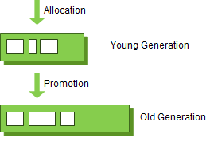

**Young 영역(Young Generation)**

  - 새롭게 생성된 객체가 할당(Allocation)되는 영역
  - 대부분의 객체가 금방 Unreachable 상태가 되기 때문에, 많은 객체가 Young 영역에 생성되었다가 사라진다.
  - Young 영역에 대한 가비지 컬렉션(Garbage Collection)을 **Minor GC**라고 부른다.

**Old 영역(Old Generation)**

  - Young 영역에서 Reachable 상태를 유지하여 살아남은 객체가 복사되는 영역
  - Young 영역보다 크게 할당되며, 영역의 크기가 큰 만큼 가비지는 적게 발생한다.
  - Old 영역에 대한 가비지 컬렉션을 **Major GC**라고 부른다.

Old 영역이 Young 영역보다 크게 할당되는 이유는 Young 영역의 수명이 짧은 객체들은 큰 공간이 필요로 하지 않으며 사이즈가 큰 객체들(메모리를 많이 차지하는)은 바로 Old 영역에 할당되기 때문이다.

예외적인 상황으로 Old 영역에 있는 객체가 Young 영역의 객체를 참조하는 경우도 존재할 것이다.

이러한 경우를 대비해서 Old 영역에는 512 bytes의 덩어리(Chunk)로 되어 있는 카드 테이블이 존재한다.

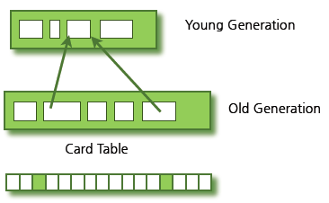

카드 테이블에는 Old 영역에 있는 객체가 Young 영역의 객체를 참조할 때 마다 그에 대한 정보가 표시된다.

Young 영역에서 가비지 컬렉션(Minor GC)가 실행될 때 모든 Old 영역에 존재하는 객체를 검사하여 참조되지 않는 Young 영역의 객체를 식별하는 것이 비효율적이기 때문에 카드 테이블만 조회하여 GC의 대상인지 식별할 수 있도록 하고 있다.

---

### Garbage Collection의 동작 방식

Young 영역과, Old 영역은 서로 다른 메모리 구조이다. 그래서 세부적인 동작 방식이 다르다. 하지만 기본적으로 가비지 컬렉션이 실행된다고 하면 다음 2가지 공통적인 단계를 따르게 된다.

  1. Stop The World
  1. Mark and Sweep

**Stop The World**

Stop The World 단계는 **가비지 컬렉션을 실행하기 위해 JVM이 애플리케이션의 실행을 멈추는 작업**이다.

GC가 실행될 때는 GC를 실행하는 쓰레드를 제외한 모든 쓰레드들의 작업이 중단되고, GC가 완료되면 작업이 재개된다. GC의 성능 개선을 위해 튜닝을 한다고 하면 보통 stop-the-world 시간을 줄이는 작업을 하는 것이다.

또한 JVM에서도 이러한 문제를 해결하기 위한 다양한 실행 옵션을 제공하고 있다.

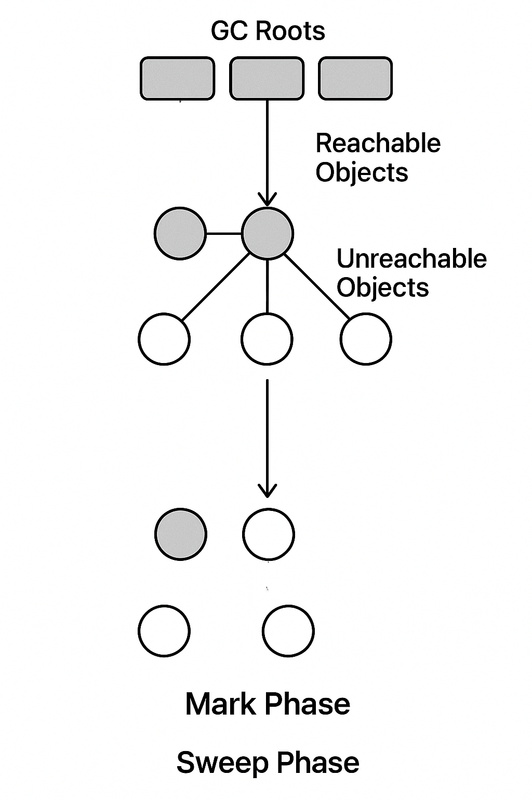

**Mark and Sweep(표시하고 쓸어낸다?)**

**Mark: 사용되는 메모리와 사용되지 않는 메모리를 식별하는 작업**

**Sweep: Mark 단계에서 사용되지 않음으로 식별된 메모리를 해제하는 작업**

Stop The World를 통해 GC 스레드를 제외한 모든 작업을 중단시키면, GC는 스택의 모든 변수 또는 Reachable 객체를 스캔하면서 각각이 어떤 객체를 참고하고 있는지를 탐색하게 된다.

그리고 사용되는 메모리를 식별하는데, 이러한 과정을 Mark라고 한다. 이후에 Mark되지 않은 객체들을 메모리에서 제거하는데, 이러한 과정을 Sweep라고 한다.

---

### Minor GC의 동작 방식

Minor GC를 이해하기 위해서는 Young 영역의 구조에 대한 이해를 해야 한다.

Young 영역은 1개의 Eden 영역과 2개의 Survivor 영역 즉, 총 3가지로 나눠진다.

  - Eden 영역: 새로 생성된 객체가 할당(Allocation)되는 영역
  - Survivor 영역: 최소 1번의 GC 이상 살아남은 객체가 존재하는 영역

객체가 새롭게 생성되면 Young 영역 중에서도 Eden 영역에 할당이 된다.

그리고 **Eden 영역이 꽉 차면 Minor GC가 발생하게 되는데, 사용되지 않는 메모리는 해제되고 Eden 영역에 존재하는 객체는 Survivor 영역으로 옮겨지게 된다.**

Survivor 영역은 총 2개이지만 반드시 1개의 영역에만 데이터가 존재해야 하는데, Young 영역의 동작 순서는 아래와 같다.

  1. 새로 생성된 객체가 Eden 영역에 할당
  1. 객체가 계속 생성되어 Eden 영역이 꽉차게 되고 Minor GC가 실행된다.
1. Eden 영역에서 사용되지 않는 객체의 메모리가 해제된다. (stop-the-world → mark-sweep)
    1. Eden 영역에서 살아남은 객체는 1개의 Survivor 영역으로 이동된다.
  1. 1~2번의 과정이 반복되다가 Survivor 영역이 가득 차게 되면 Survivor 영역의 살아남은 객체를 다른 Survivor 영역으로 이동시킨다.(1개의 Survivor 영역은 반드시 빈 상태가 된다.)
  1. 이러한 과정을 반복하여 계속해서 살아남은 객체는 Old 영역으로 이동(Promotion)된다.

객체의 생존 횟수를 카운트하기 위해 Minor GC에서 **객체가 살아남은 횟수를 의미하는 age를 Object Header에 기록한다.** 그리고 Minor GC 때 Object Header에 기록된 age를 보고 Promotion 여부를 결정한다.

또한 Survivor 영역 중 1개는 반드시 사용이 되어야 한다.

**만약 두 Survivor 영역에 모두 데이터가 존재하거나, 모두 사용량이 0이라면 현재 시스템이 정상적인 상황이 아님을 파악할 수 있다.**

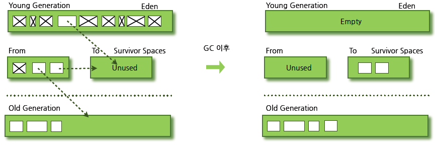

HotSpot JVM에서는 Eden 영역에 객체를 빠르게 할당하기 위해 bump the pointer, TLABs(Thread-Local Allocation Buffers)라는 기술을 사용하고 있다. bump the pointer란 Eden 영역에 마지막으로 할당된 객체의 주소를 캐싱해두는 것이다. bump the pointer를 통해 새로운 객체를 위한 유효한 메모리를 탐색할 필요 없이 마지막 주소의 다음 주소를 사용하게 함으로써 속도를 높이고 있다. 이를 통해 새로운 객체를 할당할 때 해당 객체의 크기가 Eden 영역에 적합한지만 판별하면 되므로 빠르게 메모리 할당을 할 수 있다.

하지만 싱글 쓰레드 환경이라면 bump the pointer 방식이 문제가 없겠지만 멀티 쓰레드 환경에서는 Eden 영역에 할당할 때 락(Lock)을 걸어 동기화를 해주어야 한다.

멀티 쓰레드 환경에서의 성능 문제를 해결하기 위해 HotSpot JVM은 추가로 TLABs 기술을 사용하게 되었다.

TLABs(Thread-Local-Allocation Buffers)란 각각의 쓰레드마다 Eden 영역에 객체를 할당하기 위한 주소를 부여함으로써 동기화 작업 없이 빠르게 메모리를 할당하도록 하는 기술이다. 각각의 쓰레드는 자신이 갖는 주소에만 객체를 할당함으로써 bump the pointer를 통해 빠르게 객체를 할당하도록 하고 있다.

---

### Major GC의 동작 방식

Young 영역에서의 오래 살아남은 객체는 Old 영역으로 Promotion(이동)됨을 확인할 수 있었다.

그리고 Major GC는 객체들이 계속 Promotion되어 Old 영역의 메모리가 부족해지면 발생하게 된다.

Young 영역은 일반적으로 Old 영역보다 크기가 작기 때문에 GC가 보통 0.5에서 1초 사이에 끝난다.

그렇기 때문에 Minor GC는 애플리케이션에 크게 영향을 주지 않는다. 하지만 Old 영역은 Young 영역보다 크며 Young 영역을 참조할 수도 있다. 그렇기 때문에 일반적으로 Major GC는 Minor GC보다 10배 이상의 시간을 사용한다.

동시에 Young 영역과 Old 영역을 처리하는 GC는 Full GC라고 한다.

---

### 가비지 컬렉션 알고리즘 (참고 자료 2/2)

취직하고 나중에… ㅎㅎ

---

### 참고 자료

[https://mangkyu.tistory.com/118](https://mangkyu.tistory.com/118)

[https://mangkyu.tistory.com/119](https://mangkyu.tistory.com/119)

---

### 함수형 프로그래밍 특징

**부수 효과가 없는 순수 함수를 1급 객체로 간주**하여 파라미터나 반환값으로 사용할 수 있으며, 참조 투명성을 지킬 수 있다.

**부수 효과(Side Effect)**

  - 변수의 값이 변경됨
  - 자료 구조를 제자리에서 수정함
  - 객체의 필드값을 설정함
  - 예외나 오류가 발생하여 실행이 중단됨
  - 콘솔 또는 파일 I/O가 발생함

**순수 함수(Pure Function)**

  - 부수 효과들을 제거한 함수들을 순수 함수라고 부른다.
  - 함수의 실행이 외부에 영향을 끼치지 않는 함수

**1급 객체(First-Class Object)**

  - 변수나 데이터 구조 안에 담을 수 있다.
  - 파라미터로 전달할 수 있다.
  - 반환값으로 사용할 수 있다.
  - 할당에 사용된 이름과 무관하게 고유한 구별이 가능하다.

**함수형 프로그래밍에서 함수는 1급 객체로 취급받기 때문에 함수를 파라미터로 넘기는 작업이 가능하다.** 

**우리가 일반적으로 알고 개발했던 함수들은 함수형 프로그래밍에서 정의하는 순수 함수들과는 다르다는 것을 인지하자.**

**참조 투명성(Referential Transparency)**

  - 동일한 인자에 대해 항상 동일한 결과를 반환해야 한다.
  - 참조 투명성을 통해 기존의 값은 변경되지 않고 유지된다. (Immutable Data)

---

### 참고 자료 

[https://mangkyu.tistory.com/111](https://mangkyu.tistory.com/111)

### 서론 

개발을 하다 보면 함수의 파라미터로 변수를 넘겨주어야 한다.

각 언어마다 변수를 넘겨주는 방법(Pass By Value, Pass By Reference)이 다르다.

Java는 어떠한 방식으로 파라미터를 전달할까?

---

### 문제 풀어보기

```java
class Dog {
    private String name;

    public Dog (String name) {
        this.name = name;
    }

    public String getName() {
        return name;
    }

    public void setName(String name) {
        this.name = name;
    }
}
public class Test {
    public static void main(String[] args) {
        int x = 10;
        int[] y = {2, 3, 4};
        Dog dog1 = new Dog("강아지1");
        Dog dog2 = new Dog("강아지2");
        
        foo(x, y, dog1, dog2);
        
        System.out.println("x = " + x);
        System.out.println("y = " + y[0]);
        System.out.println("dog1.name = " + dog1.getName());
        System.out.println("dog2.name = " + dog2.getName());
    }

    public static void foo(int x, int[] y, Dog dog1, Dog dog2) {
        x++;
        y[0]++;
        dog1 = new Dog("이름 바뀐 강아지1");
        dog2.setName("이름 바뀐 강아지2");
    }

}
/*
x = 10
y = 3
dog1.name = 강아지1
dog2.name = 이름 바뀐 강아지2
*/
```

---

### 참고 자료(블로그) 2/3 잘못된 내용 

| 배열 타입 | 힙의 배열 구조 |
| --- | --- |
| `int[]` | `[0, 1, 2]` — 원시 값들이 직접 저장됨 |
| `String[]` | `[주소a, 주소b, 주소c]` — 참조값이 저장됨 |
| `Object[]` | `[주소x, 주소y, 주소z]` — 참조값이 저장됨 |

---

### Pass By Value(Call By Value) 이해 

값에 의한 전달은 복사된 데이터를 전달하여 구성함으로써, **값을 수정하여도 원본의 데이터에는 영향을 주지 않도록 하는 방식이다.**

  - **자바 →  Pass By Value** 
  - 값을 복사해서 전달한다는 의미
  - 원본이 아닌 복사본을 넘긴다.
  - 기본형 → 값 복사
  - 참조형 → 참조값 복사

---

### 참고 자료 

[https://mangkyu.tistory.com/105](https://mangkyu.tistory.com/105)

[https://mangkyu.tistory.com/106](https://mangkyu.tistory.com/106)

[https://mangkyu.tistory.com/107](https://mangkyu.tistory.com/107)

---

### 복습하기

[https://www.youtube.com/watch?v=-ticJOcwrN8&t=346s](https://www.youtube.com/watch?v=-ticJOcwrN8&t=346s)

```java
public class Main {
		public static void main(String[] args) {
				String a = "Messi";    // a(스택) -> Messi(힙)
				String b = a;          // b(스택) -> Messi(힙)
				a = "Ronaldo";         // a(스택) -> Ronaldo(힙) / b(스택) -> Messi(힙)
				System.out.println(b); // b(스택) -> Messi(힙)   answer: Messi
		}
}
```

```java
public class Main {
		public static void main(String[] args) {
				 Person p = new Person("Messi");     
				 String name = p.name;               
				 
				 wow(p);                             
				 
				 System.out.println(name);           // Messi
				 System.out.println(p.name);         // Ronaldo
		}
		
		static void wow(Person p){                    
		   p.name = "Ronaldo";                   
		   p = new Person("Salah");             
		}
}

public class Person {
	  String name;
	  public Person(String name) {
	     this.name = name;
	  }
}
```

### equals()?

```java
public boolean equals(Object obj) {
    return (this == obj);
}
```

Object 클래스에 정의된 equals 같은 경우 동일성(Identity) 비교를 한다. 

하지만 동등성(Equality) 비교 같은 경우 즉, **메모리 주소는 다르지만 프로그래밍 상으로는 같은 값을 가지는지 판단하도록** 해야 한다.

예를 들어 동일한 값을 갖는 문자열을 2개 생성하면 각각은 서로 다른 힙 메모리에 할당되므로 동일하지 않다.

대신 같은 값을 지니므로 동등하다. 

하지만 동일성을 비교하는 equals 메소드를 호출하면 true가 나오는데, 그 이유는 String 클래스에서 equals 메소드를 오버라이드하여 객체가 같은 값을 갖는지 동등성(Equality)을 비교하도록 처리했기 때문이다.

---

### hashCode()?

```java
public native int hashCode()
```

hashCode 메소드는 JVM 구현에 따라 다르지만, 대부분의 경우는 객체의 메모리 주소를 기반으로 정수값으로 변환한 형태로 반환한다. JNI(Java Native Interface)라는 native code(C/C++)를 이용해 구현되었다.

hashCode는 해시 기반 자료구조를 사용할 때 데이터가 저장되는 위치를 결정하기 위해 사용된다.

---

### 규칙 

  1. a.equals(b) == true 라면, 반드시 a.hashCode() == b.hashCode() 여야 한다.
  1. a.hashCode() == b.hashCode() 라고 해서 a.equals(b) == true 일 필요는 없다.

**자바는 해시 충돌을 허용한다.**

해시 코드는 해시 기반 자료 구조에서 버킷 위치를 빨리 찾기 위한 수단일 뿐, 완전한 동등성 비교는 아니기 때문이다. hashCode()가 같은 버킷에 들어가긴 하지만, equals()를 통해 진짜 동등한지 판별한다. 

  - `hashCode()` → **우편번호**: 같은 우편번호 안에 여러 사람이 있을 수 있음
  - `equals()` → **정확한 이름과 주소**: 진짜 내가 찾는 사람인지 확인

**Java HashMap** 

| 상황 | 처리 방식 |
| --- | --- |
| 충돌 수 ≤ 7개 | **LinkedList** 유지 |
| 충돌 수 ≥ 8개 + 전체 크기 ≥ 64 | **Red-Black Tree로 전환** (`treeify`) |
| 이후 노드 수가 ≤ 6개 이하로 감소 | 다시 **LinkedList로 전환** (`untreeify`) |

---

### 참고 자료 

[https://mangkyu.tistory.com/101](https://mangkyu.tistory.com/101)

### 초기화 과정

  - **클래스 로딩 (Class Loading)**
클래스가 JVM에 의해 처음 참조되는 시점에 클래스 로더(ClassLoader)가 해당 클래스를 메모리에 로딩
  - **클래스 초기화 (Class Initialization)**
클래스가 로딩된 후, static 필드와 static 블록이 실행되어 클래스 초기화. 
이 시점에 static 변수에 값이 할당되고, static 메서드도 메모리(Method Area)에 등록된다.
  - **그 이후부터는 객체 생성 없이도 static 멤버에 접근 가능**
클래스가 이미 초기화되었기 때문에, 객체 생성 없이 클래스명.변수 또는 클래스명.메소드() 형태로 바로 접근할 수 있다.

정리해서 말하면 static 변수나 static 메서드는 “객체가 생성되기 전”이 아니라, “해당 클래스가 처음 사용될 때” 메모리에 올라간다.

```java
public class StaticTest {
    static int value = initialize();

    static {
        System.out.println("Static block executed");
    }

    private static int initialize() {
        System.out.println("Static variable initialized");
        return 100;
    }

    public static void staticMethod() {
        System.out.println("Static method called");
    }
}

public class Main {
    public static void main(String[] args) {
        StaticTest.staticMethod();  // 이 시점에 StaticTest 클래스가 로딩되고 초기화
    }
}

/*
Static variable initialized
Static block executed
Static method called
*/
```

---

### static 변수, 메서드 활용 

  1. **상수: static final**
  1. **유틸 클래스(java.lang.Math)**
  1. **정적 팩터리 메서드**

---

### 참고 자료 

[https://mangkyu.tistory.com/47](https://mangkyu.tistory.com/47)

## 목표

synchronized 4가지 사용법을 학습하고 이해

  - synchronized method
  - static synchronized method
  - synchronized block
  - static synchronized block

**핵심 사전 지식** 

Java에서 synchronized는 객체의 모니터(Monitor Lock)를 사용하여 객체 단위로 동기화를 수행한다. 

## synchronized method

synchronized method는 인스턴스 수준에서 잠금을 건다. 

```java
public class Main {
	public static void main(String[] args) {
		A a = new A();
		Thread thread1 = new Thread(() -> {
			a.run("thread1");
		});
		Thread thread2 = new Thread(() -> {
			a.run("thread2");
		});
		thread1.start();
		thread2.start();
	}
}
class A{
	 public synchronized void run(String name){
		 System.out.println(name + " lock");
		 try {
			 Thread.sleep(1000L);
		 }
		 catch (InterruptedException e) {
			 e.printStackTrace();
		 }
		 System.out.println(name + " unlock");
	 }
}
```

현재 코드는 하나의 인스턴스(객체) “a”를 2개의 스레드가 실행한다.

즉, 1개의 스레드만 메서드에 진입이 가능하다.

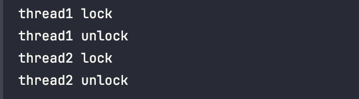

```java
public class Main {
	public static void main(String[] args) {
		A a1 = new A();
		A a2 = new A();
		Thread thread1 = new Thread(() -> {
			a1.run("thread1");
		});
		Thread thread2 = new Thread(() -> {
			a2.run("thread2");
		});
		thread1.start();
		thread2.start();
	}
}
class A{
	 public synchronized void run(String name){
		 System.out.println(name + " lock");
		 try {
			 Thread.sleep(1000L);
		 }
		 catch (InterruptedException e) {
			 e.printStackTrace();
		 }
		 System.out.println(name + " unlock");
	 }
}
```

이번에는 thread1, thread2가 서로 다른 인스턴스에서 메서드를 실행한다.

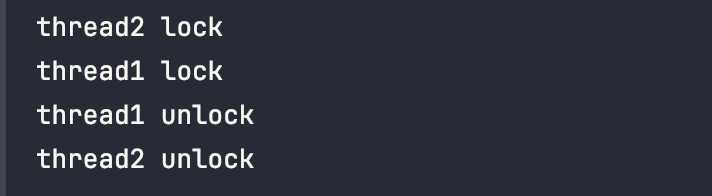

이 상황에서는 lock을 공유하지 않기 때문에 동기화가 발생하지 않는다. 

```java
public class Main {
	public static void main(String[] args) {
		A a = new A();
		Thread thread1 = new Thread(() -> {
			a.run("thread1");
		});
		Thread thread2 = new Thread(() -> {
			a.print("thread2");
		});
		thread1.start();
		thread2.start();
	}
}
class A{
	 public synchronized void print(String name){
		 System.out.println(name + " print start");
		 try {
			 Thread.sleep(1000L);
		 }
		 catch (InterruptedException e) {
			 e.printStackTrace();
		 }
		 System.out.println(name + " print end");
	 }
	 public synchronized void run(String name){
		 System.out.println(name + " run start");
		 try {
			 Thread.sleep(1000L);
		 }
		 catch (InterruptedException e) {
			 e.printStackTrace();
		 }
		 System.out.println(name + " run end");
	 }
}
```

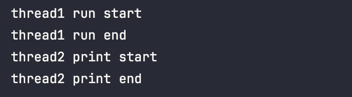

이번에는 동기화가 발생 

즉, synchronized 메서드는 인스턴스 단위로 lock을 건다. 

이때 synchronized가 적용된 같은 객체에 대해서 락을 공유한다. 

## **static synchronized method**

```java
public class Main {
	public static void main(String[] args) {
		A a1 = new A();
		A a2 = new A();
		Thread thread1 = new Thread(() -> {
			a1.run("thread1");
		});
		Thread thread2 = new Thread(() -> {
			a2.run("thread2");
		});
		thread1.start();
		thread2.start();
	}
}
class A{
	 public static synchronized void run(String name){
		 System.out.println(name + " run start");
		 try {
			 Thread.sleep(1000L);
		 }
		 catch (InterruptedException e) {
			 e.printStackTrace();
		 }
		 System.out.println(name + " run end");
	 }
}
```

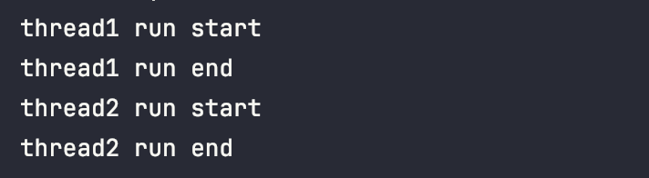

a1, a2는 서로 다른 인스턴스지만 클래스 단위로 lock이 발생했다. 

```java
public class Main {
	public static void main(String[] args) {
		A a = new A();
		Thread thread1 = new Thread(() -> {
			a.run("thread1");
		});
		Thread thread2 = new Thread(() -> {
			a.print("thread2");
		});
		thread1.start();
		thread2.start();
	}
}
class A{
	 public synchronized void print(String name){
		 System.out.println(name + " print start");
		 try {
			 Thread.sleep(1000L);
		 }
		 catch (InterruptedException e) {
			 e.printStackTrace();
		 }
		 System.out.println(name + " print end");
	 }
	 public static synchronized void run(String name){
		 System.out.println(name + " run start");
		 try {
			 Thread.sleep(1000L);
		 }
		 catch (InterruptedException e) {
			 e.printStackTrace();
		 }
		 System.out.println(name + " run end");
	 }
}
```

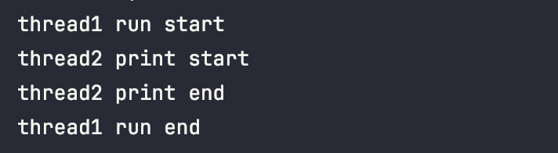

같은 인스턴스에 static synchronized method와 synchronized method를 동시에 실행했지만 동기화는 발생하지 않았다. 

즉, 클래스 단위의 lock과 인스턴스 단위의 lock은 공유하지 않는다.

| 선언 | 락의 대상 (모니터) |
| --- | --- |
| `synchronized` 인스턴스 메서드 | `this` (인스턴스 객체) |
| `static synchronized` 메서드 | `A.class` (클래스 객체) |

즉, synchronized 인스턴스 메서드는 특정 인스턴스에 대한 락

static synchronized 인스턴스 메서드는 클래스 객체에 대한 락

따라서 동기화는 별도로 적용된다. 

```plain text
자바에서는 모든 객체가 monior 락을 가진다.
이때 핵심은 A.class 도 JVM 내에서 Class 타입의 객체라는 사실이다.
그래서 동기화는 별도로 적용된다. 
```

## synchronized block

synchronized block은 synchronized method와 마찬가지로 인스턴스에 대해서 적용된다. 

하지만 synchronized method와 다르게 메서드 내에서 더 세밀하게 **임계 구역(critical section)**을 구분할 수 있다는 장점이 존재한다. 

```java
public class Main {
	public static void main(String[] args) {
		A a = new A();
		Thread thread1 = new Thread(() -> {
			a.run("thread1");
		});
		Thread thread2 = new Thread(() -> {
			a.run("thread2");
		});
		thread1.start();
		thread2.start();
	}
}
class A{
	 public void run(String name){
		 // do something ...

		 // critical section start
		 synchronized (this){
			 System.out.println(name + " run start");
			 try {
				 Thread.sleep(1000L);
			 }
			 catch (InterruptedException e) {
				 e.printStackTrace();
			 }
			 System.out.println(name + " run end");
		 }
		 // critical section end

		 // do something ...
	 }
}
```

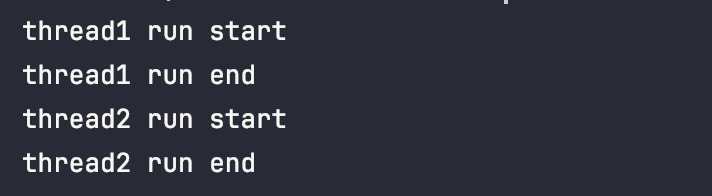

```java
public class Main {
	public static void main(String[] args) {
		A a1 = new A();
		A a2 = new A();
		Thread thread1 = new Thread(() -> {
			a1.run("thread1");
		});
		Thread thread2 = new Thread(() -> {
			a2.run("thread2");
		});
		thread1.start();
		thread2.start();
	}
}
class A{
	 public void run(String name){
		 // do something ...

		 // critical section start
		 synchronized (this){
			 System.out.println(name + " run start");
			 try {
				 Thread.sleep(1000L);
			 }
			 catch (InterruptedException e) {
				 e.printStackTrace();
			 }
			 System.out.println(name + " run end");
		 }
		 // critical section end

		 // do something ...
	 }
}
```

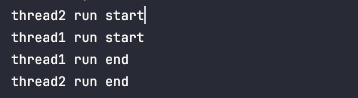

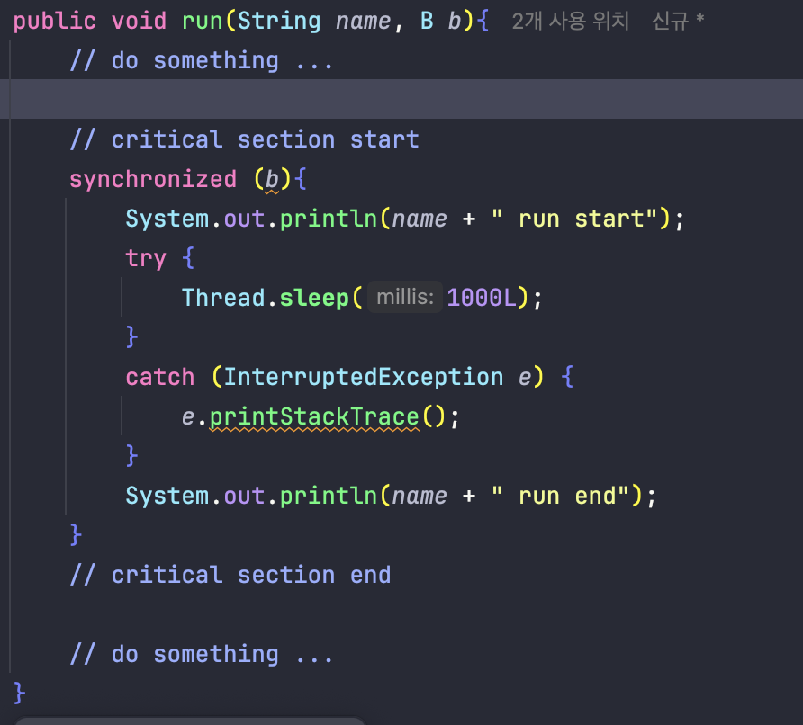

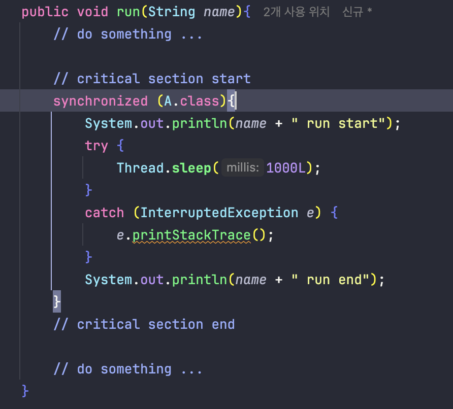

**synchonized block 락 대상은 모든 타입이 가능하다.**

this / 다른 클래스 인스턴스 / 본인 클래스(A.Class) / 다른 클래스(B.class)

락 적용은 앞에서 학습한 방식과 동일하게 적용된다. 

## static synchronized block

static의 특성상 this 같이 현재 객체를 가리키는 표현을 사용할 수 없지만 Class 타입 객체는 가능하다.

이것은 static synchronized와 비슷하지만, 락 대상(다른 클래스: Class)을 유연하게 바꿀 수 있다는 장점이 있다.

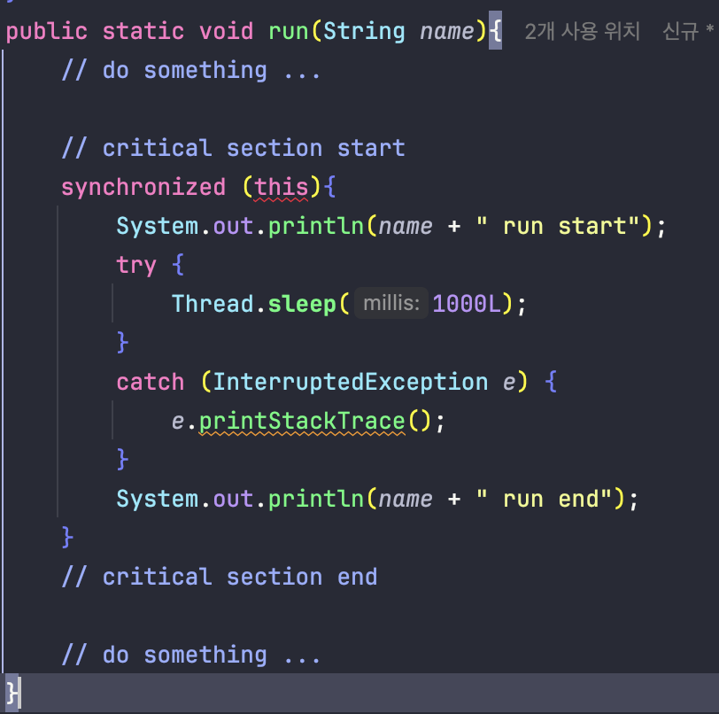

## 정리 

  - **method vs block**
→ synchronized block은 synchronized method보다 **임계 구역을 더 세밀하게 정의 가능**
  - **static synchronized method**
→ **락 대상**: 해당 클래스의 Class 객체 (A.class)
  - **synchronized method**
→ **락 대상**: 해당 **인스턴스** (this 객체)
  - **static synchronized block**
→ **락 대상**: 지정한 **클래스의 Class 객체** (예: A.class, Other.class, 등 **모든 클래스 가능**)
  - **synchronized block**
→ **락 대상**: 지정한 **모든 객체** 가능

→ 즉, **모든 인스턴스 객체** 또는 **모든 클래스 객체 (Class)** 대상 가능

## 참고 자료 

[https://jgrammer.tistory.com/entry/Java-%ED%98%BC%EB%8F%99%EB%90%98%EB%8A%94-synchronized-%EB%8F%99%EA%B8%B0%ED%99%94-%EC%A0%95%EB%A6%AC](https://jgrammer.tistory.com/entry/Java-%ED%98%BC%EB%8F%99%EB%90%98%EB%8A%94-synchronized-%EB%8F%99%EA%B8%B0%ED%99%94-%EC%A0%95%EB%A6%AC)

# var?

Java 10부터 도입된 지역 변수 타입 추론 기능 

즉, var 키워드는 변수 선언 시 컴파일러가 자동으로 타입을 추론하도록 한다. 

# var 동작 방식 

```java
 var note = new Note(UUID.randomUUID(), "title", "content", true);
 
 Note note = new Note(UUID.randomUUID(), "title", "content", true);
```

  - var note: 개발자 작성 
  - Note note: 컴파일러 자동 추론(해석)

즉, var는 해당 줄에서만 유효하며, 이후에는 note 변수가 Note 타입으로 취급된다. 

# var의 사용 제한 

  1. **지역 변수에서만 사용 가능** 
1. var는 클래스 필드 선언에 사용할 수 없다.

```java
class Example {
    var field = "Not Allowed"; // 컴파일 오류
}
```
  1. **명확한 타입이 추론 가능해야 함** 
1. var를 사용할 때 값이 없거나 null이면 컴파일 오류가 발생한다. 

```java
var unknown;        // 오류: 타입을 추론할 수 없음
var nullVar = null; // 오류: 타입을 결정할 수 없음
```
  1. **람다 표현식에서는 사용할 수 없다.**
```java
var func = (x) -> x * 2; // 오류
```

# var를 사용하는 이유

장점

  - 가독성 향상: 길고 복잡한 타입명을 줄여 코드가 깔끔해짐 
  - 유지보수성 향상: 타입 변경 시 변수 선언을 수정할 필요가 없음 

주의

  - 과도한 사용은 코드의 명확성을 해칠 수 있다. 
  - 특히, 협업하는 코드에서는 var를 적절히 사용하여 가독성과 타입 명확성 사이의 균형을 유지하는 것이 중요

# **record?**

Java14에서 도입된 새로운 클래스 타입 

주로 불변 데이터 객체(Immutable Data Object)를 간단한게 정의하기 위해 사용된다. 

기본적으로 **getter, equals, hashCode, toString을 자동 생성**하며,
**불변 객체이므로 필드가 final로 설정된다.** 

# **record 특징** 

**자동으로 생성되는 메서드**

  - 생성자: 롬복 AllArgsConstructor 같이 모든 필드를 매개변수로 가지는 생성자 
  - getter(필드명 그대로 사용) 
  - equals(), hashCode(), toString() 자동 생성 

**불변 객체** 

  - 필드 값 변경 불가 (final과 동일)
  - 세터(setter) X

**JavaBean 스타일과 차이** 

  - getTitle()이 아니라 title() 형식으로 필드명을 그대로 getter(메서드명)으로 사용 

# **record 분석** 

**Note Record** 

```java
public record Note (
    UUID noteId,
    String title,
    String contents,
    boolean isNes
)
{ }
```

**→ 자동 생성 메서드 예시 (일반 클래스로 표현)**

```java
public class Note {
    private final UUID noteId;
    private final String title;
    private final String contents;
    private final boolean isNes;

    public Note(UUID noteId, String title, String contents, boolean isNes) {
        this.noteId = noteId;
        this.title = title;
        this.contents = contents;
        this.isNes = isNes;
    }

    public UUID getNoteId() { return noteId; }
    public String getTitle() { return title; }
    public String getContents() { return contents; }
    public boolean isNes() { return isNes; }

    @Override
    public boolean equals(Object o) {
        if (this == o) return true;
        if (o == null || getClass() != o.getClass()) return false;
        Note note = (Note) o;
        return isNes == note.isNes &&
                Objects.equals(noteId, note.noteId) &&
                Objects.equals(title, note.title) &&
                Objects.equals(contents, note.contents);
    }

    @Override
    public int hashCode() {
        return Objects.hash(noteId, title, contents, isNes);
    }

    @Override
    public String toString() {
        return "Note{" +
                "noteId=" + noteId +
                ", title='" + title + '\'' +
                ", contents='" + contents + '\'' +
                ", isNes=" + isNes +
                '}';
    }
}
```

[유투브 링크](https://www.youtube.com/watch?v=4ZtKiSvZNu4)

# 람다 

**람다식이 뭐야?**

  - 메서드를 하나의 식으로 표현한 것

일반 메서드

```java
int addOperation(int a, int b){
		return a + b;
}
```

람다식 

```java
(int a, int b) -> a + b
```

좀 더 간단히!

case1)

```java
(int a, int b) -> a * b
```

매개 변수 타입 생략 

```java
(a, b) -> a * b
```

case2)

```java
(a) -> a * a 
```

파라미터의 괄호 생략 

```java
a -> a * a
```

case3)

```java
(String name, int i) -> {
			System.out.println(name + "=" + i);
}
```

바디의 중괄호, 세미콜론 생략 

```java
(String name, int i) -> 
			System.out.println(name + "=" + i)

```

람다 → 함수형 인터페이스

> 💡 함수형 인터페이스 = 추상 메서드가 딱 1개만 있는 인터페이스
default 메서드와 static 메서드는 존재할 수 있다. 

함수형 인터페이스 

```java
@FunctionalInterface
public interface BridgeNumberGenerator {
    int generate();
}
```

인스턴스를 맏드려면 어떻게 해야 할까?

추상 메서드를 오버라이딩해서 클래스를 만든다!

이 클래스로부터 인스턴스를 생성할 수 있다.

```java
import java.util.Random;

public class BrideRandomNumberGenerator implements BridgeNumberGenerator {
    @Override
    public int generate() {
        return new Random().nextInt();
    }
}
```

람다식을 이용해 인스턴스 만들기 

```java
import java.util.Random;
public class GeneratorTest {
    public static void main(String[] args) {
        BridgeNumberGenerator bridgeNumberGenerator = () -> new Random().nextInt();
        int randomNumber = bridgeNumberGenerator.generate();
    }
}
```

함수형 인터페이스의 딱 1개의 추상메서드과 람다식이 1:1 매칭 

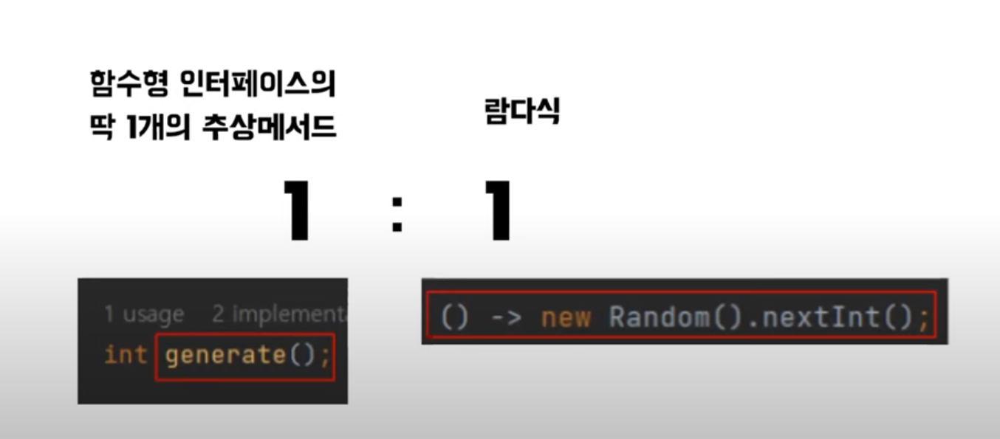

그럼 람다식을 쓰려면 매번 함수형 인터페이스를 정의해야해? 

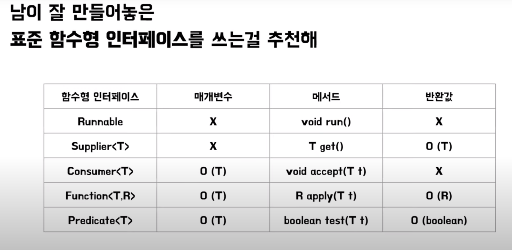

람다식이 하나의 메서드만 호출하는 경우에는 메서드 참조로 람다식을 간략히 할 수 있다.

클래스 이름::메서드 이름 또는 참조변수::메서드 이름으로 바꿀 수 있다.

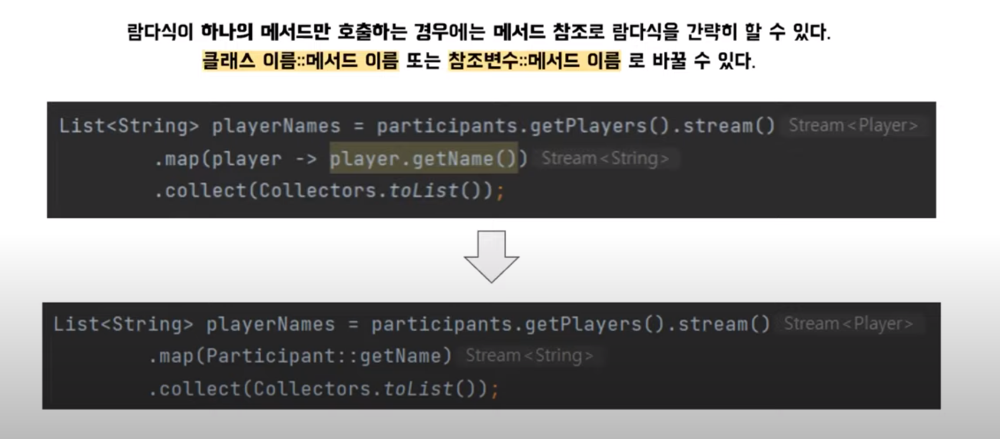

# 스트림 (stream)

Java 8 부터 다량의 데이터 처리 작업을 돕기 위해 추가되었다. 

컬렉션, 배열, 숫자, 람다식 , 파일 ,,, → Stream → Stream 연산 

스트림은 데이터 소스가 다르더라도, 일단 스트림을 생성하기만 한다면

과거의 그 데이터의 형태가 무엇이었던 같은 방식으로 다룰 수 있게 되어 코드의 재사용성이 높아진다.

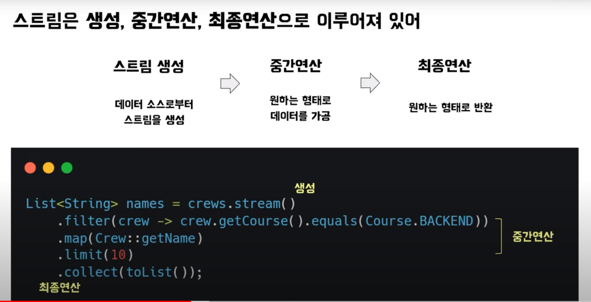

## 스트림 생성 

**1) 컬렉션**

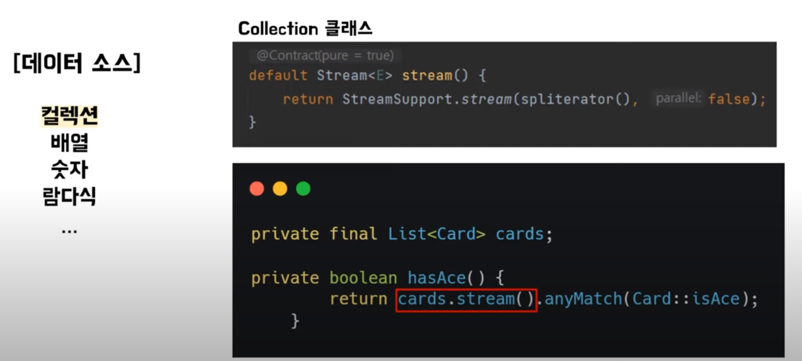

> 💡 .stream()

```java
   		  // 컬렉션 데이터 소스 -> 스트림 생성           .stream()
        List<String> list = new ArrayList<>();
        Stream<String> stream1 = list.stream();
```

**2) 배열**

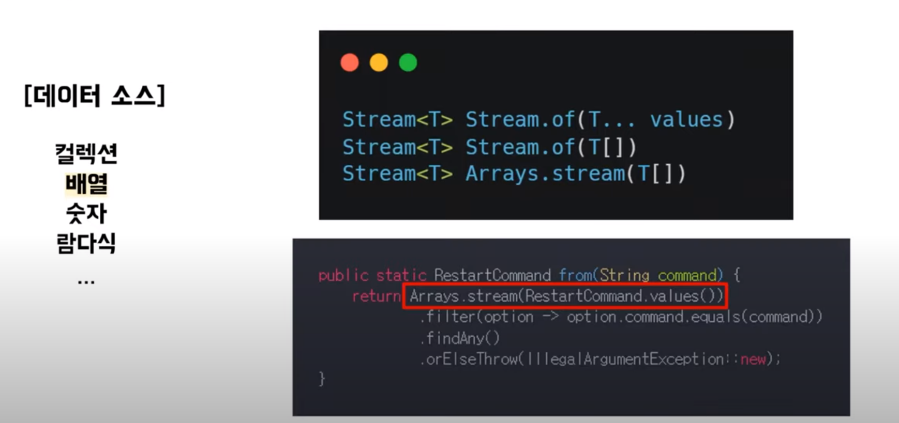

```java
     		// 배열
        int [] intArr = {-1,1,0,0};
        Stream<Integer> stream2 = Arrays.stream(intArr).boxed();

        long [] longArr = {-1,1,0,0};
        Stream<Long> stream3 = Arrays.stream(longArr).boxed();

        String [] strArr = {"a", "b", "c"};
        Stream<String> stream4 = Stream.of(strArr);
```

**3) 숫자**

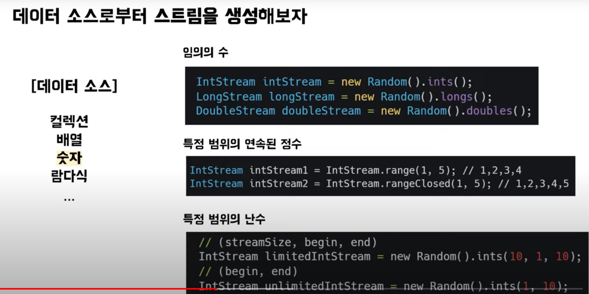

```java
        // 숫자
        // 임의의 수
        Stream<Integer> intStream = new Random().ints().boxed();
        IntStream intStream2 = new Random().ints();

        // IntStream intStream3 = new Random().nextInt();            // 에러
        IntStream intStream3 = IntStream.of(new Random().nextInt()); // 단일 정수 반환

        // 특정 범위의 연속된 정수
        IntStream intStream4 = IntStream.range(1, 5); // 1, 2, 3, 4
        Stream<Integer> intStream5 = IntStream.range(1, 5).boxed(); // 1  2  3  4
        IntStream intStream6 = IntStream.range(1, 1); // 1
        IntStream intStream7 = IntStream.rangeClosed(1, 5); // 1, 2, 3, 4, 5

        // 특정 범위의 난수
        // (streamSize, begin, end)
        IntStream intStream8 = new Random().ints(10 , 1, 10);

        // (begin , end)
        IntStream intStream9 = new Random().ints(1, 10);
```

**4) 람다식**

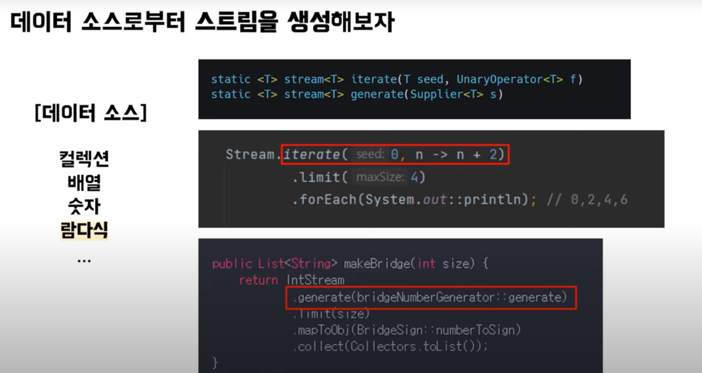

```java
  			// 람다식
        Stream.iterate(0, n -> n + 2)
                .limit(4)
                .forEach(System.out::println); // 0, 2, 4, 6

        List<Integer> save;
        save = Stream.iterate(0, n -> n + 3)
                .limit(6).collect(Collectors.toList());

        List<Integer> save2 = new ArrayList<>();
        Stream.iterate(0, n -> n + 3)
                .limit(5).forEach(save2::add);

```

## 스트림 중간 연산 

  - 중간연산으로 데이터를 입맛에 맞게 가공해보자 

distinct(), filter(), sort(), map(), flatMap(), mapToInt()

  - distinct()
- 스트림에서 중복되는 데이터를 제거 

```java
 	    	// 중복되는 데이터가 있는지 검사하고, 중복이 존재하면 예외를 던지는 코드
        List<String> players = new ArrayList<>();
        players.add("김현민");
        players.add("배제우");
        players.add("배제우");
        // 원래 players의 길이와 중복을 제거하고 players의 길이를 비교 
        // -> 3 != 2 이니 예외 처리!
        if(players.size() != players.stream().distinct().count()){
            throw new IllegalArgumentException("플레이어 이름은 중복될 수 없음!");
        }
```
  - filter(Predicate<T> predicate)
- 조건에 만족하는 데이터만 남기고 나머지를 제외 

```java
 	 		  // filter()
        // 조건을 만족하는 데이터만 남기고 나머지는 제외하고 출력
        // 길이가 4인 문자열은 제외하고 길이가 4인 문자열만 출력
        List<String> test = new ArrayList<>();
        test.add("1234");
        test.add("12345");
        test.add("2345");
        test.add("a");
        test.add("abcd");
        test.stream().filter(String -> String.length() == 4).forEach(System.out::println);
        /*
        1234
        2345
        abcd
         */
```
  - sorted(Comparator<T> comparator) sorted() : 기본 정렬 기준으로 정렬 
- 스트림을 지정된 Comparator로 정렬 

```java
 	    	// sorted(Comparator<T> comparator) 기본 정렬 기준으로 정렬 역순으로 정렬 해보기
        List<String> crewNames = new ArrayList<>();
        crewNames.add("가"); crewNames.add("나"); crewNames.add("가나"); crewNames.add("가");
        crewNames.stream().sorted(new Comparator<String>() {
            @Override
            public int compare(String o1, String o2) {
                return -o1.compareTo(o2);
            }
        }).forEach(System.out::println);
        System.out.println("--------------");
        crewNames.stream().sorted().forEach(System.out::println);
        System.out.println("--------------");
        System.out.println(crewNames.stream().sorted().collect(Collectors.joining(" ")));
```
  - map(Function<T, R> mapper)
- 원하는 필드만 뽑아내거나, 특정 형태로 변환 

```java
      	class Person{
            private String name;
            private int age;
            public Person(String name, int age){
                this.name = name; this.age = age;
            }
            public String getName() {
                return name;
            }
            public int getAge() {
                return age;
            }
        }
        List<Person> persons = List.of(
                new Person("Alice", 30),
                new Person("Bob", 25),
                new Person("Charlie", 35),
                new Person("BaeJewoo", 27)
        );
        // map(Function<T, R> mapper)
        // 원하는 필드만 뽑아내거나, 특정 형태로 변환
        List<String> names = persons.stream().map(Person::getName)
                .collect(Collectors.toList());

        names.stream().sorted().forEach(System.out::println);
```
  - flatMap(Function<T, R> mapper)
- 스트림의 각 요소에 대한 매핑 함수를 적용하고, 각 매핑 결과로 생성된 스트림을 하나의 스트림으로 평탄화합니다. 이를 통해 중첩된 리스트 또는 다차원 배열을 **평탄화**하여 단일 스트림으로 만들 수 있습니다. 
    - 평탄화? → 스트림의 원소를 각각 하나의 스트림으로 매핑한 다음, 그 스트림을 다시 하나의 스트림으로 합침 

```java
     		// flatMap(Function<T, R> mapper)
        // 중첩된 리스트 생성
        List<List<Integer>> numbers = Arrays.asList(
               List.of(1, 2, 3),
               List.of(4, 5, 6),
               List.of(7, 8, 9)
        );

        // 각 리스트들을 하나의 스트림으로 평탄화
        numbers.stream().flatMap(List :: stream).forEach(System.out::println);

        int [][] array2D = {{1,2,3},{4,5,6},{7,8,9}};
        List<Integer> list2D = Arrays.stream(array2D).flatMapToInt(Arrays :: stream).boxed().collect(Collectors.toList());
        System.out.println(list2D);
```
  - mapToInt(IntStream mapToInt(ToIntFunction<? super T> *mapper*))
- 각 요소를 지정된 함수에 매핑하여 IntStream을 반환한다.
    - 매핑이란? 각 요소에 함수를 적용하여 새로운 값으로 변환하는 것을 의미한다. 

```java
 ArrayList<Integer> tmp = new ArrayList<>();
 tmp.add(1);
 tmp.add(2);
 
 int [] array = tmp.stream().mapToInt(Integer::intValue).toArray();
 
 // 동일한 과정   
 IntStream intStream = tmp.stream().mapToInt(Integer::intValue);
 int [] array2 = intStream.toArray();
```

## 스트림 최종 연산 

  - 최종연산으로 스트림을 닫아보자 
  - forEach(Consumer<? super T> action)
```java
   		  // 중간 연산까지 마친 스트림의 숫자를 차례대로 출력
        Stream.iterate(0, n -> n + 2).limit(6).forEach(System.out::println);
```
  - 조건 검사 (boolean 반환) 
- boolean allMatch(Predicate<? super T> predicate) 모든 요소가 일치하면 true
    - boolean anyMatch(Predicate<? super T> predicate) 하나의 요소라도 일치하면 true
    - boolean noneMatch(Predicate<? super T> predicate) 모든 요소가 불일치하면 true

```java
 	    	// 조건 검사
        List<Integer> list = new ArrayList<>(List.of(11,12,13));
        System.out.println(list.stream().allMatch(Integer -> Integer > 10)); // true

        list.add(5);
        System.out.println(list.stream().allMatch(Integer -> Integer > 10 )); // false

        System.out.println(list.stream().anyMatch(Integer -> Integer < 5));   // false
        System.out.println(list.stream().anyMatch(Integer -> Integer <= 5));  // true

        System.out.println(list.stream().noneMatch(Integer -> Integer > 100)); // true
        System.out.println(list.stream().noneMatch(Integer -> Integer > 12));  // false
```

    - findFirst() 조건에 일치하는 첫 번째 요소를 반환 
    - findAny() 조건에 일치하는 요소를 하나 반환 

```java
    		// 조건 검사 findFirst(), findAny()
        List<Integer> list2 = new ArrayList<>(List.of(11, 12 ,13));
        Optional<Integer> result  = list2.stream().filter(Integer -> Integer > 10).findFirst();
        System.out.println(result.get()); // 11

        System.out.println(list2.stream().filter(Integer -> Integer > 12).findFirst().get()); // null
        System.out.println(list2.stream().filter(Integer -> Integer > 0).findAny().get()); // 11
```
  - **collect(Collector collector)**
- 스트림의 요소를 수집해 원하는 형태로 반환
    - collect() vs Collector vs Collectors 
    - collect(Collector collector) 
- 스트림의 최종 연산 
      - 컬렉터를 파라미터로 받음
    - Collector
- 인터페이스 
      - 이걸 구현해야 collect의 파라미터로 사용할 수 있음
    - Collectors
- 이미 정의된 컬렉터를 static 메서드로 제공하는 클래스
    - **collect(Collectors.toList())** - 데이터를 수집해 리스트 형태로 반환 

```java
        // collect(Collectors.toList()) 데이터를 수집해 리스트 형태로 변환
        List<String> names = List.of(
                "bae", "son", "park"
        );

        List<String> name = names.stream().collect(Collectors.toList());
```

    - **collect(Collectors.toMap())**
- toMap(Function<? super T, ? extends K>keyMapper,
Fuction<? super T, ? extends U> valueMapper)


3번째 파라미터 mergeFunction 

중복 키가 발생하면 IIlegalStateException이 발생한다. → mergeFunction의 존재 이유 

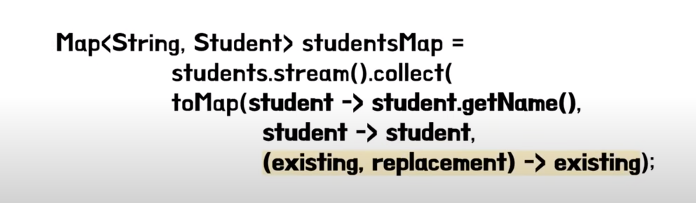
    - **collect(Collectiors.groupingBy())**
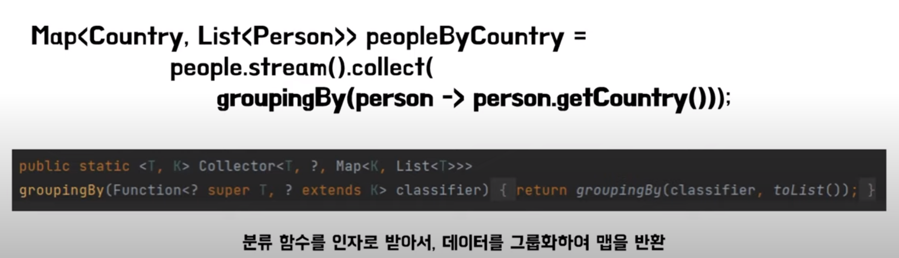
    - **collect(Collectors.joining())**
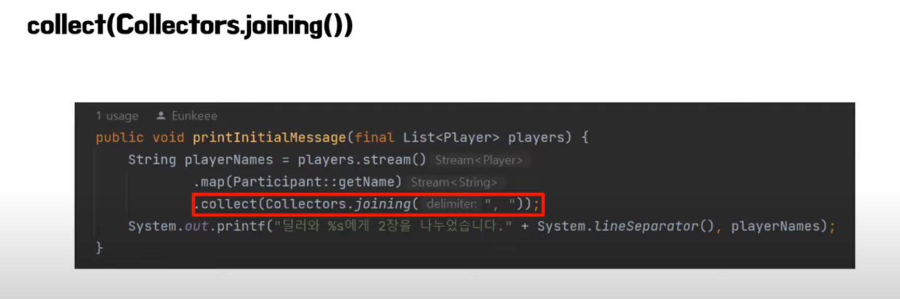

```java
 	   	 List<String> check = List.of(
                "one",
                "two",
                "three"
        );
        String check_result = check.stream().collect(Collectors.joining(" "));
        System.out.println(check_result); // one two three
```
  - reduce(T identity, BinaryOperator<T> accumulator)
- reduce(BinaryOperator<T> accumulator) : 초기값이 없을 경우 사용 
    - 스트림의 데이터를 줄여 나가면서 연산을 수행하고 최종 결과를 반환 

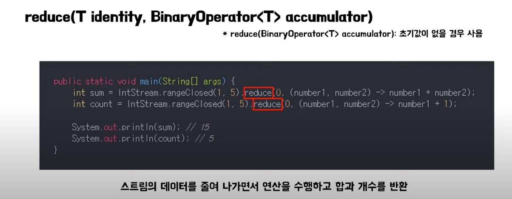
  - reduce 사용 x IntStream을 활용한 sum 

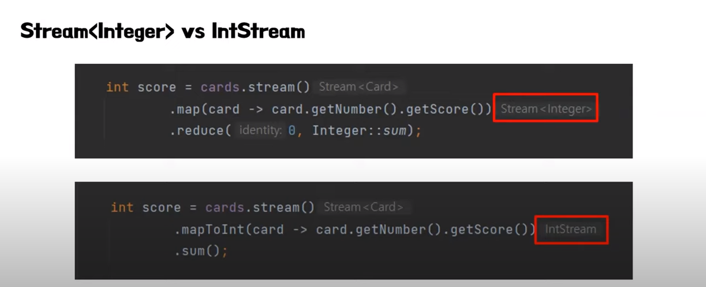

```java
        String make = IntStream.rangeClosed(1, 5).mapToObj(Integer::toString).reduce("", (str1, str2)-> str1+ str2);
        System.out.println(make); // 12345

        // IntStream을 활용한 sum
        int int_result = IntStream.rangeClosed(1, 100).sum();
        System.out.println(int_result);

        
        int int_result2 = IntStream.rangeClosed(1, 50).reduce(0, Integer::sum);
        System.out.println(int_result2);
```

IntStream은 기본형 특화 스트림 

Stream<Integer>은 unboxing boxing 과정이 있어서 기본형 특화 스트림 보다 느리다!

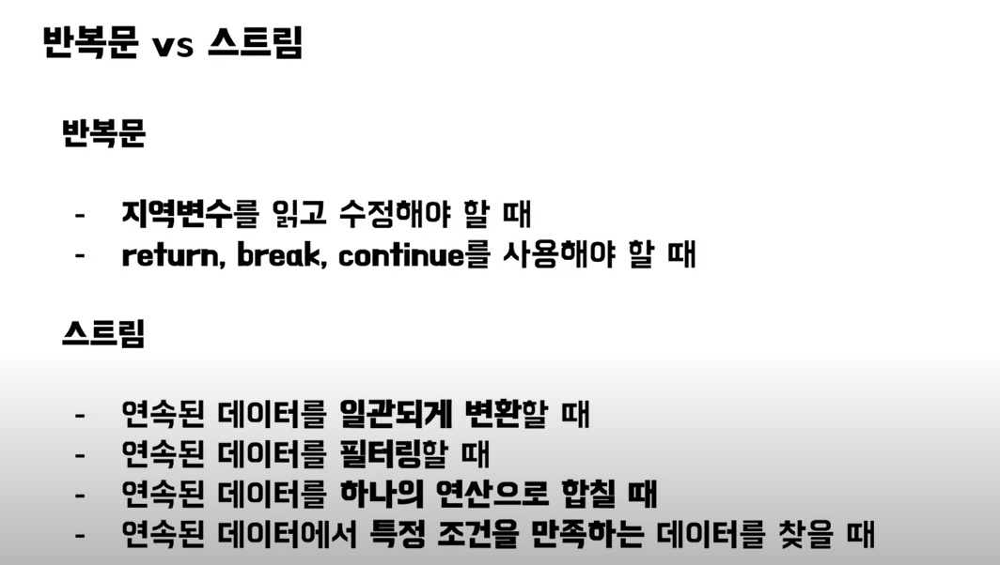

> 💡 자바에서 ‘==’ 은 객체의 주솟값을  비교하는 연산자 이다. 

백준 11652 카드 실버4 풀면서 
로직은 맞는 것 같은데 계속 틀렸었다. 

문제는 객체의 값 비교를 해야 하는데 객체의 주솟값 비교를 했던 게 문제였다.

```java
 ArrayList<Map.Entry<Long, Integer>> list = new ArrayList<>(map.entrySet());
        Collections.sort(list, new Comparator<Map.Entry<Long, Integer>>() {
            @Override
            public int compare(Map.Entry<Long, Integer> o1, Map.Entry<Long, Integer> o2) {
                if(o1.getValue() > o2.getValue()) return -1;
                else if(o1.getValue() == o2.getValue()){
                    if(o1.getKey() > o2.getKey()) return 1;
                    else if(o1.getKey() == o2.getKey()) return 0;
                    else return -1;
                }
                return 1;
            }
        });
        System.out.println(list.get(0).getKey());
```

왜 문제일까?

기본 타입에서의 == 연산자는 값을 비교한다. 

하지만 참조 타입에서의 == 연산자는 주솟값을 비교한다.

객체의 값을 비교하는 게 아니라 객체의 주소를 계속 비교했으니 틀렸던 것이다. 

그렇다면 객체의 값은 뭐로 비교해야 할까?

  1. compareTo 메서드를 사용
  1. 대소 비교 연산자 >, <
  1. getKey() - getKey() == 0 기본 타입 == 기본 타입으로 바꿔주기

```java
// Integer에서 int로 변환
Integer integerObj = 123;
int primitiveInt = integerObj.intValue();

// Long에서 long으로 변환
Long longObj = 456L;
long primitiveLong = longObj.longValue();

// Double에서 double로 변환
Double doubleObj = 3.14;
double primitiveDouble = doubleObj.doubleValue();

// Float에서 float으로 변환
Float floatObj = 2.718f;
float primitiveFloat = floatObj.floatValue();

// Character에서 char로 변환
Character charObj = 'a';
char primitiveChar = charObj.charValue();

// Boolean에서 boolean으로 변환
Boolean boolObj = true;
boolean primitiveBool = boolObj.booleanValue();
```

## int 형 배열 내림차순 정렬하기 

  - 오름차순 정렬은 보통 Arrays.sort(배열이름) 이렇게 진행한다. 
  - int 형 배열이 아닌 참조형 배열은 그냥 Collections 관련 정렬 객체를 사용하거나 직접 Comparator로 정렬 기준을 구현하면 되지만 int형 배열은 불가능하다. 
  - int 형 → Integer로 boxed하고 정렬을 해야한다.

**스트림을 활용한 int형 배열 정렬하기** 

```java
int [] arr = {4,6,1,9,2};
arr = IntStream.of(arr).boxed()      // -> int -> stream -> Integer
							 .sorted((o1,o2)->{
								return -(o1,o2);
								})
							 .mapToInt(Integer::intValue(
							 .toArray();							  
```

UUID는 **Universally Unique Identifier**의 약자로, 범용 고유 식별자를 의미합니다. UUID는 네트워크 상에서 고유한 식별자를 생성하는 데 사용되며, 충돌이 발생할 가능성이 극히 낮습니다. 이를 통해 여러 시스템 간에 정보를 신뢰할 수 있게 교환하고 추적할 수 있습니다. UUID는 주로 소프트웨어에서 데이터베이스 레코드, 파일, 네트워크 통신의 세션 식별 등에 사용됩니다. UUID는 다양한 버전이 있으며, 가장 일반적으로 사용되는 것은 UUID v1, UUID v3, UUID v4, UUID v5 등이 있습니다.

예제

```java
import java.util.UUID;

public class UUIDExample {
    public static void main(String[] args) {
        // 랜덤 UUID 생성
        UUID uuid1 = UUID.randomUUID();
        System.out.println("Random UUID: " + uuid1);

        // 이름 기반 UUID 생성
        UUID uuid2 = UUID.nameUUIDFromBytes("example".getBytes());
        System.out.println("Name-based UUID: " + uuid2);
    }
}
```

  1. UUID.randomUUID()를 사용하여 랜덤 UUID를 생성합니다.
  1. UUID.nameUUIDFromBytes(byte [])를 사용하여 특정 바이트 배열에서 이름 기반 UUID를 생성합니다.
  1. getBytes()
-  "example".getBytes()를 호출하면 해당 문자열("example")을 기본 문자셋(대개 UTF-8)으로 인코딩하여 바이트 배열을 반환합니다. 실제로 이를 출력해 보겠습니다.
    - 인코딩 

```java
public class GetBytesExample {
    public static void main(String[] args) {
        byte[] byteArray = "example".getBytes();
        for (byte b : byteArray) {
            System.out.print(b + " ");
        }
    }
}
```

→ 101 120 97 109 112 108 101

    - 디코딩

```java
 byte[] byteArray = {101, 120, 97, 109, 112, 108, 101};
 String str = new String(byteArray);
```

→ “example”

[https://www.acmicpc.net/board/view/142519#comment-215870](https://www.acmicpc.net/board/view/142519#comment-215870)

**long temp = int a + int b;**

  1. (int a) + (int b) = (int) (a + b);
  1. long temp = (long) (a + b);
  1. 만약 int a + int b가 int 범위를 넘어버리면 overflow가 발생하면서 내가 원하는 결과가 안 나올 수 있다. 주의 하자!

자바를 커맨드로 컴파일하거나 실행하는 경우는 거의 없다.

자바 개발은 대부분 IDE 개발툴을 이용하며, 대표적으로 이클립스, 인텔리제이, VS Code를 사용한다.

하지만 커맨드로도 컴파일 및 실행이 가능하다.

## CMD에서 소스파일 실행하기

먼저 프로젝트 경로로 이동한다.

CMD에서 실행하는 방법은 2가지가 있다.

## 1. 패키지가 없는 소스파일

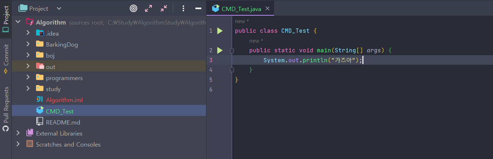

테스트를 위해 CMD_Test.java 소스파일을 만들었다.

컴파일을 먼저 실행한다.

> 💡 javac CMD_Test.java

한글이 있으면 이런 에러가 발생한다. (주석이나 출력)

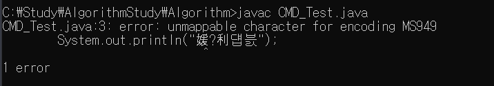

> 💡 javac CMD_Test.java -encoding UTF-8

이렇게 인코딩을 해준다.


이제 실행을 해준다.

> 💡 java CMD_Test


## 2. 패키지가 있는 소스파일

테스트를 위해서 패키지를 만들고 패키지 밑에 소스파일을 만들었다.

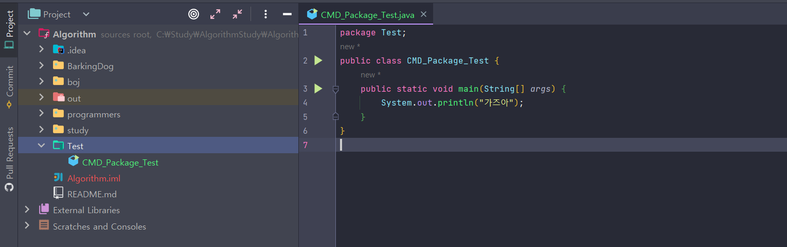

> 💡 C:\Study\AlgorithmStudy\Algorithm> javac Test/CMD_Package_Test.java -encoding UTF-8

이렇게 패키지명을 앞에 붙인다.

> 💡 java Test/CMD_Package_Test

실행 성공!!


## 자바 버전 확인 및 JDK 확인 

  1. 내가 하는 프로젝트의 JDK 확인하기 

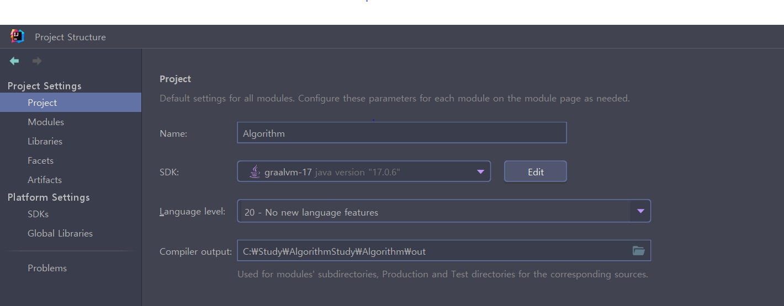

  1. JDK 위치 확인하기

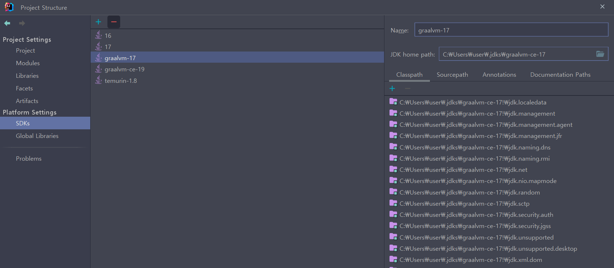

  1. JDK home path ￦bin 폴더로 이동하기

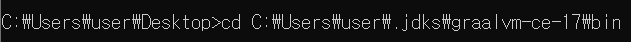

  1. 자바 버전 확인하기 

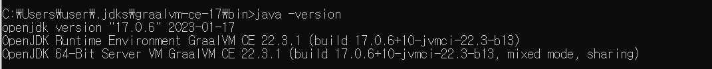

---

# 취업이후 공부

**책 [JVM 밑바닥까지 파헤치기]**

**망나니 개발자 → GC, JAVA 관련 글 전부 읽어보기**

---
