**가정: 내 PC → 스위치 → 라우터1 → 라우터2 → 스위치 → 구글 서버**

**1. 브라우저에서 URL 입력 (Application Layer, 7계층)**

  - 사용자가 브라우저에 google.com 입력
  - 브라우저는 HTTP GET 요청을 준비(시작 라인 HTTP 메서드 / HTTP 버전 1.1)
  - HTTP 헤더 생성 (예: Host, User-Agent 등)

**2. DNS 질의 (생략 가능, 이미 IP를 알고 있다고 가정)**

  - 실제로는 먼저 DNS 질의를 통해 google.com의 IP를 얻음
  - 이 과정도 동일한 OSI 7계층을 거침
  - DNS(Domain Name System) Server 계층형 질의
- 1단계 루트
    - 2단계 .net / .com 질의
    - 3단계 [www.google.com](http://www.google.com/) 질의

**먼저 클라이언트 ↔ 서버 3-way hand shake** 

  - handshake 과정에 5~7계층 관여 X
  - 과정
- 클라이언트 → SYN(m)
    - 서버 → SYN(n), ACK(m+1)
    - 클라이언트 → ACK(n+1)

**3. HTTP 요청 데이터 포장 (Presentation/Session/Transport Layer, 6~4계층)**

  - **Presentation Layer(6계층):** 데이터 인코딩/압축/암호화(HTTPS라면 TLS 암호화)
  - **Session Layer(5계층):** 통신 세션 관리, 동기화
  - **Transport Layer(4계층)**
- TCP 헤더 추가
- 출발지 포트(예: 49152), 목적지 포트(80 또는 443)
      - 시퀀스 번호, 확인 응답 번호 등
      - 플래그
    - **세그먼트 단위로 분할**

**4. 네트워크 계층 (Network Layer, 3계층)**

  - **IP 헤더** 추가:
- 출발지 IP(내 PC의 공인/사설 IP), 목적지 IP(google.com 서버의 공인 IP)
  - **패킷 단위로 포장**

**5. 데이터 링크 계층 (Data Link Layer, 2계층)**

  - **이더넷 프레임 헤더** 추가:
- 출발지 MAC 주소(내 PC의 MAC)
    - 목적지 MAC 주소(내 PC가 속한 LAN의 게이트웨이, 즉 라우터1의 LAN 포트 MAC)
  - **프레임 단위로 포장**

**만약 라우터1의 MAC 주소를 모른다면**

  - 내 PC에서 LAN에 속해있는 모든 장치에 브로드 캐스트
  - 이걸 ARP(Address Request Protocol)이라고 함
  - ARP 테이블에 저장(IP ↔ MAC 주소 매핑)

**스위치는 MAC ↔ 포트 매핑**

  - MAC Address table을 가진다.
  - 스위치의 구멍(포트)와 MAC 주소를 매핑한다.

**6. 물리 계층 (Physical Layer, 1계층)**

  - 프레임을 비트 스트림(0과 1)으로 변환
  - 랜카드에서 전기 신호로 변환 
  - 유선(Ethernet 케이블) 또는 무선(Wi-Fi)로 신호 전송
- 유선 케이블 종류: UTP(Unshielded Twisted Pair), STP(Shield Twisted Pair)

**7. 네트워크 장비를 통한 전달**

  - **내 PC → 스위치1 (LAN)**
- 스위치는 프레임의 목적지 MAC 주소를 보고, 해당 포트로 데이터 전달
    - 스위치는 MAC 주소만 보고 동작 (IP는 신경 쓰지 않음) → 1~2계층
  - **스위치 → 라우터1 (LAN)**
- 라우터1의 LAN 포트 MAC 주소가 목적지 MAC이므로 라우터1이 수신
  - **라우터1 (LAN → WAN)**
- 라우터1은 프레임을 해제하고, IP 패킷을 꺼냄
    - 목적지 IP가 자신의 네트워크 외부(google.com)이므로 **라우팅 테이블**을 참조
    - 출발지 MAC을 자신의 WAN 포트 MAC으로, 목적지 MAC을 라우터2의 WAN 포트 MAC으로 바꿔 새 프레임 생성
    - 출발지 IP/목적지 IP는 그대로 유지
- 만약 사설 IP를 사용한다면 이때 출발지 IP를 라우터가 DHCP 서버로 부터 할당받은 퍼블릭 IP를 출발지 IP로 바꾼다. (NAT)
  - **라우터1 → 라우터2 (WAN)**
- 라우터2의 WAN 포트 MAC 주소가 목적지 MAC이므로 라우터2가 수신
  - **라우터2 (WAN → LAN)**
- 라우터2도 프레임을 해제, IP 패킷을 꺼냄
    - 목적지 IP가 google.com 서버이므로, 라우터2의 LAN 쪽으로 전송
    - 출발지 MAC을 라우터2의 LAN 포트 MAC으로, 목적지 MAC을 구글 서버의 MAC으로 바꿔 새 프레임 생성
  - **라우터2 → 스위치 (LAN)**
- 스위치는 목적지 MAC이 구글 서버 MAC이므로 해당 포트로 전달
  - **스위치 → 구글 서버**
- 구글 서버가 프레임 수신
  - **구글 서버에서 계층별 헤더 제거 및 응답**
- 구글 서버는 물리→데이터링크→네트워크→전송→세션→표현→응용 계층 순서로 헤더를 하나씩 제거하며 원래의 HTTP 요청을 복원
    - HTTP 요청을 처리, index 페이지를 응답으로 준비
  - **응답 과정**
- 위의 **역순**으로 구글 서버에서 내 PC까지 데이터가 전달됨
    - 각 구간마다 MAC 주소는 구간별로 갱신, IP 주소는 처음부터 끝까지 동일
- 마찬가지로 LAN에서 사설 IP를 사용한다면 라우터2에서 출발지 IP를 퍼블릭 IP로 변경 (NAT)
    - 응답 데이터도 OSI 7계층을 따라 포장 및 해제

***"라우터는 ISP의 DHCP 서버로부터 공인 IP를 할당받고, 내부 네트워크의 각 기기에는 자체 DHCP 서버 기능을 통해 사설 IP를 할당한다" (가정, 회사)***

***또한 라우터는 ISP의 DHCP 서버로부터 받은 서브넷 마스크를 통해 사설 IP / 퍼블릭 IP를 구분한다.***

## 1장 개요 

네트워크를 처음 배우는 초급자가 꼭 알아야 할 네트워크 기초 지식을 다룬다.

**키워드**

    - 네트워크
    - 랜(LAN)
    - 왠(WAN)
    - 허브
    - 스위치
    - 비트

**목표**

    - 네트워크 이해
    - 네트워크 필요성 이해
    - LAN, WAN 의미와 종류에 대해 이해

---

## 내용 정리 

**네트워크란?** 

각종 통신 장비들이 서로 그물망처럼 연결되어 데이터를 교환하거나 협력하여 일할 수 있게 해주는 통신망

주변 장치, 데이터 공유, 공동 작업

### LAN(Local Area Network)

건물 안이나 특정 지역을 범위로 하는 네트워크, 주로 짧은 거리 내에 컴퓨터나 주변 장치(프린터)를 연결해 사용한다. 

### LAN 연결 방식, 랜의 구성 방법, 네트워크 접속 형태

      1. 스타(star)형: 하나의 허브에 여러 대의 컴퓨터를 연결하는 방식
      1. 링(ring)형: 개별 컴퓨터가 서로 원처럼 연결되어 있는 구성
      1. 버스(bus)형: 하나의 긴 선(케이블)에 컴퓨터를 포함한 모든 주변 장치를 연결하는 방식

| 구분 | 스타형 | 링형 | 버스형 |
| --- | --- | --- | --- |
| 장점 | 확장하기 쉽다 | 초기 구성이 쉽다. | 비용이 저렴하고 설치가 쉽다. |
| 단점 | 허브에 문제가 발생하면 전체 통신이 안된다.  | 컴퓨터를 한 대 추가할 경우 기존의 링을 절단하고 다시 연결해야 한다. | 케이블에 문제가 생기면 전체 통신이 불가능하다. |

일반적으로 버스형을 많이 사용한다.

---

### WAN(Wide Area Network) 

2개 이상의 LAN은 연결 즉, 넓은 지역에서 광범위하게 통신하고자 할 때 사용하는 네트워크

랜과는 다르게 별도의 ‘네트워크 접속 형태’는 없다. 단지, 랜 사이에 통신이 잘 이루어지도록 연결만 해주면 된다.

## 네트워크 구성 장치 정리

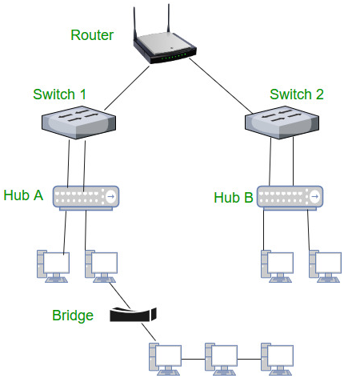

**허브(Hub)**

      - **정의:** 여러 대의 컴퓨터를 물리적으로 연결할 때 사용하는 장치
      - **역할:** 들어온 데이터를 연결된 모든 포트(컴퓨터)에 그대로 전송 브로드캐스트
      - **특징**
- 저렴하고 설치가 간단
        - 보안성이 낮다 모든 노드가 모든 데이터를 받는다
        - 데이터 충돌이 많고, 네트워크가 커질수록 속도 저하가 심하다

**스위치(Switch)**

      - **정의**: 허브와 비슷하게 여러 컴퓨터를 연결하지만, 더 똑똑하게 동작하는 장치
      - **역할**: 데이터가 목적지 컴퓨터로만 전달되도록 하여 대역폭을 효율적으로 사용
      - **특징**
- 각 포트별로 데이터를 분리해 충돌을 최소화
        - 네트워크 속도와 효율이 허브보다 훨씬 높음
        - 대규모 네트워크에 적합

**라우터** 

      - **정의**: 서로 다른 네트워크(LAN)를 연결해주는 장치
      - **역할**: 데이터가 목적지 네트워크로 갈 수 있도록 최적의 경로(길)를 찾아주는 역할
      - **특징**
- IP 주소를 기반으로 데이터 패킷을 라우팅(길 안내)
        - 인터넷 연결의 필수 장비
        - 방화벽, DHCP 등 다양한 부가 기능 제공

**브리지** 

      - **정의**: 두 개 이상의 네트워크 구간(세그먼트)을 연결하는 장치
      - **역할**: 네트워크를 분할하거나 확장할 때, 데이터를 필요한 곳으로만 전달
      - **특징**
- 네트워크 트래픽을 줄이고, 충돌 도메인을 분리
        - 계층 2(데이터 링크 계층)에서 동작
        - 예시: 1층과 2층의 네트워크를 연결할 때 사용

---

## **대역폭(bandwidth), 기본 단위**

1초당 처리할 수 있는 데이터의 양, 아래 그림에서 원통이 대역폭

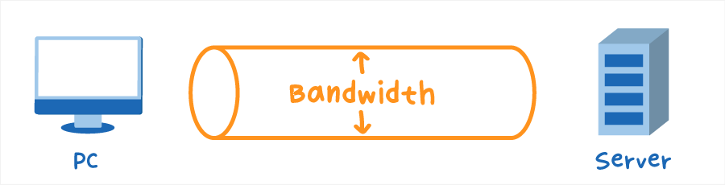

대역폭과 시간당 데이터의 처리량은 비례한다.

**대역폭을 구하는 수식**

**대역폭(bps, bit per second) = (용량 * 8) / 처리 시간**

수식에서 8을 곱하는 이유는 바이트(용량) → 비트(대역폭) 변환 

대역폭을 의미하는 단위가 bps 그중 b가 비트(bit)를 의미한다.

비트는 컴퓨터가 의사 소통하는 언어이다.

비트는 0과 1로 구성되어 있고 이것은 전기 신호로 변환되어 전송된다.

‘a’, ‘b’, ‘c’ 같은 로마자는 문자 하나가 1바이트 ‘가’, ‘나’ 같은 한글, 일본어의 문자는 하나가 2바이트

**바이트(byte) → 킬로바이트(Kilobyte) → 메가바이트(Megabyte) → 기가바이트(Gigabyte) → 테라바이트(Terabyte)**  각 단계는 1024배(2^10)를 곱한다.

| 단위 | 예시 |
| --- | --- |
| 비트 | 예/아니오 |
| 바이트 | 알파벳 1개 |
| 킬로바이트 | 몇 개의 텍스트 문단 |
| 메가바이트 | 1분 정도의 음원 |
| 기가바이트 | 30분 정도의 영화 |
| 테라바이트 | 영화 100~200편 |

---

---

## 연습 문제 

    - LAN
    - 버스형
- 하나의 허브를 두고 연결된 형태 → 스타형
      - 컴퓨터 ↔ 컴퓨터 원형 → 링형
      - 하나의 케이블로 연결 → 버스형
    - WAN
    - bps(bit per second) → 대역폭
    - 0, 1
    - 비트
    - 바이트

---

## 용어 정리 

**네트워크**

→ 각종 통신 장비들이 서로 그물망처럼 연결되어 데이터를 교환하거나 협력하여 일할 수 있게 해주는 통신망

**LAN**

→ 짧은 거리의 컴퓨터 혹은 주변 장치를 연결할 때 사용하는 네트워크

**WAN**

→ 2개 이상의 LAN 연결한 네트워크. 넓은 지역에서 광범위하게 통신 하고자 할 때 사용

**Hub**

→ 컴퓨터와 컴퓨터 사이, 네트워크 장비와 장비를 연결해주는 장치 

**대역폭(Babdwidth)**

→ 네트워크가 1초당 처리할 수 있는 데이터의 양

**스위치(Switch)**

→ 대역폭을 확대해주는 장치? 

**비트(Bit)**

→ 네트워크 통신에 있어서 가장 기본적인 단위

---

## 개요

네트워크를 이용하는 데 가장 기본이 되는 약속인 통신 규약에 대해서 알아본다.

**키워드** 

    - 프로토콜
    - OSI 7계층
    - TCP/IP 4계층
    - 캡슐화/역캡슐화
    - VPN

---

## 내용 정리

## 프로토콜이란? 

사용자 → 요청(request)         [www.google.com](http://www.google.com/) 사이트 

사용자 ← 응답(response)      [www.google.com](http://www.google.com/) 사이트 

사용자 → 접속                         [www.google.com](http://www.google.com/) 사이트 

사용자 ← 파일(페이지) 전송     [www.google.com](http://www.google.com/) 사이트 

컴퓨터 세계에서 형식적으로 나누는 인사 과정을 **프로토콜(protocol)**이라고 한다. 

**컴퓨터나 원거리 통신 장비 사이에서 메시지를 주고받는 양식과 규칙의 체계**

네트워크의 대표적인 프로토콜 OSI 7 계층,  TCP/IP 4 계층 

---

## OSI 7계층 등장 배경

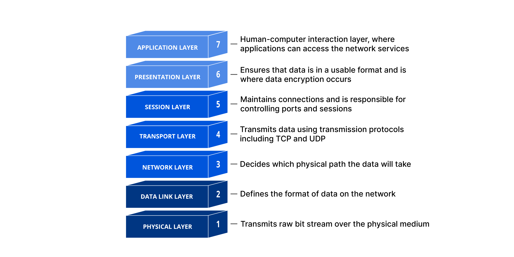

**OSI 7계층(Open Systems Interconnection 7 Layer) 모델**은 국제 표준화 기구(ISO)가 1970년대 후반~1980년대 초에 발표한 네트워크 통신 표준 모델이다.

      - **다양한 네트워크 시스템의 난립**
1980년대 초, 통신 기술이 발달하고 개인용 컴퓨터가 보급되면서, 서로 다른 제조사와 시스템 간에 네트워크 통신이 필요해졌다. 하지만 각 업체가 독자적으로 네트워크 장비와 프로토콜을 개발해, 시스템 간 호환성 문제가 심각했다.
      - **표준화의 필요성 대두**
네트워크 장비와 컴퓨터 간의 충돌과 비호환 문제를 해결하고, 다양한 시스템이 원활하게 통신할 수 있도록 하는 표준화된 모델의 필요성이 커졌다.
      - **ISO의 표준 모델 제안**
이에 따라 ISO는 네트워크 구조의 호환성을 높이고, 네트워크 간 통신 시스템을 통합하기 위한 표준 모델로 OSI 7계층을 제정했다. 이 모델은 네트워크 통신 과정을 7개의 계층으로 분리해 각 계층이 특정 기능을 담당하도록 설계되었다.

---

## OSI 7계층 

**OSI 7계층은 컴퓨터와 컴퓨터가 통신하는 구조를 7개의 계층으로 정의해둔 약속, 즉 프로토콜이다.**

| 계층  | 설명 |
| --- | --- |
| **7계층 / 응용 계층 (Application Layer)** | 사용자와 애플리케이션 간의 소통(이메일 보내기, 웹 사이트 방문) |
| **6계층 / 표현 계층 (Presentation Layer)** | 데이터를 어떻게 표현할지 정의(데이터의 압축, 데이터 암호화) |
| **5계층 / 세션 계층 (Session Layer)** | 통신을 설정, 관리, 종료(일반적으로 통신을 위한 세션을 체결) |
| **4계층 / 전송 계층 (Transport Layer)** | 신뢰성 있는 정확한 데이터 전달 |
| **3계층 / 네트워크 계층(Network Layer)** | 네트워크 장치 간의 경로 선택과 데이터 전송 |
| **2계층 / 데이터 링크 계층(Data Link Layer)** | 물리적인 연결을 통해 오류 없는 데이터 전달 |
| **1계층 / 물리 계층(Physical Layer)** | 전기 신호를 이용해서 통신 케이블로 데이터를 전송  |

송신자 관점에서 보면 7계층인 응용 계층에서 시작된 통신은 1계층인 물리 계층에서 끝난다.

반대로 수신자 관점에서는 물리 계층에서 시작하여 응용 계층에서 끝나는 흐름을 갖는다.

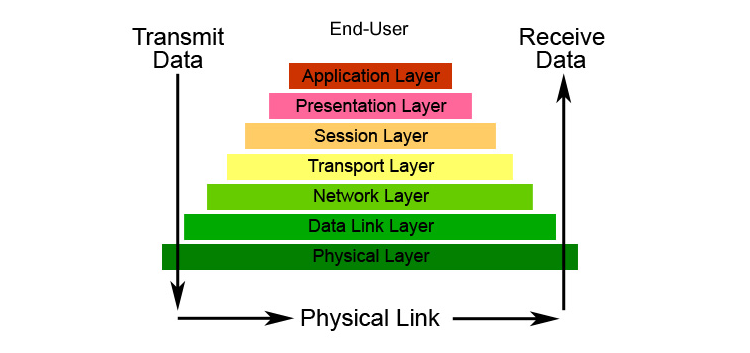

OSI 7 계층은 이론적인 표준안이다. 현실에 적용하기에는 계층이 너무 많다.

그래서 OSI 7 게층을 효율적으로 사용하기 위해 등장한 것이 TCP/IP 4 계층이다. 

따라서 **TCP/IP 4 계층을 사실상의 표준(De Facto Standard)이라고도 한다.**

---

## TCP/IP 4 계층


| **계층** | **설명** |
| --- | --- |
| 4계층 / 응용 계층  | 사용자와 애플리케이션 간의 소통 |
| 3계층 / 전송 계층  | 데이터의 전송 및 흐름에 있어 신뢰성 보장 |
| 2계층 / 인터넷 계층  | 물리적으로 데이터가 네트워크를 통해 어떻게 전송되는지를 정의 |
| 1계층 / 네트워크 인터페이스 계층 | 데이터를 전기 신호로 변환한 뒤 데이터 전송 |

---


**응용 계층 ~ 세션 계층:** ‘데이터’ 또는 ‘메시지’

**전송 계층:** ‘세그먼트’

**네트워크 계층:** ‘패킷’

**데이터 링크 계층:** ‘프레임’

**물리 계층:** ‘비트’


응용 계층(응용 계층 ~ 세션 계층)의 데이터는 말 그대로 데이터가 담겨 있다. 

예를 들어 이메일을 보낸다고 하면 이메일의 본문이 데이터가 될 것이다.

**이후 한 단계씩 아래로 내려가면서 통신을 위한 정보가 하나씩 추가로 붙게 된다.**

전송 계층, 세그먼트에서는 포트 번호 추가

네트워크 계층, 패킷에서는 송.수신자의 IP 주소 추가 

데이터 링크 계층, 프레임에서는 송.수신자의 MAC 주소 추가

**포트(port) 번호란 무엇인가?**

포트 번호란, 네트워크에서 한 컴퓨터(호스트) 내에서 실행 중인 여러 프로그램(프로세스) 중에서 어떤 프로그램과 통신할 것인지를 구분해 주는 논리적인 번호이다.

→ 포트 번호는 애플리케이션을 구분하기 위한 번호이다.

**IP 주소 (Internet Protocol Address) ?**

인터넷에 연결되어 있는 모든 장치(사용자 컴퓨터, 서버, 스마트폰)를 식별할 수 있도록 각각의 장치에 부여된 고유 주소이다. 

→ 다른 장치와 중복될 수 없다.

→ ex) 192.168.121.63

**MAC 주소** 

하드웨어 장치에 할당된 주소

→ 다른 장치와 중복되면 안 된다.

→ ex) 1C-1B-B5-08-A4-2A

**엥? IP 주소와 MAC 주소는 모두 고유 번호인데, 왜 2개나 필요할까?** 

사용하는 용도가 다르다. IP 주소는 KT, SKT, LG 등 인터넷 서비스에 가입하면 할당받는 주소이고 네트워크 계층에서 사용된다. 반면에 MAC 주소는 컴퓨터를 구매할 때부터 할당되어 있는 기기의 고유 번호이며 데이터 링크 계층에서 사용된다.

**IP 주소**는 논리적(소프트웨어적) 주소로, 네트워크 간 데이터 이동(라우팅)에 사용

**MAC 주소**는 물리적(하드웨어적) 주소로, 같은 네트워크 내에서 장치 식별에 사용

---

OSI 7 계층을 내려가면서 데이터에 정보가 하나씩 덧붙여진다.

이와 같이 **각 계층을 지나면서 덧붙여지는 정보를 헤더(header)라고 한다.**

**헤더가 추가되는 과정을 캡슐화라고 하며, 헤더가 분리되는 과정을 역캡슐화라고 한다.**

---

## 캡슐화 

미영이 컴퓨터 → 제우 컴퓨터 

미영이가 제우에게 이메일을 보내기 위해 필요한 것은 무엇일까?

2대의 컴퓨터가 통신을 하기 위해서는 **포트 번호, IP 주소, MAC 주소 정보**가 필요하다.

그리고 **캡슐화(Encapsulation)는 계층에 따라 이러한 정보를 담은 헤더를 데이터에 붙여나가는 과정을 의미한다.**

상대방에게 보내려는 데이터(이메일 본문)에 그 데이터를 보내기 위해 필요한 정보들을 헤더라는 이름으로 붙여나가는 것이다.

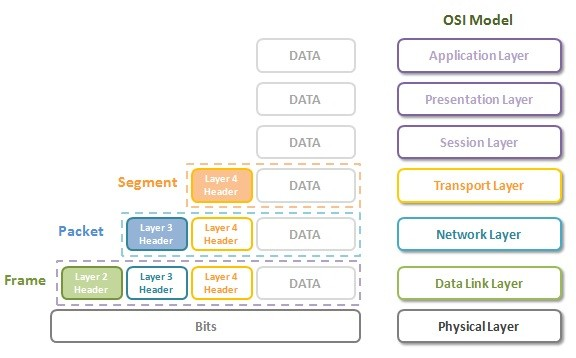

**헤더 정보** 

| 계층 | 헤더 정보 |
| --- | --- |
| 전송 계층 | 포트 정보 |
| 네트워크 계층 | 송수신자의 IP 정보 |
| 데이터 링크 계층 | 송수신자의 MAC 주소, 트레일러 |

데이터 링크 계층에서 추가되는 **트레일러(Trailer)** 정보는 전달한 데이터에 오류가 없는지 검출하기 위한 용도로 사용한다.

---

## 역캡슐화 

캡슐화가 계층을 지나면서 헤더 정보가 추가되는 것이라면, 반대로 **역캡슐화(Decapsulation)는 헤더 정보가 하나씩 벗겨지는 것을 말한다.**

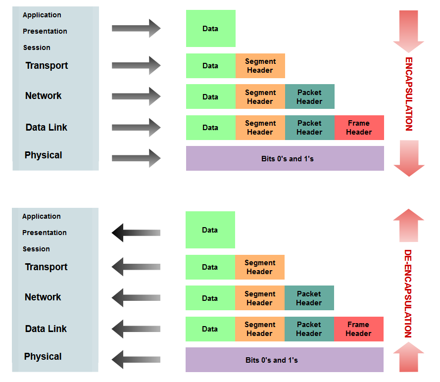

데이터 링크 계층에서의 역캡슐화는 트레일러 분리도 발생한다.

데이터 링크 계층에서 MAC 주소를 획득

네트워크 계층에서 IP 주소를 획득

전송 계층에서 포트 번호 획득

---

학교 네트워크에는 다양한 시스템이 존재한다. 학사 관리 시스템, 교직원 관리 시스템 등 수십 대의 시스템이 운영된다. 이 중에서는 학교의 기밀 정보인 중요한 정보가 담긴 시스템이 있고, 이러한 시스템은 외부에서 접근하지 못하도록 보안에 각별히 신경을 쓴다.

다음과 같은 상황을 가정해 보자.

      - 본교(서울) 제2 캠퍼스(대구)
      - 모든 시스템은 본교에 위치
      - 학사 관리 시스템에 개인정보 데이터(ex: 주민번호)가 있는 경우

이와 같은 상황에서 시스템이 본교에 위치하기 때문에 본교에 근무하는 교직원들은 바로 학사 관리 시스템에 접근할 수 있다. 하지만 제 2 캠퍼스에 근무하는 교직원들이 학사 관리 시스템에 접속하려면 VPN을 이용해서 학사 관리 시스템에 접속해야만 중요한 정보를 보호할 수 있다?

**VPN(Virtual Private Network)은 외부 네트워크(인터넷)와 내부 네트워크(본교)를 암호화된 터널로 연결**한다. 이를 통해 제2 캠퍼스에서 접속하는 교직원의 트래픽이 암호화되어 전송되므로, 중간에서 데이터가 유출되거나 도청당할 위험을 크게 줄일 수 있다.

**VPN을 사용하면 원격지(제2 캠퍼스)에서도 마치 본교 내부 네트워크에 직접 연결된 것처럼 시스템에 접근**할 수 있다. 이 방식은 원격 근무, 출장 등 다양한 상황에서 기업·기관의 민감한 시스템에 안전하게 접근하기 위해 표준적으로 사용된다.

**중요 정보 보호**

학사 관리 시스템에 주민등록번호 등 개인정보가 포함되어 있다면, 외부에서 일반 인터넷을 통해 직접 접속하게 할 경우 보안 위협이 매우 크다. VPN은 네트워크 구간 자체를 암호화하기 때문에, 외부 공격자나 해커가 데이터를 가로채더라도 내용을 해독할 수 없다.

**VPN?** 

**VPN(Virtual Private Network, 가상사설망)은 인터넷을 통해 데이터를 안전하게 전송하기 위한 기술**이다.

일반적으로 아래와 같은 방식으로 동작한다.

      1. **VPN 클라이언트 소프트웨어 설치:** 컴퓨터에 VPN 클라이언트 소프트웨어를 설치한다.
      1. **VPN 서버 연결 및 인증:** VPN 클라이언트 소프트웨어를 사용하여 VPN 서버에 연결한다. 이때 사용자 이름과 암호를 사용하여 인증을 한다.
      1. **데이터 암호화:** VPN 연결이 설정되면 모든 데이터는 암호화되어 전송된다. 이는 데이터가 인터넷을 통해 전송될 때 누구나 볼 수 없게 만들어준다.
      1. **터널링:** VPN은 암호화된 데이터를 전송하기 위해 터널링 기술을 사용한다. 터널링(Tunneling)이란 본교와 제2 캠퍼스 간에 마치 터널이 뚫린 것처럼 네트워크 사이에 통로를 생성하는 것을 말한다.
      1. **종료:** 이후 통신이 종료되면 VPN 터널은 해제되고 VPN 연결도 종료된다.

**VPN 종류** 

**IPSec(Internet Protocol Security) VPN**, **SSL(Secure Socket Layer)** **VPN** 2가지 종류

| 구분 | IPSec VPN | SSL VPN |
| --- | --- | --- |
| OSI 7 계층 | 3계층 | 4 ~ 7 계층 |
| 암호화 | IP 패킷 암호화  | 데이터 암호화 |
| 접속 방법 | 소프트웨어 설치하여 접속  | 웹 브라우저에서 접속 |

---

## 연습 문제

 1. 프로토콜

    1. OSI 7 계층
    1. TCP/IP 4 계층 → 인터넷 표준
    1. 세그먼트 
    1. 패킷, 프레임
    1. 트레일러 → 데이터 링크 계층
    1. 캡슐화
    1. IP, MAC
    1. 3계층 / 네트워크 계층
    1. 터널링 

---

## 용어 정리

**프로토콜(Protocol):** 컴퓨터나 원거리 통신 장비 사이에서 메시지를 주고받는 양식과 규칙의 체계

**OSI 7 계층:** OSI 7 계층은 컴퓨터와 컴퓨터가 통신하는 구조를 7개의 계층으로 정의해둔 약속, 프로토콜 

**TCP/IP 4 계층:** OSI 7 계층 이론을 기반으로 만들어진 사실상 인터넷 표준이다. 

**캡슐화:** 매 계층마다 데이터에 헤더 정보를 하나씩 추가하는 과정 (데이터 → 포트 정보 → IP 정보 → MAC 주소)

**트레일러(Trailer):** 데이터를 전달할 때 데이터의 마지막에 추가하는 정보로서 데이터의 오류를 검출하기 위한 용도로 사용된다.

**역캡슐화:** 데이터에서 헤더 정보를 하나씩 분리시키는 과정

**VPN:** VPN은 인터넷을 통해 데이터를 안전하게 전송하기 위한 기술

---

## 개요

OSI 7 계층에서 최하위에 위치한 물리 계층은 컴퓨터들을 물리적으로 연결하거나 데이터를 전기 신호로 변환하고 제어하는 역할을 담당한다.  데이터가 케이블을 통해 전달되는 방법에 대해 알아본다.

**키워드** 

    - 물리 계층 
    - 전기 신호 
    - 디지털 신호
    - 케이블
    - 리피터
    - 허브

**목표**

    - 물리 계층의 역할을 이해
    - 케이블 종류와 구조에 대해 이해
    - 리피터와 허브를 이해

---

## 내용 정리 

OSI 7 계층에서 최하위에 위치한 물리 계층은 컴퓨터들을 물리적으로 연결하거나 데이터를 전기 신호로 변환하고 제어하는 역할을 담당한다.

**전기 신호란?** 

전압이 일정한 패턴으로 변하여 생기는 일련의 흐름이다. 즉, 전압의 변화에 의한 신호이다. 2대의 컴퓨터는 전기 신호들을 주고받음으로써 사진이나 문서 등을 주고받을 수 있다.

### **전기 신호의 종류**

**아날로그 신호**

      - 빛, 소리 등과 같이 연속적으로 변하는 물결 모양의 신호
      - 유선 전화나 라디오 방송에서 사용

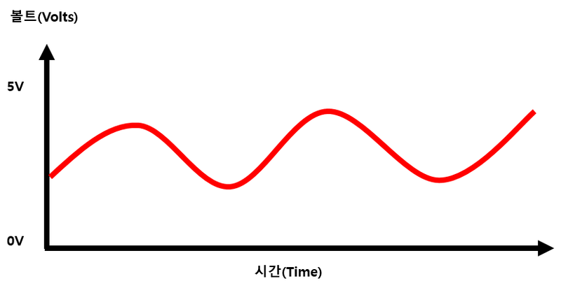

**디지털 신호**

      - 특정한 값을 기준으로 불연속적으로 변하는 막대 모양의 신호
      - 컴퓨터나 스마트폰에서 사용

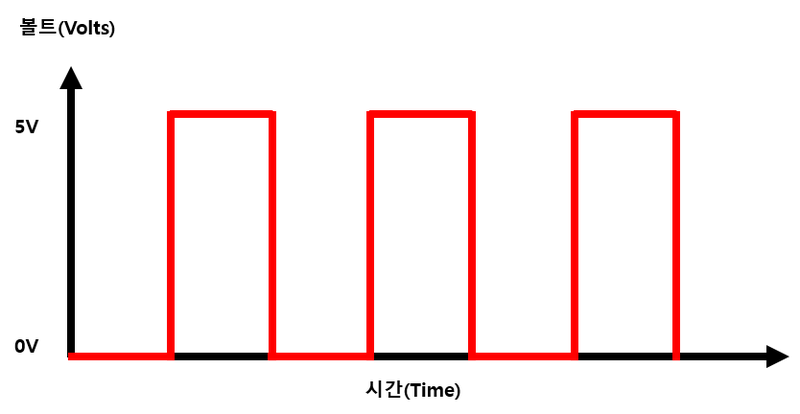

우리는 주로 디지털 신호를 사용한다. 디지털 신호를 이용해서 어떻게 데이터를 전달할까? 

물리 계층의 데이터는 비트이다. 비트란 컴퓨터가 데이터를 처리하는 최소 단위로서 0과 1로 구성된다.

올라가는 막대를 1로 표현하고 평면인 곳을 0으로 표현한다.

### 예시

송신자가 수신자에게 “network.docx 파일을 보내줘” 메시지를 보내고 싶으면 해당 문장을 0과 1의 비트로 변환하고 해당 비트를 전기 신호로 변환한 후 수신자에게 디지털 신호로 전달한다. 마지막으로 수신자 측에서는 전기 신호가 다시 0과 1의 비트로 변환된다.

**그렇다면 해당 메시지는 어떻게 그리고 어디서 전기 신호로 변환되는 것일까?** 

이 역할을 하는 것이 **랜 카드(LAN Card, NIC Network Interface Card)**라는 장치다. 

2대 이상의 컴퓨터가 통신하기 위해서는 LAN 네트워크 환경이 필요하고, 랜 카드는 내 컴퓨터와 인터넷을 연결하는 필수 장치다. 그리고 랜 카드에는 랜 케이블을 연결할 수 있는 구멍(랜 포트)가 있다.

따라서 랜 카드는 데이터가 물리적 전기 신호로 내 컴퓨터 밖으로 나가는 출발점이라고 할 수 있다.

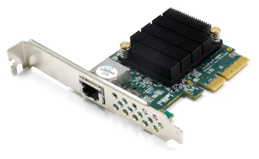

**랜 카드**가 0과 1의 비트를 전기 신호로 변환하여 밖으로 내보내는 출발점이라면, **케이블**은 그 신호를 전달하는 역할을 한다. **즉, 케이블은 컴퓨터, 서버, 라우터 및 다른 네트워크 장치 간에 데이터 신호를 전달하는 역을 한다.**

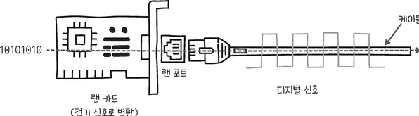

### 케이블 

케이블은 일반적으로 구리선(copper cable)이나 광섬유로 구성되며 내부 전선의 종류 및 구성에 따라 다양한 종류가 있다.

**TV 케이블로 많이 사용되는 동축 케이블은 중앙의 구리선에 흐르는 전기 신호로 데이터를 주고받는다.**

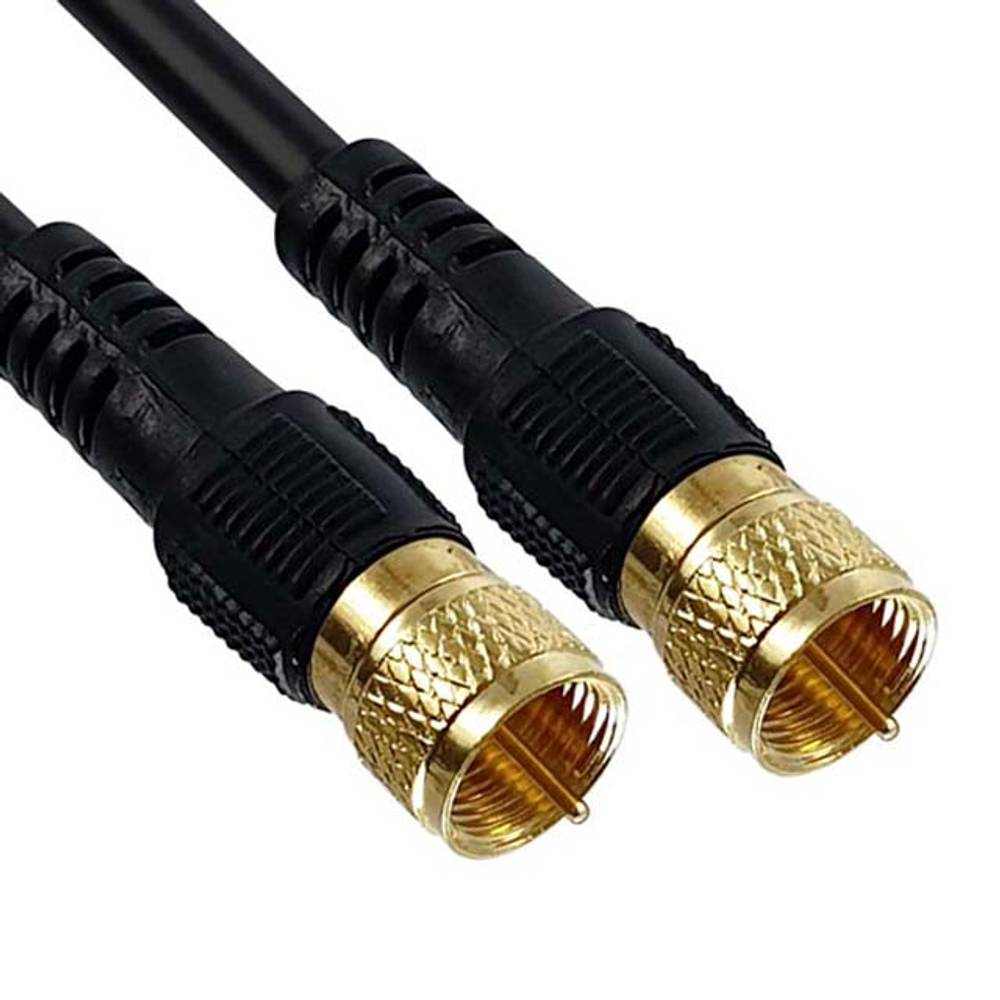

**컴퓨터에서는 꼬임선 또는 이중나선 케이블(Twisted Pair Cable)을 사용**한다.

꼬임선이란 말 그대로 몇 개의 전선을 꼬아서 만든 것이다.

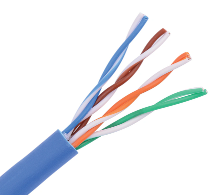

꼬임선 방식을 사용하는 케이블로는 UTP, FTP, STP가 존재한다.

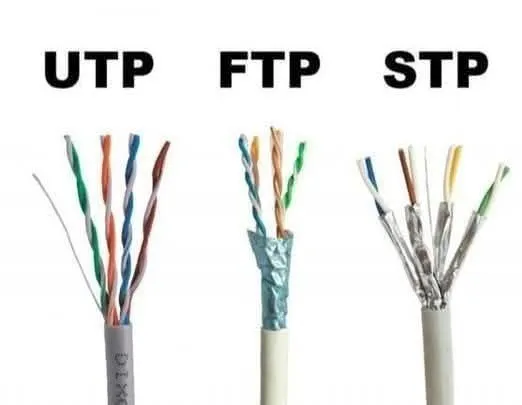

**UTP(Unshielded Twisted Pair) 케이블**

      - 감싸지 않은(Unshielded) 쌍으로 꼬인 선(Twisted Pair)

**왜? 전선을 꼬아서 사용할까?**

일반적으로 전선에 전류가 흐를 때 전파 간섭이 생기게 되는데 이 간섭을 줄이기 위해 전선을 꼬아서 사용한다.

**FTP(Foiled Twisted Pair) 케이블**

      - 알루미늄 은박이 네 가닥의 전선을 감싸고 있는 케이블
      - UTP 케이블에 비해 절연 기능이 좋기 때문에 공장의 배선 용도로 많이 사용된다.

**STP(Shielded Twisted Pair) 케이블**

      - 케이블 겉면에 외부 피복이 추가
      - 외부 피복을 실드라고 하는데, 실드는 외부의 잡음을 차단하거나 신호의 간섭을 줄이는 용도로 사용된다.
      - 가격이 UTP 케이블에 비해 비싸다.

UTP, STP 케이블은 컴퓨터끼리 통신하는 데 주로 사용되는 랜 케이블이다.

또한 STP는 잡음을 차단하기 때문에 데이터를 더 정확히 전달할 수 있다. 

잡음이 섞이면 아래와 같이 신호가 왜곡되게 된다.


### 리피터

**리피터(Repeater)는 전기 신호를 증폭하는 기능을 가진 네트워크 장치**

전기 신호를 전송할 때 거리가 멀어지면 신호가 감쇠되는 성질이 있는데 이때 감쇠된 신호를 재생하여 전달하는 장치가 리피터이다.

요즘에는 리피터를 사용하지 않는다. 이 기능을 허브에서 대신해주기 때문이다.

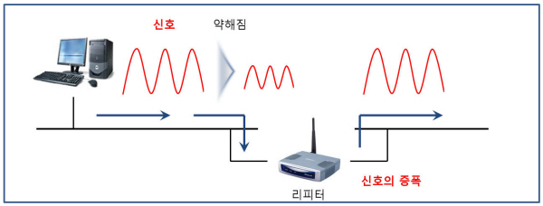

### 허브

허브는 리피터의 확장 버전이다. **허브(Hub)는 전송되는 데이터 신호를 정형하고 증폭하여 데이터 왜곡을 보정하며, 하나의 입력 신호를 여러 디바이스로 복제하여 데이터 분배 및 네트워크 확장을 지원한다.**

**또한, 데이터 충돌을 처리하여 데이터를 정상적으로 전달하도록 돕는다.**

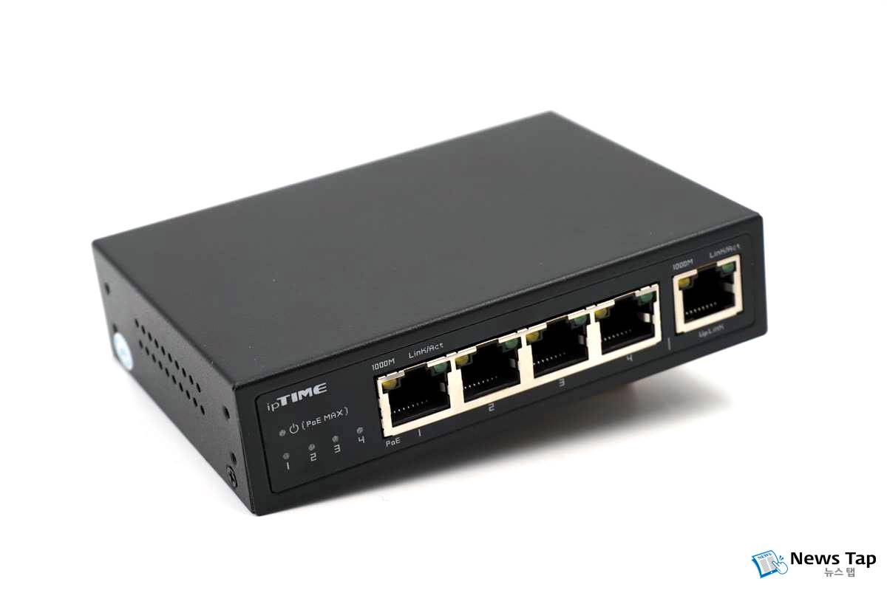

리피터가 일대일 통신만 가능하다면 허브는 포트를 여러 개 가지고 있기 때문에 여러 대의 컴퓨터와 연결할 수 있다. 그래서 요즘에는 리피터 대신 허브를 사용하고 있다.

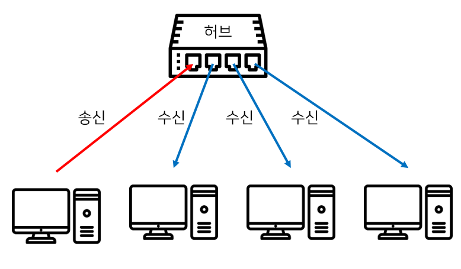

컴퓨터와 허브는 UTP(Unshielded Twisted Pair) 또는 STP(Shielded Twisted Pair) 케이블을 사용하여 연결한다.

각각의 컴퓨터가 허브로 데이터를 보낼 수 있다. 

그러면 **허브에 연결된 모든 컴퓨터가 데이터를 받는다. 이와 같이 허브는 특정 컴퓨터를 지정하여 데이터를 보낼 수 없다고 하여 “더미 허브(Dummy Hub)”라고도 부른다.**

| **구분** | **리피터(Repeater)** | **허브(Hub)** |
| --- | --- | --- |
| 기능 | 신호 증폭/재생 | 신호 증폭/재생 + 분배 |
| 연결 | 1:1(일대일) | 1:N(여러 대 동시 연결) |
| 데이터 분배 | 불가 | 가능(모두에게 전송) |
| 사용 용도 | 신호 연장 | 네트워크 확장 |
| 현대 사용 | 드묾 | 스위치로 대체됨 |

---

## 복습하기 

    1. 전기 신호
    1. 디지털 신호
    1. 랜 카드
    1. 케이블
    1. UTP, FTP, STP
    1. 허브 

**용어 정리** 

전기 신호: 전기 신호는 전압이 일정한 패턴으로 변하여 생기는 일련의 흐름

랜 카드: 랜 카드는 네트워크 환경에 내 컴퓨터와 인터넷을 연결하는 필수 장치 비트 데이터를 전기 신호로 변환

케이블: 보호 외피나 외장 안에 2개 이상의 전선이나, 광섬유로 묶여 있는 선

리피터: 전기 신호를 정형하고 증폭하는 기능을 가진 네트워크 장비

허브: 전기 신호를 정형하고 증폭, 하나의 입력 신호를 여러 디바이스에 복제하여 데이터를 전달

---

## 개요 

데이터 링크 계층은 데이터 전송의 신뢰성과 효율성을 담당한다.

MAC 주소가 통신에 어떻게 활용되는지에 대해 알아본다.

**키워드**

    - 데이터 링크 계층
    - 이더넷
    - MAC 주소
    - 스위치
    - 통신 방식

**목표** 

    - 데이터 링크 계층 역할 이해 
    - 이더넷 특징 이해
    - MAC 주소 이해
    - 스위치 이해 
    - 전송 방향에 따른 통신 방식 이해

---

## 내용 정리

### 개요 

데이터 링크 계층은 네트워크에서 데이터를 관리하고 전달하는 계층으로, 데이터 전송의 신뢰성과 효율성에 중요한 역할을 한다.

데이터 링크 계층은 데이터를 작은 프레임 단위로 분할하고, MAC 주소를 활용하여 장비를 식별한다.

네트워크에서 여러 기기가 동시에 데이터를 전송하려고 하면 신호 출동이 발생한다. 이 상황에서 데이터를 동시에 전송하면 여러 데이터가 충돌하게 되어 제대로 전달되지 않는다.

데이터 링크 계층은 이런 오류를 탐지하고 수정하는 역할을 하며, 데이터의 원활한 흐름과 네트워크 매체에서 충돌 관리도 수행한다.

**데이터 링크 계층에서 오류를 감지하거나 수정하는 방식으로는 회선 제어, 오류 제어, 흐름 제어가 있다.**

---

### 회선 제어(Line Control)

**회선 제어는 오류를 감지하기보다는 회피하는 방법으로 신호 간 충돌 현상이 발생하지 않도록 제어한다.**

**신호의 시작을 의미하는 ENQ(Enquiry)와 끝을 의미하는 EOT(End of Transmisson)를 명시적으로 지정**한다. **수신자는 송신자로부터 신호를 받으면 받았다는 의미의 ACK(Acknowledgment)를 송신자에게 보내서 신호를 정상적으로 수신하였음을 알린다.** 이러면 신호 간 충돌을 피할 수 있다.

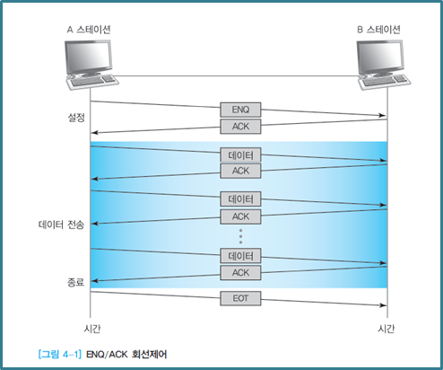

---

### 오류 제어(Error Control)

**오류 제어는 송수신 데이터가 외부 간섭, 시간 지연 등에 의해 데이터가 변형되거나 순서가 어긋나는 듯의 통신 장애가 발생하지 않도록 오류를 검출하고 정정하여 통신에 대한 신뢰성을 확보하는 방법이다.**

오류 검사로 사용되는 것 중에 패리티 검사가 있다.

**패리티 검사(parity check)**는 수신자에게 보내는 최종 데이터의 1의 개수를 짝수 개로 보낼지(even parity), 홀수 개로 보낼지(odd parity) 송수신자가 미리 약속하고 여부의 비트(패리티 비트)를 채워 보내는 방법이다. 

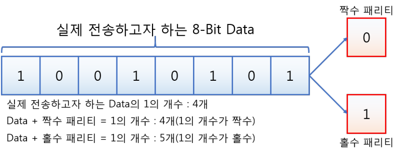

전송 데이터: 10010101

      - 짝수 패리티: 100101010
      - 홀수 패리티: 100101011

**패리티 검사 장점, 단점** 

      - 구현이 매우 간단하고, 하드웨어/소프트웨어 모두 쉽게 적용 가능
      - 오버헤드가 적다(1개의 비트만 추가)
      - 다중 비트 오류(2개 이상 비트가 동시에 바뀌는 경우)는 검출이 불가능할 수 있음
      - 오류의 위치를 알 수 없고, 오류 정정은 불가능함

오류 제어에는 패리티 검사 외에도 **CRC(Cyclic Redundancy Check), 검사합(Checksum)** 방식도 있다.

**CRC 방식**은 데이터에 CRC 코드를 추가하여 오류를 감지하는 방법으로, 송신자가 CRC 코드를 생성하고 수신자 측에서도 동일한 계산을 수행하여 일치 여부를 확인한다. 

**체크섬 방식**은 데이터의 각 바이트 값을 더하거나 연산하여 생성되는 값이다.

송신자가 데이터와 관련된 검사합을 계산하고 순사자 측에서도 동일한 계산을 수행하여 체크섬 값이 일치하는지 확인한다. 또한 오류가 발생한 경우 이를 정정하는 방법으로 **해밍 코드(Hamming code)**를 사용한다.

해밍 코드는 데이터에 추가적인 패리티 비트를 포함시켜, 이 패리티 비트들을 데이터 비트와 조합하여 구성한다.

패리티 비트를 분석하여 오류가 발생한 비트를 식별하고, 해당 비트의 값을 수정함으로써 오류를 정정한다.

---

### 흐름 제어(Flow Control)

흐름 제어는 송신자와 수신자의 데이터 처리 속도 차이를 해결하기 위해 수신자 상황에 따라 송신자의 데이터 전송량을 조정하는 방법이다. 

흐름 제어로 사용되는 방법 중 하나가 정지-대기(Stop & Wait)이다. 

송신자가 하나의 데이터를 전송한 후 다음 데이터를 전달하기 전에 응답을 기다리는 방법이다.

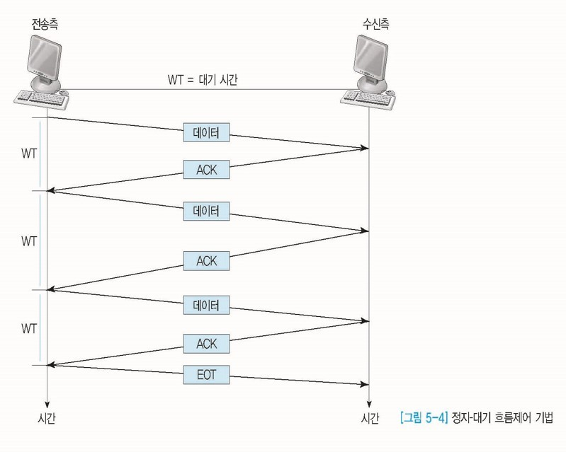

---

### 참고 

오류 제어와 흐름제어는 전송 계층에서도 사용된다.

---

**이더넷(Ethernet)이란 다수의 컴퓨터, 허브, 스위치 등을 하나의 인터넷 케이블에 연결한 구조**이다.

이더넷은 **CSMA/CD(Carrier Sense Multiple Access/Collision Detection) 프로토콜**을 사용한다.

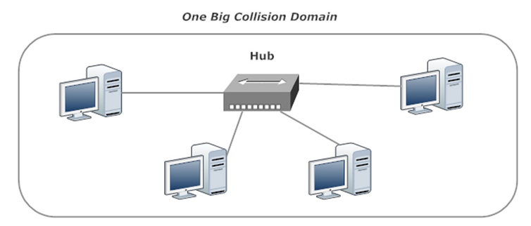

제일 왼쪽부터 제일 오른쪽까지의 컴퓨터의 이름을 각각 A, B, C, D라고 가정하자

각 컴퓨터들은 모두 허브에 묶여있다.

컴퓨터 A가 컴퓨터 B에게 network.dock 파일을 보내려고 한다.

동시에 컴퓨터 C는 컴퓨터 B에게 secutity.dock 파일을 보내려고 한다.

즉, 컴퓨터 B는 동시에 A와 B에게 데이터를 받아야 한다.

이처럼 **2대 이상의 컴퓨터가 동시에 데이터(프레임)를 보내는 상황을 충돌(collision)**이라고 한다.

이러한 **충돌을 방지하기 위해 이더넷에서는 전류의 강도를 확인해 케이블이 사용 중인지 확인하는 CSMA/CD 방식을 사용**한다. 송신 전에 케이블이 사용 가능한지 **확인하고(Carrier Sense)**, 사용 가능하면 데이터를 **전송(Multiple Access)**한다. 또한 전송 후에도 여전히 발생할 수 있는 **충돌을 확인(Collision Detection)**하는 것이 CSMA/CD 방식이다. 한마디로 각각의 컴퓨터는 데이터를 보내기 위해 눈치 게임을 하고 있는 것이다.

**CSMA/CD 케이블 사용 가능 확인 방식 3가지**

      - **1-persistent** 
- 케이블이 사용 중인지 상태를 계속 확인하다가 아무도 사용하지 않는 상태이면 바로 데이터 전송
        - 하지만 동시에 다른 컴퓨터에서도 보낼 가능성이 높기 때문에 충돌 위험성이 가장 높다.
      - **nonpersistent**
- 누구도 케이블을 사용하고 있지 않다면 데이터를 바로 보내고 그렇지 않다면 임의의 시간을 기다렸다가 상태를 다시 확인한다. 
        - 1-persistent 보다 충돌 위험이 낮다.
      - **p-persistent**
- 케이블이 사용 중이면 기다렸다가 다시 상태를 확인하고 아무도 사용하고 있지 않다면 일정 확률로 데이터를 전송

**현대의 CSMA/CD** 

현재는 잘 사용하지 않는 기술이다. 2계층에 해당하는 스위치 장비가 허브 역할을 대신하고 있기 때문이다.

**MAC(Media Access Control) 주소는 랜 카드에 할당된 값**이며, **전 세계에서 하나밖에 존재하지 않는 고유한 값이다. MAC 주소는 48비트로 표현**된다. **상위 24비트는 OUI(Organizational Unique Identifier), 랜 카드 제조사에 부여된 코드**이며 **나머지 24비트는 UAA(Universally Administered Address)라고 하여 제조사가 랜 카드에 부여한 고유 번호**이다.

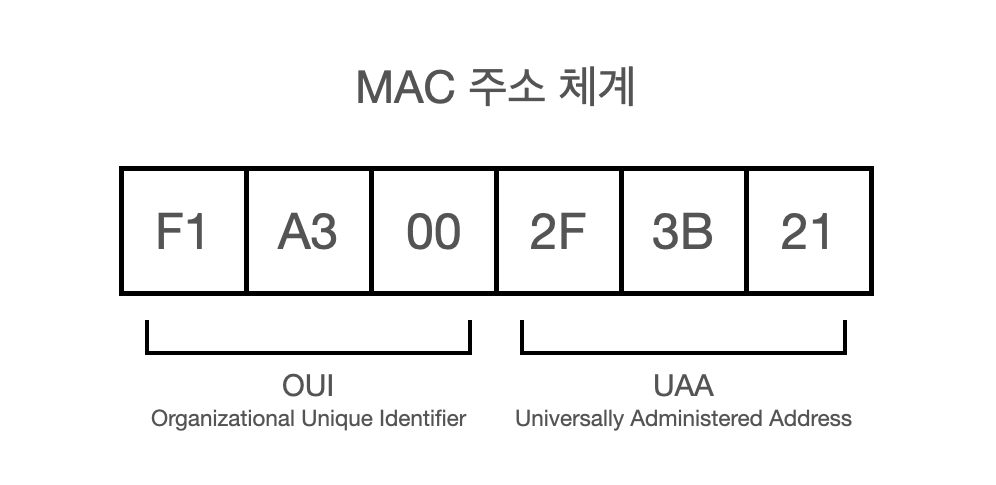

MAC 주소는 8비트 단위로 콜론(:) 또는 하이픈(-)을 사용해 16진수로 표기한다.

→ F1:A3:00:2F:3B:21

**컴퓨터가 데이터를 보낼 때 OSI 7 계층의 2계층에서는 어떤 일들이 발생할까?**

MAC 주소를 헤더에 넣어서 프레임을 생성한다.

헤더에는 송신자의 MAC 주소, 수신자의 MAC 주소가 함께 프레임에 추가된다.

또한 유형이라는 정보도 추가되는데 이것은 프로토콜을 나타낸다. 

프로토콜 종류에는 IPv4, ARP, IPv6 등이 존재한다.

**IPv4**는 현재 우리가 사용하는 32비트의 일반적인 IP 주소를 의미하며, **IPv6**는 IPv4의 주소 부족 문제를 해결하기 위해 등장한 128비트의 IP 주소이다. **ARP**는 IP 주소와 MAC 주소를 매핑해주는 프로토콜이다.

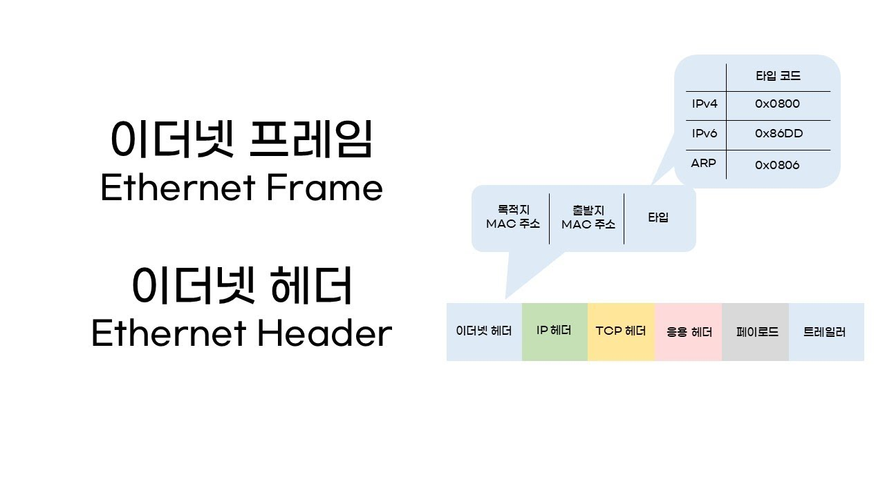

**Q: 내(출발지) MAC 주소는 알고 있는 정보라 해도, 상대방(목적지)의 MAC 주소는 어떻게 알 수 있을까?**

**A: ARP**

ARP 프로토콜은 IP 주소에 해당하는 MAC 주소를 알고자 할 때 사용한다.

**즉, ARP(Address Resolution Protocol)는 IP 주소와 MAC 주소를 매핑하기 위한 프로토콜**이다.

**ARP 예제** 

컴퓨터 A(IP 주소: 192.168.0.2)가 컴퓨터 B(IP 주소: 192.168.0.3)에게 데이터를 전송하려고 한다.

      1. 컴퓨터 A는 같은 허브에 묶여 있는 모든 컴퓨터에게 192.168.0.3이라는 IP 주소의 MAC 주소를 묻는다.
이렇게 **모든 컴퓨터에게 질의하는 것을 브로드캐스트(Broadcast)**라고 하며, **MAC 주소를 묻는 것을 ARP 요청(ARP Request)**이라고 한다.
      1. 모든 컴퓨터는 자신의 IP를 192.168.0.3과 비교한다. IP 주소가 192.168.0.3인 컴퓨터 B가 컴퓨터 A의 요청을 응답한다.이때 컴퓨터 B는 **MAC 주소를 전달한다. 이것을 ARP 응답(ARP Reply)**라고 한다.
이후 컴퓨터 A는 컴퓨터 B의 **IP와 MAC 주소를 메모리에 저장하는데 이것을 ARP 테이블(ARP Table)**이라고 한다. 앞으로 컴퓨터 A가 컴퓨터 B와 통신하고자 할 때에는 일일이 물어보는 것이 아니라 자신의 ARP 테이블을 참조한다.
      1. 이제 컴퓨터 A는 컴퓨터 B의 MAC 주소를 알게 되었으므로 2대의 컴퓨터는 통신이 가능한 상태가 된다.

핵심 개념: ARP Request, ARP Reply, ARP Table

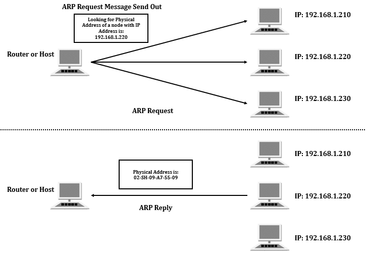

**ARP 테이블 확인하기**

```bash
arp -a 
```

이때 MAC 주소 확인은 LAN 내에서만 가능하다. WAN 환경에서의 MAC 주소 확인은 라우터 장비를 거쳐야만 확인할 수 있다. **WAN 환경에서의 상대 컴퓨터(즉, 다른 네트워크에 있는 컴퓨터) MAC 주소는 내 컴퓨터의 ARP 테이블에 저장되지 않는다.** 그 이유는 저장해도 의미가 없기 때문이다. 라우터 ↔ 라우터 통신에서의 주소 찾기는 IP 주소를 기반으로 하기 때문이다.

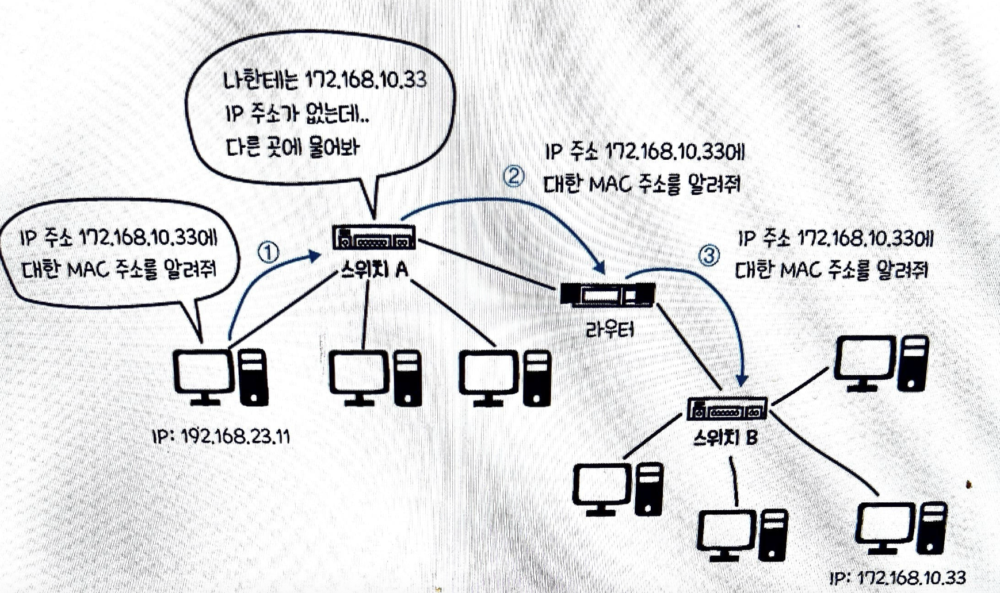

---

### 스위치의 구조

스위치의 기능은 허브와 크게 다르지 않다. 하지만 허브의 경우 컴퓨터에서 데이터를 보내면 허브에 물려 있던 모든 컴퓨터에 그 데이터가 전송된다. 이 방식은 비효율적인 방법이다. 데이터를 받아야 하는 컴퓨터에게만 데이터가 전달되면 충분하기 때문이다. 그래서 이런 단점을 개선한 스위치가 등장했다.

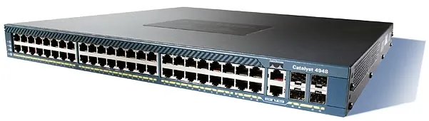

스위치는 소규모 네트워크 안에서 컴퓨터, 프린터 등 모든 장치를 서로 연결해서 데이터를 쉽게 공유할 수 있도록 하는 장비이다. 스위치는 그림과 같이 여러 개의 포트로 구성된다. 

---

### 스위치에서 MAC 테이블 관리하기

스위치는 허브와 같이 컴퓨터나 프린트 등을 연결하여 데이터를 공유하는 것 외에 또 다른 기능이 있다.

스위치 포트에 연결된 컴퓨터 MAC 주소를 관리한다. “1번 포트의 MAC 주소는 무엇이다” 형태의 테이블로 관리하는데, 이것을 MAC 테이블이라고 한다.

스위치는 처음부터 모든 컴퓨터의 MAC 주소를 가지고 있는 것은 아니다.

따라서 가장 먼저 해야 할 일은 MAC 테이블에 필요한 컴퓨터의 MAC 주소를 추가하는 것이다.

      1. 컴퓨터1이 컴퓨터4와 통신을 시도한다.
      1. 스위치는 자신의 MAC 테이블에 컴퓨터4의 MAC 주소가 없다는 것을 확인한다. 이후 컴퓨터1이 보낸 데이터를 컴퓨터2, 컴퓨터3, 컴퓨터4에게 보낸다. 이와 같이 **스위치에 몰려 있는 모든 컴퓨터에게 데이터를 보내는 것을 플러딩(Flooding)**이라고 한다.
      1. 컴퓨터2, 컴퓨터3, 컴퓨터4가 스위치에 응답하면서 자신의 MAC주소를 알려준다. 이제 스위치는 이렇게 받은 MAC 주소를 MAC 테이블에 업데이트한다.
      1. 이제 스위치는 컴퓨터3의 MAC 주소를 컴퓨터1에게 알려준다. 이후 2대의 컴퓨터가 서로 통신을 한다.

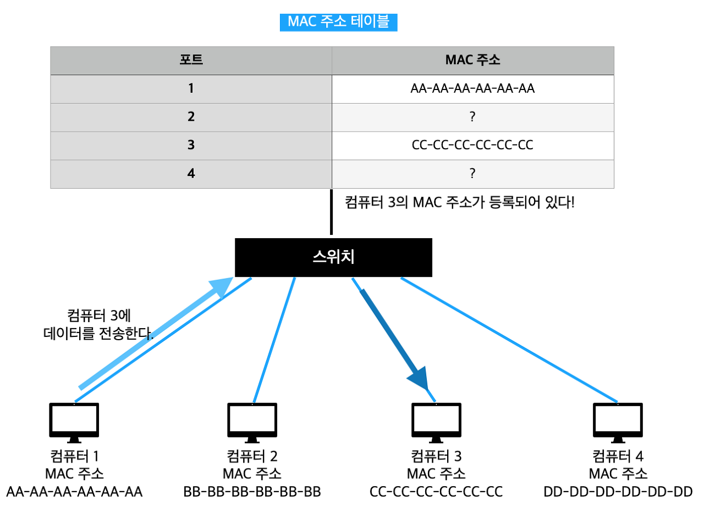

스위치에 업데이트된 MAC 테이블은 다음처럼 이용한다.

      1. 컴퓨터1은 컴퓨터3에게 데이터를 보내고자 한다. 이때 컴퓨터 1의 ARP 테이블에는 컴퓨터3의 MAC 주소가 없다(가정) 그래서 스위치에게 질의한다.
      1. 스위치는 자신의 MAC 테이블에서 컴퓨터 3의 MAC 주소를 확인한 후 컴퓨터1에게 전달한다.
      1. 이제 컴퓨터1, 컴퓨터3은 서로 통신하면 되므로 컴퓨터1의 질의는 더 이상 컴퓨터2, 4에게 전달되지 않는다. 이것을 **MAC 주소 필터링(Filtering)**이라고 한다.

---

네트워크에서 충돌(Collision)이란 두 대 이상의 장치가 동시에 데이터를 전송하려고 할 때, 전송 신호가 서로 겹쳐 데이터가 손상되는 현상을 말한다. 이러한 현상이 발생하는 이유는 컴퓨터 간에 단방향 통신을 하기 때문이다. **단방향 통신(Simplex Transmission)**은 선로가 하나만 있어서 일반 통행만 가능하다.

일반적으로 데이터를 전송하는 TV, 라디오에서 주로 사용하는 방식이다. 네트워크에서는 이 선로를 채널(Channel)이라고 한다.

그런데 단방향 통신은 상당히 비효율적이다. 그래서 **양방향 통신(Duplex Transmission)**이 등장했다.

양방향 통신은 하나의 통신 채널에서 송수신이 모두 가능한 방식으로, 반이중 방식과 전이중 방식 2가지 종류가 있다. 

**반이중(Half Duplex) 방식은 양쪽 방향으로 통신이 가능하지만 동시에 통신할 수는 없다.** 즉, 한쪽에서 데이터를 보내면 다른쪽에서는 수신만 가능하다. 송신과 수신을 번갈아가면서 통신하기 때문에 데이터 전송 속도가 빠르며, 주로 허브에서 사용하는 방식이다. 속도는 조금 빨라졌을지 몰라도 충돌 문제는 여전히 남아있다

**충돌이 발생할 때 그 영향이 미치는 범위를 충돌 도메인(Collision Domain)**이라고 한다.

예를 들어, 하나의 허브에 컴퓨터들이 연결되어 있다면 여기에 연결된 모든 컴퓨터가 충돌 도메인이 된다.

**전이중(Full Duplex) 방식은 채널을 2개 두어서 양쪽 방향에서 동시에 데이터를 주고받을 수 있는 방식이며 스위치에서 사용**된다. 전이중 방식의 경우 채널을 2개 사용하기 때문에 충돌 문제를 해결할 수 있다.

**정리** 

      - 단방향 통신(Simplex Transmission): 선로(Channel)에서 통신 방향이 단방향
      - 양방향 통신(Duplex Transmission): 선로(Channel)에서 통신 방향이 양방향
- 반이중 방식(Half Duplex): 여전히 충돌 발생, 충돌 도메인(Collision Domain)
        - 전이중 방식(Full Duplex): 채널 2개로 양방향 통신 + 충돌 X

---

---

## 복습하기

    1. 회선 제어(Line Control), 오류 제어(Error Control), 흐름 제어(Flow Control)
    1. 패리티 검사
    1. 흐름 제어
    1. 충돌
    1. OUI(Organization Unique Identifier) 24 비트 / UAA (Universally Administered Address ) 24 비트
    1. ARP(Address Resolution Protocol) 
    1. MAC 테이블
    1. 플러딩(Flooding)
    1. 채널

**이더넷(Ethernet):** 이더넷이란 하나의 인터넷 회선에 허브, 스위치 등을 연결하고, 이후 여기에 다수의 컴퓨터를 또다시 연결한 네트워크 구조

**CSMA/CD(Carrier Sense Multiple Access/Collision Detection):** CSMA/CD는 전류의 강도를 통해 케이블이 사용 중인지 확인하여 충돌을 해결하는 방식(허브에서 사용)

**MAC(Media Address Control) 주소:** MAC 주소는 랜 카드에 할당된 전 세계에서 하나밖에 존재하지 않는 고유한 값이다.

**ARP(Address Resolution Protocol):** IP 주소와 MAC 주소를 매핑하기 위한 프로토콜

**반이중 방식(Half Duplex):** 반이중 방식은 양쪽 방향에서 통신이 가능하지만 동시에는 통신이 불가능한 구조

**전이중 방식(Full Duplex):** 전이중 방식은 채널을 2개 두어서 양쪽 방향에서 동시에 데이터를 주고받을 수 있는 방식으로 스위치에서 사용된다.

---

물리 계층: 비트 (랜 카드, 케이블: UTP, FTP, STP)

데이터 링크 계층: 프레임 (ARP, 이더넷, MAC, 스위치, 허브, Simplex Transmission, Duplex Transmissin, CSMA/CD)

네트워크 계층: 패킷 

전송 계층: 세그먼트 

세션 계층: 데이터

표현 계층: 데이터

애플리케이션 계층 응용 계층: 데이터

## 개요 

네트워크 계층 송신자의 데이터를 수신자에게 전달하기 위한 경로를 찾아주는 역할을 한다.

라우터를 이용해서 경로를 어떻게 찾는지에 대해 알아본다. 

**키워드**

    - 네트워크 계층 
    - IP 주소 구조
    - IP 주소 클래스
    - 브로드 캐스트
    - 서브넷 
    - 서브넷 마스크

**목표** 

    - 네트워크 계층의 역할을 이해
    - IP 주소와 IP 주소 클래스에 대해 이해
    - 서브넷과 서브넷 마스크 이해
    - 라우터의 동작 방식을 이해

---

## 내용정리 

A 학교에 미영이라는 학생이 있다. B 학교에는 도준이라는 학생이 있다.

미영이는 도준이에게 이메일을 보내야 하는 상황이다.

미영이는 자신이 속해 있는 A 학교의 스위치에게 도준이가 사용하는 컴퓨터의 MAC 주소를 질의한다.

하지만 스위치는 도준이가 사용하는 컴퓨터의 MAC 주소를 알 수 없다. 도준이는 B 학교의 스위치에 연결되어 있기 때문이다.

즉, 스위치만으로는 미영이와 도준이가 통신할 수 있는 방법이 없다. 이때 필요한 장비가 라우터라는 장비이다.

**라우터(Router)는 데이터가 어떤 경로로 전달되어야 하는지를 알려주는 내비게이션과 같은 역할**을 한다.

어떤 길이 가장 빠른지 결정하는 것이다. **어떤 길이 가장 빠른 길인지 찾는 과정을 라우팅(Routing)**이라고 한다.

라우터는 스위치와는 다르게 IP 주소를 이용해서 통신을 한다.


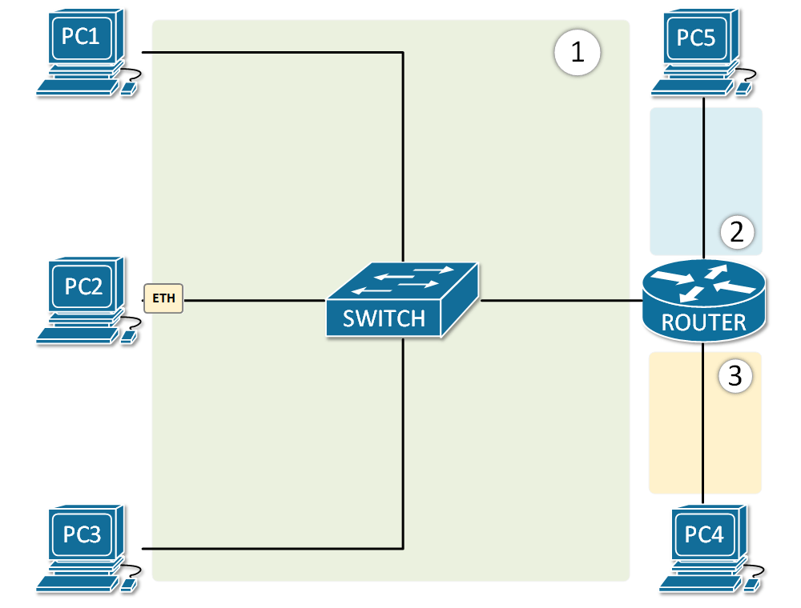

**LAN: PC1, PC2, PC3 ↔ SWITCH: MAC 주소로 통신**

**WAN: ROUTER ↔ ROUTER: IP 주소로 통신**

---

### IP & ISP

랜 환경에서는 스위치를 이용해 MAC 주소로 통신한다.

왠 환경에서는 라우터를 이용해 IP 주소로 통신한다.

**IP(Internet Protocol) 주소는 인터넷상에 있는 컴퓨터의 고유한 주소이다.**

따라서 IP를 통해서 한 컴퓨터에서 다른 컴퓨터로 데이터를 주고받을 수 있다. IP 주소는 어떻게 할당받는 것일까?

분명 컴퓨터를 구매할 때 자동으로 부여된 번호는 랜 카드 주소(MAC 주소)뿐이었다.

우리가 인터넷을 하기 위해서는 **인터넷 서비스 제공자(ISP, Internet Service Provider)**라고 하는 SKT, KT, LG U+ 등과 같은 회사에 인터넷 설치를 신청한다. 그럼 인터넷 서비스 제공자와 내 컴퓨터가 연결되며, 더불어 공인 IP가 하나 부여된다. 공엔 IP가 인터넷을 할 수 있는 IP 주소이다.

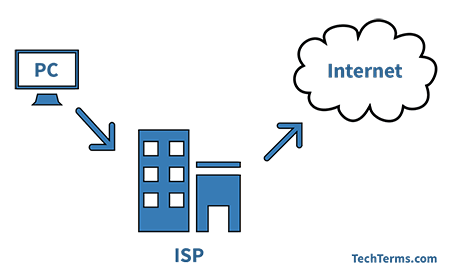

---

### 공인 IP & 사설 IP

네트워크에서 사용 목적과 방법에 따라 공인 IP와 사설 IP가 있다.

**공인 IP(Public IP)**

공인 IP는 인터넷 서비스 제공자에 의해 전 세계적으로 고유하게 할당되는 IP 주소이다.

이 주소를 이용해서 전 세계의 컴퓨터와 통신을 할 수 있다. 대부분의 인터넷 서비스 제공자들은 유동적으로 공인 IP 주소를 할당한다. 한마디로 한번 제공받은 공인 IP는 영구적으로 사용할 수 있는 것이 아니라 주기적으로 변경된다는 의미이다.

**사설 IP(Private IP)**

사설 IP는 주로 기업 내부에서만 사용되는 IP 주소로, 기업 밖에 위치한 컴퓨터와는 통신이 되지 않는다. 

---

### IP 형식

부여된 IP 형식은 다음과 같은 형식을 갖는다.

11000000 10101000 00000010 01111100 (32비트)

하지만 명령 프롬프트 창에서 ipconfig라고 입력하면 다른 형식이 나온다.

      1. 11000000 10101000 00000010 01111100 
      1. 192.168.2.124

이 둘은 동일한 의미를 다르게 표현했을 뿐이다. 1번은 2진수로 표현한 것이고, 2번은 10진수로 표현한 것뿐이다.

IP 주소 길이는 4바이트, 즉 32비트로 되어있다. IP 주소를 표기할 때는 2진수가 아닌 10진수로 표기하기 때문에

IP 주소의 범위는 0.0.0.0~255.255.255.255 이다.

**보통 1바이트의 가장 작은 수인 0과 가장 큰 수인 255는 용도가 정해져 있기 때문에 컴퓨터 IP 주소로 사용하지 않는다.** 아래와 같이 **마지막 1바이트가 0인 주소를 네트워크 주소라고 한다. 네트워크 주소는 일반적으로 하나의 네트워크를 통칭하기 위해 사용되는 주소이다.**

```
# 네트워크 주소
192.168.2.0
```

예를 들어 하나의 라우터에 묶여 있는 컴퓨터들의 IP가 192.168.2.11 ~ 192.168.2.14 라고 가정해 보자.

그러면 네트워크 주소는 192.168.2.0이 된다. IP 192.168.2.11 ~ 192.168.2.14는 같은 IP 대역을 사용한다.

또한, 다음과 같이 **마지막 1바이트가 255인 경우를 브로드캐스트 주소라고 한다. 브로드캐스트 주소는 네트워크에 연결된 컴퓨터에 데이터를 한 번에 일괄적으로 전송할 때 사용하는 주소**이다.

```
# 브로드캐스트 주소 
192.168.2.255
```

예를 들어 192.168.2.0이라는 네트워크 주소를 갖는 네트워크가 있다고 가정해 보자. 192.168.2.10이라는 IP를 갖는 컴퓨터가 자신이 속해 있는 모든 컴퓨터에 데이터를 보내고자 할 때 사용되는 IP 주소는 192.168.2.255가 된다.

---

### IP 주소의 구조

IP 주소는 아래와 같은 형태이다.

→ 192.168.2.124

IP 주소에는 많은 정보가 포함되어 있다. IP 주소에는 다음과 같이 네트워크 ID와 호스트 ID로 구분할 수 있다.

호스트 ID는 라우터에 연결된 개별 컴퓨터들을 관리하기 위해 사용된다. 즉, 호스트 ID는 개발 컴퓨터들이 사용하는 것이고, 네트워크 ID는 컴퓨터가 많을 경우 관리의 어려움이 있기 때문에 네트워크의 범위를 지정해 관리를 쉽게 하기 위해 사용한다.

**192.168.2.****124**

      - 파란색: 네트워크 ID
      - 주황색: 호스트 ID

예를 들어 네트워크 A에 포함된 컴퓨터 A, 컴퓨터 B, 컴퓨터 C의 IP 주소가 다음과 같다.

      - 컴퓨터 A: 192.168.1.2
      - 컴퓨터 A: 192.168.1.3
      - 컴퓨터 C: 192.168.1.4

이때 컴퓨터 A의 네트워크 ID와 호스트 ID는 아래와 같다.

컴퓨터 A: **192.168.1****.2**

      - 파란색: 네트워크 ID
      - 주황색: 호스트 ID

---

### IP 주소의 클래스

공인 IP 주소에는 A부터 E까지 5개의 클래스가 있다. 하지만 D, E는 일반인을 위한 것이 아니기 때문에 A, B, C 클래스만 유효하다.

A 클래스는 하나의 네트워크가 가질 수 있는 호스트 ID가 가장 많은 클래스이다. A 클래스에 속한 컴퓨터에 할당해줄 수 있는 IP의 개수는 16,777,214개이다. (2^24 - 2(브로드 캐스트, 네트워크 주소))

첫 8비트는 네트워크 ID를 의미하고 나머지 24비트는 호스트 ID를 의미한다.

B 클래스는 처음 16비트가 네트워크 ID, 나머지 16비트는 호스트 ID

C 클래스는 마지막 8비트만 호스트 ID, 나머지 24비트는 네트워크 ID이다.

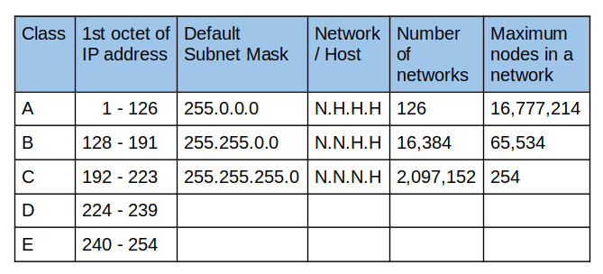

**전 세계의 IP 주소를 관리하는 기관은 IANA(Internet Assigned Numbers Authority)**이다.

우리나라의 경우 **KISA(Korea Internet & Security Agency, 한국인터넷진흥원)**에서 IANA으로부터 IP 대역을 할당받아온다. 이후 KISA는 IP 주소를 인터넷 서비스 제공업체(ISP, ex: KT, SKT)에게 다시 할당해주면 인터넷 서비스 제공업체가 개인이나 학교/기업에 다시 할당해주는 구조이다.

IANS → KISA → ISP(SKT, LG U+, KT) → 개인/학교/회사

---

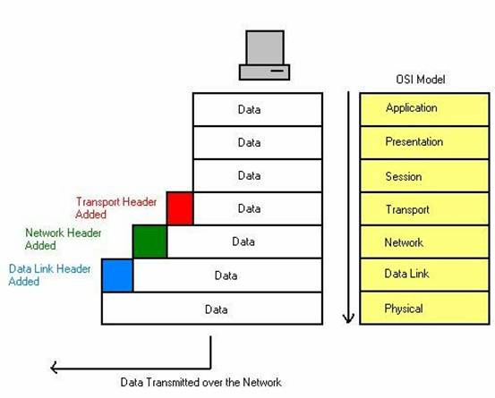

네트워크 계층에서 추가되는 헤더 정보는 IP 정보이다. 물론 IP 정보만 필요한 것은 아니고 다양한 정보들이 추가된다. 하지만 가장 중요한 부분은 송신자와 수신자의 IP 정보이다.

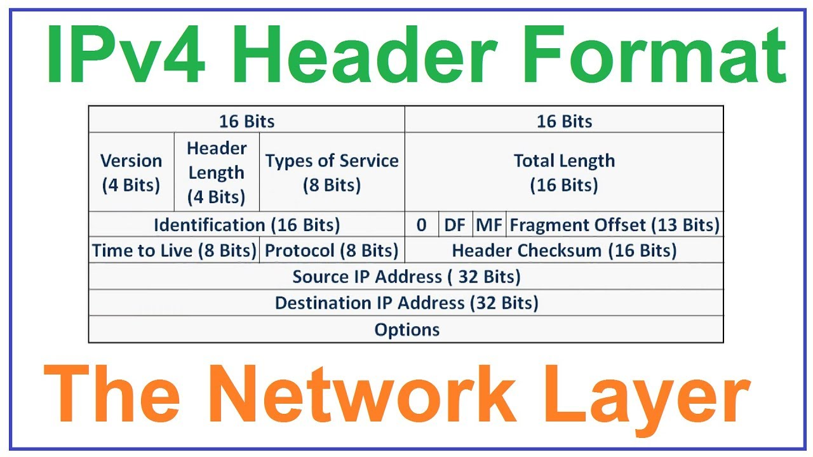

내 IP 정보는 알고 있지만 수신자의 IP 정보는 어떻게 확인할 수 있을까? 

이 정보를 알고있거나 확인해줄 수 있는 장비가 바로 라우터이다.

---

### 브로드캐스트

라디오나 TV는 일방적으로 신호를 보내기 때문에 시청자와 상호작용하지 않는다.

일방적으로 신호를 보낸다고 해서 브로드캐스트라고 하는데, 이러한 개념이 컴퓨터에도 있다.

**브로드캐스트(Broadcast)는 같은 네트워크에 속한 모든 컴퓨터에게 데이터를 전달한다.**

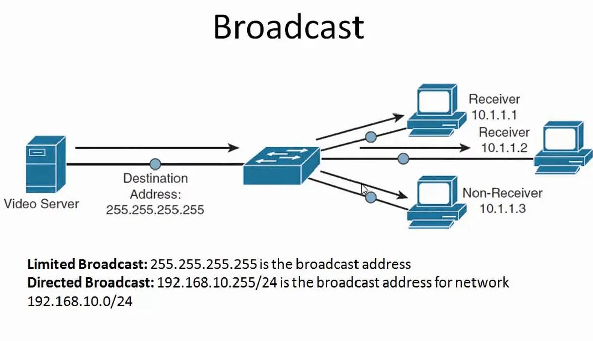

수신자 입장에서는 내가 원하지 않더라도 일방적으로 보내는 정보를 받아야 한다.

그래서 데이터를 수신하는 컴퓨터는 그 정보가 필요한지 판단해야 하는 번거로움이 있다.

---

### 유니캐스트 

**유니캐스트(Unicast)는 1:1 통신이다.**

같은 네트워크에 여러 대의 컴퓨터가 있을 때 특정한 1대의 컴퓨터에만 데이터를 보내고자 한다면 상대방의 MAC 주소를 통해 보내면된다. 그래서 상대방의 MAC 주소를 알아야 유니캐스트로 통신이 가능하다.

---

### 멀티캐스트

**멀티캐스트는 브로드캐스트 + 유니캐스트 방식이다.**

같은 네트워크에서 데이터를 보내고 싶은 컴퓨터가 1대라면 상대방의 MAC 주소를 확인하는 것은 어렵지 않을 것이다. 하지만 그 대상이 2대 이상이면 상당히 번거롭다. 이때 사용하는 방식이 멀티캐스트이다.

**멀티캐스트(Multicast)는 특정 그룹을 지정해서 그 그룹에 해당하는 컴퓨터에게만 데이터를 보내는 방식이다.**

---

### 서브넷의 개념

서브넷과 서브넷 마스크는 네트워크 ID와 호스트 ID를 이용한다.

네트워크를 A 클래스, B 클래스, C 클래스 처럼 클래스 단위로 하나의 네트워크를 사용하는 것은 비효율적인 방법이다. 하나의 네트워크에 속한 모든 컴퓨터는 브로드캐스트 주소로 오는 데이터를 모두 수신해야 하고, 그것이 내가 필요한 정보인지 필터링해야 한다. 

그래서 하나의 네트워크를 좀 더 효율적으로 즉, 더 작은 단위로 사용해보고자 등장한 개념이 서브넷이다.

**서브넷(subnet)은 하나의 네트워크가 분할된 작은 네트워크이다. 이때 작은 네트워크로 나누는 작업을 서브넷팅(subnetting)이라고 한다.**

---

### 서브넷팅의 원리

**서브넷팅이란 IP 주소에는 네트워크 ID와 호스트 ID가 있는데, 네트워크 ID는 그대로 두고 호스트 ID를 쪼개는 방식이다.** 

이때 쪼개는 개수가 적을수록 사용 가능한 호스트 수가 많아진다.

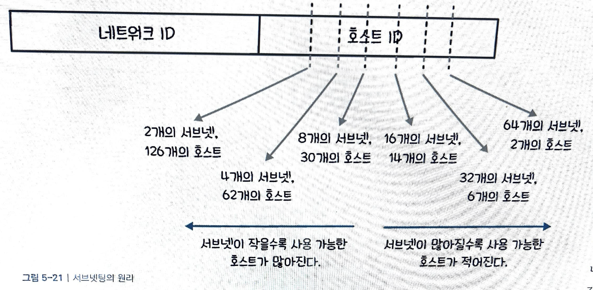

**정리하면 서브넷팅은 호스트 ID를 서브넷 ID와 호스트 ID로 나누는 작업이다.**

---

### 서브넷 마스크

IP 주소를 서브넷팅하면 네트워크 ID와 호스트 ID의 경계를 판별하기가 어려울 때가 많은데 이때 서브넷 마스크를 사용한다. 즉, **서브넷 마스크(Subnet Mask)란 IP 주소에서 네트워크 ID와 호스트 ID를 구분하기 위한 구분자다.**

서브넷 마스크를 구하기 위해서는 네트워크 ID를 모두 1로 채우고 호스트 ID를 0으로 채운다.

**서브넷 마스크 표기법**

      - **CIDR 표기법: 192.168.1.1/24**
- /24는 네트워크 ID의 비트 수이다.
      - **255.255.255.0**

---

### 서브넷팅 해보기 

네트워크 주소: 172.16.0.0

서브넷 마스크: 255.255.0.0

이를 4개의 서브넷으로 나눠보자.

4개의 조합이 나오기 위해서는 호스트 ID의 2개의 값만 이용하면 된다.

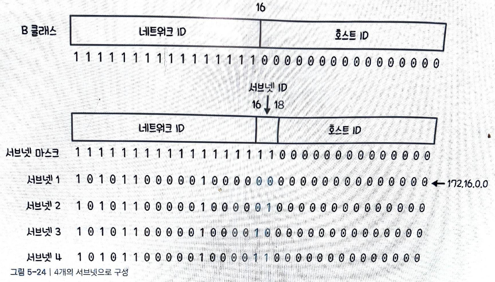

| **서브넷 번호** | **네트워크 주소** | **첫 번째 호스트** | **마지막 호스트** | **브로드캐스트 주소** |
| --- | --- | --- | --- | --- |
| 서브넷1 | 172.16.0.0 | 172.16.0.1 | 172.16.63.254 | 172.16.63.255 |
| 서브넷2 | 172.16.64.0 | 172.16.64.1 | 172.16.127.254 | 172.16.127.255 |
| 서브넷3 | 172.16.128.0 | 172.16.128.1 | 172.16.191.254 | 172.16.191.255 |
| 서브넷4 | 172.16.192.0 | 172.16.192.1 | 172.16.255.254 | 172.16.255.255 |

---

**라우터(Router)는 데이터의 전송을 위해 가장 빠른 길을 찾아 네트워크 간의 경로(Route)를 설정하는 장비**

**스위치의 한계 되짚어보기**

스위치는 같은 네트워크의 컴퓨터끼리만 통신이 가능한 장비. 즉, 서로 다른 네트워크 간의 통신은 불가능한 단점이 있다. 정확히 말하면 네트워크 주소가 다른 네트워크에서는 통신이 불가능하다.

**그래서 서로 다른 네트워크 간의 통신을 위해서는 라우터를 사용해야 한다.**

예를 들어 172.16.1.0/24 네트워크는 172.16.2.0/24 네트워크는 서로 다른 네트워크이다.

이 둘 간에 통신이 가능하려면 라우터가 필요하다.

**그런데 서로 다른 네트워크 간에는 중간에 1개 이상의 라우터가 있을 수 있다.** 

이러한 경우, 어떤 경로로 이용해야 빠른 통신이 가능한지 확인해야 한다. **즉 네트워크와 네트워크 간의 경로(Route)를 설정해야 하는데, 이것을 라우팅(Routing)이라고 한다.** 다시 말해 라우팅은 한 네트워크에서 다른 네트워크로 데이터를 전달하는 과정이다.

**그런데 경로는 어떻게 설정할까?** 

스위치에서 MAC 테이블을 이용했던 것과 같이 라우터에서는 라우팅 테이블이라는 것을 이용한다.

**라우팅 테이블은(Routing Table)은 데이터를 목적지까지 보내기 위한 거리와 방법등을 명시한 테이블이다.**

라우팅 테이블에는 데이터를 목적지까지 전달하기 위해 어떤 방향으로 가야 하는지에 대한 정보를 가지고 있다.

따라서 라우터가 데이터를 목적지로 보내려고 하면 먼저 라우팅 테이블을 찾아보게 된다.

예를 들어 컴퓨터A(172.16.1.3)가 컴퓨터B(172.16.2.12)에게 데이터를 보내려고 하는 상황을 가정해 보자.

먼저 라우터 A는 컴퓨터 B의 네트워크 주소 172.16.2.0을 확인한다. 그리고 172.16.2.0으로 가는 길이 정의되어 있는지 라우팅 테이블을 검색한다.

그랬더니 라우팅 테이블에 172.16.2.0 네트워크로 가려면 E1으로 가라는 내용이 검색되었다.

그럼 이제 라우터 A는 라우터 B에게 컴퓨터 B의 IP 주소가 무엇인지 물어보기만 하면 된다.

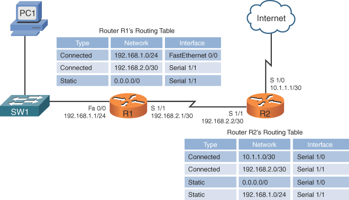

라우팅 테이블은 주기적으로 업데이트해야 한다.

네트워크 상황이 계속 변경되기 때문이다. 업데이트는 수동으로 할 수도 있고 자동으로 할 수도 있다.

보통은 라우팅 프로토콜을 이용하여 자동으로 업데이트를 진행한다.

---

---

## 복습하기 

    1. 라우팅
    1. IP
    1. 브로드캐스트 주소? 
    1. 네트워크 ID, 호스트 ID
    1. A ~ E
    1. 유니캐스트
    1. 서브넷팅
    1. 네트워크 ID, 서브넷 ID, 호스트 ID
    1. pass

**IP(Internet Protocol):** IP 주소는 인터넷상에 있는 컴퓨터의 고유한 주소이다.

**호스트 ID:** 호스트 ID는 라우터에 연결된 개별 컴퓨터들을 관리하기 위해 사용된다.

**네트워크 ID:** 네트워크 ID는 개별 컴퓨터가 많을 경우 관리의 어려움이 있기 때문에 네트워크의 범위를 지정해 관리를 쉽게 하기 위한 용도로 사용한다.

**브로드캐스트(Broadcast):** 브로드캐스트는 같은 네트워크에 속한 모든 컴퓨터에게 전달한다.

**공인 IP(Public IP):** 인터넷 서비스 제공자에 의해 전 세계적으로 고유하게 할당되는 IP 주소이다.

**사설 IP(Private IP):** 주로 기업 내부에서만 사용되는 IP 주소로, 기업 밖에 위치한 컴퓨터와는 통신이 되지 않는다.

**서브넷(Subnet)**: 서브넷은 하나의 네트워크가 분할되어 나눠진 작은 네트워크이다.

**서브넷 마스크(Subnet Mask):** 서브넷 마스크는 IP 주소에서 네트워크 ID와 호스트 ID를 구분하기 위한 구분자이다.

**라우팅(Routing):** 라우팅은 네트워크와 네트워크 간의 경로(Route)를 설정하는 과정이다.

---

## 개요

전송 계층은 신뢰성 있는 통신을 보장하는 역할을 한다.

신뢰성을 보장하기 위한 방법과 포트 번호가 통신에 어떻게 이용되는지에 대해 알아본다. 

**키워드** 

    - 전송 계층 
    - 혼잡 제어
    - 흐름 제어
    - 오류 제어
    - 3방향 핸드셰이크
    - TCP 프로토콜 
    - UDP 프로토콜

**목표** 

    - 전송 계층의 역할을 이해
    - 3 Way Handshake 구조에 대해 이해
    - TCP, UDP 구조 이해
    - 전송 계층의 로드 밸런서 구조에 대해 이해

---

## 내용정리 

전송 계층은 기본적으로 오류를 점검하는 기능과 컴퓨터가 제대로 데이터를 받았을 경우 어떤 애플리키에션으로 전달해야 하는지를 식별하는 기능을 한다.

### 혼잡 제어(Congestion Control)

**혼잡 제어(Congestion Control)는 네트워크로 들어가는 정보량을 조절하여 네트워크가 혼잡해지지 않게 조절하는 방법이다.** 

혼잡 제어 방식은 송신자가 먼저 하나의 데이터만 보내고 수신자 측에서 ACK가 오면 전송량을 2배씩 증가시켜 나간다. 그러다가 타임아웃이 발생하면 여러 개 보냈던 데이터를 줄여서 보낸다. 혹은 동일한 ACK를 여러 번 받은 경우에도 데이터를 줄여서 보내는 방식을 취한다. 타임아웃과 마찬가지로 동일한 ACK를 여러 번 받았다는 것은 네트워크가 데이터를 실어 나르느라 바쁘다는 뜻이기 때문이다.

이후 정상적인 ACK를 받게 되면 또다시 데이터를 배수로 전송함으로써 데이터 전송량을 조절한다.

아래 그림은 정상적으로 전송량이 2배씩 늘어난다.

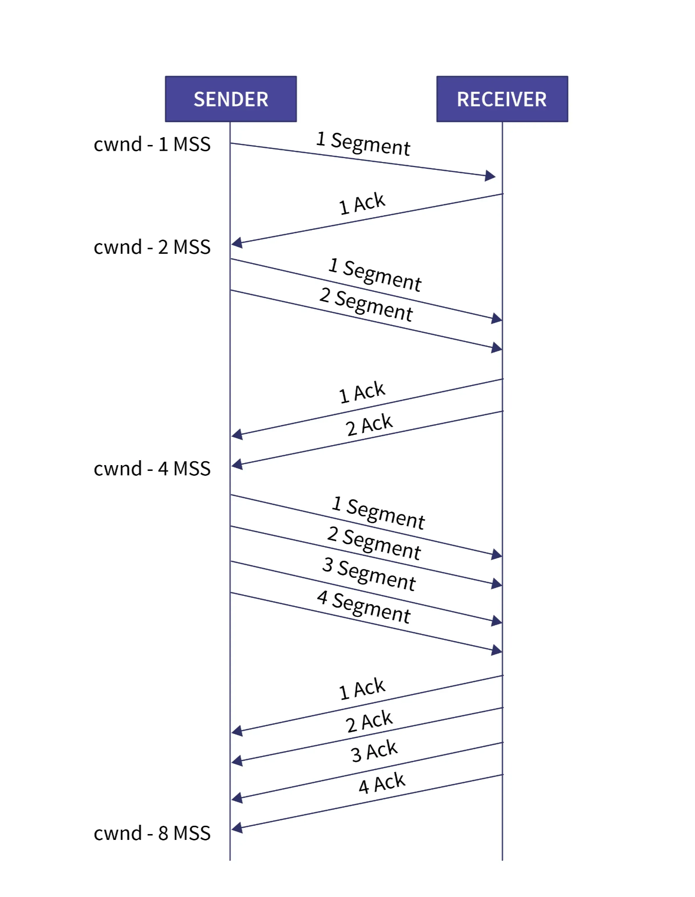

아래 그림 Packet 3이 타임아웃으로 도착하지 않아 동일한 ACK를 보낸다.

그래서 다시 Packet3를 전송한다.

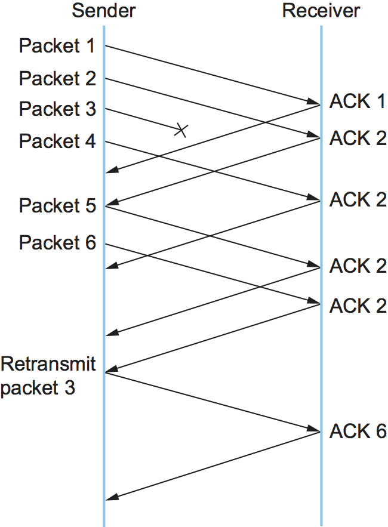

---

### 흐름 제어(Flow Control)

흐름 제어 방법 중에 하나인 정지-대기(Stop & Wait) 방식은 송신자가 하나의 데이터를 전송한 후 다음 데이터를 전달하기 전에 확인 응답을 기다리는 방법이다.

예를 들어 수신자 측에서 ACK 메시지가 송신자 측에 전달되어야만 다음 데이터를 보내는 방법이다.

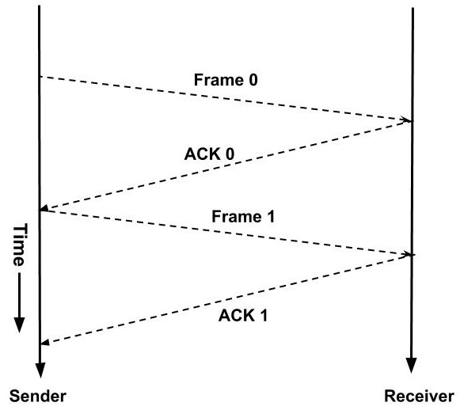

---

### 오류 제어(Error Control)

오류를 검출하기 위해서 확인 응답과 시간 초과 방법을 사용한다.

      1. 확인 응답: 수신자 측으로부터 ACK라는 응답을 받아야 하지만 ACK가 없다면 오류로 판단한다.
      1. 시간 초과: 특정 시간 내에 ACK가 없으면 세그먼트에 오류가 있다고 판단한다.

오류가 발견되면 데이터를 재전송해야 하는데, 재전송이 필요한 상황은 아래와 같다.

      - 데이터가 중간에 손실될 때
      - 데이터 순서가 바뀌었을 때
      - 데이터가 훼손되었을 때

---

전송 계층은 데이터를 목적지에 문제없이 전달하는 것을 목표로 한다.

이때 데이터를 전달하는 목적에 따라 연결형과 비연결형 통신으로 나눈다.

      - **연결형 통신: 데이터를 정확하게 전달하는 것을 목표로 하는 통신으로, TCP 프로토콜을 사용한다.**
      - **비연결형 통신: 효율적으로 데이터를 보내는 통신으로, UDP 프로토콜을 사용한다.**

TCP 프로토콜은 3 Way Handshake 방법으로 통신을 시작한다. TCP 프로토콜이 데이터를 정확하게 전달하는 것을 목표로 하기 때문에 상대방이 내 신호를 받을 수 있는 상태인지 확인하고 전송하는 방식이다.

**즉, 3 Way Handshake는 TCP 통신을 하는 장치(컴퓨터)간에 서로 통신할 준비가 되었는지를 확인하는 과정이다.**

**3 Way Handshake**

      1. **먼저 송신자는 수신자에게 SYN(Synchronize Sequence Number)이라는 임의의 숫자를 보낸다.** 
      1. **수신자는 1번의 대답으로 ACK와 SYN를 보낸다. ACK는 앞에서 받았던 SYN에 1이 더해진 숫자이며, SYN은 임의의 숫자가 된다.**
      1. **송신자는 다시 ACK를 보낸다. 이때 ACK는 앞에서 받은 SYN에 1이 더해진 숫자이다.**

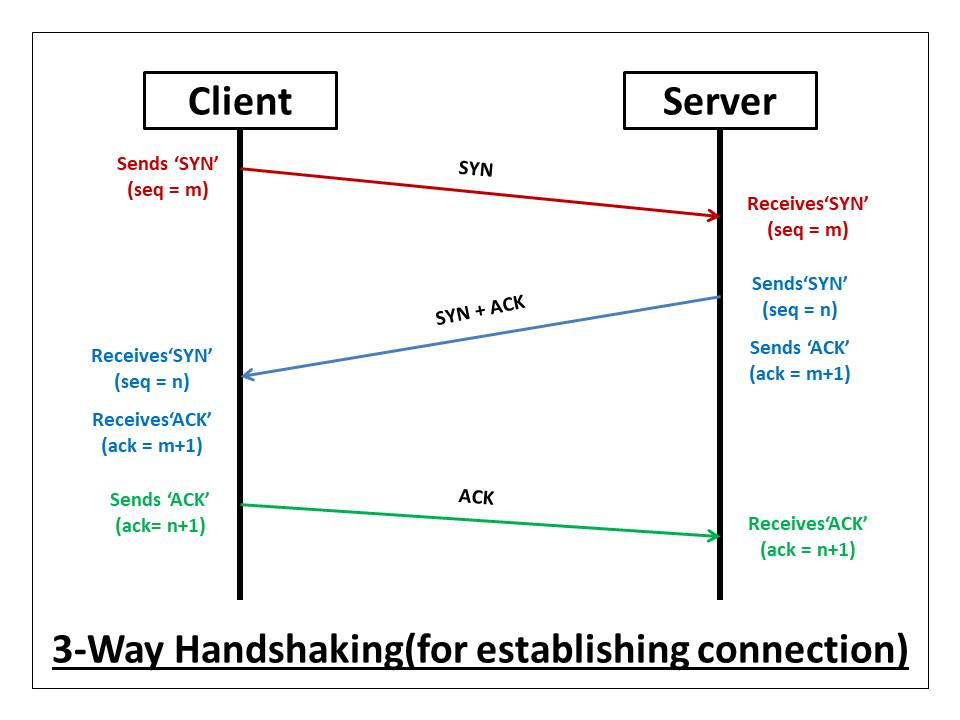

이렇게 3-Way HandShaking을 하면 송신자와 수신자 양쪽 모두 데이터를 전송할 준비가 되었다는 것을 보장한다.


### 포트 번호

전송 계층은 어떤 애플리케이션과 통신하는지 정의하는 곳이다. 그 기능을 하는 것이 포트 번호이다.

컴퓨터의 주소가 IP라면 프로그램의 주소는 포트 번호이다.

포트 번호는 총 65,536개가 존재하며 목적에 따라 다음과 같이 나위어져 있다.

      - **0~1023번:** **잘 알려진 포트(well-known port)**로, 특정한 쓰임을 위해 사용되는 포트이다.
- ex: HTTP 80
      - **1024~49151번:** 기관이나 기업들이 사용하는 포트로, **사전 등록된 포트(registered port)**라고도 한다.
      - **49152~65535번:** 일반 사용자들이 자유롭게 사용할 수 있는 포트로, **다이나믹 포트(dynamic port)**라고도 한다.

**well-known ports** 

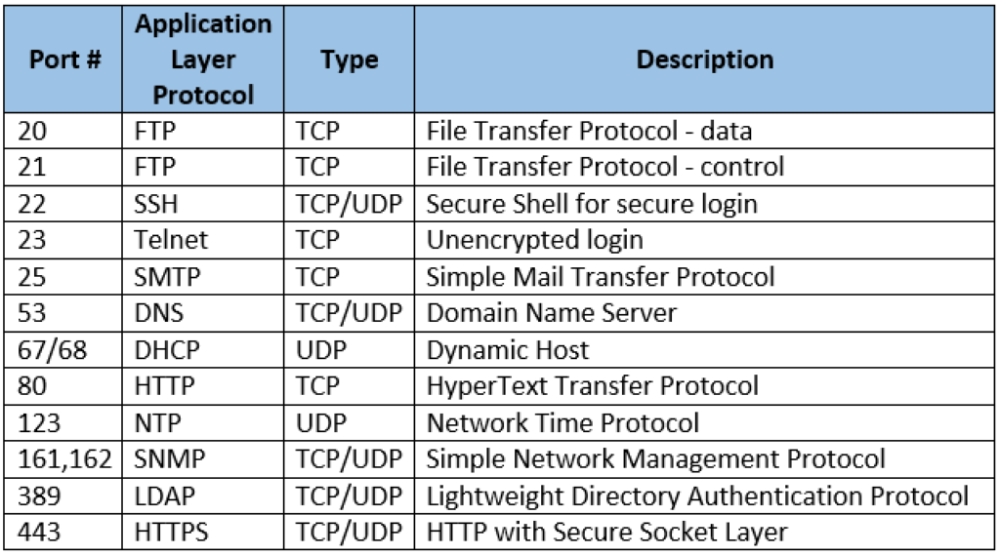

---

### 일련번호와 확인 응답 번호

**일련번호(sequence number)**는 송신자가 수신자에게 보내려는 데이터가 몇 번째인지 알려주는 것이고, 반대로 **확인 응답 번호(Acknowledgement Number)**는 수신자가 몇 번째 데이터를 받았는지 송신자에게 알려주는 역할을 한다.

송신자가 수신자에게 데이터를 보내는 상황을 가정

      - 보내야 하는 총 데이터 크기: 1500바이트
      - 패킷의 크기: 500바이트

패킷의 크기란 한 번에 보낼 수 있는 데이터의 최대 크기이다. 즉, 한 번에 보낼 수 있는 최대 크기가 500바이트라는 것이다. 그러니 1500바이트의 데이터를 보내기 위해서는 총 3번에 걸쳐 보내야 한다.

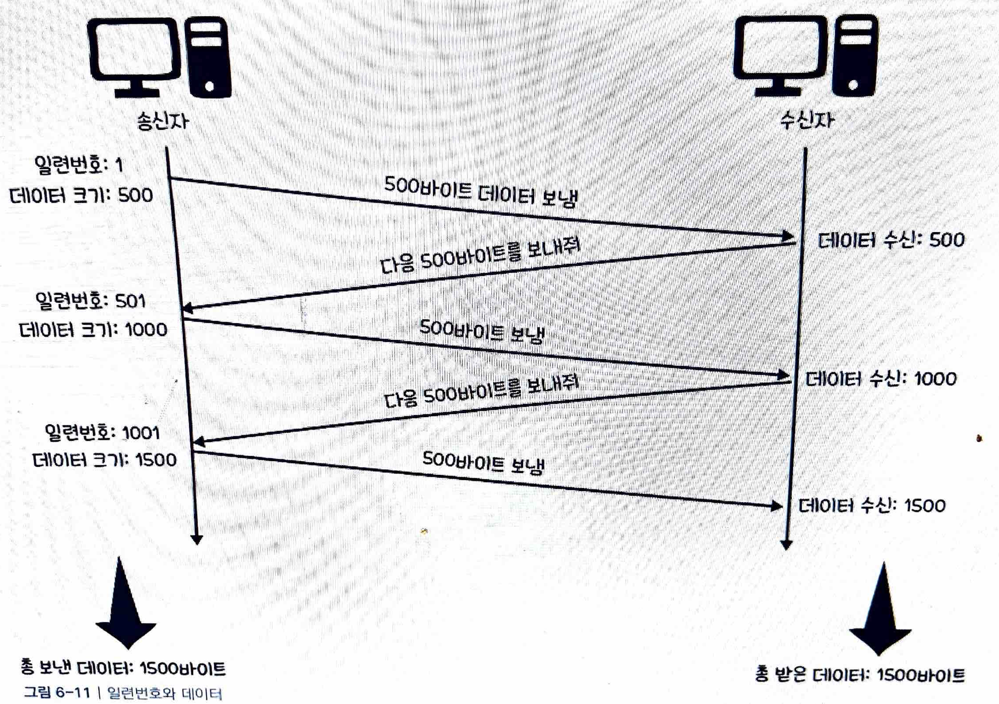

---

### 윈도우 크기

수신자가 받을 수 있는 데이터의 양은 적은데, 송신자가 그것을 고려하지 않고 많은 양의 데이터를 보낸다면 어떤일이 발생할까?

송신자는 모든 데이터를 보냈다고 생각하겠지만, 수신자는 송신자가 보낸 모든 데이터를 받아들이지 못하고 일부는 튕겨나갈 것이다. 그래서 등장한 것이 윈도우 크기다.

**윈도우 크기(Window Size)란 송신자가 한 번에 보낼 수 있는 데이터의 최대 크기이다.**

즉, 수신자가 얼마나 데이터를 받아들일 수 있는지 확인한 후, 그 크기를 고려해서 데이터를 보내겠다는 의도이다.

수신자의 윈도우 크기는 3-way Handshake 과정에서 송,수신자의 윈도우 크기를 확인할 수 있다.

3-way Handshake 과정에서 SYN과 ACK 외에도 Window_Size 정보를 주고받게 된다.

---

### 코드 비트(Flags)

코드 비트들의 기본값은 0이고 비트가 활성화되면 1이된다. 

| **코드 비트(플래그)** | **항목 이름** | **설명** |
| --- | --- | --- |
| TURG | 긴급(URGENT) | URG 포인터 필드가 유효함을 알림 (긴급 데이터가 있음을 의미) |
| ACK | 확인(ACKNOWLEDGEMENT) | ACK 번호 필드가 유효함을 알림 (데이터 수신 확인) |
| PSH | 푸시(PUSH) | 데이터를 즉시 상위 계층에 전달하도록 요청 |
| RST | 리셋(RESET) | 연결을 강제로 초기화(재설정) |
| SYN | 동기화(SYNCHRONIZE) | 연결 설정 요청 (시퀀스 번호 동기화) |
| FIN | 종료(FINISH) | 연결 종료 요청 |

---

TCP는 데이터를 세그먼트 단위로 쪼갠 후 순서를 부여하여 전송한다.

또한 수신자 입장에서는 세그먼트의 순서가 뒤바뀌는 일이 없도록 오류를 제어하는 것도 중요하다.

즉, 신뢰성 있는 통신을 기반으로 하는 것이 TCP라면 **UDP(User Datagram Protocol)**는 데이터를 수신자 측에서 오류 없이 받던, 그렇지 않던 상관하지 않고 데이터를 보내기만 한다.

UDP가 신뢰성을 보장하지 않는다고 해서 쓸모가 없는 것은 아니다. 그만큼 데이터 전송 속도가 빠른 장점이 있다.

따라서 UDP 프로토콜은 주로 실시간 방송 등에 사용한다.

**UDP Header** 

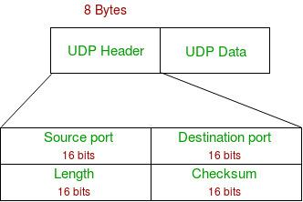

| **항목 이름** | **설명** | **크기** |
| --- | --- | --- |
| Source Port | 송신자(출발지) 포트 번호 | 16비트 (2바이트) |
| Destination Port | 수신자(목적지) 포트 번호 | 16비트 (2바이트) |
| Length | UDP 헤더 + 데이터 전체 길이(바이트 단위) | 16비트 (2바이트) |
| Checksum | 오류 검출을 위한 체크섬 값 | 16비트 (2바이트) |

**로드 밸런서(Load Balancer)****는 여러 대의 서버를 두고 사용자가 한쪽으로 몰리는 것을 분산시켜주는 장치이다.**

**1대의 서버에서 여러 대로 늘리는 것을** **스케일 아웃(Scale Out)****이라고 하며, 부하를 분산시켜주는 작업을** **로드 밸런싱(Load Balancing)****이라고 한다.**

먼저 사용자가 보내온 연결 요청은 로드 밸런서가 받는다.

이후 로드 밸런서는 서버로 연결을 요청한다. 이때 서버가 3대라면 3대의 서버가 골고루 트래픽을 받도록 사용자 연결을 처리해야 한다.

      - **라운드 로빈(Round Robin):** 분배의 가장 기본적인 방식으로 각 서버별로 돌아가면서 연결을 처리한다.
      - **가중 라운드 로빈(Weighted Round Robin):** 각 서버별로 돌아가면서 연결을 처리하지만 일부 서버는 큰 트래픽을 몰아 받는 방식이다.
      - **랜덤(Random):** 무작위로 분배되는 방식
      - **해시(Hash):** 특정 클라이언트는 특정 서버에서만 처리하는 방식

또한, 로드 밸런서는 포트 번호를 이용하여 부하를 분산시킬 수도 있다. 

예를 들어 [http://www.a.com](http://www.a.com/)을 서비스하는 서버가 3대 있을 때, 로드 밸런서 IP 주소로 접속을 시도하는 것 중에 8001 포트를 사용하는 것은 172.16.2.201 서버로 전달하고, 8002번 포트를 사용하여 접속을 시도하는 것은 172.16.2.203으로 전달하도록 설정할 수 있다.

이걸 L4 로드 밸런서라고 하는데 실제 웹 서비스에서는 L7 로드 밸런서를 더 많이 사용한다.

---

## 복습하기

    1. 혼잡 제어, 흐름 제어, 오류 제어
    1. 타임 아웃
    1. 혼잡 제어
    1. 연결형, 비연결형
    1. 포트 
    1. 25
    1. 스케일 아웃 
    1. 라운드 로빈

3-way Handshake: TCP 통신을 하는 장치 간에 서로 잘 연결되어 있는지를 확인하는 과정

윈도우 크기: 윈도우 크기란 송신자가 한 번에 보낼 수 있는 데이터의 최대 크기

TCP: 데이터를 세그먼트 단위로 쪼갠 후 순서를 부여하여 전송하는 통신으로 신뢰성 있는 통신을 기반으로 한다.

UDP: 비연결현으로 실시간 방송과 같은 통신에 사용한다. (브로드캐스트)

로드 밸런서: 로드 밸런서는 여러 대의 서버를 두고 사용자 집중으로 인한 부하를 분산시켜주는 장치이다.

로드 밸런싱: 부하를 분산시켜주는 작업을 로드 밸런싱이라고 한다.

---

응용 계층은 애플리케이션에서 데이터를 교환하는 역할을 한다.

프로토콜을 이용한 애플리케이션 통신 방법에 대해 알아본다.

**키워드**

    - 응용 계층
    - HTTP
    - DNS
    - DHCP
    - SMTP/POP3

목표 

    - 응용 계층의 역할 이해
    - 웹 서버의 구조 이해
    - DNS, DHCP 구조 이해
    - 이메일의 송수신 구조 이해

---

## 내용정리

서비스를 요청하는 측을 클라이언트(Client), 서비스를 제공하는 측은 서버(Server)라고 한다.

응용 계층은 사용자가 사용하는 애플리케이션(응용 프로그램)이 동작하는 곳이다.

클라이언트에서 서버로 데이터를 보내기 위해서는 프로토콜을 사용한다.

애플리케이션마다 사용해야 하는 포트 번호가 다르고 프로토콜도 따로 있다.

| 프로토콜 | 내용 | 포트 번호 |
| --- | --- | --- |
| HTTP | 웹 사이트 접속  | 80 |
| DNS | 이름 해석 | 53 |
| FTP | 파일 전송 | 20(데이터 전송)<br>21(명령과 응답 제어) |
| SMTP | 이메일 송신 | 25 |
| POP3 | 이메일 수신 | 110 |

---

사용자가 웹 브라우저에 www.google.com을 입력하면 원하는 페이지가 나온다. 사용자는 단순히 URL을 입력하면 되지만 내부적으로는 많은 처리가 이루어진다. 사용자가 URL을 입력하는 행위를 요청(request)이라고 하며, 서버는 사용자의 요청에 응답(response)을 한다.

요청과 응답을 위해 HTTP 프로토콜을 사용하는데, **HTTP(HyperText Transfer Protocol)는 클라이언트와 서버가 어떻게 데이터를 교환할지 정해놓은 규칙으로, 80번 포트를 사용한다.**

HTTP는 문자 형태로 데이터가 전송되기 때문에 필요한 부분을 파싱(parsing) 해주어야 하므로 다음과 같은 구조를 사용한다.

**HTTP 구조** 

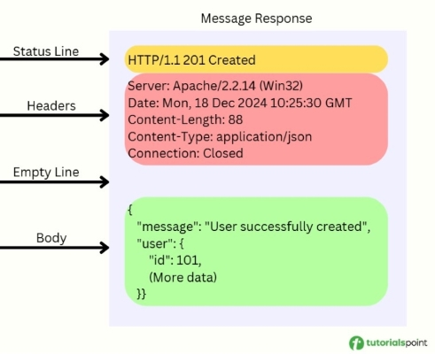

**그림과 같이 HTTP 구조는 Status Line(시작 라인), Headers(헤더), Empty Line(공백 1줄), Body(바디)로 구성된다.** 

**HTTP Status Line & Headers**

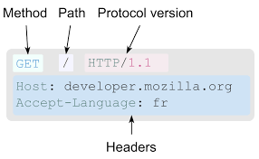

시작 라인은 HTTP 메서드, 경로, HTTP 버전으로 이루어져 있다.

HTTP 메서드는 데이터를 수신하는 서버에서 어떤 작업을 해야 하는지 알려주는 용도로 사용된다.

      - **GET: 데이터 획득**
      - **POST: 데이터 추가, 생성**
      - **PUT: 서버의 데이터 갱신**
      - **PATCH: PUT과 유사하게 요청된 데이터를 수정(update)할 때 사용하지만, PUT은 데이터 전체를 갱신하고 PATCH는 일부만 갱신한다.**
      - **DELETE: 데이터 삭제**

HTTP 버전은 1.0, 1.1, 2.0 순서로 진화했다. HTTP 프로토콜에는 자체적으로 정의한 헤더가 있어서 HTTP 버전 정보, 상태 정보 등 여러 정보를 서버로 보낼 수 있게 되었다. 하지만 매 요청마다 연결을 수립하는 과정을 반복하다 보니 이것을 처리하는 서버의 성능이 저하되는 문제점이 있었다.

그래서 등장한 것이 HTTP 1.1이며 현재 가장 많이 사용하는 버전?이다.

**HTTP 1.1부터는 Keep-Alive 기능이 추가되어 연결이 한 번 수립되면 데이터 교환을 마칠 때까지 연결을 유지하고 데이터 교환이 끝나면 연결을 끊는 구조이다.**

**HTTP 1.0 vs HTTP 1.1의 연결 방식**

| **버전** | **연결 방식 설명** |
| --- | --- |
| HTTP 1.0 | 매 요청마다 새로운 TCP 연결을 맺고, 응답 후 연결을 끊음. |
| HTTP 1.1 | **Keep-Alive** 기능이 기본 적용. 한 번 연결을 맺으면 여러 요청/응답에 재사용. |

HTTP 1.1의 Keep-Alive 덕분에, 매번 3-way handshake를 반복하지 않아도 되어 서버와 네트워크의 부하가 크게 줄었다.

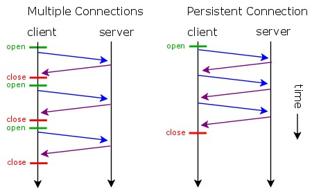

      - open: 연결 수립 → 3-way handshake
      - close: 연결 종료

**HTTP 2.0부터는 응용 계층에 바이너리 프레임(Binary Frame)을 추가하여 기존의 일반 텍스트 데이터를 바이너리로 변환한 후 데이터를 분할하여 보낸다.** 이렇게 하면 전송 속도가 빨라지고 오류 발생 가능성도 낮아진다.

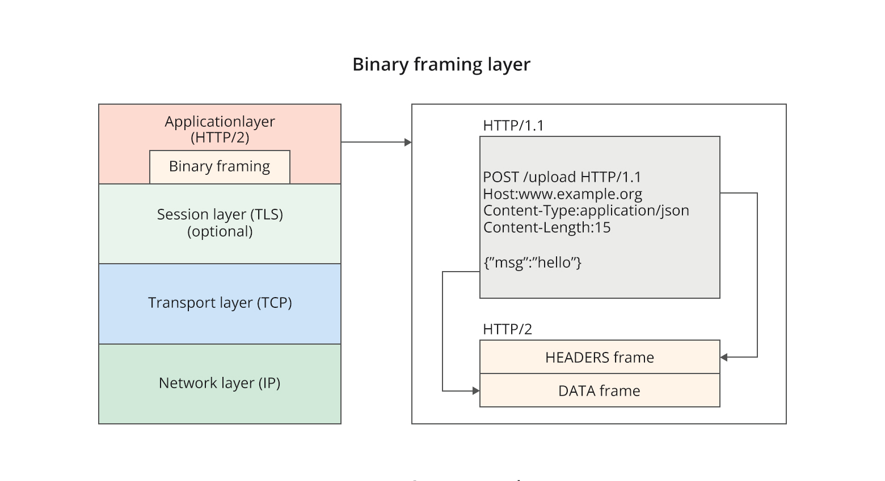

여기까지가 클라이언트에서 서버로 HTTP 요청을 할 때 전달하는 정보였다.

서버에서도 응답을 해야 하는데, 응답에 대한 시작 라인은 간단하다.

HTTP 버전, 응답 메시지로 구성된다.

응답 메시지의 상태코드는 아래와 같다.

| 1xx | 정보 | 요청을 받았으며 처리가 되고 있음을 나타낸다. |
| --- | --- | --- |
| 2xx | 성공 | 요청이 성공했음을 나타낸다.  |
| 3xx | 리다이렉션 | 클라이언트가 요청한 컨텐츠가 다른 곳에 있다는 의미이다.  |
| 4xx | 클라이언트 오류 | 클라이언트가 잘못된 요청을 했음을 의미한다. |
| 5xx | 서버 오류 | 서버측 오류로 인해 요청이 실패했음을 의미한다. |

헤더에는 클라이언트와 서버가 통신하기 위한 다음과 같은 부가적인 정보가 포함된다.

      - 호스트(Host): 서버의 도메인 이름과 포트 번호
      - 연결(Connection): 현재의 작업이 끝난 후에도 네트워크를 연결 상태로 둘지 여부를 제어
      - 언어(Language): 서버가 응답에 사용할 언어

---

사람이 웹 브라우저에 www.google.com과 같은 도메인 이름을 입력하면, 실제로는 네트워크에서 통신을 위해 IP 주소와 MAC 주소가 사용된다. **사람이 숫자로 된 IP 주소를 일일이 기억하거나 입력하기 어렵기 때문에, 도메인 이름(Domain Name)을 사용한다.**

**맥북 구글 IP 주소 확인하기**

```bash
traceroute www.google.com
```

**도메인 주소를 IP 주소로 변경해주는 것이 DNS(Domain Name System)서버이다.**

      1. 사용자는 www.google.com을 웹 브라우저에 입력
      1. 사용자의 요청은 DNS 서버로 전달된다. DNS 서버는 www.google.com에 해당하는 IP 주소인 142.250.206.228을 전달한다.
      1. 사용자는 142.250.206.228 IP 주소를 이용하여 웹 사이트에 접속한다.
      1. 웹 서버는 사용자의 요청에 응답한다.

그런데 이때 DNS 서버가 www.google.com의 IP 주소를 모를 수도 있다. 이럴 때는 또 다른 DNS 서버에 질의해서 IP 주소를 전달받는다.

DNS 서버는 게층적으로 구성되어 있다. 즉, 단계별로 질의를 하는데, 루트에서 시작해서 .com에 대한 2단계 질의가 이루어지고 마지막으로 최종 www.google.com에 대한 IP 주소를 얻게 되는 3단계 질의를 하게 된다.

1단계 질의는 루트가 되고, 2단계 질의를 통해 요청하려는 웹사이트가 .com인지 .net인지 확인하고, 마지막 3단계에서 요청하고자 하는 IP 주소를 질의한다.

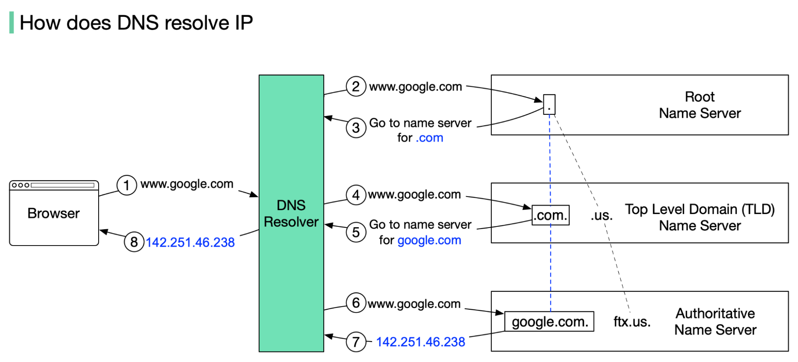

---

일반적으로 인터넷을 사용하거나 WAN 환경에서 다른 컴퓨터와 통신하기 위해서는 IP 주소가 필요하다

그리고 IP는 명시적으로 내 컴퓨터에 할당되어 있어야 한다.

하지만 관리자가 모든 컴퓨터를 찾아다니면서 일일이 IP 주소를 입력해주는 것은 매우 비효율적이다. 또한 IP 주소는 반납되어야 하는데, 이것 역시 관리하기 어렵다.

그래서 자동으로 IP 주소 설정 및 네트워크 설정 정보(서브넷 마스크, DNS 서버 주소)제공을 하는 DHCP 서버가 등장했다. **DHCP(Dynamic Host Configuration Protocol)서버는 사용자들에게 IP 주소를 할당하거나 회수하는 것을 자동으로 해주는 서버이다.**

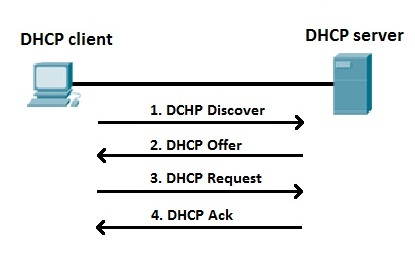

DHCP 서버가 IP를 할당해주는 방식은 다음과 같다.

      1. **먼저 사용자 컴퓨터는 DHCP 서버를 찾는다.**
      1. **DHCP 서버는 사용자에게 IP 주소 할당 여부를 묻는다.**
      1. **사용자가 IP 주소가 필요하다고 요청을 한다.**
      1. **DHCP 서버는 IP 주소를 할당해준다.**

**IP 임대 시간은 DHCP 서버 측에서 결정한다.**

이메일을 주고받을 때 사용하는 프로토콜은 **SMTP(Simple Mail Transfer Protocol)**, POP3이다.

**송신자가 사용하는 프로토콜은 SMTP, 수신자가 이메일을 받을 때 사용하는 프로토콜은 POP3 프로토콜이다.**

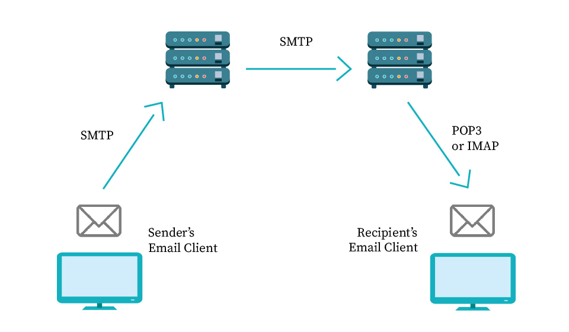

### 1. 송신자와 메일 서버 간의 통신

사용자가 메일 서버에 이메일을 보내는 과정

      1. 사용자 컴퓨터는 메일 서버에 25번 포트(SMTP 프로토콜)로 통신을 하겠다고 알린다. 그럼 메일 서버는 OK 신호와 함께 자신의 이름을 알려준다.
      1. 통신을 위한 준비가 끝나면 내가 누구인지 알려준다. 이름을 알리면 메일 서버는 역시 OK로 응답한다.
      1. 내 이메일 주소를 메일 서버에 알려주면, 메일 서버는 OK로 응답한다.
      1. 이번에는 상대방에 대한 이메일 주소를 알려주고 OK를 응답으로 받는다.
      1. 메일 서버에 이메일 본문을 전달하면, 메일 서버는 OK로 응답한다.
      1. 마지막으로 연결을 종료하겠다고 메일 서버에 전달하면 메일 서버는 연결을 종료한다.

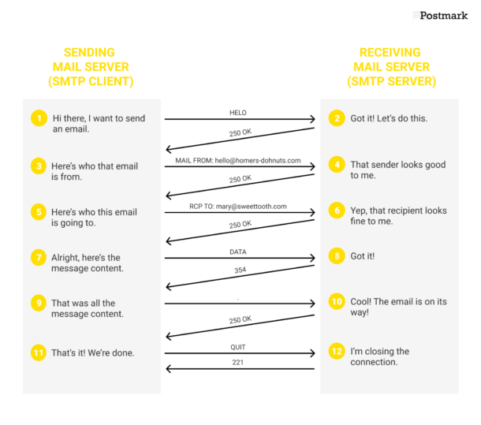

### 2. 메일 서버 간의 통신

메일 서버 간에 이메일을 주고받는 과정 역시 SMTP 프로토콜을 사용한다.

단지 그 과정이 조금 다를 뿐이다.

      1. 송신자 측 메일 서버는 해당 이메일을 수신자 측 메일 서버에 전달한다. 이때 25번 포트를 사용하고 SMTP 프로토콜을 사용한다. 이것으로 송신자 측 메일 서버의 역할은 끝난다.
      1. 이후 수신자 측 메일 서버는 사용자 A가 보낸 이메일을 사용자 B의 편지함에 저장한다.

### 3. 메일 서버와 수신자 간의 통신

      1. 이메일 수신자는 110번 포트, POP3 프로토콜로 메일 서버에 연결을 시도한다.
      1. 연결이 수립되면 사용자가 누구인지 밝힌다.
      1. 내 편지함에서 이메일을 확인하기 위한 패스워드를 알려준다. 즉, 인증된 사용자인지 확인하는 과정이다.
      1. 수신자는 메일 서버에 이메일이 있다는 것을 확인할 수 있다.
      1. 이후 해당 이메일을 컴퓨터로 내려받는다.
      1. 이메일을 내려받았으면 메일 서버와의 연결을 종료한다.

**POP3는 편지함에서 이메일을 가져오면 서버에서 이메일이 삭제된다. 삭제되는 것을 원하지 않을 때는 IMAP(Internet Access Message Protocol)을 사용하면 된다.**

| **구분** | **IMAP (Internet Message Access Protocol)** | **POP3 (Post Office Protocol 3)** |
| --- | --- | --- |
| **저장 위치** | 이메일이 서버에 저장됨 | 이메일이 클라이언트(PC, 폰 등)로 다운로드됨 |
| **동기화** | 서버와 클라이언트 간 양방향 동기화 | 다운로드 후 서버에서 삭제(기본값, 설정 변경 가능) |
| **접근성** | 여러 기기에서 동일한 메일함 동기화 및 관리 가능 | 한 기기에서만 이메일 확인 및 관리가 일반적 |
| **폴더 관리** | 서버에서 폴더 생성·삭제·이동 등 가능 | 폴더 관리 불가, 모든 메일이 받은편지함에 저장 |
| **오프라인** | 인터넷 필요(읽기 전까지 전체 다운로드 안 됨) | 한 번 다운로드하면 오프라인에서도 읽기 가능 |
| **용도** | 여러 기기에서 이메일을 자주 확인할 때 적합 | 한 기기에서만 이메일 관리할 때 적합 |

---

응용 계층에서의 로드 밸런서는 전송 계층의 로드 밸런서 기능까지 포함하고 있다. 

따라서 IP 주소나 포트 외에도 URI(Uniform Resource Indentifier), HTTP 헤더, 쿠키 등의 내용을 기준으로 부하를 분산시켜주는 것이 응용 계층의 로드 밸런서이다.

전송 계층의 로드 밸런서가 IP나 포트 번호를 기준으로 분산시키는 것만 가능했다면 응용 계층의 로드 밸런서는 서비스별로 부하를 분산시켜주는 것이 가능하다.

---

---

## 복습하기

    1. SMTP, POP3/IMAP
    1. 요청, 응답
    1. GET, POST, PUT, PATCH, DELETE
    1. 1.0, 1.1, 2.0 
    1. 리다이렉션
    1. 로드 밸런서
    1. 삭제

**GET:** HTTP 메서드는 메시지 중 서버로부터 데이터를 취득할 때 사용

**파싱:** 어떤 페이지(문서, HTML)에서 내가 원하는 데이터를 특정 패턴이나 순서로 추출하여 정보를 가공

**Keep-Alive:** 연결이 한번 수립되면 데이터 교환을 마칠 때까지 유지하고, 데이터 교환이 끝나면 연결을 끊는 구조

    - HTTP 1.1 버전 등장
    - 3-way handshake 반복 문제 해결

**DNS(Domain Name System) 서버:** 도메인 주소를 IP 주소로 변경해주는 서버 

    - 계층형: 1단계 질의 .root → 2단계 질의 .net/.com → 3단계 질의 www.google.com

**DHCP(Dynamic Host Configuration Protocol):** DHCP 서버는 사용자들에게 IP 주소를 자동으로 할당하거나 회수하는 것을 해주는 서버이다. from ISP

**HTTP(Hyper Text Transfer Protocol):** 클라이언트와 서버가 어떻게 데이터를 교환할지 정해 놓은 규칙으로 80번 포트를 사용

---

OSI 7 계층을 종합적으로 이해하기 위해 송신자가 수신자에게 이메일을 보내는 상황에 대해 알아본다.

**키워드**

    - 송신자가 이메일을 보내는 과정
    - 스위치와 라우터 관점에서 이메일을 보내는 과정
    - 수신자가 이메일을 받는 과정

**목표** 

    - OSI 7 계층 모델을 기반으로 네트워크 전반적인 흐름을 이해한다

---

## 내용정리

OSI 7 계층은 총 7개 계층으로 구성되어 있으며 각 계층을 통과할 때마다 헤더가 덧붙여진다.


LAN에서의 통신은 스위치 장비가, WAN 통신에는 라우터가 필요하다.

또한 LAN에서는 MAC 주소만 있어도 통신이 가능했지만 WAN에서는 IP 주소를 이용했다.

컴퓨터 A → 스위치 A → 라우터 A → 라우터 B → 스위치 B → 컴퓨터 B

**가정: 내 PC → 스위치 → 라우터1 → 라우터2 → 스위치 → 구글 서버**

**1. 브라우저에서 URL 입력 (Application Layer, 7계층)**

      - 사용자가 브라우저에 google.com 입력
      - 브라우저는 HTTP GET 요청을 준비(시작 라인 HTTP 메서드 / HTTP 버전 1.1)
      - HTTP 헤더 생성 (예: Host, User-Agent 등)

**2. DNS 질의 (생략 가능, 이미 IP를 알고 있다고 가정)**

      - 실제로는 먼저 DNS 질의를 통해 google.com의 IP를 얻음
      - 이 과정도 동일한 OSI 7계층을 거침
      - DNS(Domain Name System) Server 계층형 질의
- 1단계 루트
        - 2단계 .net / .com 질의
        - 3단계 [www.google.com](http://www.google.com/) 질의

**먼저 클라이언트 ↔ 서버 3-way hand shake** 

      - 5~7계층 관여 handshake 과정에 X

**3. HTTP 요청 데이터 포장 (Presentation/Session/Transport Layer, 6~4계층)**

      - **Presentation Layer(6계층):** 데이터 인코딩/압축/암호화(HTTPS라면 TLS 암호화)
      - **Session Layer(5계층):** 통신 세션 관리, 동기화
      - **Transport Layer(4계층)**
- **TCP 헤더** 추가:
- 출발지 포트(예: 49152), 목적지 포트(80 또는 443)
          - 시퀀스 번호, 확인 응답 번호 등
          - 플래그
        - **세그먼트 단위로 분할**

**4. 네트워크 계층 (Network Layer, 3계층)**

      - **IP 헤더** 추가:
- 출발지 IP(내 PC의 공인/사설 IP), 목적지 IP(google.com 서버의 공인 IP)
      - **패킷 단위로 포장**

**5. 데이터 링크 계층 (Data Link Layer, 2계층)**

      - **이더넷 프레임 헤더** 추가:
- 출발지 MAC 주소(내 PC의 MAC)
        - 목적지 MAC 주소(내 PC가 속한 LAN의 게이트웨이, 즉 라우터1의 LAN 포트 MAC)
      - **프레임 단위로 포장**

**만약 라우터1의 MAC 주소를 모른다면**

      - 내 PC에서 LAN에 속해있는 모든 장치에 브로드 캐스트
      - 이걸 ARP(Address Request Protocol)이라고 함
      - ARP 테이블에 저장(IP ↔ MAC 주소 매핑)

**스위치는 MAC ↔ 포트 매핑**

      - MAC Address table을 가진다.
      - 스위치의 구멍(포트)와 MAC 주소를 매핑한다.

**6. 물리 계층 (Physical Layer, 1계층)**

      - 프레임을 비트 스트림(0과 1)으로 변환
      - 랜카드에서 전기 신호로 변환 
      - 유선(Ethernet 케이블) 또는 무선(Wi-Fi)로 신호 전송
- 유선 케이블 종류: UTP(Unshielded Twisted Pair), STP(Shield Twisted Pair)

**7. 네트워크 장비를 통한 전달**

      - **내 PC → 스위치1 (LAN)**
- 스위치는 프레임의 목적지 MAC 주소를 보고, 해당 포트로 데이터 전달
        - 스위치는 MAC 주소만 보고 동작 (IP는 신경 쓰지 않음) → 1~2계층
      - **스위치 → 라우터1 (LAN)**
- 라우터1의 LAN 포트 MAC 주소가 목적지 MAC이므로 라우터1이 수신
      - **라우터1 (LAN → WAN)**
- 라우터1은 프레임을 해제하고, IP 패킷을 꺼냄
        - 목적지 IP가 자신의 네트워크 외부(google.com)이므로 **라우팅 테이블**을 참조
        - 출발지 MAC을 자신의 WAN 포트 MAC으로, 목적지 MAC을 라우터2의 WAN 포트 MAC으로 바꿔 새 프레임 생성
        - 출발지 IP/목적지 IP는 그대로 유지
- 만약 사설 IP를 사용한다면 이때 출발지 IP를 라우터가 DHCP 서버로 부터 할당받은 퍼블릭 IP를 출발지 IP로 바꾼다. (NAT)
      - **라우터1 → 라우터2 (WAN)**
- 라우터2의 WAN 포트 MAC 주소가 목적지 MAC이므로 라우터2가 수신
      - **라우터2 (WAN → LAN)**
- 라우터2도 프레임을 해제, IP 패킷을 꺼냄
        - 목적지 IP가 google.com 서버이므로, 라우터2의 LAN 쪽으로 전송
        - 출발지 MAC을 라우터2의 LAN 포트 MAC으로, 목적지 MAC을 구글 서버의 MAC으로 바꿔 새 프레임 생성
      - **라우터2 → 스위치 (LAN)**
- 스위치는 목적지 MAC이 구글 서버 MAC이므로 해당 포트로 전달
      - **스위치 → 구글 서버**
- 구글 서버가 프레임 수신
      - **구글 서버에서 계층별 헤더 제거 및 응답**
- 구글 서버는 물리→데이터링크→네트워크→전송→세션→표현→응용 계층 순서로 헤더를 하나씩 제거하며 원래의 HTTP 요청을 복원
        - HTTP 요청을 처리, index 페이지를 응답으로 준비
      - **응답 과정**
- 위의 **역순**으로 구글 서버에서 내 PC까지 데이터가 전달됨
        - 각 구간마다 MAC 주소는 구간별로 갱신, IP 주소는 처음부터 끝까지 동일
- 마찬가지로 LAN에서 사설 IP를 사용한다면 라우터2에서 출발지 IP를 퍼블릭 IP로 변경 (NAT)
        - 응답 데이터도 OSI 7계층을 따라 포장 및 해제

***"라우터는 ISP의 DHCP 서버로부터 공인 IP를 할당받고, 내부 네트워크의 각 기기에는 자체 DHCP 서버 기능을 통해 사설 IP를 할당한다" (가정, 회사)***

***또한 라우터는 ISP의 DHCP 서버로부터 받은 서브넷 마스크를 통해 사설 IP / 퍼블릭 IP를 구분한다.***

---

## 복습하기

    1. 80
    1. 포트 번호
    1. IP 주소 
    1. MAC 주소
    1. 전기 신호
    1. 이더넷 헤더
    1. 송신자의 IP 주소, 송신자의 MAC 주소

**OSI 7 계층:** OSI 7 계층은 컴퓨터와 컴퓨터가 통신하는 구조를 7개의 계층으로 정의해둔 약속, 즉 프로콜이다.

**스위치(Switch):** 스위치는 허브와 같이 컴퓨터나 프린터 등을 연결하여 공유하는 것 외에도 스위치 포트에 연결된 컴퓨터의 MAC 주소를 관리한다.

**라우터(Router):** 라우터는 네트워크와 네트워크 간의 경로(Route)를 설정하고 가장 빠른 길로 트래픽을 이끌어주는 네트워크 장비이다.

**헤더(Header):** 헤더는 네트워크에서 데이터 송/수신에 필요한 부가적인 정보를 담고 있는 부분

**패킷(Packet):** 패킷은 네트워크 계층에서 사용되는 데이터 단위

**프레임(Frame):** 데이터 링크 계층에서 사용되는 데이터 단위

**세그먼트(Segment):** 전송 계층에서 사용되는 데이터 단위

무선 랜은 케이블 없이 데이터를 전송할 수 있는 역할을 한다.

전자기파를 이용해서 데이터를 주고받는 방법에 대해 알아보자.

**키워드**

    - 무선 랜
    - 전자기파
    - 무선 엑세스 포인트
    - 비콘
    - SSID
    - 인프라스트럭쳐 방식
    - 애드혹 방식
    - 무선 랜 규격

**목표**

    - 무선 랜의 개념에 대해 이해
    - 무선 랜의 구성 및 통신 방법에 대해 이해
    - 무선 랜의 규격에 대해 이해

---

## 내용정리 

요즘에는 랜 케이블을 컴퓨터와 연결하여 사용하는 경우는 흔하지 않는다.

**무선 랜(Wireless Local Area Network)은 유선 랜과 달리 케이블 없이 통신하는 네트워크**이다.

**무선 랜은 무선 엑세스 포인트를 통해 인터넷에 연결된다. 무선 엑세스 포인트(Wireless Access Point)는 유선 랜과 무선랜을 연결해주는 장치이다. 그리고 여기에 연결된 노트북, 태블릿 등을 클라이언트(Client)**라고 한다.

무선 엑세스 포인트를 ‘무선 공유기’라고 부르기도 한다.

무선 랜은 주로 가정, 사무실, 학교 등 작은 범위의 공간에서 사용되며 모바일 기기나 노트북 등의 이동성이 높은 기기에서도 쉽게 사용할 수 있는 장점이 있다.

**그렇다면 무선 엑세스 포인트를 통해 어떻게 통신이 가능할까?** 

무선 랜은 전자기파(electromagnetic wave)를 사용하여 데이터를 전송한다.

무선 랜은 일반적으로 2.4GHz 또는 5GHz 무선 주파수 대역을 사용하여 통신한다.

**파장 관점** 

저주파(2.4GHz)일수록 파장이 길고, 고주파(5Ghz)일수록 파장이 짧다. 파장이 길수록 멀리 전달되고 파장이 짧을수록 전파가 전파가 멀리 가지 않는다.

그렇기 때문에 무선 랜에서 2.4GHz가 5GHz보다 넓은 범위에서 인터넷을 사용할 수 있는 환경을 지원한다.


**대역폭 관점**

**2.4GHz**: 대역폭이 좁아 최대 속도가 낮음. 이론적으로 최대 450~600Mbps까지 지원하지만, 실제 환경에서는 간섭(전자레인지, 블루투스 등) 때문에 속도가 더 낮아진다.

**5GHz**: 대역폭이 넓어 더 많은 데이터를 한 번에 전송할 수 있다. 이론적으로 최대 1300Mbps(1Gbps 이상)까지 지원하며, 실제로도 2.4GHz보다 훨씬 빠른 속도를 경험할 수 있다.

---

무선 랜을 구성하는 방식에는 인프라스트럭처와 애드혹 2가지가 있다.

**인프라스트럭처(Infrastructure)방식은 무선 랜 네트워크에 연결된 모든 장치가 무선 엑세스 포인트에 연결되는 방식이다.** 즉, 모든 장치가 무선 엑세스 포인트와 통신하며 무선 엑세스 포인트(공유기)가 장치들 간의 통신을 중재한다. 이 방식은 대부분의 집과 사무실에서 사용되며 안정적이고 안전한 무선 네트워크 환경을 제공한다.


**애드혹(Ad-hoc)방식은 무선 엑세스 포인트 없이 장치 간에 직접 통신을 한다.** 이 방식은 다음 그림과 같이 컴퓨터들끼리 서로 연결되어 정보를 교환하고 통신할 수 있다. 따라서 애드혹 네트워크는 보통 작은 범위 내에서 사용되는 경우가 많다.


**Ad-hoc vs Infrastructure** 

| **방식** | **AP(공유기) 필요 여부** | **기기 연결 구조** | **예시** | **ad-hoc 여부** |
| --- | --- | --- | --- | --- |
| Infrastructure | 필요 | AP 중심 연결 | 일반 가정/회사 Wi-Fi | X |
| Ad-hoc | 불필요 | 기기 간 직접 연결 | 노트북-노트북 직접 연결 | O |
| Wi-Fi 핫스팟 | 불필요(기기 자체 AP) | AP 중심 연결 | 스마트폰 핫스팟 | X (infrastructure) |
| 블루투스 테더링 | 불필요 | 기기 간 직접 연결 | 스마트폰-노트북 블루투스 연결 | O |

규격은 제품, 시스템, 서비스 등에 대한 요구 사항과 기술적인 세부 사항을 정의한 문서이다.

예를 들어 무선 랜 기술은 IEEE에서 제정한 규격에 따라 동작하는데 데이터 전송 속도, 주파수 대역, 보안 기능, 전송 거리 등의 세부 사항이 정의되어 있다.

무선 랜은 IEEE에서 제정한 802.11 시리즈 규격에 따라 작동된다.

| **규격** | **대역** | **최대 전송 속도** | **장점** | **단점** |
| --- | --- | --- | --- | --- |
| 802.11b | 2.4GHz | 11 Mbps | 저렴, 호환성 높음 | 속도 느림, 간섭 많음 |
| 802.11a | 5GHz | 54 Mbps | 간섭 적음, 속도 빠름 | 범위 좁음, 벽 통과 약함 |
| 802.11g | 2.4GHz | 54 Mbps | b와 호환, 속도 개선 | 간섭 많음, 속도 제한 |
| 802.11n (Wi-Fi 4) | 2.4GHz, 5GHz | 600 Mbps | 속도·범위 개선, MIMO 지원 | 간섭 영향, 구형 장치와의 호환성 문제 가능 |
| 802.11ac (Wi-Fi 5) | 5GHz | 1~3.5 Gbps | 매우 빠른 속도, MU-MIMO, 넓은 채널폭 | 5GHz만 지원, 범위 좁음 |
| 802.11ax (Wi-Fi 6) | 2.4GHz, 5GHz | 9.6 Gbps | 속도·효율·동시접속 대폭 개선, OFDMA | 고가, 구형 장치와 호환성 문제 가능 |
| 802.11be (Wi-Fi 7) | 2.4GHz, 5GHz, 6GHz | 46 Gbps | 초고속, 초저지연, 6GHz 추가 | 최신 장치 필요, 높은 비용 |

무선 엑세스 포인트나 여기에 연결되는 클라이언트는 하나의 규격만 지원하는 것은 아니다.

기술이 발전할수록 규격도 바뀌기 때문에 장치(무선 엑세스 포인트, 노트북, 태블릿 등)도 그 규격을 따라야 한다.

또한 무선 엑세스 포인트와 클라이언트에서 모두 제공해야 통신할 수 있다.

무선 엑세스 포인트와 클라이언트 통신에는 SSID를 이용합니다. **SSID(Service Set Identifier, 서비스 세트 식별자)는 하나의 무선 랜을 다른 무선 랜과 구분해주는 식별자로,** 특정 무선 랜에 접속하려는 무선 엑세스 포인트나 클라이언트는 반드시 동일한 SSID를 사용해야 한다.

무선 엑세스 포인트는 일반적으로 미리 정해진 SSID를 가지고 있다. 클라이언트는 이 SSID를 검색하여 해당 네트워크에 연결할 수 있다. 

      1. 무선 엑세스 포인트는 **주기적으로 클라이언트에게 브로드캐스트로 비콘 메시지를 보낸다. 비콘(Beacon)이란 가까운 범위 안에 있는 주변 기기에 정보를 전달하는 무선 통신**이다. 이 메시지 때문에 클라이언트는 주변에 있는 무선 랜 네트워크의 SSID를 검색할 수 있다.
      1. 이 신호를 받은 클라이언트는 자신의 SSID와 같은지 무선 엑세스 포인트에 문의한다.
      1. 같은 SSID의 무선 엑세스 포인트가 응답을 한다.
      1. 설정된 인증 방식이 올바른지 확인한 후에 
      1. 클라이언트는 무선 엑세스 포인트에 연결을 요청하고
      1. 무선 엑세스 포인트로부터 승인을 받는다. 그럼 통신이 가능한 생태가 된다.

**SSID = 와이파이 이름**


wifi client는 먼저 무선 엑세스 포인트의 브로드 캐스트(비콘 메시지)를 받는다. 해당 메시지에는 SSID 정보 및 무선 랜 규격이 들어있다.

probe request/response: 같은 SSID인지 문의/응답 

authentication request/response: 인증 요청/응답

association request/response: 연결 요청/승인

무선 엑세스 포인트를 여러 대 두면 채널 간섭이 발생할 수 있다.

무선 랜은 여러 기기가 동시에 접속할 수 있도록 주파수 대역을 분리하는데, 분리된 주파수 대역을 채널이라고 부른다. 같은 규격이면 채널 간섭이 발생한다. 하지만 서로 다른 규격의 경우 주파수가 달라서 간섭이 발생하지 않는다.

---

## 복습하기 

    1. 간섭
    1. 전기장, 자기장
    1. 클라이언트
    1. 2.4GHz, 5GHz
    1. infrastructure, Ad-hoc
    1. 802.11 시리즈
    1. 13개의 채널, 5MHz

무선 랜(Wireless Access Newtork): 무선 랜은 유선 랜과 달리 케이블 없이 무선으로 통신하는 네트워크

무선 엑세스 포인트(Wireless Access Point): 무선 엑세스 포인트는 무선 랜을 구성하는 장치 중 하나로, 유선 랜과 무선 랜을 연결해주는 장치

인프라스트럭처(Infrastructure): 무선 랜을 사용하여 네트워크에 연결된 모든 장치가 무선 엑세스 포인트에 연결되는 방식

애드혹(Ad-hoc): 무선 엑세스 포인트 없이 장치 간에 직접 통신을 한다.

SSID(Servie Set Identifier, 서비스 세트 식별자): 하나의 무선 랜을 다른 무선 랜과 연결해주는 식별자

비콘 메시지(Beacon Message): 무선 엑세스 포인트가 자신의 존재를 알리는 메시지(SSID 및 규격을 브로드캐스트로 알려준다)

