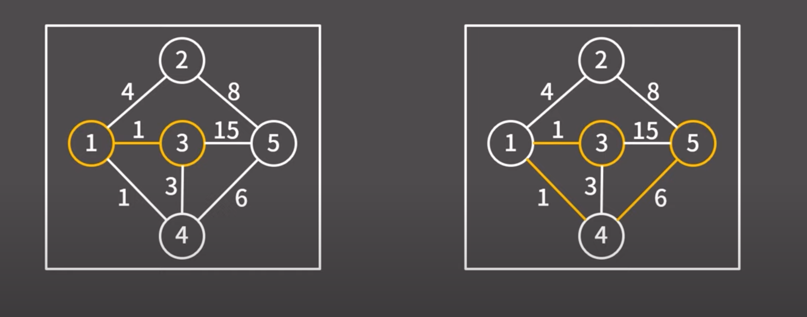
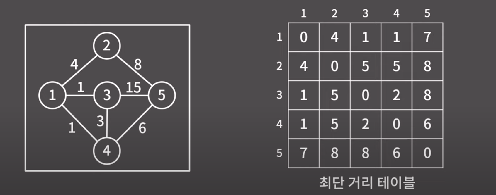
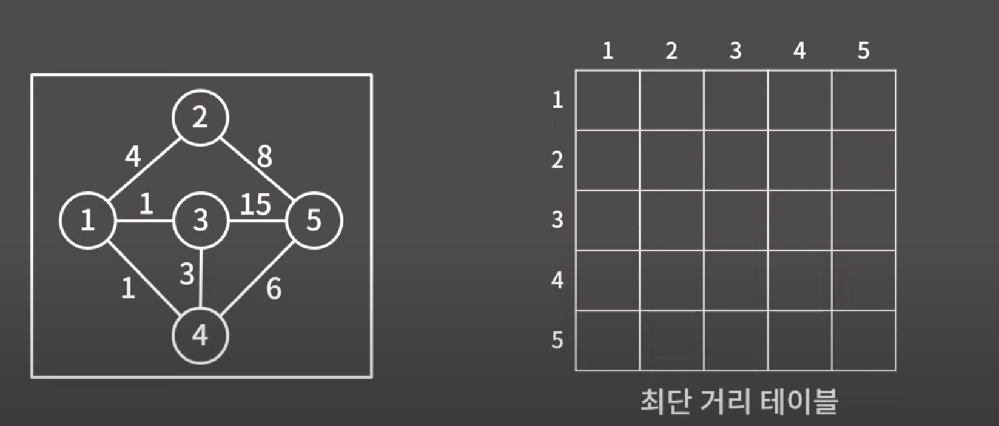
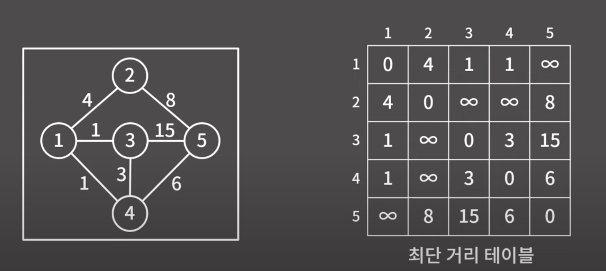
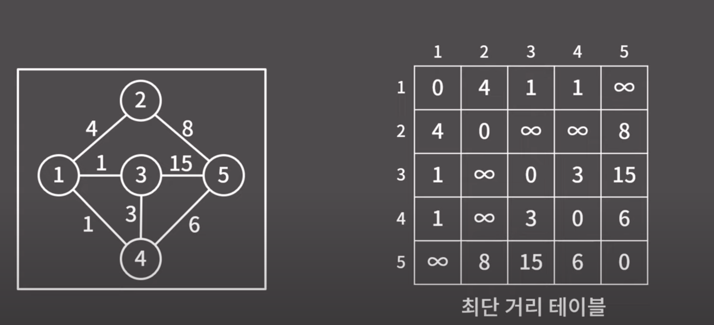
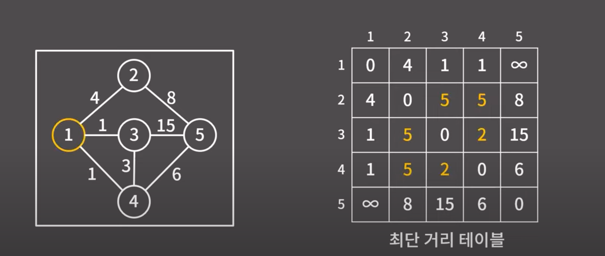
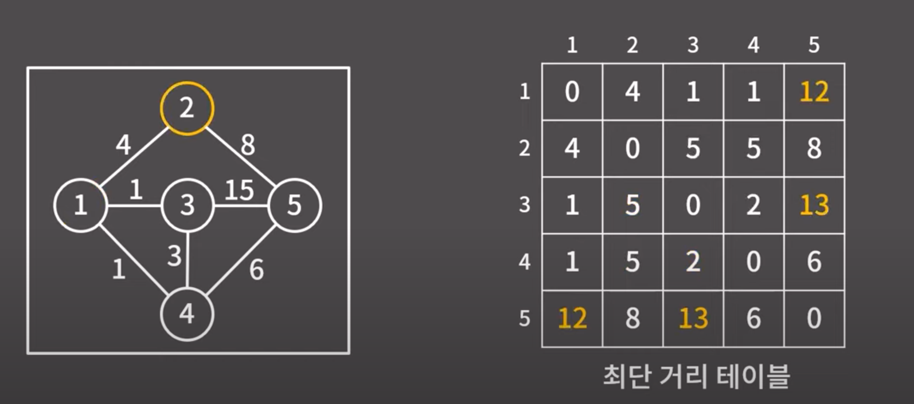
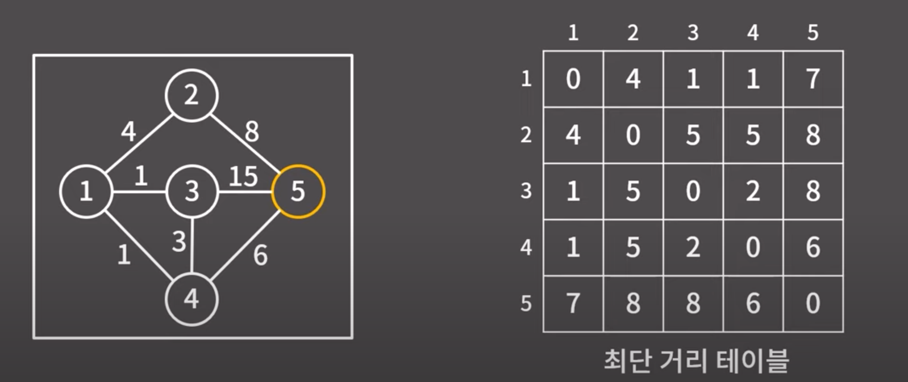

## 목차

- 플로이드 설명 
- 플로이드 알고리즘 과정 
- 플로이드 알고리즘 시간 복잡도
- 백준 11404 플로이드 골드4 
- 백준 11780 플로이드2 골드2
- 참고 자료 

---

## 플로이드 설명 

Folyd(플로이드) 알고리즘은 그래프 최단 경로를 찾는 알고리즘 중 하나이다. 



정점1 → 정점3 : 최단경로는 1이다. 

정점3 → 정점5 : 최단경로는 3 → 4 + 4 → 5 = 3 + 6 = 9 이다. 

플로이드 알고리즘 = 모든 정점 쌍 사이의 최단 거리를 구하는 알고리즘 



현재 그래프는 무방향(양방향) 그래프 이지만 그래프가 방향 그래프이건, 무방향 그래프이건 상관이 없다. 

간선의 값이 음수여도 잘 동작하지만, 음수인 사이클이 있으면 문제가 생긴다. 

하지만 애초에 간선의 값이 음수인 상황이 일반적이지는 않다. 

플로이드 알고리즘의 구현 난이도는 MST에 비해 비교적 쉬운 편이다. 

---

## 플로이드 알고리즘 과정 



일단 현재 그래프에서 테이블에 당장 채울수 있는 것만 채우겠다. 



자기 자신으로 가는 거리는 0 

간선 1개로 바로 건너갈 수 있는 곳 또한 간선의 값으로 바로 채울 수 있다. 

그래프에 간선이 많기 때문에 자명한 것들만 채워도 꽤 많이 채워진다. 

하지만 현재 최단 거리 테이블은 문제가 많다. 

예를 들어 3에서 5로 가는 최단 경로는 9이다. 지금은 간선 1개 짜리만 보니 15로 채워져있다.

일단 현재의 최단 거리 테이블은 중간에 다른 정점을 거치지 않았을 때의 최단 거리가 저장되어 있는 테이블이라고 생각하면 된다. 

이제 중간에 다른 정점을 거치지 않았거나 1번 정점을 거쳐서 갈 때의 최단 거리가 저장되도록 수정해보겠다. 



현재 2 → 4의 최단 경로는 ∞ 이다. 

이때 1을 거쳐서 가면 2에서 1로 가는 간선, 1에서 4로 가는 간선을 이용해 거리 5로 갈 수 있으니까 해당 칸의 값을 5로 갱신하고 싶다.



s에서 t로 갈 때 1번 정점을 거쳐가는 최단 거리는 D[s][1] + D[1][t]이다. 

D[s][1] + D[1][t]가 의미하는 바는 s에서 1까지 최단 경로로 가고 그 후 1부터 1부터 t까지 다시 최단 경로로 갔을 때의 값이다.

D[s][t] 보다 D[s][1] + D[1][t]가 더 작은 경우, 즉 1번 정점을 거쳐가는 것이 더 효율적일 때에만 

D[s][t] = D[s][1] + D[1][t] 이렇게 갱신을 해준다. 



현재 테이블은 다른 정점 x / 1번 정점 / 2번 정점을 거쳐갔을 때의 최단 거리 테이블이다. 

→ D[s][t] > D[s][2] + D[2][t]  →   D[s][t] = D[s][2] + D[2][t]  갱신

중간에 다른 정점을 거치지 않았거나 3번 정점을 거쳐갔을 때의 최단 거리 

중간에 다른 정점을 거치지 않았거나 4번 정점을 거쳐갔을 때의 최단 거리 

…..

마지막 n번 정점을 거쳐갔을 때의 최단 거리 까지 갱신하면 끝이다.



최종 결과

---

## 플로이드 알고리즘 시간 복잡도 

정점이 V개라고 할 때, 총 v단계에 걸쳐 갱신이 이루어지고 각 k=1,2,3,…,V번째 단계마다 

총 V^2개의 모든 D[s][t]값을 D[s][k] + D[k][t]값과 비교하기 때문에 

플로이드 알고리즘의 시간 복잡도는 **O(V^3)**이다. 

보통 컴퓨터는 1초에 3~4억 정도의 연산이 가능하다고 알고 있지만 

플로이드 알고리즘은 단순 사칙 연산만 있어서 정점이 1000개까지도 가능하다.

**상수시간 최적화 - (연산 < 대입)** 

- 대입이 더 시간이 오래 걸리니까 min을 사용하지 않고 연산을 해서 꼭 필요한 경우에만 대입을 하도록 하자 

---

## 백준 11404 플로이드 골드4 

```java
import java.io.*;
import java.util.*;
public class Main {
    public static final int INF = 100000 * 100;
    public static void main(String[] args) throws IOException {
        BufferedReader br = new BufferedReader(new InputStreamReader(System.in));
        StringTokenizer st;
        int n = Integer.parseInt(br.readLine()); // 도시의 개수
        int m = Integer.parseInt(br.readLine()); // 버스의 개수
        int [][] D = new int[n][n];
        for (int i = 0; i < n; i++) {
            for (int j = 0; j < n; j++) {
                if(i == j){
                    D[i][j] = 0;
                    continue;
                }
                D[i][j] = INF;
            }
        }
        while (m-->0){
            st = new StringTokenizer(br.readLine());
            int v1 = Integer.parseInt(st.nextToken()) - 1;
            int v2 = Integer.parseInt(st.nextToken()) - 1;
            int cost = Integer.parseInt(st.nextToken());
            if(D[v1][v2] > cost) D[v1][v2] = cost;
        }

        for (int i = 0; i < n; i++) {
            for (int j = 0; j < n; j++) {
                for (int k = 0; k < n; k++) {
                    if(D[j][k] > D[j][i] + D[i][k]){
                        D[j][k] = D[j][i] + D[i][k];
                    }
                }
            }
        }
        StringBuilder sb = new StringBuilder();
        for (int i = 0; i < n; i++) {
            for (int j = 0; j < n; j++) {
                if(D[i][j] == INF) D[i][j] = 0;
                sb.append(D[i][j]).append(" ");
            }
            sb.append("\n");
        }
        System.out.println(sb);
    }
}
```

---

## 백준 11780 플로이드2 골드2

```java
import java.io.*;
import java.util.*;
public class Main {
    public static final int INF = 100000 * 99;
    public static void main(String[] args) throws IOException{
        BufferedReader br = new BufferedReader(new InputStreamReader(System.in));
        StringTokenizer st;
        int n = Integer.parseInt(br.readLine()); // 도시의 개수
        int m = Integer.parseInt(br.readLine()); // 버스의 개수
        int [][] D = new int[n][n];
        int [][] next = new int[n][n];

        for (int i = 0; i < n; i++) {
            for (int j = 0; j < n; j++) {
                if(i == j){
                    D[i][j] = 0;
                    continue;
                }
                D[i][j] = INF;
            }
        }
        while (m-->0){
            st = new StringTokenizer(br.readLine());
            int v1 = Integer.parseInt(st.nextToken()) - 1;
            int v2 = Integer.parseInt(st.nextToken()) - 1;
            int cost = Integer.parseInt(st.nextToken());
            if(D[v1][v2] > cost){
                D[v1][v2] = cost;
                next[v1][v2] = v2;
            }
        }

        for (int i = 0; i < n; i++) {
            for (int j = 0; j < n; j++) {
                for (int k = 0; k < n; k++) {
                    if(D[j][k] > D[j][i] + D[i][k]){
                        D[j][k] = D[j][i] + D[i][k];
                        next[j][k] = next[j][i];
                    }
                }
            }
        }
        StringBuilder sb = new StringBuilder();
        for (int i = 0; i < n; i++) {
            for (int j = 0; j < n; j++) {
                if(D[i][j] == INF) D[i][j] = 0;
                sb.append(D[i][j]).append(" ");
            }
            sb.append("\n");
        }
        for (int i = 0; i < n; i++) {
            for (int j = 0; j < n; j++) {
                if(D[i][j] == 0){
                    sb.append(0).append("\n");
                    continue;
                }
                Queue<Integer> q = new LinkedList<>();
                q.add(i + 1);
                int cur = i;
                while (cur != j){
                    cur = next[cur][j];
                    q.add(cur + 1);
                }
                sb.append(q.size()).append(" ");
                while (!q.isEmpty()){
                    sb.append(q.poll()).append(" ");
                }
                sb.append("\n");
            }
        }
        System.out.println(sb);
    }
}
```

---

## 참고 자료 

[https://www.youtube.com/watch?v=dDDy2bEZRA8&list=PLtqbFd2VIQv4O6D6l9HcD732hdrnYb6CY&index=29](https://www.youtube.com/watch?v=dDDy2bEZRA8&list=PLtqbFd2VIQv4O6D6l9HcD732hdrnYb6CY&index=29)

---

