## 목차 

- 알고리즘 설명 
- 알고리즘 Simulation 
- 알고리즘 구현 
- 백준 2252 줄 세우기 골드3
- 참고자료 

---

## 알고리즘 설명 

실생활에서 예시 : 교과 이수 제도 

대학교에는 선수 과목이라는 개념이 존재한다. 

→ 프로그래밍1 → 프로그래밍2 / 일반수학 → 공업수학 

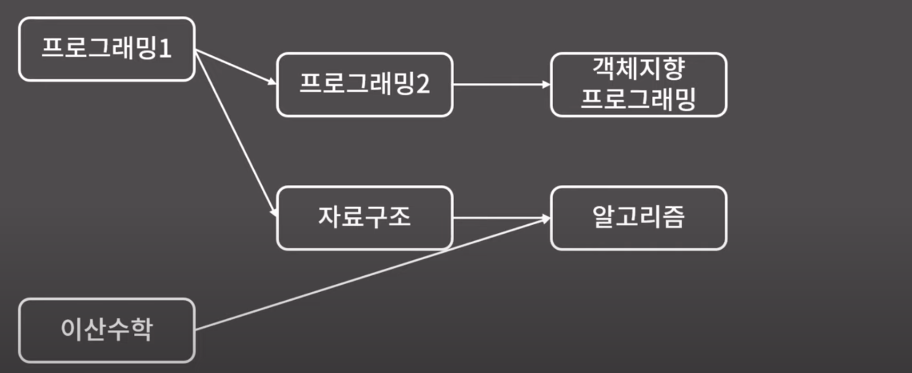

여기 내가 대학교에서 수업을 들어야 하는 과목들이 있다. 

모든 과목을 수강하고 싶다고 하면 어떤 순서로 과목을 들어야 할까?   

수강을 하는 순서로는 다양한 방법들이 존재한다. 

1) 이산수학, 프로그래밍1, 프로그래밍2, 자료구조, 알고리즘, 객체지향 프로그래밍 

2) 프로그래밍1, 프로그래밍2, 객체지향 프로그래밍, 자료구조, 이산수학, 알고리즘 

……

이 때 과목을 정점으로 나타내고 과목의 선후 관계를 간선으로 나타낸 상황을 생각해보자.

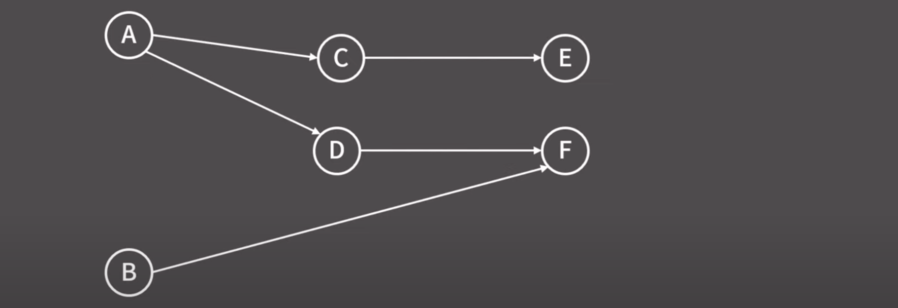

그러면 이런 그래프가 나온다.

**위상 정렬(Topological Sorting) : 방향 그래프에서 간선으로 주어진 정점 간 선후관계를 위배하지** 

**않도록 나열하는 정렬** 

하나의 그래프에는 여러 개의 위상 정렬 결과가 있을 수 있다. 

ABDEEF, ACEDBF, BADCEF, BADFCE 등이 전부 올바른 위상 정렬이다.

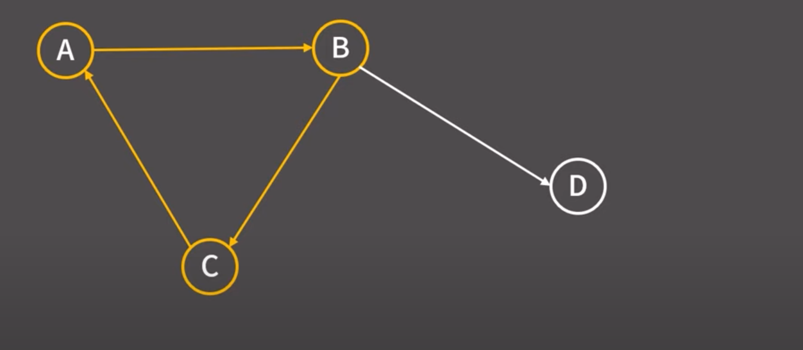

이렇게 그래프 안에 사이클이 존재할 경우에는 올바른 위상 정렬이 존재할 수 없다.

ABC 중에 그 어떤 것이 먼저 나오더라도 간선으로 주어진 정점 간 선후관계에 모순이 발생하기 때문이다.

그렇기 때문에 위상정렬은 사이클이 존재하지 않는 방향 그래프에서만 동작한다.

사이클이 없는 방향 그래프를 **DAG(Directed Acyclic Graph)**라고 줄여서 부르기도 한다.

 

---

## 알고리즘 Simulation 

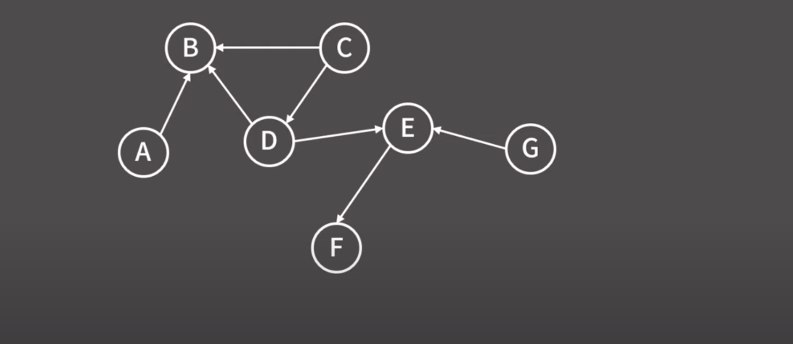

해당 그래프를 위상 정렬을 해서 결과를 도출해 보자.

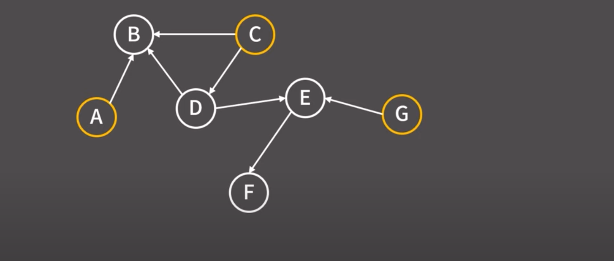

위상 정렬 상에서 제일 앞에 오는 원소로 가능한 게 무엇인지를 먼저 생각해 보자.

제일 앞에 오려면 자신의 정점 보다 앞에 있는 정점이 없어야 한다. 

즉 자신에게 들어오는 간선이 없어야 한다.

A → B 간선을 분석해 보자.

B 정점은 A 정점 이후에 등장할 수 있다.

그래서 B정점은 제일 앞에 올수 없다.

자신에게 들어오는 간선의 개수를 **indegree** 라고 표현을 하면 

위상 정렬 시작 정점은 indegree가 0인 A,C,G가 가능하다.

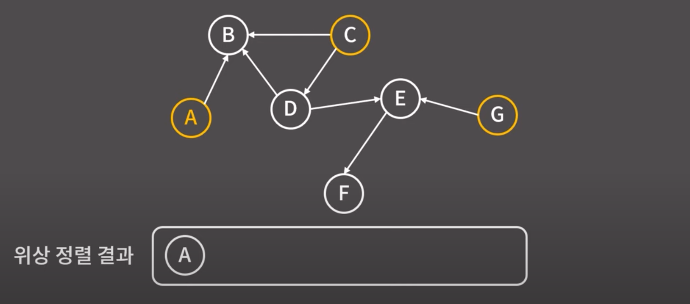

셋 중 어느 것이 제일 앞에 오더라도 전혀 상관이 없겠지만 임의로 A를 택한다.

A를 추가한 이후로는 A에서 다른 정점으로 나가는 간선은 의미가 없다.

그렇기에 주어진 그래프에서 정점 A와 A에서 뻗어나가는 간선을 모두 지운 후

위상 정렬을 이어나가면 된다. 

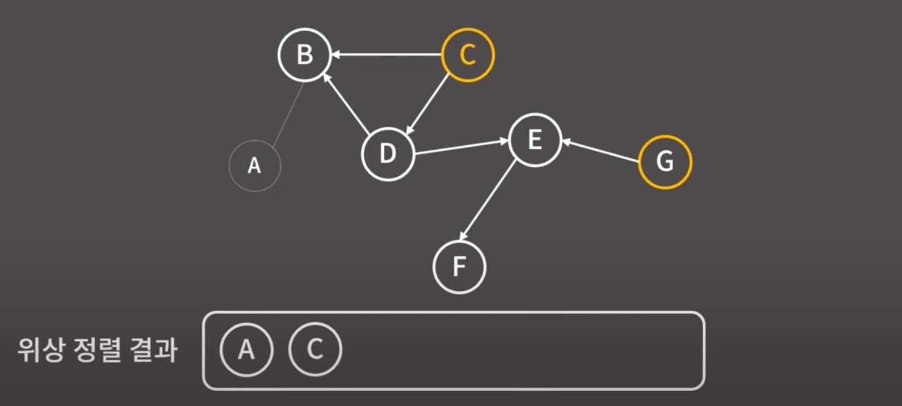

정점 A가 제거된 후 B,C,D,E,F,G로 이루어진 그래프에서 제일 앞에 위치할 수 있는 정점, 

즉 자신에게 돌아오는 간선이 없는 정점은 C, G 

임의로 C를 택한다.

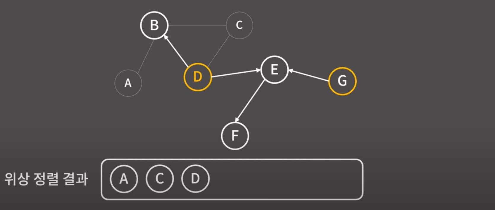

A에서 했던 동작과 마찬가지로 정점C와 C에서 뻗어나가는 간선을 모두 지운다.

정점 C가 제거된 후 B,D,E,F,G로 이루어진 그래프에서 제일 앞에 위치할 수 있는 정점은 

D와 G이다. 

임의로 D를 택한다.

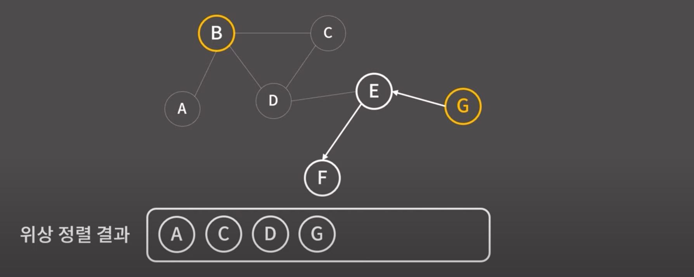

정점D와 D에서 뻗어나가는 간선을 모두 지운다.

정점 D가 제거된 후 B,E,F,G로 이루어진 그래프에서 제일 앞에 위치할 수 있는 정점은 

B와 G이다. 

임의로 G를 택한다.

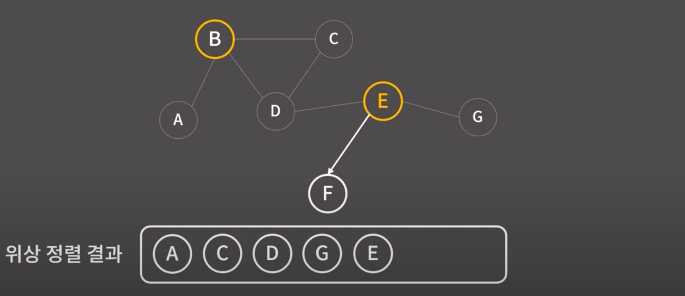

정점G와 G에서 뻗어나가는 간선을 모두 지운다.

정점 G가 제거된 후 B,E,F로 이루어진 그래프에서 제일 앞에 위치할 수 있는 정점은 

B와 E 정점이다.

임의로 E를 택한다.

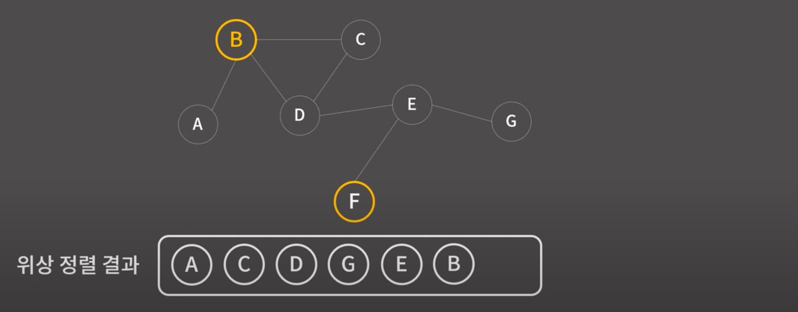

정점E와 E에서 뻗어나가는 간선을 모두 지운다.

정점 E가 제거된 후 B,F로 이루어진 그래프에서 제일 앞에 위치할 수 있는 정점은 

B와 F이다. 

임의로 B를 택한다.

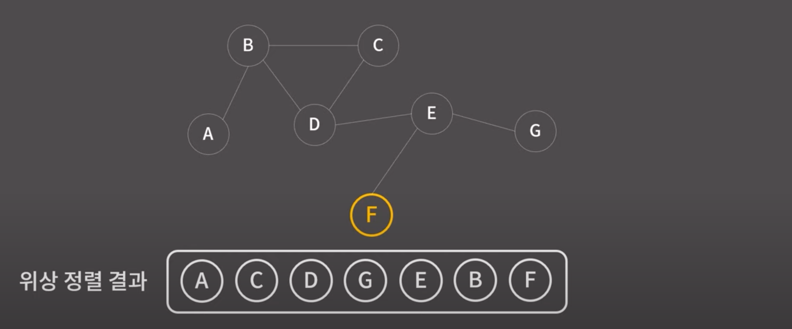

위상 정렬 완료

---

## 알고리즘 구현 

**구현의 편의를 위한 성질** 

1. 정점과 간선을 실제로 지울 필요 없이 미리 indegree의 값을 저장했다가 매번 뻗어나가는 정점들의 indegree 값만 1 감소시켜도 과정을 수행 가능
1. indegree가 0인 정점을 구하기 위해 매번 모든 정점들을 다 확인하는 대신에 목록을 따로 저장하고 있다가 직전에 제거한 정점에서 연결된 정점들만 추가 

**위상 정렬 알고리즘**

1. 맨 처음 모든 간선을 읽으며 indegree 테이블을 채운다.
1. indegree가 0인 정점을 모두 큐에 넣는다.
1. 큐에서 정점을 꺼내어 위상 정렬 결과에 추가
1. 해당 정점으로부터 연결된 모든 정점의 indegree 값을 1 감소시킴 이 때 indegree가 0인 정점은 그 정점을 큐에 추가
1. 큐가 빌 때 까지 3, 4번 과정을 반복 

---

## 백준 2252 줄 세우기 골드3

```java
import java.util.*;
import java.io.*;
public class Main {
    public static void main(String[] args) throws IOException {
        BufferedReader br = new BufferedReader(new InputStreamReader(System.in));
        StringTokenizer st;

        st = new StringTokenizer(br.readLine());
        int n = Integer.parseInt(st.nextToken()); // 학생의 수 1 ~ n
        int m = Integer.parseInt(st.nextToken()); // 간선

        // 그래프 초기화
        ArrayList<Integer> [] graph = new ArrayList[n+1];
        for (int i = 0; i <= n; i++) {
            graph[i] = new ArrayList<>();
        }

        // indegree
        int [] indegree = new int[n+1];

        // 그래프 입력
        while (m-->0){
            st = new StringTokenizer(br.readLine());
            int start = Integer.parseInt(st.nextToken());
            int end = Integer.parseInt(st.nextToken());
            graph[start].add(end);

            // indegree up
            indegree[end]++;
        }

        // StringBuilder 결과 출력용
        StringBuilder sb = new StringBuilder();

        // indegree 0인 정점 추가
        Queue<Integer> q = new LinkedList<>();
        for (int i = 1; i <= n; i++) {
            if(indegree[i] == 0) q.add(i);
        }

        // 위상 정렬 알고리즘
        while (!q.isEmpty()){
            int cur = q.poll();
            sb.append(cur).append(" ");
            for (int i = 0; i < graph[cur].size(); i++) {
                int next = graph[cur].get(i);
                indegree[next]--;
                if(indegree[next] == 0) q.add(next);
            }
        }

        System.out.println(sb);

    }
}
```

---

## 참고 자료 

[https://www.youtube.com/watch?v=Th-gLZUrd04&list=PLtqbFd2VIQv4O6D6l9HcD732hdrnYb6CY&index=27](https://www.youtube.com/watch?v=Th-gLZUrd04&list=PLtqbFd2VIQv4O6D6l9HcD732hdrnYb6CY&index=27)

---

