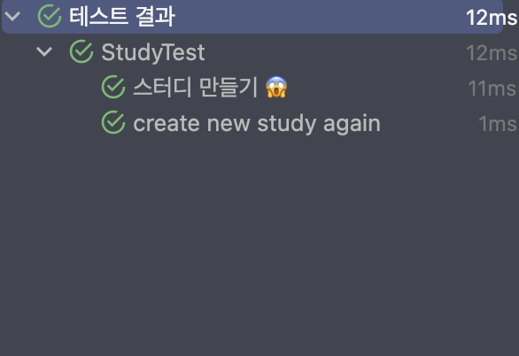
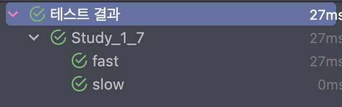
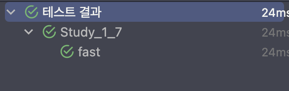

```java
class StudyTest {
    @Test
    void create(){
        var study = new Study();
        assertNotNull(study);
        System.out.println("create");
    }
    @BeforeAll
    static void beforeAll(){
        System.out.println("before all");
    }
    @AfterAll
    static void afterAll(){
        System.out.println("after all");
    }
    @BeforeEach
    void beforeEach(){
        System.out.println("before each");
    }
    @AfterEach
    void afterEach(){
        System.out.println("after each");
    }
}
```

  - `@BeforeAll` , `@AfterAll` 
- 모든 테스트를 시작하기 전/후에 동작 
    - **must static 메서드**
  - `@Disabled` 
- 실행하지 않을 테스트에 적용

## **@DisplayNameGeneration**

```java
@DisplayNameGeneration(DisplayNameGenerator.ReplaceUnderscores.class)
class StudyTest {
    @Test
    void create_new_study(){
        var study = new Study();
        assertNotNull(study);
        System.out.println("create1");
    }
    @Test
    void create_new_study_again(){
        System.out.println("create2");
    }
}
```

  - JUnit5에서 테스트 메서드 이름을 자동으로 변환해주는 어노테이션 
  - **클래스 레벨, 메서드 레벨 전부 적용 가능** 
  - @DisplayNameGeneration(DisplayNameGenerator.ReplaceUnderscores.class)
- **언더스코어(_)를 공백문자( )로 치환** 
    - create_new_study → create new study
    - create_new_study_again → create new study again

## **@DisplayName**

```java
@DisplayNameGeneration(DisplayNameGenerator.ReplaceUnderscores.class)
class StudyTest {
    @Test
    @DisplayName("스터디 만들기 \uD83D\uDE31")
    void create_new_study(){
        var study = new Study();
        assertNotNull(study);
        System.out.println("create1");
    }
    @Test
    void create_new_study_again(){
        System.out.println("create2");
    }
}
```

  - **@DisplayNameGeneration 보다 우선순위가 높다** 



  - cute ㅋㅋ

# Supplier 성능 최적화 

```java
@Test
@DisplayName("스터디 만들기 \uD83D\uDE31")
void create_new_study(){
    var study = new Study();
    assertNotNull(study);
    // expected, actual
    assertEquals(StudyStatus.DRAFT, study.getStatus(),
            () -> "스터디를 처음 만들면 상태값이 " + StudyStatus.DRAFT);
    System.out.println("create1");
}
```

  - `import static org.junit.jupiter.api.Assertions.*;`

**assertEquals 메소드를 보면 expected, actual, Supplier<String>을 넘기고 있다.** 

**assertEquals 메소드는 다양한 형태로 오버로딩**  

  - `assertEquals(expected, actual, message)`
  - `assertEquals(expected, actual, Supplier<String> messageSupplier)`

하지만 왜 Supplier<String>으로 넘길 수 있게 만들었을까?

**이는 성능과 관련이 있다.** 

에러 메시지를 만드는 데 비용이 크다면? ex) 문자열 + 연산이 여러 번 존재 

그냥 String으로 넘기면 에러가 발생하지 않더라도 바로 연산을 해서 넘긴다. 

하지만 이렇게 Supplier를 통해서 람다식으로 넘기면 에러가 발생했을 때만 문자열 연산이 동작한다.

# AssertAll

```java
@Test
@DisplayName("스터디 만들기 \uD83D\uDE31")
void create_new_study(){
    var study = new Study(10);
    assertAll(
            () -> assertNotNull(study),
            () -> assertTrue(study.getLimit() > 0, "스터디 최대 참석 가능 인원은 0보다 커야함"),
            () -> assertEquals(StudyStatus.DRAFT, study.getStatus(),
                    () -> "스터디를 처음 만들면 상태값이 " + StudyStatus.DRAFT)
    );
}
```

assertAll을 사용하지 않고 assertNotNull, assertTrue, assertEquals 테스트가 있으면

순서에 따라서 앞에서 실행된 테스트가 실패하면 테스트는 더 이상 실행되지 않고 멈추게 된다. 

하지만 이렇게 assertAll을 사용하여 각 테스트를 executable(functional interface)로 넘겨주면 

하나의 테스트가 실패해도 나머지 테스트도 동작하고 최종적으로 어떤 테스트가 실패했는지 알려준다. 

**즉, 여러 개의 assertion을 한 번에 실행할 수 있으며, 하나의 assertion이 실패해도 나머지 assertion이 계속 실행된다.** 

# assertThrows

```java
@Test
@DisplayName("스터디 만들기 assertThrows")
void create_new_study_again(){
    IllegalArgumentException exception =
            assertThrows(IllegalArgumentException.class, () -> new Study(-10));
    assertEquals("limit은 0보다 커야한다.", exception.getMessage());
}
```

**예외 검증** 

# **assertTimeout**

```java
@Test
@DisplayName("스터디 만들기 assertTimeout")
void create_new_study_assertTimeout(){
    assertTimeout(Duration.ofMillis(100), () -> {
         new Study(10);
         Thread.sleep(300);
    });
}
```

**테스트 시간을 검증** 

현재 0.1초 이내에 동작해야 하는 데 0.3이상이 걸려서 테스트가 실패하게 된다. 

# 
**assertTimeoutPreemptively**

```java
@Test
@DisplayName("스터디 만들기 assertTimeoutPreemptively")
void create_new_study_assertTimeoutPreemptively(){
    assertTimeoutPreemptively(Duration.ofMillis(100), () -> {
         new Study(10);
         Thread.sleep(10000);
    }, () -> "스터디 생성은 0.1초 이내에 동작");
}
```

**테스트 시간을 검증** 

0.1초 이내에 동작해야 하는데 현재 Thread.sleep을 보면 10초다.

assertTimeout 메소드를 통한 검증이었다면 10초를 기다리고 테스트가 실패하겠지만

**assertTimeoutPreemptively 같은 경우 지정한 Duration인 0.1초를 넘기면 바로 실패한다.** 

**주의점** 

**ThreadLocal을 사용하는 SpringSecurity(context holder), Spring Transaction case** 

assertTimeoutPreemptively는 다른 스레드에서 동작한다.

# **assumingTrue**

```java
@Test
@DisplayName("assumeTrue")
void test(){
    String testEnv = System.getenv("TEST_ENV");
    assumeTrue("LOCAL2".equalsIgnoreCase(testEnv));
    var study = new Study(10);
    assertThat(study.getLimit()).isGreaterThan(5);
}
```

**조건에 맞으면 테스트 진행** 

# **assumingThat**

```java
@Test
@DisplayName("assumingThat")
void test2(){
    String testEnv = System.getenv("TEST_ENV");
    assumingThat("LOCAL2".equalsIgnoreCase(testEnv), () -> {
        var study = new Study(10);
        assertThat(study.getLimit()).isGreaterThan(5);
    });
}
```

```java
@Test
@DisplayName("@EnabledIfEnvironmentVariable")
@EnabledIfEnvironmentVariable(named = "TEST_ENV", matches = "LOCAL2")
void test4(){
    var study = new Study(10);
    assertThat(study.getLimit()).isGreaterThan(5);
}
```

**@EnabledIfEnvironmentVariable**: assumingThat, assumingTrue 조건을 애노테이션으로 해결 

# 
**@EnabledOnOs**

```java
@Test
@DisplayName("@EnabledOnOS")
@EnabledOnOs({OS.MAC, OS.LINUX})
void test3(){
    var study = new Study(10);
    assertThat(study.getLimit()).isGreaterThan(5);
}
```

**OS에 해당하면 테스트 진행**

```java
/**
 * JUnit 5 태깅과 필터링
 */
public class Study_1_7 {
    @Test
    @DisplayName("fast")
    @Tag("fast")
    void fast() {
        var study = new Study(100);
        assertThat(study).isNotNull();
    }
    @Test
    @DisplayName("slow")
    @Tag("slow")
    void slow() {
        var study = new Study(100);
        assertThat(study).isNotNull();
    }
}
```

**build.gradle → excludeTags 적용** 

```java
tasks.named('test') {
	useJUnitPlatform{
		// excludeTags("slow")
	}
}
```



```java
tasks.named('test') {
	useJUnitPlatform{
		 excludeTags("slow")
	}
}
```



```java
/**
 * JUnit5 테스트 반복하기
 */
public class Study_1_9 {
    @DisplayName("반복 테스트 연습1")
    @RepeatedTest(value = 10, name = "{currentRepetition}/{totalRepetitions} {displayName}")
    void repeatedTest(RepetitionInfo repetitionInfo) {
        System.out.println(
        "test " + repetitionInfo.getCurrentRepetition() + "/" + repetitionInfo.getTotalRepetitions());
    }

    @DisplayName("반복 테스트 연습2")
    @ParameterizedTest(name = "{index} {displayName} message={0}")
    @ValueSource(strings = {"날씨가", "많이", "추워지고", "있네요"})
    void repeatedTest2(String message) {
        System.out.println(message);
    }

    @DisplayName("반복 테스트 연습3")
    @ParameterizedTest(name = "{index} {displayName} message={0}")
    @ValueSource(strings = {"날씨가", "많이", "추워지고", "있네요"})
    @NullAndEmptySource // @NullSource + @EmptySource
    void repeatedTest3(String message) {
        System.out.println(message);
    }

    @DisplayName("반복 테스트 연습4")
    @ParameterizedTest(name = "{index} {displayName} message={0}")
    @ValueSource(ints = {1, 2, 3, 4, 5})
    void repeatedTest4(@ConvertWith(StudyConverter.class) Study study) {
        System.out.println(study.getLimit());
    }

    static class StudyConverter extends SimpleArgumentConverter{
        @Override
        protected Object convert(Object source, Class<?> targetType) throws ArgumentConversionException {
            assertEquals(Study.class, targetType, "Cant only convert to Study");
            return new Study(Integer.parseInt(source.toString()));
        }
    }

    @DisplayName("반복 테스트 연습5")
    @ParameterizedTest(name = "{index} {displayName} message={0} {1}")
    @CsvSource({"10, 자바 스터디", "20, 스프링"})
    void repeatedTest5(Integer limit, String name) {
        var study = new Study(limit, name);
        System.out.println(study);
    }

    @DisplayName("반복 테스트 연습6")
    @ParameterizedTest(name = "{index} {displayName} message={0} {1}")
    @CsvSource({"10, 자바 스터디", "20, 스프링"})
    void repeatedTest6(ArgumentsAccessor argumentsAccessor) {
        var study = new Study(argumentsAccessor.getInteger(0), argumentsAccessor.getString(1));
        System.out.println(study);
    }
    
    @DisplayName("반복 테스트 연습7")
    @ParameterizedTest(name = "{index} {displayName} message={0} {1}")
    @CsvSource({"10, 자바 스터디", "20, 스프링"})
    void repeatedTest6(@AggregateWith(StudyAggregator.class) Study study) {
        System.out.println(study);
    }
    
    static class StudyAggregator implements ArgumentsAggregator{
        @Override
        public Object aggregateArguments(ArgumentsAccessor accessor, ParameterContext context) throws ArgumentsAggregationException {
           return new Study(accessor.getInteger(0), accessor.getString(1));
        }
    }
}
```

**JUnit은 테스트 메서드 마다 테스트 인스턴스를 새로 만든다.**

  - 이것이 기본 전략이다. 
  - 테스트 메서드를 독립적으로 실행하여 예상치 못한 부작용을 방지하기 위함이다.
  - 이 전략을 JUnit 5에서 변경할 수 있다.

```java
public class Study_1_10 {
    @Test
    public void test1() {
        System.out.println(this);
    }
    @Test
    public void test2() {
        System.out.println(this);
    }
}
```

  - **spring.studytest.Study_1_10@6c7a164b**
  - **spring.studytest.Study_1_10@dc9876b**
  - **인스턴스가 서로 다르다.  → 테스트 메서드마다 새로운 테스트 인스턴스를 만든다.** 

### TestInstance.PER_CLASS

```java
@TestInstance(TestInstance.Lifecycle.PER_CLASS)
public class Study_1_10 {
    @Test
    public void test1() {
        System.out.println(this);
    }
    @Test
    public void test2() {
        System.out.println(this);
    }
}
```

  - **spring.studytest.Study_1_10@4c2bb6e0**
  - **spring.studytest.Study_1_10@4c2bb6e0**
  - **인스턴스가 같다. → 테스트 메서드마다 새로운 인스턴스를 만들지 않고 하나의 인스턴스를 재사용한다.**

