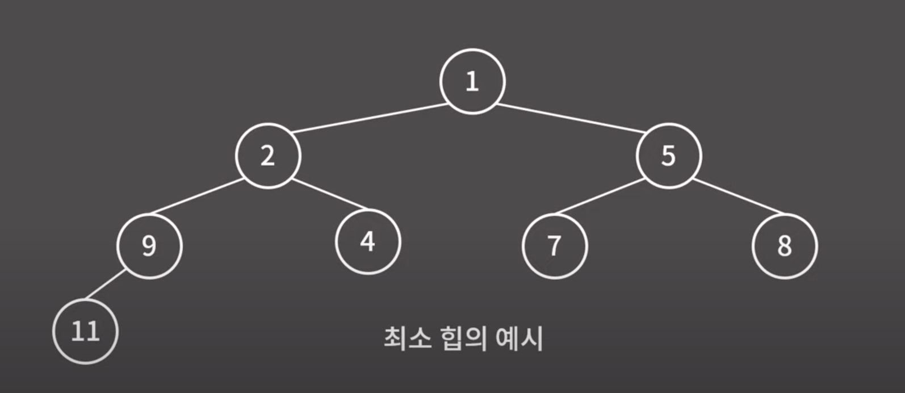
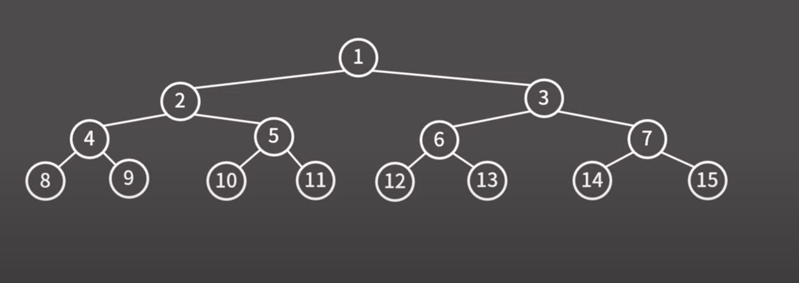
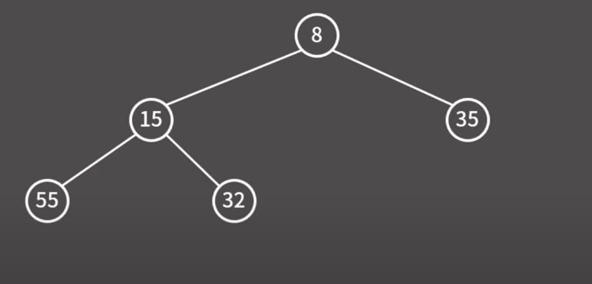
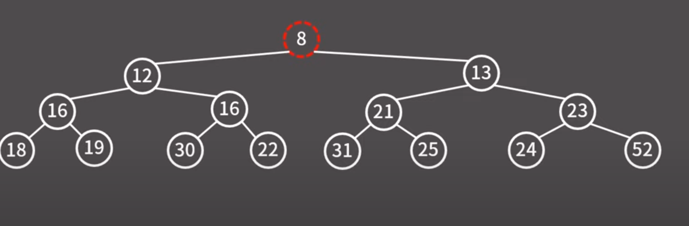
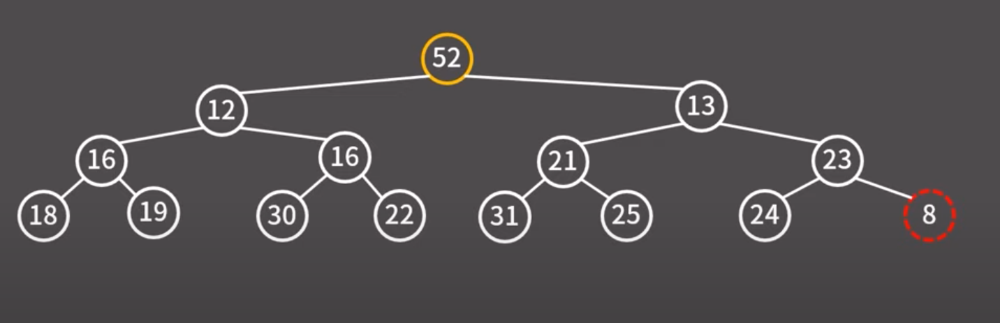
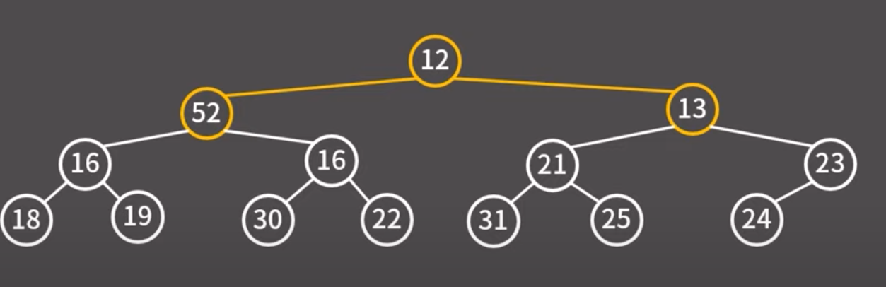
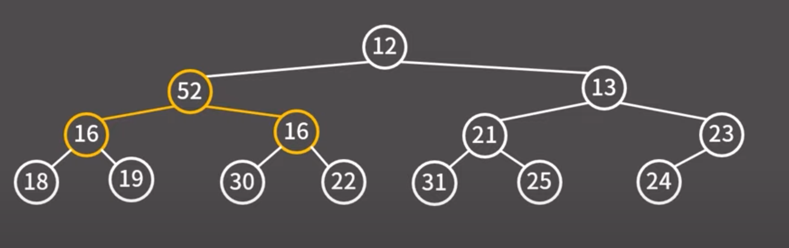
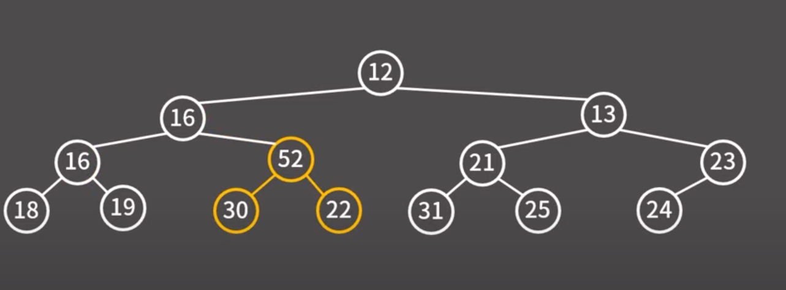
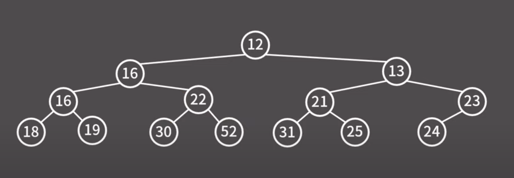
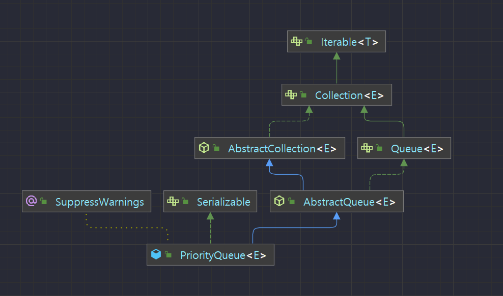

## 설명 + 시간 복잡도

우선순위 큐 = pop을 할 때 가장 먼저 들어온 원소가 나오는 대신 우선순위가 가장 높은 원소가 나오는 큐 

1. 원소의 추가가 O(lg N)
1. 우선순위가 가장 높은 원소의 확인 O(1)
1. 우선순위가 가장 높은 원소의 제거가 O(lg N)

그냥 배열로 구현을 하면 세 연산의 시간복잡도가 O(1), O(N), O(N)이 되겠지만 

Heap 구조를 이용하면 O(lg N), O(1), O(lg N)에 가능하다. 

---

## Heap

이진 트리의 모양을 가지는 자료 구조 

이진 트리 : 각 정점의 자식이 최대 2개인 트리를 의미 

이진 검색 트리와는 다른 자료구조이다. 이진 트리라는 공통점만 가진다. 

우리는 힙을 최댓값 혹은 최솟값을 찾는 목적으로 쓸 수 있다.

최대 힙 : 최댓값을 찾기 위해 사용한는 힙

최소 힙 : 최솟값을 찾기 위해 사용하는 힙

최소 힙에서는 부모가 자식 보다 작아야 한다. → 루트가  최솟값 

최대 힙은 부모가 자식보다 커야 한다. → 루트가 최댓값 

---

## **Heap의 삽입 순서** 

이런 순서로 값을 채워 나가니 이진 검색 트리와는 다르게 힙은 불균형이 발생하지 않고 늘 균형이 맞는 규형 이진 트리의 모양이다. 

---

## **Heap (삽입)Insert Simulation** 

- 최소힙 

35 삽입 

55 삽입

15 삽입

35와 15에서 부모와 자식 간의 관계가 최소힙 조건에 위배된다.  (부모 < 자식)

→ 부모와 자식의 자리를 바꾼다. 

8 삽입

이번에도 마찬가지로 최고 힙의 조건이 위배된다. 

8 ↔ 55 

8 ↔ 15

32 삽입

정리

매번 삽입을 할 때 마다 아무리 비교를 많이 해도 최대 높이 만큼만 비교를 하고 문제가 있다면

올라가면서 자리를 바꿔주면 끝난다. 

힙의 구조상 균형 트리이기 때문에 삽입의 시간복잡도는 O(lg N)이다. 

---

## **Heap Find** 

최솟값 확인은 매우 간단하다. 그냥 루트에 값이 최솟값이다. 

단 최소 힙에서는 최솟값을 효율적으로 확인할 수 있지만, 열 번째로 작은 값의 확인이라던가 

최댓값의 확인은 모든 원소를 다 보는게 아닌 이상 불가능하다. 

최대 힙은 반대 

이런 특징은 이진 검색 트리와 힙의 차이다. 

---

## Heap Erase 

최솟값을 지우는 연산, 여기서는 루트(8)

트리의 구조를 지키기 위해서 트리의 순서상 가장 마지막인 원소와 자리 교체를 하고 8을 없앤다. 

여기서 8을 없애도 트리의 구조가 지켜지는 이유는 가장 마지막인 원소는 자식이 없기 때문이다. 

이제 52가 루트로 왔으니 다시 최소 힙의 조건을 맞춘다. 

12, 13, 52 중에서 가장 작은 값은 12니까 12 ↔ 52 바꾼다.

52, 16, 16에서는 어떻게 최소 힙 조건을 맞출까?

16, 16 둘 둥 어느 것을 올리더라도 문제가 없다! 

52 ↔ 16

52, 30, 22 에서 문제 발생 

52 ↔ 22 

끝!

---

## **자바 PriorityQueue 계층 구조** 

---

## 이진 검색 트리 기반 vs heap 기반 

TreeSet과 PriorityQueue를 비교해 보자 .

- PriorityQueue에서 수행 가능한 기능은 TreeSet에서 모두 수행 가능하고 훨씬 더 다양한 기능을 제공하다. 
- ex) NavigableSet(인터페이스) 메서드
- 삽입, 삭제, 검색 시간 복잡도 또한 동일하다 
- TreeSet의 검색은 평균이 O(lg N) 
  - first(), last() 는 O(1)이다.

다 맞는 말이다. 하지만 PriorityQueue가 똑같은 데이터 셋을 수행할 때 TreeSet 보다 더 빠르고 공간도 적게 차지한다. 빅오 표기법(O)로 하는건 평균적인 수치이다 . 너무 맹신하지 말자 

이런 수행 시간 차이가 나는건 이진 검색 트리는 트리 불균형에 대한 균형을 맞추기 위한 시간이 소비된다. (자바는 자가 균형 트리인 레드 블랙 트리) 

하지만 PriorityQueue의 이진 트리는 불균형이 존재하지 않는다. 항상 삽입 순서가 정해져 있다.

언제나 O(lg N)에 수행 

같은 연산을 할 때 비교를 해보면 속도가 2~4배 정도 차이 난다고 한다. 정확한 수치인진 모르고 

데이터마다 다 다를 것이다. 

그래서 PriortyQueue에서 제공하는 연산으로만 해결 가능한 데이터라면 

PriorityQueue를 사용하는 게 좋다!!

---

## 참고 자료 

바킹독 : [바킹독 우선순위 큐](https://www.youtube.com/watch?v=_9mbqoF9qzc&list=PLtqbFd2VIQv4O6D6l9HcD732hdrnYb6CY&index=24)

---

