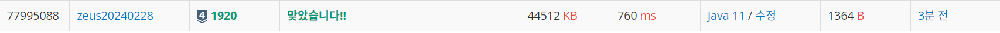
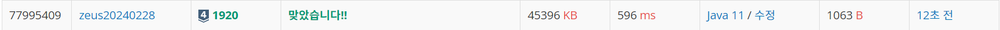
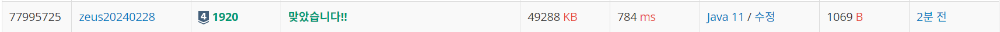

이분탐색 = 정렬되어 있는 배열에서 특정 데이터를 찾기 위해 모든 데이터를 

순차적으로 확인하는 대신 탐색 범위를 절반으로 줄여가며 찾는 탐색 방법

선형 탐색 : O(N)

이분 탐색 : O(lgN)

- 주의사항 
- 이분탐색을 하고자 한다면 주어진 값을 정렬
  - 무한 루프에 빠지지 않게 mid 값을 정해야 한다.
  - mid - (st+en+1)/2

**관련 문제 1 : 백준 1920 [수 찾기]**

**(1) 이분탐색 직접 구현** 

```java
import java.util.*;
import java.io.*;
public class Main {
    public static void main(String[] args) throws IOException{
        BufferedReader br = new BufferedReader(new InputStreamReader(System.in));
        int n = Integer.parseInt(br.readLine());
        StringTokenizer st;
        int [] A = new int[n];
        st = new StringTokenizer(br.readLine());
        for (int i = 0; i < n; i++) {
            A[i] = Integer.parseInt(st.nextToken());
        }

        Arrays.sort(A);

        int t = Integer.parseInt(br.readLine());
        int [] array = new int[t];
        st = new StringTokenizer(br.readLine());
        for (int i = 0; i < t; i++) {
            array[i] = Integer.parseInt(st.nextToken());
        }

        StringBuilder sb = new StringBuilder();
        for (int i = 0; i < t; i++) {
            int target = array[i];
            int start = 0;
            int end   = n - 1;
            int input = 0;
            while (start <= end){
                int mid = (start + end) / 2;
                if(A[mid] == target){
                    input = 1;
                    break;
                }
                else if(A[mid] < target){
                    start = mid + 1;
                }
                else end = mid - 1;
            }
            sb.append(input).append("\n");
        }
        System.out.println(sb);
    }
}
```



**(2) Arrays.binarySearch(int[] array , target)**

정렬된 배열에서 특정 요소를 찾아 인덱스를 반환합니다. 배열에 요소가 없으면 음수값을 반환합니다.

```java
import java.util.*;
import java.io.*;
public class Main {
    public static void main(String[] args) throws IOException{
        BufferedReader br = new BufferedReader(new InputStreamReader(System.in));
        int n = Integer.parseInt(br.readLine());
        StringTokenizer st;
        int [] A = new int[n];
        st = new StringTokenizer(br.readLine());
        for (int i = 0; i < n; i++) {
            A[i] = Integer.parseInt(st.nextToken());
        }

        Arrays.sort(A);

        int t = Integer.parseInt(br.readLine());
        int [] array = new int[t];
        st = new StringTokenizer(br.readLine());
        for (int i = 0; i < t; i++) {
            array[i] = Integer.parseInt(st.nextToken());
        }

        StringBuilder sb = new StringBuilder();
        for (int i = 0; i < t ; i++) {
            int target = array[i];
            int index = Arrays.binarySearch(A, target);
            if(index >= 0) sb.append(1);
            else sb.append(0);
            sb.append("\n");
        }
        System.out.println(sb);
    }
}
```



**(3) Collections.binarySearch(List<> list , target)**

정렬된 List에서 특정 요소를 찾아 인덱스를 반환합니다. List에 요소가 없으면 음수값을 반환합니다.



**관련 문제 2 : 백준 10816 [숫자 카드2] → 나중에 꼭 다시 한번 풀어보기**

```java
import java.io.*;
import java.util.*;
public class Main {
    static int [] cards;
    public static void main(String[] args) throws IOException {
        BufferedReader br = new BufferedReader(new InputStreamReader(System.in));
        StringTokenizer st;
        int n = Integer.parseInt(br.readLine());
        cards = new int[n];
        st = new StringTokenizer(br.readLine());
        for (int i = 0; i < n; i++) {
            cards[i] = Integer.parseInt(st.nextToken());
        }
        Arrays.sort(cards);
        int t = Integer.parseInt(br.readLine());
        st = new StringTokenizer(br.readLine());
        StringBuilder sb = new StringBuilder();
        for (int i = 0; i < t; i++) {
            int target = Integer.parseInt(st.nextToken());
            sb.append(upper_idx(target) - lower_idx(target)).append(" ");
        }
        System.out.println(sb);
    }
    public static int lower_idx(int target){
        int start = 0;
        int end   = cards.length;
        while (start < end){
            int mid = (start + end) / 2;
            if(cards[mid] < target){
                start = mid + 1;
            }
            else end = mid;
        }
        return start;
    }
    public static int upper_idx(int target){
        int start = 0;
        int end   = cards.length;
        while (start < end){
            int mid = (start + end) / 2;
            if(cards[mid] <= target){
                start = mid + 1;
            }
            else end = mid;
        }
        return  end;
    }
}
```

**관련 문제 3 : 백준 2295 [세 수의 합]** 

1) 시간 초과 코드

```java
import java.io.*;
import java.util.*;
public class Main {
    public static void main(String[] args) throws IOException{
        BufferedReader br = new BufferedReader(new InputStreamReader(System.in));
        int n = Integer.parseInt(br.readLine());

        int [] arr = new int[n];
        for (int i = 0; i < n; i++) {
            arr[i] = Integer.parseInt(br.readLine());
        }
        // 원소의 최대 크기는 2억 2억 * 3 = 6억 int 사용 가능
        Arrays.sort(arr);
        int size = arr.length;
        int max = 0;
        for (int i = 0; i < size; i++) {
            for (int j = 0; j < size; j++) {
                for (int k = 0; k < size; k++) {
                    int target = arr[i] + arr[j] + arr[k];
                    int st = 0;
                    int en = size - 1;
                    while (st <= en){
                        int mid = (st + en) / 2;
                        if(arr[mid] == target){
                            max = Math.max(max, target);
                            break;
                        }
                        else if(arr[mid] > target){
                            en = mid - 1;
                        }
                        else st = mid + 1;
                    }
                }
            }
        }
        System.out.println(max);
    }
}
```

2) 시간 초과 코드

```java
import java.io.*;
import java.util.*;
public class Main {
    public static void main(String[] args) throws IOException{
        BufferedReader br = new BufferedReader(new InputStreamReader(System.in));
        int n = Integer.parseInt(br.readLine());

        int [] arr = new int[n];
        for (int i = 0; i < n; i++) {
            arr[i] = Integer.parseInt(br.readLine());
        }

        // 원소의 최대 크기는 2억 2억 * 3 = 6억 int 사용 가능

        Arrays.sort(arr);

        Set<Integer> set = new HashSet<>();

        int size = arr.length;
        for (int i = 0; i < size - 1; i++) {
            for (int j = 0; j < size - 1; j++) {
                set.add(arr[i] + arr[j]);
            }
        }

        int [] check = set.stream().sorted((o1,o2)->{
            return o1.compareTo(o2);
        }).mapToInt(Integer::intValue).toArray();

        int size2 = check.length;

        int max = 0;
        for (int i = 0; i < size - 1; i++) {
            for (int j = 0; j < size2 - 1; j++) {
                int target = arr[i] + check[j];
                int st = 0;
                int et = size - 1;
                while (st <= et){
                    int mid = (st + et) / 2;
                    if(arr[mid] == target){
                        max = Math.max(max, target);
                        break;
                    }
                    else if(arr[mid] > target){
                        et = mid - 1;
                    }
                    else st = mid + 1;
                }
            }
        }
        System.out.println(max);
    }
}
```

3) 시간 초과 코드

```java
import java.io.*;
import java.util.*;
public class Main {
    public static void main(String[] args) throws IOException{
        BufferedReader br = new BufferedReader(new InputStreamReader(System.in));
        int n = Integer.parseInt(br.readLine());

        int [] arr = new int[n];
        for (int i = 0; i < n; i++) {
            arr[i] = Integer.parseInt(br.readLine());
        }

        // 원소의 최대 크기는 2억 2억 * 3 = 6억 int 사용 가능

        Arrays.sort(arr);

        Set<Integer> set = new HashSet<>();

        int size = arr.length;
        for (int i = 0; i < size - 1; i++) {
            for (int j = 0; j < size - 1; j++) {
                set.add(arr[i] + arr[j]);
            }
        }

        int [] check = set.stream().sorted((o1,o2)->{
            return o1.compareTo(o2);
        }).mapToInt(Integer::intValue).toArray();

        int size2 = check.length;

        int max = 0;
        for (int i = 0; i < size; i++) {
            for (int j = 0; j < size2; j++) {
                int target = arr[i] + check[j];
                int idx = Arrays.binarySearch(arr, target);
                if(idx <= -1) continue;
                max = Math.max(max, target);
            }
        }
        System.out.println(max);
    }
}
```

드디어 통과!

```java
import java.io.*;
import java.util.*;
public class BOJ2295 {
    public static void main(String[] args) throws IOException{
        BufferedReader br = new BufferedReader(new InputStreamReader(System.in));
        int n = Integer.parseInt(br.readLine());

        int [] arr = new int[n];
        for (int i = 0; i < n; i++) {
            arr[i] = Integer.parseInt(br.readLine());
        }

        // 원소의 최대 크기는 2억 2억 * 3 = 6억 int 사용 가능

        Arrays.sort(arr);

        Set<Integer> set = new HashSet<>();

        int size = arr.length;
        for (int i = 0; i < size - 1; i++) {
            for (int j = 0; j < size - 1; j++) {
                set.add(arr[i] + arr[j]);
            }
        }

        int [] check = set.stream().mapToInt(Integer::intValue).toArray();

        int size2 = check.length;

        for (int i = size - 1; i >= 0; i--) {
            for (int j = 0; j < size2; j++) {
                int target = arr[i] - check[j];
                int idx = Arrays.binarySearch(arr, target);
                if(idx >= 0){
                    System.out.println(arr[i]);
                    return;
                }
            }
        }
    }
} 
```

**핵심 로직** 

arr에 들어있는 배열의 값들을 2중 for문으로 미리 더해준다. 

arr배열의 제일 마지막 index 즉 제일 큰 값부터 새롭게 더해서 만든 배열을 빼서 

arr배열에 값이 있는지 이분 탐색을 통해 찾고 있으면 제일 큰 값이니 바로 return 

## **Parametric Search**

조건을 만족하는 최소/최댓값을 구하는 문제(최적화 문제)를 결정 문제로 변환해 이분탐색을 수행하는 방법 

관련 문제 백준 1654 [랜선 자르기]

