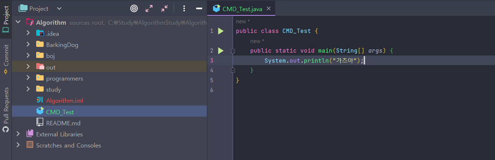
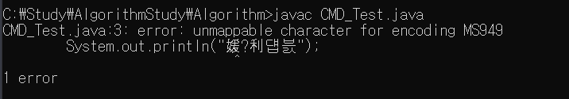
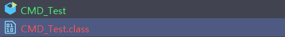
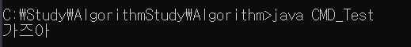
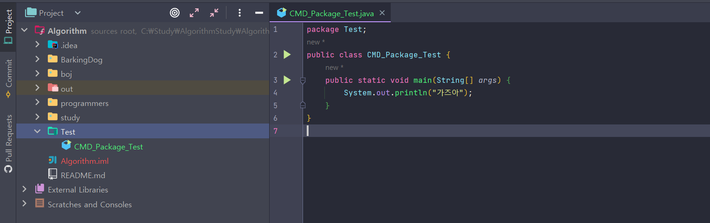
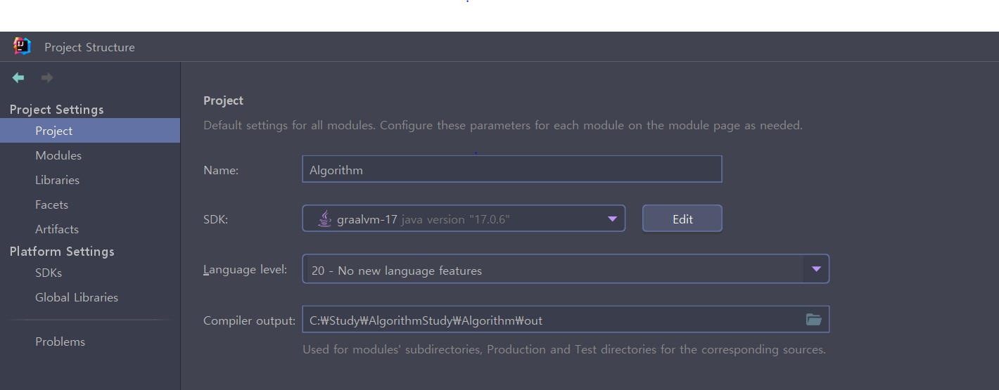
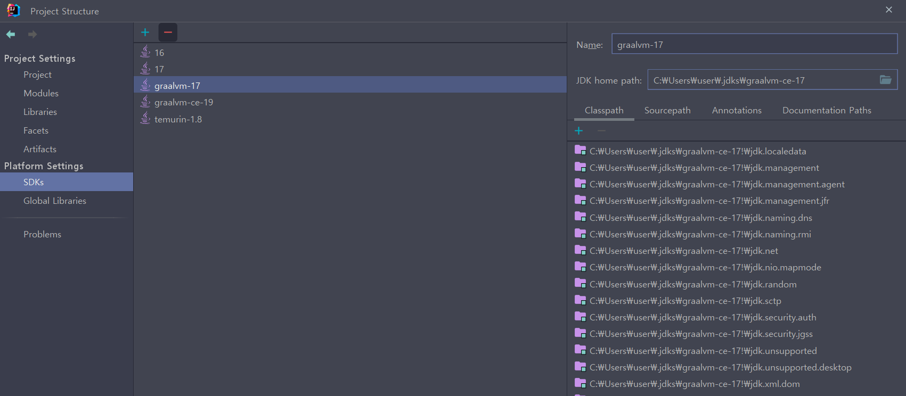
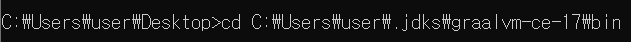
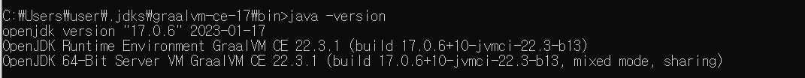

자바를 커맨드로 컴파일하거나 실행하는 경우는 거의 없다.

자바 개발은 대부분 IDE 개발툴을 이용하며, 대표적으로 이클립스, 인텔리제이, VS Code를 사용한다.

하지만 커맨드로도 컴파일 및 실행이 가능하다.

## CMD에서 소스파일 실행하기

먼저 프로젝트 경로로 이동한다.

CMD에서 실행하는 방법은 2가지가 있다.

## 1. 패키지가 없는 소스파일

테스트를 위해 CMD_Test.java 소스파일을 만들었다.

컴파일을 먼저 실행한다.

> 💡 javac CMD_Test.java

한글이 있으면 이런 에러가 발생한다. (주석이나 출력)

> 💡 javac CMD_Test.java -encoding UTF-8

이렇게 인코딩을 해준다.

이제 실행을 해준다.

> 💡 java CMD_Test

## 2. 패키지가 있는 소스파일

테스트를 위해서 패키지를 만들고 패키지 밑에 소스파일을 만들었다.

> 💡 C:\Study\AlgorithmStudy\Algorithm> javac Test/CMD_Package_Test.java -encoding UTF-8

이렇게 패키지명을 앞에 붙인다.

> 💡 java Test/CMD_Package_Test

실행 성공!!

## 자바 버전 확인 및 JDK 확인 

1. 내가 하는 프로젝트의 JDK 확인하기 

1. JDK 위치 확인하기

1. JDK home path ￦bin 폴더로 이동하기

1. 자바 버전 확인하기 


