### **운영체제는 무엇이고 어떤 역할을 수행?**

  - 운영체제는 컴퓨터 하드웨어 바로 윗단에 설치되어서 하드웨어와 다른 모든 소프트웨어를 연결해주는 소프트웨어
  - 운영체제는 컴퓨터 시스템 자원을 효율적으로 관리
  - 하드웨어를 직접 다루는 복잡한 부분은 OS가 대신해주어 컴퓨터 시스템을 편리하게 사용하게 해준다.
  - 악성 프로그램에 대해 사용자와 운영체제 자신을 보호한다. 

### 시분할 시스템?

  - **Time-Sharing System**
  - 여러 작업을 수행할 때 컴퓨터 처리 능력을 일정한 시간 단위로 분할해서 번갈아가며 여러 작업을 수행하는 시스템 (운영 체제의 방식)
  - 특징
- **멀티태스킹 지원** 
- 여러 프로세스를 빠르게 전환하여 사용자가 동시에 실행되는 것처럼 느끼도록 한다.
      - 각 프로세스는 짧은 시간(퀀텀, time slice) 동안 CPU를 차례로 할당받는다.
    - **빠른 응답 시간**
- 사용자가 요청한 작업이 즉시 실행되는 것처럼 보이도록 설계
    - **선점형 스케줄링(Preemptive Scheduling)**
- 특정 프로세스가 CPU를 독점하지 못하도록 일정 시간이 지나면 다른 프로세스로 전환
    - **입출력과 병행 처리** 
- CPU가 한 프로세스의 입출력(I/O)을 기다리는 동안, 다른 프로세스를 실행하여 CPU 자원을 효율적으로 활용한다.

### 다중 프로그래밍 시스템?

  - **Multi Programming System**
  - 멀티 프로그래밍 시스템은 메모리 공간을 분할하여 동시에 여러 프로그램을 적재하고 수행하는 시스템 
  - 멀티 프로그래밍 시스템은 CPU를 효율적으로 사용할 수 있도록 한다. 
- CPU가 한 프로세스의 입출력(I/O)을 기다리는 동안, 다른 프로세스를 실행하여 CPU 자원을 효율적으로 활용한다.

### 대화형 시스템?

  - **Interactive System**
  - 인터렉티브 시스템은 사용자의 요청에 대한 결과를 곧바로 얻을 수 있는 시스템을 말한다.

### 다중 처리기 시스템(멀티 프로세싱)

  - **Multi Processor System** 
  - 멀티 프로세싱은 **두 개 이상의 CPU(프로세서)** 가 여러 프로세스를 병렬로 처리하는 시스템을 의미.
  - 멀티 프로세싱은 여러 개의 CPU를 활용하여 작업을 병렬로 처리할 수 있으며, 한 CPU에 장애가 발생하더라도 나머지 CPU가 작업을 계속 수행할 수 있는 장점이 있다.

### **Multi Programming System VS Multi Processor System** 

  - **다중 프로그래밍 시스템**은 **CPU가 하나라도 가능**하며, **프로세스를 동시에 여러 개 실행하는 방법**에 관한 개념
  - **다중 처리기 시스템**은 **CPU 자체가 여러 개 존재**하며, **CPU(프로세서)의 병렬 처리**에 관한 개념
  - 즉, **다중 프로그래밍은 "프로세스" 관점**, **다중 처리기는 "CPU(프로세서)" 관점**에서 설명하는 개념

### 시스템 콜?

  - **운영체제의 기능을 호출하기 위한 인터페이스** 
- 사용자 프로그램이 운영체제 커널의 기능을 사용하고 싶을 때 호출
  - 사용자 프로그램이 운영체제 커널에 있는 코드를 실행하기 위해, 시스템 콜을 발생시키면 CPU 제어권을 운영체제로 넘겨서 운영체제 커널에 있는 코드를 처리하게 된다. 
- **유저 모드 → 커널 모드 전환**
  - [https://yunchan97.tistory.com/68](https://yunchan97.tistory.com/68)

### Interrupt, System Call 정리 

# User Mode, Kernel Mode

운영체제는 기본적으로 사용자에게 인터페이스를 제공하는 **User Mode**와 기기들을 직접 관리하는 **Kernel Mode**로 구분된다. 

    - User Mode → 일반적인 응용프로그램이 구동되는 환경 
    - Kernel Mode → 커널이 구동되는 환경, 이 모드에서는 OS 시스템에 영향을 주는 명령어를 실행할 수 있다. 

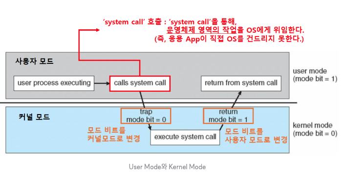

**Kernel의 작업은 컴퓨터의 중요한 부분에 해당하는 작업이기에 사용자가 직접 작업하다가 문제가 생길 시 컴퓨터 전체에 영향을 끼치기 때문에 모드를 나눠 사용자가 직접 접근하지 못하게 한다.** 

프로그램을 사용하면서 인터럽트나 트랩이 발생되거나 시스템 콜을 호출하면 **모드 비트(Mode Bit)**를 0으로 바꾸고 운영체제의 모드 또한 커널 모드로 변경된다. 

# **인터럽트(Interrupt)**

컴퓨터 시스템에서 발생하는 중단 신호로 CPU가 프로그램을 실행하고 있을 때, 입출력 하드웨어 등의 장치나 예외상황이 발생하여 처리가 필요할 경우에 잠시 프로그램을 중단하고 발생한 일을 처리한 후, 다시 실행중인 작업으로 돌아오는 것을 말한다.

### **인터럽트 종류** 

    - **하드웨어 인터럽트**
- 하드웨어 장치에서 발생하는 인터럽트로, 주변 장치와의 상호작용을 관리
      - 키보드나 마우스와 같은 입력 장치, 타이머나 외부 신호에 의한 인터럽트
    - **소프트웨어 인터럽트** 
- 소프트웨어 명령에 의해 발생하는 인터럽트
      - 프로그램의 명령에 따라 명시적으로 발생시킬 수 있다.
      - 주로 프로세스 간 통신이나 예외 처리를 위해 사용
    - **예외 인터럽트(트랩?)**
- 프로세서가 실행 중에 예외 상황을 감지할 때 발생하는 인터럽트
      - 프로그램 에러, 메모리 오류, 연산 오버플로우 등과 같은 예외 상황을 처리하기 위해 사용
    - **외부 인터럽트** 
- 외부 장치나 외부 시스템에서 발생하는 인터럽트
      - 다른 컴퓨터 시스템과의 통신에서 사용

### **인터럽트 동작과정** 

    1. **인터럽트 발생** 
1. 하드웨어(키보드 입력, 타이머, 네트워크 패킷) 또는 소프트웨어(예외, 시스템 콜)에 의해 인터럽트가 발생
    1. **현재 실행 중인 명령어 완료** 
1. CPU는 현재 실행 중인 명령어(Instruction)를 마무리한 후 인터럽트를 처리
    1. **현재 상태 저장** 
1. CPU는 실행 중이던 프로세스의 **레지스터 값(PC, SP 등)과 실행 상태(Context)를 저장**
      1. 저장 위치: **커널 스택(Kernel Stack)**
    1. **인터럽트 핸들러(ISR) 실행**
1. CPU는 **인터럽트 벡터 테이블(IVT, Interrupt Vector Table)**을 참조하여 해당 인터럽트를 처리할 **인터럽트 서비스 루틴(ISR, Interrupt Service Routine)**으로 점프 
      1. ex) 키보드 입력이면 키보드 ISR
    1. **인터럽트 처리 완료 후 복귀**
1. 인터럽트 핸들러 실행이 끝나면, CPU는 **저장된 컨텍스트를 복원**하고 원래 수행하던 작업으로 복귀

# 시스템 콜(System Call)?

시스템 콜은 운영체제와 사용자 프로그램(응용 프로그램) 사이에서 중요한 인터페이스 역할을 한다. 

시스템 콜은 유저 모드에서 실행 중인 응용 프로그램이 운영체제의 커널 모드의 기능을 사용하기 위해 호출되는 함수이다. 

시스템 콜은 **유저 프로그램**이 운영체제의 **커널 모드**에서 제공하는 자원이나 서비스를 요청하는 방법

이를 통해 **보안성**과 **자원 보호**를 유지하면서 유저 프로그램이 커널의 기능을 사용할 수 있게 된다. 

### 시스템 콜 예시 

    - **파일 관련 시스템 콜**
- open(), read(), write(), close() 등은 파일 시스템과 상호작용하는 시스템 콜
    - **프로세스 관련 시스템 콜**
- fork(), exec(), wait() 등은 프로세스 생성, 실행 및 종료와 관련된 시스템 콜
    - **메모리 관련 시스템 콜**
- mmap(), malloc(), free() 등은 메모리 할당 및 관리와 관련된 시스템 콜
    - **입출력(I/O) 관련 시스템 콜**
- read(), write(), ioctl() 등은 입출력 장치와의 상호작용을 위한 시스템 콜

### 시스템 콜 동작 원리

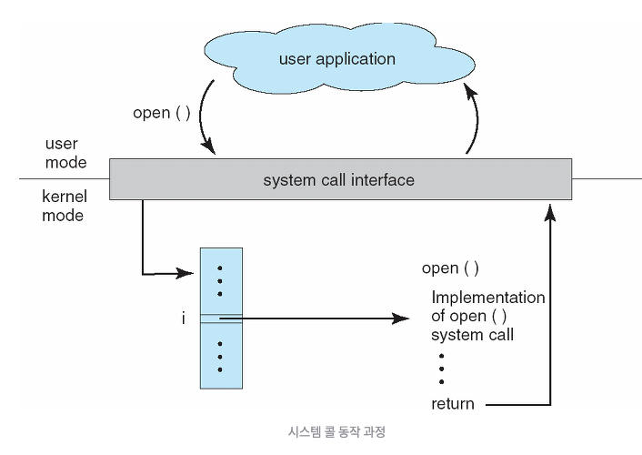

    1. **사용자 프로그램**이 시스템 콜을 호출하면, 해당 시스템 콜의 **주소**를 커널에게 전달
    1. 커널은 이 시스템 콜을 처리하고, 필요하다면 **커널 모드로 전환**되어 실행
    1. 커널은 요청된 자원에 대한 작업을 처리하고, 그 결과를 다시 **유저 프로그램에 반환**

# 모드 전환과 관련된 이벤트 정리

| 구분 | 설명 | 예시 | 모드 변경 |
| --- | --- | --- | --- |
| **시스템 콜 (System Call)** | 사용자 프로그램이 운영체제 기능을 호출할 때 발생 | read(), write()<br>fork(), exec() | 사용자 모드 → **커널 모드** |
| **인터럽트 (Interrupt)** | 하드웨어 or 소프트웨어 신호로 CPU의 작업 흐름 변경 | 키보드 입력, 타이머 인터럽트, 네트워크 패킷 수신 | 사용자 모드 → **커널 모드** |
| **트랩 (Trap)** | 예외(Exception) 처리를 위한 소프트웨어 인터럽트 | 0으로 나누기, 잘못된 메모리 접근 (Segmentation Fault) | 사용자 모드 → **커널 모드** |

### 커널(Kernel)?

운영체제에서 가장 중요한 핵심 부분, 컴퓨터 시스템의 하드웨어와 소프트웨어 간의 상호작용을 관리하고 제어하는 역할을 한다. 커널은 시스템 자원의 효율적인 사용과 보호, 안전성을 제공하며, 사용자 프로그램이 하드웨어에 접근할 수 있는 방식을 제공한다. 

  - 프로세스 관리
- 커널은 프로세스의 생성, 스케줄링, 종료를 관리. 여러 프로세스가 동시에 실행될 때 커널은 각 프로세스가 CPU를 효율적으로 사용할 수 있도록 스케줄링한다. 
    - 프로세스 간의 상호작용 및 동기화를 담당한다. 두 프로세스가 같은 자원을 사용할 때 상호 배제를 보장한다.
  - 메모리 관리
- 커널은 시스템의 메모리 자원을 관리한다. 가상 메모리, 메모리 할당, 메모리 보호 같은 기능이 포함 
    - 운영체제는 각 프로세스에 대해 독립된 메모리 공간을 제공하며, 프로세스가 서로 간섭하지 않도록 보호
  - 입출력 관리
- 커널은 하드웨어 장치와 소프트웨어 간의 데이터 입출력을 관리. 디스크, 네트워크 카드, 키보드 등의 장치 
    - 커널은 장치 드라이버를 통해 하드웨어와 소프트웨어 간의 연결을 관리하고, 입출력 작업을 효율적으로 처리한다.
  - 파일 시스템 관리
- 커널은 파일 시스템을 통해 데이터를 저장하고 관리. 파일 시스템은 데이터의 저장, 검색, 수정, 삭제 작업을 효율적으로 처리할 수 있도록 한다.
  - 장치 드라이버 
- 커널은 하드웨어 장치와 상호작용하기 위해 장치 드라이버를 사용. 이 드라이버는 커널과 하드웨어 장치 간의 소프트웨어 인터페이스 역할을 한다. 
    - 예를 들어, 커널은 네트워크 카드나 프린터와 같은 장치와 상호작용할 때, 각 장치에 맞는 드라이버를 통해 명령을 전달하고 데이터를 주고받는다.
  - 시스템 콜 
- 커널은 시스템 콜을 통해 사용자 프로그램이 시스템 자원에 접근할 수 있도록 한다. 
    - 유저 프로그램은 커널의 기능을 사용하기 위해 시스템 콜을 호출하며, 이때 유저 모드에서 커널 모드로 전환 
    - 시스템 콜을 통해 파일 입출력, 프로세스 관리, 메모리 할당 등의 작업을 커널에서 처리할 수 있다.

### **유저 모드와 커널 모드** 

  - 커널 모드 
- 커널 모드는 시스템의 모든 메모리에 접근할 수 있고 모든 CPU 명령을 수행할 수 있는 모드
    - 예를들어 프로세스는 사용자 모드에서 수행하던 중 시스템 콜이나 인터럽트가 발생하면,
커널모드로 전환 한 후 사용자 모드에서 처리할 수 없는 작업을 커널을 통해 수행
  - 유저 모드 
- 유저모드란 프로세스의 실행 상태중 하나로, 프로세스가 자신의 주소 공간에 정의된 코드를 실행하는 상태를 뜻
    - 유저모드에서는 I/O 작업등 커널에 정의되어 있는 작업을 수행할 수 없다.
따라서 시스템 콜을 통해 커널모드로 전환하여 커널의 기능을 사용하도록 할 수 있다.

### 폴링(Polling)

폴링은 컴퓨터 시스템에서 CPU가 주기적으로 상태(이벤트)를 확인하는 방식 

시스템이 계속해서 주기적으로 특정 장치나 상태를 점검하고, 그 상태에 따라 적절한 동작을 수행하는 방식 

예를들어 CPU가 I/O 작업을 요청한뒤 CPU는 I/O 작업이 완료 되었는지 주기적으로 확인 

**이벤트에 대한 지속적인 확인을 수행하기 때문에 리소스가 소모되고, 이벤트가 발생한 정확한 타이밍에 처리하기가 어렵다는 단점이 있다****.**

하지만 구현이 간단하고, 상태를 주기적으로 체크하는 방식이기 때문에 직관적이다. 

**효율성 면에서 인터럽트 방식에 비해 부족하다. → 많은 시스템은 폴링보다 이벤트 발생 즉시 처리할 수 있는 인터럽트 방식을 선호** 

### 인터럽트(Interrupt)

인터럽트는 컴퓨터 작업도중 커널의 처리가 필요할 때 그것을 통보하는 것

예를 들어 프로세스가 직접 시스템 콜 호출 / I/O 장치가 요청받은 데이터를 다 읽은 경우 / 프로그램 예외 발생 

→ 인터럽트 

인터럽트가 발생하면 먼저 **인터럽트 백터 테이블(IVT)**에서 해당 인터럽트에 대한 **인터럽트 처리 루틴(ISR)**을 찾아서 인터럽트를 처리한다.

인터럽트를 처리하기 전에는 CPU와 프로세스의 **현재 상태(PC, SP)**를 저장하고, 인터럽트가 처리되면 다시 상태 정보를 복구해서 이전 작업을 이어서 수행한다.

### DMA(Direct Memory Access)

I/O 장치가 메인 메모리와 직접 데이터를 주고받을 수 있게 해주는 기술 

DMA를 사용하면 CPU가 I/O 작업을 처리하지 않고, I/O 장치와 메모리 간의 데이터 전송을 **DMA 컨트롤러(DMA Controller)**가 대신 수행 

이 방식은 CPU의 부담을 줄여주고, CPU는 다른 연산을 수행할 수 있게 해준다. 

**DMA 동작 방식** 

  1. **DMA 요청:** I/O 장치가 데이터 전송을 요청하면 DMA 컨트롤러가 활성화 
  1. **CPU, DMA 컨트롤러 협력**
1. DMA 컨트롤러는 CPU 개입 없이 직접 메모리와 I/O 장치 간의 데이터를 전송 
    1. 데이터 전송이 완료되면, DMA 컨트롤러는 CPU에 인터럽트를 발생시켜 작업 완료를 알린다.
  1. **CPU 개입 최소화**
1. DMA는 I/O 작업을 처리하는 동안 CPU가 다른 작업을 수행할 수 있도록 한다. 
    1. CPU는 I/O작업을 처리하기 위해 인터럽트를 받지 않으므로, CPU 자원을 보다 효율적으로 사용할 수 있다.

### 동기식 I/O (Synchronous I/O)

동기식 I/O는 입출력 작업이 완료될 때까지 프로세스가 대기하는 방식 즉, I/O 작업이 끝날 때까지 CPU는 다른 작업을 진행할 수 없다. 

I/O 작업을 요청한 후, 요청이 완료할 때까지 CPU는 해당 작업을 기다리며 블로킹(Blocking) 상태에 놓인다. 

**장단점** 

  - 장점
- 구현이 간단하고 예측 가능하여 디버깅 용이
    - 동기식 처리 방식으로 흐름이 직관적
  - 단점
- CPU 자원 낭비, 작업이 완료될 때까지 CPU가 대기하는 동안 다른 작업을 처리하지 못한다. 
    - I/O 대기 시간 동안 CPU 효율성이 낮아질 수 있다.

### 비동기식 I/O (Asynchronous I/O)

비동기식 I/O는 I/O 작업이 **백그라운드에서 실행**되고, 프로세스는 I/O 작업이 완료될 때까지 대기하지 않고 다른 작업을 계속 진행할 수 있는 방식

I/O 작업을 요청한 후, 해당 작업이 **완료되었을 때**만 프로세스에 알림을 주며, 그 전에 CPU는 다른 작업을 할 수 있습니다. 즉, I/O 작업이 비동기적으로 실행되므로 프로세스는 **블로킹**되지 않는다. 

**장단점** 

  - 장점
- CPU 자원을 효율적으로 활용할 수 있다.  
I/O 작업을 기다리는 동안 다른 작업을 처리할 수 있어 시스템 자원의 낭비를 줄일 수 있습니다.
    - **병렬 처리**나 **비동기 작업**을 통해 처리 속도를 높일 수 있다.
  - 단점
- 구현이 복잡하고, 예외 처리나 상태 관리가 어렵다. 
    - 프로그램이 직관적이지 않아 디버깅이 어렵다.

# 프로세스

## 참고 자료 

[https://yunchan97.tistory.com/60](https://yunchan97.tistory.com/60)

## 프로그램?

프로그램이란 메모리에 올라가 있지 않고, 저장 장치에 저장 되어 있는 상태의 코드 파일을 의미한다.

프로그램을 실행하기 위해서는 OS로부터 프로그램이 동작하는데 필요한 CPU, 메모리 등을 할당 받아야 한다. 

## 프로세스?

프로세스란 실행중인 프로그램이다. 

디스크에 파일로 존대하던 프로그램이 메모리에 올라가서 실행되면 프로세스가 된다. 

## **멀티 프로세스?**

하나의 프로그램에서 동시에 여러개의 프로세스를 실행하는 기술 

하나의 부모 프로세스가 여러 갱의 자식 프로세스를 생성하는 구조이며 서로 독립적인 메모리 공간을 가진다. 

예를들어 구글의 크롬 탭은 각각이 프로세스이며, 하나의 탭이 멈추더라도 다른 텝은 정상 작동한다.

## **프로세스 문맥?(Process Context)**

프로세스 컨텍스트는 실행 중인 프로세스에 대한 정보를 의미한다. 

운영체제는 멀티태스킹 환경에서 동시에 여러 프로세스를 동시에 관리해야 하므로, 각 프로세스의 상태와 필요한 정보를 저장해두어야 한다. 이 정보를 문맥(context)이라고 부른다. 

프로세스 문맥은 주로 프로세스가 실행되기 위해 필요한 상태 정보를 포함하며, 이를 통해 프로세스가 실행되던 상태로 복귀할 수 있다. 

이 정보는 주로 스케줄러가 프로세스를 교체 즉, **컨텍스트 스위칭(Context Switching)**을 할 때 사용된다.

**프로세스 문맥에 포함되는 주요 정보** 

  1. **프로세스 카운터(PC, Program Counter)**
1. 프로세스가 실행 중인 명령어의 주소.
    1. 프로세스가 멈추고 다시 시작할 때, 어느 명령어에서 실행할지 결정에 필요하다.
  1. **레지스터 값**
1. CPU 레지스터에 저장된 값들. 각 레지스터에는 연산에 필요한 데이터나 주소 등이 저장된다. 
    1. 프로세스가 중단되면, 그 때의 레지스터 값을 저장하여, 프로세스가 다시 시작될 때 복구한다.
  1. **스택 포인터(SP, Stack Pointer)**
1. 현재 프로세스의 스택에 대한 포인터이다. 함수 호출 시 스택에 쌓이는 정보를 관리한다. 
    1. 이 값을 통해 프로세스가 재개될 때 이전 함수 호출 정보를 복구할 수 있다.
  1. **메모리 관리 정보** 
1. 프로세스가 사용하는 메모리 공간에 대한 정보 
    1. 가상 주소 공간과 물리 주소 공간의 매핑, 페이지 테이블 등이 포함
  1. **프로세스 상태** 
1. 프로세스가 실행 중인지, 대기 중인지, 종료되었는지 등의 상태 정보

## 컨텍스트 스위칭(Context Switching)

문맥 교환은 CPU가 하나의 프로세스에서 다른 프로세스로 전환될 때, 현재 실행 중인 프로세스의 상태(문맥)을 저장하고, 새롭게 실행할 프로세스의 이전 상태를 복구하는 작업을 의미한다. 

이 과정은 운영체제가 멀티태스킹 환경에서 여러 프로세스에게 CPU를 할당하기 위해 필수적인 과정이다. 

**컨텍스트 스위칭이 발생하는 경우** 

  - **타임 슬라이스 종료:** **라운드 로빈 방식**과 같이 프로세스에게 일정 시간 동안 CPU를 할당한 후, 타임 슬라이스가 끝나면 컨텍스트 스위칭이 발생한다. 
  - **타이머 인터럽트:** CPU 타이머에 의해 인터럽트가 발생하면, 현재 실행 중인 프로세스의 시간이 다 되었음을 알리고 문맥 교환을 트리거할 수 있다. 
- **타임 슬라이스가 종료 → 타이머 인터럽트 발생 → 컨텍스트 스위칭**
  - **I/O 요청 또는 시스템 콜**: 프로세스가 I/O 요청이나 시스템 콜을 호출하여 커널 모드로 전환되면, 현재 실행 중인 작업을 중단하고 다른 프로세스로 교체하는 경우에도 문맥 교환이 발생할 수 있다.

## 라운드 로빈(Round Robin)

**선점형 스케줄링 알고리즘** 중 하나, 다중 작업을 공평하게 처리하기 위해 각 프로세스에 동일한 시간 할당량(타임 슬라이스)을 부여하는 방식 

라운드 로빈 알고리즘은 CPU 시간을 각 프로세스에 순차적으로 배분하고, 각 프로세스가 정해진 시간 동안 실행되다가, 시간이 다 되면 **타이머 인터럽트**를 통해 문맥 교환을 일으켜 다음 프로세스로 전환된다. 

**장점** 

  - **공정성:** 모든 프로세스에 대해 공평하게 CPU 시간을 할당하므로 **기아(Starvation)** 현상이 발생하지 않는다. 
  - **예측 가능성**: 각 프로세스는 일정 시간 안에 반드시 실행되므로 예측 가능한 처리가 가능하다.

**단점**

  - **타임 슬라이스 설정에 따라 성능 차이**: 너무 작은 타임 슬라이스는 **문맥 교환 오버헤드**를 초래할 수 있고, 너무 큰 타임 슬라이스는 **응답 시간**이 길어질 수 있다.
  - **긴 작업에 불리함**: CPU를 많이 사용하는 긴 프로세스는 자주 문맥 교환이 발생하게 되어 **효율성이 떨어질 수 있다.**

## 프로세스 상태

  1. **new:** 최초 상태인 new는 프로세스가 생성중인 상태 
  1. **ready:** 실행 가능한 상태, CPU를 할당받기 위해 대기 중인 상태 
  1. **running:** 현재 CPU에서 실행중인 상태 
  1. **blocked, waiting, sleep:** 특정 이벤트를 기다리는 상태로, 예를 들어 I/O 작업을 기다리거나 락(lock)을 획득하기 위해 대기하는 상태
  1. **termiated:** 실행이 완료된 상태로, 운영체제에 의해 자원이 해제되고 종료되는 상태 

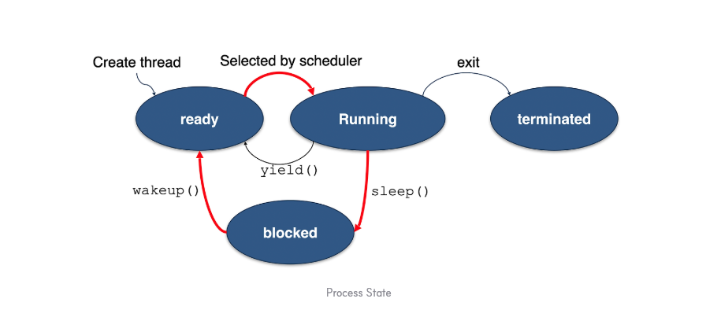

## 프로세스의 메모리 공간 

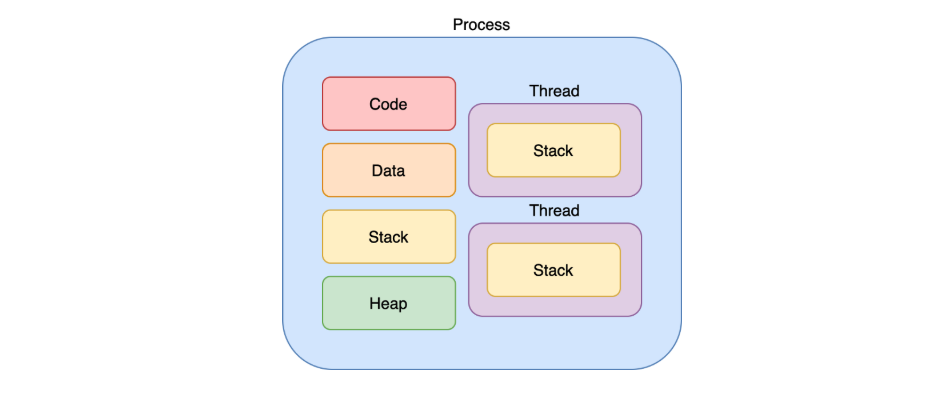

프로세스 내부에는 최소 하나의 스레드(thread)를 가지고 있는데, 실제로는 스레드(thread)단위로 스케줄링을 한다.  

프로세스의 메모리 공간은 프로세스가 실행되는 동안 필요한 메모리 영역을 나타낸다.

각 프로세스는 독립적인 공간을 가진다. 
이 메모리 공간은 프로세스가 정상적으로 실행되기 위한 **코드, 데이터, 스택, 힙** 등의 영역으로 나뉜다. 

**코드 영역 Code**

  - 실행할 프로그램 코드가 저장되며, CPU에서 수행되는 명령어를 저장하는 공간 
  - 읽기 전용으로 설정되어 있어, 실행 중인 코드가 수정되는 것을 방지

**데이터 영역 (Data Segment)**

  - 전역 변수나 정적 변수가 저장되는 공간
  - 프로그램 실행 중 변경 가능한 데이터들이 저장 
  - 데이터 영역은 초기화된 데이터와 초기화되지 않은 데이터(BSS 영역)로 나뉜다. 
- 초기화 데이터: 프로그램에서 값을 할당한 변수들 
    - **BSS(Block Started by Symbol):** 초기화되지 않은 전역 변수나 정적 변수들이 저장되는 영역

**힙 영역 (Heap)**

  - 동적 메모리 할당을 위해 사용되는 메모리 영역 
  - malloc(), free()같은 함수 호출을 통해 메모리를 할당하고 해제한다. 
  - 프로세스가 실행되는 동안 동적으로 변경 
  - **메모리 누수(memory leak)**나 **가비지 컬렉션** 문제 등이 이 영역에서 발생할 수 있다.

**스택 영역(Stack)**

  - 함수 호출 시 사용되는 지역 변수와 함수 호출 기록이 저장된다.
  - 함수가 호출될 때마다 스택 프레임이 생성되고, 함수가 종료되면 해당 프레임이 사라진다. 
  - **LIFO(Last In, First Out)** 방식으로 메모리 할당과 해제가 이루어진다.
  - 스택 영역은 **재귀 호출**이나 **함수 호출** 시 메모리 용량이 빠르게 증가할 수 있으며, 이로 인해 **스택 오버플로우**가 발생할 수 있다.

## **프로세스 제어블록(PCB)**

**프로세스 제어 블록(Process Control Block)**은 운영체제가 각 프로세스를 관리하기 위해 사용되는 데이터 구조이다. PCB는 실행 중인 각 프로세스에 대한 중요한 정보를 저장하고 있으며, 프로세스가 실행되는 동안 필요한 상태를 추적하고 관리하는 데 사용된다. 

**즉, 프로세스 컨텍스트를 저장하는 자료구조** 

### PCB 정보 

**프로세스 상태 (Process State)**

  - 프로세스가 현재 어떤 상태에 있는지를 나타낸다. 
  - **new, ready, running, waiting/sleep/blocked, terminated**

**프로세스 식별자 (Process ID, PID)**

  - 운영체제가 각 프로세스를 고유하게 식별하는 값 

**프로그램 카운터 (Program Counter, PC)**

  - 현재 실행 중인 프로세스의 다음 명령어 주소를 저장하는 레지스터 
  - 문맥 교환 시 이 값을 저장하고 복원하여 프로세스가 실행을 계속할 수 있게 한다. 

**CPU 레지스터 (CPU Registers)**

  - 프로세스가 실행 중일 때 CPU에서 사용되는 레지스터 값들(예: 누산기, 인덱스 레지스터 등)을 저장
  - 문맥 교환 시 현재 프로세스의 상태를 저장하고, 새로 실행될 프로세스의 레지스터를 복원

**우선순위 (Priority)**

  - 프로세스의 실행 우선순위를 나타낸다. 
  - 스케줄링 알고리즘에 따라 프로세스가 CPU를 할당받을 우선순위가 결정된다. 

**부모 프로세스와 자식 프로세스 (Parent and Child Process Information)**

  - 부모 프로세스와 자식 프로세스의 정보가 포함되어, 부모-자식 관계를 추적할 수 있다.

**CPU 시간 (CPU Time)**

  - 프로세스가 CPU를 사용한 시간이나, 프로세스가 실행된 시간을 추적하는 정보

**자원 할당 정보 (Resource Allocation Information)**

  - 프로세스가 사용 중인 자원들(예: 메모리, 파일 등)의 정보를 포함한다.
  -  또한 자원 할당에 대한 정보도 포함될 수 있다.

**메모리 관리 정보 (Memory Management Information)**

  - 프로세스의 가상 메모리 주소 공간과 관련된 정보
  - 페이지 테이블, 세그먼트 테이블, 시작 주소, 크기 등 메모리 관리에 필요한 정보가 포함

## 프로세스끼리 협력하는 방법

### **메시지 전달 방식(Message Passing)**

  - **기본 원리** 
- 메시지 전달 방식은 두 프로세스가 서로 **직접** 데이터를 주고받는 방식
    - 한 프로세스가 데이터를 다른 프로세스에게 **메시지** 형태로 보내면, 그 메시지를 받은 프로세스가 데이터를 처리하는 방식
  - **작동 방식**
- 프로세스는 운영체제에게 **시스템 콜**을 사용하여 메시지를 전달하려고 요청
    - 메시지는 운영체제를 통해 다른 프로세스에게 전달
    - 이 방식은 **명시적 통신**을 필요로 하며, 프로세스 간의 연결을 명확히 설정해야 한다.
  - **장점** 
- 프로세스 간의 독립성이 유지됩니다. 즉, 서로 메모리를 공유하지 않기 때문에, 프로세스 간에 충돌이나 영향이 최소화
    - 메시지가 안전하게 전달될 수 있도록 운영체제가 보장할 수 있다.
  - **단점** 
- 메시지 전달을 위해 운영체제를 통해 중간 단계가 필요하고, 이로 인해 속도나 효율성이 떨어질 수 있다.
    - 통신 비용이 크고, 대량의 데이터 전송에는 비효율적일 수 있다.
  - **예시**
- **소켓 통신**: 네트워크를 통해 다른 컴퓨터와 데이터를 주고받을 때
    - **큐(queue)**: 하나의 프로세스가 메시지를 큐에 넣고, 다른 프로세스가 이를 받아서 처리하는 방식

### **공유 메모리 방식(Shared Memory)**

  - **기본 원리** 
- 공유 메모리 방식은 여러 프로세스가 하나의 **공유된 메모리 공간**을 사용하여 데이터를 직접 읽고 쓸 수 있도록 하는 방식
  - **작동 방식** 
- 운영체제는 프로세스들 간에 공유할 메모리 공간을 할당한다. 
각 프로세스는 이 공유 메모리에 접근하여 데이터를 읽고 쓸 수 있다.
    - 프로세스는 운영체제에게 시스템 콜을 사용하여 공유 메모리 공간을 요청하고, 이 공간을 이용해 다른 프로세스와 데이터를 교환한다.
  - **장점** 
- 데이터 전송 속도가 빠르다. 메시지 전달 방식과 달리 운영체제를 통한 중간 단계가 없기 때문에, 직접 메모리 공간을 공유하기 때문에 효율적이다. 
    - 대량의 데이터 전송에 적합
  - **단점** 
- 여러 프로세스가 같은 메모리 공간을 공유하기 때문에 **동기화**가 필요하다. 
즉, 하나의 프로세스가 데이터를 변경하는 동안 다른 프로세스가 접근하지 않도록 해야 한다. 
이를 위해 **세마포어**나 **뮤텍스**와 같은 동기화 메커니즘이 필요하다.
    - 메모리 보호가 필요하다. 한 프로세스가 잘못된 데이터를 쓰면 다른 프로세스에 영향을 미칠 수 있다.

## fork() 명령어?

fork()명령어는 유닉스 및 유닉스 계열 운영체제에서 프로세스를 생성하는 시스템 콜로, 부모 프로세스의 내용을 그대로 복제한 자식 프로세스를 생성하는 기능을 제공한다. 

fork()명령어는 프로세스를 생성하고, 부모 프로세스와 자식 프로세스가 동시에 실행될 수 있도록 한다. 

부모 프로세스와 자식 프로세스는 각각 독립적인 주소 공간을 가진다. 

즉, 부모와 자식이 동일한 메모리 공간을 갖더라도 **메모리 변경은 서로에게 영향을 미치지 않는다.** 

**Copy-On-Write(COW)**

  - 메모리 복사가 지연될 수 있다. 부모와 자식이 동일한 메모리 페이지를 참조하고 있다가 어느 한쪽이 메모리 값을 수정하려 할 때 복사가 발생한다. 
  - 이로 인해 실제 복사가 일어나기 전까지는 메모리 자원 낭비를 줄일 수 있다. 

# 쓰레드 

## 스레드란?

**스레드는 프로세스 내에서 실행되는 최소 단위**

스레드는 프로세스의 일부로서 독립적인 실행 경로를 가지며, 프로세스의 자원을 공유하여 병렬적 또는 동시에 실행될 수 있다.

스레드는 프로세스의 주소 공간, 파일 핸들, 열린 파일 등과 같은 자원을 공유하기 때문에, 스레드 간의 통신과 데이터 공유가 비교적 쉽다.

**스레드 간의 전환 (Context Switch) 시에는 프로세스 전환보다 비용이 적게든다.**

스레드는 프로세스 내에서 **각각 레지스터와, Stack만 따로 할당받고 Code, Data, Heap 영역은 공유**한다.

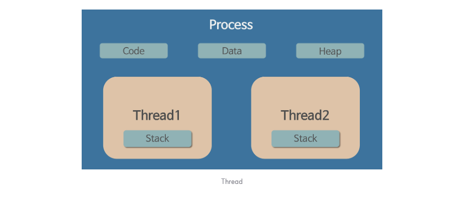

## 스레드 제어블록(TCB, Thread Control Blcok)

스레드 제어블록(TCB)은 운영체제가 각 스레드에 대해 **문맥 정보를 관리**하는 자료구조이다. 
프로세스는 하나 이상의 스레드를 가질 수 있으며, 각 스레드는 독립적인 실행 흐름을 가진다. 
TCB는 이러한 스레드의 상태와 관련된 정보를 저장하여 스레드 스케줄링 및 관리에 중요한 역할을 한다.

### TCB 주요 구성 요소 

  - **스레드 ID(Thread ID)**
- 각 스레드를 구별할 수 있는 고유한 식별자
  - **스레드 우선순위(Thread Priority)**
- 스레드가 실행되는 우선순위 정보, 운영체제는 우선순위에 따라 스레드를 스케줄링
    - 높은 우선순위를 가진 스레드가 더 자주 CPU를 할당받는다.
  - **스레드 상태(Thread State)**
- 스레드의 현재 상태를 나타낸다.
    - **실행 중(Running), 대기 중(Waiting), 준비 중(Ready), 종료(Dead)** 상태 등이 포함
  - **프로그램 카운터(Program Counter, PC)**
- 스레드가 마지막으로 실행된 위치를 나타내는 **메모리 주소**
    - 문맥 교환(Context Switch)이 발생할 때 이 정보는 스레드가 이전에 실행하던 위치로 다시 돌아갈 수 있도록 한다.
  - **레지스터 상태(Register States)**
- 스레드가 마지막으로 실행된 시점에서 CPU의 레지스터 상태를 저장
    -  문맥 교환 시, 이 레지스터 정보는 이전 스레드의 상태로 복구되며, 새로 실행될 스레드의 레지스터 상태로 업데이트
  - **스택 포인터(Stack Pointer)**
- 스레드가 사용하는 **스택 영역**의 위치를 나타내는 포인터
    - 스택은 함수 호출과 로컬 변수 저장 등에 사용

## 스레드의 컨텍스트 스위칭이 더 가벼운 이유 

**프로세스 간 컨텍스트 스위칭의 경우**

  - 프로세스 간의 컨텍스트 스위칭은 각 프로세스가 독립적인 주소 공간을 가지고 있기 때문에, CPU의 상태뿐만 아니라 프로세스의 전체 메모리 (주소 공간, 파일 핸들, 열린 파일 등)까지 저장하고 복구
  - 프로세스 전환 시에는 프로세스마다 별도의 메모리 공간을 할당하고 있기 때문에, 메모리 덤프와 복원을 해야 하는 비용이 크고, 캐시와 같은 시스템 자원의 변경이 많아져서 오버헤드가 발생

**스레드 간 컨텍스트 스위칭의 경우**

  - 스레드는 같은 프로세스 내에서 실행되므로, 자원 (주소 공간, 파일 핸들 등)을 공유한다. 
그래서 스레드 전환 시 프로세스의 전체 메모리 상태를 저장하거나 복원할 필요가 없다.
  - 스레드는 자신의 레지스터, 스택, 프로그램 카운터(PC)만 관리하면 되므로, 저장해야 할 상태가 프로세스에 비해 적다.
  - 즉, 프로세스의 주소 공간, 파일 핸들, 메모리 등의 복구가 필요하지 않으므로 스레드 간의 컨텍스트 스위칭이 가볍고 빠르다.

## 사용자 수준 쓰레드와 커널 수준 쓰레드의 차이

### **사용자 수준 쓰레드 (User-level thread)**

  - **정의**: 사용자 수준 쓰레드는 운영체제가 아닌 사용자 프로그램에서 관리하는 쓰레드이다.
 운영체제는 이 쓰레드를 별도로 인식하지 않으며, 커널은 해당 쓰레드가 존재하는지 알지 못한다.
  - **스케줄링**: 커널은 하나의 프로세스만 관리하므로, 여러 사용자 수준 쓰레드는 하나의 프로세스에 속하는 것으로 보입니다. 스케줄링은 **사용자 라이브러리**에서 처리되고, 커널은 이를 구분하지 않는다.
  - **장점** 
- **빠른 스레드 전환**: 커널의 개입 없이 사용자 수준에서 직접 스레드를 전환하므로 빠르다.
    - **커널 오버헤드 없음**: 커널의 개입이 없으므로 커널에서 발생하는 오버헤드가 없다.
    - **더 적은 시스템 자원 사용**: 커널의 관리를 받지 않기 때문에 메모리나 시스템 자원을 적게 사용한다.
  - **단점** 
- **멀티프로세서 활용 불가**: 운영체제가 각 CPU 코어에 쓰레드를 분배하지 않기 때문에 멀티코어 시스템에서 병렬 처리를 할 수 없다.
    - **I/O 차단 문제**: 하나의 쓰레드가 블로킹(예: I/O 작업)될 경우, 전체 프로세스가 멈추게 되어 다른 쓰레드가 실행되지 않는다.

### **커널 수준 쓰레드 (Kernel-level thread)**

  - **정의**: 커널 수준 쓰레드는 운영체제가 직접 관리하는 쓰레드로, 커널은 각 쓰레드를 독립적인 실행 단위로 인식하고 관리한다.
  - **관리**: 운영체제의 커널이 쓰레드를 생성, 종료, 스케줄링을 담당한다.
  - **스케줄링**: 커널은 각 쓰레드가 독립적으로 스케줄링되도록 관리하고, 여러 커널 수준 쓰레드는 다중 프로세서 환경에서도 독립적으로 실행될 수 있다.
  - **장점**
- **멀티프로세서 지원**: 커널은 각 쓰레드를 독립적으로 관리하므로 멀티코어 시스템에서 효율적으로 실행
    - **블로킹 문제 해결**: 하나의 쓰레드가 블로킹되어도 다른 쓰레드가 실행될 수 있어, I/O 차단 문제를 해결할 수 있다.
    - **스케줄링 제어**: 커널이 각 쓰레드의 우선순위와 상태를 더 잘 관리할 수 있다.
  - **단점** 
- **스레드 전환 비용**: 커널이 직접 관리하므로 스레드 전환 시 오버헤드가 발생
    - **더 많은 시스템 자원 사용**: 커널의 관리를 받기 때문에 더 많은 메모리와 자원을 사용
    - **복잡한 구현**: 사용자 수준 쓰레드보다 구현이 복잡하고, 커널의 변경이 필요할 수 있다.

| **특성** | **사용자 수준 쓰레드 (User-level thread)** | **커널 수준 쓰레드 (Kernel-level thread)** |
| --- | --- | --- |
| **스케줄링 관리** | 사용자 라이브러리에서 관리 | 커널에서 관리 |
| **커널 개입** | 커널 개입 없음, 사용자 공간에서 관리 | 커널이 직접 관리 |
| **다중 프로세서 활용** | 멀티코어 환경에서 비효율적 | 멀티코어 환경에서 효율적 |
| **I/O 차단 문제** | 하나의 쓰레드가 블로킹되면 전체 프로세스가 멈춤 | 하나의 쓰레드가 블로킹되어도 다른 쓰레드는 실행 가능 |
| **스레드 전환 속도** | 빠르다 | 느리다 (커널 개입 필요) |
| **시스템 자원 소모** | 적다 | 많다 |

### **자바 스레드** 

  - **1:1 매핑:** 자바의 스레드는 운영체제의 커널 스레드와 직접적으로 매핑, 즉, 자바 스레드 하나는 운영체제의 커널 스레드 하나와 연결
  - **멀티코어 환경에서 효율적:** 각 스레드가 독립적으로 운영체제의 스케줄러에 의해 관리되기 때문에, 멀티코어 시스템에서는 각 코어에서 동시에 자바 스레드가 실행될 수 있다. 이는 병렬 처리를 극대화하고 성능을 높이는 데 유리
  - **커널의 관리**: 커널은 각 스레드의 상태를 추적하고, 프로세서 간의 컨텍스트 스위칭과 스케줄링을 담당하므로, 시스템 자원을 효율적으로 사용할 수 있다.

## 멀티 쓰레딩

멀티쓰레딩은 하나의 프로세스 내에서 여러 개의 쓰레드를 실행하여 동시에 작업을 수행하는 프로그래밍 기버
이는 주로 CPU 자원을 보다 효율적으로 활용하고, 병렬 처리로 응답성을 향상시키기 위해 사용된다. 
멀티쓰레딩을 통해 여러 작업을 동시에 처리할 수 있으므로, 프로그램의 처리 속도를 높이고 대기 시간을 줄이는 데 유리하다.

### **멀티쓰레딩의 장점**

  - 프로세스 내에 있는 모든 스레드들이 프로세스의 자원을 공유하므로 자원 중복에 대한 낭비를 막을 수 있다. 
- 스택, PC 같은 일부 정보만 따로 할당
  - 한 스레드가 입출력으로 인해 작업이 진행되지 않더라도, 다른 스레드가 작업을 이어서 할 수 있다. 
  - 쓰레드는 동일한 프로세스 내에서 실행되기 때문에 **커널의 개입 없이** 빠르게 통신할 수 있다.
  - **병렬 처리:** CPU 집약적인 작업을 여러 쓰레드로 나누어 동시에 처리함으로써, 멀티코어 시스템에서 성능을 크게 향상시킬 수 있다.
  - **비동기 작업 처리:** 사용자 인터페이스(UI)와 같은 작업에서 **비동기 처리**를 위해 멀티쓰레딩을 활용할 수 있다. UI 쓰레드는 사용자의 입력을 받으며, 백그라운드 쓰레드는 데이터를 로드하거나 네트워크 요청을 처리할 수 있다.

### **멀티쓰레딩의 단점**

  - 한 스레드에 문제가 생기면 전체 스레드에 영향을 미친다. 
  - 공유 자원에 대한 동기화가 필요하다 **경쟁 조건 (RaceCondition)**. → **Thread Safe**하게 작성하여 동시성 이슈가 발생하지 않도록 해야함
- 불변 객체로 활용 
    - 락을 통해 공유 자원에 접근할 스레드를 제한

## 기아 상태란 무엇인가?

기아 상태(Starvation)란 운영 체제(OS)에서 하나의 프로세스 또는 스레드가 필요한 자원을 장기간 할당받지 못해 실행되지 못하는 상황을 의미한다.

## 기아 상태가 발생하는 원인

  - **우선순위 기반 스케줄링**
- 낮은 우선순위를 가진 프로세스가 높은 우선순위 프로세스들에 의해 계속해서 밀려 실행되지 못하는 경우
  - **자원 경합(Resource Contention)**
- 여러 프로세스가 동일한 자원을 요청할 때, 특정 프로세스가 계속해서 자원을 할당받지 못하는 경우
  - **세마포어 및 락 관리 미흡**
- 특정 프로세스가 락을 계속 점유하고 있어 다른 프로세스가 락을 획득하지 못하는 경우
  - **비공정한 자원 할당 정책**
- 특정 프로세스가 자원을 독점하거나, 새로운 프로세스가 계속 들어와 기존 프로세스가 자원을 받지 못하는 경우

## 기아 상태 해결 방법

  1. **노화 기법(Aging) 적용**
1. 시간이 지나면 오래 기다린 프로세스의 우선순위를 점진적으로 높여 결국 실행되도록 함
  1. **공정한 자원 할당 정책(Fair Scheduling)**
1. 프로세스가 일정 시간 이상 자원을 할당받지 못하면 강제로 실행되도록 조정
  1. **타임 슬라이스(Time Quantum) 제한**
1. 특정 프로세스가 독점하지 못하도록 실행 시간을 제한하여 분배
  1. **락(lock) 및 세마포어 관리 개선**
1. 공정한 락 정책을 사용하여 특정 프로세스가 지나치게 오래 대기하지 않도록 조정

## CPU 스케줄링?

CPU 스케줄링은 운영 체제에서 CPU를 어떤 프로세스에게 할당할지 결정하는 핵심 메커니즘

CPU 스케줄러는 **레디 큐(Ready Queue)**에 있는 프로세스들 중 하나를 선택하여 CPU를 할당하며,

이 과정에서 시스템의 **응답 속도(Response Time)와 처리량(Throughput)을 최적화** 하는 것이 목표

여러 프로세스들이 번갈아가며 수행되는 시분할 시스템에서 각 프로세스들의 CPU 수행시간은 모두 다르다. 

CPU 스케줄링을 통해 프로세스들에게 CPU를 적절히 할당 해줘서 응답 속도와 처리량을 최적화 해야한다.

## 스케줄러의 종류 

### 단기 스케줄러 (Short-Term Scheduler, CPU 스케줄러)

  - 역할
- **레디 큐(Ready Queue)**에 있는 프로세스들 중 **어떤 프로세스를 CPU에서 실행할지 결정**
    - 문맥 전환(Context Switching)을 발생시키며, 실행 속도가 매우 빠름
  - 특징 
- 가장 자주 실행됨
    - **CPU 스케줄링 알고리즘(FCFS, SJF, RR 등)**을 사용하여 프로세스를 선택

### 중기 스케줄러 (Mid-Term Scheduler, 스왑 아웃 스케줄러)

  - 역할
- 메모리 부족 시, 프로세스를 디스크로 **스왑 아웃(Swap Out)**하여 메모리를 확보 
    - **스왑 인(Swap In)**을 통해 프로세스를 다시 메모리로 불러온다.
  - 특징
- **메모리 관리(Memory Management)** 를 담당하여, 다중 프로그래밍의 정도(Degree of Multiprogramming)를 조절
    - 일부 프로세스를 일시 중지하여 메모리 공간을 확보
  - 예제
- **운영 체제가 메모리 부족을 감지하면** → **일부 프로세스를 스왑 아웃**
    - **메모리가 여유로워지면** → **스왑 아웃된 프로세스를 다시 스왑 인하여 실행**

### 장기 스케줄러 (Long-Term Scheduler, 작업 스케줄러)

  - 역할
- **새로운 프로세스를 시스템에 받아들일지 결정**하고, 준비 큐(Ready Queue)로 보낼지 판단
    - 현대 OS에서는 대부분 **즉시 프로세스를 생성, 준비 큐로 보낸다.**
  - 특징
- 실행 빈도가 가장 낮다(새로운 프로세스 생성 시에만 실행)
    - CPU-bound(연산 집중형) / I/O-bound(입출력 집중형) 프로세스를 적절히 조절하여 시스템 성능을 최적화
  - 예제
- 배치 시스템에서 **한 번에 너무 많은 작업이 들어오는 경우**, 일부 작업을 보류하고 나중에 실행
    - 현대 OS에서는 실시간으로 프로세스를 생성하므로 장기 스케줄러가 거의 사용되지 않음

## 선점형(Preemptive) vs. 비선점형(Non-Preemptive) 스케줄링 차이

### 선점형 스케줄링 (Preemptive Scheduling)

  - 정의
- **현재 실행 중인 프로세스가 강제로 CPU를 빼앗길 수 있는 방식**
    - 운영 체제가 CPU를 다른 프로세스로 강제로 전환 가능
    - 우선순위가 높은 프로세스가 등장하면 현재 프로세스를 중단하고 실행
  - 특징
- **빠른 응답성** → 우선순위가 높은 작업을 즉시 실행 가능
    - **멀티태스킹 지원** → 여러 프로세스가 CPU를 효율적으로 공유
    - **문맥 전환(Context Switching)이 자주 발생** → 오버헤드 발생
  - **예제 CPU 스케줄링 알고리즘** 
- **라운드 로빈 (Round Robin, RR)** → 일정 시간(Time Quantum)마다 프로세스 교체
    - **우선순위 스케줄링 (Priority Scheduling, Preemptive)** → 높은 우선순위 프로세스가 CPU 차지
    - **최소 잔여시간 우선 (Shortest Remaining Time First, SRTF)** → 실행 중인 프로세스보다 짧은 실행 시간이 남은 프로세스가 등장하면 CPU를 넘김

### 비선점형 스케줄링 (Non-Preemptive Scheduling)

  - 정의
- **현재 실행 중인 프로세스가 자발적으로 CPU를 반납할 때까지 실행을 계속하는 방식**
    - 한 번 CPU를 할당받으면 **자신이 끝나거나, I/O 요청을 해야만 CPU를 다른 프로세스에게 넘겨줌**
    - CPU를 강제로 빼앗을 수 없음
  - 특징
- **문맥 전환 오버헤드가 적음** → 선점형보다 효율적인 실행
    - **긴 작업이 CPU를 독점할 가능성 있음** → 짧은 작업이 오래 기다릴 수 있음 (기아 가능성)
  - **예제 CPU 스케줄링 알고리즘**
- **FCFS (First Come First Served, 먼저 온 순서대로 처리)**
    - **SJF (Shortest Job First, 실행 시간이 짧은 프로세스 우선 실행, Non-Preemptive 버전)**
    - **우선순위 스케줄링 (Priority Scheduling, Non-Preemptive)**

## 주요 스케줄링 정리

### **FCFS (First Come First Served, 먼저 온 순서대로 처리)**

  - **비선점형 스케줄링 / 선입선출 스케줄링** 
  - 구현이 간단하다. (큐, Queue) 자료 구조
  - 만약 CPU 사용 시간이 매우 긴 프로세스가 먼저 도착하면 뒤이어 도착한 다수의 프로세스들이 긴 시간을 기다려야 한다는 단점이 존재한다. → **starvation 가능성**  

### **SJF (Shortest Job First, 최단 작업 우선)**

  - SJF(최단 작업 우선) 스케줄링은 **실행 시간이 가장 짧은 프로세스를 먼저 실행하는 방식**
  - 비선점형(Non-Preemptive) or 선점형(Preemptive) 방식 모두 가능 
- **선점형 SJF = SRTF(Shortest Remaining Time First)** 
- 최소 잔류 시간 우선 스케줄링 
      - 새로운 프로세스가 도착하면 현재 실행 중인 프로세스와 비교하여 더 짧은 작업이면 CPU 선점 
      - CPU 실행 시간이 긴 프로세스는 영원히 CPU를 할당받지 못하는 Starvation이 발생할 수 있다.
    - **비선점형 SJF**
- 실행 중인 프로세스가 끝날 때까지 CPU 점유
  - **평균 대기 시간 최소화** 
- 짧은 작업을 먼저 실행하므로 전체적인 평균 대기 시간이 줄어듦
    - CPU 버스트 타임이 긴 작업이 뒤로 밀려나기 때문에 긴 작업의 응답 시간이 증가할 수 있다
  - **CPU 활용률 증가** 
- 실행 시간이 짧은 프로세스들을 먼저 끝내므로 **CPU가 자주 유휴 상태가 되는 것을 방지**
  - **프로세스들의 CPU 수행 시간을 예측 해야함**
- OS는 이전에 수행되었던 프로세스의 실제 수행 시간과 예측했던 수행시간을 통해 예측할 수 있다.
  - **기아 상태** 
- 선점형 뿐만 아니라 비선점형 SJF도 마찬가지로 긴 작업은 CPU를 무한정 기다릴 수도 있다.
    - 이를 위해서 에이징 기업을 사용하여 오래 기다린 프로세스의 우선순위를 점진적으로 증가

### 우선순위 스케줄링 (Priority Scheduling)

  - 우선순위 스케줄링은 **Ready Queue에 있는 프로세스들 중 우선순위가 가장 높은 프로세스에게 CPU를 할당하는** 방식이다.
  - 비선점형(Non-Preemptive) or 선점형(Preemptive) 방식 모두 가능 
  - **다양한 우선순위 기준**
- **CPU 버스트 타임: SJF처럼 실행 시간이 짧은 순으로 우선 실행**
    - **프로세스의 중요도** (예: 실시간 시스템에서 중요한 작업을 우선 실행)
    - **입출력(IO) 중심 vs CPU 중심** (입출력 작업을 많이 하는 프로세스를 우선 실행)
    - **운영체제 정책** (예: 사용자 vs 시스템 프로세스)
  - **단점** 
- **기아 현상(Starvation): 우선순위가 낮은 프로세스가 계속 실행되지 못하는 문제**
- **해결책 Aging(에이징 기법)**
- 오랫동안 대기한 프로세스의 우선순위를 점진적으로 높이는 방법 
        - 일정 시간이 지나면 우선순위를 자동으로 올려서 **기아 현상 방지**
    - **우선순위 할당 기준이 애매할 수 있음**
- CPU 실행 시간, 중요도 등 여러 기준을 어떻게 설정할지 결정하는 것이 어려울 수 있음

### 라운드 로빈 스케줄링 (Priority Scheduling)

  - 라운드 로빈 스케줄링은 **시간 할당량(Time Quantum, Time Slice)** 을 설정하고, **각 프로세스에게 동일한 시간만큼 CPU를 할당하는 선점형(Preemptive) 스케줄링 알고리즘**
  - **동작 방식** 
- 모든 프로세스를 Ready Queue에 도착한 순서대로 배치
    - CPU는 정해진 시간 할당량만큼만 프로세스를 실행
    - 시간 할당량이 끝나면 선점(Preempt)하여 다음 프로세스로 교체
    - 완료되지 않은 프로세스는 다시 Ready Queue의 맨 뒤로 이동
  - **시간 할당량(Time Quantum, Time Slice)**
- 너무 크면 → **FCFS(선입선출)와 유사**해져 응답 시간이 길어짐 
    - 너무 작으면 → **컨텍스트 스위칭(Context Switching) 오버헤드 증가**
  - 여러 프로세스들에게 빠른 시간안에 조금씩 CPU를 사용하게 해주는 방식 이기 때문에
사용자에 빠른 응답 시간을 제공해줄 수 있다.

### 멀티 레벨 큐 스케줄링 (Multilevel Queue Scheduling)

  - **멀티 레벨 큐 스케줄링은 레디큐를 여러개로 나누어 관리하는 스케줄링 기법** 
  - **프로세스를 기준을 통해서 여러 개의 큐로 분류** 
- 시스템 프로세스, 대화형 프로세스, 배치 프로세스 등등 …
    - 우선순위, CPU 사용량, 메모리 사용량, I/O 빈도 등등…
  - **각 큐마다 별도의 스케줄링 알고리즘 적용** 
- **시스템 프로세스 큐 → FCFS(First Come First Served)**
    - **대화형 프로세스 큐 → 라운드 로빈(Round Robin)**
    - **배치 프로세스 큐 → SJF(Shortest Job First)**
  - **큐 간의 스케줄링 방식 결정** 
- **큐들 간에도 우선순위를 CPU를 배분할지, 타임 슬라이스(Time Slice)로 공유할지 결정** 
    - 우선순위가 높은 큐의 작업이 끝나야 낮은 큐의 작업을 수행하는 것이 일반적 
    - 또는 큐 간에 비율을 정해 CPU를 공유할 수 있다.
  - **멀티 레벨 큐 스케줄링 장점** 
- 프로세스 유형별 최적화 가능
- 시스템 프로세스는 빠른 응답이 필요하므로 FCFS 
      - 대화형 프로세스는 응답 시간이 중요하므로 RR 적용
      - 배치 프로세스는 긴 작업을 효과적으로 처리하도록 SJF 적용
    - 높은 우선순위 작업을 빠르게 처리 가능 
- 중요한 시스템 프로세스가 사용자 프로세스보다 먼저 실행됨
    - 특정 작업 유형을 효과적으로 관리 가능 
- 대화형 프로세스가 배치 프로세스보다 더 자주 실행되도록 설정 가능
  - **멀티 레벨 큐 스케줄링 단점** 
- 한 번 할당된 프로세스는 해당 큐에서만 실행
- 하지만 **멀티 레벨 피드백 큐(Multilevel Feedback Queue, MLFQ)**를 사용하면 해결 가능
    - 낮은 우선순위 프로세스의 기아(Starvation) 문제 발생 가능
- 상위 큐에 작업이 많으면 하위 큐의 프로세스는 실행되지 않을 수 있음
      - 해결책: CPU 시간을 일정 비율로 나누어 배분
    - 큐를 어떻게 나눌지, 스케줄링 알고리즘을 어떻게 적용할지 미리 결정해야 함
- 프로세스의 특성을 정확히 예측하기 어려운 경우가 있음

### 멀티 레벨 피드백 큐 스케줄링 (Multilevel Feedback Queue, MLFQ)

  - 멀티 레벨 피드백 큐 스케줄링은 **멀티 레벨 큐 스케줄링(MLQ)의 단점을 보완한 방식**
으로,프로세스가 실행되면서 **동적으로 우선순위가 변경되고 다른 큐로 이동할 수 있는 특징**을 가진다.
  - 특징 
- **여러 개의 큐(Queue) 사용**
- 각 큐는 서로 다른 **우선순위(priority)** 및 **스케줄링 알고리즘**을 가짐
      - 일반적으로 높은 우선순위 큐는 **짧은 타임 슬라이스(RR 사용)**, 낮은 우선순위 큐는 **긴 타임 슬라이스(FCFS 또는 SJF 사용)**
    - **큐 간 이동(Feedback) 가능**
- CPU를 오래 사용하는 프로세스는 점점 낮은 우선순위 큐로 이동
      - CPU를 짧게 사용하면 높은 우선순위를 유지
      - 우선순위가 낮아진 프로세스라도 **오랜 시간 기다리면 다시 높은 우선순위로 이동 가능** (기아 방지)
- **에이징**
    - I/O 바운드 vs CPU 바운드 프로세스의 자동 구분
- **I/O 바운드 프로세스**: 보통 빠르게 실행됨 → 높은 우선순위 큐에 머물러 있음
      - **PU 바운드 프로세스**: 시간이 지날수록 낮은 우선순위 큐로 이동
  - **동장 방식 정리** 
- 모든 프로세스는 처음에 **우선순위가 가장 높은 큐에 배정**
    - 일정 시간(CPU 버스트)이 지나면
- CPU를 계속 사용하면 **우선순위가 낮은 큐로 이동**
      - I/O 요청 등으로 CPU를 자주 반납하면 **높은 우선순위 유지**
    - 낮은 우선순위의 프로세스도 일정 시간이 지나면 다시 높은 우선순위 큐로 이동 가능
- 에이징 → 기아 현상 방지
    - **각 큐는 서로 다른 스케줄링 알고리즘을 사용할 수 있음**

[https://github.com/jeus1998/CS/blob/main/src/EasyCodeCS/OperatingSystem/5-spinlock%20%26%20mutex%20%26%20semaphore.md](https://github.com/jeus1998/CS/blob/main/src/EasyCodeCS/OperatingSystem/5-spinlock%20%26%20mutex%20%26%20semaphore.md)

  - **내가 정리한 spinlock mutex, semaphore**

## 병행성(동시성, Concurrency)

동시성은 여러 작업이 동시에 실행될 수 있도록 보이게 하는 개념**(멀티 태스킹)**

이는 여러 작업을 동시에 다룰 수 있는 능력을 의미, 반드시 동시에 실행될 필요는 없다. 

동시성은 단일 프로세서(싱글 코어)에서 여러 작업을 순차적으로 처리하는 방식으로 구현될 수도 있다. 

중요한 점은 **작업들이 겹쳐서 실행될 수 있다는 점**이다.

예를 들어 한 CPU에서 여러 프로세스를 번갈아가며 실행하는 것

  - 웹 서버에서 여러 사용자의 요청을 처리하는 경우, 각 요청은 순차적으로 처리되지만, 동시에 처리되고 있는 것처럼 보인다. 

## 병렬성(Parallelism)

병렬성은 여러 작업을 실제로 동시에 실행하는 것

여러 프로세서(코어)를 이용해 동시에 작업을 처리하는 방식이다.

병렬성은 **실제 하드웨어가 여러 작업을 동시에 처리할 수 있는 경우**에 해당 

예를 들어 다중 코어 CPU를 사용하는 프로그램에서 각 코어가 서로 다른 작업을 동시에 처리하는 경우 

**동시성, 병렬성 차이점** 

  - 동시성은 여러 작업을 동시에 처리할 수 있도록 다루는 논리적 개념이고, 병령성은 여러 작업을 실제로 동시에 물리적으로 처리하는 방법 
  - 동시성은 자원의 분배와 스케줄링에 신경 쓰는 개념이며, 병렬성은 하드웨어 자원을 이용해 동시에 작업을 처리하는 방식이다. 

**둘 다  성능 향상에 기여하지만, 동시성은 프로그램의 흐름을 관리하는 방법, 병렬성은 실제 성능을 최적화하는 방법** 

## 프로세스 동기화 (S**ynchronization)**

**프로세스 동기화**는 협력하는 **여러 프로세스**가 **공유 자원**을 사용할 때 일관성을 보장하는 것을 의미한다. 
프로세스가 공유 자원을 서로 사용하려고 하는 상황에서 **RaceCondition(경쟁 조건)**을 방지하기 위해 **특별한 규칙(Lock - 뮤텍스, 세마포어)**을 만드는 것이 프로세스 동기화이다. 

## **Critical Section (크리티컬 섹션)**

**크리티컬 섹션(Critical Section)**은 여러 스레드가 공유 자원에 동시에 접근할 수 있는 코드의 일부분을 의미한다. 여러 스레드가 동시에 이 부분을 실행할 때, 공유 자원의 상태가 예기치 않게 변경될 수 있기 때문에 **동기화(synchronization)**가 필요하다. 동기화가 이루어지지 않으면, 프로그램의 동작이 예측 불가능해지거나 오류가 발생할 수 있다.

## **Race Condition (레이스 컨디션)**

**레이스 컨디션(Race Condition)**은 두 개 이상의 스레드가 동시에 공유 자원에 접근할 때, 실행 순서나 타이밍에 따라 프로그램의 동작이 달라지는 상황을 말한다. 즉, 여러 스레드가 동시에 실행될 때 자원의 상태나 결과가 예측 불가능해지는 문제이다. 

레이스 컨디션은 **크리티컬 섹션**에서 발생할 수 있다. 여러 스레드가 **동시에 자원에 접근**하려고 할 때, 자원에 대한 접근이 제대로 동기화되지 않으면 결과가 잘못되거나 불일치가 발생할 수 있습니다.

**레이스 컨디션은 동시성(동기화)문제이고 크리티컬 섹션은 그 문제가 발생하는 장소(코드)이다.** 

## **Race Condition (레이스 컨디션) 어떻게 해결?**

가장 간단한 방법은 한 순간에 하나의 프로세스나 쓰레드가 접근할 수 있도록 **락(lock, 잠금)**을 활용하여 동기화 하는 것이다. 

즉, 여러 스레드가 공유 자원에 동시에 접근할 때 방생할 수 있는 충돌을 막기 위해 자원에 대한 **배타적 접근(exclusive access)**을 제공하는 것 

## **Mutual Exclusion (상호배제) 구현 방법**

Mutual Exclusion은 여러 프로세스나 스레드가 공유 자원에 동시에 접근하지 못하도록 보장하는 기법이다. 

이를 통해 경쟁 조건을 방지하고 데이터 일관성을 유지할 수 있다. 

상호배제를 구현하는 방법에는 소프트웨어적인 방법과 하드웨어적인 방법이 있다.

### 소프트웨어적 상호배제 구현 

**피터슨 알고리즘 (Peterson's Algorithm)**은 두 개의 프로세스가 상호배제를 보장하도록 하는 간단한 알고리즘이다. 

이 알고리즘은 공유 변수를 사용하여 어느 프로세스가 임계 영역(critical section)에 들어가야 하는지 결정한다. 

**피터슨 알고리즘 주요 변수** 

  - flag[i]: 프로세스 i가 임계 구역에 들어가려는지 여부를 나타내는 변수
- flag[0]= true 프로세스 0은 임계 구역에 들어가고자 한다는 의미 
    - flag[1] = true 프로레스 1은 임계 구역에 들어가고자 한다는 의미
  - turn: 임계 구역에 들어갈 차례를 정하는 변수 
- turn = 0이면 프로세스 0이 임계 구역에 들어가도록 하며, turn = 1이면 프로세스 1이 임계 구역에 들어가도록 한다.

**피터슨 알고리즘 설명** 

  1. 자기 자신이 임계 구역에 들어가려는 의도를 표시 flag[i]
  1. 상대방이 임계 구역에 들어가려는지 확인하고, 만약 상대방이 이미 들어갔다면, 자기 차례가 올 때까지 기다린다. → turn 변수를 사용 

### 하드웨어적 상호배제 구현 

**TestAndSet**은 하드웨어에서 제공하는 **원자적(atomic)** 연산으로, 변수의 값을 검사하고 그 값을 설정하는 연산이 연산은 **하나의 연산으로 결합되어** 읽고 쓰는 작업을 원자적으로 처리할 수 있다. 이를 통해 경쟁 조건을 방지하고 상호배제를 보장할 수 있다.

```
TestAndSet (boolean *lock) {
    boolean old = *lock;
    *lock = true;
    return old;
}
```

이 함수는 락(lock)이 설정되어 있는지 검사하고, 락을 설정하며 이전 값도 반환한다. 
이 방식으로 다른 스레드가 동시에 락을 설정하지 못하게 할 수 있다.

**읽기와 쓰기 작업의 원자성TestAndSet**과 같은 원자적 연산은 읽기와 쓰기 작업을 하나의 연산으로 묶어서 **중간 상태**에서 다른 스레드가 변경하지 못하도록 한다. 이렇게 하면 경쟁 조건을 방지하고, 여러 스레드가 동시에 자원에 접근하는 문제를 해결할 수 있습니다.

### 정리

상호배제(Mutual Exclusion)는 주로 여러 프로세스나 스레드가 공유 자원에 접근할 때 발생하는 경쟁 조건을 해결하기 위한 기법이다. 

  - **소프트웨어적 방법**: 피터슨 알고리즘, 세마포어, 모니터 등의 기법을 통해 상호배제를 구현
  - **하드웨어적 방법**: TestAndSet과 같은 원자적 연산을 통해 상호배제를 보장

각 방법은 **상호배제**를 보장하지만, 사용 상황에 맞는 최적의 방법을 선택하는 것이 중요

## 뮤텍스(Mutex)

뮤텍스(Mutex)는 상호배제(Mutual Exclusion)를 보장하기 위한 **동기화 도구**로, 공유 자원에 대한 접근을 제어주로 멀티스레드 환경에서 자원 경합을 방지하고, 여러 스레드가 동시에 공유 자원을 사용하는 것을 방지하는 데 사용

### 뮤텍스(Mutex)의 동작 원리

뮤텍스는 **Lock**과 **Unlock**을 통해 **상호배제**를 실현.
이를 통해 한 번에 하나의 스레드만 공유 자원에 접근할 수 있게 한다. 

  - **Lock**: 스레드가 공유 자원에 접근하려면 먼저 뮤텍스를 **잠금(Lock)을 획득** 해야 한다. 
잠금을 얻은 스레드만 해당 자원을 사용할 수 있다.
  - **Unlock**: 자원을 다 사용한 스레드는 반드시 뮤텍스를 잠금을 **해제(Unlock)**해야 한다. 
이를 통해 다른 스레드가 공유 자원에 접근할 수 있게 된다.

```java
class Mutex{
  int value = 1;
  int guard = 0;
}

Mutex::lock(){
  while(test_and_set(&guard));
  if(value == 0){
      .. 현재 스레드를 큐에 넣음;
      guard = 0; & go to sleep
  }
  else{
      value = 0;
      guard = 0;
  }
}

Mutex::unlock(){
  while(test_and_set(&guard));
  if(큐에 하나라도 대기중이라면){
     그 중에 하나를 깨운다;
  }
  else{
	    value= 1;
  }
  guard = 0;  
}
```

  - value: 공유 자원의 잠금 상태를 나타내는 변수 
- 1이면 자원 사용 가능
  - guard: 상호배제를 보장하기 위한 변수로, 뮤텍스의 잠금 상태를 관리 test_and_set이 호출되면 guard를 1로 설정하여 다른 프로세스가 동시에 lock을 시도할 수 없게 만든다.

### 뮤텍스(Mutex)의 특징

  - **상호배제 보장**: 뮤텍스는 여러 스레드가 동시에 공유 자원에 접근하지 않도록 보장한다. 
이는 경쟁 조건(Race Condition)을 방지한다.
  - **소유권**: 잠금을 획득한 스레드만 잠금을 해제할 수 있기 때문에, 뮤텍스는 **자원의 소유권**을 가지고 있다.
  - **Deadlock 방지**: 잘못된 사용으로 인해 데드락이 발생할 수 있다. 예를 들어, 두 개 이상의 스레드가 서로 다른 뮤텍스를 잠그고, 서로의 잠금을 기다리는 상황이 발생할 수 있다. 이를 방지하기 위해서는 뮤텍스 사용을 신중하게 고려해야 합니다.

### **뮤텍스 VS 스핀락** 

뮤텍스에서 lock() 함수 내부의 test_and_set(&guard) 부분은 스핀락처럼 동작한다. 
즉, guard가 0이 될 때까지 반복하는 구조이므로, 뮤텍스도 일부 스핀락의 성격을 갖고 있다고 볼 수 있다. 
하지만 중요한 차이는 공유 자원(value)에 대한 접근 방식이다.

  1. **뮤텍스에서 guard는 스핀락처럼 동작**
- while (test_and_set(&guard)); 이 부분은 스핀락과 동일한 방식으로 동작한다. 
즉, 다른 스레드가 guard를 해제할 때까지 반복하면서 기다린다.
    - 하지만 이 과정은 아주 짧은 시간(보통 몇 번의 CPU 사이클)만 발생한다.
  1. **공유 자원(value)에 대한 접근은 Sleep 기반 처리**
- 만약 value == 0이면 현재 스레드는 스핀하지 않고 Sleep 상태로 들어감
    - 반면 스핀락은 계속 CPU를 사용하면서 value가 1이 될 때까지 반복

이 때문에 뮤텍스는 결국 공유 자원을 얻지 못하면 Sleep 처리를 하면서 CPU 낭비를 줄이는 반면, 스핀락은 계속 루프를 돌면서 CPU를 소비한다는 점이 결정적인 차이이다.

## 세마포어(Semaphore)

세마포어는 **멀티스레드 및 멀티프로세스 환경에서 동기화 기능을 제공하는 추상 자료형**

즉, **공유 자원에 대한 접근을 제한하여 Race Condition(경쟁 상태) 문제를 해결하는 동기화 기법**

```java
class Semaphore{
  int value = 1;
  int guard = 0;
}

Semaphore::wait(){
  while(test_and_set(&guard));
  if(value == 0){
      .. 현재 스레드를 큐에 넣음;
      guard = 0; & go to sleep
  }
  else{
      value -= 1;
      guard = 0;
  }
}
Semaphore::signal(){
  while(test_and_set(&guard));
  if(큐에 하나라도 대기중이라면){
     그 중에 하나를 깨워서 준비 시킨다
  }
  else{
    value += 1;
  }
  guard = 0;  
}
```

  - **value = 1**
- **binary semaphore**
  - **value > 1**
- **counting semaphore**

### 이진 세마포어 (Binary Semaphore)

  - 값이 0 또는 1만 가질 수 있음
  - **뮤텍스(Mutex)와 유사**, 한 번에 하나의 프로세스/스레드만 공유 자원 접근 가능
  - **뮤텍스와 차이점**: 뮤텍스는 Lock을 걸었던 스레드만 Unlock 가능하지만, 세마포어는 다른 스레드도 해제 가능
  - 예시 
- 임계 구역 보호 (Critical Section)
    - 공유 변수 보호

### 카운팅 세마포어 (Counting Semaphore)

  - 값이 0 이상의 정수 값을 가질 수 있음
  - 공유 자원을 **N개까지 허용**할 수 있음
  - N개의 리소스가 있을 때, 최대 N개의 프로세스가 접근 가능
- **DB Connection Pool**, **제한된 개수의 쓰레드 풀**

## **뮤텍스(Mutex)와 이진 세마포어의 차이**

뮤텍스와 이진 세마포어의 핵심 차이는 뮤텍스의 경우 락을 설정한(값을 0으로 설정한) 프로세스만이 락을 해제할 수 있지만, 이진 세마포어의 경우 락을 설정한 프로세스와 해제하는 프로세스가 서로 다를 수 있다.

## **절대 주소 지정과 상대주소 지정의 차이점**

  - 절대 주소 지정은 물리적 메모리의 실제 주소를 할당 해주는 방법 
  - 상대 주소 지정은 프로세스 0번지에서 시작되는 논리 주소를 할당 해주는 방법 

## 메모리 분할 

  - 메모리 분할은 여러 프로그램을 번갈아가며 수행시키는 멀티 프로그래밍 환경에서 메모리에 여러 프로그램을 적재 시키기위해 메모리 공간을 나누는 것 
  - 프로세스를 통째로 메모리에 올리는 연속할당 방식에서는 메모리를 고정 크기로 분할하는 고정 분할 방식과 
메모리를 프로그램의 크기에 따라 분할하는 가변 분할 방식이 있다. 
  - 프로세스를 여러 조각으로 나누어 메모리에 올리는 불연속 할당 방식에는 프로세스를 균일한 크기인 페이지로 나누거나 의미 단위인 세그먼트로 나누어 메모리에 적재하는 방식이 있다. 

**연속 할당 방식**

  - 고정 분할 방식 
  - 가변 분할 방식 

**불연속 할당 방식** 

  - 의미단위인 세그먼트 단위로 나누어 적재 
  - 균일한 크기인 페이지 단위로 적재 

## 메모리 배치 기법(메모리 관리 전략)

프로세스를 메모리에 통째로 올리는 연속할당 기법에서는 메모리에 외부조각과 내부조각이 생길 수 있다. 

메모리의 외부조각 공간을 최대한 활용하기 위해 어느 메모리 공간에 프로세스를 적재할지 결정해야 한다. 

이를 메모리 배치 기법 또는 동적 메모리 할당 문제라고 한다. 

**first-fit**

  - 메모리 가용 공간을 순차적으로 살펴보면서, 프로세스가 적재될 수 있는 공간이 있으면 즉시 적재하는 방법 

**best-fit**

  - 적재 하고자 하는 프로세스 크기와 유사한 공간을 찾아 적재하는 방법 

**worst-fit**

  - 적재 가능한 메모리 공간 중 크기가 가장 큰 곳에 프로세스를 배치하는 방법 

## 외부 단편화와 내부 단편화의 차이 

**외부 단편화(외부 조각)**

  - 메모리 내의 프로세스가 1개만 들어갈 수 있는 10MB의 공간이 있다고 가정할 때, 12MB의 프로세스를 공간이 비좁아서 넣지 못할 때 10MB의 공간을 외부 조각이라고 한다. 
  - **넣으려는 프로세스가 공간이 부족해서 넣지 못한 공간**  

**내부 단편화(내부 조각)**

  - 메모리 내의 프로세스가 1개만 들어갈 수 있는 10MB의 공간이 있다고 가정할 때, 8MB의 프로세스를 넣었을 때 2MB의 빈 공간을 내부 조각이라고 합니다.
  - **프로세스를 넣고 남은 공간** 

## **메모리 배치 기법중 하나인 colaescing(통합)**

크기가 일정하지 않은 프로세스를 통째로 메모리에 적재하는 연속할당 방식에서는 외부조각이 발생할 수 있다. 

colaescing은 인접한 외부조각 또는 **빈 메모리 공간을 합쳐서 새로운 빈 공간을 마련하는 기법**이다. 

## **메모리 배치 기법중 하나인 compaction(압축)**

크기가 일정하지 않은 프로세스를 통째로 메모리에 적재하는 연속할당 방식에서는 외부조각이 발생할 수 있다. 

compaction은 메모리의 한쪽으로는 프로세스들을 몰고 한쪽으로는 외부조각들을 몰아서 빈 공간을 마련하는 기법 

compaction은 수행중인 프로세스의 메모리 위치를 이동시키는 오버헤드가 큰 작업이다. 

## 메모리 배치 기법중 하나인 버디 시스템

**고정 분할 기법의 내부 단편화, 가변 분할 기법의 외부 단편화가 발생하는 단점을 극복하기 위한 메모리 배치 기법이다.**

버디 시스템에서 일정 크기의 메모리 공간을 요청을 받으면, 그 공간의 비슷한 크기의 메모리 공간을 마련한다. 

메모리 공간이 다쓰이고 해제되면 인접한 두 개의 공간을 합치면서 큰 공간을 마련한다. 

## 메모리 배치 기법중 하나인 페이징

페이징이란 프로세스의 주소 공간을 일정한 크기의 페이지로 나눠서 메모리의 서로 다른 위치에 프로세스를 적재하는 기법

## ✅ IPC?

프로세스들이 데이터를 주고받거나 협력 작업을 수행할 수 있도록 하는 다양한 메커니즘

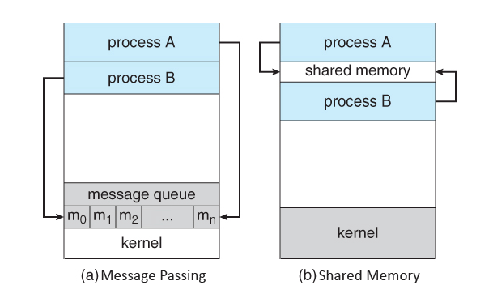

---

## ✅ IPC의 목적

  1. **데이터 공유 (Data Sharing)**
  1. **정보 교환 (Message Passing)**
- 예: 클라이언트-서버 모델
  1. **동기화 (Synchronization)**
- 예: 자원 접근 순서 제어, 데드락 회피
  1. **신뢰성 있는 협력 수행**
- 프로세스 간의 신뢰성 있는 통신을 보장

---

## ✅ Shared Memory (공유 메모리)

### 📌 원리

  - 두 프로세스가 같은 메모리 영역에 접근하도록 OS가 메모리 매핑을 허용
  - 커널 공간이 아닌 **유저 공간에 공유된 영역**을 둠
  - 통신이 빠르지만 **동기화**는 개발자가 직접 제어해야 함

### 📌 구현

  - UNIX: `shmget()`, `shmat()`, `shmdt()`, `shmctl()`
  - 메모리 자체는 커널이 관리하지만, 동기화는 보통 `semaphore`나 `mutex`를 함께 사용

### 📌 장점

  - 매우 빠름 (초기 설정 이후 시스템 콜 필요 X)
  - 대량 데이터 교환에 적합

### 📌 단점

  - 동기화가 까다로움
  - 보안 측면에서 위험 (메모리를 공유하므로 침투 가능성)

### 📌 예시

  - 데이터 처리 파이프라인: 한 프로세스가 영상 프레임을 공유 메모리에 넣고, 다른 프로세스가 실시간 분석

---

## ✅ Message Queue (메시지 큐)

### 📌 원리

  - 커널이 관리하는 메시지 큐에 메시지를 보내고 받음
  - 각각의 메시지는 타입과 데이터를 포함함

### 📌 구현

  - POSIX: `mq_open`, `mq_send`, `mq_receive`
  - System V: `msgget()`, `msgsnd()`, `msgrcv()`

### 📌 장점

  - 프로세스 간 **명시적 메시지 전달** 가능
  - 비동기 통신 지원
  - 구조화된 데이터 전달

### 📌 단점

  - 상대적으로 느림 (커널 개입)
  - 메시지 크기 제한 있음

### 📌 예시

  - 생산자-소비자 모델에서 작업 큐 역할

---

## ✅ Pipe (파이프)

### 📌 원리

  - **단방향 통신 채널**, 한쪽이 쓰고 다른 쪽이 읽음
  - **익명 파이프**: 부모-자식 간
  - **이름있는 파이프 (FIFO)**: 관련 없는 프로세스 간

### 📌 구현

  - UNIX: `pipe()`, `mkfifo()`, `open()`, `read()`, `write()`

### 📌 장점

  - 구현이 단순
  - 동기화가 암묵적으로 됨 (읽을 때 블로킹)

### 📌 단점

  - 단방향, 바이너리 스트림
  - 데이터가 지속되지 않음 (휘발성)

---

## ✅ Socket(소켓)

### 📌 원리

  - 네트워크 인터페이스를 통해 데이터 송수신
  - **로컬 IPC (AF_UNIX)** 또는 **네트워크 기반 (AF_INET)**

### 📌 구현

  - `socket()`, `bind()`, `listen()`, `accept()`, `connect()`, `send()`, `recv()`

### 📌 장점

  - 네트워크를 넘는 **프로세스 간 협력 가능**
  - 다수 클라이언트와 동시 통신

### 📌 단점

  - 성능이 느림 (TCP/IP 스택)
  - 구조화된 데이터 처리 시 수작업 필요

### 📌 예시

  - 마이크로서비스 간 통신, REST API 기반 백엔드 간 협력

---

## 버스 구조와 DMA의 도입 이유

### 1. DMA가 없을 때의 구조

  - **하나의 시스템 버스**에 모든 장치가 연결됨
```
[ CPU ] ←→ [ 시스템 버스 ] ←→ [ 메모리 ]
	                             ↑
	                             ↓
	                         [ I/O 장치 ]
```
  - 이 구조에서는 **CPU ↔ I/O ↔ 메모리** 간 데이터 전송을 **CPU가 직접 제어**
  - **문제점**:
- 시스템 버스는 **한 번에 하나의 전송만 가능** (공유 자원)
    - **I/O 작업이 버스를 점유**하면 CPU와 메모리 간의 작업도 지연됨
    - 전체 시스템 성능 저하

---

### 2. DMA + 버스 분리 구조

  - DMA와 함께 **버스를 두 개로 분리**
- **시스템 버스**: CPU, 메모리, DMA 연결
    - **입출력 버스**: DMA, I/O 장치 연결

```
[ CPU ] ←→ [ 시스템 버스 ] ←→ [ 메모리 ]
                               ↑
                            [ DMA ]
                               ↓
            [ 입출력 버스 ] ←→ [ I/O 장치 ]
```
  - **장점**:
- I/O 장치가 데이터 전송할 때 **입출력 버스를 사용**하므로,
- **시스템 버스를 점유하지 않음**
      - CPU와 메모리는 **자유롭게 시스템 버스를 사용** 가능
    - CPU가 I/O 처리에 직접 개입하지 않고도 데이터 전송이 이뤄짐 → **병렬성 향상**

---

### 3. 흐름 요약

| 항목 | DMA 없음 | DMA + 버스 분리 |
| --- | --- | --- |
| 버스 수 | 하나 (시스템 버스) | 두 개 (시스템, 입출력 버스) |
| I/O 전송 | CPU가 직접 수행 | DMA가 입출력 버스로 수행 |
| 시스템 버스 | I/O 작업과 경쟁 | CPU/메모리 작업에 집중 |
| 성능 | 낮음 | 향상됨 |

---

### ✅ 결론

DMA는 단순히 CPU 대신 데이터를 옮기는 역할뿐만 아니라,
시스템 버스를 I/O 작업으로부터 분리하여 전체 시스템의 병목을 줄이고 
효율을 높이는 구조적 장점도 제공한다.

---

## DMA(Direct Memory Access) 정리

### 버스 구조와 DMA의 역할

  - 컴퓨터 시스템에는 버스(Bus)가 존재하며, 크게 두 가지가 존재
- **시스템 버스**: CPU, 메모리 연결 (주소 버스, 데이터 버스, 제어 버스로 구성)
    - **입출력 버스**: 주로 I/O 장치와 관련된 데이터 전송을 담당
  - 기존 방식
- CPU가 모든 데이터 전송을 **직접 제어**하며 I/O 장치와 메모리 사이를 오감
    - I/O 장치가 데이터를 보내거나 받을 때마다 **CPU가 개입**해서 메모리에 저장하거나 불러옴 → **CPU 낭비 심함**
  - **DMA**는 이 과정에서 CPU의 부담을 줄이기 위해 등장
- CPU가 전송 작업을 **DMA 컨트롤러**에게 위임
    - DMA 컨트롤러는 직접 **메모리와 I/O 장치 사이에서 데이터 이동** 수행
    - CPU는 작업을 DMA에게 맡기고 그동안 다른 연산에 집중 가능

---

### DMA 동작 방식

  - CPU는 DMA 컨트롤러에 다음 정보를 설정
- **데이터 전송 시작 주소**
    - **데이터 크기 (블록 단위)**
    - **전송 방향 (메모리 → I/O, I/O → 메모리 등)**
  - 설정 후 DMA 컨트롤러가 **독립적으로 데이터 전송 수행**
  - **전송 완료 시 인터럽트**를 CPU에 발생시켜 알려준다
- 이 방식은 매번 **바이트 단위로 인터럽트**를 발생시키는 게 아니라,
    - **블록 단위로 한 번에 처리** 후 인터럽트 발생 → **시스템 효율성 향상**

---

### DMA의 장점

  - CPU의 부담을 줄이고, **병렬성 향상**
  - 인터럽트 발생 횟수 감소 → **오버헤드 줄어듦**
  - 빠른 대용량 데이터 전송에 유리 (예: 디스크, 네트워크 카드 등)

---

### 예시 요약

| 항목 | 기존 방식 | DMA 방식 |
| --- | --- | --- |
| 데이터 전송 주체 | CPU | DMA 컨트롤러 |
| CPU 개입 빈도 | 매번 | 전송 설정 시 1번, 완료 시 인터럽트 |
| 인터럽트 발생 | 자주 (바이트 단위) | 적게 (블록 단위) |
| 효율성 | 낮음 | 높음 |

---

## **APIC + DMA 전체 구조** 

```c
┌────────────┐           ┌─────────────┐
│  I/O 장치  ├──────────▶│   DMA       │◀────────────┐
└────────────┘           └────┬────────┘             │
                              │                      │
                              ▼                      ▼
                          ┌────────┐           ┌──────────┐
                          │ IOAPIC │◀──────────│ 다른 I/O │  ← 여러 장치 가능
                          └────┬───┘           └──────────┘
                               │
                               ▼
                        ┌─────────────┐
                        │ 시스템 버스 │◀────────────────────-----
                        └────┬────────┘                      │
                             │                               │
       ┌────────────────────┴────────────────────┐           │
       ▼                                          ▼          ▼
┌────────────┐                            ┌────────────┐  ┌──────────┐
│ Local APIC │◀──────────────┐           │ Local APIC │  │  Memory  │
│   (CPU 0)  │               │           │   (CPU 1)  │  └──────────┘
└────────────┘               │           └────────────┘
       │                    IPI                  │
       ▼                                         ▼
┌────────────┐                            ┌────────────┐
│   CPU 0    │                            │   CPU 1    │
└────────────┘                            └────────────┘

```

## ✅ IDT (Interrupt Descriptor Table)

  - Interrupt Vector Number (0 ~ 255)에 따라,
  - **해당 인터럽트가 발생했을 때 실행할 함수 주**를 담고 있는 테이블
  - 일종의 **"인터럽트 → 처리 루틴" 매핑표**

```

        IDT (Interrupt Descriptor Table)
        ┌────────────┬────────────────────────────┐
        │ Vector No. │ ISR 주소 (Interrupt Handler) │
        ├────────────┼────────────────────────────┤
        │     0      │ divide_by_zero_handler()    │
        │     1      │ debug_handler()             │
        │    ...     │ ...                         │
        │   32       │ timer_interrupt_handler()   │ ← (ex. 하드웨어 IRQ0)
        │   33       │ keyboard_handler()          │ ← (ex. 하드웨어 IRQ1)
        │  128       │ syscall_handler()           │ ← (ex. int 0x80)
        └────────────┴────────────────────────────┘

```

---

## ✅ ISR (Interrupt Service Routine, 인터럽트 핸들러)

  - 인터럽트가 발생했을 때 CPU가 **IDT에서 해당 ISR 주소를 찾아서** 실행하는 함수
  - 대부분 **커널 내부 함수**이며, **커널 스택에서 동작**
  - 예외나 장치별 인터럽트를 **구체적으로 처리**

예

```c
void keyboard_handler() {
    char c = read_from_keyboard_controller();
    put_char_to_buffer(c);
    send_EOI_to_APIC();
}
```

---

## ✅ 전체 흐름 (소프트웨어 예외 또는 하드웨어 인터럽트)

예: 키보드 눌림 (하드웨어 인터럽트)

```
1. 키보드 누름
2. IOAPIC가 IRQ1 (인터럽트 번호 33)을 Local APIC에 전달
3. CPU는 IDT[33]를 참조 → ISR 주소를 얻음
4. 해당 ISR (keyboard_handler) 실행
5. EOI(End of Interrupt) 보내고 복귀
```

예: 0으로 나눔 (소프트웨어 예외)

```
1. CPU가 0으로 나눔 → 예외 발생
2. CPU 내부에서 즉시 IDT[0] 참조 → divide_by_zero_handler 실행
3. ISR 수행 후 복귀
```

---

### **✅ 하드웨어 인터럽트 처리 과정**

  1. **하드웨어 장치(예: 키보드, 마우스, 디스크 등)가 인터럽트 요청(IRQ, Interrupt Request)을 발생**
  1. **PIC/APIC(인터럽트 컨트롤러)가 해당 인터럽트에 대한 인터럽트 벡터 번호를 CPU에 전달**
  1. **CPU는 인터럽트 벡터 번호를 기반으로 IDT(Interrupt Descriptor Table)에서 인터럽트 핸들러(ISR, Interrupt Service Routine) 주소를 찾음**
  1. **현재 실행 중이던 프로그램의 컨텍스트(레지스터, 스택)를 저장하고, 인터럽트 핸들러로 점프하여 실행**
  1. **인터럽트 핸들러 실행 후, EOI(End of Interrupt) 신호를 PIC/APIC에 보내 인터럽트 처리가 완료되었음을 알림**
  1. **CPU는 저장된 컨텍스트를 복원하고, 인터럽트 발생 이전의 코드 실행을 계속 진행**

---

### **✅ 소프트웨어 인터럽트 (시스템 콜) 처리 과정**

  1. **응용 프로그램이 운영체제의 기능을 사용하기 위해 시스템 콜 요청 (예: 파일 저장, 네트워크 요청)**
  1. **시스템 콜 번호와 필요한 데이터를 CPU 레지스터 또는 스택을 통해 운영체제에 전달**
  1. **CPU는 현재 실행 중인 프로세스의 컨텍스트(레지스터, 스택)를 저장하고 커널 모드로 전환**
  1. **CPU는 IDT에서 시스템 콜 핸들러(커널의 시스템 콜 테이블에 정의된 함수)를 찾아 해당 주소로 점프**
  1. **커널에서 해당 시스템 콜을 처리 (예: 파일 쓰기, 프로세스 생성 등)**
  1. **처리가 끝나면 다시 사용자 모드로 전환하고, 저장된 프로세스 컨텍스트를 복원하여 원래 코드 실행을 계속 진행**

### 하드웨어 인터럽트

  - **하드웨어 인터럽트**는 여러 입출력 장치나 보조 기억 장치에서 발생하며, 실제 하드웨어에서 발생하는 신호로 인해 CPU가 현재 작업을 중단하고 다른 작업을 처리하도록 한다.
  - 이를 처리하기 위해, **PIC (Programmable Interrupt Controller)** 같은 하드웨어 장치를 사용해 여러 개의 인터럽트를 관리하고, 이를 CPU에 전달한다. 
PIC는 여러 인터럽트 신호를 수집하고, 이를 **우선순위**에 따라 CPU에게 전달한다.
  - 다중 인터럽트가 발생하는 경우, PIC는 각각의 인터럽트 신호에 우선순위를 부여하고, 이를 순차적으로 처리하는 방식으로 **다중 인터럽트**를 처리한다.

**최근에는 APIC를 통해서 멀티 코어를 지원한다.**

I/O Device → I/O APIC → Local APIC(CPU 마다 1개씩 존재) → CPU

### 소프트웨어 인터럽트 (트랩)

  - **소프트웨어 인터럽트**는 주로 **시스템 호출**(System Call)이나 **예외 처리**(Exception)와 관련된 인터럽트 
예를 들어, 프로세스가 운영체제에게 자원을 요청하거나 특정 작업을 수행하도록 할 때 발생한다.
  - 이 인터럽트는 **명령어 주기**(Fetch-Execute Cycle) 중에 발생하며, **하드웨어 인터럽트**와는 달리 외부 장치에서 발생하는 것이 아니라, 프로그램 실행 중에 발생하는 것
  - 소프트웨어 인터럽트는 **동시에 많이 발생할 수는 없**지만, **여러 개의 명령어**가 실행되는 동안 발생할 수 있다. 예를 들어, 특정 시스템 호출이 여러 번 발생할 수 있다.

### 현대 운영체제에서의 처리 방식

  1. **인터럽트 처리 시점**:
- CPU는 명령어 주기의 **실행 직전에 인터럽트가 발생했는지 확인.** 이때 인터럽트가 발생하면 현재 실행 중인 명령어를 중단하고, 인터럽트 서비스 루틴(ISR)을 호출
    - **플래그 레지스터**의 인터럽트 비트는 인터럽트가 발생했는지 여부를 확인하는 중요한 역할을 한다.
인터럽트 비트가 설정되면 CPU는 인터럽트가 발생했다는 것을 알게 되고, 이를 처리하게 된다.
  1. **NIP (Non-Interruptible Process)**:
- **NIP**는 인터럽트를 처리하지 않고 실행해야 하는 명령어나 프로세스를 말한다. 예를 들어, 일부 중요한 작업이나 특정 조건 하에서 반드시 실행되어야 하는 작업이 있을 수 있다. 이런 작업은 인터럽트가 발생하더라도 실행이 중단되지 않도록 관리된다.
  1. **인터럽트 비트와 관계**:
- CPU가 인터럽트를 처리할 때는 **인터럽트 비트**에 따라 다르게 행동한다. 인터럽트 비트가 활성화되면 해당 인터럽트가 발생한 것으로 간주하고, 이를 처리한다.. 하지만, 일부 중요한 작업이나 예외적인 상황에서는 **NIP**와 같은 특별한 규칙을 통해 인터럽트 처리를 다르게 할 수 있다.

### 결론

현대 운영체제는 하드웨어와 소프트웨어 인터럽트를 효율적으로 처리하는 방식으로 설계되어 있다. **하드웨어 인터럽트**는 PIC와 같은 하드웨어 장치를 통해 다중 인터럽트를 처리하고, **소프트웨어 인터럽트**는 명령어 주기에서 발생할 수 있는 경우에 적절히 관리된다. 인터럽트는 플래그 레지스터의 상태나 시스템 호출에 의해 발생하며, **NIP, NMI(Non-Maskable Interrupt)**와 같은 특별한 처리 규칙에 따라 달리 처리될 수 있다.

운영체제는 이러한 다양한 인터럽트를 신속하고 효율적으로 처리할 수 있도록 여러 메커니즘을 제공한다.

### 1. **락 (Locks)**

  - **목적**: 다중 스레드 환경에서 **공유 자원에 대한 경쟁**을 방지하고, 동시에 여러 스레드가 자원에 접근하지 않도록 **동기화**하는 데 사용
  - **사용 시점**: 여러 스레드나 프로세스가 동시에 동일한 자원에 접근할 때, 자원에 대한 **경쟁 상태**를 방지하고자 할 때 사용 예를 들어, **데이터베이스 업데이트**, **파일 시스템 접근**, **공유 메모리**와 같은 자원을 보호
  - **핵심**: 락은 **자원 보호**와 **동시성**을 보장하는 데 필요한 기법. 여러 스레드가 동시에 자원에 접근할 때 이를 **동기화**하여 경쟁 조건(race condition)을 피한다.

### 2. **인터럽트 불능화 (Disabling Interrupts)**

  - **목적**: **중요한 작업**이 진행되는 동안, 외부 인터럽트(주로 하드웨어 인터럽트)로 인한 방해를 막는 것.
이는 **시스템의 중요한 상태 변경**(예: 문맥 교환, 타이머 인터럽트 처리)을 보호하는 데 필요하다.
  - **사용 시점**: 시스템에서 **문맥 교환**이나 **타이머 인터럽트**와 같이 **우선순위가 더 높은 작업**을 처리해야 할 때, 인터럽트가 다른 작업을 방해하지 않도록 하기 위해 사용. 
이때 다른 **하드웨어 인터럽트**나 **소프트웨어 인터럽트**는 처리되지 않도록 불능화한다.
  - **핵심**: 인터럽트 불능화는 **시스템 안정성**과 **중요한 작업을 방해받지 않도록 보호**하는 데 사용된다. 
인터럽트가 발생하는 동안 중요한 작업을 안전하게 처리할 수 있도록 한다.

### 결론

  - **락**은 **동시성 문제를 해결**하는 데 초점을 맞추고, 여러 스레드나 프로세스가 동시에 자원에 접근하는 상황에서 이를 **제어**하는 데 사용된다.
  - **인터럽트 불능화**는 **우선순위가 높은 작업**을 안전하게 처리하기 위해, 다른 인터럽트가 발생하지 않도록 막는 데 사용된다. 특히 **문맥 교환**이나 **타이머 인터럽트**와 같은 중요한 작업을 처리하는 동안 사용된다.

따라서, **동시성 제어**가 필요한 상황에서는 락을 사용하고, **중요한 작업**을 보호해야 할 때는 **인터럽트 불능화**를 사용. 이 두 가지 방법은 운영체제가 시스템의 **안정성**과 **효율성**을 보장하기 위해 필요한 기법이다.

**인터럽트 불능화 = 플레그 레지스터 인터럽트 비트 비활성화**

## ✅  fork() 시스템 콜

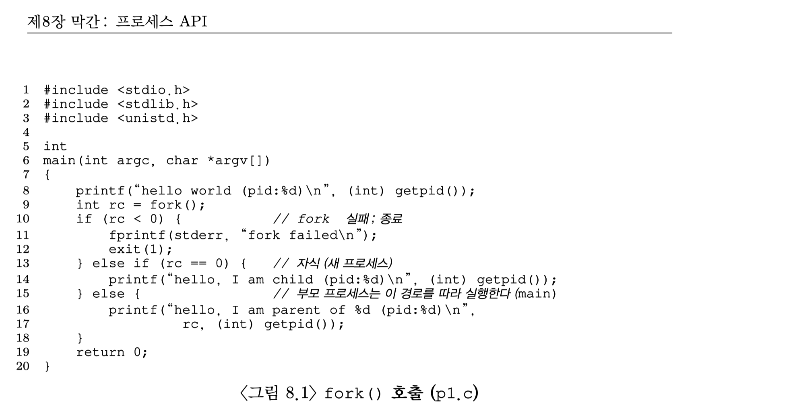

getpid() → 현재 프로세스의 PID 반환

생성된 자식 프로세스는 fork() 부분부터 실행됨

→ hello world 한번만 출력 

부모 프로세스 rc : 자식 프로세스 PID

자식 프로세스 rc: 0 

→ 이를 통해 분기 처리 가능

---

## ✅  wait() 시스템 콜 

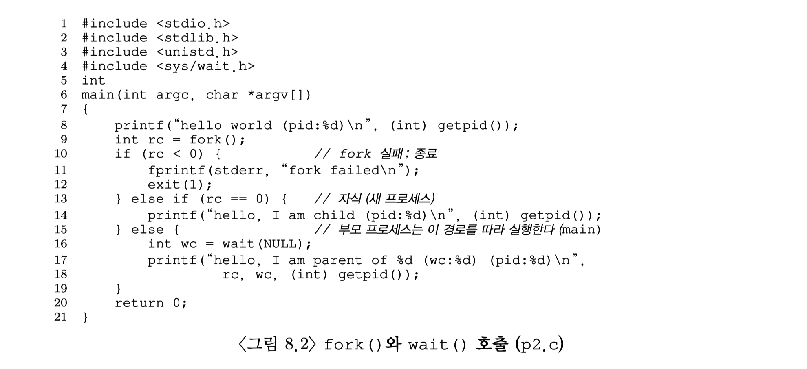

해당 코드에서는 항상 자식 프로세스가 먼저 출력

  - 자식 프로세스 → 부모 프로세스 
  - 부모 프로세스 → 자식 프로세스
- 부모 프로세스 wait() → block 상태 
    - 자식 프로세스 종료 
    - 부모 프로세스 block → ready → running

---

## ✅ exec() 시스템 콜 

```
exec() 시스템 콜은 자기 자신이 아닌 다른 프로그램을 실행할 때 사용한다. 
```

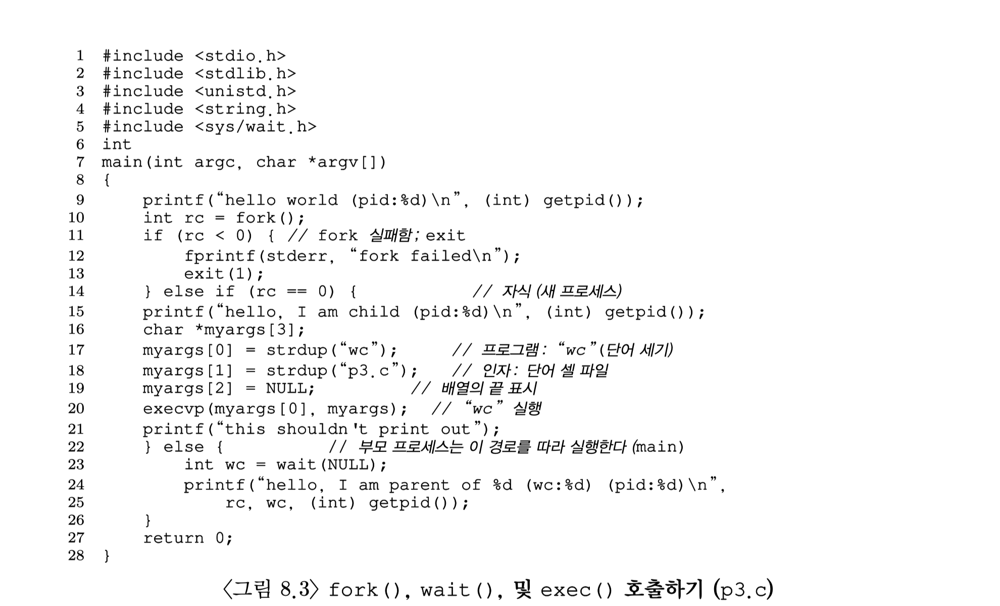


**wc 프로그램** 

  - 소스 코드의 행 개수, 단어의 개수, 바이트 개수를 출력한다.

exec() 시스템 콜은 실행 파일의 이름(ex: wc), 약간의 인자가 주어지면 해당 실행 파일의 코드와 정적 데이터를 읽어 들여 현재 실행 중인 프로세스의 코드 세그먼트와 정적 데이터 부분을 덮어 쓴다.

힙과 스택 및 공간들도 새로운 프로그램의 실행을 위해 초기화 된다. 

그런 다음 운영체제는 프로세스의 argv 같은 인자를 전달하여 실행중인 프로그램 (p3)를 다른 다른 실행 중인 프로그램으로 (wc)로 대체한다.

자식 프로세스가 exec()을 호출한 후에는 절대로 리턴되지 않는다.

→ printf(”this shouldn’t print out”); 출력 X

## **✅ Locality of Reference**

캐시 메모리는 원칙에 따라 메모리로부터 가져올 데이터를 결정한다. 

바로 참조 지역성의 원리이다. 

참조 지역성의 원리란 CPU가 메모리에 접근할 때의 주된 경향을 바탕으로 만들어진 원리이다.

  1. CPU는 최근에 접근했던 메모리 공간에 다시 접근하려는 경향이 있다. 
  1. CPU는 접근한 메모리 공간에 근처를 접근하려는 경향이 있다. 

## **✅ 시간 지역성(Temporal Locality)**

정의: 최근에 접근한 데이터는 **가까운 미래에 다시 접근될 가능성이 높다**는 원리 

예시:

```java
int sum = 0;
for (int i = 0; i < 1000; i++) {
    sum += data[10];  
}
```

  - `data[10]`은 **같은 메모리 주소**를 계속 반복해서 참조
  - CPU는 이 값을 한 번 캐시에 올려두면, 이후 반복 접근에서 **메인 메모리까지 가지 않고** 캐시에서 바로 가져올 수 있어 성능이 향상
  - → 이게 바로 **시간 지역성 (Temporal Locality)**!

## **✅ 공간 지역성(Spatial Locality)**

정의: 특정 메모리 위치가 접근되면, 그 주변의 메모리도 곧 접근될 가능성이 높다는 원리 

예시:

```java
for (int i = 0; i < 100; i++) {
    sum += arr[i];
}
```

  - `arr[0]`을 접근한 후, `arr[1], arr[2], ...` 도 순차적으로 접근되므로 배열을 일정 크기 블록으로 캐시에 올려두면 효율적
  - **활용**: 캐시는 메모리를 라인 단위로 가져오기 때문에 인접한 데이터를 함께 불러와 성능을 높인다.

## 🔍 한 줄 요약

  - `data[10]`을 반복해서 접근 → **시간 지역성**
  - `data[i]`를 순차적으로 접근 → **공간 지역성**

1. 가상 머신 안에서 실행되는 응용 프로그램(유저 모드)이 디스크에 데이터를 저장하려고 함.
  1. 응용 프로그램이 게스트 OS의 **시스템 콜**을 호출 → 커널 모드로 전환됨.
  1. 게스트 OS의 커널은 디스크 I/O 요청을 처리하려고 하지만, 가상 머신은 **실제 하드웨어에 직접 접근할 수 없음.**
  1. **하이퍼바이저가 이 요청을 가로채서 처리**하고, 적절히 호스트 OS의 디스크 I/O를 이용해 수행함.
  1. 요청이 처리된 후 결과가 게스트 OS에 전달됨 → 다시 응용 프로그램(유저 모드)로 복귀.

**하이퍼바이저**

```
즉, **게스트 OS가 시스템 콜을 실행하면, 결국 하이퍼바이저가 이를 가로채서 적절한 처리를 수행**

이 과정에서 하이퍼바이저는 하이퍼바이저 모드(Hypervisor Mode, VMX Root Mode)에서 실행되며, 
가상 머신이 하드웨어를 직접 건드리지 못하게 **중재자 역할**을 한다.
```

---

### 1️⃣ 응용 프로그램 실행 (유저 모드)

  - 가상 머신(게스트 OS) 내부에서 실행되는 응용 프로그램이 디스크 저장 요청을 보냄.
  - 응용 프로그램은 유저 모드(User Mode)에서 동작 중.
  - `write()` 같은 시스템 콜을 호출하여 커널 모드로 전환됨.

### 2️⃣ 게스트 OS의 시스템 콜 처리 (커널 모드)

  - 게스트 OS의 커널이 시스템 콜을 받아서 처리하려고 함.
  - 그러나 가상 머신 내부의 OS는 **진짜 하드웨어에 접근할 권한이 없음.**
  - 하드웨어 관련 명령어(예: 디스크 쓰기)가 실행되면 **트랩(Trap)** 발생.

### 3️⃣ 하이퍼바이저 (하이퍼바이저 모드)

  - 트랩이 발생하면 하이퍼바이저가(intercept)하여 요청을 가로챔.
  - 하이퍼바이저는 하이퍼바이저 모드(Hypervisor Mode)에서 실행됨.
  - 실제 호스트 OS 또는 하드웨어에 요청을 위임하거나, 가상 디스크에 저장하는 방식으로 처리함.

### 4️⃣ 실제 디스크 작업 (호스트 OS 커널 모드)

  - 하이퍼바이저가 실제 호스트 OS의 **커널 모드**에서 디스크 쓰기 요청을 처리함.
  - 물리적인 하드웨어와 통신하여 데이터 저장 수행.

### 5️⃣ 완료 후 복귀 (역순으로 모드 전환)

  - 디스크 저장이 끝나면 **호스트 OS → 하이퍼바이저 → 게스트 OS → 응용 프로그램** 순으로 결과 전달.
  - 응용 프로그램은 다시 **유저 모드**에서 실행됨.

---

**모드 흐름 정리**  

  - 유저 모드(가상 머신 응용 프로그램)
  - 커널 모드(게스트 OS) 
  - 하이퍼바이저 모드 
  - 커널 모드(호스트 OS) 
  - 하이퍼바이저 모드(결과 전달) 
  - 커널 모드(게스트 OS)
  - 유저 모드(가상 머신 응용 프로그램 재개)

**베이스 레지스터(Base Register)**

  - 프로세스가 메모리에서 시작하는 물리 주소를 저장하는 레지스터
  - 즉, 프로세스의 **기준 주소(base address)** 역할을 한다.

**한계 레지스터(Limit Register)**

  - 프로세스가 사용할 수 있는 **메모리의 크기(limit)** 를 저장하는 레지스터
  - 보통 한계 레지스터 값은 프로세스가 할당받은 메모리 크기를 나타낸다.
  - 따라서, **프로세스가 접근 가능한 최대 물리 주소는** **`베이스 레지스터 + 한계 레지스터 값 - 1`** 

예를 들어,

  - 베이스 레지스터 값이 `1000`이고,
  - 한계 레지스터 값이 `5000`이면,
  - 이 프로세스는 `1000 ~ 5999`까지의 주소 범위를 사용할 수 있다.

### 역할

  - **메모리 보호**: 프로세스가 할당된 영역을 벗어난 주소에 접근하면 CPU가 이를 감지하고 **예외(Exception)** 를 발생시켜 보호한다.
  - **주소 변환**: 논리 주소(프로세스 관점)에서 물리 주소(메모리 관점)로 변환할 때 사용된다.
  - **MMU(Memory Management Unit)**가 수행하는 작업 

### 동작 방식

  1. CPU가 논리 주소를 생성 (예: `200`)
  1. 물리 주소 계산 → `물리 주소 = 베이스 레지스터 + 논리 주소`
  1. 물리 주소가 한계 레지스터 범위를 초과하는지 검사
- 초과하면 **메모리 접근 오류(예외 발생)**
    - 초과하지 않으면 정상적으로 메모리에 접근

이 개념은 **단순한 분할 방식의 메모리 관리**에서 사용되며, 현대 OS에서는 **페이징(Paging) 및 세그멘테이션(Segmentation)** 방식이 더 일반적이다.

## ✅ 프로세스 제어 블록(PCB)에 포함되는 정보들

  - Process ID(PID) : 프로세스를 구분하는 ID
  - Process state : 각 State 들의 상태를 저장한다.
- new, ready, running, blocked, terminated
  - Program Counter 
- **다음 Instruction의 주소를 저장한다.** 
    - CPU는 이 값을 참조해서 Process의 Instruction을 수행한다.
  - Register : Accumulator, CPU Register, General Register(범용 레지스터) 등을 포함한다.
  - CPU Scheduling Information : **우선순위, 최종 실행시간, CPU 점유시간** 등이 포함된다.
  - Memory Information : 해당 **프로세스 주소공간(lower bound ~ upper bound) 정보**를 저장
  - Process Information : 페이지 테이블, 스케줄링 큐 포인터, 소유자, 부모 등
  - Device I/O Status : 프로세스에 할당된 입출력 장치 목록, 열린 목록등
  - Pointer : **부모/자식 프로세스에 대한 포인터, 자원에 대한 포인터** 등
  - Open File List : 프로세스를 위해 열려있는 파일의 리스트

```
🔹 파일 디스크립터(File Descriptor)란?
운영체제가 열려있는 파일(또는 입출력 자원) 을 식별하기 위해 사용하는 정수값 ID

리눅스/유닉스 기반 시스템에서는 모든 것을 파일로 취급하므로,
파일뿐 아니라 소켓, 파이프, 터미널, 디바이스 등 다양한 자원을 식별할 때 사용

각각의 프로세스는 자신만의 파일 디스크립터 테이블(File Descriptor Table) 을 갖고 있고,
이 테이블은 커널 내부의 오픈 파일 테이블(Open File Table)을 참조

🔹 대표적인 파일 디스크립터 번호
번호	   의미
0	  표준 입력 (stdin)
1	  표준 출력 (stdout)
2	  표준 에러 (stderr)

이 기본 3가지는 프로세스 시작 시 자동으로 open
```

---

# ✅ **PCB와 프로세스 리스트**

| 항목 | 설명 |
| --- | --- |
| **PCB (Process Control Block)** | 각 프로세스의 상태, 레지스터, 스케줄링 정보, 메모리 정보 등을 담은 구조체. <br>커널이 프로세스를 추적하고 관리하는 핵심 구조. |
| **위치** | 커널 메모리 (일반적으로 커널 힙) |
| **프로세스 리스트** | PCB를 링크드 리스트 등으로 관리하며, Ready, Blocked 등 상태별로 큐를 구성함 |
| **Ready/Blocked List …** | PCB 포인터를 노드로 가지는 큐들. 상태에 따라 PCB가 이동함 |

---

# ✅ **스케줄링과 Ready List 구조**

| 항목 | 설명 |
| --- | --- |
| **Ready List** | 실행 가능한 프로세스(PCB 포인터)를 보관. 일반적으로 **멀티 레벨 피드백 큐**로 구현됨. |
| **MLFQ (Multi-Level Feedback Queue)** | 우선순위 기반 + 다양한 스케줄링 알고리즘 (FCFS, SJF, Round Robin 등)을 혼합 |
| **각 큐는 독립적인 알고리즘** | 예: 상위 레벨은 짧은 타임슬라이스, 하위는 긴 타임슬라이스 또는 SJF 적용 가능 |

---

# ✅ **멀티 프로세서 시스템에서의 큐 구조**

| 항목 | 설명 |
| --- | --- |
| **멀티 프로세서** | 여러 CPU에서 병렬로 스케줄링/실행함 |
| **큐 구조** | 보통 아래 중 하나<br>① **단일 큐**: 모든 CPU가 하나의 Ready Queue 공유<br>② **멀티 큐**: 각 CPU가 자체 Ready Queue 보유 |
| **이주(Migration)** | 부하 분산을 위해 프로세스를 다른 CPU의 큐로 이동시키는 기법 |
| **스틸링(Stealing)** | 유휴 CPU가 다른 CPU의 큐에서 프로세스를 “훔쳐”오는 방식 |

---

# ✅ **커널 스택과 PCB**

| 항목 | 설명 |
| --- | --- |
| **커널 스택** | 시스템 콜, 인터럽트 처리 중 커널이 사용하는 스택. 사용자 스택과 별도로 존재 |
| **각 프로세스마다 1개** | PCB 옆에 할당되거나, 8KB 블록 안에 PCB + 커널 스택을 같이 넣음 |
| **위치** | 커널 메모리 (물리 메모리 상 커널 공간) |

---

# ✅ **PCB와 페이지 테이블의 관계**

| 항목 | 설명 |
| --- | --- |
| **페이지 테이블** | 가상 주소 → 물리 주소 매핑을 위한 자료구조. 커널이 관리 |
| **위치** | 물리 메모리에 커널이 동적으로 할당 (커널 힙 또는 전용 영역) |
| **PCB → mm_struct → pgd** | PCB는 `mm_struct` 포인터를 가지고 있고, 그 안에 `pgd`가 페이지 테이블 루트를 가리킴 |
| **CPU 연동** | 페이지 테이블의 루트 주소는 `CR3` 레지스터에 적재됨 (컨텍스트 스위칭 시 업데이트됨) |

운영체제(OS)에서 프로세스의 실행 사이클을 관리할 때 준비 큐(Ready Queue)와 대기 큐(Waiting Queue, 또는 Blocked Queue)가 존재하며, 각각의 역할이 다릅니다.

### 🔹 **준비 큐 (Ready Queue)**

  - CPU를 할당받을 준비가 된 프로세스들이 대기하는 큐입니다.
  - 스케줄러가 프로세스의 우선순위를 고려하여 **CPU 스케줄링**을 수행합니다.
  - 다양한 스케줄링 알고리즘(FIFO, SJF, Round Robin, Priority Scheduling 등)에 따라 실행 순서가 정해집니다.

### 🔹 **대기 큐 (Waiting Queue 또는 Blocked Queue)**

  - 입출력(I/O) 작업이나 특정 이벤트가 완료될 때까지 **대기해야 하는 프로세스들이 머무는 큐**입니다.
  - 대기 큐는 하나만 존재하는 것이 아니라, **각 입출력 장치마다 별도로 존재**할 수 있습니다.
- 예를 들어, 디스크에서 데이터를 읽어오는 프로세스는 **디스크 대기 큐**에서 기다리고,
    - 네트워크 작업을 수행하는 프로세스는 **네트워크 대기 큐**에서 기다릴 수 있습니다.
  - I/O 작업이 완료되면 **해당 프로세스는 다시 준비 큐로 이동**하여 CPU를 할당받을 준비를 합니다.

### 🔹 **프로세스 상태 전이 (State Transition)**

프로세스는 실행 중에 다음과 같은 상태 전이를 합니다.

  1. **New → Ready** : 새로운 프로세스가 생성되면 **준비 큐에 들어감**.
  1. **Ready → Running** : CPU가 프로세스를 선택하면 실행됨. (디스패치)
  1. **Running → Waiting** : 입출력 요청 또는 특정 이벤트 발생 시 **대기 큐로 이동**.
  1. **Waiting → Ready** : 입출력 작업이 끝나면 다시 **준비 큐로 이동**. (인터럽트)
  1. **Running → Terminated** : 실행이 끝나면 종료됨.

```
💡 즉, **대기 큐는 각 입출력 장치별로 존재할 수 있으며, 프로세스는 필요한 I/O 작업이 끝날 때까지 해당 큐에서 대기하는 구조**입니다.
```

비선점형 스케줄링(Non-preemptive Scheduling)과 선점형 스케줄링(Preemptive Scheduling)의 차이를 비교해 보겠습니다.

---

## 1. **비선점형 스케줄링 (Non-preemptive Scheduling)**

  - **정의**: 한 프로세스가 CPU를 점유하면, 실행이 끝날 때까지 CPU를 다른 프로세스가 빼앗을 수 없는 방식.
  - **특징**:
- 프로세스가 자발적으로 종료되거나 I/O 작업을 수행해야만 CPU가 다른 프로세스로 넘어감.
    - 컨텍스트 스위칭(Context Switching)이 적어 오버헤드가 낮음.
    - 긴 작업이 먼저 실행되면, 짧은 작업이 오랫동안 대기할 수 있음
  - **대표적인 스케줄링 알고리즘**:
- FCFS(First Come First Served)
    - SJF(Shortest Job First, 단, 선점하지 않는 방식)
    - 우선순위 스케줄링 (비선점형)

---

## 2. **선점형 스케줄링 (Preemptive Scheduling)**

  - **정의**: 프로세스가 CPU를 사용하고 있더라도, 특정 조건이 충족되면 다른 프로세스가 CPU를 빼앗아 실행할 수 있는 방식.
  - **특징**:
- 우선순위가 높은 프로세스가 도착하면 실행 중인 프로세스를 중단하고 CPU를 선점할 수 있음.
    - 응답 시간이 짧고 실시간 시스템에 적합함.
    - 컨텍스트 스위칭이 자주 발생해 오버헤드가 발생할 수 있음.
  - **대표적인 스케줄링 알고리즘**:
- Round Robin (RR)
    - SRTF (Shortest Remaining Time First)
    - 우선순위 스케줄링 (선점형)
    - 다단계 큐 스케줄링

---

## 3. **비교 정리**

| 구분 | 비선점형 스케줄링 | 선점형 스케줄링 |
| --- | --- | --- |
| **CPU 점유** | 한 번 점유하면 끝까지 실행 | 실행 도중에도 다른 프로세스가 선점 가능 |
| **응답 시간** | 상대적으로 길 수 있음 | 짧음 (빠른 응답 가능) |
| **오버헤드** | 컨텍스트 스위칭이 적어 낮음 | 컨텍스트 스위칭이 많아 오버헤드 발생 가능 |
| **우선순위 반영** | 실행 중인 프로세스를 중단할 수 없음 | 더 높은 우선순위 프로세스가 오면 선점 가능 |
| **실시간 시스템 적합성** | 적합하지 않음 | 적합함 |

---

### ✅ **언제 사용해야 할까?**

  - **비선점형**: 컨텍스트 스위칭 오버헤드를 줄이고 싶을 때, 배치(batch) 처리 시스템에 적합.
  - **선점형**: 응답 속도가 중요한 실시간 시스템이나 다중 사용자 환경에서 적합.

즉, 선점형 스케줄링은 빠른 응답과 공정성을 제공하지만 오버헤드가 증가할 수 있으며, 비선점형 스케줄링은 CPU 점유율이 안정적이지만 응답 시간이 길어질 수 있습니다.

### 📌 **Convoy Effect (호위 효과)란?**

  - **한 개의 느린 작업(또는 큰 작업)이 전체 시스템의 성능을 저하시킬 때 발생하는 현상**
  - 느린 작업이 자원을 독점하면서, 뒤따르는 작은 작업(빠르게 처리될 수 있는 작업)까지 지연됨
  - 마치 **느린 배(선박)가 앞장서고 나머지 배들이 그 속도에 맞춰 따라가는 것처럼 전체 속도가 느려지는 효과**

### 선입 선처리 스케줄링 

  - FCFS(First Come First Served) 스케줄링
  - 단순히 준비 큐에 삽입된 순서대로 처리하는 비선점 스케줄링 
  - 먼저 CPU를 요청한 프로세스부터 CPU 할당 
  - 단점: 프로세스들이 기다리는 시간이 매우 길어질 수 있다. (호위 효과)

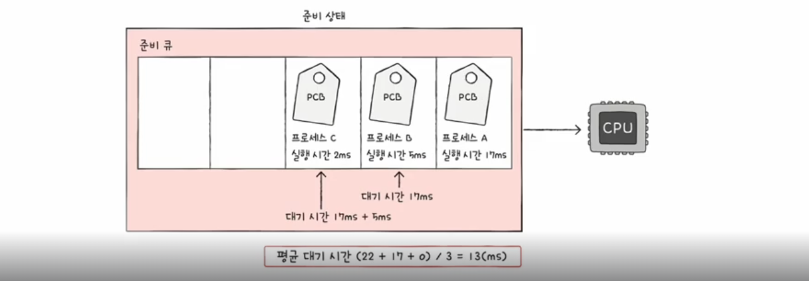

### 최단 작업 우선 스케줄링 

  - SJF(Shortest Job First) 스케줄링 
  - 호위 효과를 방지
  - CPU 사용이 긴 프로세스는 나중에 실행, CPU 사용 시간이 짧은 프로세스는 먼저 실행 
  - CPU 사용 시간이 가장 짧은 프로세스부터 처리하는 스케줄링 방식 
  - 비선점형 방식 

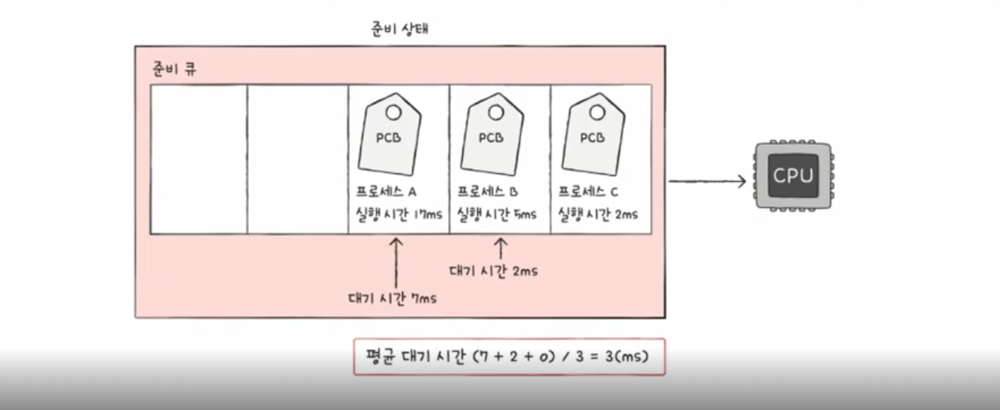

### 라운드 로빈 스케줄링 

  - RR(Round Robin) 스케줄링 
  - 선입 선처리 스케줄링 + 타임 슬라이스(time slice)
  - 타임 슬라이스: 각 프로세스가 CPU를 사용할 수 있는 정해진 시간 
  - 정해진 타임 슬라이스만큼의 시간 동안 돌아가며 CPU를 이용하는 선점형 스케줄링 
- 큐에 삽입된 프로세스들은 순서대로 CPU를 이용하되 정해진 시간만큼만 사용 
    - 정해진 시간을 모두 사용하였음에도 아직 프로세스가 완료되지 않았다면 다시 큐의 맨 뒤에 삽입(선점, 문맥교환)
  - 타임 슬라이스의 크기가 중요 
- 너무 작으면 문맥 교환이 자주 발생 → 오버헤드 
    - 너무 크면 선입 선처리 스케줄링과 같이 호위 효과가 발생

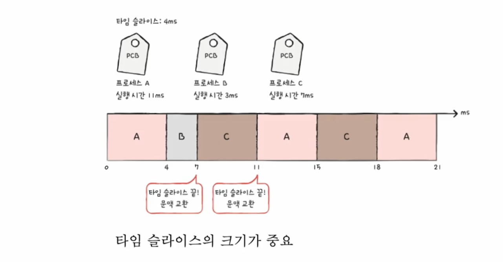

### 최소 잔여 시간 우선 스케줄링 

  - SRT (Shortest Remaining Time) 스케줄링 
  - 최단 작업 우선 스케줄링 + 라운드 로빈 스케줄링 
  - 최단 작업 우선 스케줄링: 작업 시간이 짧은 프로세스부터 처리하는 비선점형 스케줄링 알고리즘 
  - 라운드 로빈 스케줄링: 정해진 타임 슬라이스만큼 돌아가며 사용하는 선점형 스케줄링 알고리즘 
  - 정해진 시간만큼 CPU를 이용하되, 다음으로 CPU를 사용할 프로세스로는 남은 작업 시간이 가장 적은 프로세스 선택 

### 우선순위 스케줄링 

  - 프로세스들에게 우선순위를 부여하고, 우선순위가 높은 프로세스부터 실행 
  - 우선순위가 같은 프로세스들은 선입 선처리로 스케줄링 
  - 최단 작업 우선 스케줄링(SJF), 최소 잔여 시간 스케줄링(SRT)은 모두 우선순위 스케줄링에 포함
  - 우선순의 스케줄링의 근본적인 문제점, 기아(starvation) 현상 
  - 우선순위가 높은 프로레스만 주구장창 실행 
  - 우선순위가 낮은 프로세스는 (준비 큐에 먼저 삽입되었음에도 불구하고)실행 연기 

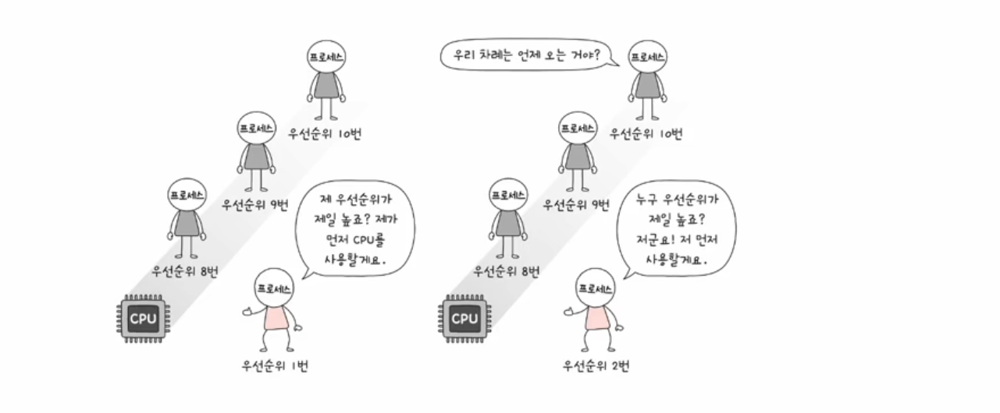

### 우선순위 스케줄링 방지 기법: 에이징(aging)

  - 오랫동안 대기한 프로세스의 우선순위를 점차 높이는 방식 
  - 대기 중인 프로세스의 우선순위를 마치 나이 먹듯 점차 증가시키는 방법 
- 우선순위가 낮아도 언젠가는 우선순위가 높아진다

### 다단계 큐 스케줄링 

  - Multilevel queue 스케줄링 
  - 우선순위 스케줄링의 발전된 형태 
  - 우선순위별로 준비 큐를 여러 개 사용하는 스케줄링 방식 
- 우선순위가 가장 높은 큐에 있는 프로세스를 먼저 처리 
    - 우선순위가 가장 높은 큐가 비어 있으면 그 다음 우선순위 큐에 있는 프로세스 처리

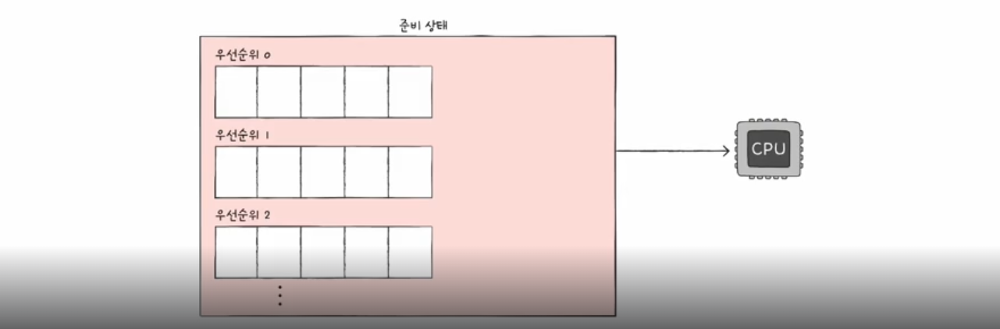

### 다단계 피드백 큐 스케줄링 

  - Multilevel feedback queue 스케줄링 
  - 다단계 큐 스케줄링의 발전된 형태 
  - 큐 간의 이동이 가능한 다단계 큐 스케줄링 
  - 다단계 큐 스케줄링은 기본적으로 큐 간의 이동 불가 
- 우선순위 낮은 프로세스는 계속해서 실행 연기 우려 → 기아 현상 발생 가능

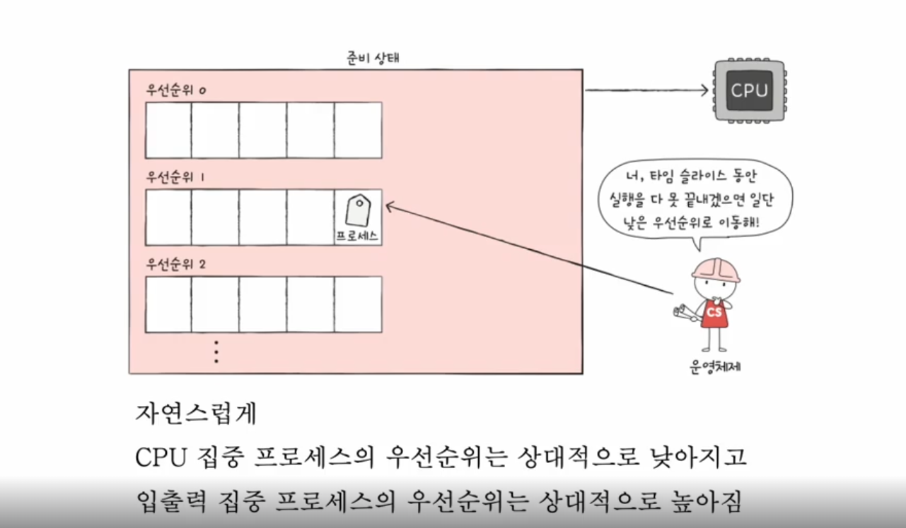

### 🔥 **MLFQ의 핵심 원리**

✅ **1. 처음에는 높은 우선순위 큐에서 실행**

  - 새롭게 도착한 프로세스는 가장 높은 우선순위 큐에 배정
  - 타임 슬라이스(time slice, CPU 점유 시간) 동안 실행

✅ **2. 타임 슬라이스를 초과하면 낮은 우선순위 큐로 이동**

  - **CPU 집중 프로세스**(연산 위주, 입출력 적음) → **낮은 우선순위 큐**로 내려감
  - **입출력 집중 프로세스**(I/O 작업 많음) → **높은 우선순위 유지** (빠르게 실행됨)

✅ **3. Aging(에이징) 적용하여 기아(starvation) 방지**

  - 낮은 우선순위 큐에서 **오랫동안 실행되지 않은 프로세스의 우선순위를 점진적으로 상승**시킴

✅ **4. 우선순위가 높은 프로세스가 먼저 실행됨**

  - 높은 우선순위 큐가 비어 있을 때만 낮은 우선순위 큐의 작업 실행

---

### ⚡ **왜 다단계 피드백 큐를 사용할까?**

📌 **장점**

  - 입출력 중심 프로세스 → 빠르게 처리 (대기 시간 단축 ✅)
  - CPU 중심 프로세스 → 나중에 실행 (효율적 자원 배분 ✅)
  - Aging 적용 → 기아 현상 방지 (공정성 확보 ✅)
  - 동적 조정 가능 → 프로세스의 실행 패턴에 따라 우선순위 변화 (유연성 ✅)

📌 **단점**

  - 큐의 개수 및 타임 슬라이스 조정을 잘못하면 비효율 발생
  - 스케줄링 로직이 복잡함

### 동기화란?

프로세스 = 스레드 

동시다발적으로 실행되는 프로세스들은 공동의 목적을 올바르게 수행하기 위해 서로 협력하고 영향을 주고 받는다. 

프로세스들은 실행 순서와 자원의 일관성 보장을 해야 하기에 반드시 **동기화(synchronization)**되어야 한다.

프로세스를 동기화하지 않을 경우 발생할 수 있는 문제점을 통해 동기화가 왜 필요한지 알아보자.

### 프로세스 동기화 2가지

  - 실행 순서 제어: 프로세스를 올바른 순서대로 실행하기 
  - 상호 배제: 동시에 접근해서는 안 되는 자원에 하나의 프로세스만 접근하게 하기 

### **실행 순서를 제어를 위한 동기화  Read-Write Problem**

Reader 프로세스, Writer 프로세스 존재 

각 프로세스는 book.txt 파일을 read/write 하는 프로세스들 두 프로세스는 동시에 실행 

이 두 프로세스들은 무작정 아무 순서대로 실행되어서는 안 된다. Reader 프로세스는 Writer 프로세스 실행이 끝나야 비로소 실행할 수 있기 때문이다. 

### **상호 배제를 위한 동기화 Bank-Account Problem**

**고급 언어의 한 줄 코드**는 컴파일 과정을 거쳐 여러 개의 기계어 명령어(어셈블리어)로 변환

**고급 언어** 

money += 10 

**어셈블리어(저급 언어)**

계좌의 잔액을 읽는다.

읽어 들인 잔액에 10만원을 더한다. 

더한 값을 저장한다.  

### **공유 자원과 임계 구역** 

계좌 잔액이라는 **공유 자원(shared resource)**에 여러 프로세스가 동시에 접근 → 동시성 이슈 

즉, **상호 배제(mutual exclusion)**가 필요하다.

```yaml
공유 자원은 전역 변수, 파일, 입출력 장치, 보조기억장치가 될 수도 있다. 
```

동시에 실행하면 문제가 발생하는 자원에 접근하는 코드 영역을 **임계 구역(critical section)**이라고 한다.

임계 구역은 두 개 이상의 프로세스가 동시에 실행되면 안 되는 영역이지만, 잘못된 실행으로 인해 여러 프로세스가 동시 다발적으로 임계 구역 코드를 실행하여 문제가 발생하는 경우가 있다. 이를 **레이스 컨디션(race condition)** 이라고 한다.

레이스 컨디션 

  - **상호 배제를 위한 동기화 Consumer-Producer Problem**
  - **상호 배제를 위한 동기화 Bank-Account Problem**

### 임계 구역 문제를 해결하는 세 가지 원칙

상호 배제를 위한 동기화를 위해서는 아래 세 가지 원칙이 반드시 지켜져야 한다. 

  - **상호 배제**: 한 프로세스가 임계 구역에 진입했다면 다른 프로세스는 임계 구역에 들어올 수 없다. 
  - **진행:** 임계 구역에 어떤 프로세스도 진입하지 않았다면 임계 구역에 진입하고자 하는 프로세스는 들어갈 수 있어야 한다. 
  - **유한 대기**: 한 프로세스가 임계 구역에 진입하고 싶다면 그 프로세는 언젠가는 임계 구역에 들어올 수 있어야 한다. (즉, 무한정 대기해서는 안 된다.)

### **✅ 스핀락(Spinlock)**

**스핀락은 CPU를 계속 점유하면서 락을 확인하는 방식 → Busy Waiting**

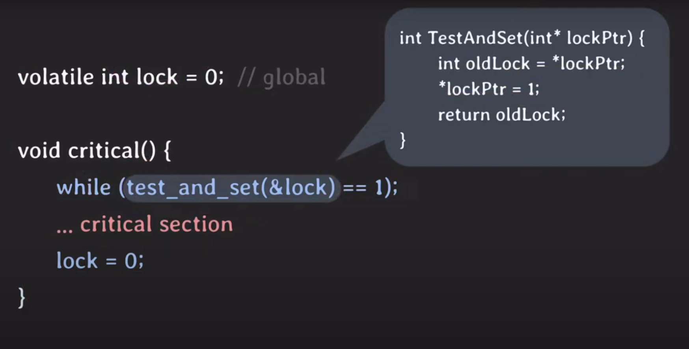

**✅ TestAndSet** 

  - **TestAndSet 함수 호출은 무조건 lock을 1로 만든다.**
  - **이전 lock 값에 따라서 0 또는 1을 반환한다.**

**✅ 의문점** 

  - **만약 스레드1, 스레드2가 동시에 TestAndSet 함수 호출을 한다면 oldLock은 0으로 스레드1, 스레드2 모두 critical section에 들어가지 않나?**

**✅ TestAndSet = CPU atomic 명령어** 

  - **실행 중간에 간섭받거나 중단되지 않는다** 
  - **같은 메모리 영역에 대해 동시에 실행되지 않는다** 
  - **이해를 돕기 위한 코드이지 실제 TestAndSet 명령어 기계어가 아니다.**

**⚠️ Busy-Waiting으로 인해 CPU 사용량이 높을 수 있음**

---

### **✅ 뮤텍스(Mutex) 락** 

**뮤텍스는 CPU를 양보하고 블로킹(wait)하는 방식** 

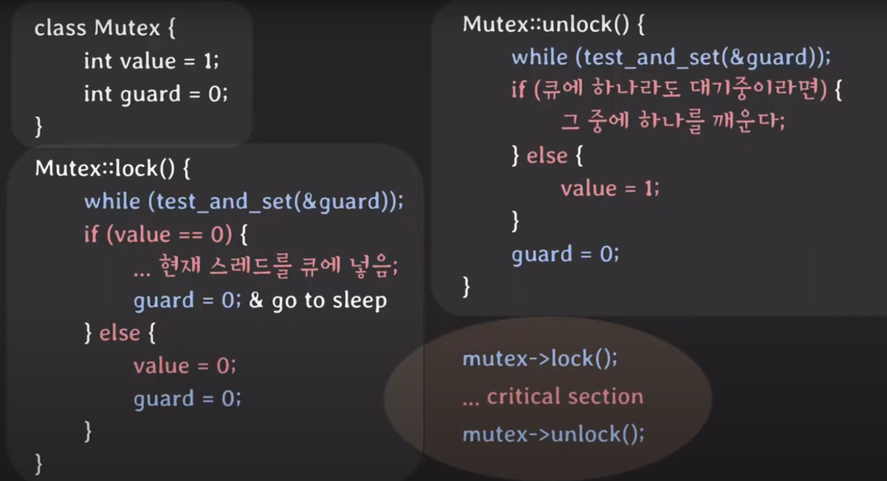

  - **guard 같은 경우 atomic 연산(test_and_set)을 통해 획득**
  - **스핀락과 다르게 CPU를 양보하고 블로킹 상태로 대기 큐에서 락 해제를 기다린다.**

### **뮤텍스(Mutex) 락은 priority inheritance(우선순위 상속) 특성을 가질 수 있다.** 

**Priority Inheritance란?**

  - 우선순위 역전(priority inversion) 문제를 해결하기 위한 메커니즘
  - 낮은 우선순위(low priority) 쓰레드가 뮤텍스를 소유하고 있을 때, 높은 우선순위(high priority) 쓰레드가 뮤텍스가 풀릴 때까지 기다려야 하는 경우가 발생할 수 있다.
  - 이때 낮은 우선순위 쓰레드가 CPU를 배정받지 못하면, 높은 우선순위 쓰레드는 계속 대기하게 되는데, 이게 **우선순위 역전** 문제다.

**뮤텍스의 Priority Inheritance 특성**

  - 뮤텍스를 소유한 낮은 우선순위 쓰레드가 **더 높은 우선순위를 임시로 부여받는 것**이 Priority Inheritance
  - 이렇게 하면 낮은 우선순위 쓰레드가 빠르게 실행되어 락을 해제할 수 있고, 높은 우선순위 쓰레드는 불필요하게 대기하지 않게 된다.
  - 락을 해제하면 원래 우선순위로 돌아간다.
  - 기본적으로 모든 뮤텍스가 priority inheritance를 지원하는 건 아니다.
  - OS 및 커널 설정에 따라 다르고, 일반적인 환경에서는 기본적으로 비활성화된 경우가 많다.

### **뮤텍스 락 VS 스핀 락 비교** 

|  | **스핀락(Spinlock)** | **뮤텍스(Mutex)** |
| --- | --- | --- |
| **대기 방식** | 계속 루프 돌며 락 확인 (Busy-Waiting) | 컨텍스트 스위칭 후 Block 상태 |
| **CPU 낭비** | 높음 (계속 CPU 사용) | 없음 (대기 상태) |
| **임계 구역 짧을 때** | ✅ 효율적 | ❌ 비효율적 (컨텍스트 스위칭 오버헤드) |
| **임계 구역 길 때** | ❌ 비효율적 (CPU 낭비) | ✅ 효율적 |

**스핀락과 뮤텍스 락 모두 atomic 연산을 통해 상호 배제를 제공하지만 락을 걸고 사용하려고 할 때 내부적으로 로우 레벨에서 차이점이 존재한다. 뮤텍스 같은 경우 자원에 이미 락이 걸려 있을 경우 락이 풀릴 때까지 기다리며 컨텍스트 스위칭을 하고 대기 큐에서 기다리지만 스핀락 같은 경우 CPU를 양보하지 않고 무한 루프에서 계속 락 획득 시도를 한다. 하지만 모든 상황에서 뮤텍스 락이 효율적인 것은 아니고 임계 구간의 작업이 컨텍스트 스위칭 보다 작다면 즉, 락 필요 기간이 작다면 스핀락을 통해 컨텍스트 스위칭에 대한 오버헤드를 줄일 수 있다.** 

**멀티 코어 환경이고 critical section 작업이 컨텍스트 스위칭보다 더 빨리 끝난다면 스핀락이 뮤텍스보다 더 이점이 있다.** 

### **✅ 세마포어 (Semaphore)** 

**signal mechanism을 가진, 하나 이상의 프로세스/스레드가 critical section에 접근 가능하도록 하는 장치** 

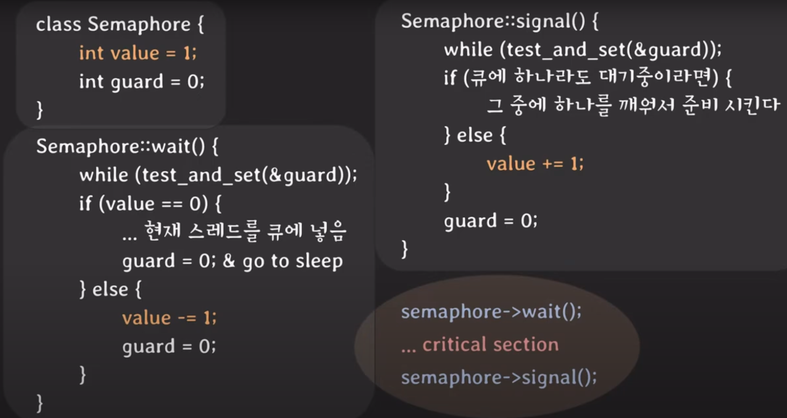

  - **value = 1: 이진 세마포어** 
  - **value ≥ 2: 카운팅 세마포어** 
  - **세마포어는 실행 순서에 대한 동기화가 가능하다.** 

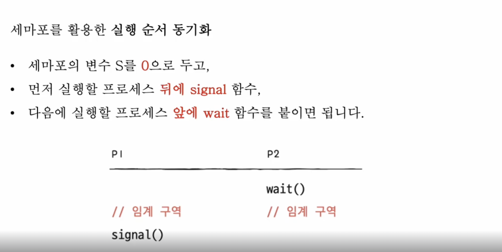

```c
목표: 실행 순서 동기화 P1이 항상 P2 보다 먼저 실행 

시나리오1 P1이 먼저 실행 
S = 0
P1: 임계 구역에 진입
P1: signal() S = 1
P2: wait() S = 1
P2는 바로 임계 구역에 진입 

시나리오2 P2가 먼저 실행 
S = 0
P2: wait() S = 0
P2: 대기 큐 삽입 또는 스핀락과 같이 CPU 양보를 하지 않고 무한 요청 
P1: 임계 구역에 진입 
P1: signal() S = 1
P2: wait() S = 1 
P2: 임계 구역에 진입 
```

### ✅ **뮤텍스 vs 세마포어**

| **특징** | **뮤텍스 (Mutex)** | **세마포어 (Semaphore)** |
| --- | --- | --- |
| **목적** | 상호 배제 (Mutual Exclusion) | 실행 순서 동기화 및 자원 제한 |
| **자원 접근 가능 개수** | 1개 | N개 |
| **CPU 효율성** | 대기 시 블로킹 (CPU 양보) | 대기 시 블로킹 가능 or 바쁜 대기 가능 |
| **락 획득 / 해제** | **같은 스레드만 해제 가능** | **다른 스레드가 해제 가능** |
| **사용 예시** | 임계 구역 보호 (ex. 파일 쓰기) | 제한된 자원 관리 (ex. DB 커넥션 풀, 쓰레드 풀) |

✅ **핵심 차이점**

  - **뮤텍스**는 "내가 락을 걸었으면 나만 해제 가능"
  - **세마포어**는 "A 스레드가 락을 걸고, B 스레드가 해제 가능"

✅ **뮤텍스 vs 이진 세마포어**

  - 뮤텍스는 락을 가진 자만 락을 해제 할 수 있지만 이진 세마포어는 그렇지 않다 
  - 뮤텍스는 priority inheritance 속성을 가진다 이진 세마포어는 그 속성이 없다. 

### ✅ 모니터 

매번 임계구역 앞뒤로 wait(), signal() 호출해야 하나? 

→ 개발자가 실수를 한다면?

→ 모니터 등장, 개발자가 다루기에 편한 동기화 도구 

상호 배제를 위한 동기화, 실행 순서를 위한 동기화 모두 제공한다. 

상호 배제를 위한 동기화 

  - 인터페이스를 위한 큐 
  - 공유자원에 접근하고자 하는 프로세스를 (인터페이스를 위한) 큐에 삽입
  - 큐에 삽입된 순서대로(FIFO) 한 번에 하나의 프로세스만 공유 자원 이용 

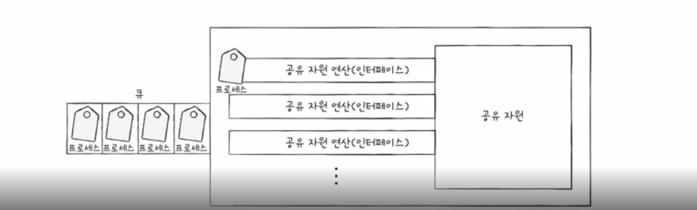

실행 순서 제어를 위한 동기화

  - 조건 변수를 이용
- 프로세스나 스레드의 실행 순서를 제어하기 위해 사용되는 특별한 변수
  - 조건변수.wait(): 대기 상태로 변경, 조건 변수에 대한 큐에 삽입
  - 조건변수.signal(): wait()으로 대기 상태로 접어든 조건변수를 실행 상태로 변경 
  - 특정 프로세스가 아직 실행될 조건이 되지 않았을 때에는 wait를 통해 실행을 중단 → 조건변수 큐에 삽입
  - 특정 조건변수를 가지는 프로세스가 실행이 끝나면 signal을 통해 조건변수 큐에 있던 프로세스를 깨워 실행을 재개한다. 

### 모니터에 대한 예제 코드 및 정리 

[https://github.com/jeus1998/CS/blob/main/src/EasyCodeCS/OperatingSystem/6-monitor.md](https://github.com/jeus1998/CS/blob/main/src/EasyCodeCS/OperatingSystem/6-monitor.md)

## **✅** 교착 상태(Deadlock)?

둘 이상의 프로세스나 스레드가 서로 자원을 점유한 채, 상대방이 가진 자원을 기다리면서 영훤히 진행되지 않는 상태를 말한다. 

쉽게 말해서, **A는 B의 자원을 기다리고, B는 A의 자원을 기다리는 상황이 발생**하면 서로 영원히 기다리기만 하게 되어 아무 일도 진행되지 않는 상태가 된다.

→ 식사하는 철학자 문제!

→ 자원 할당 그래프를 통해 교착 상태를 표현할 수 있다. 

→ 교착 상태 발생 조건: 상호 배제, 점유 대기, 비선점, 환형 대기 

## **✅** 교착 상태(Deadlock) 4가지 조건 

  - 상호 배제(Mutual Exclusion)
- 자원은 한 번에 하나의 프로세스만 사용할 수 있다.
  - 점유 대기(Hold and Wait)
- 자원을 점유한 프로세스가, 다른 자원을 기다리며 대기한다.
  - 비선점(No Preemption)
- 다른 프로세스가 점유한 자원을 강제로 빼앗을 수 없다.
  - 환형 대기(Circular Wait)
- 각 프로세스가 다음 프로세스의 자원을 기다리며 원형으로 대기하는 형태가 존재한다.

4가지 조건이 동시에 만족하면 교착상태가 발생한다. 

## ✅ 교착 상태 해결 방법

  1. **예방 (Prevention)**

교착상태가 발생하지 않도록 4가지 조건 중 하나 이상을 **사전에 제거**함.

  1. **회피 (Avoidance)**

교착상태가 발생할 수 있는 상태를 **알아서 피하도록** 자원 할당을 조정 (예: Banker 알고리즘)

  1. **발견 및 복구 (Detection & Recovery)**

교착상태가 발생한 후에 **탐지하고 강제로 해결** (예: 프로세스 종료, 자원 회수 등)

  1. **무시 (Ignore)**

그냥 발생하면 **재부팅하거나 수동 개입**, 일반적으로 성능이 중요한 시스템에서는 이 방법도 고려됨 (ex. Unix/Linux)

## ✅ 교착 상태 예방**(Prevention)**

정의: 교착상태가 발생하지 않도록 4가지 조건 중 하나를 사전에 제거함 

**예방1: 상호 배제 제거** 

  - 리소스를 공유 가능하게 함 
  - 현실적으로는 불가능: 리소스 상호 배제는 이유가 있어서 한다. 
- 프린터기는 동시에 2개의 작업을 못한다.

**예방2: 점유 및 대기 제거** 

  - 사용할 리소스들을 모두 획득한 뒤에 시작 
  - 리소스를 전혀 가지지 않은 상태에서만 리소스를 모두 요청 
  - 당장 자원이 필요한 프로세스 대기, 사용되지 않으면서 오랫동안 할당되는 자원을 다수 양산
  - 자원의 활용률이 낮아진다.

**예방3: 비선점 → 선점** 

  - 비선점 조건을 없애면 자원을 이용 중인 프로세스로부터 해당 자원을 빼앗을 수 있다.
  - CPU 같은 선점 가능한 자원에 대해서는 효과적이지만 선점이 불가능한 자원 ex) 프린터기 같은 경우 선점이 불가능하다. 
  - 모든 자원에 비선점 조건을 없애는 건 불가능하다. → 범용성이 떨어진다.

**예방4: 원형 대기 조건 삭제** 

  - 모든 자원에 번호를 붙이고, 오름차순으로 자원을 할당하면 원형 대기는 발생하지 않는다. 
  - 예를 들어, 식사하는 철학자 문제에서 모든 포크에 1~5까지 번호를 붙이고, 철학자들로 하여금 낮은 포크에서 높은 포크 순으로 집어들게 한다면 원형대기는 일어나지 않는다.  
  - 데드락 예방 방법 중에 가장 많이 사용하는 방법이지만 모든 자원에 번호를 붙이는 것은 상당히 어렵다.

## ✅ 교착 상태 회피**(Avoidance)**

정의: 교착상태가 발생할 수 있는 상태를 **알아서 피하도록** 자원 할당을 조정

### **회피에 대한 3가지 개념**

  - 안전 순서열 : 교착 상태 없이 안전하게 프로세스들에 자원을 할당할 수 있는 순서 
  - 안전 상태: 교착 상태 없이 모든 프로세스가 자원을 할당 받고 종료될 수 있는 상태 
  - 불안전 상태 : 교착 상태가 발생할 수도 있는 상태 

### **시나리오** 

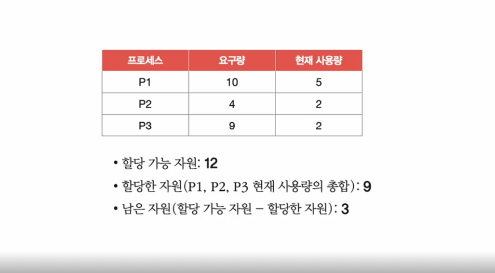

Q: 안전 순서열이 존재하는가? 

A: 안전 순서열이 존재: P2 → P1 → P3

**프로세스 P1, P2, P3이 모두 최대로 자원을 요구한 최악의 상황 가정** 

  - P1: 5개 P2: 2개 P3: 7개 자원을 추가로 요구 

```java
P2: 2개 추가로 할당 -> 2 + 2 = 4    남은 시스템 자원: 3 - 2 = 1
P2: 자원 반납(4개)                  남은 시스템 자원: 1 + 4 = 5
P1: 5개 추가로 할당 -> 5 + 5 = 10   남은 시스템 자원: 5 - 5 = 0
P1: 자원 반납(10개)                 남은 시스템 자원: 0 + 10 = 10
```

### **교착 상태 회피란?**

  - 안전 상태에서 안전 상태로 움직이는 경우에만 자원을 할당하는 방식 
  - 항시 안전 상태를 유지하도록 자원을 할당하는 방식 
  - ex) 은행원 알고리즘 

## ✅ 교착 상태 검출 후 회복 (Detection & Recovery)

  - 교착 상태의 발생을 인정하고 사후에 조치하는 방식 
  - 프로세스가 자원을 요구하면 일단 할당, 교착 상태가 검출되면 회복 
  - 선점을 통한 회복, 프로세스 강제 종료를 통한 회복 

**선점을 통한 회복** 

  - 교착 상태가 해결될 때까지 한 프로세스씩 자원을 몰아주는 방식 

**프로세스 강제 종료를 통한 회복** 

  - 교착 상태에 놓인 프로세스 모두 강제 종료 → 작업 내역을 잃을 위험
  - 교착 상태가 해결될 때까지 한 프로세스씩 강제 종료 → 오버헤드 

## ✅ 교착 상태 무시

## **✅**  연속 메모리 할당

**프로세스에 연속적인 메모리 공간을 할당** 

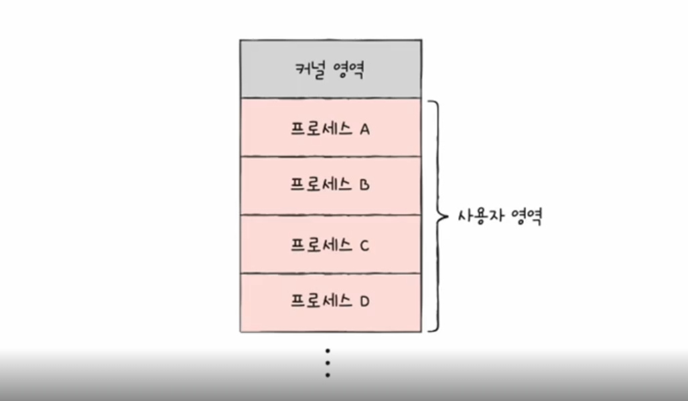

## **✅  스와핑**

현재 사용되지 않는 프로세스들을 보조기억장치의 **일부 영역으로 쫓아내고(스왑 아웃)** 그렇게 생긴 빈 공간에 **새 프로세스 적재(스왑 인)** 

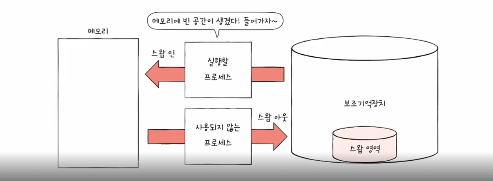

**스와핑 장점 → 프로세스들이 요구하는 메모리 공간 크기 > 실제 메모리 크기** 

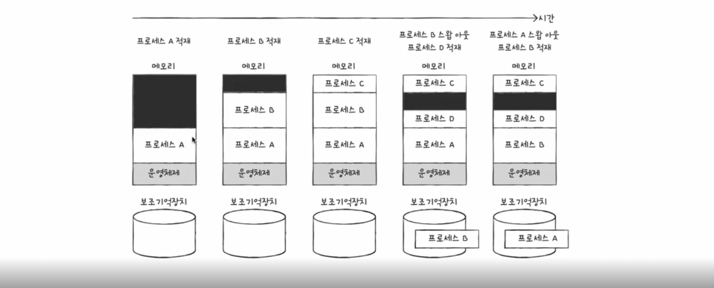

실제 물리 메모리 공간 크기 보다 많은 공간을 차지하는 프로세스들을 스왑(Swap)기법을 통해 스왑 인, 스왑 아웃을 반복하면서 동작시킬 수 있다. 

## **✅  연속 메모리 할당** 

    - 프로세스는 메모리의 빈 공간에 할당되어야 한다. 이때 빈 공간이 여러 개 있다면? 
    - 최초 적합, 최적 적합, 최악 적합 

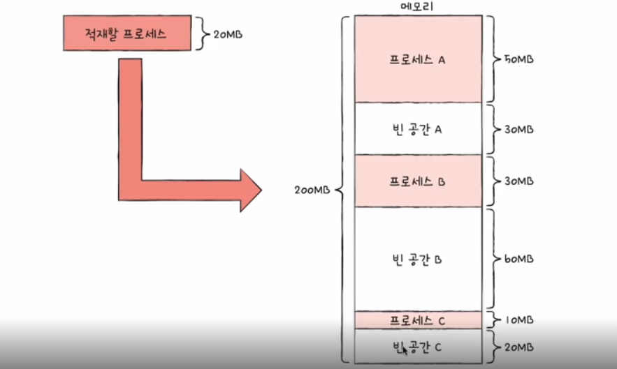

### 최초 적합(first-fit)

    - 운영체제가 메모리 내의 빈 공간을 순서대로 검색하다 적재할 수 있는 공간을 발견하면 그 공간에 프로세스를 배치하는 방식 
    - 특징: 검색 최소화, 빠른 할당 
    - 빈 공간 A 

### 최적 적합(best-fit)

    - 운영체제가 빈 공간을 모두 검색해본 뒤, 적재 가능한 가장 작은 공간에 할당 
    - 빈 공간 C

### 최악 적합(worst-fit)

    - 운영체제가 빈 공간을 모두 검색해본 뒤, 적재 가능한 가장 큰 공간에 할당 
    - 빈 공간 B

## **✅**  외부 단편화

    - 프로세스를 연속적으로 메모리에 할당하는 방식은 메모리를 효율적으로 사용하는 방법이 아니다.
    - **외부 단편화(external fragmentation)**이라는 문제가 발생하기 때문이다. 

### 외부 단편화 이해 

    - 사용자 영역이 200MB
    - A: 50MB B: 30MB C: 100MB D: 20MB

프로세스 A,B,C,D 순서대로 메모리를 연속적으로 할당 

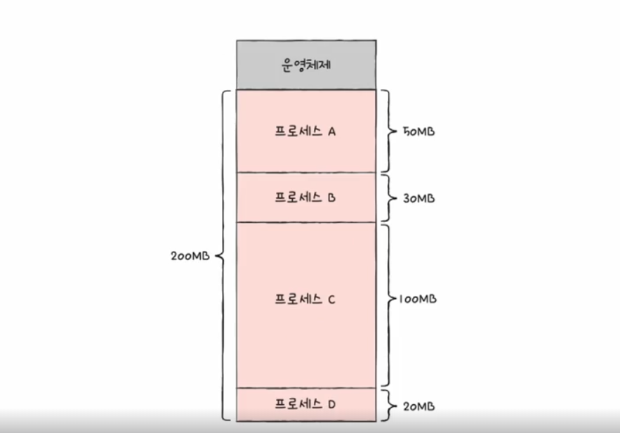

프로세스 B,D 실행 끝 

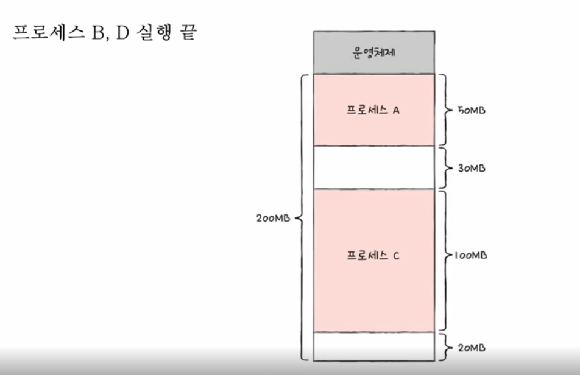

Q: 남은 공간의 총량? A: 50MB

Q: 50MB 프로세스를 메모리에 할당 가능? A: NO

### 외부 단편화?

    - **프로세스들이 실행되고 종료되길 반복하며 메모리 사이 사이에 빈 공간 발생** 
    - **프로세스를 할당하기 어려울 만큼 작은 메모리 공간들로 인해 메모리가 낭비되는 현상을 외부 단편화라고 한다.** 

### **외부 단편화 해결1 - 메모리 압축 (compaction)**

    - 여기저기 흩어져 있는 빈 공간들을 하나로 모으는 방식
    - 프로세스를 적당히 재배치시켜 흩어져 있는 작은 빈 공간들을 하나의 큰 빈 공간으로 만드는 방법 

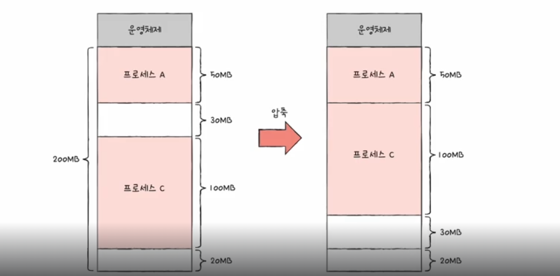

압축 방식은 작은 빈 공간들을 하나로 모으는 동안 시스템은 하던 일을 중지해야 하고, 메모리에 있는 내용을 옮기는 작업은 많은 오버헤드를 야기하며, 어떤 프로세스를 어떻게 움직여야 오버헤드를 최소화하며 압축할 수 있는지에 대한 명확한 방법을 결정하기 어렵다. 

그래서 현재는 외부 단편화를 없앨 수 있는 가상 메모리 기법, 그 중에서도 페이징 기법을 많이 사용한다. 

### **외부 단편화 해결2 - 가상 메모리 기법, 페이징**

## **✅** 연속 메모리 할당의 두 가지 문제점

    - 외부 단편화 
    - 물리 메모리보다 큰 프로세스 실행 불가 

## **✅ 가상 메모리 기법**

    - 실행하고자 하는 프로그램을 일부만 메모리에 적재하여 실제 물리 메모리 크기보다 더 큰 프로세스를 실행할 수 있게 하는 기술 
    - 페이징, 세그멘테이션 

## **✅ 페이징**

    - 외부 단편화가 발생했던 근본적인 문제는? 
    - 각기 다른 크기의 프로세가 메모리에 연속적으로 할당되었기 때문이다. 
    - 프로세스를 일정 크기로 자르고, 이를 메모리에 불연속적으로 할당할 수 있으면 어떨까?

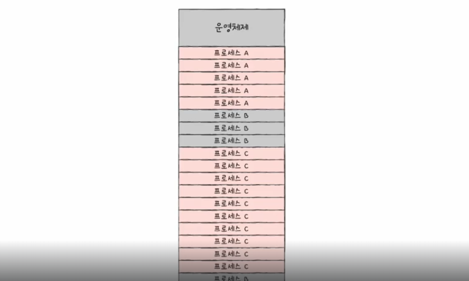

### 페이징(paging)

    - 프로세스의 논리 주소 공간을 **페이지(page)**라는 일정 단위로 자르고, 
    - 메모리의 물리 공간을 **프레임(frame)**이라는 페이지와 동일한 단위로 자른 뒤 
    - 페이지를 프레임에 할당하는 가상 메모리 관리 기법 

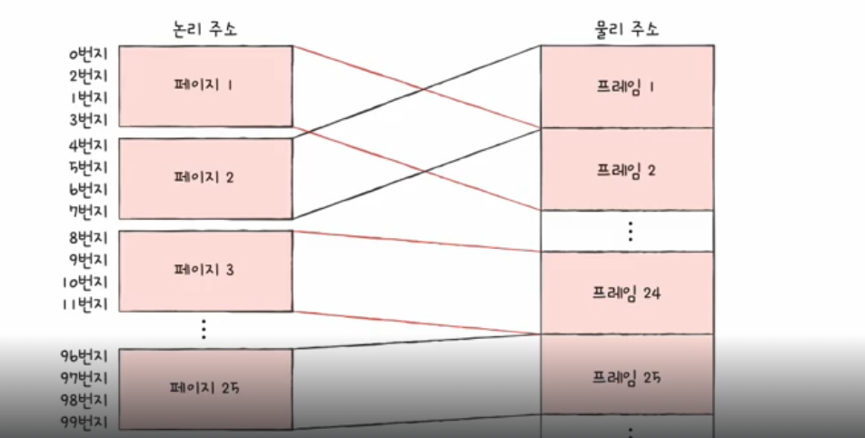

### 페이징에서의 스와핑 

    - 프로세스 단위의 스왑 인, 스왑 아웃이 아닌 페이지 단위의 **스왑 인(페이지 인), 스왑 아웃(페이지 아웃)**
    - 메모리에 적재될 필요가 없는 페이지들을 보조기억장치로 스왑 아웃(페이지 아웃)
    - 실행에 필요한 페이지들을 메모리로 스왑 인(페이지 인)

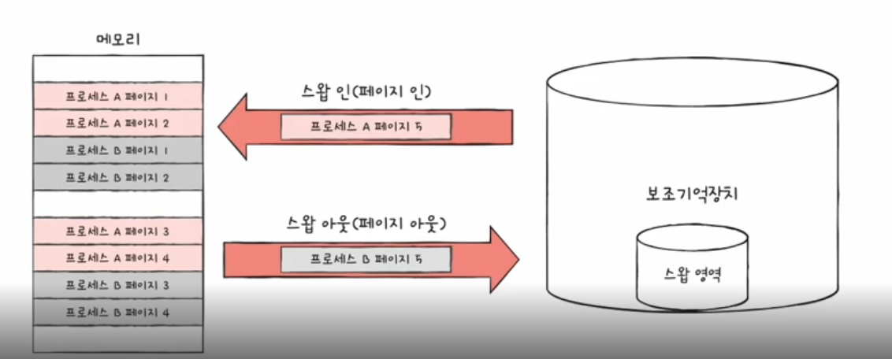

    - 프로세스를 실행하기 위해 모든 페이지가 적재될 필요 없다
    - 달리 말해 물리 메모리보다 큰 프로세스도 실행될 수 있다 

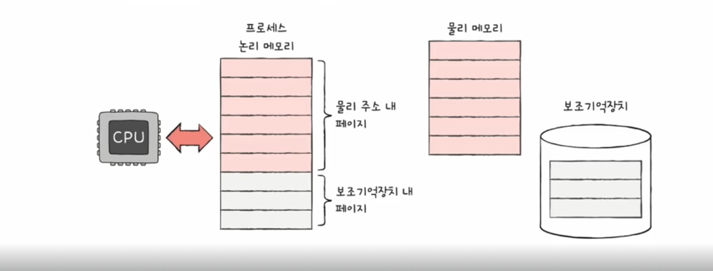

### CPU 입장에서 페이징 

    - 프로세스를 이루는 페이지가 어느 프레임에 적재되어 있는지 CPU가 일일이 알기란 어렵다 
    - 프로세스가 메모리에 불연속적으로 배치되어 있다면 CPU 입장에서 이를 순차적으로 실행할 수가 없다. 
    - CPU 입장에서는 다음에 실행할 명령어 위치를 찾기가 어려워졌다. 

## **✅**  페이지 테이블 

    - 물리 주소에 불연속적으로 배치되더라도
    - 논리 주소에는 연속적으로 배치되도록 하는 방법 
    - 페이지 번호와 프레임 번호를 짝지어 주는 일종의 이정표 

**프로세스마다 페이지 테이블이 존재** 

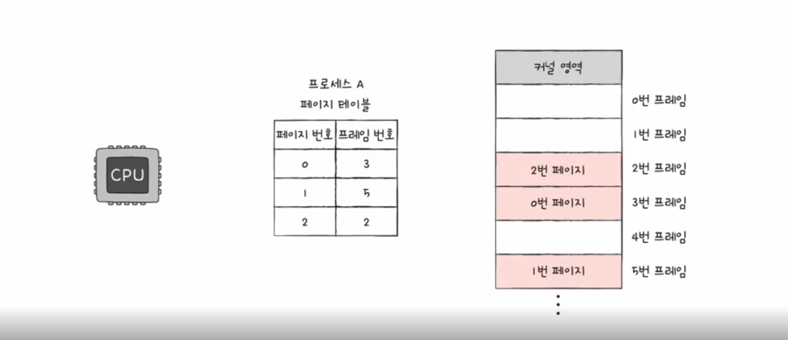

    - 물리적으로는 분산되어 저장되어 있더라도 CPU 입장에서 바라본 논리 주소는 연속적으로 보인다 
    - CPU는 그저 논리 주소를 순차적으로 실행하면 될 뿐

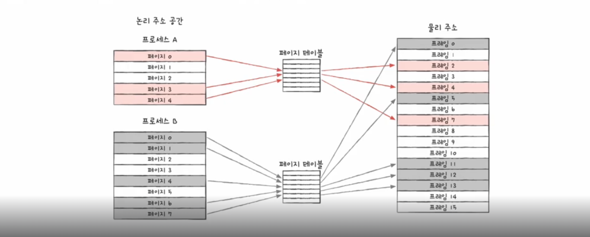

## **✅**  내부 단편화

    - 페이지 크기가 10KB, 프로세스 크기 108KB
    - 2KB: 내부 단편화 
    - 하나의 페이지 크기보다 작은 크기로 발생 

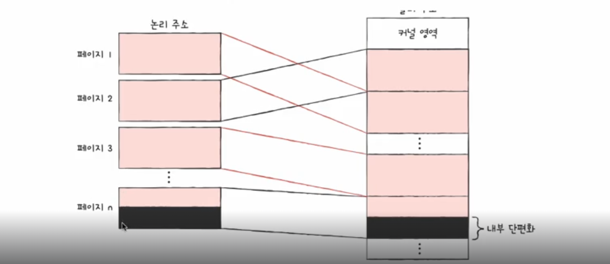

**하지만 내부 단편화의 크기는 외부 단편화와 비교했을 때 매우 작다.** 

## **✅** PTBR (Page Table Base Register)

    - 프로세스마다 페이지 테이블이 존재 
    - 각 페이지 테이블은 CPU 내의 **프로세스 테이블 베이스 레지스터(PTBR)**가 가리킨다.
    - 이런 각 프로세스들의 페이지 테이블 정보들은 각 프로세스의 PCB에 기록된다. 

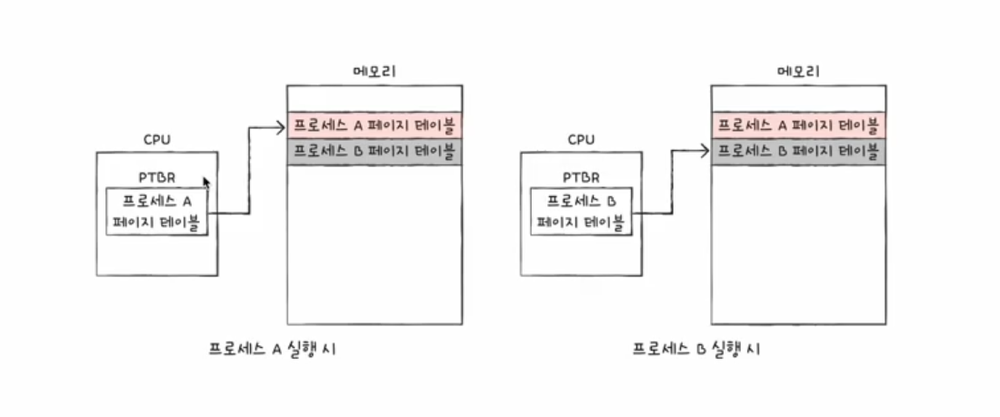

    - 페이지 테이블이 메모리에 있으면? **메모리 접근 시간 두 배로** 
    - 페이지 테이블 참조 1번, 페이지 탐조하기 위해 1번 

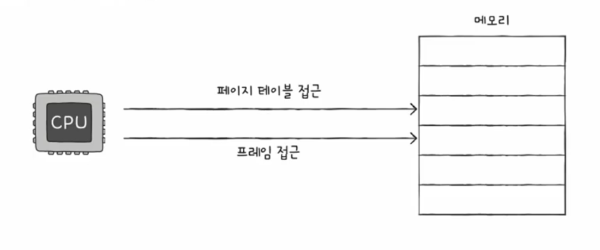

## **✅  TLB (Translation Lookaside Buffer)**

    - TLB: CPU 곁에 페이지 테이블의 캐시 메모리 
- 일반적으로 **MMU(Memory Management Unit)** 내에
    - 페이지 테이블의 일부를 가져와 저장 
- 참조 지역성에 근거해 최근에 사용된 페이지 위주로 가져와 저장

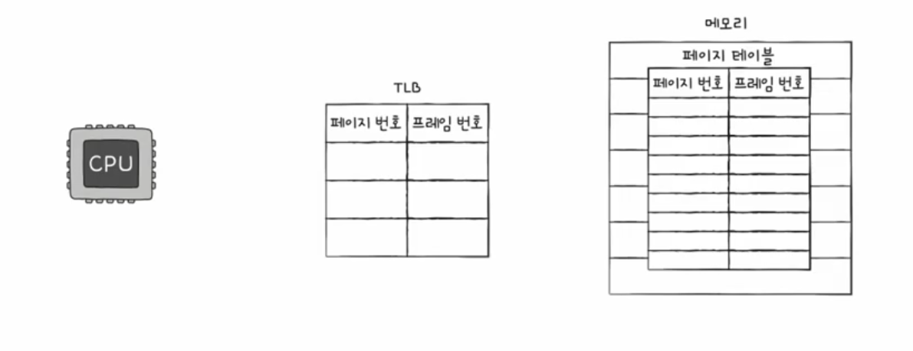

    - CPU가 접근하려는 논리 주소가 TLB에 있다면? TLB 히트 
- 메모리 접근 한 번
    - CPU가 접근하려는 논리 주소가 TLB에 없다면? TLB 미스 
- 메모리 접근 두 번

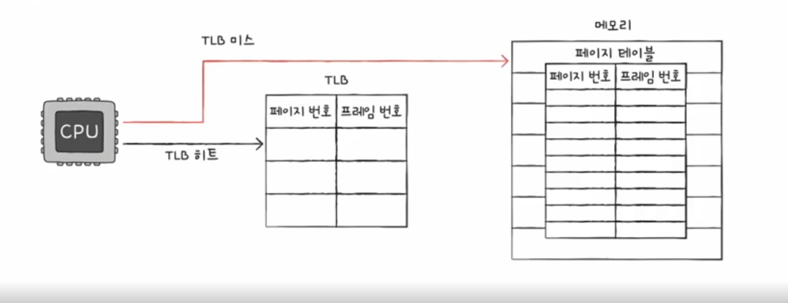

## **✅**  페이징에서의 주소 변환 

    - 특정 주소에 접근하고자 한다면 어떤 정보가 필요할까? 
- 어떤 페이지/프레임에 접근하고 싶은지
      - 접근하려는 주소가 그 페이지 혹은 프레임으로부터 얼마나 떨어져 있는지

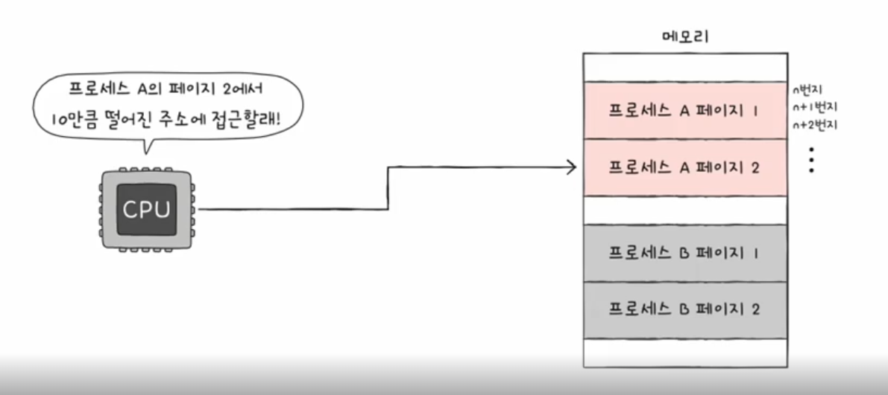

### 페이징 시스템에서의 논리 주소 

    - 페이지 번호(page number)와 변위(offset)


### 페이징에서의 주소 변환 

    - <페이지 번호, 변위>로 이루어진 논리 주소는 
    - 페이지 테이블틀 통해 
    - <프레임 번호, 변위>로 변환된다 
    - 페이징에서 주소 변환은 **MMU (Memory Management Unit)** 가 담당

### 주소 변환 흐름 

    1. **CPU**가 논리 주소(가상 주소)를 생성
ex) `페이지 번호 + 오프셋`
    1. **MMU**가 TLB를 먼저 조회
- Hit: 바로 물리 주소로 변환
      - Miss: 메모리에서 페이지 테이블을 조회
    1. **페이지 테이블**을 통해 해당 페이지 번호가 매핑된 **프레임 번호**를 찾음
    1. **프레임 번호 + 오프셋** → 최종 **물리 주소** 계산

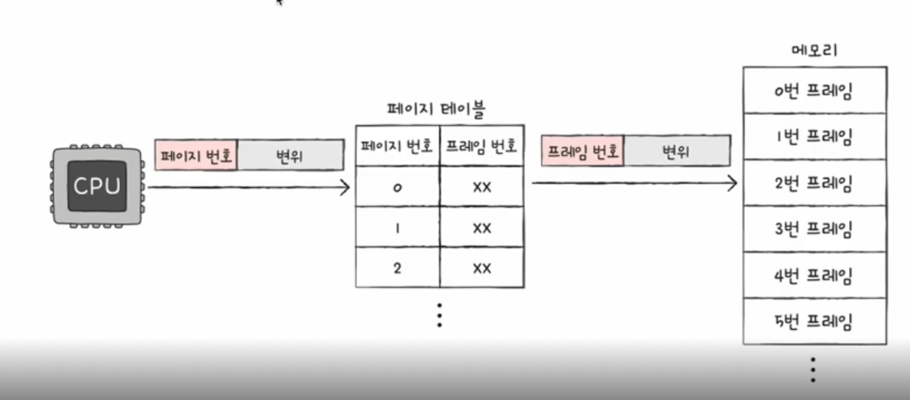

    - 논리주소<페이지 번호, 변위>가 <5, 2>인 곳에 접근?

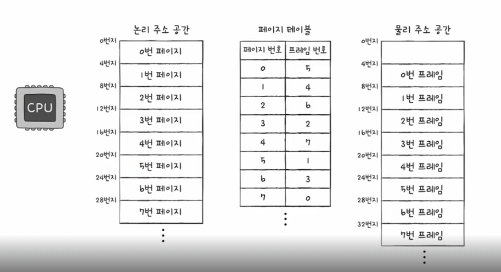

A: 페이지 번호: 5 → 프레임 번호: 1  1번 프레임 엔트리: 8번지 변위: 2 최종 접근 물리 주소: 8 + 2 = 10번지 

## **✅**  페이지 테이블 엔트리

    - 페이지 테이블의 각각의 행: 페이지 테이블 엔트리(PTE)
- 현재까지 설명한 PTE: 페이지 번호, 프레임 번호 
      - 이외에 담기는 정보?

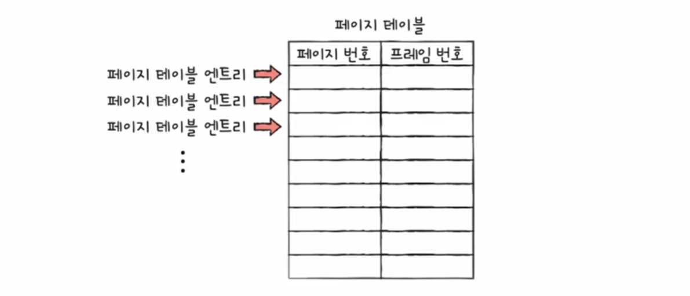

### 유효 비트 

    - 현재 해당 페이지에 접근 가능한지 여부 (valid, invalid) 

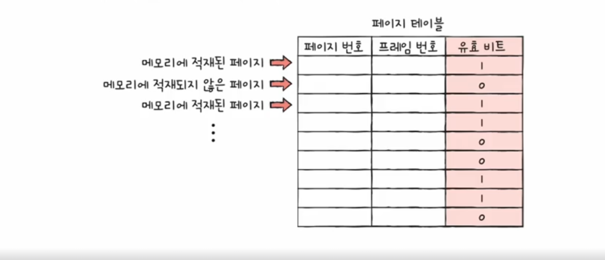

### 유효 비트가 0인 페이지에 접근하려고 하면?

    - **페이지 폴트(page fault)라는 인터럽트 발생** 
1. CPU는 기존의 작업 내역을 백업 
      1. 페이지 폴트 처리 루틴(인터럽트 서비스 루틴) 실행 
      1. 페이지 처리 루틴은 페이지를 메모리로 가져온 뒤(페이지 인/스왑 인) 유효 비트를 1로 변경 
      1. 페이지 폴트로 처리했다면 이제 CPU는 해당 페이지에 접근할 수 있게 된다.

### 보호 비트 

    - 페이지 보호 기능을 위해 존재하는 비트 
    - 페이지에 접근할 권한을 제한하여 페이지를 보호하는 비트 

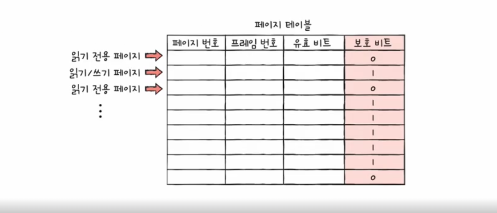

### 참조 비트

    - CPU가 이 페이지에 접근한 적이 있는지 여부 

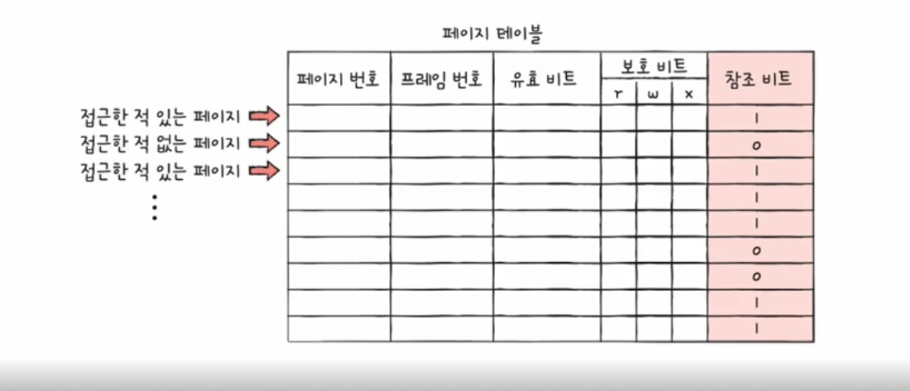

### 수정 비트 (더티 비트 = dirty bit)

    - CPU가 이 페이지에 데이터를 쓴 적이 있는지 여부 

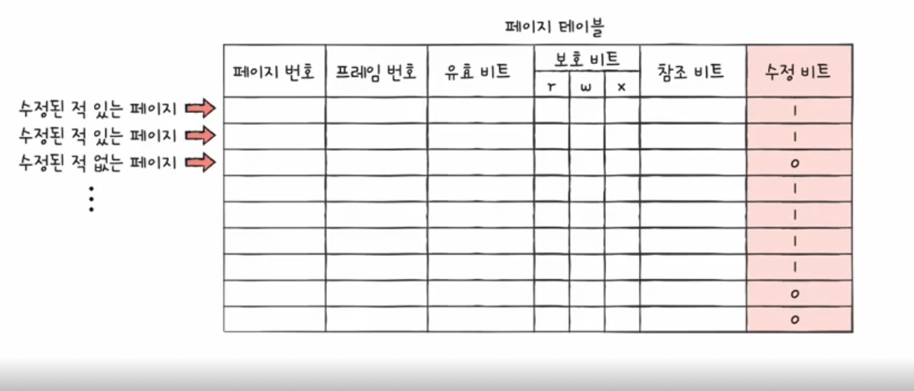

    - 수정 비트의 존재 이유? 
    - 수정된 페이지는 스왑 아웃될 때 보조기억장치에도 쓰기 작업을 거쳐야 한다. 
    - 수정되지 않은 페이지는 스왑 아웃될 때 작업 X (디스크에 있는 내용이 이미 최신본)

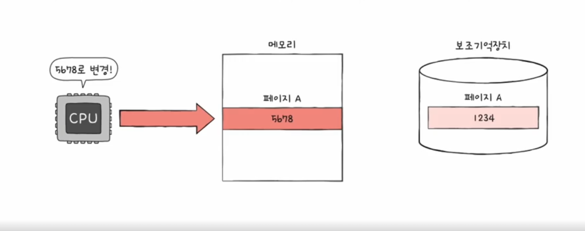

## **✅** 이론적인 fork()

프로세스는 기본적으로 자원을 공유하지 않는다. 

→ 부모 프로세스가 적재된 별도의 공간에 자식 프로세스가 통째로 복제되어 적재 

→ (프로세스 생성 시간 지연, 메모리 낭비) 

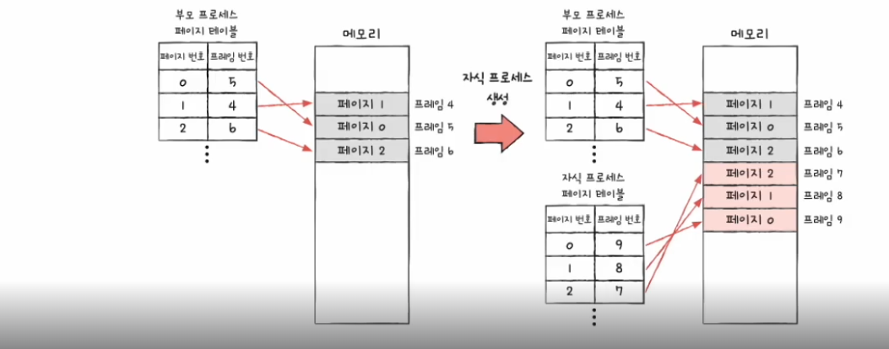

## **✅ 쓰기 시 복사** 

부모 프로세스와 동일한 자식 프로세스가 복제되어 생성되면 자식 프로세스는 부모 프로세스와 동일한 프레임을 가리킴(쓰기 작업이 없다면 이 상태 유지) 

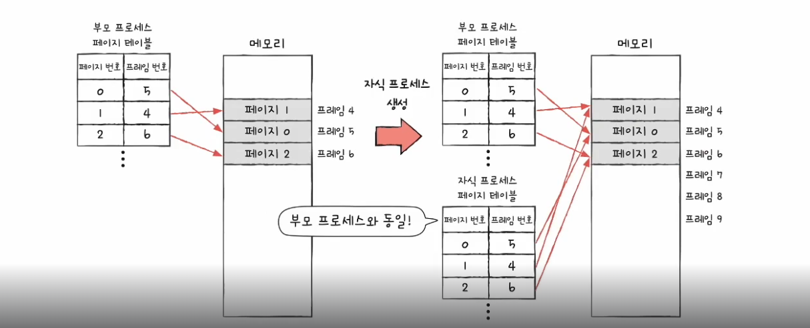

부모 프로세스/자식 프로세스 둘 중 하나가 페이지에 쓰기 작업 수행 시 해당 페이지는 별도의 공간으로 복제 

(프로세스 생성 시간 절약, 메모리 절약) 


## **✅**  계층적 페이징 

    - 프로세스 테이블의 크기는 생각보다 작지 않다 
    - 프로세스를 이루는 모든 페이지 테이블 엔트리(행)를 메모리(커널 영역)에 두는 것은 큰 낭비 
    - 프로세스를 이루는 모든 페이지 테이블 엔트리를 항상 메모리에 유지하지 않을 방법 

### 페이지 테이블을 페이징하여 여러 단계의 페이지를 두는 방식 


페이지 테이블을 여러 페이지로 쪼개고 이 페이지를 가리키는 페이지 테이블(Outer 페이지 테이블)을 두는 방식 

**모든 페이지 테이블을 항상 메모리에 필요가 없어짐**

    - CPU와 가장 가까이 위치한 페이지 테이블(Outer 페이지 테이블)은 항상 메모리에 유지 

### 계층적 페이징을 이용하는 환경에서의 논리 주소 


현재 그림은 계층적 페이징은 2단계지만 더 많은 계층이 존재할 수 있다.

하지만 너무 많은 단계가 존재하면 페이지 폴트가 발생했을 때 보조기억장치의 접근 횟수가 많아져 성능에 좋지 않다.

## **✅**  들어가며

    - 물리 메모리보다 큰 프로세스들을 실행할 수 있지만, 그럼에도 물리 메모리의 크기는 한정되어 있다 
    - 기존에 적재된 불필요한 페이지를 선별해 보조기억장치로 내보내고 프로세스들에게 적절한 수의 프레임을 할당해야 한다. 


## **✅  요구 페이징** 

    - 처음부터 모든 페이지를 적재하지 않고 필요한 페이지만을 메모리에 적재하는 기법
    - **요구되는 페이지만 적재**하는 기법 
    1. CPU가 특정 페이지에 접근하는 명령어를 실행한다. 
    1. 해당 페이지가 현재 메모리에 있을 경우(유효 비트가 1일 경우) CPU는 페이지가 적재된 프레임에 접근한다. 
    1. 해당 페이지가 현재 메모리에 없을 경우(유효 비트가 0일 경우) 페이지 폴트 발생 
    1. 페이지 폴트 처리 루틴은 해당 페이지를 메모리에 적재하고 유효 비트를 1로 설정한다. 
    1. 다시 1번을 수행한다. (폴트의 특징) 

### 이러한 요구 페이징 시스템이 안정적으로 작동하려면 해결해야 할 문제? 

    - 페이지 교체 
    - 프레임 할당 

## **✅  페이지 교체 알고리즘** 

    - 요구 페이징 기법으로 페이지들을 적재하다보면 언젠가 메모리가 가득 차게 된다. 
    - 당장 실행에 필요한 페이지를 적재하려면 적재된 페이지를 보조기억장치로 내보내야함 
    - 이때, 어떤 페이지를 내보낼까? 
    - 이를 결정하는 알고리즘이 페이지 교체 알고리즘 

### 무엇이 좋은 페이지 교체 알고리즘일까?

    - 페이지 폴트가 적은 알고리즘
- 페이지 폴트가 발생하면 보조기억장치에 접근해야 해서 성능 저하

### 페이지 폴트 횟수는 어떻게 알 수 있을까?

    - 페이지 참조열(page reference string)
- CPU가 참조하는 페이지들 중 연속된 페이지를 생략한 페이지열

```java
#CPU가 참조하는 페이지들 
2 2 2 3 5 5 5 3 3 7

#연속된 페이지 생략 
2 3 5 3 7
```

## **✅  FIFO 페이지 교체 알고리즘** 

    - 가장 단순한 방식 
    - 메모리에 가장 먼저 올라온 페이지부터 내쫓는 방식 → 오래 머물렀다면 나가라~


    - 프로그램 실행 내내 사용될 페이지 ← 먼저 적재되었다고 내쫓아선 안된다 

### FIFO 페이지 교체 알고리즘 - 보완책 

    - **2차 기회(second-chance) 페이지 교체 알고리즘** 
    - 참조 비트 1: CPU가 한 번 참조한 적이 있는 페이지 
- 한 번 더 기회를 주기(참조 비트 0으로 초기화 후 적재 시간을 현재 시간으로 설정)
    - 참조 비트 0: CPU가 참조한 적이 없는 페이지 
- Bye
    - FIFO 페이지 교체 알고리즘과 마찬가지로 오래된 순서대로 내쫓는 방식이지만 참조 비트에 따라서 다르게 동작한다. 

## **✅  최적 페이지 교체 알고리즘** 

    - CPU에 의해 참조되는 횟수를 고려 
    - 메모리에 오래 남아야 할 페이지는 **자주 사용될 페이지** 
    - 메모리에 없어도 될 페이지는 **오랫동안 사용되지 않을 페이지** 
    - 앞으로의 사용 빈도가 가장 낮은 페이지를 교체하는 알고리즘 


### 최적 페이지 교체 알고리즘 특징 

    - **가장 낮은 페이지 폴트율을 보장**하는 페이지 교체 알고리즘 
    - **하지만 실제 구현이 어렵다** 
    - 앞으로 오랫동안 사용되지 않을 페이지? 어떻게 예측?
    - 다른 페이지 교체 알고리즘 성능을 평가하기 위한 하한선으로 간주 

## **✅  LRU(Least-Recently-Used) 페이지 교체 알고리즘** 

    - 최적 페이지 교체 알고리즘: 가장 오래 사용되지 **않을** 페이지 교체 
    - LRU 페이지 교체 알고리즘: 가장 오래 사용되지 **않은** 페이지 교체 
- 최근에 사용되지 않은 페이지는 앞으로도 사용되지 않지 않을까?


## **✅  기타 페이지 교체 알고리즘** 

    - 이외에도 많은 페이지 교체 알고리즘들이 있다. 

## **✅  스래싱 문제** 

### 페이지 폴트가 자주 발생하는 이유 

    - 비효율적인 페이지 알고리즘을 사용해서
    - **프로세스가 사용할 수 있는 프레임 자체가 적어서** 


### 스래싱?

    - 프로세스가 실행되는 시간보다 페이지 교체에 더 많은 시간을 소요하여 성능(CPU 이용률)이 저해되는 문제 


    - 멀티프로그래밍의 정도: 메모리에 동시에 실행되는 프로세스의 수 

**스래싱 원인**

    - 각 프로세스가 필요로 하는 최소한의 프레임 수가 보장되지 않았기 때문 
    - 각 프로세스가 필요로 하는 최소한의 프레임 수를 파악하고 프로세스들에게 적절한 프레임을 할당해주어야 한다 
    - 즉 프로세스를 많이 생성 → CPU 이용률 상승 X(각 프로세스 프레임 수 보장 X)

## **✅  프로세스** 프레임 할당 

### 균등 할당(equal allocation)

    - 가장 단순한 할당 방식 
    - 모든 프로세스들에게 균등하게 프레임을 할당하는 방식 
    - 정적 할당 방식 

### 비례 할당(proportional allocation)

    - 프로세스 크기를 고려 
    - 프로세스 크기에 비례하여 프레임 할당 
    - 정적 할당 방식 
    - 문제점
- 크기가 큰 프로세스인데 막상 실행해보니 많은 프레임을 필요로 하지 않으면? 
      - 크기가 작은 프로세스인데 막상 실행해보니 많은 프레임이 필요로 하면? 
      - 결국 프로세스가 필요로 하는 프레임 수는 **실행해봐야 안다**

### 작업 집합 모델 

    - 프로세스가 실행하는 과정에서 배분할 프레임 결정 (동적 할당 방식)
    - 스래싱이 발생하는 이유는 빈번한 페이지 교체 때문 
    - **CPU가 특정 시간 동안 주로 참조한 페이지 개수만큼만 프레임을 할당하면 된다**  
    - 프로세스가 일정 기간 동안 참조한 페이지 집합을 기억하며 빈번한 페이지 교체를 방지 
- 작업 집합이란 실행 중인 프로세스가 일정 시간 동안 참조한 페이지의 집합

**작업 집합을 구하려면?**

    - 프로세스가 참조한 페이지 
    - 시간 간격 


### 페이지 폴트 빈도 

    - 프로세스가 실행하는 과정에서 배분할 프레임 결정 
    - 두 개의 가정에서 생겨난 아이디어 
- 페이지 폴트율이 너무 높으면 그 프로세스는 너무 적은 프레임을 갖고 있다. 
      - 페이지 폴트율이 너무 낮으면 그 프로세스는 너무 많은 프레임을 갖고 있다.


    - 페이지 폴트율에 상한선과 하한선을 정하고, 그 내부 범위 안에서만 프레임을 할당하는 방식

### 🔁 스레드 vs 프로세스 컨텍스트 스위칭: 가상 메모리 관점

### ✅ 스레드 컨텍스트 스위칭의 특징

    - **페이지 테이블 주소 변경 없음**
- 스레드는 같은 프로세스 내에서 실행되므로 **같은 가상 주소 공간을 공유**합니다.
      - 따라서 **CR3 레지스터 (페이지 테이블 베이스 레지스터)** 값이 변하지 않음 → 페이지 테이블 변경 없음.
    - **TLB 유지**
- 페이지 테이블이 그대로이므로 TLB 캐시(TLB: Translation Lookaside Buffer)가 대부분 유효함.
      - → **TLB hit 가능성 높음** → 스위칭 이후 메모리 접근 효율적.
    - **메모리 접근 패널티 낮음**
- 동일한 메모리 맥락이 유지되므로 **페이지 폴트 등의 가능성 낮음**.

### ❌ 프로세스 컨텍스트 스위칭의 특징

    - **페이지 테이블 전환**
- 프로세스 간 컨텍스트 스위칭은 **가상 주소 공간이 완전히 바뀌는 것**을 의미.
      - 이때 **CR3 레지스터의 값도 변경** → **페이지 테이블 전체 변경**.
    - **TLB flush 가능성**
- 페이지 테이블이 바뀌었기 때문에 기존 TLB는 **오염된 상태가 됨**.
      - 대부분 OS는 이를 감지해 **TLB를 flush** 함 → **다시 TLB miss 발생 가능성 높음**.
    - **페이지 폴트 가능성 증가**
- 계층적 페이지 테이블을 사용하므로 새 프로세스의 페이지가 아직 메모리에 없을 수 있음.
      - 이 경우 **디스크 I/O가 발생하는 페이지 폴트**가 발생 가능.

- 연속 메모리 할당 / 페이징을 통한 가상 메모리 관리 / 계층적 페이징 / 페이지 교체와 프레임 할당 

## **✅**  들어가며

**파일 시스템(file system)**

    - 파일과 디렉터리를 관리하는 운영체제 내의 프로그램 

**파일과 디렉터리** 

    - 보조기억장치의 데이터 덩어리, 파일과 디렉터리 

## **✅  파일** 

    - 보조기억장치에 저장된 관련 정보의 집합 
    - 의미 있고 관련 있는 정보를 모은 논리적 단위 
    - 파일을 이루는 정보 
- 파일을 실행하기 위한 정보 
      - 부가 정보(속성, 메타 데이터)

### **파일의 속성 종류** 


### **유형 = 확장자** 

운영체제가 인식하기 위한 파일의 종류 


### 파일 연산을 위한 시스템 호출 

    1. 파일 생성
    1. 파일 삭제
    1. 파일 열기 
    1. 파일 닫기
    1. 파일 읽기
    1. 파일 쓰기 

## **✅** 디렉터리 

    - 윈도우에서는 폴더(folder)
    - 여러 계층으로 파일 및 폴더를 관리하는 트리 구조 디렉터리 
    - 최상위 디렉터리(루트 디렉터리, / ), 서브 디렉터리 


### 경로 

    - 디렉터리를 이용해 파일/디렉터리의 위치, 나아가 이름까지 특정 지을 수 있는 정보 
    - **절대 경로: 루트 디렉터리부터 시작하는 경로** 
- /home/minchul/a.sh
    - **상대 경로: 현재 디렉터리부터 시작하는 경로** 
- 현재 디렉터리 경로: /home
      - guest/d.jpg

### 디렉터리 연산을 위한 시스템 호출 

    1. 디렉터리 생성 
    1. 디렉터리 삭제 
    1. 디렉터리 열기 
    1. 디렉터리 닫기 
    1. 디렉터리 읽기 

### 디렉터리 엔트리 

```
사실 많은 운영체제에서는 디렉터리를 그저 특별한 형태의 파일로 간주한다 
즉, 디렉터리는 그저 포함된 정보가 조금 특별한 파일 
```

    - 파일의 내부에는 파일과 관련된 정보들이 있다면, 디렉터리 내부에는 해당 디렉터리에 담겨 있는 대상과 관련된 정보들이 담겨 있다.
- 이 정보는 보통 테이블(표) 형태로 구성

각 엔트리(행)에 담기는 정보 

    - 디렉터리에 포함된 대상의 이름 
    - 그 대상이 보조기억장치 내에 저장된 위치를 유추할 수 있는 정보 


## **✅**  들어가며

    - 파일 시스템이 파일과 디렉터리를 보조기억장치에 할당하고 접근하는 방법
    - 대표적인 파일 시스템의 종류(FAT 파일 시스템, 유닉스 파일 시스템) 학습

## **✅**  파티셔닝과 포매팅 

    - 이제 막 공장에서 생산되어 한 번도 사용된 적 없는 새 하드 디스크 / SSD? 
    - 파티셔닝, 포매팅 하기 전까지는 사용할 수 없다. 

### 파티셔닝 

    - 저장 장치의 논리적인 영역을 구획하는 작업 


### 포매팅 

    - 파일 시스템을 설정 
    - 어떤 방식으로 파일을 관리할지 결정, 새로운 데이터를 쓸 준비하는 작업 

**USB 포매팅 예시** 


    - 파일 시스템에는 여러 종류가 존재 
    - 파티션마다 다른 파일 시스템을 설정할 수 있다 

### 🔄 정리

| 용어 | 설명 |
| --- | --- |
| **파티션** | 디스크를 논리적으로 나누는 작업 (예: C:, D: 드라이브 나누기) |
| **포맷(포매팅)** | 파티션에 파일 시스템을 설치해서 사용할 수 있게 만드는 작업 |

## **✅** 파일 할당 방법 

    - 포매팅까지 끝난 하드 디스크에 파일을 저장하기 
    - 운영체제는 파일/디렉터리를 블록 단위로 읽고 쓴다 
- 즉, 하나의 파일이 보조기억장치에 저장될 때에는 여러 블록에 걸쳐 저장된다
    - 파일을 보조기억장치에 할당하는 두 가지 방법: 연속 할당, 불연속 할당 


### 연속 할당 

    - 이름 그대로 보조기억장치 내 연속적인 블록에 파일 할당 


**연속 할당 특징** 

    - 연속된 파일에 접근하기 위해 파일의 첫 번째 블록 주소와 블록 단위의 길이만 알면 된다 
    - 디렉터리 엔트리: 파일 이름 & 첫 번째 블록 주소 & 블록 단위 길이 명시 


**연속 할당 단점** 

    - 구현이 간단하지만 외부 단편화를 야기할 수 있다. 


    - 파일 D, F 삭제 → 잔여 블록은 11개지만, 블록 7개 이상 사용하는 파일은 할당 X

### 불연속 할당 - 연결 할당 

    - 각 블록의 일부에 다음 블록의 주소를 저장하여 각 블록이 다음 블록을 가리키는 형태로 할당 
    - 파일을 이루는 데이터 블록을 연결 리스트로 관리 
    - 불연속 할당의 일종: 파일이 여러 블록에 흩어져 저장되어도 무방 


**디렉터리 엔트리: 파일 이름 & 첫번째 블록 주소 & 블록 단위의 길이** 


    - 디렉터리 엔트리: 마지막 블록 주소를 기록할 수도 있다. 
    - 파일 a: 10(시작) → 5 → 13 → 2(끝)

**불연속 할당 - 연결 할당 특징** 

    - 연속 할당의 단점: 외부 단편화 문제 해결 
    - **반드시 첫 번째 블록부터 하나씩 읽어들여야 한다** 
- → 파일을 중간부터 읽지 못한다.
    - 오류 발생시 해당 블록 이후 블록은 접근이 어렵다 

### 불연속 할당 - 색인 할당 

    - 파일의 모든 블록 주소를 색인 블록이라는 하나의 블록에 모아 관리하는 방식 
    - 파일 내 임의의 위치에 접근하기 용이 


**디렉터리 엔트리: 파일 이름 & 색인 블록 주소** 


## **✅**  파일 시스템 살펴보기 

### FAT 파일 시스템 

    - 불연속 - 연결 할당 기반 파일 시스템 
    - 연결 할당의 단점을 보완 
    - USB, SD 카드 
    - 각 블록에 포함된 다음 블록 주소를 한데 모아 **테이블(FAT, File Allocation Table)**로 관리 


**FAT 파일 시스템의 파티션 도식도** 


**FAT 파일 시스템 디렉터리 엔트리** 


**루트 디렉터리 → home 디렉터리 → minchul 데릭터리 → FAT(9 → 8 → 11 → 13)** 

### 유닉스 파일 시스템 

    - 색인 할당 기반 파일 시스템 
    - 색인 블록 == **i-node**
- 파일의 속성 정보와 15개의 블록 주소 저장 가능


**유닉스 파일 시스템 파티션 모식도** 


**15개 블록 이상을 차지하는 파일은 어떻게 처리?** 

    1. 블록 주소 중 12개에는 직접 블록 주소 저장 
1. 직접 블록: 파일 데이터가 저장된 블록


    1. 1번으로 충분하지 않다면 13번째 주소에 단일 간접 블록 주소 저장 
1. 단일 간접 블록: 파일 데이터를 저장한 블록 주소가 저장된 블록


    1. 2번으로 충분하지 않다면 14번째 주소에 이중 간접 블록 주소 저장 
1. 이중 간접 블록: 단일 간접 블록들의 주소를 저장하는 블록


    1. 3번으로 충전하지 않다면 15번째 주소에 삼중 간접 블록 주소 저장 
1. 삼중 간접 블록: 이중 간접 블록들의 주소를 저장하는 블록


**유닉스 파일 시스템 디렉터리 엔트리** 

    - i-node가 파일 시스템의 핵심 


**I/O Multiplexing**은 하나의 스레드(또는 프로세스)가 **여러 개의 I/O 자원(파일 디스크립터 등)을 동시에 감시하고 처리하는 기술**

-> "여러 I/O 이벤트를 한꺼번에 기다렸다가, 준비된 것만 처리하는 방식"

---

## ✅ 왜 필요한가?

일반적인 I/O는 **블로킹 방식.** 예를 들어 `read()`를 호출했는데 읽을 데이터가 없으면 해당 스레드는 멈춰버린다. 하지만 서버는 수많은 클라이언트를 상대해야 하기 때문에

  - **클라이언트 수만큼 스레드를 만들면 오버헤드가 큼**
  - **하나의 스레드로 여러 클라이언트를 처리**하면 더 효율적

➡️ 그래서 **I/O Multiplexing**이 등장

---

## ✅ 주요 시스템 호출 방식들

| 방식 | 설명 | 등장 순서 |
| --- | --- | --- |
| `select()` | FD 집합을 감시 (비트마스크) | 전통적 |
| `poll()` | 구조체 배열 감시 (FD 수 무제한) | 개선형 |
| `epoll()` | 커널에 감시 목록 등록, 이벤트 기반 통지 방식 | 고성능 |
| `kqueue()` | BSD/FreeBSD/macOS의 고성능 이벤트 감시 시스템 | 고성능 |

---

## ✅ 작동 원리 요약

  1. 서버는 `select()`, `poll()`, 또는 `epoll_wait()` 등을 호출하여 여러 FD를 감시
  1. 커널은 I/O가 가능한 디스크립터가 생기면 알려줌
  1. 서버는 준비된 디스크립터만 읽거나 씀 (비효율 최소화)

---

## ✅ 예시

웹서버가 클라이언트 소켓 100개를 감시한다고 해보면:

  - **블로킹 방식**: 100개의 스레드 필요 (비효율적)
  - **I/O Multiplexing 방식**: 단 **1개의 스레드**가 `select()`로 100개 감시 → 준비된 소켓만 처리

---

## ✅ 장점

  - **효율적 자원 사용** (적은 스레드로 많은 작업 가능)
  - **높은 동시성** 처리 가능
  - **이벤트 기반 구조**와 잘 어울림 (ex. `epoll` + `reactor` 패턴)

---

## 📌 비유로 이해하기

> "식당에서 100명의 손님을 기다리는 방식"

- 블로킹 방식: 웨이터 100명이 각 테이블에 붙어 기다림
    - I/O Multiplexing: **1명의 웨이터가 100명을 두리번거리며 감시하다**, 호출한 테이블만 응대

---

