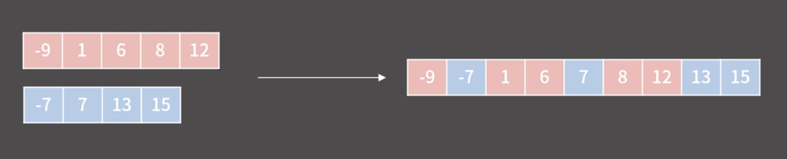
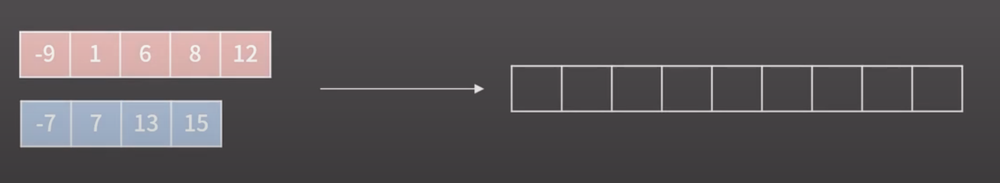
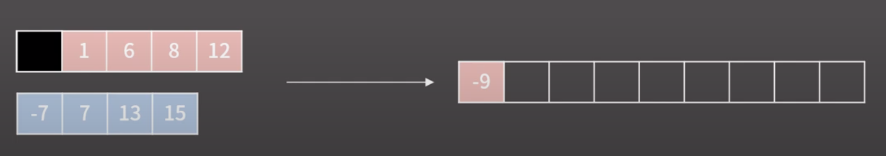
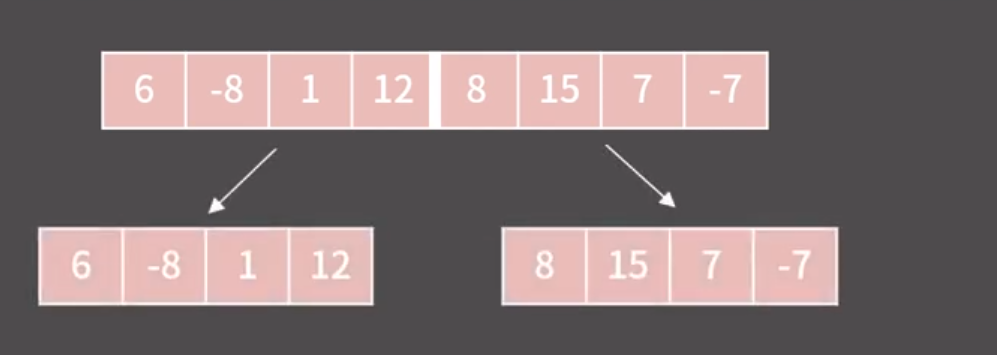
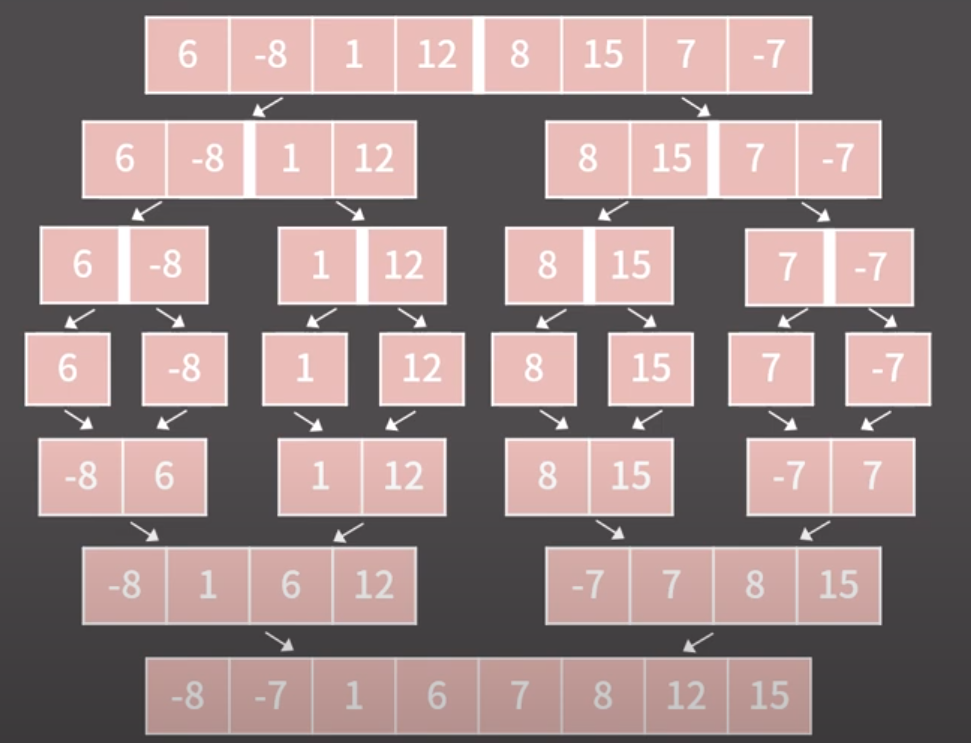
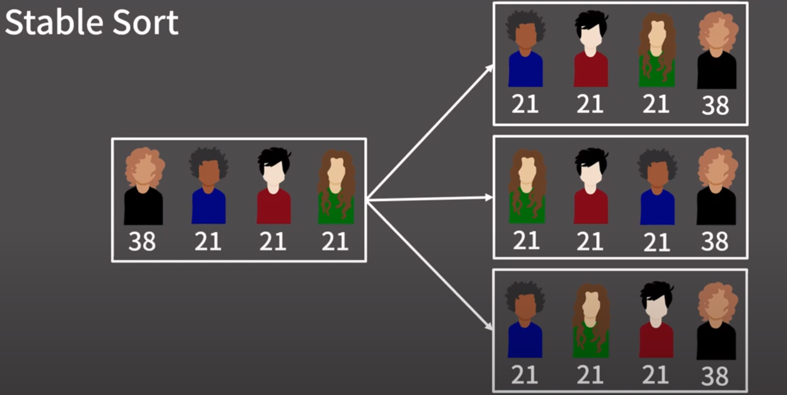
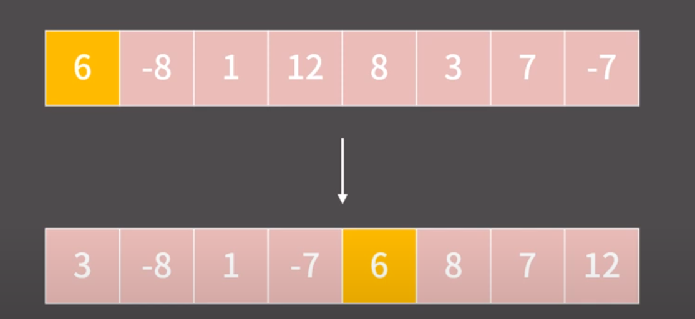
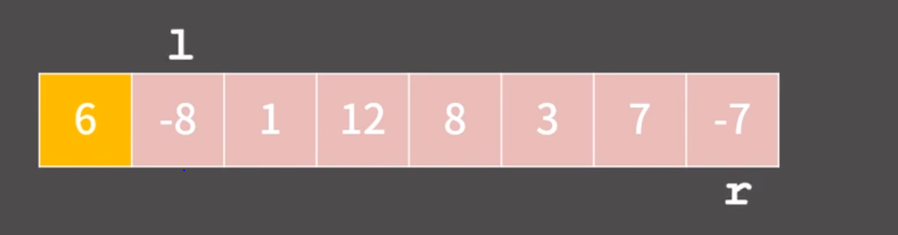
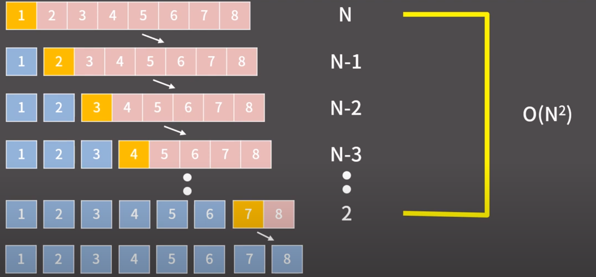
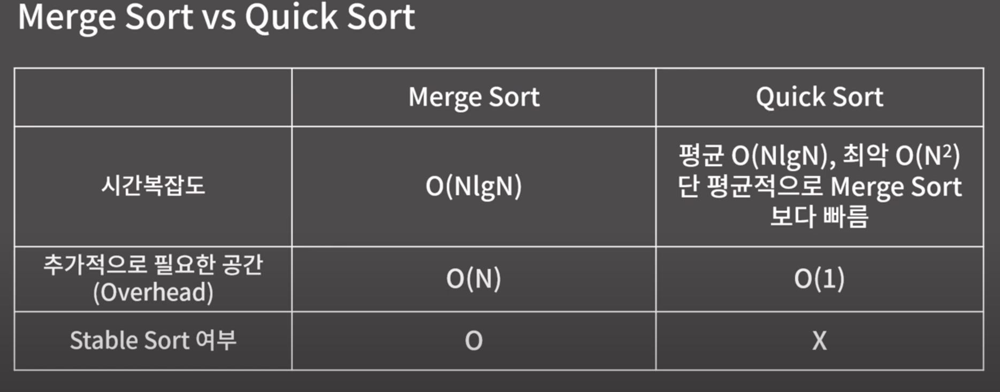

## 1. 기초 정렬 (선택 정렬, S**election Sort)**

N개의 원소에서 가장 작은 원소를 찾고 배열 첫 번째로 

N-1개의 원소에서 가장 작은 원소를 찾고 배열 두 번째로

….

**시간 복잡도 O(N^2)**

```java

import java.util.Arrays;
// 기초 정렬 (선택 정렬)
public class Basic_Sort {
    public static void main(String[] args) {
        int [] arr = {3, 2, 7, 116, 62, 235, 1, 23, 55, 77};
        int n = arr.length;
        for (int i = 0; i < n; i++) {
            int idx = i;
            for (int j = i + 1; j < n; j++) {
                if(arr[j] < arr[idx]) idx = j;
            }
            int temp = arr[i];
            arr[i] = arr[idx];
            arr[idx] = temp;
        }
        System.out.println(Arrays.toString(arr));
    }
}
```

## 2. 버블 정렬(B**ubble Sort)**

앞에서부터 인접한 두 원소를 보면서 앞의 원소가 뒤의 원소보다 클 경우 자리를 바꾸는 것을 

반복하면 자연스럽게 제일 큰 것부터 오른쪽에 쌓이게 된다.

**시간 복잡도 O(N^2)**

```java
// 버블 정렬
import java.util.*;
public class Bubble_Sort {
    public static void main(String[] args) {
        int [] arr = {3, 2, 7, 116, 62, 235, 1, 23, 55, 77};
        int size = arr.length;
        for (int i = 0; i < size; i++) {
            for (int j = 0; j < size - 1; j++) {
                if(arr[j] > arr[j+1]){
                    int temp = arr[j+1];
                    arr[j+1] = arr[j];
                    arr[j] = temp;
                }
            }
        }
        System.out.println(Arrays.toString(arr));
    }
}
```

## 3. Merge Sort 

재귀적으로 수열을 나눠 정렬한 후 합치는 정렬법 

**시간 복잡도 O(NlgN)**

Merge Sort를 하기 위해서는 먼저 길이가 N과 M인 두 정렬된 리스트를 합쳐서 

길이 N+M의 리스트를 만드는 방법을 알아야 한다.





여기서 제일 앞에 와야하는 수는 뭘까?

제일 앞의 원소라는건 전체 중에 가장 작은 원소란건데 

가장 작은 원소를 찾기 위해서 N+M의 모든 원소를 다 봐야할까? → NO

두 리스트에서 각각에서 가장 작은 원소인 -9와 -7만 비교하면 끝이다. 

-9 이후로는 모든 원소가 -9보다 크고

-7 이후로는 모든 원소가 -7보다 크니까 

-9와 -7을 비교해서 더 작은 숫자인 -9를 리스트 첫 번째 원소로 넣는다. 

이건 시간복잡도 O(1)에 가능하다. 



그런 다음에 넣을 원소는 어떻게 찾을까?

각 리스트에서 가장 작은 원소를 찾는다. 1, -7 

-7이 더 작으니 리스트에 -7을 넣는다. 

이렇게 반복하면 두 리스트가 오름차순으로 정렬된 리스트로 합쳐진다.

**BOJ 11728 배열 합치기로 연습해 보자**

[https://www.acmicpc.net/problem/11728](https://www.acmicpc.net/problem/11728)



**Merge Sort 과정** 

1. 주어진 리스트를 2개로 나눈다. 
1. 나눈 리스트 2개를 정렬한다.
1. 정렬된 두 리스트를 합친다.



분할하는 과정의 시간복잡도는 O(N)

합쳐나가는 과정은 O(NlgN)

→ 최종 시간복잡도는 O(NlgN)

```java

// Merge_Sort 병합 정렬 O(NlogN)
import java.util.*;
public class Merge_Sort {
    static int [] arr = {-3, -1, 4, -5, 7, 5, 3, 0, 2, 9, 8};
    static int [] tmp = new int[arr.length];

    public static void main(String[] args) {
        func(0, arr.length);
        System.out.println(Arrays.toString(arr));
    }
    public static void func(int start, int end){
        if(end - start == 1){
            return;
        }
        int mid = (start + end) / 2;
        func(start, mid);
        func2(start, end);
    }
    public static void func2(int start, int end){
        int mid = (start + end) / 2;
        int idx1 = start;
        int idx2 = mid;
        for (int i = start; i < end; i++) {
            if(idx1 == mid){
                tmp[i] = arr[idx2++];
            }
            else if(idx2 == end){
                tmp[i] = arr[idx1++];
            }
            else{
                if(arr[idx1] <= arr[idx2]){
                    tmp[i] = arr[idx1++];
                }
                else{
                    tmp[i] = arr[idx2++];
                }
            }
        }
        for (int i = start; i < end; i++) {
            arr[i] = tmp[i];
        }
    }
}
```

**Stable Sort**

우선 순위가 같은 원소가 여러 개일 땐 정렬한 결과가 유일하지 않을 수 있다.



우선 순위가 같은 원소들끼리는 원래의 순서를 따라가도록 하는 정렬이 Stable Sort이다. 

즉 StableSort를 하면 첫 번째 처럼 파랑 빨강 초록 검은색 순서대로 정렬되어 있다.

하지만 두 번째나 세 번째 같은 정렬이 될 수도 있는 정렬 방법은 **Unstable Sort**이다. 

Merge Sort는 Stable Sort이다. 

EX) 파일을 정리할 때 파일의 크기 순서가 1순위 2순위가 파일 생성 시기라면 

파일 크기 순서대로 Stable Sort를 하면 자연스럽게 파일 생성 시기 또한 순서가 지켜져서 

정렬된다.

## 4. Quick Sort

퀵 소트가 거의 모든 정렬 알고리즘보다 빨라서 각종 라이브러리의 정렬은 대부분 

퀵 소트를 바탕으로 만들어져 있다.

코딩 테스트에서 라이브러리를 사용하지 못하고 정렬을 구현해야 한다면 

퀵 소트를 사용하지 않고 머지 소트를 사용해야 한다.

퀵 소트 또한 머지 소트처럼 재귀적으로 구현을 하는 정렬이다.

퀵 소트에서는 매 단계마다 pivot이라고 이름 붙은 원소 하나를 제자리로 

보내는 작업을 반복한다. 


지금 이 리스트를 보면 이 원소들 사이에서 pivot은 마음대로 잡으면 되지만 

편의상 제일 앞의 원소인 6을 pivot으로 잡겠다. 

여기서 어떻게든 pivot을 제자리로 보내고 싶다. pivot을 제자리로 보낸다는 의미는 

pivot을 올바른 자리에 넣고 pivot 왼쪽은 pivot보다 작은 원소가 pivot 보다 큰 원소는 

오른쪽에 위치 시키겠다는 뜻이다. 



비록 정렬이 되지는 않았지만 6의 왼쪽에는 6보다 작은 원소만 위치하고 

오른쪽에는 6보다 큰 원소만 위치하고 있다. 

pivot을 제자리로 보내고 나면 왼쪽 구간과 오른쪽 구간을 따로따로 정렬하면 되고 각 구간은 

머지 소트에서 하던 작업을 재귀적으로 생각하면 된다. 

왼쪽 구간과 오른쪽 구간을 어떻게 따로따로 정렬하는 건가요? 라고 질문을 던진다면 

머지 소트와 상황이 똑같다고 설명을 할 수 있다.

먼저 pivot을 제자리로 보내는 작업부터 해보자.

임시 배열 tmp를 만들고 

pivot보다 작은 원소들을 먼저 배열에 넣고 pivot을 넣은 다음에 pivot 보다 큰 원소들을 배열에 넣는다.

퀵 소트의 장점은 추가적인 공간이 필요하지 않다는 점에 있다. 

또 그렇게 그 배열 안에서의 자리 바꿈만으로 처리가 되기 떄문에 cache hit rate가 높아서 속도가 빠르다는 장점이 있다.  

그렇기 때문에 우리는 추가적인 공간을 사용하지 않고 pivot을 제자리로 보낼 방법을 고민해야 한다.

이렇게 추가적인 공간을 사용하지 않는 정렬을 **In-Place-Sort**라고 부른다.



포인터 2개를 설정한다. l은 pivot보다 큰 값이 나올 때 까지 오른쪽으로 이동을 한다.

r은 pivot보다 작거나 같은 값이 나올 때 까지 왼쪽으로 이동을 한다.

그리고 각 포인터가 가리키는 원소를 스왑한다. 

이걸 l과 r이 교차할 때 까지 반복한다. 

```java
import java.util.Arrays;
// Quick Sort 구현하기
public class Quick_Sort {
    static  int[] arr = {6, -8, 1, 12, 8, 3, 7, -7};
    public static void main(String[] args) {
        int n = arr.length;
        QuickSort(0, n - 1);
        System.out.println(Arrays.toString(arr));
    }
    public static void QuickSort(int low, int high){
        if(low < high){
            int pivot_index = func(low, high);
            QuickSort(low, pivot_index - 1);
            QuickSort(pivot_index + 1, high);
        }
    }
    public static int func(int low, int high){
        int pivot = arr[low];
        int l = low + 1;
        int r = high;
        while (l <= r){
            while (l <= r && pivot > arr[l]) l++;
            while (l <= r && pivot <= arr[r]) r--;
            if(l < r){
                swap(l, r);
            }
        }
        swap(low, r);
        return r;
    }
    public static void swap(int l , int r){
        int temp = arr[r];
        arr[r] = arr[l];
        arr[l] = temp;
    }
}
```

시간복잡도는 평균적으로 O(NlogN)이지만 

최악의 경우 O(N^2)이다. 

pivot이 매번 제일 앞에 있으면 



실제 라이브러리를 보면 다양한 처리를 한다.

피벗을 랜덤하게 선택하거나 피벗 후보를 3개를 두고 3개중에 고르는 방법 등등..

**최종 정리**



