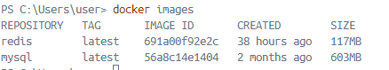
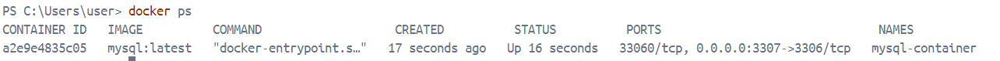

***이미지 다운로드***

```shell
 docker pull mysql:latest
 
 docker pull redis:latest
```

***다운로드된 이미지 확인***

```shell
docker images
```



***MySQL 컨테이너 실행***

```shell
docker run --name mysql-container -e MYSQL_ROOT_PASSWORD=[REDACTED] -d -p 3306:3306 mysql:latest
```

- *-name mysql-container: 컨테이너 이름 설정*
- *e MYSQL_ROOT_PASSWORD=[REDACTED] MySQL root 비밀번호 설정*
- *d: 백그라운드 실행*
- *p 3306:3306: 호스트와 컨테이너 간 포트 매핑*
- *mysql:latest: 다운로드한 MySQL 이미지로 실행*

***나는 이미 3306 포트에 MySQL 서버가 실행되고 있다. (ERROR RESPONSE)***

```shell
docker: Error response from daemon: Ports are not available: exposing port TCP 0.0.0.0:3306 -> 0.0.0.0:0: listen tcp 0.0.0.0:3306: bind: Only on
e usage of each socket address (protocol/network address/port) is normally permitted.
```

*→ 호스트 포트 3307로 변경*



***MySQL 최초 실행 이후***

```shell
docker exec -it mysql-container mysql -u root -p
```

- *docker exec: 이미 실행 중인 컨테이너 내에서 명령을 실행하는 Docker 명령어*
- *-it*
- *-i: "interactive" 모드로 컨테이너와 상호작용할 수 있도록 한다. 입력을 받을 수 있게 한다.*
  - -t: *"tty" (터미널)를 할당하여 가상 터미널을 제공. 이는 컨테이너 내에서 명령어를 실행할 때 마치 실제 터미널을 사용하는 것처럼 보이게 해준다. 이 두 옵션을 함께 사용하면, 컨테이너 내에서 터미널처럼 명령을 입력하고 결과를 볼 수 있다.*
- *p: 비밀번호를 묻는 프롬프트를 띄우기 위한 옵션. 이 옵션을 사용하면 MySQL 클라이언트가 접속을 시도할 때 비밀번호를 입력하라는 메시지를 표시. 이때 비밀번호는 이전에 설정한 루트 비밀번호*


***Redis 컨테이너 실행***

```shell
docker run --name redis-container -d -p 6379:6379 redis:latest
```

- *-name redis-container: 컨테이너 이름 설정*
- *d: 백그라운드 실행*
- *p 6379:6379: 호스트와 컨테이너 간 포트 매핑*
- *redis:latest: 다운로드한 Redis 이미지로 실행*

***Redis CLI 접속***

```shell
docker exec -it redis-container redis-cli
```

# ***관리 명령어***

***실행중인 컨테이너 확인*** 

```shell
docker ps
```

***컨테이너 정지***

```shell
docker stop mysql-container 
```

***컨테이너 재시작*** 

```shell
docker start mysql-container 
```

***컨테이너 삭제***

```shell
docker rm mysql-container 
```

***docker compose 버전 확인***

```shell
docker-compose -v
```
