## 목차 

- **해시?**
- **충돌?**
- **충돌회피(Chaining)**
- **충돌회피(OpenAddressing)**
- **OpenAddressing (Linear Probing)**
- **OpenAddressing (Quadratic Probing)**
- **OpenAddressing (Double Hashing)**

---

## 해시

**해시 자료구조 : 키(Key)에 대응하는 값(Value)을 저장하는 자료구조** 

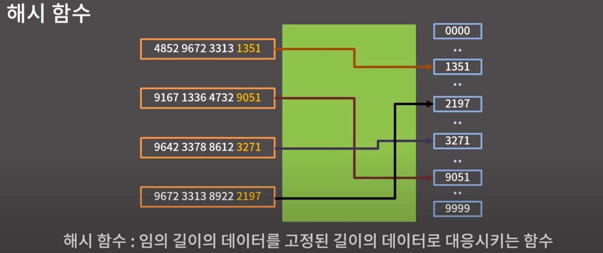

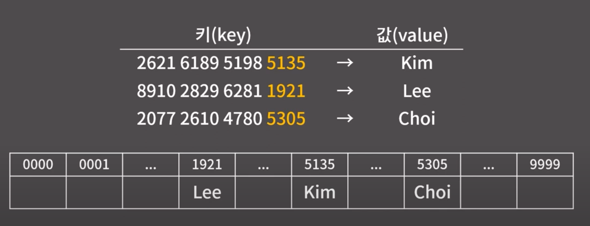

이러한 테이블을 해시 테이블이라고 한다. 

이렇게 해시 함수를 이용해서 해시 테이블을 구현하면 삽입(put), 삭제(remove), 검색(get) 등 모든 연산이 O(1)에 동작한다. 

---

## **충돌** 

충돌 현상 설명 

카드 번호 0000 0000 0000 5135 : kim 을 삽입

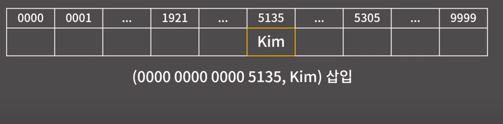

이때 카드 번호 9999 9999 9999 5135 는 누구의 카드 번호인가 질문

그럼 Kim이라고 대답한다. 

Kim의 카드 번호는 0000 0000 0000 5135 이다.  → **충돌 발생!** 

즉 서로 다른 값이 같은 키를 가지면 충돌이 발생한다. 

이렇게 충동을 방지하는 해시 함수를 구현하는 것이 해시 성능에 가장 영향을 끼친다.

---

## 충돌 회피 1 - Chaining

Chaining에서는 각 인덱스마다 연결 리스트를 하나씩 둔다. 

자 다시 충돌 part에서 했던 삽입을 반복 해보자.

1. 9999 9999 9999 5135 : choi 
1. 0000 0000 0000 5135 : kim

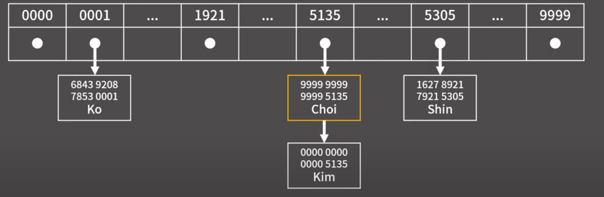

remove, put, get 모든 연산이 이 원리를 적용

각 index 마다 연결 리스트를 둬서 충돌 회피를 하는 방법을 Chaining이라고 한다. 

> 💡 자바의 HashMap은 충돌을 해결하기 위해 기본적으로 체이닝(chaining) 기법을 사용합니다. 충돌이 발생하면, 동일한 해시 코드를 갖는 키들을 연결 리스트로 연결하여 해결합니다. 이를 통해 각 버킷에 여러 개의 키-값 쌍을 저장할 수 있습니다. 이 외에도 자바의 HashMap은 자바 8부터는 충돌이 발생하면 연결 리스트 대신에 트리를 사용하여 성능을 더 향상시키는 기능도 도입되었습니다.

**Chaining 기법의 성능** 

만약 들어온 데이터들의 모든 key가 동일하다면 삽입은 O(1)이 걸리지만
remove, get은 해당 연결 리스트의 시간 복잡도를 가진다 즉 O(N)이 걸린다.

**이상적인 상황**(모든 key가 균등하게 index를 차지 == 각 index 연결 리스트 크기 ≤ 1)

에서는 O(1) 

**최악의 상황**(모든 해시 값이 같은 상황) O(N) 

→ 각 키의 해시 값이 최대한 균등하게 퍼져야 성능이 좋아진다. 그러기 위해서는 주어진 데이터에 대한 좋은 해시 함수를 정해야 한다. 

**자바 17 해시 코드 출력** 

```java
public class HashCode {
    public static void main(String[] args) {
        String str1 = "hello";
        String str2 = "hello2";

        int hashCode1 = str1.hashCode();
        int hashCode2 = str2.hashCode();

        System.out.println("HashCode of \"hello\": " + hashCode1);
        System.out.println("HashCode of \"hello2\": " + hashCode2);
    }
}
```

```java
HashCode of "hello": 99162322
HashCode of "hello2": -1220935264
```

---

## 충돌 회피 2 - Open Addressing

0000 0000 0000 3333 : kim 삽입

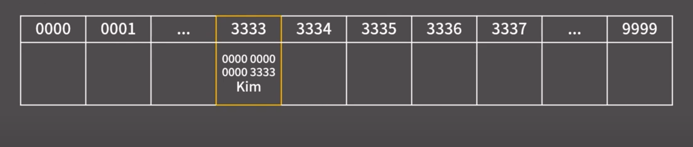

6278 5351 9104 3333 : Lee 삽입

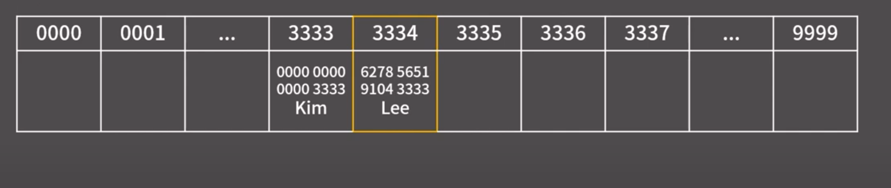

이미 3333 index에 값이 있으니 그 다음 index인 3334에 해당 값을 넣는다. 

7298 1127 6004 3334 : Bae 삽입 

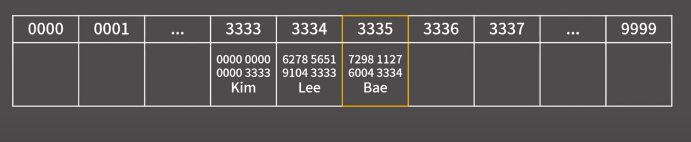

이미 3334 index에 값이 있으니 그 다음 index인 3335에 삽입 

3492 0658 8348 3333 : Yang 삽입 

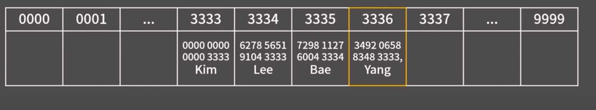

**3492 0658 8348 3333는 누구의 카드인가?**

3333 → 3334 → 3335 → [3336]에서 찾는다

**존재하지 않는 카드 번호를 찾는 상황** 

5555 6666 7777 3335는 누구의 카드인가?

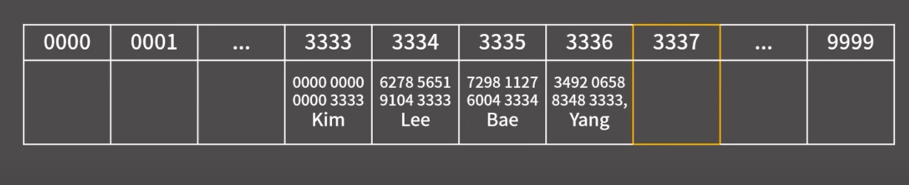

3335 → 3336 → [3337] stop 

이렇게 빈 곳에 도달하면 해당 번호가 저장이 안되어있다는걸 확신할 수 있다.

**6278 5651 9104 3333 삭제** 

find와 마찬가지로 삭제 또한 찾는게  먼저이다. 3333 → 3334

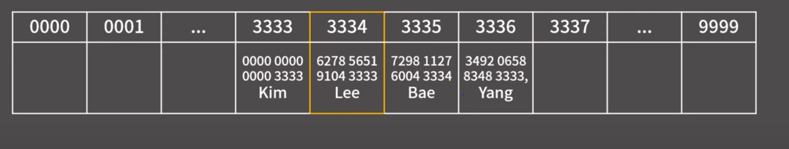

찾고 제거 완료!

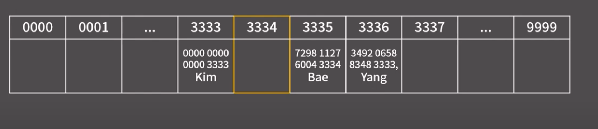

이렇게 삭제를 하면 나중에 find에서 **심각한 오류**가 발생할 수 있다. 

ex) 7298 1127 6004 3334 카드 번호를 찾는 경우 

현재 7298 1127 6004 3334 는 3335에 저장 하지만 찾기를 시작하면 3334에서 찾기 시작하는데 

해당 원소가 없어서 바로 종료하며 즉 찾는 카드 번호가 없다고 결과가 나온다. 

**어떻게 해결?**

Open Addressing에서는 이런 오류를 방지하기 위해 삭제를 하는 칸을 실제로 삭제해서 빈 칸으로 만드는게 아닌 원래 값이 있었지만 제거된 상태임을 명시를 해준다. (DUMMY 데이터로 대체)

삽입을 한다고 하면 빈칸 OR DUMMY 데이터면 삽입

검색, 삭제 에서도 DUMMY 데이터를 만나면 종료가 아닌 다음 INDEX로 넘어가게 한다. 

---

## **OpenAddressing (Linear Probing)**

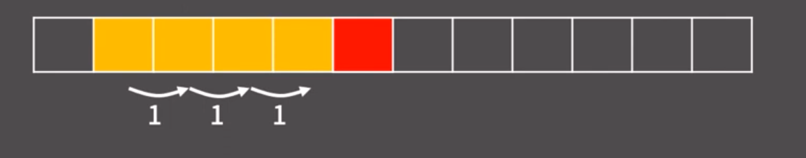

충돌 발생 시 오른쪽으로 1칸씩 이동하는 방식 

장점:

- Cache hit rate가 높습니다. 인접한 메모리 위치에 저장되어 있기 때문에 CPU 캐시의 지역성(locality)을 활용하여 더 빠르게 접근할 수 있습니다.
- 해시 테이블의 재구성 없이 데이터를 추가하거나 삭제할 수 있습니다. 새로운 키가 충돌 발생 지점 바로 다음에 저장되기 때문에 추가 연산이 더 효율적입니다.

단점:

- 클러스터링(Clustering)이 발생할 수 있습니다. 선형 조사는 충돌이 발생한 위치에서 오른쪽으로 이동하면서 저장할 위치를 찾기 때문에 일부 버킷에 데이터가 밀집되는 현상이 발생할 수 있습니다. 이로 인해 해시 테이블의 일부 영역이 밀집되면 성능이 저하될 수 있습니다.
- 군집(Clustering)으로 인해 선형 조사는 더 많은 충돌을 유발할 수 있습니다. 한 버킷에 데이터가 많이 모이면 다음 데이터가 저장될 위치를 찾기 위해 많은 이동이 필요하므로 충돌이 더 자주 발생할 수 있습니다. 따라서 군집화가 심각한 경우에는 성능이 저하될 수 있습니다.

---

## **OpenAddressing (Quadratic Probing)**

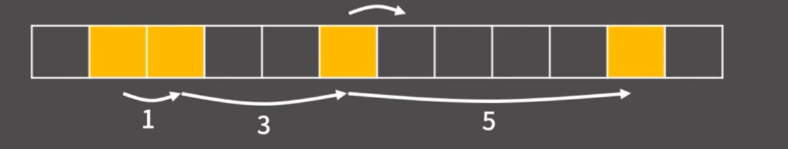

충돌 발생 시 오른쪽으로 1,3,5,…칸씩 이동하는 방식 

오픈 어드레싱에서의 다른 충돌 해결 전략 중 하나로는 Quadratic Probing(이차 조사)이 있습니다. Quadratic Probing은 충돌이 발생했을 때 선형 조사처럼 단순히 오른쪽으로 이동하는 것이 아니라, 이차 함수를 사용하여 새로운 위치를 찾는 방식입니다.

Quadratic Probing은 충돌 발생 시 현재 위치에서 일정한 간격(제곱수)으로 이동하여 다음 저장 위치를 찾습니다. 이동 간격은 제곱 수열을 따르기 때문에 Quadratic Probing이라는 이름이 붙었습니다.

장점:

- Linear Probing에 비해 클러스터링(Clustering)의 가능성이 낮습니다. 선형 조사보다는 좀 더 골고루 버킷을 사용하기 때문에 클러스터링이 발생할 가능성이 줄어듭니다.
- 선형 조사보다는 더 많은 범위를 탐색하므로 일부 영역에 데이터가 밀집되는 현상을 줄일 수 있습니다.

단점:

- Quadratic Probing도 일부 클러스터링 문제를 가질 수 있습니다. 특정 충돌 해결 전략은 일부 특정한 패턴의 충돌을 완전히 제거할 수 없을 수 있습니다.
- 선형 조사보다는 조금 더 복잡한 계산이 필요할 수 있습니다. Quadratic Probing은 이차 함수를 사용하기 때문에 이동할 위치를 계산하는데 조금 더 연산이 필요합니다.

---

## **OpenAddressing (Double Hashing)**

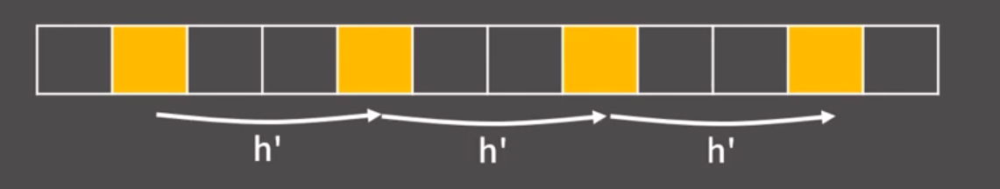

충돌 발생 시 이동할 칸의 수를 새로운 해시 함수로 계산하는 방식 

ex) 

지금까지 index 결정을 카드 번호의 뒷 4자리로 했다고 하면 이동할 칸의 자리는 카드 번호의 앞 4자리로 하기 

1234 2222 5555 5555가 충돌이 발생하면 다음 index는 5555 + 1234 

Double Hashing(이중 해싱)은 충돌을 해결하는 또 다른 방법으로, 두 개의 해시 함수를 사용하여 충돌이 발생한 경우에 새로운 위치를 결정하는 방법입니다.

Double Hashing은 충돌이 발생했을 때, 기본 해시 함수와 더불어 두 번째 해시 함수를 사용하여 새로운 위치를 찾습니다. 즉, 충돌이 발생한 위치에서 두 번째 해시 함수의 값을 이용하여 새로운 위치를 찾는 것입니다. 이 때 두 번째 해시 함수는 충돌을 해결하기 위한 적절한 값들을 생성하기 위해 사용됩니다.

Double Hashing의 핵심 아이디어는 다음과 같습니다:

1. 충돌이 발생했을 때, 첫 번째 해시 함수를 통해 얻은 위치에서 두 번째 해시 함수를 사용하여 새로운 위치를 찾습니다.
1. 두 번째 해시 함수의 값이 0이면, 즉 두 번째 해시 함수가 충돌 해결에 아무런 도움을 주지 못한다면, 간격을 조정하여 다음 위치를 찾습니다.

장점:

- 충돌이 발생했을 때 선형 조사나 이차 조사보다 더 넓은 영역을 탐색할 수 있습니다.
- 충돌을 해결하기 위한 다양한 조합의 위치를 시도할 수 있기 때문에, 클러스터링이 발생할 가능성이 낮아집니다.

단점:

- 두 개의 해시 함수를 선택하고, 이를 통해 적절한 값을 찾는 과정이 복잡할 수 있습니다.
- 일부 특정한 상황에서는 충돌을 완전히 해결하지 못할 수 있습니다.
- Cache hit rate가 극악으로 안 좋아진다.

