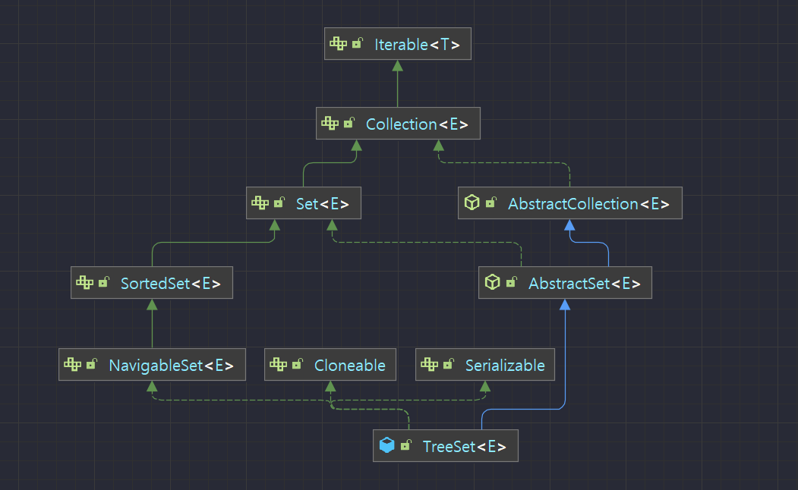
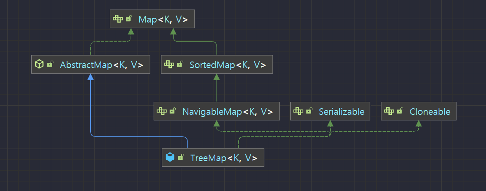

## 자바 이진 검색 트리 기반 자료구조 

- TreeSet
- TreeMap
- 이진 검색 트리에 대한 자세한 내용 

---

## TreeSet 

- 정렬된 집합 (Set)을 구현한 클래스, 이진 검색 트리 기반 
- 중복된 요소 허용 x - **SortedSet** 인터페이스의 확장
- 요소들이 정렬된 순서로 저장 - **SortedSet** 인터페이스의 확장
- 내부적으로 레드 - 블랙 트리 사용하여 구현(자가 균형 트리)
- **NavigableSet** 인터페이스를 확장하고 있어서 네비게이션 기능도 제공




```java
public class TreeSet<E> extends AbstractSet<E>
    implements NavigableSet<E>, Cloneable, java.io.Serializable
```

## TreeSet 메서드 정리 

- NavigableSet 을 확장한 클래스여서 해당 인터페이스의 메서드 또한 사용이 가능하다.

[Untitled](https://app.notion.com/p/6eec71fc2e794b4d96d587bd12918fdd) 

**생성자** 

- TreeSet() : 빈 TreeSet 객체 생성 
- TreeSet(Collection< ? extends E> c ): 지정된 컬렉션의 요소를 포함하는 TreeSet 객체 생성 
- TreeSet(Comparator< ? super E > comparator ) : 지정된 비교자를 사용하여 요소를 정렬하는 TreeSet 객체를 생성 

**요소 추가 및 삭제**

- boolean add(E e) : 지정된 요소를 이 TreeSet에 추가 
- boolean remove(Object o ) : 지정된 요소를 제거  

**검색 및 조회** 

- boolean contains(Object o) : 지정된 요소가 TreeSet에 포함되어 있는지 여부 확인
- E first() : TreeSet의 첫 번째 요소(가장 작은) 요소를 반환 
- E last() : TreeSet의 마지막 (가장 큰) 요소를 반환 

**정렬 및 범위 검색** 

- Comparator<? super E> comparator() : 이 TreeSet에서 사용되는 비교자 Comparator를 반환 
- SortedSet<E> subSet(E fromElement, E toEelemnt) : 지정된 범위의 요소들로 이루어진 부분 집합을 반환 
- SortedSet<E> headSet(E toEelemnt) : 지정된 요소보다 작은 요소들로 이루어진 부분 집합 반환 
- SortedSet<E> tailSet(E fromElement) : 지정된 요소 이상의 요소들로 이루어진 부분 집합 반환 

---

## TreeSet comparator 객체 출력하기 

테스트1 (기본)

```java
TreeSet<Integer> treeSet = new TreeSet<>();
System.out.println(treeSet.comparator());
```

결과1

```java
null
```

테스트2 (custom)

```java
TreeSet<Integer> treeSet = new TreeSet<>((o1,o2)->{
            return -(o1-o2);
         });
System.out.println(treeSet.comparator());      
```

결과 2

```java
DataStructure.BinarySearchTree.TreeSet.TreeSetPractice$$Lambda$16/0x0000000800c01a00@3b9a45b3
```

테스트3 (Collections 제공 Comparator)

```java
 TreeSet<Integer> treeSet = new TreeSet<>(Collections.reverseOrder());
```

결과 3

```java
java.util.Collections$ReverseComparator@7cca494b
```

 

---

## TreeMap

- 정렬된 키-값 쌍을 저장하는 자료구조
- 이진 검색 트리를 기반
- 키를 기준으로 정렬
-  중복된 키를 허용 x
- 레드-블랙 트리(Red-Black Tree)를 사용하여 내부적으로 구현

```java
public class TreeMap<K,V> extends AbstractMap<K,V>
    implements NavigableMap<K,V>, Cloneable, java.io.Serializable
```

---

## TreeMap 계층 구조 



TreeSet - SortedSet, NavigableSet

TreeMap - SortedMap, NavigableMap

---

## TreeMap 메서드 정리 

**생성자** 

- TreeMap() : 빈 TreeMap 객체 생성 
- TreeMap(Map<? extends K, ? extends V> m) : 지정된 Map의 요소를 포함하는 TreeMap 객체 생성 
- TreeMap(Comparator< ? super E > comparator ) : 지정된 비교자를 사용하여 요소를 정렬하는 TreeMap 객체를 생성 

**요소 추가 및 삭제**

- V put(K key, V value) : 지정된 키 - 값 쌍을 이 TreeMap에 추가  
- V remove(Object key) : 지정된 키에 매핑된 값을 이 TreeMap에서 제거  

**검색 및 조회** 

- boolean contains(Object key) : 지정된 키가 TreeMap에 포함되어 있는지 여부 반환 
- boolean containsValue(Object value) : 지정된 값이 TreeMap에 포함되어 있는지 여부 반환 
- V get(Object key ) : 지정된 키에 매핑된 값 반환 
- V getOrDefault(Object key, V defaultValue) : 지정된 키가 TreeMap에 있으면 매핑된 값 반환 없으면 defaultValue 반환 

**정렬 및 범위 검색** 

- Comparator<? super E> comparator() : 이 TreeSet에서 사용되는 비교자 Comparator를 반환 
- K firstKey() : 이 TreeMap에서 가장 작은 키를 반환 
- K lastKey() : 이 TreeMap에서 가장 큰 키를 반환 

**하위 맵과 서브 맵 생성**

- NavigableMap<K, V> headMap(K toKey, boolean inclusive):  지정된 키보다 작은 키들의 하위 맵을 반환
- NavigableMap<K, V> tailMap(K fromKey, boolean inclusive): 지정된 키 이상의 키들의 하위 맵을 반환
- NavigableMap<K, V> subMap(K fromKey, boolean fromInclusive, K toKey, boolean toInclusive): 지정된 범위의 키들의 서브 맵을 반환

---

