# ✅ 1주차 

**프론트 컨트롤러 MVC 전용 디자인 패턴**

클라이언트 요청 → Tomcat(서블릿 컨테이너) → 필터 → FrontController(DispatcherServlet) → …

**정적 자원의 처리**

직접 url 구분이 아닌, Dispatcher Servlet 요청이 처리할 컨트롤러를 먼저 찾고 찾을 수 없는 경우 설정된 자원 경로를 탐색하여 자원을 탐색

**Handler Mapping** 

@Controller + @RequestMapping , Controller 인터페이스를 통한 컨트롤러 작성 여러가지 스펙이 존재

컨트롤러를 구현하는 방법이 다양하기 때문에 HandlerMapping 인터페이스를 만들어두고, 다양한 구현 방법에 따라 요청을 처리할 대상을 찾도록 되어 있다.

오늘날 방식인 @Controller는 RequestMappingHandlerMapping이 처리한다.

이는 @Controller로 작성된 모든 컨트롤러를 파싱하여 HashMap으로 <요청 정보, 처리할 대상> 관리한다.

```java
if (this.handlerMethods.containsKey(mapping)) {
    throw new IllegalStateException("생략 ...");
}
this.handlerMethods.put(mapping, handlerMethod);
```

여기서 처리할 대상은 HandlerMethod 객체로 컨트롤러, 메서드 등을 갖고 있는데 이는 스프링이 리플렉션을 이용해 요청을 위임하기 때문이다.

그래서 요청이 오면 요청 정보를 통해 HashMap에서 HandlerMethod를 찾고 HandlerExecutionChain으로 감싸서 반환한다. 체인으로 감싸는 이유는 컨트롤러 요청 이전에 처리해야 하는 인터셉터 등을 포함하기 위해서다.

[https://mangkyu.tistory.com/18](https://mangkyu.tistory.com/18)

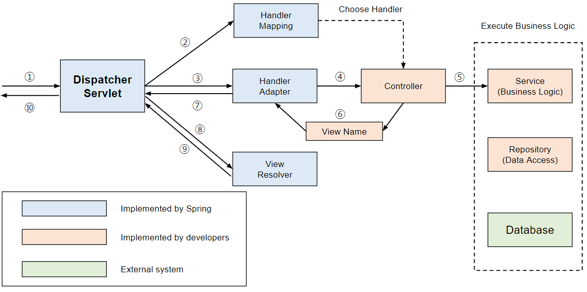

2번 과정과 3번 과정 사이에는 Adapter 탐색 과정이 추가로 존재한다.

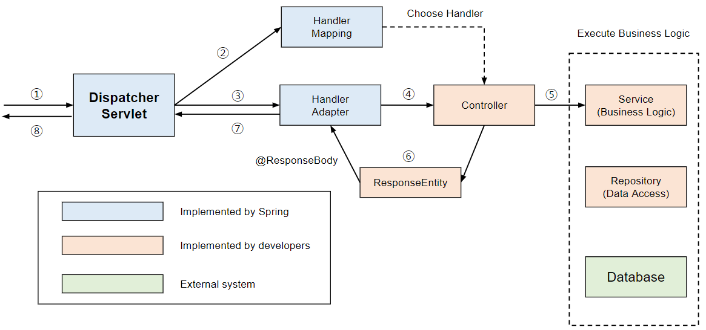

HttpMessageConverter 

  - StringHttpMessageConverter (String)
  - MappingJackson2HttpMessageConverter (Object)
  - another converter (another data type)

해당 그림에서 4번(메시지 → 객체 Deserialization) 6번(객체 → 메시지 Serialization) 2번의 과정에서 메시지 컨버터가 사용된다.

[https://mangkyu.tistory.com/49](https://mangkyu.tistory.com/49)

**@RequestParam**

  - 필수 여부 기본이 true(required= true), 파라미터 전송되지 않으면 400 에러 발생
  - defaultValue 기본값 지정 가능

**@RequestBody**

  - 클라이언트가 전송하는 JSON 형태의 HTTP Body를 Java 객체로 변환시켜주는 역할 
  - MaapingJacson2HttpMessageConverter, ObjectMapper 

**@ModelAttribute**

  - 폼 형태의 HTTP Body와 요청 파라미터들을 객체에 바인딩

[https://mangkyu.tistory.com/72](https://mangkyu.tistory.com/72)

**Spring Bean?** 

스프링에서는 스프링의 DI 컨테이너에 의해 관리되는 POJO(Plain Old Java Object)를 Bean 이라고 부르며, Bean 들은 스프링을 구성하는 핵심 요소이다.

  - POJO, 스프링 애플리케이션을 구성하는 핵심 객체
  - Spring IoC 컨테이너(또는 DI 컨테이너)에 의해 생성 및 관리된다.

**Spring Bean 구성 요소**

  - class: Bean 등록할 Java 클래스
  - id: Bean 고유 식별자
  - scope: Bean 생명주기(singleton, request, prototype)
  - constructor-arg: Bean 생성 시 생성자에 전달할 파라미터

**Spring Bean 등록 방법1**

```java
public class BeanClass {

}

@Configuration 
public class BeanConfig {
		@Bean
		public BeanClass beanName(){
			 return new BeanClass();
		}
}
```

스프링 빈으로 등록된 다른 클래스 안에서 @Bean으로 직접 빈을 등록해주는 것도 동작하지만, @Configuration 안에서 @Bean을 사용해야 싱글톤을 보장받을 수 있다.

그 이유는 (2/2)에서 설명한다.

**Spring Bean 등록 방법2 @Component** 

스프링은 컴포넌트 스캔을 사용해 @Component 애노테이션이 있는 클래스들을 찾아서 자동으로 빈 등록을 해준다. 

SpringBoot를 사용하면 개발자가 직접 @ComponetScan으로 컴포넌트를 찾는 탐색 범위를 지정해줄 필요 없이, @SpringBootApplication 애노테이션이 메인 메서드(엔트리 포인트)에 기본적으로 포함되어 있어 별도의 설정이 없다. 그리고 기본적으로 탐색 범위는 해당 애노테이션을 포함한 패키지와 하위 패키지 전체이다.

[https://mangkyu.tistory.com/75](https://mangkyu.tistory.com/75)

@Configuration은 CGLIB 라이브러리를 통해 프록시 패턴을 적용해 수동으로 등록되는 스프링 빈이 반드시 싱글톤으로 생성됨을 보장해 준다.

```java
@Configuration
public class TestClass {
	
	@Bean
	public Resource resource() {
		return new Resource();
	}
	
	@Bean
	public Resource2 resource2() {
		return new Resource2(new Resource());
	}
}
```

현재 예제 코드를 보면 Resource 빈 등록 메서드를 여러번 호출한다. 즉, 불필요하게 여러 개의 빈이 생성이 된다.

스프링은 이러한 문제를 방지하고자 @Configuration이 있는 클래스를 객체로 생성할 때 CGLIB 라이브러리를 사용해 프록시 패턴을 적용한다. 그래서 @Bean이 있는 메서드를 여러 번 호출해도 항상 동일한 객체를 반환하여 싱글톤을 보장한다.

```java
public class TestClass$$EnhancerBySpringCGLIB extends TestClass {
    // 싱글톤 빈을 저장할 필드
    private Resource resourceSingleton;

    @Override
    public Resource resource() {
        // 이미 생성된 빈이 있으면 반환, 없으면 생성 후 저장
        if (resourceSingleton == null) {
            resourceSingleton = super.resource();
        }
        return resourceSingleton;
    }

    @Override
    public Resource2 resource2() {
        // resource()를 직접 new Resource()로 호출하지 않고, 프록시의 resource()를 호출
        return new Resource2(resource());
    }
}
```

실제 소스코드는 더 복잡하지만, 위 예시는 동작 원리를 쉽게 이해할 수 있도록 단순화한 것이다.

참고로 CGLIB는 런타임 위빙으로 프록시를 만들어낸다.

**@Configuration proxyBeanMethods 옵션** 

대부분의 경우 @Bean으로 수동 빈 등록을 할 때 싱글톤으로 생성되기를 원한다.

하지만 @Bean 메서드를 호출할 때 의도적으로 다른 객체가 생성되기를 원할 수 있다.

그럴 때에는 @Configuration 애노테이션이 갖고 있는 proxyBeanMethods를 false로 주면 된다. 

기본은 true

[https://mangkyu.tistory.com/234](https://mangkyu.tistory.com/234)

싱글톤

  - 스프링 컨테이너의 시작과 종료까지 1개의 객체로 유지
  - 스프링 기본 스코프

프로토타입 

  - 컨테이너에서 빈의 생성, 의존관계 주입까지만 관여 
  - 요청이 오면 항상 새로운 인스턴스를 생성하여 반환

웹

  - request
  - session
  - application

[https://mangkyu.tistory.com/117](https://mangkyu.tistory.com/117)

**애플리케이션 컨텍스트(Application Context)** 

Spring에서는 빈의 생성과 관계설정 같은 제어를 담당하는 IoC 컨테이너인 Bean Factory가 존재한다.

하지만 빈의 생성과 관계설정 외에 추가적인 기능이 필요한데, 이러한 이유로 Spring에서는 Bean Factory를 상속받아 확장한 애플리케이션 컨텍스트를 사용한다.

애플리케이션 컨텍스트는 생성 정보와 연관관계 정보에 대한 설정을 읽어 처리한다.

[https://mangkyu.tistory.com/151](https://mangkyu.tistory.com/151)

**Bean 등록**

```java
@Bean
public DiscountPolicy discountPolicy() {
	return new ficDiscountPolicy();
}

@Bean
public DiscountPolicy ratePolicy() {
	return new rateDiscountPolicy();
}
```

Spring은 기본적으로 메서드/클래스 이름을 Bean으로 사용한다.

```java
@Bean(name = "ficDiscountPolicy")
public DiscountPolicy discountPolicy() {
	return new ficDiscountPolicy();
}
```

이렇게 직접 빈의 이름을 부여할 수도 있다.

**Bean 조회 전략**

  1. 주입받고자하는 타입으로 매칭을 시도한다.
  1. 타입이 여러 개면 필드 또는 파라미터 이름으로 매칭을 시도한다.

빈의 이름이 충돌되어 빈 이름만으로 해결이 불가능한 경우 또는 빈에 추가 구분자나 우선순위를 부여하고 싶은 경우 @Qualifier, @Primary 애노테이션을 이용한다.

  - @Autowired: 필드 타입을 기준으로 빈을 찾음
  - @Resource: 필드 이름을 기준으로 빈을 찾음

**@Qualifier** 

빈의 이름만으로 부족하고, 추가적인 정보가 필요할 수 있다. 이런 상황에서 해당 애노테이션을 통해 추가 구분자(Alias)를 붙여줄 수 있다. **빈의 이름을 바꾸는 것이 아니다.**

구분자를 부여하면서 빈 생성

```java
@Qualifier("mainDiscountPolicy")
@Bean
public DiscountPolicy discountPolicy() {
	return new ficDiscountPolicy();
}
```

빈 사용

```java
public BeanTest(@Qualifier("mainDiscountPolicy") DiscountPolicy discountPolicy) {
	this.discountPolicy = discountPolicy;
}
```

  1. @Qualifer가 붙은 빈을 조회한다.
  1. 1번에서 못찾으면 필드, 파라미터 이름으로 매칭을 시도한다.
  1. 2번에서도 못찾으면 NoSuchBeanDefinitionException 

**@Primary** 

여러 타입의 빈이 존재할 때, 특정 빈을 우선적으로 주입받도록 하고 싶다면 해당 애노테이션을 사용한다.

만약 Primary, Qualifer 모두 등록이 되어있다면 이름을 직접 지정하는 Qualifier가 우선순위를 갖는다.

[https://mangkyu.tistory.com/148](https://mangkyu.tistory.com/148)

[https://mangkyu.tistory.com/168](https://mangkyu.tistory.com/168)

[https://mangkyu.tistory.com/150](https://mangkyu.tistory.com/150)

[https://mangkyu.tistory.com/125](https://mangkyu.tistory.com/125)

**InitializingBean, DisposableBean 인터페이스**

  - afterPropertiesSet() 오버라이드
  - destroy() 오버라이드
  - 자바 표준 인터페이스가 아닌 스프링 전용 인터페이스 → 스프링에 종속적
  - 메서드명 변경 불가능

**@PreDestroy, @PostConstruct** 

  - 스프링 애노테이션이 아닌 자바 표준 애노테이션
  - 외부 라이브러리를 빈으로 등록하는 경우라면 코드 수정이 불가능하여 다른 방법 사용해야 한다.

**@Bean 애노테이션에 initMethod, destroyMethod 설정** 

```java
@Bean(initMethod = "init", destroyMethod = "destroy")
public CacheClient cacheClient() {
    return new CacheClient("http://localhost:1234");
}
```

  - 코드에 접근할 수 없는 외부 라이브러리에도 초기화, 종료 메서드 적용 가능
  - destroyMethod는 추론 기능이 존재하여 메서드의 이름으로 close, shutdown 메서드가 존재하면 이를 종료 메서드로 인식하여 호출한다. 이러한 추론 기능을 사용하고 싶지 않으면 destroyMethod=”” 같이 공백으로 지정하면 된다.

[https://mangkyu.tistory.com/126](https://mangkyu.tistory.com/126)

[https://mangkyu.tistory.com/144](https://mangkyu.tistory.com/144)

[https://mangkyu.tistory.com/145](https://mangkyu.tistory.com/145)

트랜잭션 동기화

  - Thread Local

트랜잭션 추상화

  - PlatformTransactionManager

비즈니스 로직 트랜잭션 분리

  - AOP

트랜잭션 세부 설정 

  - TransactionDefinition 
  - 트랜잭션 전파
  - 격리수준
  - 제한시간
  - 읽기전용

[https://mangkyu.tistory.com/154](https://mangkyu.tistory.com/154)

### 전파 속성(Propagation)

  1. **REQUIRED**
1. default 속성 
    1. 이미 시작된 트랜잭션이 있으면 참여하고 없으면 새로 시작
  1. **SUPPORTS**
1. 이미 시작된 트랜잭션이 있으면 참여하고, 그렇지 않으면 트랜잭션 없이 진행
    1. 트랜잭션이 없어도 해당 경계 안에서 Connection, 하이버네이트 Session 공유 가능
  1. **MANDATORY**
1. 이미 시작된 트랜잭션이 있으면 참여, 그렇지 않으면 예외 발생
  1. **REQUIRES_NEW**
1. 항상 새로운 트랜잭션을 시작해야 하는 경우에 사용
    1. 이미 진행중인 트랜잭션이 있으면 이를 보류시키고 새로운 트랜잭션을 만들어 시작함 
    1. 커넥션을 1개 더 사용
  1. **NOT_SUPPORTED**
1. 이미 진행중인 트랜잭션이 있으면 이를 보류시키고, 트랜잭션을 사용하지 않도록 함
  1. **NEVER**
1. 이미 진행중인 트랜잭션이 있으면 예외를 발생
  1. **NESTED**
1. JPA 지원 X
    1. 부모 트랜잭션과 자식(NESTED) 트랜잭션은 동일한 DB 커넥션을 공유
    1. NESTED 트랜잭션이 시작되면, SAVEPOINT를 설정하여 그 시점으로 부분 롤백이 가능하게 만든다.

[https://mangkyu.tistory.com/169](https://mangkyu.tistory.com/169)

선언적 트랜잭션 

프로그램에 의한 트랜잭션

[https://mangkyu.tistory.com/170](https://mangkyu.tistory.com/170)

[https://mangkyu.tistory.com/155](https://mangkyu.tistory.com/155)

[https://mangkyu.tistory.com/156](https://mangkyu.tistory.com/156)

[https://mangkyu.tistory.com/159](https://mangkyu.tistory.com/159)

[https://mangkyu.tistory.com/160](https://mangkyu.tistory.com/160)

### **@Value 사용법** 

  1. PropertyPlaceHolderConfigurer를 통한 수동 변환 ${}
  1. SpEL을 통한 능동 변환 #{}

**PropertyPlaceHolderConfigurer**

PropertyPlaceHolderConfigurer는 BeanFactoryPostProcessor의 일종이다. 

오브젝트의 내용이나 오브젝트 자체를 변경하는 일반적인 빈 후처리기(AnnotationAwareBeanPostProcessor)와 달리 빈 설정 메타정보가 모두 준비됐을 때 빈 메타정보 자체를 조작하기 위해 사용된다.

```java
database.className=org.mariadb.jdbc.Driver

@Value("${database.className}")
private String className;
```

이러한 방법은 별도의 후처리기가 값을 변경해주기를 기대하기 때문에 수동적이다. 

그래서 초기 빈 메타정보에는 ${database.className} 같은 문자열이 등록되어 있다.

그러다가 설정 파일에서 적절한 키 값을 찾지 못하면 해당 문자열이 그대로 남아있게 된다.

→ 값이 변경되지 않더라도 예외가 발생하지 않는다.

**SpEL**

Spring Expression Language를 이용하는 방법은 프로퍼티의 대체 위치를 설정해두고 빈 팩토리 후처리기가 바꿔주기를 기다리는 수동적인 방법과 다르게 다른 빈 오브젝트에 직접 접근할 수 있는 표현식을 이용해 원하는 프로퍼티 값을 능동적으로 가져온다.

```java
database.className=org.mariadb.jdbc.Driver

@Value("#{environment['database.className']}")
private String className;
```

해당 예제는 environment 이름의 빈으로부터 해당 키에 해당하는 값을 읽어온다.

SpEL을 이용하면 오타와 같은 실수가 있을 때 에러 검증이 가능하다.

[https://mangkyu.tistory.com/167](https://mangkyu.tistory.com/167)

### **@Value** 

RelaxedBinding 적용되지 않는다. RelaxedBinding이란 프로퍼티 값의 이름이 조금 달라도 유연하게 바인딩을 시켜주는 규칙을 의미한다.

### **@ConfigurationProperties** 

@ConfigurationProperties는 기본적으로 RelaxedBinding이 적용된다. 

즉, 완전히 일치하게 적지 않아도 바인딩이 된다.

```java
server.admin-what-is-real-name=Baejeu

@Value("${server.admin-what-is-real-name}")
private String adminName;

@Getter
@Setter
@ConfigurationProperties(prefix = "server")
public class ServerInfo {
    private final String adminWhatIsRealName;

}
```

ConfigurationProperties에서는 Validation을 적용할 수 있다. @Validated 애노테이션이 필요하다.

```java
@Getter
@Setter
@ConfigurationProperties(prefix = "server")
@Validated
public class ServerInfo {

		@NotBlank
    private final String adminWhatIsRealName;

}
```

### **@Value  VS @ConfigurationProperties** 

|  | **@Value** | **@ConfigurationProperties**  |
| --- | --- | --- |
| 사용 이유 | 단일 값의 주입 | 클래스로 N개의 값을 바인딩 |
| 여러 값의 처리 | 1개의 값만 주입 가능  | 여러 개의 값을 바인딩 가능 |
| RelaxedBinding | X | O |
| SpEL 적용 | O | X |

---

[https://mangkyu.tistory.com/207](https://mangkyu.tistory.com/207)

### 필요성 알아보기

**application.properties** 

```java
spring.datasource.driver-class-name=org.h2.Driver
spring.datasource.url=jdbc:h2:mem:db;DB_CLOSE_DELAY=-1
spring.datasource.username=h2test
spring.datasource.password=[REDACTED]
```

datasource 관련 설정 값들을 다음과 같은 클래스로 한번에 불러오고 싶다면?

```java
@Getter
public class DataSourceProperties {

	private String driverClassName;
	private String url;
	private String username;
	private String password;

}
```

2가지 방법이 있다. Setter를 이옹해 수정자로 바인딩하거나 @Constructor Binding를 이용해 생성자로 바인딩 할 수 있다.

### Setter 바인딩 

DataSourceProperties 설정 클래스를 초기화하고 빈으로 생성하도록 등록을 해주어야 한다.

이를 위해서는 @EnableConfigurationProperties를 등록하고, 해당 클래스를 추가해주어야 한다.

```java
@Configuration
@EnableConfigurationProperties({DataSourceProperties.class})
public class SpringBootApplication {

}
```

ConfigurationProperties는 기본적으로 자바빈 프로퍼티 방식으로 동작하기 때문에 Setter가 반드시 필요하다.

DataSourceProperties 클래스에 바인딩하고자 하는 값들의 prefix는 spring.datasource가 공통된다.

```java
@Setter
@Getter
@ConfigurationProperties(prefix = "spring.datasource")
public class DataSourceProperties {
	private String driverClassName;
	private String url;
	private String username;
	private String password;

}
```

### 생성자로 바인딩 

객체의 변경 가능성을 닫기 위해 모두 필드를 final로 선언하고, 생성자 바인딩을 추가한다.

생성자 바인딩을 위해 @ConstructorBinding 애노테이션을 추가한다. 

```java
@Getter
@RequiredArgsConstructor
@ConfigurationProperties(prefix = "spring.datasource")
@ConstructorBinding
public class DataSourceProperties {

	private final String driverClassName;
	private final String url;
	private final String username;
	private final String password;
	
}	
```

스프링부트 3.0부터는 1개의 생성자만 있는 경우에 기본적으로 생성자 방식으로 동작하도록 수정되었다.

즉, 생성자가 2개 이상 존재하지 않는 경우라면 @ConstructorBinding 생략이 가능하다.

프로퍼티 설정 클래스들이 상당히 많아지면 하나하나 수동으로 등록하는게 번거로워질 수 있다.

그래서 SpringBoot 2.2 부터는 @ConfigurationProperties 애노테이션이 붙은 블래스들을 스캔하여 처리는 기능을 제공한다. -> @ConfigurationPropertiesScan

[https://mangkyu.tistory.com/189](https://mangkyu.tistory.com/189)

**@EnableConfigurationProperties 한계** 

```java
@Configuration
@EnableConfigurationProperties({DataSourceProperties.class, InfluxProperties.class, ...})
public class SpringBootApplication {

}
```

설정 클래스들이 많아지면 코드가 너무 무거워진다.

**@ConfigurationPropertiesScan** 

패키지를 기반으로 @ConfigurationProperties가 등록된 클래스들을 찾아 값들을 주입하고 빈으로 등록해준다.

@ConfigurationProperties에 스캔을 실행할 패키지 또는 클래스를 지정해 줄 수 있으며, 별도로 지정하지 않으면 해당 애노테이션이 붙은 패키지와 그 하위의 패키지에 대해 스캔을 진행한다.

**@Component 또는 해당 애노테이션이 들어있는 컴포즈 애노테이션 @Service, @Configuration이 붙은 클래스들은 @ConfigurationPropertiesScan에 의해 스캔되지 않는다.** 

```java
@ConfigurationPropertiesScan
public class SpringBootApplication {

}
```

만약 등록해주어야 하는 클래스가 많다면 @EnableConfigurationProperties가 아닌 @ConfigurationPropertiesScan를 이용하자.

[https://mangkyu.tistory.com/191](https://mangkyu.tistory.com/191)

HandlerExecutionChain 

**Request /  Response 조작 가능 여부**

필터는 가능하지만 인터셉터는 단순히 true, false 반환하기 때문에 조작이 불가능하다.

**DelegatingFilterChainProxy**

  1. Filter 구현체 스프링 빈으로 등록
  1. ServletContext가 Filter 구현체(스프링 빈)을 갖는 DelegatingFilterProxy 생성 
  1. ServletContext가 DelegatingFilterProxy를 서블릿 컨테이너에 필터로 등록
  1. 요청이 오면 DelegatingFilterProxy가 필터 구현체(스프링 빈)에게 요청을 위임하여 필터 처리 진행

**스프링 부트 등장 이후**

SpringBoot라면 DelegatingFilterChainProxy 조차 필요 없다.

SpringBoot가 내장 웹서버를 지원하면서 톰캣과 같은 서블릿 컨테이너까지 SpringBoot가 제어가능하기 때문이다. SpringBoot가 서블릿 필터의 구현체 빈을 찾으면 바로 필터 체인에 필터를 등록해준다.

[https://mangkyu.tistory.com/173](https://mangkyu.tistory.com/173)

[https://mangkyu.tistory.com/221](https://mangkyu.tistory.com/221)

---

# 2주차 

[https://mangkyu.tistory.com/161](https://mangkyu.tistory.com/161)

[https://mangkyu.tistory.com/121](https://mangkyu.tistory.com/121)

[https://mangkyu.tistory.com/175](https://mangkyu.tistory.com/175)

**@Valid**는 자바 표준 스펙(JSR-303, Bean Validation)에 포함된 어노테이션이다.

**@Validated**는 스프링 프레임워크에서 제공하는 어노테이션이다.

**dependency** 

```
implementation 'org.springframework.boot:spring-boot-starter-validation'
```

**ArgumentResolver** 

  - @RequestBody → RequestResponseBodyMethodProcessor
  - @ModelAttribute → ModelAttributeMethodProcessor 

exception: **MethodArgumentNotValidException** 

resolver: DefaultHandlerExceptionResolver

컨트롤러 이전 ArgumentResolver 검증이 아닌 서비스 및 다른 계층에서 검증

  - class level: @Validated 
  - method level: @Valid

@Validated는 AOP 기반으로 메서드 요청을 인터셉터하여 처리된다.

@Validated를 클래스 레벨에 선언하면 해당 클래스에 유효성 검증을 위한 AOP의 어드바이스 또는 인터셉터(MethodValidationInterceptor)가 등록된다.

발생하는 예외는 **ConstraintViolationException**

*@Validated 그룹 지정 기능이 있지만 코드가 복잡해져서 거의 사용되지 않는다.*

**다양한 제약조건 애노테이션**

  - @NotNull
  - @NotEmpty
  - @NotBlank
  - @AssertTrue
  - @Size
  - @Min
  - @Max
  - @Pattern

**스프링 부트 3에서의 유효성 검증 기능 변화** 

@Valid, @Validated 붙여줄 필요 없이 기본적인 유효성 검증이 동작하게 된다.

```java
@RestController
class SystemController {

    @GetMapping("/hello")
    public Integer health(@RequestParam @Length(min = 10) String name){
        return 0;
    }
}
```

스프링 부트 3.2(스프링 6.1)부터 MethodValidator 관련 기능을 제공한다.

아래의 조건들이 만족되면 기본적인 유효성 검증이 작동된다.

  1. 컨트롤러에 @Validated 통한 AOP기반 검증 존재 X
  1. LocalValidatorFactoryBean 같은 jakarata.validation.Validator 타입의 빈 등록
  1. 메서드 파라미터에 유효성 검증 애노테이션이 붙어있다.

---

[https://mangkyu.tistory.com/174](https://mangkyu.tistory.com/174)

[https://mangkyu.tistory.com/379](https://mangkyu.tistory.com/379)

```java
@Target({FIELD})
@Retention(RUNTIME)
@Constraint(validatedBy = PhoneValidator.class)
@Documented
public @interface Phone {

    String message() default "Invalid Phone";

    Class<?>[] groups() default { };

    Class<? extends Payload>[] payload() default { };

}
```

  - @Doucumented: JavaDoc 생성 시 Annotation 정보도 함께 생성
  - @Constraint(validatedBy = PhoneValidator.class): PhoneValidator 통해 유효성 검사 진행

**속성**

  - **message: 유효하지 않을 경우 반환할 메시지**
  - **groups: 유효성 검증이 진행될 그룹**
  - **payload: 유효성 검증 시에 전달할 메타 정보**

**ConstraintValidator 인터페이스** 

```java
 public interface ConstraintValidator<A extends Annotation, T> {

    default void initialize(A constraintAnnotation) {}

    boolean isValid(T value, ConstraintValidatorContext context);
}
```

**제네릭**

  - A: 적용될 애노테이션 → @Phone
  - T: 적용될 타입 → String

**메서드**

  - initialize: Validator 초기화 메서드
  - isValid: 유효성 검증 메서드

**Phone Validator implements ConstraintValidator**

```java

public class PhoneValidator implements ConstraintValidator<Phone, String> {

    @Override
    public boolean isValid(String value, ConstraintValidatorContext context) {
        Pattern pattern = Pattern.compile("\\d{3}-\\d{4}-\\d{4}");
        Matcher matcher = pattern.matcher(value);
        return matcher.matches();
    }
}
```

[https://mangkyu.tistory.com/206](https://mangkyu.tistory.com/206)

[https://mangkyu.tistory.com/176](https://mangkyu.tistory.com/176)

### 환경의 분리

개발을 하다 보면 여러 개의 환경을 관리해야 한다. 예를 들어 테스트를 위한 테스트 환경, 개발을 하고 테스트를 하기 위한 개발 환경, 실제 서비스가 운영되는 운영 환경 등이 있다.

그렇기 때문에 각각의 환경들에 맞게 서로 다르게 빈 또는 프로퍼티들을 정의해야 할 수 있다.

---

### 활성 프로필을 지정하기 위한 @ActiveProfiles 애노테이션

활성 프로필이란 스프링 컨테이너를 실행할 때 실행 환경을 지정해주는 속성으로, 환경을 구분하기 위해 사용된다.

프로필은 JVM 옵션으로도 설정을 할 수 있고, 스프링에서도 할 수 있다.

**JVM 옵션으로 설정**

```java
-Dspring.profiles.active=dev
```

**@ActiveProfiles 설정**

```java
@ActiveProfiles("test")
public class UnitTestConfig {

}
```

[https://mangkyu.tistory.com/178](https://mangkyu.tistory.com/178)

# Spring이 제공하는 캐시(Cache) 추상화

### **캐시의 사용**

캐시는 서버의 부담을 높이고, 성능을 높이기 위해 사용되는 기술이다. 

어떤 요청을 처리하는데 계산이 복잡하거나, DB에서 조회하는게 오래 걸리는 경우 결과를 저장해두고 가져옴으로써 빠르게 처리할 수 있다. 

캐시의 값을 저장해두고 불러오기 때문에 반복적으로 동일한 결과를 반환하는 경우에 용이하다.

만약 매번 다른 결과를 돌려줘야 하는 상황에 캐시를 적용한다면 오히려 성능이 떨어진다.

캐시에 저장하거나 캐시를 확인하는 작업 때문에 부하가 생기기 때문이다.

그러므로 캐시는 기본적으로 동일한 결과를 반환하는 반복적인 작업과 시간이 오래 결러서 애플리케이션에 부담이 되는 경우 그리고 대부분의 케이스에서 캐시 hit를 목표로 설계해야 한다.

### Spring 캐시(Cache) 추상화

스프링은 AOP 방식으로 편리하게 메서드에 캐시 서비스를 적용하는 기능을 제공하고 있다.

캐시 서비스는 트랜잭션과 마찬가지로 AOP를 이용해 메서드 실행 과정에 투명하게 적용된다.

이를 통해 캐시 관련 로직을 핵심 비즈니스 로직으로부터 분리할 뿐만 아니라, 손쉽게 캐시 기능을 적용할 수 있다.

또한 스프링은 캐시 구현 기술에 종속되지 않도록 추상화된 서비스를 제공한다.

### Spring 캐시 저장소 

인메모리 or Redis 같은 외부 캐시 저장소

---

# Spring 캐시 사용법(@Cacheable, @CachePut, @CacheEvict)

### 캐시 관련 설정 추가

**@EnableCaching**

```java
@EnableCaching
@Configuration
public class CacheConfig {
	
}
```

**캐시 매니저 빈 추가**

캐시를 관리해줄 CacheManager를 빈으로 등록해주어야 한다. Spring은 현재 다음과 같은 캐시 매니저들을 제공하고 있다.

  - ConcurrentMapCacheManager: java CouncurrentHashMap을 사용해 구현한 캐시를 사용하는 캐시매니저
  - SimpleCacheManager: 기본적으로 제공하는 캐시가 없어 사용할 캐시를 직접 등록하여 사용하기 위한 캐시매니저
  - EhCacheCacheManager: 자바 캐시 프레임워크 중 하나인 EhCache를 지원하는 캐시 매니저
  - CompositeCacheManager: 1개 이상의 캐시 매니저를 사용하도록 지원해주는 혼합 캐시 매니저
  - CaffeineCacheManager: Java8 Guava 캐시를 재작성한 Caffenie 캐시를 사용하는 캐시 매니저
  - JCacheCacheManager: JSR-107 기반의 캐시를 사용하는 캐시 매니저

### @Cacheable, @CacheEvict 이용한 캐시 사용

**캐시를 저장/조회 → @Cacheable**

클래스나 인터페이스에도 캐시를 지정할 수는 있지만 이렇게 작업하는 경우는 상당히 드물고, 보통 메서드 단위로 적용한다. 캐시를 적용할 메서드에 **@Cacheable 애노테이션을 붙여주면 캐시에 데이터가 없을 경우에는 기존의 로직을 실행한 후에 캐시에 데이터를 추가하고, 캐시에 데이터가 있으면 캐시의 데이터를 반환한다.**

```java
@Cacheable("bestSeller")
public Book getBestSeller(String bookNo) {
		
}
```

베스트 셀러인 책을 반환하는 메서드이다. 베스트 셀러는 쉽게 변하지 않으며 많은 사용자들이 자주 찾을 것이므로 캐시를 적용하기에 적당하다.

캐시는 기본적으로 캐시 이름 하위에 key-value 형태로 데이터를 저장하는데, bestSeller가 캐시 이름이고, bookNo를 key 값으로 저장한다.

  1. getBestSeller(1) 처음 호출 
1. 캐시에 값이 없음
    1. 해당 로직을 실행해서 값을 반환
    1. 반환한 값을 캐시에 key 1로 저장
  1. getBestSeller(1) 두번째 호출
1. bestSeller 캐시에 bookNo(1) 존재 
    1. 캐시에 값이 있으므로 해당 로직을 실행하지 않고 캐시에서 조회한 값을 반환
  1. getBestSeller(2) bookNo 바뀜 즉, 처음 호출
1. 캐시에 값이 없음
    1. 해당 로직을 실행해서 값을 반환
    1. 반환한 값을 캐시에 key 2로 저장

만약 메서드에 파라미터가 없다면 0이라는 default 값을 key로 사용하여 저장한다.

만약 메서드의 파라미터가 여러 개라면 파라미터들의 hashCode 값을 조합하여 키를 생성한다.

하지만 여러 개의 파라미터 중에서도 1개의 키 값으로 저장하고 싶은 경우도 있다.

그러한 경우에는 key 값을 별도로 지정해두면 된다.

```java
@Cacheable(value = "bestSeller", key = "#bookNo")
public Book getBestSeller(String bookNo, User user, Date date) {

}
```

key 값 지정에는 SpEL이 사용된다. 만약 파라미터가 객체라면 다음과 같이 하위 속성에 접근하면 된다.

```java
@Cacheable(value = "bestSeller", key = "#book.bookNo")
public Book getBestSeller(Book book, User user, Date date) {

}
```

  - Book 클래스에 bookNo에 대한 getter가 있어야 내부적으로 호출해서 값을 가져온다.

파라미터 값이 특정 조건인 경우에만 캐시를 적용하기를 원한다면 condition을 활용한다.

```java
@Cacheable(value = "bestSeller", key = "#book.bookNo", condition = "#book.bookType.name() == 'BOOK'")
public Book getBestSeller(Book book, Date date) {
	return null;
}
```

**캐시 저장만을 위한 @CachePut**

@CachePut은 @Cacheable과 유사하게 실행 결과를 캐시에 저장하지만, 조회 시에 저장된 캐시의 내용을 사용하지는 않고 항상 메서드의 로직을 실행한다

**캐시 제거를 위한 @CacheEvict**

캐시는 적절한 시점에 제거되어야 하는데, 만약 값이 달라진다면 캐시를 제거해야 할 것이다.

그렇지 않으면 잘못된 결과가 반환된다. 캐시를 제거하는 방법은 2가지가 있다.

  - 일정한 주기로 캐시를 제거
  - 값이 변할 때 캐시를 제거

@CacheEvict에 캐시 이름을 넣어주면 메서드가 실행될 때 캐시의 내용이 제거된다.

```java
@CacheEvict(value = "bestSeller")
public void clearBestSeller() {
	
}
```

@CacheEvict 특정 키 값을 가진 캐시만 제거

```java
@CacheEvict(value = "bestSeller", key = "#book.bookNo")
public void clearBestSeller(Book book) {

}
```

@CacheEvict allEntires 캐시 영역 전체 삭제

```java
@CacheEvict(value = "bestSeller", allEntries = true)
public void clearBestSeller(Book book, User user) {

}
```

해당 동작은 key 지정 X와 동일하다.

[https://mangkyu.tistory.com/179](https://mangkyu.tistory.com/179)

[https://mangkyu.tistory.com/192](https://mangkyu.tistory.com/192)

BasicErrorController

[https://mangkyu.tistory.com/204](https://mangkyu.tistory.com/204)

[https://mangkyu.tistory.com/205](https://mangkyu.tistory.com/205)

# SpringBoot의 장점과 특징

**SpringBoot 장점**

  1. 자주 사용되는 라이브러리들의 버전 관리 자동화
  1. AutoConfiguration → 복잡한 설정 자동화
  1. 내장 웹서버 제공
  1. 실행 가능한 JAR 

**자두 사용되는 라이브러리들의 버전 관리 자동화**

우리가 사용하는 도구들(프레임워크, 라이브러리)에는 기본적으로 버전이 존재한다.

여러 도구들의 버전을 올바르게 조합해주지 않으면 예상치 못한 오류가 발생할 수 있다.

스프링 부트 개발자들은 이러한 문제점을 인지하였고, 직접 라이브러리 버전들을 관리해준다.

그래서 maven, gradle 같은 빌드 도구에 버전을 명시하지 않아도 적합한 라이브러리 버전을 찾아서 가져와준다.

```groovy
dependencies {
    implementation 'org.springframework.boot:spring-boot-starter-web'
    testImplementation 'org.springframework.boot:spring-boot-starter-test'
    implementation 'org.springframework.boot:spring-boot-starter-validation'
    implementation 'org.springframework.boot:spring-boot-starter-data-jpa'
    
    implementation 'com.google.code.gson:gson'
    compileOnly 'org.projectlombok:lombok'
    annotationProcessor 'org.projectlombok:lombok'
    implementation 'com.h2database:h2'
}
```

**AutoConfiguration → 복잡한 설정 자동화**

개발을 진행하다보면 json 메시지 변환, 프로퍼티 설정 등 다양한 공통적인 설정이 필요하다.

스프링 부트는 개발을 위해 필요한 공통적인 부분들을 자동으로 구성해준다. 또한 스프링부트는 ElasticSearch, Redis 등과 같은 자주 사용되는 외부 라이브러리들 역시도 자동 설정을 제공하고 있다.

의존성을 추가하면 클래스 패스 기준으로 의존성이 존재하는지 파악하여 자동으로 설정을 해준다.

**내장 웹서버 제공**

과거의 스프링 프레임워크는 서버를 배포하기 위해 톰캣과 같은 별도의 외장 웹서버를 설치하고, war 파일을 생성하여 배포해주어야 했다. 이러한 방식은 상당히 번거롭고 처리 속도도 느렸는데, 스프링 부트는 내장 웹서버(톰캣 or 리액터 네티)을 가지고 있어서 별도의 작업 없이 빠르게 서버를 실행할 수 있도록 도와준다.

**실행 가능한 JAR** 

스프링 프로젝트를 배포하기 위해서는 war 파일을 만들어서 배포해야 했다. 하지만 스프링 부트는 순수 자바 애플리케이션 프로그램을 실행하는 것처럼 스프링 역시 jar 파일을 통해 실행 가능하도록 하였다.

이러한 부분은 애플리케이션 실행에 상당한 편리성을 제공해주고 있다.

---

[https://mangkyu.tistory.com/208](https://mangkyu.tistory.com/208)

# 애플리케이션 컨텍스트(Application Context)

### 다양한 종류의 애플리케이션 컨텍스트(Application Context)

애플리케이션 컨텍스트는 빈들의 생성과 의존성 주입 등의 역할을 하는 DI 컨테이너이다.

직접 애플리케이션 컨텍스트를 생성할 수도 있지만 SpringBoot를 이용한다면 애플리케이션 종류에 따라 각기 다른 종류의 ApplicationContext가 내부에서 만들어진다.

  - 웹 애플리케이션이 아닌 경우
- 애플리케이션 컨텍스트: AnnotationConfigApplicationContext 
    - 웹서버: X
  - 서블릿 기반 웹 애플리케이션인 경우
- 애플리케이션 컨텍스트: AnnotationConfigServletWebServerApplicationContext
    - 웹서버: Tomcat
  - 리액티브 웹 애플리케이션인 경우
- 애플리케이션 컨텍스트: AnnotationConfigReactiveWebServerApplicationContext
    - 웹서버: Reactor Netty

일반적인 ApplicationContext 관련 클래스들은 spring-context 프로젝트에 존재하며, spring-core, spring-bean 또는 spring-aop 의존성을 추가하면 같이 불러와진다.

하지만 AnnotationConfigServletWebServerApplicationContext(서블릿) 또는 AnnotationConfigReactiveWebServerApplicationContext(리액티브)는 SpringBoot에서 추가된 클래스이므로 spring-boot-starter-web 또는 spring-boot-starter-webflux 같은 spring-boot 의존성을 추가해주어야 한다.

또한 기존의 spring 프로젝트들과 다르게 SpringBoot는 내장 웹서버를 가지고 있다. 

### DI 컨테이너와 애플리케이션 컨텍스트(Application Context) 

ApplicationContext는 빈들을 생성하는 BeanFactory 인터페이스를 부모로 상속받고 있다.

그래서 애플리케이션 컨텍스트를 애플리케이션을 실행하는 환경뿐만 아니라 DI 컨테이너라고도 부른다.

```java
public interface ApplicationContext extends EnvironmentCapable, 
		ListableBeanFactory, HierarchicalBeanFactory, MessageSource, 
		ApplicationEventPublisher, ResourcePatternResolver {
		
		AutowireCapableBeanFactory getAutowireCapableBeanFactory() throws IllegalStateException;
}		
```

BeanFactory 인터페이스에는 1개의 빈을 찾기 위한 메서드들을 가지고 있다.

하지만 스프링은 동일한 타입의 빈이 여러 개 존재할 때에도 List로 빈을 찾아서 주입해준다.

ApplicationContext는 BeanFactory를 바로 상속받는 것이 아니라 ListableBeanFactory, HierarchicalBeanFactory를 통해 상속받는 것을 확인할 수 있다. 

빈 리스트를 처리하기 위한 메서드는 ListableBeanFactory에 존재하고 HierarchicalBeanFactory는 여러 BeanFactory 간의 계층(부모-자식) 관계를 설정하기 위한 퍼블릭 인터페이스를 갖는다.

이를 통해 애플리케이션 컨텍스트는 단일 빈 외에도 다양하게 처리할 수 있는 것이다.

또한 ApplicationContext는 @Autowired 처리를 위한 AutowireCapableBeanFactory를 Has-A 관계로 가지고 있다.

ApplicationContext 하위에는 다양한 구현체들이 존재하며, 일반적으로 스프링부트가 만들어내는 3가지 애플리케이션 컨텍스트는 모두 GenericApplicationContext라는 애플리케이션 컨텍스트를 부모로 가지고 있다.

```java
public class GenericApplicationContext extends AbstractApplicationContext implements BeanDefinitionRegistry {
	
	private final DefaultListableBeanFactory beanFactory;
	
	@Nullable
	private ResourceLoader resourceLoader;
	
	private boolean customClassLoader = false;
	
	private final AtomicBoolean refreshed = new AtomicBoolean();
	
	public GenericApplicationContext() {
			this.beanFactory = new DefaultListableBeanFactory();
	}
	
}	
```

GenericApplicationContext 생성자를 보면 진짜 빈들을 등록하여 관리하고 찾아주는 DefaultListableBeanFactory를 생성하고 있음을 확인할 수 있다.

즉, 애플리케이션 컨텍스트는 빈들을 관리하는 BeanFactory 구현체인 DefaultListableBeanFactory를 Has-A 관계로 내부에 가지고 있고, 애플리케이션 컨텍스트에 빈을 등록하거나 찾아달라는 빈 처리 요청이 오면 BeanFactory로 요청을 위임하여 처리하는 것이다.

또한 ApplicationContext에서 @Autowired를 처리해주는 빈 팩토리를 반환하는 getAutowireBeanCapableBeanFactory를 퍼블릭 인터페이스로 가지고 있는데, 해당 메서드를 호출하면 반환되는 빈 팩토리 또한 DefaultListableBeanFactory이다.

[https://mangkyu.tistory.com/210](https://mangkyu.tistory.com/210)

[https://mangkyu.tistory.com/211](https://mangkyu.tistory.com/211)

[https://mangkyu.tistory.com/212](https://mangkyu.tistory.com/212)

[https://mangkyu.tistory.com/213](https://mangkyu.tistory.com/213)

[https://mangkyu.tistory.com/214](https://mangkyu.tistory.com/214)

---

# 3주차 

[https://mangkyu.tistory.com/219](https://mangkyu.tistory.com/219)

Spring 애플리케이션을 실행하고 요청을 보내면 유독 첫 요청이 오래 걸린다.

이는 디스패처 서블릿의 구조와 관련있다. 그래서 이번에는 왜 첫 요청이 오래 걸리는지에 대해서 WHY & HOW를 알아보자.

---

# 스프링의 서블릿 초기화 작업들

### 디스패처 서블릿과 서블릿의 생명 주기

스프링에서는 모든 요청을 가장 먼저 받아 적합한 컨트롤러에 위임하는 디스패처 서블릿(프론트 컨트롤러)가 있다.

디스패처 서블릿은 HttpServlet 클래스를 확장한 서블릿 기반의 기술인데, 첫 요청이 오래 걸리는 이유는 서블릿의 생명주기와 연관이 있다.

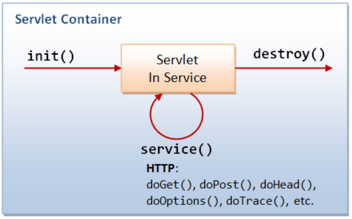

  - 초기화: 요청이 들어오면 서블릿이 서블릿 컨테이너에 등록되어 있는지 확인하고, 없으면 초기화를 진행한다.
  - 요청 처리: 요청이 들어오면 각각의 HTTP 메서드에 맞게 요청을 처리한다
  - 소멸: 서블릿 컨테이너가 서블릿에 종료 요청을 하여 종료 시에 처리해야하는 작업을 처리한다.

클라이언트로부터 요청이 오면 서블릿 컨테이너는 먼저 서블릿이 초기화 되어있는지를 확인한다.

만약 서블릿이 이미 할당되어 있다면 바로 요청을 처리하지만 그렇지 않다면 init() 메서드를 호출해 초기화를 진행하고 할당한다.

SpringBoot 에서는 스프링 컨테이너가 웹 컨텍스트까지 제어가 가능하므로 이미 디스패처 서블릿은 할당은 되어 있고, 초기화는 되어있지 않은 상태이다.

init() 메서드는 첫 요청이 왔을 때 한번만 실행되기 때문에 서블릿의 스레드에서 공통적으로 필요로 하는 작업들이 진행되며, 이런 이유로 스프링은 첫 요청을 처리하는데 많은 시간을 필요로 하는 것이다.

---

### 서블릿 초기화에서 진행되는 작업들

디스패처 서블릿은 컨트롤러로 요청을 위임하고, 컨트롤러부터 받은 결과를 처리하기 위해 다음과 같은 도구들을 필요로 한다.

  - MultiPart 파일 업로드를 위한 MultiPartResolver
  - Locale 결정을 위한 LocaleResolver
  - 요청을 처리할 컨트롤러를 찾기 위한 HandlerMapping
  - 요청을 컨트롤러로 위임하기 위한 HandlerAdapater
  - 뷰를 반환하기 위한 ViewResolver

스프링은 Lazy-Init 전략을 사용해 애플리케이션을 빠르게 구동하도록 하고 있어서, 디스패처 서블릿에 해당 도구들이 설정되지 않은 상태로 띄워지게 된다. 그리고 서블릿 초기화 시에 애플리케이션 컨택스트로부터 해당 타입의 빈을 찾아서 디스패처 서블릿에 설정(Set)해준다. 그래야 요청을 정상적으로 처리할 수 있기 때문이다. 물론 위에서 적은 내용들 외에도 다양한 서블릿 초기화 작업들이 진행된다. 위의 내용은 DispatcherServlet에 다음과 같이 구현되어 있다. 

```java
@Override
protected void onRefresh(ApplicationContext context) {
    initStrategies(context);
}

protected void initStrategies(ApplicationContext context) {
    initMultipartResolver(context);
    initLocaleResolver(context);
    initThemeResolver(context);
    initHandlerMappings(context);
    initHandlerAdapters(context);
    initHandlerExceptionResolvers(context);
    initRequestToViewNameTranslator(context);
    initViewResolvers(context);
    initFlashMapManager(context);
}
```

위의 코드에서 도구들을 초기화하는 메서드 이름이 initStrategies인 이유는 전략 패턴이 적용되었기 때문이다.

대표적으로 뷰를 반환하기 위한 도구인 ViewResolver를 중심으로 살펴보자.

ViewResolver는 전략 패턴을 적용하기 위해 인터페이스로 만들어졌다.

```java
public interface ViewResolver {

    @Nullable
    View resolveViewName(String viewName, Locale locale) throws Exception;

}
```

애플리케이션이 실행되면 기본 구현체들(ContentNegotiatingViewResolver, BeanNameViewResolver, InternalResourceViewResolver)를 빈으로 등록해둔다. 

그리고 개발자가 추가한 Thymeleaf나 Mustache와 같은 템플릿 엔진을 위한 ViewResolver도 추가될 수 있다.

ViewResolver 외에 다른 모든 도구들도 전략 패턴을 적용하기 위한 인터페이스를 갖고 있으며, 인터페이스 타입으로 선언되어 있다. 이러한 작업들이 서블릿 초기화 시점에 처리되는데, 사실 이러한 부분은 성능에 많은 영향을 주지는 않는다. 오히려 JVM의 JIT 컴파일러에 의한 영향이 훨씬 큰데, 이와 관련해서 살펴보도록 하자. 

---

# JIT 컴파일러의 웜업(Warm-Up)

### 자바 언어의 동작 방식

첫 요청이 오래 걸리는 주된 이유는 JVM JIT 컴파일러와 연관이 있다.

먼저 자바 언어의 동작 방식과 C, C++, Rust 같은 컴파일 언어의 동작 과정부터 살펴보도록 하자.

컴파일 언어는 컴파일 과정에서 바로 기계어를 만들어낸다. 그리고 컴파일 시에 코드 최적화까지 진행하여 처리 성능이 상당히 뛰어나다. 대신 생성된 기계어는 빌드 환경(특정 OS)에 종속적이라서, 플랫폼이 바뀐다면 다시 빌드해야 하는 문제가 있다.

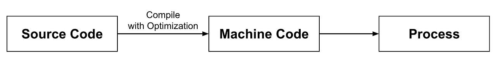

자바는 이러한 플랫폼 종속적인 문제를 해결하고자 JVM을 도입하였고, 그래서 동작 과정이 조금 다르다.

자바는 먼저 작성된 소스 코드를 바이트 코드로 컴파일하는데, 바이트 코드는 주로 JAR 또는 WAR로 아카이브하여 활용하게 된다. JVM은 아카이빙된 파일을 구동하는데, **실시간으로 바이트 코드를 기계어로 번역하면서 CPU가 해당 기계어를 처리한다.** 

이러한 구조 때문에, 코드를 실행할 때 바이트 코드를 기계어로 번역하는 작업 때문에 성능이 느려졌다.

그래서 이러한 문제를 해결하고자 JIT 컴파일러를 도입하여 사용하고 있다.

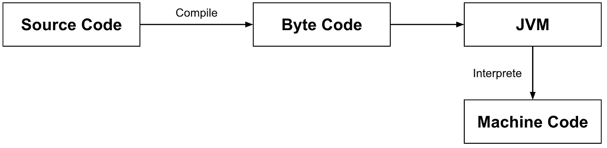

---

### JIT 컴파일러(Just In Time Complier)의 웜업(Warm-Up) 문제

자바는 성능 문제를 해결하기 위해 적시에 기계어를 만들어낸다는 의미의 JIT(Just In Time) 컴파일러를 도입하여 사용하고 있다. JIT 컴파일러는 핫스팟이라고도 불리는데, JDK 1.3부터 반영되어 있다.

**JIT 컴파일러는 바이트 코드를 기계어로 번역하는 과정에서 캐시를 활용한다.** 

그래서 이미 번경된 기계어를 재사용할 수 있도록 하며, 그에 더해 런타임 환경에 맞춰 코드도 최적화함으로써 성능을 향상시킨다.

하지만 **문제는 애플리케이션이 시작될 때에는 캐싱된 기계어가 없다는 것**이고, 그래서 스프링에서 첫 요청이 오래걸리는 것이다.

그래서 애플리케이션 시작 후에 강제로 로직을 호출하여 기계어를 캐싱해두는 작업이 필요한데, 이를 warm-up이라고 한다. 위에서 설명한 서블릿 초기화 보다는 JIT 컴파일러 부분이 훨씬 성능이 크게 영향을 미친다.

---

### 메타스페이스에 처음 사용되는 클래스들의 메타데이터 적재 X

자바는 클래스가 실제로 필요할 때(on-demand) 동적으로 로딩한다.

클래스가 처음 참조되면, 클래스 로더가 .class 파일을 읽어 메타데이터(메서드, 필드, 상수, 구조 등)를 메타스페이스에 적재한다.

이 과정에서 로딩(Loading) → 링크(Linking) → 초기화(Initialization) 단계를 거치며, static 변수 초기화, static 블록 실행 등도 함께 일어난다.

따라서 **첫 요청이 느린 이유는 JIT 캐싱뿐 아니라,클래스의 메타데이터가 메타스페이스(메서드 영역)에 아직 로딩되지 않았기 때문이다****.**

---

# 첫 요청이 느린 문제의 해결 방법

**느린 이유 요약** 

  - 디스패처 서블릿 초기화
  - JIT 컴파일러 기계어 캐싱 X
  - 메타데이터 로딩 X

첫 요청이 느린 문제의 해결 방법은 간단하다. 스프링 애플리케이션이 실행된 후에 핵심 로직들을 강제로 호출시켜 warm-up 하면 된다. warm-up 후에 해당 서버를 투입시키는 것이다. 

개발자라면 애플리케이션이 실행된 후에 1회 초기화 과정을 자동화하기를 원할 수 있다.

---

# 참고 자료

[https://mangkyu.tistory.com/232](https://mangkyu.tistory.com/232)

### CommandLineRunner, ApplicationRunner

CommandLineRunner 

  - 스프링 부트 1.0
  - 함수형 인터페이스

ApplicationRunner

  - 스프링 부트 2.0
  - 함수형 인터페이스

---

### @EventListener를 사용한 이벤트 리스너 등록

스프링 4.2부터 @EventListener 애노테이션이 추가되었는데, 스프링 빈 안에 구현해두면 리스너가 동작하게 된다. 스프링은 애플리케이션이 준비되었을 때 ApplicationReadyEvent 타입의 이벤트를 발행한다.

```java
@SpringBootApplication
public class SpringJavaStudyApplication {

	public static void main(String[] args) {
		SpringApplication.run(SpringJavaStudyApplication.class, args);
	}

	@Order(2)
	@EventListener(ApplicationReadyEvent.class)
	public void init () {
		System.out.println("Application is ready!");
	}

	@Order(1)
	@EventListener
	public void init(ApplicationReadyEvent event) {
		System.out.println("Application is ready! (using ApplicationReadyEvent)");
	}

}
```

스프링은 ApplicationReadyEvent 타입의 이벤트를 1회만 발행하는데, 위의 코드에서는 수신하는 리스너가 2개가 존재한다. **이벤트 리스너는 기본적으로 멀티 캐스팅 관계이므로 동일한 타입의 여러 리스너가 등록되었다면 모든 리스너가 이벤트를 받게 된다.**

더 자세한 이벤트 리스너 관련 내용은 참고자료를 확인하자

---

### 참고 자료

[https://mangkyu.tistory.com/233](https://mangkyu.tistory.com/233)

# 서론 

Spring 프레임워크를 사용하다보면 AOP를 적용해야 하는 상황이 온다.

AOP를 적용하다보면 클래스나 메서드에 있는 애노테이션 또는 메서드로 넘겨진 파라미터 값을 필요로 할 때가 있다. 그 방법에 대해서 살펴보자.

---

# 메서드 파라미터 값 가져오기

```java
@Slf4j
@Service
@ClassAop
public class HelloService {

	@MethodAop(value = "myValue")
	public String hello(String name) {
		log.info("Hello, {}", name);
		return name;
	}

}

```

현재 HelloService를 보면 클래스 레벨, 메서드 레벨 애노테이션이 있는 메서드가 있다.

```java
@Aspect
@Component
@Slf4j
public class MethodAspect {

	@Around("@annotation(study.spring_java_study.aop.MethodAop)")
	public Object aspectParameter(final ProceedingJoinPoint joinPoint) throws Throwable {

	}
}
```

MethodAop를 위한 MethodAspect에서 hello 메서드의 파라미터를 어떻게 하면 꺼낼 수 있는지 살펴보자.

---

### 파라미터 이름 목록과 값 목록을 통한 조회

ProceedingJoinPoint를 통해 파라미터 이름 배열과 파라미터 값 배열을 얻을 수 있다.

그러므로 파라미터 이름의 배열을 순회하여 원하는 파라미터 이름이 나왔을 때의 인덱스 값을 사용해 파라미터 값 배열로부터 꺼내는 방법이 있다.

```java
@Aspect
@Component
@Slf4j
public class MethodAspect {
	
	@Around("@annotation(study.spring_java_study.aop.MethodAop)")
	public Object aspectParameter(final ProceedingJoinPoint joinPoint) throws Throwable {
		log.info("[aspectParameter] name: {}", getName(joinPoint, "name"));
		return joinPoint.proceed();
	}

	private String getName(final ProceedingJoinPoint joinPoint, final String parameterName) {
		String[] parameterNames = ((MethodSignature)joinPoint.getSignature()).getParameterNames();
		Object[] args = joinPoint.getArgs();
		for (int i = 0; i < parameterNames.length; i++) {
			if(parameterNames[i].equals(parameterName)) {
				return (String) args[i];
			}
		}
		throw new NoSuchParameterException(parameterName);
	}
}
```

하지만 현재 방법은 상당히 번거로우며 다음과 같은 문제를 야기할 수 있다.

  - 파라미터 이름이 없을 때 오류 발생
  - 파라미터 이름이 변경 → Aspect 또한 변경
  - 테스트하기 어렵다

---

### 파라미터 값 배열로부터 직접 조회

```java
@Around("@annotation(study.spring_java_study.aop.MethodAop)")
public Object aspectParameter(final ProceedingJoinPoint joinPoint) throws Throwable {
	log.info("[aspectParameter] name: {}", joinPoint.getArgs()[0]);
	return joinPoint.proceed();
}
```

이전 방법보다 더 간단하지만 역시 아직 다음 단점이 남아있다.

  - 파라미터가 변경되었을 때 문제가 발생할 수 있다.
  - 테스트하기 어렵다.

---

### args로 값을 주입받기

이러한 문제를 해결하기 위해 args를 이용해 값을 주입받는 방법이 있다.

args는 기본적으로 파라미터 포인트 컷(AOP 적용 조건)에 해당하므로 해당 타입이 순서대로 매칭되지 않으면 AOP가 적용되지 않는다.

```java
@Around("@annotation(study.spring_java_study.aop.MethodAop) && args(name, ..)")
public Object aspectParameter(
		final ProceedingJoinPoint joinPoint, 
		final String name
) throws Throwable 
{
	log.info("[aspectParameter] name: {}", name);
	return joinPoint.proceed();
}
```

위의 예시에서는 args(name, ..) 포인트 컷이 추가되었고, 메소드의 파라미터로 String name이 추가되었다. 

이것은 String 타입이 첫 번째 파라미터로 반드시 존재하고, 그 뒤에 ..는 다음 파라미터로 신경쓰지 않겠다(0..N)는 의미이다. 그러므로 첫 번째 인자로 String 타입이 있어야 해당 AOP가 동작한다. 만약 위의 String name을 Integer name으로 변경하면 에러가 발생하는 것이 아니라 AOP가 적용되지 않는다. 이러한 방식을 이용하면 깔끔하게 필요한 파라미터 값을 주입받을 수 있으며 파라미터 순서가 변경되거나 해도 동작을 하지 않으므로 에러를 발생하지는 않는다. 또한 테스트 코드를 작성하기가 훨씬 수월해진다. 

---

# 애노테이션 값 가져오기

애노테이션 기반으로 AOP를 개발하면 애노테이션에 있는 값이 필요하여 해당 애노테이션의 값을 조회해야 하는 상황이 생길 수 있다. 애노테이션이 클래스에 있는지 메서드에 있는지에 따라 가져오는 방법이 다르다.

---

### 클래스 레벨 애노테이션

@within 또는 @target 애노테이션을 사용해주면 된다.

```java
@Around("@annotation(study.spring_java_study.aop.MethodAop) && args(name, ..) && @within(annotation)")
public Object aspectParameter(
final ProceedingJoinPoint joinPoint,
final String name,
final ClassAop annotation
) throws Throwable 
{
	log.info("[aspectParameter] name: {} value: {}", name, annotation.value());
	return joinPoint.proceed();
}


@Around("@annotation(study.spring_java_study.aop.MethodAop) && args(name, ..) && @target(annotation)")
public Object aspectParameter(
	final ProceedingJoinPoint joinPoint,
	final String name,
	final ClassAop annotation
) throws Throwable 
{
	log.info("[aspectParameter] name: {} value: {}", name, annotation.value());
	return joinPoint.proceed();
}
```

---

### 메서드 레벨 애노테이션

@annotation 애노테이션을 사용해주면 된다.

```java
@Around("@annotation(study.spring_java_study.aop.MethodAop) && args(name, ..) && @annotation(annotation)")
public Object aspectParameter(
	final ProceedingJoinPoint joinPoint,
	final String name,
	final MethodAop annotation
) throws Throwable
{
	log.info("[aspectParameter] name: {} value: {}", name, annotation.value());
	return joinPoint.proceed();
}
```

---

# 참고 자료

[https://mangkyu.tistory.com/231](https://mangkyu.tistory.com/231)

### StringUtils

```java

/**
 * StringUtilsTest
 * 스프링 프레임워크의 StringUtils 테스트 클래스
 */
class StringUtilsTest {

	@Test
	@DisplayName("hasLength(): 해당 문자열이 비어있지 않으면 true를 반환한다.")
	void hasLength() {
		String str1 = "Hello, World!";
		boolean result1 = StringUtils.hasLength(str1);
		assertThat(result1).isTrue();

		String str2 = "";
		boolean result2 = StringUtils.hasLength(str2);
		assertThat(result2).isFalse();

		String str3 = " ";
		boolean result3 = StringUtils.hasLength(str3);
		assertThat(result3).isTrue();
	}

	@Test
	@DisplayName("hasText(): 해당 문자열이 비어있지 않고 공백이 아니면 true를 반환한다.")
	void hasText() {
		String str1 = "Hello, World!";
		boolean result1 = StringUtils.hasText(str1);
		assertThat(result1).isTrue();

		String str2 = "";
		boolean result2 = StringUtils.hasText(str2);
		assertThat(result2).isFalse();

		String str3 = " ";
		boolean result3 = StringUtils.hasText(str3);
		assertThat(result3).isFalse();
	}

	@Test
	@DisplayName("containsWhiteSpace(): 해당 문자열이 비어있지 않고 공백이 포함되어 있으면 true를 반환한다.")
	void containsWhiteSpace() {
		String st1 = "Hello,World!";
		boolean result1 = StringUtils.containsWhitespace(st1);
		assertThat(result1).isFalse();

		String str2 = "Hello, World!";
		boolean result2 = StringUtils.containsWhitespace(str2);
		assertThat(result2).isTrue();

		String str3 = " ";
		boolean result3 = StringUtils.containsWhitespace(str3);
		assertThat(result3).isTrue();

		String str4 = "";
		boolean result4 = StringUtils.containsWhitespace(str4);
		assertThat(result4).isFalse();
	}

	@Test
	@DisplayName("trimAllWhitespace(): 문자열의 모든 공백을 제거한다.")
	void trimAllWhitespace() {
		String str1 = "Hello,   World!";
		boolean result1 = StringUtils.containsWhitespace(str1);
		assertThat(result1).isTrue();

		String str2 = StringUtils.trimAllWhitespace(str1);
		boolean result2 = StringUtils.containsWhitespace(str2);
		assertThat(result2).isFalse();

		assertThat(str2).isEqualTo("Hello,World!");
	}

	@Test
	@DisplayName("trim(): 문자열의 앞뒤 공백을 제거한다.")
	void trim() {
		String str1 = "   Hello,  World!   ";
		String str2 = str1.trim();
		assertThat(str2).isEqualTo("Hello,  World!");
	}
}

```

그 외에도 대/소문자 처리, 배열에 특정 문자열 더하기, 특정 문자열로 자르기, path 관련 처리 등 다양한 기능을 제공한다.

---

### PatternMatchUtils

스프링은 간단한 패턴 매치를 판별하기 위한 PatternMatchUtils를 제공하고 있다.

  - simpleMatch: 어떤 문자열이 특정 패턴에 매칭되는지를 검사

```java
/**
 * PatternMathUtilsTest
 * 스프링 프레임워크의 PatternMathUtils 테스트 클래스
 */
class PatternMathUtilsTest {
	@Test
	void test() {
		String[] patterns = {"*.java", "*.xml"};
		String[] files = {"Test.java", "Test.xml", "Test.txt"};
		assertThat(PatternMatchUtils.simpleMatch(patterns, files[0])).isTrue();
		assertThat(PatternMatchUtils.simpleMatch(patterns, files[1])).isTrue();
		assertThat(PatternMatchUtils.simpleMatch(patterns, files[2])).isFalse();
	}
}
```

---

### ReflectionUtils

스프링은 리플렉션 API를 보다 편리하게 사용하기 위한 유틸 클래스를 제공한다.

  - accessibleConstructor: 접근 가능한 생성자를 찾는다
  - declareException: 메서드가 명시적으로 throw 하고 있는지를 검사
  - findField: 클래스에서 특정 필드를 찾는다
  - findMethod: 클래스에서 특정 메서드를 찾는다
  - getDeclaredMethods: 클래스의 모든 메서드를 찾는다
  - getAllDeclareMethods: 부모 클래스를 포함해 클래스의 모든 메서드를 찾는다
  - getField: 객체에서 필드의 실제 값을 찾는다
  - setField: 객체에서 필드의 실제 값을 설정
  - invokeMethod: 특정 메서드를 호출
  - makeAccessible: 접근 가능여부를 true로 설정

실제 프로덕션 코드에서는 해당 유틸 클래스를 사용할 경우는 거의 없다.

하지만 테스트 코드에서는 리플렉션이 필요한 상황이 있다. 

**그래서 테스트 코드에는 ReflectionTestUtils를 제공한다.**

  - getField: 객체에서 필드의 실제 값을 찾는다
  - setField: 객체에서 필드의 실제 값을 설정
  - invokeMethod: 특정 메서드를 호출

ReflectionTestUtils의 메서드는 접근 가능이 불가능한 상태여도 바로 호출이 가능하도록 내부적으로 makeAccessible을 호출해주고 있다.

```java
/**
 * ReflectionTestUtilsTest
 * 스프링 프레임워크의 ReflectionTestUtils 테스트 클래스
 */
class ReflectionTestUtilsTest {
	@Test
	void getField() {
		PrivateClass object = PrivateClass.of("before");
		// object.privateField -> 컴파일 에러 발생
		assertThat(object.getPrivateField()).isEqualTo("before");
		ReflectionTestUtils.setField(object, "privateField", "after");
		assertThat(object.getPrivateField()).isEqualTo("after");
	}
}
```

---

### SystemPropertyUtlis

스프링은 시스템 프로퍼티를 처리하기 위한 유틸 클래스를 제공한다.

  - resolvePlaceHolders

```java
/**
 * SystemPropertyUtilsTest
 * 스프링 프레임워크의 SystemPropertyUtils 테스트 클래스
 */
class SystemPropertyUtilsTest {

	private static final String PROPERTY_NAME = "name";
	private static final String PROPERTY_VALUE = "배제우";

	@BeforeEach
	void setUp() {
		System.setProperty(PROPERTY_NAME, PROPERTY_VALUE);
	}

	@AfterEach
	void tearDown() {
		System.clearProperty(PROPERTY_NAME);
	}

	@Test
	@DisplayName("프로퍼티를 찾고 치환하여 반환")
	void resolvePlaceholders1() {
		String result = SystemPropertyUtils.resolvePlaceholders("Hello, ${name}!");
		assertThat(result).isEqualTo("Hello, 배제우!");
	}

	@Test
	@DisplayName("프로퍼티 찾지 못하여 예외 발생")
	void resolvePlaceholders2() {
		assertThatThrownBy(() -> SystemPropertyUtils.resolvePlaceholders("Hi, ${notfound}"))
			.isInstanceOf(IllegalArgumentException.class)
			.hasMessageContaining("Could not resolve placeholder 'notfound' in value \"Hi, ${notfound}\"");
	}

	@Test
	@DisplayName("프로퍼티 찾지 못하여 그대로 반환")
	void resolvePlaceholders3() {
		String result = SystemPropertyUtils.resolvePlaceholders("Hi, ${notfound}", true);
		assertThat(result).isEqualTo("Hi, ${notfound}");
	}

}
```

---

### 기타 유틸 클래스

**BeanUtils** 

  - 스프링은 빈으로 만들 클래스 또는 객체에 대한 처리를 위해 유틸 클래스를 제공한다. 
- findMethod: 클래스에 선언된 메서드를 찾음
    - findDeclaredMethod: 클래스에 선언된 메서드를 찾음
    - getParameterNames: 생성자의 파라미터 목록을 찾음
    - getResolvableConstructor: 사용가능한 생성자를 찾음, 파라미터가 여러 개면 적은 것부터 찾는다
    - instantiateClass: 클래스 또는 생성자로 객체를 생성

**FileCopyUtils** 

  - 스프링은 파일 복사를 위한 유틸 클래스를 제공한다.
- copy: 파일을 복사
    - copyToByteArray: 바이트 배열로 파일을 복사
    - copyToString: 문자열로 파일을 복사

**AopUtils, AopTestUtils: Aop 관련 처리**

**ClassUtils : Class 이름과 매서드**

**TransactionSynchronizationUtils: 트랜잭션 처리**

---

### 스프링 유틸 클래스 특징

스프링은 내부적으로 유틸 클래스에 대한 컨벤션을 가지고 있는데, 모든 유틸성 클래스를 추상 클래스로 선언한다는 것이다.

일반적으로 유틸 클래스는 final 클래스로 선언하고 private 생성자를 만들어 두는 것이 좋다.

추상 클래스는 익명 객체로 생성이 가능하기 떄문이다.

---

### 참고 자료

[https://mangkyu.tistory.com/238](https://mangkyu.tistory.com/238)

# 1. 스프링 부트 테스트를 위한 의존성

### 스프링 부트 테스트를 위한 의존성

스프링 부트는 서블릿 기반 웹 개발을 위한 spring-boot-starter-web, 유효성 검증을 위한 spring-boot-starter-validation 등 spring-boot-starter 의존성을 제공한다.

테스트를 위한 의존성으로는 spring-boot-start-test가 존재한다. 해당 의존성에는 아래와 같은 라이브러리들이 포함된다.

  - JUnit5: 자바 애플리케이션의 단위 테스트를 위한 표준 테스트 도구
  - Spring Test & Spring Boot Test: 스프링 부트 애플리케이션에 대한 유틸리티 및 통합 테스트 지원
  - AssertJ: 유연한 검증 라이브러리
  - Hamcrest: 객체 Matcher를 위한 라이브러리
  - Mockito: 자바 모킹 프레임워크
  - JSONassert: JSON 검증을 위한 도구
  - JsonPath: JSON 용 Xpath 

---

### 스프링 부트 테스트를 위한 애노테이션 

스프링 부트는 spring-boot-test-autoconfigure 통해 특정 애노테이션을 붙여주면 해당 테스트를 위한 설정들을 자동으로 제공해준다.

  - @SpringBootTest
  - @WebMvcTest
  - @DataJpaTest
  - @RestClientTest
  - @JsonTest
  - @JdbcTest

---

### @Autowired @MockBean @SpyBean

스프링 부트가 제공하는 테스트 애노테이션들은 실제 스프링 컨텍스트를 사용해 빈들을 등록한다.

그래서 @Autowired로 등록된 빈을 주입받을 수 있다.

특정 객체를 모킹하고 싶은 경우에는 @MockBean @SpyBean를 사용하면 된다.

  - @MockBean: 해당 객체를 Mock된 빈으로 등록
  - @SpyBean: 해당 객체를 Spy된 빈으로 등록
- **@SpyBean은 스프링의 프록시가 적용된 빈이라면 사용이 불가능하니 프록시를 제거해주어야 한다.**

---

# 2. 스프링부트 테스트를 위한 다양한 애노테이션들

### @SpringBootTest

통합 테스트를 위한 애노테이션이다. 모든 빈들을 스캔하고 애플리케이션 컨텍스트를 생성하여 테스트를 실행한다.

해당 애노테이션에는 다양한 값을 줄 수 있다.

  - value, properties: 애플리케이션 실행에 필요한 프로퍼티를 key=value 형태로 추가할 수 있다.
  - args: 애플리케이션의 arguments로 값을 전달할 수 있다.
  - classes: 애플리케이션을 로딩할 때 사용되는 컴포넌트 클래스들을 정의할 수 있다.
  - webEnvironment: 웹 테스트 환경을 설정할 수 있다.

---

### @SpringBootTest: webEnvironment

  - **MOCK**
- 웹 기반의 애플리케이션 컨텍스트를 생성, MOCK 환경으로 제공하여 내장 서버가 시작되지 않는다.
    - 웹 환경이 클래스패스에 없다면 웹이 아닌 애플리케이션 컨텍스트를 생성
    - 웹 기반의 Mock 테스트를 위해 @AutoConfigureMockMvc, @AutoConfigureWebTestClient 함께 사용 가능
  - **RANDOM_PORT**
- 웹 기반의 애플리케이션 컨텍스트를 생성, 실제 웹 환경 제공
    - 내장 서버 실행, 사용되지 않는 랜덤 포트를 사용
  - **DEFINED_PORT**
- 웹 기반의 애플리케이션 컨텍스트를 생성, 실제 웹 환경 제공
    - 내장 서버 실행, 지정한 포트(default 8080)를 사용
  - **NONE**
- SpringApplication 으로 애플리케이션 컨텍스트 생성
    - mockd이나 다른 것들을 포함해 어떠한 웹 환경을 제공하지 않는다.

webEnvironment 기본값은 MOCK → 실제 웹 서버가 실행되지 않는다.

**테스트에 @Transactional이 있으면 테스트 끝나고 트랜잭션을 롤백하는데, RANDOM_PORT, DEFINED_PORT 같은 경우 실제 서버가 구동되어 롤백되지 않는다.**

해당 문제를 해결하는 방법은 [https://mangkyu.tistory.com/264](https://mangkyu.tistory.com/264) 해당 링크를 참고하자.

또한 RANDOM_PORT, DEFINED_PORT 같은 경우 TestRestTemplate 의존성이 추가되므로 API 호출이 필요할 때 이용할 수 있다. 

---

### @SpringBootTest 단점 & 슬라이스 테스트(Slice Test)

@SpringBootTest는 기본적으로 모든 빈을 탐색하고 등록한다. 그래서 특정 계층만 테스트가 필요한 상황에서 @SpringBootTest를 사용하면 불필요하게 무거워지고 시간이 오래 걸린다.

그래서 스프링은 특정 부분만 테스트할 수 있는 슬라이스 테스트를 위한 애노테이션을 제공한다.

**물론 슬라이스 테스트도 스프링 컨텍스트를 구성하므로 통합 테스트이다.**

---

### @WebMvcTest

@WebMvcTest를 사용하면 간편하게 컨트롤러를 테스트할 수 있는 환경을 제공한다, 내장된 서블릿 컨테이너가 랜덤 포트로 실행된다.

@WebMvcTest는 애플리케이션 컨텍스트를 만들 때 **컨트롤러와 연관된 빈들만을 제한적으로 찾아서 등록한다.**

등록되는 빈들은 아래 링크에 정리되어 있다.

[Untitled](https://app.notion.com/p/1fc7d6692ca8800aa853c98ebf20bed5) 

추가적인 설정이 필요하면 @Import를 사용할 수 있고, @MockBean이나 @SpyBean 역시 사용할 수 있다. 

또한 @WebMvcTest는 컨트롤러 테스트이므로 @WebMvcTest 내부에 @AutoConfigureMockMvc가 들어있다. 그러므로 @Autowired로 MockMvc를 주입받을 수 있다.

---

### @DataJpaTest

JPA 레포지토리의 슬라이스 테스트를 위해서 해당 애노테이션을 이용할 수 있다.

@Entity가 있는 엔티티들을 스캔하며 테스트를 위한 TestEntityManager를 사용해 JPA 레포지토리를 설정해준다. 

@Transactional 애노테이션이 @DataJpaTest 안에 들어있어서 기본적으로 모든 테스트가 롤백된다.

만약 롤백을 원하지 않는다면 @Rollback(false)를 추가하면 된다.

만약 H2와 같은 내장 데이터베이스가 클래스 패스에 존재한다면 내장 데이터베이스가 자동 구성된다.

spring-boot-test 의존성에는 기본적으로 H2가 들어있으므로 별다른 설정을 주지 않는다면 H2로 설정된다.

내장 데이터베이스로 설정되기를 원하지 않는다면 다음과 같이 설정하면 된다.

```java
@DataJpaTest
@AutoConfigureTestDatabase(replace = Replace.NONE)
class MyRepositoryTests {

}
```

---

# 3. 스프링 부트 테스트의 애플리케이션 컨텍스트 캐싱

### 애플리케이션 컨텍스트 캐싱

스프링 부트가 제공하는 테스트는 모두 애플리케이션 컨텍스트를 구성해주어야 한다. 하지만 모든 테스트마다 이를 구성하려면 비용이 커지므로 스프링은 **테스트 시에 내부적으로 스프링 컨텍스트를 캐싱해두고 동일한 설정이라면 재사용한다.** 

그러므로 다음과 같이 애플리케이션 컨텍스트 설정에 변경을 주는 기능들은 테스트 시에 새로운 컨텍스트를 생성하도록 요구한다.

  - @MockBean, @SpyBean
  - @TestPropertySource
  - @ConditionalOnX
  - @WebMvcTest에 컨트롤러 지정
  - @Import

@MockBean과 @SpyBean은 특정 빈을 Mock이 적용된 빈으로 등록한다. 그러므로 애플리케이션 컨텍스트가 갖는 빈이 달라져 새로운 컨텍스트를 생성하게 된다. 그러다보니 @MockBean과 @SpyBean을 많이 사용하면 테스트가 느려질 수 있으며 캐싱된 애플리케이션 컨텍스트의 수를 증가시킨다. 물론 테스트 클래스에서 @MockBean과 @SpyBean이 적용된 객체가 완전히 동일하다면 재사용한다. 그러므로 만약 현재 테스트 속도가 느리다면 테스트들마다 애플리케이션 컨텍스트가 생성되는지 확인해보도록 하자.

---

# 참고 자료

[https://mangkyu.tistory.com/242](https://mangkyu.tistory.com/242)

### 스프링 부트 테스트 작성 시 주의사항1

스프링 부트가 제공하는 테스트 애노테이션들은 모두 애플리케이션 컨텍스트를 만들어 조건에 맞는 빈들을 찾아서 등록한다. **그러다보니 애플리케이션 설정을 잘못하면 불필요하게 테스트 비용이 커지게 된다.**

  - 특정 기능을 위한 @Enable 애노테이션
  - 빈 탐색을 위한 @ComponentScan

**특정 기능을 위한 @Enable 애노테이션**

스프링 부트에서 테스트를 위한 애플리케이션 컨텍스트를 만들 때 설정의 기준이 되는 클래스는 @SpringBootApplication 애노테이션이 붙은 클래스이다. 일반적으로 해당 애노테이션은 메인 클래스에 존재하는데, 이러한 이유로 **메인 클래스에는 특정한 기능을 위한 설정을 추가하지 않는 것이 좋다.**

```java
@SpringBootApplication
@EnableBatchProcessing
public class MyApplication {

    public static void main(String[] args) {
        SpringApplication.run(MyApplication.class, args);
    }

}
```

현재 메인 클래스에는 배치 설정 활성화를 위한 애노테이션인 @EnableBatchProcessing이 존재한다.

문제는 @SpringBootApplication에 의해 해당 메인 클래스가 테스트를 위한 기본 클래스가 되므로, 스프링 부트 슬라이스 통합 테스트인 @WebMvcTest, @DataJpaTest를 사용할 때에도 Spring Batch에 대한 설정까지 활성화가 된다. 이것은 테스트를 불필요하게 무겁게 만들기 때문에 특정 기능을 위한 설정 클래스를 만들어 분리하는 것이 좋다.

```java
@Configuration
@EnableBatchProcessing
public class MyBatchConfiguration {

}
```

**빈 탐색을 위한 @ComponentScan**

위와 마찬가지로 @ComponentScan을 설정해주는 것 역시 슬라이스 테스트를 진행할 때 부작용을 일으킬 수 있다. 예를 들어 우리가 다음과 같이 컴포넌트 스캔 설정을 해두었다고 하자.

```java
@SpringBootApplication 
@ComponentScan({ "com.mangkyu.app", "com.mangkyu.another"})
public class MyApplication {

    public static void main(String[] args) {
        SpringApplication.run(MyApplication.class, args);
    }

}
```

역시 스프링은 @SpringBootApplication을 참고해 애플리케이션 컨텍스트를 생성하는데, 오버라이딩한 컴포넌트 스캔에 의해 불필요한 빈들까지 등록이 된다. 예를 들어 위와 같이 설정에서 @DataJpaTest를 사용하면 컨트롤러부터 서비스 등 해당 위치의 모든 빈이 등록된다. 그러므로 이러한 이슈를 피하기 위해서는 역시 별도의 설정 클래스로 빼주는 것이 좋다. 만약 불가능하다면 테스트 패키지에 별도의 @SpringBootConfiguration을 만들거나 테스트에 대한 소스 위치를 지정하여 기본 설정을 비활성화할 수 있다.

### 스프링 부트 테스트 작성 시 주의사항2

**애플리케이션 컨텍스트 캐싱**

[스프링 부트 테스트를 위한 의존성과 애노테이션(@SpringBootTest, @WebMvcTest, @DataJpaTest)](https://app.notion.com/p/26b7d6692ca881f19e77f8ccfefb00c4) 

---

### 참고 자료

[https://mangkyu.tistory.com/243](https://mangkyu.tistory.com/243)

---

# 4주차 

# 서론 

개발을 하다보면 추상화를 위해 하나의 인터페이스 또는 추상 클래스가 여러 구현체를 갖는 경우가 자주 있다.

이때 특정 타입의 구현체를 찾아주어야 하는 팩토리 클래스를 만드는 것이 불가피한데, 이 팩토리 클래스를 유연하게 만드는 방법에 대해 알아보도록 하자.

---

# if-else로 팩토리 클래스 구현하기

**다양한 로그인 방법을 지원한다고 가정**

```java
public interface LoginService {
		void login();
}
```

**Login Service 구현체 및 LoginController dependecy**

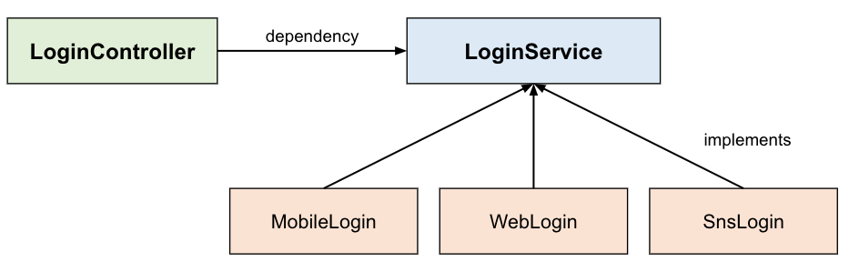

**LoginController** 

```java
@RestController
@RequiredArgsConstructor
public class LoginController {
		private final LoginFactory loginFactory;
	
		@GetMapping("/login")
		public void login(@RequestParam(value = "LoginType", required = true) LoginType loginType) {
				loginFactory.find(loginType).login();
		}
}
```

**LoginFactory** 

```java
@Component
@RequiredArgsConstructor
public class LoginFactory {
		private final MobileLogin mobileLogin;
		private final WebLogin webLogin;
		private final SnsLogin snsLogin;
		
		public LoginService find(final LoginType loginType) {
				if(loginType == LoginType.MOBILE) {
						return mobileLogin;
				}
				else if(loginType == LoginType.WEB) {
						return webLogin;
				}
				else if(loginType == LoginType.SNS) {
						return snsLogin;
				}
				throw new NoSuchParameterException("Cannot find login type: " + loginType.name());	
		}
}
```

현재 LoginFactory 구조는 문제가 많다.

LoginService의 새로운 구현체가 생겼을 때 해당 팩토리 클래스도 수정이 필요하기 때문이다.

만약 구현체가 점점 늘어나면 유지보수하기가 어려워진다.

**그러므로 보다 유연하게 대응할 수 있는 팩토리 클래스가 필요하다.**

---

# if-else 없이 유연한 팩토리 클래스 구현하기

  1. LoginService에서 해당 로그인 타입일 경우 처리 여부를 결정하는 supports 메서드를 추가한다.

```java
public interface LoginService {
		void login();
		boolean supports(LoginType loginType);
}
```

  1. LoginService 구현체에 supports 메서드 오버라이딩
  1. 팩토리 클래스 수정

```java
@Component
@RequiredArgsConstructor
public class LoginFactory2 {
		private final List<LoginService> loginServiceList;
		private final Map<LoginType, LoginService> factoryCache = new HashMap<>();
	
		public LoginService find(final LoginType loginType) {
				LoginService loginService = factoryCache.get(loginType);
				if(loginService != null) {
						return loginService;
				}
		
				return loginServiceList.stream()
						.filter(v -> v.supports(loginType))
						.findFirst()
						.orElseThrow(() -> new IllegalArgumentException("Cannot find login type: " + loginType.name()));
			}
}

```

이제 새로운 구현체가 생겨도 팩토리 클래스를 수정할 필요가 없다.

---

# 참고 자료

[https://mangkyu.tistory.com/252](https://mangkyu.tistory.com/252)

# ObjectMapper를 이용한 직렬화(Serialize)

ObjectMapper는 리플랙션을 활용해서 객체로부터 Json 형태의 문자열을 만들어내는데, 이것을 직렬화(Serialize)라고 한다. → @ResponseBody, @RestController, ResponseEntity 등등…

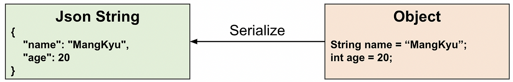

Spring에서는 기본적으로 jackson 모듈의 ObjectMapper라는 클래스가 직렬화를 처리한다.

그 과정에서 ObjectMapper의 writeValueAsString() 메서드가 사용된다.

객체로부터 Json 문자열을 만들기 위해서는 필드 값을 알아야 한다.

하지만 ObjectMapper의 기본 설정으로는 public 필드 또는 public 형태의 getter(getXX 메서드)만 접근이 가능하다. 물론 추가 설정을 통해 가시성을 높여줄 수 있지만, getter가 없는 경우는 거의 없으므로 기본 설정으로 사용해도 충분하다. 그러므로 ObjectMapper를 이용하는 경우, 직렬화를 위해 기본적으로 getter를 만들어두는 것이 좋다.

```java
@Test
@DisplayName("record 직렬화 테스트")
void test1() throws Exception {
		String json = objectMapper.writeValueAsString(
									new RecordUser("Trump Donald", 77));
		log.info("result: {}", json);
}

@Test
@DisplayName("getter 없는 class 직렬화 테스트")
void test2() throws Exception {
		assertThatThrownBy(() -> objectMapper.writeValueAsString(
				new ClassUser("Trump Donald", 77)))
			.isInstanceOf(InvalidDefinitionException.class);
}

@Test
@DisplayName("getter 있는 class 직렬화 테스트")
void test3() throws Exception {
		String json = objectMapper.writeValueAsString(
				new ClassUser2("Trump Donald", 77));
		log.info("result: {}", json);
}

record RecordUser(String name, int age) {

}

class ClassUser {
		private String name;
		private int age;
	
		public ClassUser(String name, int age) {
			this.name = name;
			this.age = age;
		}
}

@Getter
class ClassUser2 {
		private String name;
		private int age;
	
		public ClassUser2(String name, int age) {
			this.name = name;
			this.age = age;
		}
}
```

**최신 정리**

Jackson의 필드 탐색/직렬화는 단순히 get으로 시작되는 getter만 아니라, public 메서드(파라미터 없는)도 기본적으로 포함한다.

최근 버전의 Spring Boot/Jackson은 기본적으로 Java record 타입을 지원하는 Jackson 모듈(jackson-datatype-jdk8, jackson-datatype-parameter-names 등)을 자동 등록하여 별도의 커스터마이징 없이도 record와 함께 동작한다.

### ObjectMapper를 이용한 직렬화 주의 사항

ObjectMapper 직렬화 동작 방식 때문에 때론 의도치 않은 json 메세지를 만들어 내기도 한다.

아래 메서드를 보면 getXX로 시작하는 getNameAge() 메서드가 존재한다.

```java
@Getter
class ClassUser2 {
		private String name;
		private int age;
	
		public ClassUser2(String name, int age) {
				this.name = name;
				this.age = age;
		}
	
		public String getNameAge() {
				return name + " " + age;
		}
}

// {"name":"Trump Donald","age":77,"nameAge":"Trump Donald 77"}
```

getNameAge() 역시 getter 메서드 규칙을 따르기 때문에 nameAge라는 json 문자열이 만들어진다.

꼭 이러한 동작 방식을 인지하자

---

# ObjectMapper를 이용한 역직렬화(Deserialize)

ObjectMapper는 리플랙션을 활용해서 Json 문자열로부터 객체를 만들어내는데, 이것을 역직렬화(Deserialize)라고 한다. → @RequestBody

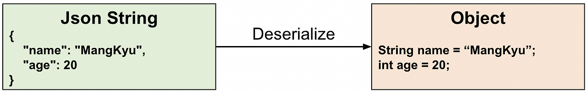

역직렬화는 기본적으로 다음과 같은 과정을 거쳐서 처리된다.

  1. 기본 생성자로 객체를 생성
  1. 필드값을 찾아서 값을 바인딩

가장 먼저 객체를 생성하는데, 기본 생성자가 없으면 에러를 발생시킨다.

기본 생성자로 객체를 생성한 후에는 필드값을 찾아야하는데, 기본적으로 public 필드 또는 public getter/setter로 찾을 수 있다. 만약 처리에 실패하면 마찬가지로 InvalidDefinitionException이 발생한다.

결론적으로, Spring Boot 최신 버전(3.x 이상)과 Jackson 조합에서는 record 타입처럼 "모든 필드를 받는 생성자"가 있으면 기본 생성자 없이도 역직렬화가 지원된다.

별도의 커스텀 설정 없이도 동작하며, 이는 스프링 부트가 jackson 관련 모듈을 자동 등록해주기 때문이다.

---

# 정리 

더 자세한 내용은 참고 자료를 보자

---

# 참고 자료 

[https://mangkyu.tistory.com/223](https://mangkyu.tistory.com/223)

[https://mangkyu.tistory.com/264](https://mangkyu.tistory.com/264)

# 스프링에서 이벤트 사용법 및 주의사항

### 스프링에서 이벤트의 발행과 구독

  - 스프링 부트 1.3(스프링 4.2) 이전 버전이라면 이벤트 클래스가 ApplicationEvent를 상속
  - 이벤트 발행을 위해서는 ApplicationEventPublisher를 주입받아 사용해야 한다
  - 이벤트 구독을 위해서는 ApplicationListener 인터페이스를 구현하거나 @EventListner를 사용해야 한다

스프링에서 이벤트 발행은 ApplicationEventPublisher 인터페이스가 담당한다.

이를 구현하는 것은 결국 애플리케이션 컨텍스이다.

이벤트 발행은 publishEvent 메서드를 사용하면 된다.

이벤트 구독은 ApplicationListener 인터페이스를 구현하거나 @EventListner를 사용해야 한다

이벤트가 발행되면 애플리케이션 컨텍스트는 해당 이벤트를 구독하는 빈들을 찾아서 notify 해주는데, 이러한 부분은 **내부적으로 옵저버 패턴을 사용해 구현되어 있다.**

### 스프링 이벤트 발행과 구독 동작 방식

  - 멀티캐스팅 방식으로 동작한다
  - 동기 방식으로 동작한다
  - 트랜잭션과의 결합이 필요하다면 @TransactionalEventListener

스프링 이벤트 리스너는 기본적으로 **멀티 캐스팅 관계**이다. 

따라서 동일한 타입의 여러 리스너가 등록되었다면 모든 리스너가 이벤트를 받게 되므로 주의가 필요하다.

스프링 이벤트는 동기 방식으로 진행한다

이벤트 처리가 하나의 트랜잭션 안에서 실행된다면 트랜잭션 동작을 고려해야할 수 있다.

그래서 스프링 4.2 부터는 @EventListner를 확장한 @TransactionalEventListener를 제공하고 있으며 

아래와 같은 옵션을 제공한다.

  - TransactionPhase.BEFORE_COMMIT
  - TransactionPhase.AFTER_COMPLETION
  - TransactionPhase.AFTER_COMMIT
  - TransactionPhase.AFTER_ROLLBACK

### 비동기로 이벤트 처리하기

이벤트를 비동기 방식으로 동작시키는 것은 이벤트 발행을 발행시키 전/후가 더 이상 하나의 트랜잭션으로 묶일 수 없다는 것을 의미하기도 한다. 

이벤트를 비동기로 처리하기 위해서는 다음의 2가지 방법이 있다.

  - @Async 메서드로 비동기 구현
  - ApplicationEventMulticaster로 비동기 구현

기본적으로 이벤트를 구독하는 부분에 @Async 메서드를 사용하면 된다.

만약 비동기 실행이 되지 않는다면 @EnableAsync로 비동기 설정이 활성화 되어 있는지 확인해보면 된다.

만약 모든 메시지를 기본적으로 비동기로 처리한다면 위와 같은 방식은 번거롭다.

다수의 ApplicationEventListner 객체를 관리하고 객체에 이벤트를 전달하기 위한 인터페이스는 ApplicationEventMulticaster 인데, 해당 부분을 수정하면 된다.

자세한 내용은 아래 참고 자료 블로그를 확인하자

---

# 참고 자료 

[https://mangkyu.tistory.com/292](https://mangkyu.tistory.com/292)

# 스프링이 제공하는 Cache 기능 정리

### Cache Abstraction(캐시 추상화)

로컬 메모리에서 동작하는 caffeine 캐시, 분산 저장소를 활용하는 Redis 캐시 등 다양한 구현체 존재

해당 기술을 직접 의존하면 캐시 구현체가 변경될 때 코드에 영향을 받는다.

스프링은 이러한 문제를 방지하기 위해 캐시를 추상화하여 제공한다.

### Cache 인터페이스

Cache 인터페이스는 공통된 캐시 기능을 스프링이 추상화 한 것으로, 이를 통해 모든 캐시를 하나의 일관된 인터페이스로 접근할 수 있다.

```java
public interface Cache {
	
		String getName();
	
		Object getNativeCache();
	
		@Nullable
		ValueWrapper get(Object key);
	
		@Nullable
		<T> T get(Object key, @Nullable Class<T> type);
	
		@Nullable
		<T> T get(Object key, Callable<T> valueLoader);
	
		
		@Nullable
		default CompletableFuture<?> retrieve(Object key) {
			throw new UnsupportedOperationException(
					getClass().getName() + " does not support CompletableFuture-based retrieval");
		}
	
		default <T> CompletableFuture<T> retrieve(Object key, Supplier<CompletableFuture<T>> valueLoader) {
			throw new UnsupportedOperationException(
					getClass().getName() + " does not support CompletableFuture-based retrieval");
		}
	
		void put(Object key, @Nullable Object value);
	
	
		@Nullable
		default ValueWrapper putIfAbsent(Object key, @Nullable Object value) {
				ValueWrapper existingValue = get(key);
				if (existingValue == null) {
						put(key, value);
				}
				return existingValue;
		}
	
		void evict(Object key);
	
		default boolean evictIfPresent(Object key) {
				evict(key);
				return false;
		}
	
		void clear();
	
		default boolean invalidate() {
				clear();
				return false;
		}
	
	
		@FunctionalInterface
		interface ValueWrapper {
		
				@Nullable
				Object get();
		}
	
	
		@SuppressWarnings("serial")
		class ValueRetrievalException extends RuntimeException {
	
				@Nullable
				private final Object key;
		
				public ValueRetrievalException(@Nullable Object key, Callable<?> loader, @Nullable Throwable ex) {
						super(String.format("Value for key '%s' could not be loaded using '%s'", key, loader), ex);
						this.key = key;
				}
		
				@Nullable
				public Object getKey() {
						return this.key;
				}
		}
	
}	
```

기본적으로 캐시 구현체는 1개의 캐시 이름을 가지며, 캐시의 종류에 따라서 구현이 달라진다.

대표적으로 Caffein Cache와 Redis Cache가 존재한다.

**Caffeine Cache는 로컬 메모리에 값을 저장하는 인메모리 캐시로, ConcurrentHashMap을 사용하여 구현**되어 있다. 예를 들어 사용자의 이메일을 바탕으로 닉네임 정보를 캐싱하면 아래와 같다.

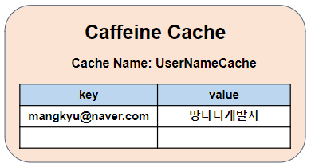

외부 저장소에 값을 저장하는 Redis Cache 같은 캐시들은 내부 구현이 다르다.

Redis Cache도 동일하게 Cache Name을 갖지만, 실제 데이터는 외부 저장소에 존재하므로, 레디스 설정 시에 등록해주는 CacheWriter를 통해 캐시 관련 연산을 수행한다.

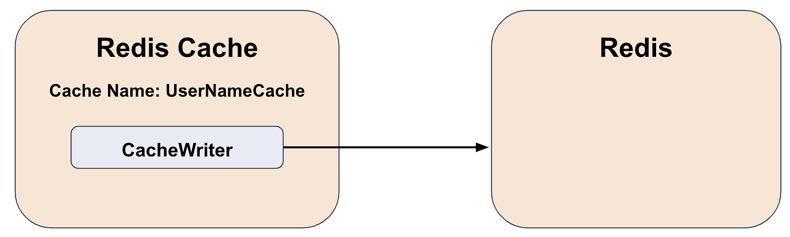

스프링의 경우 일반적인 캐시 사용을 위해 Cache 인터페이스는 null 값 캐싱을 허용한다.

따라서 null일 경우에는 캐싱에서 제외하도록 표현식을 적용할 수도 있다.


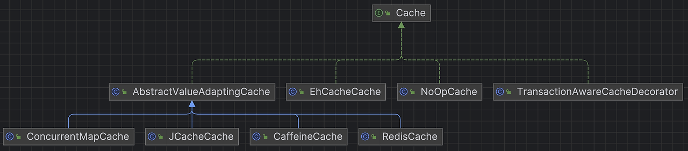

스프링이 제공하는 구현체를 보면 CaffeineCache, RedisCache 외에도 다양한 구현체가 존재한다.

캐싱된 값을 래핑하는 공통 기능을 담당하는 추상 클래스를 일부 부모로 구현하고 있음을 확인할 수 있다.

### CacheManager

애플리케이션을 개발하다보면 다양한 캐시가 필요할 수 있다.

스프링은 이러한 캐시 객체들을 관리하는 CacheManager 인터페이스를 제공한다.

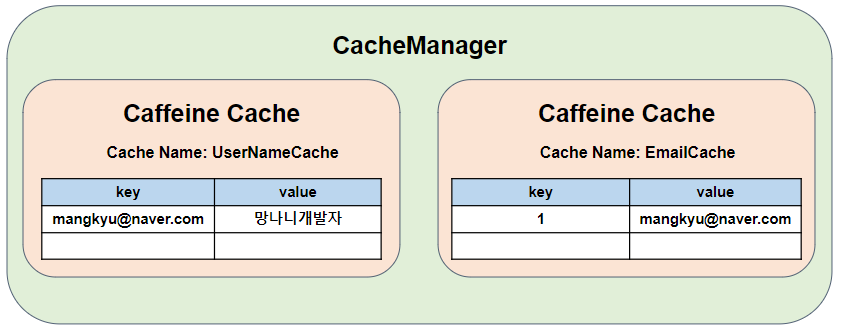

Cache 인터페이스와 마찬가지로, CacheManager 역시 캐시 목록을 관리하는 기능을 추상화한 인터페이스이다.

```java
public interface CacheManager {
		/**
		 * Get the cache associated with the given name.
		 * <p>Note that the cache may be lazily created at runtime if the
		 * native provider supports it.
		 * @param name the cache identifier (must not be {@code null})
		 * @return the associated cache, or {@code null} if such a cache
		 * does not exist or could be not created
		 */
		@Nullable
		Cache getCache(String name);
	
		Collection<String> getCacheNames();
}
```

CacheManager는 여러 개의 캐시를 관리하므로, 캐시 이름(Cache Name)으로 캐시를 조회하는 기능이 존재한다. 따라서 캐시 매니저에게 특정한 캐시를 가져오도록 @Cacheable를 사용할 때 cacheNames를 지정한다.

```java
@Cacheable(cacheNames = [CacheKey.HOLIDAYS], cacheManager = "localCacheManager",
key = "#year", )
public List<LocalDate> getHolidays(int year) {
	 return repository.getHolidays(year);
}

```

또한 전체 캐시 이름 목록을 조회하는 메서드도 갖고있다. 

주의할 부분은 getCache 메서드 부분인데, 구현체에 따라 캐시 매니저의 캐시가 lazy하게 생성될 수 있다는 부분이다. 이를 자세하게 이해하기 위해서 CacheManager 구현을 살펴보도록 하자.

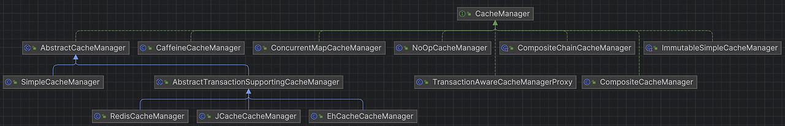

CacheManager 계층 구조를 보면 다양한 구현체들이 존재함을 알 수 있다.

그중에서 SimpleCacheManager를 살펴보도록 하자.

CacheManager → AbstractCacheManager → SimpleCacheManager

SimpleCacheManager는 내부적으로 ConcurrentHashMap을 사용하여 단일 인스턴스 내부에 캐싱하기 위한 용도로 활용하는 CacheManager이다. SimpleCacheManager의 계층 구조를 보면, 실질적인 기능들은 AbstractCacheManager에 존재함을 확인할 수 있다.

AbstractCacheManager 클래스의 getCache 메서드를 보면 CacheManager에서 캐시를 꺼내고 존재하지 않을 경우에는 put 하는 것을 확인할 수 있다.

흔히 사용하는 SimpleCacheManager, RedisCacheManager 모두 해당 클래스를 상속받으므로, 캐시가 없다면 예외가 발생하지 않고 새로운 캐시가 등록된다.

```java
@Override
public @Nullable Cache getCache(String name) {
		Cache cache = this.cacheMap.get(name);
		if (cache != null) {
				return cache;
		}
		Cache missingCache = getMissingCache(name);
		if (missingCache != null) {
				synchronized (this.cacheMap) {
						cache = this.cacheMap.get(name);
						if (cache == null) {
								cache = decorateCache(missingCache);
								this.cacheMap.put(name, cache);
								updateCacheNames(name);
						}
				}
		}
		return cache;
} 
```

실제 서비스를 운영할 때는 로컬 캐시 외에도 레디스와 같은 분산 저장소의 캐시 모두 필요하다.

따라서 스프링은 로컬 캐시를 위해서 SimpleCacheManager, 레디스 캐시를 위한 RedisCacheManager를 제공하며, 복수의 CacheManager 들을 관리하기 위한 CompositeCacheManager 역시 제공한다.

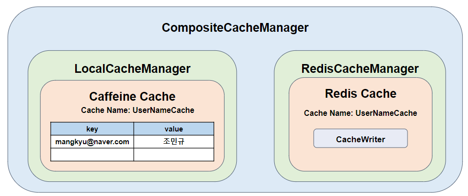

CompositeCacheManager는 디자인 패턴 중 컴포지트 패턴을 적용한 것으로, 다양한 CacheManager들을 순차적으로 접근하여 처리하는 방식으로 동작한다.

CompositeCacheManager를 기반으로 @Cacheable을 사용할 때 cacheNames 말고도 cacheManager를 지정해주어야 하는 이유가 바로 어떤 캐시 매니저에서 어떠한 캐시 이름에 접근할 것인지 정보가 필요하기 때문이다.

---

# 참고 자료

[https://mangkyu.tistory.com/370](https://mangkyu.tistory.com/370)

### 요구사항 

스프링의 @Cacheable을 활용하여 로컬 캐시와 분산 캐시를 함께 사용하는 2-Level Cache(2계층 캐시)를 구현하는 것이다. 2계층 캐시란 동일한 캐시 요청에 대해 먼저 로컬 캐시를 조회하고 있으면 반환, 없으면 분산 캐시를 조회하여 그 결과를 반환하는 것이다. 이를 통해 분산 캐시에 대한 트래픽을 보호할 수 있고, 분산 캐시가 장애난 경우에도 로컬 캐시를 통해 서비스에는 문제가 없도록 만들 수 있다.

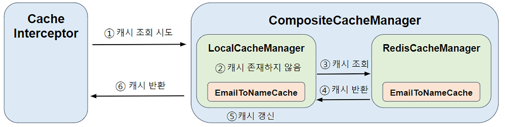

[https://mangkyu.tistory.com/371](https://mangkyu.tistory.com/371)

### ✅ 외부 API 호출 

[https://jsonplaceholder.typicode.com/](https://jsonplaceholder.typicode.com/)

  - 실존하지 않는 데이터(가짜 JSON 데이터)를 제공하는 무료 API
  - GET, POST, PUT, DELETE 등 다양한 메서드 테스트 가능
  - 인증, 쿼터 제한이 없다.

Spring 프레임워크에서는 외부 API와 통신하기 위해서 RestTemplate을 구현해두었다.

---

# RestTemplate 타임아웃, 재시도, 로깅 설정

### 타임아웃(Timeout) 설정 

기본적인 RestTemplate의 타임아웃은 제한이 없다.

스프링 MVC는 멀티 스레드 기반으로 동작하는데, RestTemplate으로 호출한 외부 AP에 문제가 생겨 응답이 오지 않는다면 RestTemplate을 호출한 스레드는 대기 상태에 빠진다.

즉, 다른 클라이언트 요청에 응답할 스레드가 남아있지 않게 된다.

이는 별도의 스레드 풀을 만들고 비동기 처리를 해도 동일하게 외부 API 호출할 스레드가 없어 문제가 생긴다.

**이런 상황을 방지하기 위해 일정 시간이 지나도 응답이 없다면 연결을 강제로 끊어주도록 반드시 타임아웃 설정을 해주어야 한다.** 일반적으로 커넥션 타임아웃과, 리드 타임아웃을 5초씩 잡아준다.

```java
@Configuration
public class RestTemplateConfig {
	/**
	 * RestTemplate 빈을 생성
	 * setConnectTimeout() setReadTimeout() 사용하여 연결 및 읽기 시간 초과를 설정
	 * 하지만 스프링 3.4.0 이후 해당 메서드는 deprecated 되었으므로, 사용하지 않는다.
	 * 대신 connectTimeout()과 readTimeout() 메서드를 사용한다.
	 */
	@Bean
	public RestTemplate restTemplate(RestTemplateBuilder builder) {
		return builder
			.connectTimeout(Duration.ofSeconds(5))
			.readTimeout(Duration.ofSeconds(5))
			.build();
	}
}
```

### 재시도(Retry) 설정

API 통신은 네트워크 같은 이슈로 간헐적으로 실패할 수 있다.

그러므로 **1번 호출하여 실패했을 때 바로 실패 응답을 내려주는 것보다 일정 횟수 만큼 요청을 재시도해보면 좋다.**

Spring은 Retry를 편리하게 구현하도록 spring-retry 프로젝트에 RetryTemplate를 만들어 두었다.

이를 RestTemplate 인터셉터에 적용하면 손쉽게 재시도 로직을 반영할 수 있다.

**RestTemplate을 적용하기 위해서는 spring-retry 의존성을 추가해주어야 한다.**

```groovy
implementation 'org.springframework.retry:spring-retry'
```

**RestTemplate에 적용할 RetryTemplate이 적용된 인터셉터 등록 및 RestTemplate에 등록**

```java
@Bean
public RestTemplate restTemplate(RestTemplateBuilder builder) {
	return builder
		.connectTimeout(Duration.ofSeconds(5))
		.readTimeout(Duration.ofSeconds(5))
		.additionalInterceptors(clientHttpRequestInterceptor())
		.build();
}

public ClientHttpRequestInterceptor clientHttpRequestInterceptor() {
	return (request, body, execution) -> {
		RetryTemplate retryTemplate = new RetryTemplate();
		retryTemplate.setRetryPolicy(new SimpleRetryPolicy(3));
		try {
			return retryTemplate.execute(context -> execution.execute(request, body));
		}
		catch (Throwable throwable) {
			throw new RuntimeException(throwable);
		}
	};
}
```

### 요청/응답 로깅(Logging) 설정

요청과 응답이 정상적으로 처리되었는지 확인이 필요한 상황이 있다.

재시도와 마찬가지로 RestTemplate에 인터셉터를 적용해 요청과 응답 내용을 로그로 남겨주면 유용하다.

```java

@Configuration
public class RestTemplateConfig {
	/**
	 * RestTemplate 빈을 생성
	 * setConnectTimeout() setReadTimeout() 사용하여 연결 및 읽기 시간 초과를 설정
	 * 하지만 스프링 3.4.0 이후 해당 메서드는 deprecated 되었으므로, 사용하지 않는다.
	 * 대신 connectTimeout()과 readTimeout() 메서드를 사용한다.
	 */
	@Bean
	public RestTemplate restTemplate(RestTemplateBuilder builder) {
		return builder
			.connectTimeout(Duration.ofSeconds(5))
			.readTimeout(Duration.ofSeconds(5))
			.additionalInterceptors(clientHttpRequestInterceptor(), new LoggingInterceptor())
			.requestFactory(() -> new BufferingClientHttpRequestFactory(new SimpleClientHttpRequestFactory()))
			.build();
	}

	/**
	 * RestTemplate 대한 HTTP 요청 인터셉터를 생성
	 * 이 인터셉터는 요청을 재시도하는 기능을 제공
	 */
	public ClientHttpRequestInterceptor clientHttpRequestInterceptor() {
		return (request, body, execution) -> {
			RetryTemplate retryTemplate = new RetryTemplate();
			retryTemplate.setRetryPolicy(new SimpleRetryPolicy(3));
			try {
				return retryTemplate.execute(context -> execution.execute(request, body));
			}
			catch (Throwable throwable) {
				throw new RuntimeException(throwable);
			}
		};
	}

	@Slf4j
	static class LoggingInterceptor implements ClientHttpRequestInterceptor {
		@Override
		public ClientHttpResponse intercept
		(
			HttpRequest request,
			byte[] body,
			ClientHttpRequestExecution execution
		) throws IOException
		{
			final String sessionNumber = makeSessionNumber();
			printRequest(sessionNumber, request, body);
			ClientHttpResponse response = execution.execute(request, body);
			printResponse(sessionNumber, response);
			return response;
		}

		private String makeSessionNumber() {
			return Integer.toString((int) (Math.random() * 10000000));
		}

		private void printRequest
		(
			final String sessionNumber,
			final HttpRequest req,
			final byte [] body
		)
		{
			log.info("[{}] URI: {}, Method:{}, Headers:{}, Body:{}",
				sessionNumber,
				req.getURI(),
				req.getMethod(),
				req.getHeaders(),
				new String(body, StandardCharsets.UTF_8));
		}

		private void printResponse
		(
			final String sessionNumber,
			final ClientHttpResponse res
		) throws IOException
		{
			String body = new BufferedReader(
				new InputStreamReader(res.getBody(), StandardCharsets.UTF_8))
				.lines().collect(Collectors.joining("\n"));

			log.info("[{}] Status: {}, Headers: {}, Body: {}",
				sessionNumber,
				res.getStatusCode(),
				res.getHeaders(),
				body);
		}

	}
}

```

현재 코드를 보면 RestTemplate 빌더에서 BufferingClientHttpRequestFactory를 사용한다.

로깅 인터셉터는 로깅을 위해 응답 Stream(InputStream)을 먼저 읽는다. 이후에 애플리케이션에서도 응답 값을 위해 다시 스트림을 읽는데, 이미 Stream 데이터들이 컨슘된 상태라 데이터가 없어 에러가 발생한다.

이러한 문제를 방지하기 위해 추가해주는 것이 바로 BufferingClientHttpRequestFactory이다.

**BufferingClientHttpRequestFactory를 추가하면 스트림의 내용을 메모리에 버퍼링해둠으로써 여러 번 읽을 수 있다.** 그래서 인터셉터에는 로그를 남기고, 애플리케이션에서는 응답 결과를 얻을 수 있다.

**어려우니까 다시 정리**

RestTemplate으로 외부 API를 호출하면, 응답은 InputStream 형태로 전달된다.

Stream 특성상 InputStream도 마찬가지로 한 번만 읽을 수 있는 일회성 스트림이다.

즉,  한 번 읽고 나면 내부 데이터가 소모(consume)되어, 그 이후에는 더 이상 데이터를 읽을 수 없다.

문제는 로깅 인터셉터에서는 응답 내용을 로그로 남기기 위해 응답의 InpuStream을 읽어서 문자열로 변환한다.

```java
String body = new BufferedReader(new InputStreamReader(
			res.getBody(), StandardCharsets.UTF_8)).lines()
			.collect(Collectors.joining("\n"));
```

이때 BufferedReader는 InputStream을 한 줄씩 읽어서 전체 응답을 String으로 만들어준다.

하지만 이렇게 읽으면 애플리케이션 코드(서비스)에서 같은 InputStream을 다시 읽으려고 할 때

이미 데이터가 소모되어 더 이상 읽을 수 없어서 에러가 발생한다.

BufferingClientHttpRequestFactory는 InputStream의 데이터를 메모리에 버퍼링(복사)해준다.

즉, 한 번 읽은 데이터도 메모리에 저장해두었다가 여러 번 읽을 수 있도록 해준다.

이렇게 하면 인터셉터에서 로그를 위해 한 번 읽고 실제 비즈니스 로직에서 다시 읽어도 문제가 발생하지 않는다.

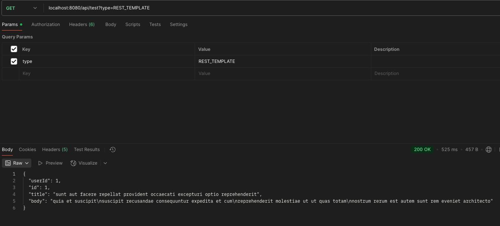

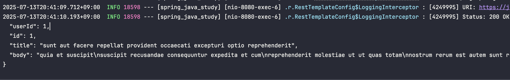

### RestTemplate 보다는 OpenFegin

RestTemplate 역시 잘 만들어진 도구이긴 하지만 직접 API 호출 도구를 작성해야 하므로 번거롭다.

Netflix에서 시작된 OpenFegin 도구를 사용하면 Spring Data JPA 처럼 인터페이스와 애노테이션 기반으로 외부 API를 손쉽게 작성할 수 있다.

---

# 참고 자료

[https://mangkyu.tistory.com/256](https://mangkyu.tistory.com/256)

# OpenFeign 소개 및 역사

### OpenFeign 소개

Open Feign은 Netflix에 의해 처음 만들어진 Declarative(선언적인) HTTP Client 도구로써, 외부 API 호출을 쉽게할 수 있도록 도와준다. 여기서 “선언적인”이란 애노테이션 사용을 의미하는데, Open Feign은 인터페이스에 애노테이션들만 붙여주면 구현이 된다. 이러한 방식은 Spring Data JPA와 유사하며, 상당히 편리하게 개발을 할 수 있도록 도와준다.

```java
@FeignClient(name = "ExchangeRateOpenFeign", url = "${exchange.currency.api.uri}")
public interface ExchangeRateOpenFeign {
    @GetMapping
    ExchangeRateResponse call(
            @RequestHeader String apiKey,
            @RequestParam Currency source,
            @RequestParam Currency currencies);

}
```

### OpenFeign 역사 

OpenFeign의 초기 모델인 Feign은 Eureka, Ribbon 등을 포함하는 Netflix OSS 프로젝트의 일부로써 Netflix에 의해 만들고 공개되었다. Netflix OSS가 공개되고 나서 Spring Cloud 진영은 Spring Cloud Netflix라는 프로젝트로 Netflix OSS를 Spring Cloud 생태계로 포함시켰는데, Feign은 단독으로 사용될 수 있도록 별도의 starter로 제공되었다. 이후에 넷플릭스는 내부적으로 feign의 사용 및 개발을 중단하기로 결정하였고, OpenFeign이라는 새로운 이름과 함께 오픈소스 커뮤니티로 넘겨졌다. Spring Cloud는 Open Feign 역시 스프링 클라우드 생태계로 통합하였고, 이 과정에서 기존의 Feign 자체 어노테이션과 JAX-RS 어노테이션만 사용 가능했던 부분을 Spring MVC 어노테이션을 지원하도록 추가했다. 그리고 추가적으로 Spring에서 사용되는 것과 동일한 HttpMessageConverters를 사용하도록 확장하였다. 그 외에도 다른 Spring Cloud 기술인 Eureka, CircuitBreaker, LoadBalancer를 통합하여 load-balanced된 http client를 제공하고자 하였다.

Netflix OSS → Spring Cloud Netflix → Open Feign → Spring Cloud Open Feign 

### OpenFeign 장점

  - 인터페이스, 애노테이션 기반으로 작성할 코드가 줄어든다.
  - 익숙한 Spring MVC 애노테이션으로 개발이 가능하다.
  - 다른 Spring Cloud 기술들과의 통합이 쉽다.

OpenFeign의 가장 큰 장점은 작성할 코드가 줄어드는 것이다. 

아래 코드는 환율 조회 API를 RestTemplate으로 작성했다 OpenFeign으로 작성한 코드와 비교해 보자.

```java
@Component
@RequiredArgsConstructor
class ExchangeRateRestTemplate {

    private final RestTemplate restTemplate;
    private final ExchangeRateProperties properties;
    private static final String API_KEY = [REDACTED];

    public ExchangeRateResponse call(final Currency source, final Currency target) {
        return restTemplate.exchange(
                        createApiUri(source, target),
                        HttpMethod.GET,
                        new HttpEntity<>(createHttpHeaders()),
                        ExchangeRateResponse.class)
                .getBody();
    }

    private String createApiUri(final Currency source, final Currency target) {
        return UriComponentsBuilder.fromHttpUrl(properties.getUri())
                .queryParam("source", source.name())
                .queryParam("currencies", target.name())
                .encode()
                .toUriString();
    }

    private HttpHeaders createHttpHeaders() {
        final HttpHeaders headers = new HttpHeaders();
        headers.add(API_KEY, properties.getKey());
        return headers;
    }
}
```

OpenFeign으로 작성한 환율 조회 API

```java
@FeignClient(name = "ExchangeRateOpenFeign", url = "${exchange.currency.api.uri}")
public interface ExchangeRateOpenFeign {

    @GetMapping
    ExchangeRateResponse call(
            @RequestHeader String apiKey,
            @RequestParam Currency source,
            @RequestParam Currency currencies);

}
```

### Open Feign 단점 및 한계

  - 기본 Http Client가 HTTP2를 지원하지 않는다. → 추가 설정이 필요하다.
  - 공식적으로 Reactive 모델을 지원하지 않는다.
  - 경우에 따라서 애플리케이션 초기화 에러가 발생할 수 있다 → Object Provider 통해 대응 필요
  - 테스트 도구를 제공하지 않는다

---

# Open Feign 시작하기

### 의존성 추가하기

Open Feign은 Spring Cloud 기반의 기술이므로 Spring Cloud 의존성이 필요하다.

아래 공식 문서를 통해서 SpringBoot 버전에 적합한 버전을 확인하자.

[https://spring.io/projects/spring-cloud](https://spring.io/projects/spring-cloud)

```groovy
plugins {
    id 'java'
    id 'org.springframework.boot' version '3.5.3'
    id 'io.spring.dependency-management' version '1.1.7'
}

ext {
    set('springCloudVersion', "2025.0.0")
}

dependencyManagement {
    imports {
        mavenBom "org.springframework.cloud:spring-cloud-dependencies:${springCloudVersion}"
    }
}

implementation 'org.springframework.cloud:spring-cloud-starter-openfeign'
```

Spring 3.5.X 버전 → 2025.0.X

### OpenFeign 활성화

@EnableFeignClients 애노테이션을 붙여주면 된다.

@Enable 애노테이션을 Main 클래스에 붙여주는 것은 SpringBoot가 제공하는 슬라이스 테스트에 영향을 줄 수 있다. 그래서 아래와 같이 별도의 Config 클래스로 등록해 주는 것이 좋다

```java
@Configuration
@EnableFeignClients(basePackages = "study.spring_java_study")
public class OpenFeignConfig {
	
}
```

### FeignClient 구현

```java
@FeignClient(name = "postClient", url = "${api.external.url}")
public interface PostOpenFeign {
	@GetMapping("/posts/{id}")
	String getPostById(@PathVariable Long id);

	@GetMapping("/posts")
	String getPosts();
}

@Component
@RequiredArgsConstructor
public class OpenFeignService implements ApiCallService {
	private final PostOpenFeign postOpenFeign;

	@Override
	public String callApi(Long id) {
		return postOpenFeign.getPostById(id);
	}

	@Override
	public boolean supports(CallType callType) {
		return callType.equals(OPEN_FEIGN);
	}
}
```

이처럼 OpenFeign을 적용하고 코드로 구현하는 것은 매우 쉽다.

---

# 참고 자료

[https://mangkyu.tistory.com/278](https://mangkyu.tistory.com/278)

OpenFeign 설정은 yml, Java config 모두로 할 수 있다.

**만약 yml, Java config 모두 존재한다면 yml 정보가 Java config를 덮어씌우며 우선순위를 가진다.**

이러한 우선순위 설정은 바꿔줄 수 있으며, Feign Client 별로 다르게 가져갈 수도 있다.

클라이언트 별로 설정을 다르게 가져갈려면 @Configuration이 붙은 설정 클래스를 FeignClient에 붙여주면 된다.

이러한 지식을 바탕으로 타임아웃, 재시도, 로깅을 설정해 보자.

---

### 타임아웃(Timeout) 설정하기

OpenFeign이 default로 갖는 timeout 설정은 아래와 같다.

| **타임아웃 종류** | **의미** | **기본값** |
| --- | --- | --- |
| **connectTimeout** | 서버와의 연결 시도 시, 연결이 성립될 때까지 대기 시간 | 2000ms (2초) |
| **readTimeout** | 연결 후, 응답 데이터 수신까지 대기 시간 | 60000ms (60초) |

connection timeout은 주로 TCP 3-way handshake(SYN, SYN-ACK, ACK) 과정에서 연결이 성립될 때까지 기다리는 시간이다. 이 과정에서 패킷 유실이 발생하거나 네트워크가 불안정해 연결이 지연될 경우, 설정된 connection timeout을 초과하면 연결 시도가 중단된다.

readTimeout은 3-way handshake를 통해 연결이 성공적으로 성립된 이후, 서버에 요청을 보내고 응답 데이터가 도착할 때까지 대기하는 시간이다. 즉, 서버의 처리 지연이나 네트워크 문제로 응답이 늦어질 때 readTimeout이 초과되면 타임아웃 예외가 발생한다.

**설정 변경하기**

```yaml
spring:
  cloud:
    openfeign:
      client:
        config:
            default:
                connectTimeout: 5000
                readTimeout: 5000
```

### 재시도(Retry) 설정하기

Feign은 기본적으로 Retryer.NEVER_RETRY를 등록하여 재시도를 시도하지 않으므로 재시도를 시키려면 추가적인 설정이 필요하다.

예를 들어 0.1초의 간격으로 시작해 최대 3초 간격으로 점점 증가하며, 최대 5번 재시도하는 Retryer는 다음과 같이 설정할 수 있다.

```java
@Configuration
@EnableFeignClients(basePackages = "study.spring_java_study")
public class OpenFeignConfig {
	@Bean
	Retryer.Default retryer() {
		// 0.1초 후에 재시도하고, 최대 3초까지 재시도하며, 총 5번 재시도합니다.
		return new Retryer.Default(100L, TimeUnit.SECONDS.toMillis(3L), 5);
	}
}
```

**Feign이 제공하는 Retryer는 I/O Exception이 발생한 경우에만 처리한다.**

이외의 경우에도 재시도가 필요하다면 Spring-Retry를 이용하거나 인터셉터로 직접 구현하는 등의 방법을 사용해야 한다.

**재시도 정책과 RetryStorm**

Retry Storm이란, 외부 API나 서버에 장애가 발생했을 때 여러 인스턴스 또는 여러 스레드가 동시에 실패를 감지하고, 재시도 로직에 의해 반복적으로 요청을 보내면서 트래픽이 폭증하는 현상을 의미한다.

즉, Retry Storm을 방지하기 위해 재시도 정책을 반드시 신중하게 설계해야 하며, 단순히 "실패하면 재시도"만 적용하는 것은 위험할 수 있다.

---

### 요청/응답 로깅(Logging) 설정하기

Logger의 이름은 전체 인터페이스 이름이며, Feign Client들마다 만들어진다.

Feign은 남길 로그에 따라 4가지 수준을 제공한다.

  - NONE: 로깅 X(default)
  - BASIC: 요청 메서드, URI와 응답 상태, 실행 시간만 로깅
  - HEADERS: 요청과 응답 헤더와 함께 기본 정보를 남긴다
  - FULL: 요청과 응답에 대한 헤더와 바디, 메타 데이터를 남긴다

```java
@Configuration
@EnableFeignClients(basePackages = "study.spring_java_study")
public class OpenFeignConfig {
	@Bean
	Retryer.Default retryer() {
		// 0.1초 후에 재시도하고, 최대 3초까지 재시도하며, 총 5번 재시도합니다.
		return new Retryer.Default(100L, TimeUnit.SECONDS.toMillis(3L), 5);
	}

	@Bean
	Logger.Level feignLoggerLevel() {
		return Logger.Level.FULL;
	}
}
```

**Feign은 DEBUG 레벨로만 로그를 남길 수 있다. 그래서 반드시 로그 레벨이 DEBUG로 설정이 되어 있어야 한다.**

간단하게 설정 파일에서 다음과 같이 수정해줄 수 있으며, 이것 역시 클라이언트 별로도 적용이 가능하다.

```yaml
logging:
  level:
    study.spring_java_study.api.openfegin.PostOpenFeign: DEBUG
```

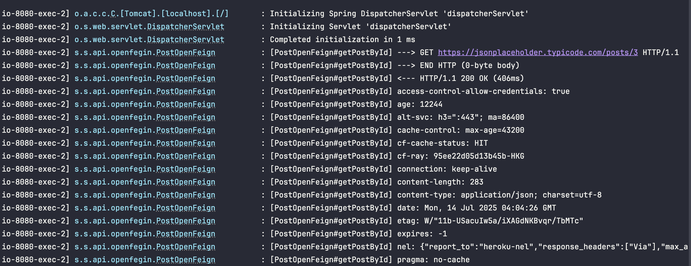

---

### LocalDate, LocalDateTime, LocalTime 등을 위한 설정

주고 받는 데이터 타입으로 LocalDate, LocalDateTime, LocalTime 등이 사용된다면 제대도 처리가 되지 않는다. 그래서 DateTimer 관련 포매터 추가 설정이 필요하다.

```java
@Bean
public FeignFormatterRegistrar dateFormatterRegistrar() {
	return registry -> {
		DateTimeFormatterRegistrar registrar = new DateTimeFormatterRegistrar();
		registrar.setUseIsoFormat(true);
		registrar.registerFormatters(registry);
	};
}
```

또한 스프링 부트 버전이나 의존성에 따라서 ObjectMapper가 해당 타입들을 Serialize, Deserialize 하기 위한 라이브러리가 존재하지 않을 수도 있다. 아래의 2가지 의존성을 추가한다.

```groovy
implementation 'com.fasterxml.jackson.datatype:jackson-datatype-jdk8'
implementation 'com.fasterxml.jackson.datatype:jackson-datatype-jsr310'
```

---

### FeignClient 별도 설정 적용 

```java
public class CustomFeignConfig {
    @Bean
    public Retryer retryer() {
        // 0.2초 후 재시도, 최대 2초, 4번 재시도
        return new Retryer.Default(200, 2000, 4);
    }

    @Bean
    public Logger.Level feignLoggerLevel() {
        return Logger.Level.BASIC;
    }
}

@FeignClient(
    name = "customClient",
    url = "https://api.example.com",
    configuration = CustomFeignConfig.class
)
public interface CustomFeignClient {
    @GetMapping("/data")
    String getData();
}
```

---

### OpenFeign 테스트 설정

SpringDataJpa는 @DataJpaTest를 이용해 손쉽게 테스트를 작성할 수 있는데, OpenFeign은 테스팅 도구를 지원하지 않으므로 나만의 커스텀 슬라이스 테스트인 @FeignTest를 직접 만들어주면 된다.

**FeignTestContext 테스트를 위한 컨텍스트**

```java
@ImportAutoConfiguration({
	OpenFeignConfig.class, // Custom OpenFeign 설정
	FeignAutoConfiguration.class, // 필수 설정
	HttpMessageConvertersAutoConfiguration.class, // 필수 설정
})
public class FeignTestContext {

}
```

여기서 FeignAutoConfiguration.class, HttpMessageConvertersAutoConfiguration.class 는 반드시 포함시켜야 하는 것들이다. 추가로 개발 환경에 맞게 OpenFeign 설정 클래스 같은 클래스를 추가해주면 된다.

**@FeignTest 애노테이션**

```java
@SpringBootTest(
	classes = FeignTestContext.class
)
@Target(ElementType.TYPE)
@Retention(RetentionPolicy.RUNTIME)
public @interface FeignTest {

}
```

**FeignClient 테스트** 

```java
@Slf4j
@FeignTest
public class JsonPlaceHolderFeignTest {
	@Autowired
	private PostOpenFeign postOpenFeign;
	@Test
	void getPostById() {
		Long id = 1L;
		String post = postOpenFeign.getPostById(id);
		assertThat(post).isNotNull();
		log.info("post={}", post);
	}
}
```

---

### 에러 응답 후처리

**ErrorDecoder**

```java
public class CustomErrorDecoder implements ErrorDecoder {
    @Override
    public Exception decode(String methodKey, Response response) {
        switch (response.status()){
            case 400:
                return new BadRequestException();
            case 404:
                return new NotFoundException();
            default:
                return new Exception("Generic error");
        }
    }
}
```

---

### OpenFeign 사용 시 주의 사항

  - OpenFeign 빈 Body 설정 이슈 → OpenFeign 12.0 버전에서 수정
  - 마지막 슬래시(/) 제거 

---

# 참고 자료

[https://mangkyu.tistory.com/279](https://mangkyu.tistory.com/279)

[https://docs.spring.io/spring-cloud-openfeign/reference/spring-cloud-openfeign.html](https://docs.spring.io/spring-cloud-openfeign/reference/spring-cloud-openfeign.html)

[https://docs.spring.io/spring-cloud-openfeign/docs/current/reference/html/appendix.html](https://docs.spring.io/spring-cloud-openfeign/docs/current/reference/html/appendix.html)

# HttpInterface?

### HttpInterface 소개 및 사용법

HttpInterface는 Spring6에 새롭게 추가된 기술이다.

HttpInterface는 HTTP 요청을 위한 서비스를 자바 인터페이스와 애노테이션으로 정의할 수 있도록 도와준다.

해당 서비스를 구현하는 프록시 객체를 생성하면 이를 통해 손쉽게 HTTP 요청을 보낼 수 있다.

**HttpInterface 구현**

```java
public interface PostHttpInterface {
	@GetExchange("/posts/{id}")
	String post(@PathVariable("id") Long id);
}
```

**HttpInterface 프록시 구현체 만들기(RestClient 활용)**

```java
@Configuration
public class HttpInterfaceConfig {

	@Value("${api.external.url}")
	private String postApiUrl;

	@Bean
	public PostHttpInterface postHttpInterface() {
		RestClient client = RestClient.builder()
			.baseUrl(postApiUrl)
			.build();

		HttpServiceProxyFactory factory = HttpServiceProxyFactory
			.builder().exchangeAdapter(RestClientAdapter.create(client))
			.build();

		return factory.createClient(PostHttpInterface.class);
	}
}
```

스프링 부트 3.2 이전에는 프록시를 생성하기 위해서 WebClient가 필요했다.

WebClient는 spring-web이 아닌 spring-webflux에 의존성이 존재하므로, 의존성이 없다면 추가해주어야 했다.  하지만 스프링 부트 3.2부터는 RestClient라는 서블릿 환경의 WebClient가 추가되었다. RestClient 역시 HttpInterface의 기반 기술로 활용할 수 있으므로, 굳이 spring-webflux 의존성을 추가할 필요 없다.

**HttpInterface 사용** 

```java
@Service
@RequiredArgsConstructor
public class HttpInterfaceService implements ApiCallService {
	private final PostHttpInterface postHttpInterface;

	@Override
	public String callApi(Long id) {
		return postHttpInterface.post(id);
	}

	@Override
	public boolean supports(CallType callType) {
		return callType.equals(CallType.HTTP_INTERFACE);
	}
}
```

### 예외 처리

```java
@Bean
public PostHttpInterface postHttpInterface() {
	RestClient client = RestClient.builder()
		.baseUrl(postApiUrl)
		.defaultStatusHandler((response) -> {
			// 원하는 커스텀 처리
			if (response.getStatusCode().is4xxClientError()) {
				throw new RuntimeException("");
			}
			if (response.getStatusCode().is5xxServerError()) {
				throw new RuntimeException("");
			}
			return false;
		})
		.build();

	HttpServiceProxyFactory factory = HttpServiceProxyFactory
		.builder().exchangeAdapter(RestClientAdapter.create(client))
		.build();

	return factory.createClient(PostHttpInterface.class);
}
```

---

# 다양한 HTTP 도구들

오늘날 Java 진영에서 사용할 수 있는 다양한 HTTP Client 들이 있다.

→ HttpInterface, OpenFeign, RestTemplate, RestClient, WebClient 

나라면 선언적인 방식(애노테이션 기반)으로 생산성을 높일 수 있는 HttpInterface, OpenFeign 가장 많이 사용할듯하다. 둘 중 하나만 고르라면 HttpInterface는 아직까지 매번 새로운 프록시를 생성해 주는 것이 번거롭기 때문에 OpenFeign을 사용할듯하다.

---

# 참고 자료 

[https://mangkyu.tistory.com/291](https://mangkyu.tistory.com/291)

[https://www.youtube.com/watch?v=Kb37Q5GCyZs](https://www.youtube.com/watch?v=Kb37Q5GCyZs)

# RestClient 필요성

Spring에서는 RestTemplate, WebClient 같은 HttpClient를 지원한다. 하지만 이들은 각각 문제점을 가지고 있었다. RestTemplate은 사용이 직관적이지 못하고, WebClient와 HttpInterface는 web-flux 의존성이 필요했다. 

Spring 3에 RestTemplate이 도입된 이후, Template 같은 클래스를 통해 모든 HTTP 기능을 노출하는 것이 부담을 줄 수 있다는 것을 발견했다. 그래서 Spring 5에 fluent API를 지원하는 리액티브 기반 WebClient를 추가했다. 하지만 web-flux를 필요로 한다는 점이 아쉬웠는데, 이에 대한 대안으로 RestClient이 나왔다.

즉, 서블릿 버전의 WebClient이다. 

스프링은 Spring6.1, SpringBoot 3.2부터 새로운 동기식 HTTP 호출 도구인 RestClient를 도입했다.

**RestClient는 RestTemplate과 동일한 기반 기술을 바탕으로 fluent API를 제공하기 위해 탄생하였다.**

RestClient를 사용하면 WebClient와 유사한 방식으로 사용 가능하며, 기존의 message converters, request factories, interceptors 및 RestTemplate의 기타 구성 요소들을 사용할 수 있다.

---

# RestClient 사용법

### **RestClient 생성**

```java
// RestClient.create()를 통해 기본 설정으로 RestClient 생성
RestClient restClient1 = RestClient.create();

// 기존에 작성했던 RestTemplate 설정 그대로 RestClient 생성
RestClient restClient2 = RestClient.create(restTemplate);

// 빌더를 통한 RestClient 생성
RestClient client3 = RestClient.builder()
					.baseUrl(apiUrl)
					.build();
```

빌더를 사용하면 base url, path variables, headers, interceptors, initializers, 에러 핸들링을 위한 설정들을 추가할 수 있다.

### RestClient 이용한 GET 요청 

```java
String result = restClient2.get()
	.uri(apiUrl + "/posts/{id}", id)
	.retrieve()
	.body(String.class);

// 요청 상태 코드나 헤더 등이 필요하다면? ResponseEntity 사용 
ResponseEntity<String> entity = restClient3.get()
	.uri("/posts/{id}", id)
	.retrieve()
	.toEntity(String.class);

```

RestClient 역시 Json 변환을 지원하며, 마찬가지로 내부에서는 message converters를 사용한다.

따라서 클래스로 변환하여 값을 반환받을 수 있다.

### RestClient 에러 헨들링

기본적으로 RestClient는 4xx 또는 5xx 상태 코드를 수신하면 RestClientException 하위 클래스를 throw 한다. 해당 동작은 StatusHandler를 사용하면 재정의할 수도 있다.

```java
ResponseEntity<String> entity = restClient3.get()
			.uri("/posts/{id}", id)
			.retrieve()
			.onStatus(HttpStatusCode::is4xxClientError, (request, response) -> {
				// 4xx 에러 처리 로직
				throw new RuntimeException("");
			})
			.toEntity(String.class);
```

### **RestClient  exchange**

exchange 메서드를 사용하면 더욱 advanced 된 시나리오를 다룰 수 있다.

exchange 메서드를 통해 내부의 request, response 객체에 접근할 수 있기 때문이다.

exchange 메서드를 사용하면 status handler는 적용되지 않는다.

---

# 참고 자료

[https://mangkyu.tistory.com/303](https://mangkyu.tistory.com/303)

---

# 5주차 

페이지 5 ~

