[유투브 링크](https://www.youtube.com/watch?v=4ZtKiSvZNu4)

# 람다 

**람다식이 뭐야?**

- 메서드를 하나의 식으로 표현한 것

일반 메서드

```java
int addOperation(int a, int b){
		return a + b;
}
```

람다식 

```java
(int a, int b) -> a + b
```

좀 더 간단히!

case1)

```java
(int a, int b) -> a * b
```

매개 변수 타입 생략 

```java
(a, b) -> a * b
```

case2)

```java
(a) -> a * a 
```

파라미터의 괄호 생략 

```java
a -> a * a
```

case3)

```java
(String name, int i) -> {
			System.out.println(name + "=" + i);
}
```

바디의 중괄호, 세미콜론 생략 

```java
(String name, int i) -> 
			System.out.println(name + "=" + i)

```

람다 → 함수형 인터페이스

> 💡 함수형 인터페이스 = 추상 메서드가 딱 1개만 있는 인터페이스
default 메서드와 static 메서드는 존재할 수 있다. 

함수형 인터페이스 

```java
@FunctionalInterface
public interface BridgeNumberGenerator {
    int generate();
}
```

인스턴스를 맏드려면 어떻게 해야 할까?

추상 메서드를 오버라이딩해서 클래스를 만든다!

이 클래스로부터 인스턴스를 생성할 수 있다.

```java
import java.util.Random;

public class BrideRandomNumberGenerator implements BridgeNumberGenerator {
    @Override
    public int generate() {
        return new Random().nextInt();
    }
}
```

람다식을 이용해 인스턴스 만들기 

```java
import java.util.Random;
public class GeneratorTest {
    public static void main(String[] args) {
        BridgeNumberGenerator bridgeNumberGenerator = () -> new Random().nextInt();
        int randomNumber = bridgeNumberGenerator.generate();
    }
}
```

함수형 인터페이스의 딱 1개의 추상메서드과 람다식이 1:1 매칭 

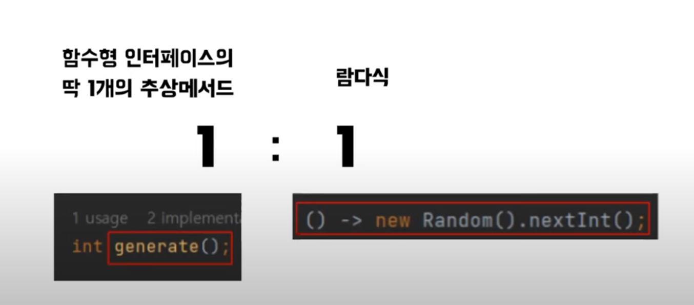

그럼 람다식을 쓰려면 매번 함수형 인터페이스를 정의해야해? 

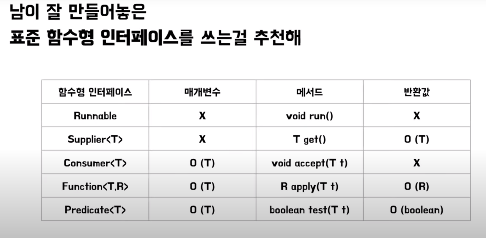

람다식이 하나의 메서드만 호출하는 경우에는 메서드 참조로 람다식을 간략히 할 수 있다.

클래스 이름::메서드 이름 또는 참조변수::메서드 이름으로 바꿀 수 있다.

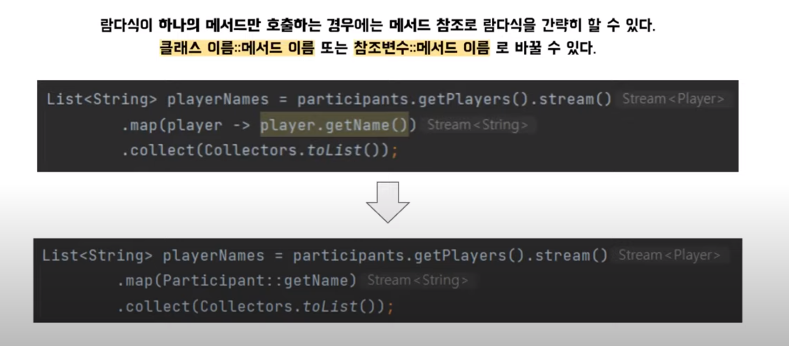

# 스트림 (stream)

Java 8 부터 다량의 데이터 처리 작업을 돕기 위해 추가되었다. 

컬렉션, 배열, 숫자, 람다식 , 파일 ,,, → Stream → Stream 연산 

스트림은 데이터 소스가 다르더라도, 일단 스트림을 생성하기만 한다면

과거의 그 데이터의 형태가 무엇이었던 같은 방식으로 다룰 수 있게 되어 코드의 재사용성이 높아진다.

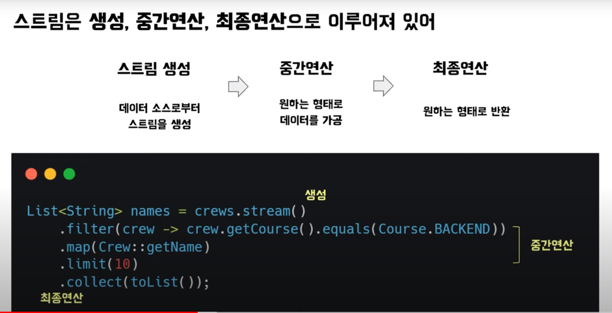

## 스트림 생성 

**1) 컬렉션**

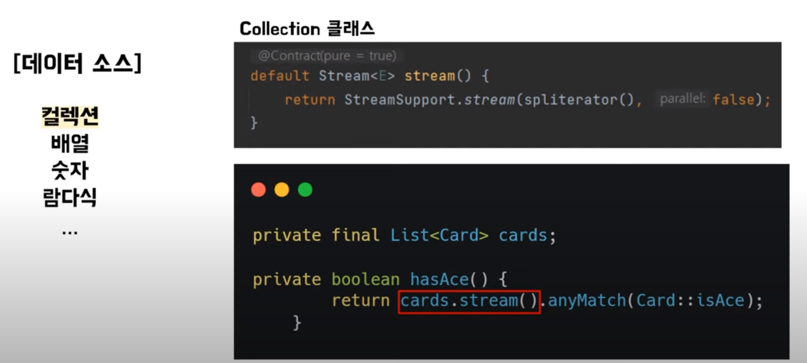

> 💡 .stream()

```java
   		  // 컬렉션 데이터 소스 -> 스트림 생성           .stream()
        List<String> list = new ArrayList<>();
        Stream<String> stream1 = list.stream();
```

**2) 배열**

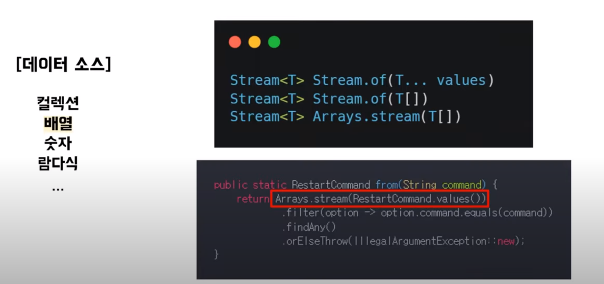

```java
     		// 배열
        int [] intArr = {-1,1,0,0};
        Stream<Integer> stream2 = Arrays.stream(intArr).boxed();

        long [] longArr = {-1,1,0,0};
        Stream<Long> stream3 = Arrays.stream(longArr).boxed();

        String [] strArr = {"a", "b", "c"};
        Stream<String> stream4 = Stream.of(strArr);
```

**3) 숫자**

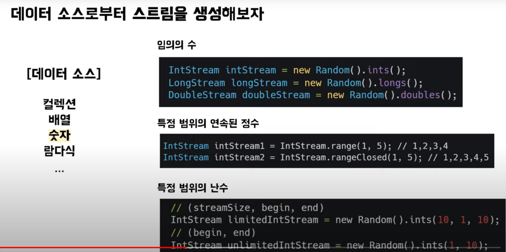

```java
        // 숫자
        // 임의의 수
        Stream<Integer> intStream = new Random().ints().boxed();
        IntStream intStream2 = new Random().ints();

        // IntStream intStream3 = new Random().nextInt();            // 에러
        IntStream intStream3 = IntStream.of(new Random().nextInt()); // 단일 정수 반환

        // 특정 범위의 연속된 정수
        IntStream intStream4 = IntStream.range(1, 5); // 1, 2, 3, 4
        Stream<Integer> intStream5 = IntStream.range(1, 5).boxed(); // 1  2  3  4
        IntStream intStream6 = IntStream.range(1, 1); // 1
        IntStream intStream7 = IntStream.rangeClosed(1, 5); // 1, 2, 3, 4, 5

        // 특정 범위의 난수
        // (streamSize, begin, end)
        IntStream intStream8 = new Random().ints(10 , 1, 10);

        // (begin , end)
        IntStream intStream9 = new Random().ints(1, 10);
```

**4) 람다식**

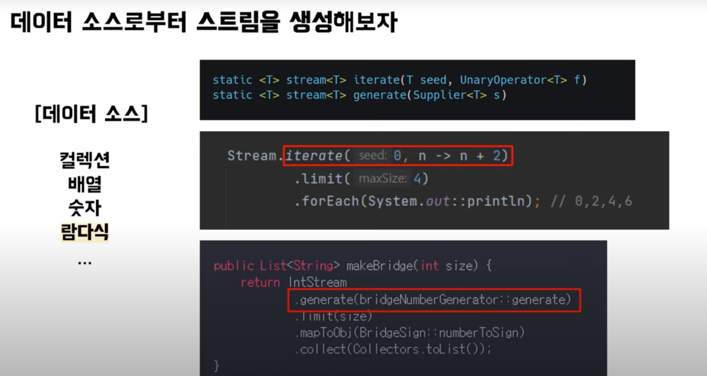

```java
  			// 람다식
        Stream.iterate(0, n -> n + 2)
                .limit(4)
                .forEach(System.out::println); // 0, 2, 4, 6

        List<Integer> save;
        save = Stream.iterate(0, n -> n + 3)
                .limit(6).collect(Collectors.toList());

        List<Integer> save2 = new ArrayList<>();
        Stream.iterate(0, n -> n + 3)
                .limit(5).forEach(save2::add);

```

## 스트림 중간 연산 

- 중간연산으로 데이터를 입맛에 맞게 가공해보자 

distinct(), filter(), sort(), map(), flatMap(), mapToInt()

- distinct()
- 스트림에서 중복되는 데이터를 제거 

```java
 	    	// 중복되는 데이터가 있는지 검사하고, 중복이 존재하면 예외를 던지는 코드
        List<String> players = new ArrayList<>();
        players.add("김현민");
        players.add("배제우");
        players.add("배제우");
        // 원래 players의 길이와 중복을 제거하고 players의 길이를 비교 
        // -> 3 != 2 이니 예외 처리!
        if(players.size() != players.stream().distinct().count()){
            throw new IllegalArgumentException("플레이어 이름은 중복될 수 없음!");
        }
```
- filter(Predicate<T> predicate)
- 조건에 만족하는 데이터만 남기고 나머지를 제외 

```java
 	 		  // filter()
        // 조건을 만족하는 데이터만 남기고 나머지는 제외하고 출력
        // 길이가 4인 문자열은 제외하고 길이가 4인 문자열만 출력
        List<String> test = new ArrayList<>();
        test.add("1234");
        test.add("12345");
        test.add("2345");
        test.add("a");
        test.add("abcd");
        test.stream().filter(String -> String.length() == 4).forEach(System.out::println);
        /*
        1234
        2345
        abcd
         */
```
- sorted(Comparator<T> comparator) sorted() : 기본 정렬 기준으로 정렬 
- 스트림을 지정된 Comparator로 정렬 

```java
 	    	// sorted(Comparator<T> comparator) 기본 정렬 기준으로 정렬 역순으로 정렬 해보기
        List<String> crewNames = new ArrayList<>();
        crewNames.add("가"); crewNames.add("나"); crewNames.add("가나"); crewNames.add("가");
        crewNames.stream().sorted(new Comparator<String>() {
            @Override
            public int compare(String o1, String o2) {
                return -o1.compareTo(o2);
            }
        }).forEach(System.out::println);
        System.out.println("--------------");
        crewNames.stream().sorted().forEach(System.out::println);
        System.out.println("--------------");
        System.out.println(crewNames.stream().sorted().collect(Collectors.joining(" ")));
```
- map(Function<T, R> mapper)
- 원하는 필드만 뽑아내거나, 특정 형태로 변환 

```java
      	class Person{
            private String name;
            private int age;
            public Person(String name, int age){
                this.name = name; this.age = age;
            }
            public String getName() {
                return name;
            }
            public int getAge() {
                return age;
            }
        }
        List<Person> persons = List.of(
                new Person("Alice", 30),
                new Person("Bob", 25),
                new Person("Charlie", 35),
                new Person("BaeJewoo", 27)
        );
        // map(Function<T, R> mapper)
        // 원하는 필드만 뽑아내거나, 특정 형태로 변환
        List<String> names = persons.stream().map(Person::getName)
                .collect(Collectors.toList());

        names.stream().sorted().forEach(System.out::println);
```
- flatMap(Function<T, R> mapper)
- 스트림의 각 요소에 대한 매핑 함수를 적용하고, 각 매핑 결과로 생성된 스트림을 하나의 스트림으로 평탄화합니다. 이를 통해 중첩된 리스트 또는 다차원 배열을 **평탄화**하여 단일 스트림으로 만들 수 있습니다. 
  - 평탄화? → 스트림의 원소를 각각 하나의 스트림으로 매핑한 다음, 그 스트림을 다시 하나의 스트림으로 합침 

```java
     		// flatMap(Function<T, R> mapper)
        // 중첩된 리스트 생성
        List<List<Integer>> numbers = Arrays.asList(
               List.of(1, 2, 3),
               List.of(4, 5, 6),
               List.of(7, 8, 9)
        );

        // 각 리스트들을 하나의 스트림으로 평탄화
        numbers.stream().flatMap(List :: stream).forEach(System.out::println);

        int [][] array2D = {{1,2,3},{4,5,6},{7,8,9}};
        List<Integer> list2D = Arrays.stream(array2D).flatMapToInt(Arrays :: stream).boxed().collect(Collectors.toList());
        System.out.println(list2D);
```
- mapToInt(IntStream mapToInt(ToIntFunction<? super T> *mapper*))
- 각 요소를 지정된 함수에 매핑하여 IntStream을 반환한다.
  - 매핑이란? 각 요소에 함수를 적용하여 새로운 값으로 변환하는 것을 의미한다. 

```java
 ArrayList<Integer> tmp = new ArrayList<>();
 tmp.add(1);
 tmp.add(2);
 
 int [] array = tmp.stream().mapToInt(Integer::intValue).toArray();
 
 // 동일한 과정   
 IntStream intStream = tmp.stream().mapToInt(Integer::intValue);
 int [] array2 = intStream.toArray();
```

## 스트림 최종 연산 

- 최종연산으로 스트림을 닫아보자 
- forEach(Consumer<? super T> action)
```java
   		  // 중간 연산까지 마친 스트림의 숫자를 차례대로 출력
        Stream.iterate(0, n -> n + 2).limit(6).forEach(System.out::println);
```
- 조건 검사 (boolean 반환) 
- boolean allMatch(Predicate<? super T> predicate) 모든 요소가 일치하면 true
  - boolean anyMatch(Predicate<? super T> predicate) 하나의 요소라도 일치하면 true
  - boolean noneMatch(Predicate<? super T> predicate) 모든 요소가 불일치하면 true

```java
 	    	// 조건 검사
        List<Integer> list = new ArrayList<>(List.of(11,12,13));
        System.out.println(list.stream().allMatch(Integer -> Integer > 10)); // true

        list.add(5);
        System.out.println(list.stream().allMatch(Integer -> Integer > 10 )); // false

        System.out.println(list.stream().anyMatch(Integer -> Integer < 5));   // false
        System.out.println(list.stream().anyMatch(Integer -> Integer <= 5));  // true

        System.out.println(list.stream().noneMatch(Integer -> Integer > 100)); // true
        System.out.println(list.stream().noneMatch(Integer -> Integer > 12));  // false
```

  - findFirst() 조건에 일치하는 첫 번째 요소를 반환 
  - findAny() 조건에 일치하는 요소를 하나 반환 

```java
    		// 조건 검사 findFirst(), findAny()
        List<Integer> list2 = new ArrayList<>(List.of(11, 12 ,13));
        Optional<Integer> result  = list2.stream().filter(Integer -> Integer > 10).findFirst();
        System.out.println(result.get()); // 11

        System.out.println(list2.stream().filter(Integer -> Integer > 12).findFirst().get()); // null
        System.out.println(list2.stream().filter(Integer -> Integer > 0).findAny().get()); // 11
```
- **collect(Collector collector)**
- 스트림의 요소를 수집해 원하는 형태로 반환
  - collect() vs Collector vs Collectors 
  - collect(Collector collector) 
- 스트림의 최종 연산 
    - 컬렉터를 파라미터로 받음
  - Collector
- 인터페이스 
    - 이걸 구현해야 collect의 파라미터로 사용할 수 있음
  - Collectors
- 이미 정의된 컬렉터를 static 메서드로 제공하는 클래스
  - **collect(Collectors.toList())** - 데이터를 수집해 리스트 형태로 반환 

```java
        // collect(Collectors.toList()) 데이터를 수집해 리스트 형태로 변환
        List<String> names = List.of(
                "bae", "son", "park"
        );

        List<String> name = names.stream().collect(Collectors.toList());
```

  - **collect(Collectors.toMap())**
- toMap(Function<? super T, ? extends K>keyMapper,
Fuction<? super T, ? extends U> valueMapper)


3번째 파라미터 mergeFunction 

중복 키가 발생하면 IIlegalStateException이 발생한다. → mergeFunction의 존재 이유 

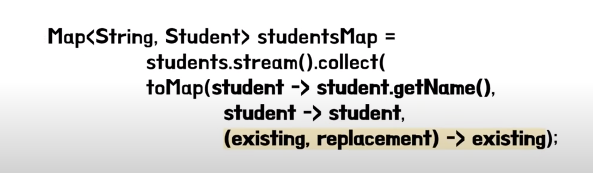
  - **collect(Collectiors.groupingBy())**
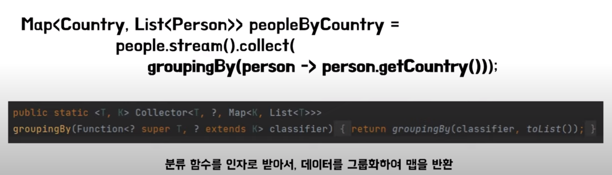
  - **collect(Collectors.joining())**
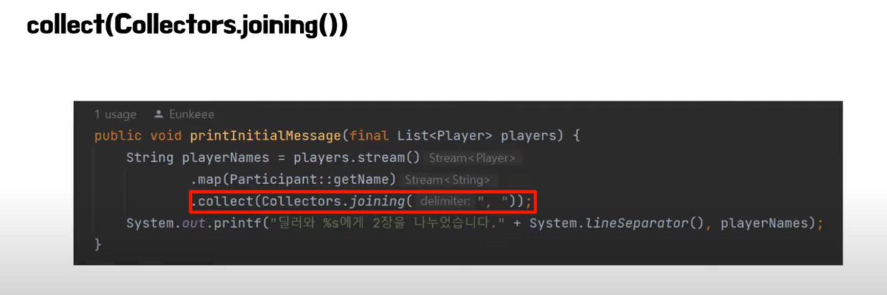

```java
 	   	 List<String> check = List.of(
                "one",
                "two",
                "three"
        );
        String check_result = check.stream().collect(Collectors.joining(" "));
        System.out.println(check_result); // one two three
```
- reduce(T identity, BinaryOperator<T> accumulator)
- reduce(BinaryOperator<T> accumulator) : 초기값이 없을 경우 사용 
  - 스트림의 데이터를 줄여 나가면서 연산을 수행하고 최종 결과를 반환 

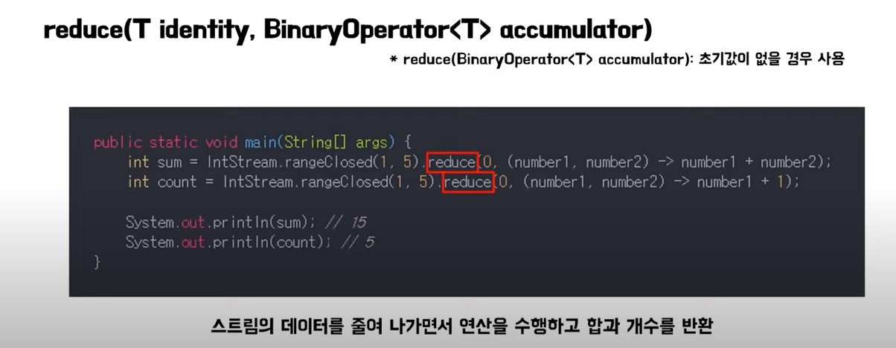
- reduce 사용 x IntStream을 활용한 sum 

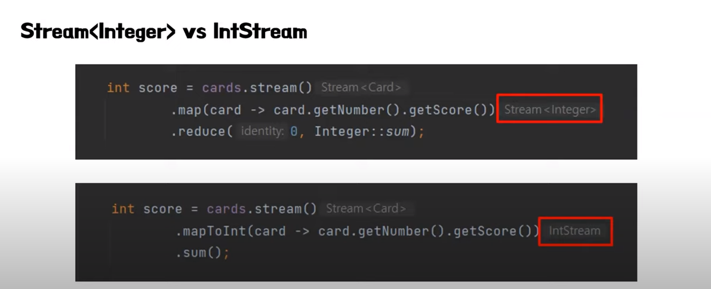

```java
        String make = IntStream.rangeClosed(1, 5).mapToObj(Integer::toString).reduce("", (str1, str2)-> str1+ str2);
        System.out.println(make); // 12345

        // IntStream을 활용한 sum
        int int_result = IntStream.rangeClosed(1, 100).sum();
        System.out.println(int_result);

        
        int int_result2 = IntStream.rangeClosed(1, 50).reduce(0, Integer::sum);
        System.out.println(int_result2);
```

IntStream은 기본형 특화 스트림 

Stream<Integer>은 unboxing boxing 과정이 있어서 기본형 특화 스트림 보다 느리다!

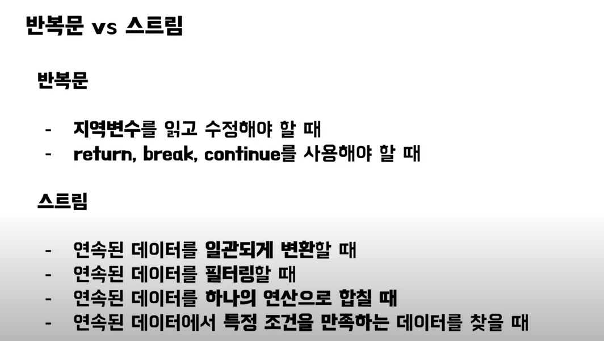

