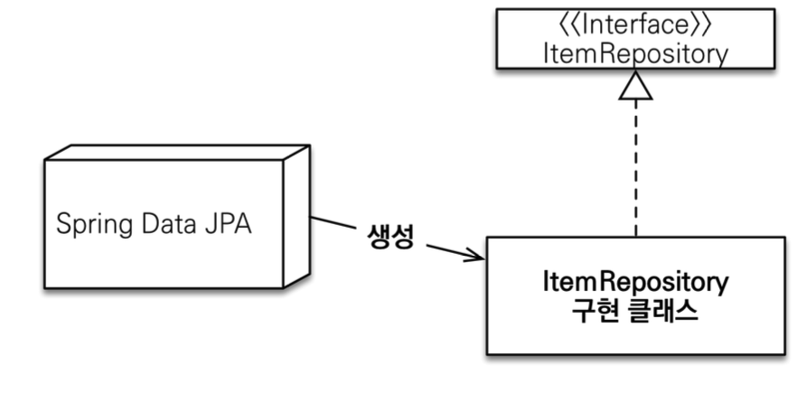
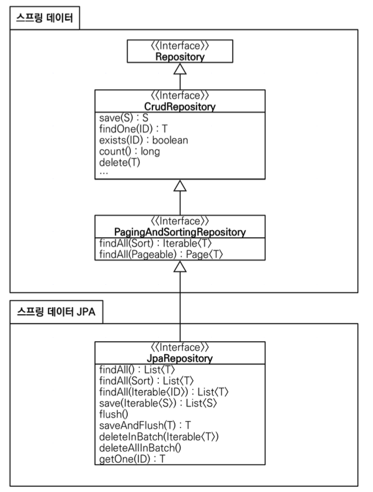

### ***엔티티***

*Member*

  - *id*
  - *username*
  - *age*
  - *Team team*

*Team*

  - *id*
  - *name*
  - *List<Member> mebers*

```java
@Entity
@Getter @Setter
@NoArgsConstructor(access = AccessLevel.PROTECTED)
@ToString(of = {"id", "username", "age"})
public class Member {
    @Id @GeneratedValue(strategy = GenerationType.IDENTITY)
    @Column(name = "member_id")
    private Long id;

    private String username;

    private int age;

    @ManyToOne(fetch = FetchType.LAZY)
    @JoinColumn(name = "team_id")
    private Team team;

    public Member(String username) {
        this.username = username;
    }

    // 연관관계 편의 메소드
    public void changeTeam(Team team) {
        this.team = team;
        team.getMembers().add(this);
    }
}

@Entity
@Getter @Setter
@NoArgsConstructor(access = AccessLevel.PROTECTED)
@ToString(of = {"id", "name"})
public class Team {
    @Id @GeneratedValue(strategy = GenerationType.IDENTITY)
    @Column(name = "team_id")
    private Long id;

    private String name;

    @OneToMany(mappedBy = "team")
    private List<Member> members = new ArrayList<>();

    public Team(String name) {
        this.name = name;
    }
}

```

# ***순수*** *JPA* ***기반 리포지토리 만들기***

***MemberJpaRepository***

```java
@Repository
@RequiredArgsConstructor
public class MemberJpaRepository {

    private final EntityManager em;

    public Member save(Member member) {
        em.persist(member);
        return member;
    }

    public Member find(Long id){
        return em.find(Member.class, id);
    }

    public void delete(Member member) {
        em.remove(member);
    }

    public List<Member> findAll() {
        return em.createQuery("select m from Member m", Member.class)
                .getResultList();
    }

    public Optional<Member> findById(Long id) {
        Member member = em.find(Member.class, id);
        return Optional.ofNullable(member);
    }
    public long count(){
        return em.createQuery("select count(m) from Member m", Long.class)
                .getSingleResult();
    }
}
```

***TeamJpaRepository***

```java
@Repository
@RequiredArgsConstructor
public class TeamRepository {

    private final EntityManager em;

    public Team save(Team team) {
        em.persist(team);
        return team;
    }
    public void delete(Team team) {
        em.remove(team);
    }

    public List<Team> findAll() {
        return em.createQuery("select t from Team t", Team.class)
                .getResultList();
    }

    public Optional<Team> findById(Long id) {
        return Optional.ofNullable(em.find(Team.class, id));
    }

    public long count(){
        return em.createQuery("select count(t) from Team t", Long.class)
                .getSingleResult();
    }
}
```

***기본 CRUD***

  - *저장*
  - *변경 → 변경감지 사용*
- *merge: 모두 null로 대체하기 때문에 위험하다.*
  - *삭제*
  - *전체 조회* 
  - *단건 조회 (Optional)* 
  - *카운트* 

# ***공통 인터페이스 설정***

***스프링 부트 사용시 생략 가능한 설정*** 

```java
@Configuration
@EnableJpaRepositories(basePackages = "jpabook.jpashop.repository")
public class AppConfig {}
```

  - *스프링 부트 사용시 @SpringBootApplication 위치를 지정(해당 패키지와 하위 패키지 인식)*
  - *만약 위치가 달라지면 @EnableJpaRepositories 필요하다* 
- *`org.springframework.data.repository.Repository`* *를 구현(상속받는)한 클래스는 스캔 대상*

***스프링 부트 JPA가 구현 클래스를 대신 생성*** 



  - *`org.springframework.data.repository.Repository`* *를 구현(상속받는)한 클래스는 스캔 대상*
- *스프링 데이터 JPA가 프록시 객체를 생성해서 스프링 컨테이너에 자동 주입한다.*
    - *MemberRepository가 인터페이스가 동작하는 이유*
```java
public interface MemberRepository extends JpaRepository<Member, Long> {}
```

```java
@SpringBootTest
@Transactional
class MemberRepositoryTest {
    @Autowired
    private MemberRepository memberRepository;

    @Test
    void proxy(){
        System.out.println(AopUtils.isAopProxy(memberRepository));
        System.out.println("memberRepository = " + memberRepository.getClass());
    }
```

      - *true 출력* 
      - *memberRepository = class jdk.proxy3.$Proxy129*
    - *인터페이스 기반 프록시 → JDK 동적 프록시를 적용한다.*
  - ***@Repository 애노테이션 생략 가능*** 
- *컴포넌트 스캔을 스프링 데이터 JPA가 자동으로 처리한다.*
    - *JPA 예외를 스프링의 추상화된 예외인 DataAccessException으로 변환하는 과정도 자동으로 처리*

# *공통 인터페이스 분석* 


***JpaRepository - 공통 기능 인터페이스*** 

  - *공통 CRUD 제공* 
  - *제네릭: <엔티티 타입, 식별자 타입> 설정* 



***제네릭 타입***

  - *T: 엔티티*
  - *ID: 엔티티의 식별자 타입* 
  - *S: 엔티티와 그 자식 타입* 

***주요 메소드*** 

  - *save(S): 새로운 엔티티는 저장(persist) 이미 식별자가 존재하는 엔티티는 병합(merge)*
  - *delete(T): 엔티티 하나를 삭제 → em.remove(T) 호출* 
  - *findById(ID): 엔티티 하나를 조회 → em.find() 호출* 
- *Optional<T> 반환*
  - *getOne(ID): 엔티티를 프록시로 조회한다. →em.getReference() 호출*
  - *findAll(…): 모든 엔티티를 조회한다.*
- *정렬(sort),페이징(Pageable) 조건을 파라미터로 제공할 수 있다.*

***스프링 데이터 JPA가 제공하는 마법 같은 기능 - 쿼리 메소드*** 

  - *메소드 이름으로 쿼리 생성* 
  - *메소드 이름으로 JPA NamedQuery 호출* 
  - *@Query 애노테이션을 사용해서 리포지토리 인터페이스에 쿼리 직접 정의* 

# ***메소드 이름으로 쿼리 생성***

*메소드 이름을 분석해서 JQPL 쿼리 실행* 

*ex) 이름과 나이를 기준으로 회원을 조회하려면?*

***직접 JPQL 작성한다면?***

```java
public List<Member> findByUsernameAndAgeGreaterThen(String username, int age) {
     return em.createQuery("select m from Member m where m.username = :username and age > :age", Member.class)
             .setParameter("username", username)
             .setParameter("age", age)
             .getResultList();
}

```

***순수 JpaRepository test***

```java
@Test
public void findByUsernameAndAgeGreaterThen(){
    Member member1 = new Member("memberA", 10);
    Member member2 = new Member("memberA", 20);
    memberJpaRepository.save(member1);
    memberJpaRepository.save(member2);

    List<Member> result = memberJpaRepository
            .findByUsernameAndAgeGreaterThen("memberA", 15);

    assertThat(result.size()).isEqualTo(1);
    assertThat(result.get(0).getAge()).isEqualTo(20);
    assertThat(result.get(0).getUsername()).isEqualTo("memberA");
}
```

	
***메소드 이름으로 쿼리 생성 적용*** 

```java
public interface MemberRepository extends JpaRepository<Member, Long> {
    List<Member> findByUsernameAndAgeIsGreaterThan(String username, int age);
}
```

***동일한 테스트 적용*** 

```java
@Test
public void findByUsernameAndAgeGreaterThen(){
    Member member1 = new Member("memberA", 10);
    Member member2 = new Member("memberA", 20);
    memberRepository.save(member1);
    memberRepository.save(member2);

    List<Member> result = memberRepository
            .findByUsernameAndAgeIsGreaterThan("memberA", 15);

    assertThat(result.size()).isEqualTo(1);
    assertThat(result.get(0).getAge()).isEqualTo(20);
    assertThat(result.get(0).getUsername()).isEqualTo("memberA");
}
```

*스프링 데이터 JPA는 메소드 이름을 분석해서 JPQL을 생성하고 실행한다.*

***쿼리 메소드 필터 조건***

  - [https://docs.spring.io/spring-data/jpa/reference/jpa/query-methods.html](https://docs.spring.io/spring-data/jpa/reference/jpa/query-methods.html)


***스프링 데이터 JPA가 제공하는 쿼리 메소드 기능***	

  - *조회*
- *find...By ,read...By ,query...By get...By*
    - *By이후 조건이 없으면 findAll()로 동작한다.* 
    - *즉, 메소드 이름에 식별하기 위한 설명이 들어가도 된다.*

```java
public interface MemberRepository extends JpaRepository<Member, Long> {
    List<Member> findZeusBy();
}

select
    m1_0.member_id,
    m1_0.age,
    m1_0.team_id,
    m1_0.username 
from
    member m1_0
	
```
  - *COUNT*
- *count...By* 
    - *반환타입: long*
  - *EXISTS*
- *exists…By*
    - *반환타입: boolean*
  - *DELETE*
- *delete…By, remove…By*
    - *반환타입: long → 적용된 row 수*
  - *DISTINCT*
- *findDistinct, findMemberDistinctBy*
  - *LIMIT*
- *findFirst3, findFirst, findTop, findTop3*

***참고*** 

*해당 기능은 엔티티 필드명이 변경되면 인터페이스에 정의한 메소드 이름도 꼭 함께 변경해야 한다.*

*그렇지 않으면 애플리케이션 시작하는 시점에 오류가 발생한다.* 

*이렇게 애플리케이션 로딩 시점에 오류를 인지할 수 있는 것이 스프링 데이터 JPA의 매우 큰 장점이다.*

*ex) 순수 JPA로 직접 JQPL 작성은 클라이언트가 호출 전까지 인지하지 못한다.*

# ***JPA NamedQuery***

***Member entity***

```java
@Entity
@Getter @Setter
@NoArgsConstructor(access = AccessLevel.PROTECTED)
@ToString(of = {"id", "username", "age"})
@NamedQuery(
      name = "Member.findByUsername",
      query = "select m from Member m where m.username = :username"
)
public class Member {
		  // 생략 ...
}
```

  - ***@NamedQuery 적용*** 

***순수 JPA 리포지토리 named query 사용*** 

```java
public List<Member> findByUsername(String username){
    return em.createNamedQuery("Member.findByUsername", Member.class)
            .setParameter("username", username)
            .getResultList();
}
```

***JpaRepository에서 NamedQuery 사용*** 

```java
public interface MemberRepository extends JpaRepository<Member, Long> {
    
    @Query(name = "Member.findByUsername")
    List<Member> findNameQueryByUsername(@Param("username") String username);
}
```

***장점***

  - *NamedQuery는 애플리케이션 로딩 시점에 파싱하기 때문에 문제가 있으면 예외를 던진다.*
  - *JPA는 내부적으로 NamedQuery를 캐싱하여 재사용한다. → 성능 최적화*
  - *JPA가 캐싱하는 방식과 옵티마이저가 캐싱은 다르다.* 

| **캐싱 레벨** | **캐싱 주체** | **캐싱 대상** | **주요 특징** |
| --- | --- | --- | --- |
| **NamedQuery 캐싱** | JPA 구현체 (Hibernate) | JPQL -> SQL 변환 결과 | 애플리케이션 레벨 캐싱<br>**SQL 재생성 방지** |
| **DB 옵티마이저 캐싱** | 데이터베이스 엔진 | SQL 실행 계획 (Execution Plan) | 동일한 SQL 텍스트일 경우 <br>**실행 계획 재사용** |

***참고*** 

*Spring Data Jpa는 메소드 이름으로 쿼리를 생성할 때 먼저 엔티티이름.메소드이름 형식으로* 
***매핑된 NameQuery가 먼저 존재하는지 찾고 없으면 메소드 이름을 기반으로 쿼리를 생성한다.***

*즉, 엔티티에 정의된 NameQuery 이름이 Member.findByUsername 이면* 

```java
List<Member> findByUsername(@Param("username") String username);
```

*이렇게만 정의해도 네임드 쿼리로 동작한다.*

***참고*** 

*@Param은 JPQL setParameter() 같이 동작을 한다.* 

*직접 JPQL 작성 또는 NameQuery를 사용할 때 필요하다.*

*메소드 이름으로 쿼리를 생성하는 경우에는 생략이 가능하다.*

```java
List<Member> findByUsername(String username); 
```

  - *@Param 생략* 

***참고***

*스프링 데이터 JPA를 사용하면 실무에서 NameQuery를 엔티티,xml에 직접 등록해서 사용하는 일은 드물다.*

*대신에 @Query를 사용해서 리포지토리 메소드에 쿼리를 직접 정의한다.*

# *@Query,* ***리포지토리 메소드에 쿼리 정의하기***

```java
public interface MemberRepository extends JpaRepository<Member, Long> {
    @Query("select m from Member m where m.username = :username and m.age = :age")
    List<Member> findUser(@Param("username") String username, @Param("age") int age);
}

```

  - *NameQuery 장점을 모두 가지면서 엔티티, xml에 직접 정의해야 하는 불편함이 없다.*
  - *참고로 파라미터 이름은 오류 감지를 못한다.*

# *@Query,* ***값****, DTO* ***조회하기***

### ***단순히 값 하나를 조회*** 

```java
 @Query("select m.username from Member m")
 List<String> findUsernameList();
```

  - *JPA 값 타입(@Embedded)도 해당 방식으로 조회할 수 있다.*

*test* 

```java
@Test
public void testUsername(){
    Member member1 = new Member("memberA", 10);
    Member member2 = new Member("memberB", 20);
    memberRepository.save(member1);
    memberRepository.save(member2);

    List<String> result = memberRepository.findUsernameList();
    assertThat(result).containsExactly("memberA", "memberB");
}
```

### ***DTO로 직접 조회***

```java
@Data
@AllArgsConstructor
public class MemberDto {
    private Long id;
    private String username;
    private String teamName;
}

@Query("select new study.datajpa.dto.MemberDto(m.id, m.username, t.name) from Member m join m.team t")
List<MemberDto> findMemberDto();

```

  - *JPA가 제공하는 new 명령어와 함께 FQCN을 적어준다.* 

*test*

```java
@Test
public void testMemberDto(){
    Team teamA = new Team("teamA");
    Team teamB = new Team("teamB");
    teamRepository.save(teamA);
    teamRepository.save(teamB);

    Member member1 = new Member("memberA", 10, teamA);
    Member member2 = new Member("memberB", 20, teamB);
    memberRepository.save(member1);
    memberRepository.save(member2);

    List<MemberDto> result = memberRepository.findMemberDto();
    assertThat(result.get(0).getTeamName()).isEqualTo("teamA");
    assertThat(result.get(1).getTeamName()).isEqualTo("teamB");
}
```

# ***파라미터 바인딩***

### ***위치 기반 vs 이름 기반*** 

  - *위치 기반 파라미터 바인딩*  
  - *이름 기반 파라미터 바인딩* 

```java
select m from Member m where m.username = ?0 //위치 기반 
select m from Member m where m.username = :name //이름 기반
```

***코드 가독성과 유지 보수를 위해 이름 기반 파라미터 바인딩을 사용하자***

*→ 위치 기반 파라미터 바인딩에서 순서가 틀려지는 상황을 상상해 보자*

```java
public interface MemberRepository extends JpaRepository<Member, Long> {
     @Query("select m from Member m where m.username = :name")
     Member findMembers(@Param("name") String username);
 }
```

### ***컬렉션 파라미터 바인딩***

*Collection 타입으로 in절 지원한다.*

```java
@Query("select m from Member m where m.username in :names")
List<Member> findByNames(@Param("names") List<String> names);
```

  - *JPA가 리스트 크기에 맞게 동적으로 in절을 만들어준다.* 

*test*

```java
@Test
public void parameterBindingTest(){
    Member member1 = new Member("memberA", 10);
    Member member2 = new Member("memberB", 20);
    Member member3 = new Member("memberC", 30);
    memberRepository.save(member1);
    memberRepository.save(member2);
    memberRepository.save(member3);

    List<Member> result = memberRepository
            .findByNames((List.of("memberA", "memberB")));

    assertThat(result.size()).isEqualTo(2);
}

select
    m1_0.member_id,
    m1_0.age,
    m1_0.team_id,
    m1_0.username 
from
    member m1_0 
where
    m1_0.username in (?, ?)
```

# ***반환 타입***

*스프링 데이터 JPA는 유연한 반환 타입을 지원한다.*

```java
List<Member> findListByUsername(String username);

Member findMemberByUsername(String username);

Optional<Member> findOptionalMemberByUsername(String username);
```

***조회 결과가 많거나 적으면?***

  - *컬렉션*
- *결과 없음 → 빈 컬렉션 반환*
  - *단건 조회*
- *결과 없음 → null 반환*
    - *결과가 2건 이상:* ***jakarta.persistence.NonUniqueResultException*** *예외 발생*
- ***IncorrectResultSizeDataAccessException*** *스프링 예외 변환기가 변환해서 올리는 예외*

```java
@Test
public void returnTypeTest(){
    Member member1 = new Member("memberA", 10);
    Member member2 = new Member("memberA", 20);
    memberRepository.save(member1);
    memberRepository.save(member2);

    assertThatThrownBy(() -> memberRepository.findMemberByUsername("memberA"))
            .isInstanceOf(IncorrectResultSizeDataAccessException.class);
}
```

  - *스프링의 예외 추상화*

***참고***

*단건으로 지정한 메소드를 호출하면 스프링 데이터 JPA는 내부에서 JPQL의* ***Query.getSingleResult()*** *메소드를 호출한다.*

*이 메소드를 호출했을 때 결과가 없으면* ***jakarta.persistence.NoResultException*** *예외가 발생하는데 
스프링 데이터 JPA는 이 예외가 발생하면 catch해서* ***null을 반환한다.***

[https://docs.spring.io/spring-data/jpa/reference/repositories/query-return-types-reference.html#page-title](https://docs.spring.io/spring-data/jpa/reference/repositories/query-return-types-reference.html#page-title)

  - *Future<T>, CompletableFuture<T> 또한 받을 수 있다.*

# ***순수*** *JPA* ***페이징과 정렬***

*다음 조건으로 페이징과 정렬을 사용하는 예제 코드를 보자*

  - *검색 조건: 나이가 10살* 
  - *정렬 조건: 이름으로 내림차순* 
  - *페이징 조건: 첫 번째 페이지, 페이지당 보여줄 데이터는 3건*  

```java
public List<Member> findByPage(int age, int offset, int limit){
    return em.createQuery("select m from Member m where m.age = :age order by m.username desc",
            Member.class)
            .setParameter("age", age)
            .setFirstResult(offset)
            .setMaxResults(limit)
            .getResultList();
}

public long totalCount(int age){
    return em.createQuery("select count(m) from Member m where m.age = :age", Long.class)
            .setParameter("age", age)
            .getSingleResult();
}
```

  - *페이징은 현재 몇 번째 페이지인지 보여줘야하기 때문에 count 쿼리가 추가로 필요하다.*

```java
@Test
public void pageTest(){
    // given
    Member member1 = memberJpaRepository.save(new Member("member1", 10));
    Member member2 = memberJpaRepository.save(new Member("member2", 10));
    Member member3 = memberJpaRepository.save(new Member("member3", 10));
    Member member4 = memberJpaRepository.save(new Member("member4", 10));
    Member member5 = memberJpaRepository.save(new Member("member5", 10));
    Member member6 = memberJpaRepository.save(new Member("member6", 10));

    int age = 10;
    int offset = 3;
    int limit = 3;

    // when
    List<Member> members = memberJpaRepository.findByPage(age, offset, limit);
    long totalCount = memberJpaRepository.totalCount(age);

    // then
    assertThat(members.size()).isEqualTo(3);
    assertThat(totalCount).isEqualTo(6);
    assertThat(members).containsExactly(member3, member2, member1);
}
```

# ***스프링 데이터*** *JPA* ***페이징과 정렬***

### ***페이징과 정렬 파라미터***

  - *org.springframework.data.domain.****Sort*** *: 정렬 기능*
  - *org.springframework.data.domain.****Pageable****: 페이징 기능*
- *내부에 Sort 포함*

### ***특별한 반환 타입***

  - *org.springframework.data.domain.****Page****: 추가 count 쿼리 결과를 포함하는 페이징*	
  - *org.springframework.data.domain.****Slice****: 추가 count 쿼리 없이 다음 페이지만 확인 가능(내부적으로 limit + 1조회)*
  - ***List(자바 컬렉션)****: 추가 count 쿼리 없이 결과만 반환* 

### ***페이징과 정렬 사용 예제***

```java
Page<Member> findByUsername(String name, Pageable pageable); 

Slice<Member> findByUsername(String name, Pageable pageable); 

List<Member> findByUsername(String name, Pageable pageable); 
 
List<Member> findByUsername(String name, Sort sort);
```

*다음 조건으로 페이징과 정렬을 사용하는 예제 코드를 보자*

  - *검색 조건: 나이가 10살* 
  - *정렬 조건: 이름으로 내림차순* 
  - *페이징 조건: 첫 번째 페이지, 페이지당 보여줄 데이터는 3건*  

### *Page*

```java
Page<Member> findByAge(int age, Pageable pageable);

----------------------------------------------------------------------

@Test
public void pageTest(){
    // given
    Member member1 = memberRepository.save(new Member("member1", 10));
    Member member2 = memberRepository.save(new Member("member2", 10));
    Member member3 = memberRepository.save(new Member("member3", 10));
    Member member4 = memberRepository.save(new Member("member4", 10));
    Member member5 = memberRepository.save(new Member("member5", 10));
    Member member6 = memberRepository.save(new Member("member6", 10));

    int age = 10;
    PageRequest pageRequest = PageRequest.of(1, 3,
                    Sort.by(Sort.Direction.DESC, "username"));

    // when
    Page<Member> result = memberRepository.findByAge(age, pageRequest);

    // then
    List<Member> content = result.getContent();
    long totalElements = result.getTotalElements();
    int totalPages = result.getTotalPages();

    assertThat(content.size()).isEqualTo(3);
    assertThat(totalElements).isEqualTo(6);
    assertThat(totalPages).isEqualTo(2);
    assertThat(content).containsExactly(member3, member2, member1);
}
```

  - *PageRequest: Pageable<interface>구현체*
  - *PageRequest(페이지 번호(0부터 시작), 페이지 데이터 크기, 정렬 조건(생략 가능))*
  - *반환타입: Page<T>*
- *getContent(): List<T>*
    - *getElements(): 전체 row 수*
    - *getTotalPages(): 페이지 데이터 크기로 계산한 전체 페이지 개수* 
    - *getNumber(): 현재 페이지 번호 (0부터 시작)*
    - *isFirst(), isLast(), hasNext() …*

```java
 select
      m1_0.member_id,
      m1_0.age,
      m1_0.team_id,
      m1_0.username 
  from
      member m1_0 
  where
      m1_0.age=? 
  order by
      m1_0.username desc 
  offset
      ? rows 
  fetch
      first ? rows only
      
 ---------------------------------------------     
      
 select
      count(m1_0.member_id) 
  from
      member m1_0 
  where
      m1_0.age=?    
```

  - *추가로 count 쿼리가 날아간다.*

### *Slice*

***Page extends Slice***

```java
public interface Page<T> extends Slice<T> {
   
    static <T> Page<T> empty() {
        return empty(Pageable.unpaged());
    }

    static <T> Page<T> empty(Pageable pageable) {
        return new PageImpl(Collections.emptyList(), pageable, 0L);
    }

    int getTotalPages();

    long getTotalElements();

    <U> Page<U> map(Function<? super T, ? extends U> converter);
}
```

  - *Page는 Slice와 다르게 count 쿼리가 추가로 날아가기 때문에 getTotalPages(), getTotalElements() 같은 API를 사용할 수 있다.*

```java
Slice<Member>findSliceByAge(int age, Pageable pageable);

-------------------------------------------------------------------------

@Test
public void sliceTest(){
    // given
    Member member1 = memberRepository.save(new Member("member1", 10));
    Member member2 = memberRepository.save(new Member("member2", 10));
    Member member3 = memberRepository.save(new Member("member3", 10));
    Member member4 = memberRepository.save(new Member("member4", 10));
    Member member5 = memberRepository.save(new Member("member5", 10));
    Member member6 = memberRepository.save(new Member("member6", 10));
    Member member7 = memberRepository.save(new Member("member7", 10));

    int age = 10;
    PageRequest pageRequest = PageRequest.of(1, 3,
                    Sort.by(Sort.Direction.DESC, "username"));

    // when
    Slice<Member> result = memberRepository.findSliceByAge(age, pageRequest);

    // then
    List<Member> content = result.getContent();
    int number = result.getNumber();

    assertThat(number).isEqualTo(1);
    assertThat(content.size()).isEqualTo(3);
    assertThat(content).containsExactly(member4, member3, member2);
    assertThat(result.isFirst()).isFalse();
    assertThat(result.isLast()).isFalse();
    assertThat(result.hasNext()).isTrue();
}
```

  - *count 쿼리가 날아가지 않는다.*
  - *추가로 limit + 1을 조회한다.* 
- *다음 페이지 여부 확인(모바일 리스트)*

```java
select
    m1_0.member_id,
    m1_0.age,
    m1_0.team_id,
    m1_0.username 
from
    member m1_0 
where
    m1_0.age=? 
order by
    m1_0.username desc 
offset
    ? rows 
fetch
    first ? rows only
```

### ***Count 쿼리 분리*** 👍

*전체 데이터 개수 조회(count)는 DB에 부하가 많이 가는 작업이다.* 

*그래서 JPA가 직접 날려주는 페이징 + totalCount 쿼리를 사용하는 게 아닌 분리할 필요가 있다.* 

  - *Page: count + 페이징* 

***ex) Member, Team left join 예시*** 

*count 쿼리에서는 Member Team left join을 해서 전체 개수를 count 할 필요 없다.*

*그냥 Member만 count 하면된다.*

*하지만 spring data jpa에서 생성하는 count 쿼리는 그렇지 않다.* 

*불필요한 조인을 하여 성능에 부하를 줄 수 있다.*

***Count 쿼리 분리*** 

```java
@Query(value = "select m from Member m left join m.team t",
        countQuery = "select count(m) from Member m")
Page<Member> findOptimize(Pageable pageable);
```

### *Page.map*

*실무에서는 절대로 엔티티를 노출시키면 안 된다.* 

*반드시 DTO를 노출시키자*

*Page.map를 사용하면 페이지를 유지하면서 쉽게 DTO로 변환이 가능하다.*

```java
@Test
public void pageMapTest(){
    // given
    Member member1 = memberRepository.save(new Member("member1", 10));
    Member member2 = memberRepository.save(new Member("member2", 10));
    Member member3 = memberRepository.save(new Member("member3", 10));
    Member member4 = memberRepository.save(new Member("member4", 10));
    Member member5 = memberRepository.save(new Member("member5", 10));
    Member member6 = memberRepository.save(new Member("member6", 10));
    Member member7 = memberRepository.save(new Member("member7", 10));

    PageRequest pageRequest = PageRequest.of(0, 3,
            Sort.by(Sort.Direction.DESC, "username"));

    Page<Member> result = memberRepository.findOptimize(pageRequest);

    assertThat(result.getContent()).containsExactly(member7, member6, member5);
    assertThat(result.isFirst()).isTrue();

    Page<MemberDto> toMap = 
            result.map(m -> 
                    new MemberDto(m.getId(), m.getUsername(), m.getTeam().getName()));

}
```

# ***벌크성 수정 쿼리***

### 
*순수 JPA* 

```java
public int bulkAgePlus(int age){
    return em.createQuery("update Member m set m.age = m.age + 1" +
            " where m.age >= :age")
            .setParameter("age", age)
            .executeUpdate();
}
```

***테스트 코드*** 

```java
@Test
@Rollback(false)
public void bulkUpdateTest(){
    // given
    Member member1 = memberJpaRepository.save(new Member("member1", 10));
    Member member2 = memberJpaRepository.save(new Member("member2", 19));
    Member member3 = memberJpaRepository.save(new Member("member3", 20));
    Member member4 = memberJpaRepository.save(new Member("member4", 21));
    Member member5 = memberJpaRepository.save(new Member("member5", 40));

    // when
    int resultCount = memberJpaRepository.bulkAgePlus(20);

    // then
    assertThat(resultCount).isEqualTo(3);
}
```

### *Spring Data JPA*

```java
@Modifying
@Query("update Member m set m.age = m.age + 1 where m.age >= :age")
int bulkAgePlus(@Param("age") int age);
```

  - ***@Modifying***
- *Spring Data JPA를 사용하고 벌크성 쿼리를 사용할 때 해당 애노테이션이 필요하다.
해당 애노테이션이 있어야  executeUpdate() 실행* 
    - *해당 애노테이션이 없으면 반환 타입에 따라서 getSingleResult(), getResultList()가 동작한다.* 
    - ***update JPQL인데 @Modifying이 없으면 예외가 발생한다.***

***테스트 코드 동일*** 

### 👍 *벌크성 쿼리 주의사항* 

```java
@Test
@Rollback(false)
public void bulkUpdateTest(){
    // given
    Member member1 = memberRepository.save(new Member("member1", 10));
    Member member2 = memberRepository.save(new Member("member2", 19));
    Member member3 = memberRepository.save(new Member("member3", 20));
    Member member4 = memberRepository.save(new Member("member4", 21));
    Member member5 = memberRepository.save(new Member("member5", 40));

    // when
    int resultCount = memberRepository.bulkAgePlus(20);

    Member findMember5 = memberRepository.findById(member5.getId()).get();
    assertThat(findMember5.getAge()).isEqualTo(40);

    // then
    assertThat(resultCount).isEqualTo(3);
}
```

*update를 했지만 update 대상인 member3, member4, member5의 영속성 컨텍스트에서의 나이는 그대로
Spring Data Jpa도 결국 Jpa를 사용한다.* 

*즉, Jpa의 벌크성 쿼리는 영속성 컨텍스트(1차 캐시)의 상태를 변경하지 않는다.*

*물론 update 쿼리도 JPQL 이니까 flush() 호출 이후 동작하지만 update로 인한 변경은 영속성 컨텍스트에 반영되지 않는다.* 

*즉, JPA의 벌크성 쿼리는 같은 트랜잭션에서 애플리케이션 레벨의 Repeatable Read 보장은 되지 않는다.*

*이를 막을려면 벌크성 쿼리 이후 영속성 컨텍스트 초기화가 필요하다.*

```java
@SpringBootTest
@Transactional
class MemberRepositoryTest {

    @Autowired
    private MemberRepository memberRepository;

    @Autowired
    private EntityManager em;

		@Test
		@Rollback(false)
		public void bulkUpdateTest(){
		    // given
		    Member member1 = memberRepository.save(new Member("member1", 10));
		    Member member2 = memberRepository.save(new Member("member2", 19));
		    Member member3 = memberRepository.save(new Member("member3", 20));
		    Member member4 = memberRepository.save(new Member("member4", 21));
		    Member member5 = memberRepository.save(new Member("member5", 40));
		
		    // when
		    int resultCount = memberRepository.bulkAgePlus(20);
		    em.clear();
		
		    Member findMember5 = memberRepository.findById(member5.getId()).get();
		    assertThat(findMember5.getAge()).isEqualTo(41);
		
		    // then
		    assertThat(resultCount).isEqualTo(3);
}
```

  - *엔티티 매니저를 통해서 영속성 컨텍스트(1차 캐시)를 비웠기 때문에 다시 select 쿼리가 findById에서 날아간다.*
  - *DB에서 직접 조회했기 때문에 update된 정상적인 나이 41이 나온다.*
  - *참고로 같은 트랜잭션에서는 같은 엔티티 매니저를 사용한다.*
- *트랜잭션 매니저(JpaTransactionalManager)에서 트랜잭션 동기화 매니저를 통해 스레드 로컬에 엔티티 매니저를 보관해서 그렇다.*

### *Modifying - clearAutomatically*

```java
@Modifying(clearAutomatically = true)
@Query("update Member m set m.age = m.age + 1 where m.age >= :age")
int bulkAgePlus(@Param("age") int age);
```

  - *해당 옵션을 사용하면 update 쿼리 이후에 영속성 컨텍스트 초기화를 한다.*
  - *이제 이전 테스트는 em.clear()를 호출하지 않아도 정상 동작*

# *@EntityGraph*

*연관된 엔티티들을 SQL 한번에 조회하는 방법이다.*

### *지연 로딩 & N+1 문제* 

```java
@Test
public void findMemberLazy(){
    // given
    Team teamA = new Team("teamA");
    Team teamB = new Team("teamB");
    teamRepository.save(teamA);
    teamRepository.save(teamB);
    memberRepository.save(new Member("member1", 10, teamA));
    memberRepository.save(new Member("member2", 10, teamB));

    em.clear();
    // when
    List<Member> members = memberRepository.findAll();

    for (Member member : members) {
        System.out.println("member = " + member);
        System.out.println("member.team = " + member.getTeam().getName());
    }
}
```

  - *현재 Member Team → N:1 관계 & fetchType=Lazy*
  - *N+1 문제 발생*
- *Member 전체 조회 1번* 
    - *지연 로딩된 프록시 Team 객체 조회 2번*

### *fetch join 적용* 

```java
@Query("select m from Member m join fetch m.team t")
List<Member> findMemberFetchJoin();
```

***동일한 테스트*** 

```java
  select
      m1_0.member_id,
      m1_0.age,
      t1_0.team_id,
      t1_0.name,
      m1_0.username 
  from
      member m1_0 
  join
      team t1_0 
          on t1_0.team_id=m1_0.team_id
```

  - *fetch join으로 동일한 테스트 쿼리 1번 실행* 

### *@EntityGraph*

***Spring Data JPA에서는 @EntityGraph를 통해서 간편하게 fetch join을 사용 가능하다***


***상위 인터페이스 메소드 + @EnitityGraph***

```java
@Override
@EntityGraph(attributePaths = {"team"})
List<Member> findAll();

select
    m1_0.member_id,
    m1_0.age,
    t1_0.team_id,
    t1_0.name,
    m1_0.username 
from
    member m1_0 
left join
    team t1_0 
        on t1_0.team_id=m1_0.team_id
```

  - *참고: findAll() 메소드는 본래 ListCrudRepository에 있다.*

***JPQL + @EntityGraph***

```java
@EntityGraph(attributePaths = {"team"})
@Query("select m from Member m")
List<Member> findMemberEntityGraph();

select
    m1_0.member_id,
    m1_0.age,
    t1_0.team_id,
    t1_0.name,
    m1_0.username 
from
    member m1_0 
left join
    team t1_0 
        on t1_0.team_id=m1_0.team_id
```

***메소드 이름 기반  + @EntityGraph***

```java
@EntityGraph(attributePaths = {"team"})
List<Member> findEntityGraphByUsername(@Param("username") String username);


select
    m1_0.member_id,
    m1_0.age,
    t1_0.team_id,
    t1_0.name,
    m1_0.username 
from
    member m1_0 
left join
    team t1_0 
        on t1_0.team_id=m1_0.team_id 
where
    m1_0.username=?
```

### *정리*

  - *페치 조인의 간편 버전* 
  - *LEFT OUTER JOIN*

# *JPA Hint & Lock*

## *JPA Hint ?*

*SQL 힌트가 아니라 JPA 구현체에게 제공하는 힌트이다.*

### *변경 감지 Dirty Checking* 

```java
@Test
public void queryHint(){
    // given
    Member member1 = memberRepository.save(new Member("member1", 10));
    em.clear();

    // when
    Member findMember = memberRepository.findById(member1.getId()).get();
    findMember.setUsername("member2");
}
```

  - *@GeneratedValue(strategy = GenerationType.IDENTITY)*
- *해당 전략을 사용하고 있어서 em.flush() 하지 않아도 insert 쿼리가 날아간다.*
  - *em.clear() 이후 다시 조회하고 값을 변경했기 때문에 트랜잭션 커밋 시점에 원본 데이터(스냅샷)와 1차 캐시에 있는 데이터를 비교했는데 달라서 update 쿼리가 날아간다.*

### ***만약 조회만 한다면?***

*변경 감지의 동작을 위해서는 영속성 컨텍스트(1차 캐시)에 영속화되었을 때(DB 조회, em.persist())
원본 데이터를 1차 캐시 이외에 다른곳에 저장한다. (스냅샷)*

*내가 DB에서 조회(Read-only)만 한다고 하면 변경 감지를 위한 원본 데이터 저장(스냅샷)은 리소스 낭비이다.* 

*물론 내부에서 최적화를 많이 하겠지만..?*

### *@QueryHints, @QueryHint 적용*

```java
@QueryHints(value = @QueryHint(name = "org.hibernate.readOnly", value = "true"))
Member findReadOnlyByUsername(String username);
```

***테스트, 쿼리 확인*** 

```java
@Test
public void queryHint(){
    // given
    Member member1 = memberRepository.save(new Member("member1", 10));
    em.clear();

    // when
    Member findMember = memberRepository.findReadOnlyByUsername("member1");
    findMember.setUsername("member2");
}

select
    m1_0.member_id,
    m1_0.age,
    m1_0.team_id,
    m1_0.username 
from
    member m1_0 
where
    m1_0.username=?
```

  - *쿼리 힌트를 통해서 스냅샷을 생성하지 않았기 때문에 변경 감지가 동작하지 않는다.*

### ***Lock***

```java
@Lock(LockModeType.PESSIMISTIC_WRITE)
List<Member> findLockByUsername(String username);
```

  - *비관적 락(데이터베이스 베타 락(쓰기 락))*

***쿼리 확인*** 

```java
@Test
public void lock(){
    // given
    Member member1 = memberRepository.save(new Member("member1", 10));
    em.clear();

    // when
    List<Member> result = memberRepository.findLockByUsername("member1");
}

select
    m1_0.member_id,
    m1_0.age,
    m1_0.team_id,
    m1_0.username 
from
    member m1_0 
where
    m1_0.username=? for update
```

- ***메소드 이름 기반 쿼리 생성*** 
- ***JPA NamedQuery + 실행 계획 캐싱 vs NameQuery 캐싱 차이점 비교*** 
- ***@Query + Dto 조회***
- ***파라미터 바인딩, 컬렉션 파라미터 바인딩(in 절)***
- ***반환 타입*** 
- ***페이징과 정렬, 페이징 count 쿼리 분리, DTO 변환*** 
- ***벌크성 수정 쿼리 (주의사항), @Modifying, 옵션*** 
- ***@EntityGraph***
- ***JPA Hint***

# ***사용자 정의 리포지토리 구현***

### *사용자 정의 리포지토리 구현이 왜 필요할까?*

  - *스프링 데이터 JPA 리포지토리는 인터페이스만 정의하고 구현체는 스프링이 자동 생성한다. (프록시)*
  - *스프링 데이터 JPA가 제공하는 인터페이스를 직접 구현하면 구현해야 하는 기능이 너무 많다.*
- *오버라이딩*
  - *다양한 이유로 인터페이스의 메소드를 직접 구현하고 싶다면?*
- *JPA 직접 사용 - 엔티티 매니저를 직접 사용*
    - *스프링 JDBC Template, Mybatis, QueryDSL 사용* 
    - *데이터베이스 커넥션 직접 사용*

### *사용자 정의 인터페이스 구현* 

***사용자 정의 인터페이스 + 구현체*** 

```java
public interface MemberRepositoryCustom {
    List<Member> findMemberCustom();
}

@Repository
@RequiredArgsConstructor
public class MemberRepositoryImpl implements MemberRepositoryCustom {

    private final EntityManager em;

    @Override
    public List<Member> findMemberCustom() {
        return em.createQuery("select m from Member m", Member.class)
                .getResultList();
    }
}
```

  - *MemberRepositoryCustom<interface>*
  - *MemberRepositoryImpl implements MemberRepositoryCustom*

***사용자 정의 인터페이스 상속*** 

```java
public interface MemberRepository extends 
			JpaRepository<Member, Long>, MemberRepositoryCustom {			
}
```

***테스트 코드  - findMemberCustom()***

```java
@Test
public void callCustom(){
    List<Member> members = memberRepository.findMemberCustom();
}
```

  - ***정상 동작***

***사용자 정의 구현 클래스 규칙*** 

  - *리포지토리 인터페이스 이름 + Impl*
  - *스프링 데이터 JPA가 인식해서 스프링 빈으로 등록한다*
  - ***스프링 부트 2.0 이상***
- *사용자 정의 인터페이스명 + Impl 방식도 지원한다.*
    - ***ex) MemberRepositoryImpl → MemberRepositoryCustomImpl***
    - *참고로 해당 방식은 여러 사용자 정의 인터페이스를 분리해서 구현이 가능하니 이 방식을 권장한다.*

***Impl 대신 다른 이름으로 변경하고 싶으면?***

  - ***XML 설정***
```java
<repositories base-package="study.datajpa.repository"
               repository-impl-postfix="Impl" />
```
  - ***JavaConfig 설정*** 
```java
 @EnableJpaRepositories(basePackages = "study.datajpa.repository",
                        repositoryImplementationPostfix = "Impl")
```

### *참고* 

  - *실무에서는 주로 QueryDSL이나 SpringJdbcTemplate을 함께 사용할 때 사용자 정의 리포지토리 가능을 자주 사용한다*
  - *항상 사용자 정의 리포지토리가 필요한 것은 아니다. 그냥 임의의 리포지토리를 만들어도 된다. 
예를들어 MemberQueryRepository를 인터페이스가 아닌 클래스로 만들고 스프링 빈으로 등록해서 직접 사용해도 된다.
물론 해당 경우는 Spring Data JPA와는 아무런 관계 없이 별도로 동작한다.* 
***핵심 비즈니스에 필요한 쿼리와 특정 화면(API)에 필요한 쿼리를 분리해서 사용하자***

# *Auditing*

### ***엔티티를 생성, 변경할 때 변경한 사람과 시간을 추적하고 싶다면?***

  - *등록일*
  - *수정일*
  - *등록자*
  - *수정자*

## *순수 JPA 사용* 

***JpaBaseEntity***

```java
@MappedSuperclass
public class JpaBaseEntity {

    @Column(updatable = false)
    private LocalDateTime createdDate;
    private LocalDateTime updatedDate;

    @PrePersist
    public void prePersist() {
        LocalDateTime now = LocalDateTime.now();
        this.createdDate = now;
        this.updatedDate = now;
    }
    
    @PreUpdate
    public void preUpdate() {
        updatedDate = LocalDateTime.now();
    }
}
```

***Member 엔티티 추가*** 

```java
public class Member extends JpaBaseEntity {}

create table member (
    age integer not null,
    created_date timestamp(6),
    member_id bigint generated by default as identity,
    team_id bigint,
    updated_date timestamp(6),
    username varchar(255),
    primary key (member_id)
);

```

  - ***애노테이션, 필드 생략*** 
  - *쿼리를 보면 create_date, updated_date 컬럼이 존재한다.*

***테스트 코드***

```java
@Test
public void JpaEventBaseEntity() throws Exception {
    // given
    Member member = new Member("member1");
    memberRepository.save(member); // @PrePersist

    Thread.sleep(100);
    member.setUsername("member2");

    em.flush(); // @PreUpdate
    em.clear();

    // when
    Member findMember = memberRepository.findById(member.getId()).get();
    
    // then
    System.out.println("findMember.created_date = " + findMember.getCreatedDate());
    System.out.println("findMember.updated_date = " + findMember.getUpdatedDate());
}

findMember.created_date = 2025-01-28T16:48:31.374386
findMember.updated_date = 2025-01-28T16:48:31.508190

```

***JPA 주요 애노테이션*** 

  - *@PrePersist, @PostPersist, @PreUpdate, @PostUpdate*

## ***스프링 데이터*** *JPA* ***사용***

***@EnableJpaAuditing 적용*** 

```java
@EnableJpaAuditing
@SpringBootApplication
public class SpringDataJpaApplication {
    public static void main(String[] args) {
        SpringApplication.run(SpringDataJpaApplication.class, args);
    }
}
```

  - *스프링 부트 설정 클래스에 적용해야 한다*

***@MappedSuperclass, @EntityListeners(AuditingEntityListener.class)***

*→ 엔티티에 적용* 

***사용 애노테이션*** 

  - ***@CreatedDate***
  - ***@LastModifiedDate*** 
  - ***@CreatedBy*** 
  - ***@LastModifiedBy***

```java
@MappedSuperclass
@Getter
@EntityListeners(AuditingEntityListener.class)
public class BaseEntity {

    @CreatedDate
    @Column(updatable = false)
    private LocalDateTime createdDate;

    @LastModifiedDate
    private LocalDateTime lastModifiedDate;

    @CreatedBy
    @Column(updatable = false)
    private String createdBy;

    @LastModifiedBy
    private String lastModifiedBy;
}
```

***@CreatedBy(등록자), @LastModifiedBy(수정자) 같은 경우 처리해주는 별도의 스프링 빈이 필요하다***

***AuditorAware***

```java
@EnableJpaAuditing
@SpringBootApplication
public class SpringDataJpaApplication {

    public static void main(String[] args) {
        SpringApplication.run(SpringDataJpaApplication.class, args);
    }
    @Bean
    public AuditorAware<String> auditorProvider() {
        return () -> Optional.of(UUID.randomUUID().toString());
    }
}
```

  - *실무에서는 세션 정보 또는 시큐리티 로그인 정보에서 ID를 받는다.* 
- *SecurityContextHolder*

***테스트, 출력*** 

```java
@Test
@Rollback(false)
public void JpaEventBaseEntity() throws Exception {
    // given
    Member member = new Member("member1");
    memberRepository.save(member); 

    Thread.sleep(100);
    member.setUsername("member2");

    em.flush(); 
    em.clear();

    // when
    Member findMember = memberRepository.findById(member.getId()).get();
    
    // then
    System.out.println("findMember.created_date = " + findMember.getCreatedDate());
    System.out.println("findMember.updated_date = " + findMember.getLastModifiedDate());
    System.out.println("findMember.createdBy = " + findMember.getCreatedBy());
    System.out.println("findMember.modifiedBy= " + findMember.getLastModifiedBy());
}
    
findMember.created_date = 2025-01-29T19:29:10.318869
findMember.updated_date = 2025-01-29T19:29:10.455145
findMember.createdBy = 64161f4a-f3b2-46c8-85d6-61e9273a6f30
findMember.modifiedBy= cd390596-1bed-4d67-9784-53cab2b90ff5    
    
```

***참고*** 

  - *실무에서는 대부분의 엔티티는 등록시간, 수정시간이 필요하지만, 등록자, 수정자는 없을 수도 있다.* 
  - *BaseEntity 타입을 분리하고, 원하는 타입을 선택해서 상속한다.*

```java
public class BaseTimeEntity {
     @CreatedDate
     @Column(updatable = false)
     private LocalDateTime createdDate;
     @LastModifiedDate
     private LocalDateTime lastModifiedDate;
}

public class BaseEntity extends BaseTimeEntity {
    @CreatedBy
    @Column(updatable = false)
    private String createdBy;
    @LastModifiedBy
    private String lastModifiedBy;
}     
```

  - *주의: @MappedSuperclass, @EntityListeners(AuditingEntityListener.class) 필요* 

*저장시점에 등록일, 등록자는 물론이고 수정일, 수정자도 같은 데이터가 저장된다.*

*데이터가 중복 저장되지만, 이렇게 해두면 변경 컬럼만 확인해도 마지막에 업데이트한 유저를 확인할 수 있다.*

# *Web* ***확장*** *-* ***도메인 클래스 컨버터***

```java
@RestController
@RequiredArgsConstructor
public class MemberController {
    private final MemberRepository memberRepository;

    @GetMapping("/members/{id}")
    public String findMember(@PathVariable Long id) {
        Member member = memberRepository.findById(id).get();
        return member.getUsername();
    }

    @GetMapping("/members2/{id}")
    public String findMember2(@PathVariable("id") Member member) {
       return member.getUsername();
    }

    @PostConstruct
    public void init() {
        memberRepository.save(new Member("userA"));
    }
}
```

*HTTP 요청은 회원 id를 받지만 도메인 클래스 컨버터가 중간에 동작해서 회원 엔티티 객체를 반환한다*

*도메인 클래스 컨버터도 리포지토리를 사용해서 엔티티를 조회한다* 

***주의*** 
*도메인 클래스 컨버터로 엔티티를 파라미터로 받으면, 이 엔티티는 단순히 조회용으로만 사용해야 한다.* 

*트랜잭션이 없는 범위에서 엔티티를 조회했으므로, 엔티티를 변경해도 DB에 반영되지 않는다.*

# *Web* ***확장*** *-* ***페이징과 정렬***

*스프링 데이터가 제공하는 페이징과 정렬 기능을 스프링 MVC에서 편리하게 사용할 수 있다.* 

```java
@GetMapping("/members")
public Page<Member> list(Pageable pageable){
    return memberRepository.findAll(pageable);
}

@PostConstruct
public void init() {
    for (int i = 1; i <= 100; i++) {
        memberRepository.save(new Member("user" + i, i));
    }
}
```

  - *파라미터로 Pageable을 받을 수 있다.*
  - *Pageable 은 인터페이스, 실제는 org.springframework.data.domain.PageRequest 객체 생성*
- ***페이징 + 정렬***

***요청 파라미터*** 

  - *ex) /members?page=0&size=3&sort=id,desc&sort=username,desc*	
  - *page: 현재 페이지, 0부터 시작한다*
  - *size: 한 페이지에 노출할 데이터 건수* 
  - *sort: 정렬 조건을 정의* 
- *default: asc(생략 가능)*
    - *asc, desc 모두 설정 가능*

***글로벌 설정: 스프링 부트 application.yaml(properties)***

```yaml
spring:
  data:
    web:
      pageable:
        default-page-size: 20
        max-page-size: 2000
```

  - *기본 페이지 사이즈: 20* 
  - *최대 페이지 사이즈: 2000* 

***개별 설정  - @PageableDefault***

```java
@GetMapping("/members")
public Page<Member> list(@PageableDefault(size = 5, sort = "username") Pageable pageable){
    return memberRepository.findAll(pageable);
}
```

  - ***개별 설정 > 글로벌 설정*** 

***접두사*** 

  - *페이징 정보가 둘 이상이라면 접두사로 구분* 
  - ***@Qualifier***
  - *ex) /members?member_page=0&order_page=1*
```java
public String list(
     @Qualifier("member") Pageable memberPageable,
     @Qualifier("order") Pageable orderPageable, ...
```

### *Page* ***내용을*** *DTO****로 변환하기***

  - *엔티티를 API로 노출하면 다양한 문제가 발생한다. 엔티티를 꼭 DTO로 변환해서 반환해야 한다.*
  - *Page는* ***map()****을 지원해서 내부 데이터를 다른 것으로 변경할 수 있다.*

***MemberDTO***

```java
@Data
@AllArgsConstructor
public class MemberDto {
    private Long id;
    private String username;
    private String teamName;
}
```

***page.map() 적용*** 

```java
@GetMapping("/members")
public Page<MemberDto> list(@PageableDefault(size = 5, sort = "username") Pageable pageable){
    return memberRepository.findAll(pageable)
            .map(m -> new MemberDto(m.getId(), m.getUsername(), null));
}
```

  - *team 생략* 
  - *Member(엔티티) → MemberDto(DTO)*

### ***Page를 1부터 시작하기***

  - *스프링 데이터는 Page를 0부터 시작한다.* 
  - *1부터 시작하려면?*

*방법1* 

*Pageable, Page를 파라미터, 응답 값으로 사용하지 않고, 직접 클래스를 만들어서 처리한다.* 

*직접 Pageable 구현체(PageRequest)를 생성해서 리포지토리에 넘긴다.* 

*방법2*

***spring.data.web.pageable.one-indexed-parameters****를 true로 설정한다.*

*해당 방법은 web에서 pageable 파라미터를 -1 처리 할 뿐이다.*

- ***사용자 정의 리포지토리***
- ***Auditing (JPA, Spring Data JPA)***
- ***Web 확장 - 페이징과 정렬***

# ***스프링 데이터*** *JPA* ***구현체 분석***

*스프링 데이터 JPA가 제공하는 공통 인터페이스의 구현체* 

*→ org.springframework.data.jpa.repository.support.SimpleJpaRepository*

```java
@Repository
@Transactional(readOnly = true)
public class SimpleJpaRepository<T, ID> 
			implements JpaRepositoryImplementation<T, ID> {
		
		 @Transactional
		 public <S extends T> S save(S entity) {
			    Assert.notNull(entity, "Entity must not be null");
			    if (this.entityInformation.isNew(entity)) {
			        this.entityManager.persist(entity);
			        return entity;
			    } 
			    else {
			        return (S)this.entityManager.merge(entity);
			    }
			}
}			
```

  - *@Repository 적용 →  JPA 예외를 스프링이 추상화한 예외(DataAccessException)로 변환*
  - *@Transactional 트랜잭션 적용*
- *JPA의 모든 변경은 트랜잭션 안에서 동작* 
    - *Spring Data Jpa가 제공하는 기본 crud 기능을 사용하면 트랜잭션 처리를 서비스나 컨트롤러에서 하지 않아도 동작하는 이유*
  - *@Transactional(readOnly = true)*
- *본래 커밋 시점에 플러시 호출을 하지만 플러시 호출을 생략해서 약간의 성능 향상을 얻을 수 있다.*
    - *JPA 쿼리 힌트는 스냅샷 생성을 하지 않음*

***매우 중요!!!***

  - *save() 메소드* 
- *새로운 엔티티면 저장 → persist*
    - *새로운 엔티티가 아니면 병합 → merge*

```java
@Transactional
public <S extends T> S save(S entity) {
    Assert.notNull(entity, "Entity must not be null");
    if (this.entityInformation.isNew(entity)) {
        this.entityManager.persist(entity);
        return entity;
    } 
    else {
        return (S)this.entityManager.merge(entity);
    }
}
```

# ***새로운 엔티티를 구별하는 방법***

***새로운 엔티티를 판단하는 기본 전략*** 

  - *식별자가 객체일 때 null로 판단*
  - *식별자가 자바 기본 타입일 때 기본값으로 판단*
  - ***Persistable 인터페이스를 구현해서 판단 로직 변경 가능*** 

***Persistable - interface*** 

```java
public interface Persistable<ID> {
     ID getId();
     boolean isNew();
}
```

### ***JPA 식별자 생성 전략*** 

*JPA 식별자 생성 전략이 @GeneratedValue면 save() 호출 시점에 식별자가 없으므로 새로운 엔티티로 인식해서 정상 동작한다.*

*하지만 JPA 식별자 생성 전략이 @Id만 사용해서 직접 할당이면 이미 식별자 값이 있는 상태로 save()를 호출한다. 그럼 merge()가 호출된다.*

*merge()는 우선 DB를 호출해서 값을 확인하고, DB에 값이 없으면 새로운 엔티티로 인지하므로 매우 비효율적이다.  따라서 Persistable를 사용해서 새로운 엔티티 확인 여부를 직접 구현하는 방식아 효과적이다.* 

***Item Entity, Repository*** 

```java
@Entity
@Getter @Setter
public class Item {
    @Id 
    private String id;
}

public interface ItemRepository extends JpaRepository<Item, String> {
}
```

***@Id - test*** 

```java

@SpringBootTest
class ItemRepositoryTest {

    @Autowired ItemRepository itemRepository;

    @Test
    public void save() {
        Item item = new Item();
        item.setId("A");
        itemRepository.save(item);
    }
}

------------------------------------------------------------------------------

select
    i1_0.id 
from
    item i1_0 
where
    i1_0.id='A'

insert 
into
    item
    (id) 
values
    ('A')
```

  - *이미 식별자가 할당되어서 merge()가 호출된다.*
- *데이터베이스에 존재하는지 확인 쿼리 1번* 
    - *insert 쿼리 1번*

### ***Persistable 인터페이스 + @CreatedDate 적용하기*** 

*@CreatedDate에 값이 없으면 새로운 엔티티로 판단하여 바로 persist()를 호출하도록 해보자*

***Item Entity 적용*** 

```java
@Entity
@EntityListeners(AuditingEntityListener.class)
@NoArgsConstructor(access = AccessLevel.PROTECTED)
@Getter
public class Item implements Persistable<String> {
    @Id
    private String id;

    public Item(String id) {
        this.id = id;
    }

    @CreatedDate
    @Column(updatable = false)
    private LocalDateTime createdDate;

    @Override
    public boolean isNew() {
        return getCreatedDate() == null;
    }
}
```

***test*** 

```
insert
into
    item
    (created_date, id)
values
    (?, ?)

```

  - *이제 쿼리가 1번만 날아간다. 불필요한 쿼리 실행을 줄였다.*

- ***Persistable 인터페이스 - 식별자 생성 전략에 따른 성능 최적화*** 
- *SpringDataJPA - 구현체 @Repository, @Transactional 적용* 

# *Specifications (****명세****)*

  - *pass*

# ***Query By Example***

  - *pass*

# ***Projections***

*엔티티 대신에 DTO를 편리하게 조회할 때 사용*

*전체 엔티티가 아니라 회원의 이름만 딱 조회하고 싶으면?* 

### *인터페이스 기반 Closed Projections*

***UsernameOnly - interface***

```java
public interface UsernameOnly {
    String getUsername();
}
```

  - *조회할 엔티티의 필드를 getter 형식으로 지정하면 해당 필드만 선택해서 조회(Projection)*

***MemberRepository - extends JpaRepository***

```java
public interface MemberRepository extends JpaRepository<Member, Long> {
			List<UsernameOnly> findProjectionsByUsername(@Param("username") String username);
```

  - *메소드 이름은 자유, 반환 타입으로 인지한다.*

***test*** 

```java
@Test
public void projections(){
    // given
    Team teamA = new Team("teamA");
    em.persist(teamA);

    Member m1 = new Member("m1", 0, teamA);
    Member m2 = new Member("m2", 0, teamA);
    em.persist(m1);
    em.persist(m2);

    em.clear();

    // when
    List<UsernameOnly> result = memberRepository.findProjectionsByUsername("m1");
    
    // then
    for (UsernameOnly usernameOnly : result) {
        System.out.println("usernameOnly = " + usernameOnly);
    }
    
    assertThat(result.size()).isEqualTo(1);
}

-----------------------------------------------------------------------------
select
    m1_0.username 
from
    member m1_0 
where
    m1_0.username=?
    
    
```

  - *select 절에서 username만 조회(Projection)하는 것을 확인*
  - *스프링 데이터 JPA가 구현체인 동적 프록시(JdkDynamicProxy)객체를 넣어준다.*

### *인터페이스 기반 Open Projections*

```java
public interface UsernameOnly {
    @Value("#{target.username + ' ' + target.age + ' ' + target.team.name}")
    String getUsername();
}
```

  - *스프링의 SpEL 문법도 지원한다.*
  - *이렇게 SpEL 문법을 사용하면, DB에서 엔티티 필드를 다 조회해온 다음에 계산한다. 
따라서 JPQL SELECT 최적화가 안된다.* 

***테스트*** 

```java
@Test
public void projections(){
    // given
    Team teamA = new Team("teamA");
    em.persist(teamA);

    Member m1 = new Member("m1", 0, teamA);
    Member m2 = new Member("m2", 0, teamA);
    em.persist(m1);
    em.persist(m2);

    em.clear();

    // when
    List<UsernameOnly> result = memberRepository.findProjectionsByUsername("m1");
    for (UsernameOnly usernameOnly : result) {
        System.out.println("usernameOnly = " + usernameOnly);
        System.out.println("usernameOnly.username = " + usernameOnly.getUsername());
    }

    assertThat(result.size()).isEqualTo(1);
}

-----------------------------------------------------------------------------
select
    m1_0.member_id,
    m1_0.age,
    m1_0.created_by,
    m1_0.created_date,
    m1_0.last_modified_by,
    m1_0.last_modified_date,
    m1_0.team_id,
    m1_0.username 
from
    member m1_0 
where
    m1_0.username=?
    
select
    t1_0.team_id,
    t1_0.name 
from
    team t1_0 
where
    t1_0.team_id=?    

```

  - *Projections 최적화 X*
  - *N+1 문제 발생* 

### ***클래스 기반 Projection***


```java
public class UsernameOnlyDto {
    private final String username;
    
    public UsernameOnlyDto(String username) {
        this.username = username;
    }
    public String getUsername() {
        return username;
    }
}
```

### *동적 Projections*

```java
<T> List<T> findProjectionsByUsername(String username, Class<T> type);

// 사용 코드 
List<UsernameOnlyDto> result = memberRepository
				.findProjectionsClassByUsername("m1", UsernameOnlyDto.class);
```

  - *Generic type을 주면, 동적으로 프로젝션 데이터 변경이 가능하다* 

### ***중첩 구조 처리***

```java
public interface NestedClosedProjection {
    String getUsername();

    TeamInfo getTeam();

    interface  TeamInfo {
        String getName();
    }
}


// Repository method
List<NestedClosedProjection> findNestedProjectionsByUsername(@Param("username") String username);
```

***테스트*** 

```java
@Test
public void projections(){
    // given
    Team teamA = new Team("teamA");
    em.persist(teamA);

    Member m1 = new Member("m1", 0, teamA);
    Member m2 = new Member("m2", 0, teamA);
    em.persist(m1);
    em.persist(m2);

    em.clear();

    // when
    List<NestedClosedProjection> result = memberRepository.findNestedProjectionsByUsername("m1");
    for (NestedClosedProjection target : result) {
        System.out.println("target.getUsername() = " + target.getUsername());
        System.out.println("target.getTeam().getName() = " + target.getTeam().getName());
    }
    assertThat(result.size()).isEqualTo(1);
}
-----------------------------------------------------------------------------

select
    m1_0.username,
    t1_0.team_id,
    t1_0.name 
from
    member m1_0 
left join
    team t1_0 
        on t1_0.team_id=m1_0.team_id 
where
    m1_0.username=?
```

***주의*** 

  - *프로젝션 대상이 root 엔티티면, JPQL SELECT 절 최적화 가능* 
  - 프로젝션 대상이 root가 아니라면 
- *LEFT OUTER JOIN 처리*
    - *모든 필드를 SELECT해서 엔티티로 조회한 다음에 계산*

***정리***

  - *프로젝션 대상이 root 엔티티면 유용하지만 아니라면 최적화가 안된다*
  - *단순할 때만 사용하고, 복잡해지면 QueryDSL을 사용하자* 

# ***네이티브 쿼리***

***스프링 데이터 JPA 기반 네이티브 쿼리*** 

  - *페이징 지원*
  - *반환타입* 
- *Object[]*
    - *Tuple*
    - *DTO(스프링 데이터 인터페이스 Projections 지원)*
  - *제약*
- *Sort 파라미터를 통한 정렬이 정상 동작하지 않을 수 있다(직접 처리)*
    - *JPQL 처럼 애플리케이션 로딩 시점에 문법 확인 불가* 
    - *동적 쿼리 불가*

```java
@Query(value = "select * from member where username = ?", nativeQuery = true)
Member findByNativeQuery(String username);


@Test
public void nativeQuery(){
    // given
    Team teamA = new Team("teamA");
    em.persist(teamA);

    Member m1 = new Member("m1", 0, teamA);
    Member m2 = new Member("m2", 0, teamA);
    em.persist(m1);
    em.persist(m2);

    em.clear();

    // when
    Member result = memberRepository.findByNativeQuery("m1");
    System.out.println("result = " + result);
}

select
    * 
from
    member 
where
    username = ?
```

  - *@Query + nativeQuery = true 옵션을 준다.*

