[[책] RealMySQL 8.0 1권 ](https://app.notion.com/p/26b7d6692ca8805f8a30f1950852ffb7) 

[[책] RealMySQL 8.0 2권 ](https://app.notion.com/p/26b7d6692ca880a0975df6738fa953c6) 

---

[https://20240228.tistory.com/399](https://20240228.tistory.com/399)

[https://20240228.tistory.com/401](https://20240228.tistory.com/401)

# ***참고 자료***

*RealMySQL 8.0 1권 - 백은빈, 이성욱 지음*

*해당 글은 책에서 나오는 내용을 나중에 편하게 보기 위해서 요약한 내용이다.*

# ***04장 아키텍처***

*MySQL 서버는 사람의 머리 역할을 하는 MySQL 엔진과 손발 역할을 담당하는 스토리지 엔진으로 구분할 수 있다.*

*스토리지 엔진은 핸들러 API를 만족하면 누구든지 스토리지 엔진을 구현해서 MySQL 서버에 추가해서 사용할 수 있다.*

*MySQL 엔진, MySQL 서버에서 기본으로 제공하는 InnoDB 스토리지 엔진,  MyISAM 스토리지 엔진에 대해서 알아보자*

# ***4.2 InnoDB 스토리지 엔진 아키텍처***

*InnoDB는 MySQL에서 사용할 수 있는 스토리지 엔진 중 거의 유일하게 레코드 기반의 잠금을 제공*

*그 때문에 높은 동시성 처리가 가능하며 안정적이고 성능이 뛰어나다.*


## ***4.2.1 프라이머리 키에 의한 클러스터링***

[*https://20240228.tistory.com/415*](https://20240228.tistory.com/415)

[*https://20240228.tistory.com/416*](https://20240228.tistory.com/416)

*InnoDB의 모든 테이블은 기본적으로 프라이머리 키를 기준으로 클러스터링되어 저장된다.*

*프라이머리 키 값의 순서대로 디스크에 저장된다는 뜻*

*모든 세컨더리 인덱스는 레코드의 주소 대신 프라이머리 키의 값을 논리적인 주소로 사용한다.*

*프라이머리 키가 클러스터링 인덱스이기 때문에 프라이머리 키를 이용한 레인지 스캔은 상당히 빨리 처리될 수 있다.*

→ *쿼리의 실행 계획에서 기본적으로 다른 보조 인덱스에 비해 비중이 높게 설정된다.*

***MyISAM 스토리지 엔진***

*MyISAM 스토리지 엔진은 클러스터링 키를 지원하지 않는다.*

*그래서 MyISAM 테이블에서는 프라이머리 키와 세컨더리 인덱스는 구조적인 차이가 없다.*

*프라이머리 키는 유니크 제약 조건이 걸린 세컨더리 인덱스와 똑같다.*

*MyISAM 테이블의 모든 인덱스(프라이머리 키 포함)는 물리적인 레코드의 주소(ROWID)를 가진다.*

## ***4.2.2 외래 키 지원***

*외래 키에 대한 지원은 InnoDB 스토리지 엔진 레벨에서 지원하는 기능이다.*

*MyISAM이나 MEMORY 테이블에서는 사용할 수 없다.*

*InnoDB에서 외래 키는 부모 테이블과 자식 테이블 모두 해당 칼럼에 인덱스 생성이 필요하다.*

*변경 시에는 반드시 부모 테이블이나 자식 테이블에 데이터가 있는지 체크하는 작업이 필요하므로 잠금이 여러 테이블로 전파되고, 그로 인해 데드락이 발생할 때가 많다. 주의하자!*

***외래 키 관계에 대한 체크 작업 ON/OFF***

*부모 테이블과 자식 테이블의 관계를 명확하게 파악해서 순서대로 작업하면 문제가 없지만 복잡한 경우 실패할 수 있다.*

*이런 경우* ***`foreign_key_checks`*** ***시스템 변수****를 off로 설정하면 외래 키 관계에 대한 체크 작업을 일시적으로 멈출 수 있다.*

*멈추면 레코드 적재나 삭제 등의 작업도 부가적인 체크가 필요 없기 때문에 훨씬 빠르게 처리할 수 있다.*

*참고: 체크 off면 외래 키 관계의 부모 테이블에 대한 작업(CASCADE) 옵션도 무시하게 된다.*

```sql
SET foreign_key_checks=OFF;

// 작업

SET foreign_key_checks=ON;
```

*외래 키 체크를 일시적으로 해제하고 작업을 처리한 이후 일관성을 맞춰준 후 꼭 다시 외래 키 체크 기능을 활성화 하자*

***foreign_key_checks 시스템 변수***

*적용 범위를 GLOBAL, SESSION 모두로 설정 가능한 변수다.*

*생략하면 SESSION 이다.*

```sql
// 동일한 SESSION 범위로 적용
SET foreign_key_checks=OFF;
SET SESSION foreign_key_checks=OFF;
```

*작업이 완료되면 반드시 현재 세션을 종료하거나 현재 세션의 외래 키 체크를 다시 활성화 하자*

## ***4.2.3 MVCC(Multi Version Concurrency Control)***

*일반적으로 레코드 레벨의 트랜잭션을 지원하는 DBMS가 제공하는 기능이다.*

*MVCC의 가장 큰 목적은 잠금을 사용하지 않는 일관적 읽기를 제공하는 데 있다.*

*InnoDB는 언두 로그 (Undo log)를 이용해 이 기능을 구현한다.*

### ***MySQL 서버 InnoDB MVCC 예제***

```sql
 create table member (
     m_id int not null,
     m_name varchar(20) not null,
     m_area varchar(100) not null,
     primary key (m_id),
     index ix_area (m_area)
 );
```

***트랜잭션 격리 레벨 조회*** 

```sql
SELECT @@transaction_isolation;
```

*해당 결과가* ***READ_COMMITTED*** *레벨이면 다음 작업은 필요 없다.*

- *트랜잭션 레벨 변경하기*

```sql
SET SESSION TRANSACTION ISOLATION LEVEL READ COMMITTED; // 현재 세션

SET GLOBAL TRANSACTION ISOLATION LEVEL READ COMMITTED;  // 전체
```

***데이터 삽입***

```sql
 INSERT INTO member values(12, '홍길동', '서울');
```


*INSERT 문이 실행되면 데이터베이스의 상태는 아래와 같은 상태이다.*


```sql
UPDATE member SET m_area='경기' WHERE m_area='서울';
```


*UPDATE 문장이 실행되면 커밋 실행 여부와 관계없이 InnoDB 버퍼 풀은 새로운 값인 '경기'로 업데이트 된다.*

*디스크의 데이터 파일은 체크포인트나 InnoDB의 Write 스레드에 의해 업데이트돼 있을 수도 있고 아닐 수도 있다. (InnoDB는* ***ACID****를 보장하기 때문에 일반적으로 InnoDB 버퍼 풀과 데이터 파일은 동일한 상태라고 가정해도 무방하다)*

[*https://20240228.tistory.com/406*](https://20240228.tistory.com/406)

[*https://velog.io/@qkrtkdwns3410/%EC%96%B8%EB%91%90%EB%A1%9C%EA%B7%B8-vs-%EB%A6%AC%EB%91%90-%EB%A1%9C%EA%B7%B8*](https://velog.io/@qkrtkdwns3410/%EC%96%B8%EB%91%90%EB%A1%9C%EA%B7%B8-vs-%EB%A6%AC%EB%91%90-%EB%A1%9C%EA%B7%B8)

*아직 COMMIT이나 ROLLBACK 되지 않은 상태에서* ***다른 사용자가*** *다음 쿼리로 작업 중인 레코드를 조회하면 어디에 있는 데이터를 조회할까?*

```sql
SELECT * FROM MEMBER WHERE m_id = 12;
```

*이 질문의 답은 MySQL 서버의 격리 수준에 따라 다르다는 것이다.*

***READ_UNCOMMITED****인 경우는 InnoDB 버퍼 풀이 현재 가지고 있는 변경된 데이터를 읽어서 반환한다.*

*그렇지 않고* ***READ_COMMITTED*** *레벨이나 그 이상의 격리 수준이면 아직 커밋되지 않았기 때문에 변경되기 이전의 내용을 보관하고 있는* ***언두 영역의 데이터****를 반환한다.*

→ '서울'을 반환한다.

*이러한 과정을 DBMS에서는* ***MVCC****라고 표현한다.*

*즉, 하나의 레코드(회원 번호 = 12)에 대해 2개의 버전이 유지되고, 필요에 따라 어느 데이터가 보여지는지 여러 가지 상황에 따라 달라지는 구조다.*

*여기서는 1개의 데이터만 가지고 설명했지만 관리해야 하는 예전 버전의 데이터는 무한히 많아질 수 있다.*

***COMMIT 실행***

*InnoDB는 더 이상의 변경 작업 없이 지금의 상태를 영구적인 상태로 만들어 버린다.*

***ROLLBACK 실행***

*InnoDB는 언두 영역에 있는 백업된 데이터를 InnoDB 버퍼 풀로 다시 복귀하고, 언두 영역의 내용을 삭제해버린다.*

*커밋이 된다고 언두 영역의 백업 데이터가 항상 바로 삭제되는 것은 아니다.*

*이 언두 영역을 필요로 하는 트랜잭션이 더는 필요 없을 때 삭제된다.*

## ***4.2.4 잠금 없는 일관된 읽기 (Non-Locking Consistent Read)***

*InnoDB 스토리지 엔진은 MVCC 기술을 이용해 잠금을 걸지 않고 읽기 작업을 수행한다.*

*잠금을 걸지 않기 때문에 InnoDB에서 읽기 작업은 다른 트랜잭션이 가지고 있는 잠금을 기다리지 않고, 읽기 작업이 가능하다.*

*격리 수준이 SERIALIZABLE을 제외하고 나머지 3개의 읽기 작업은 바로 실행된다.*

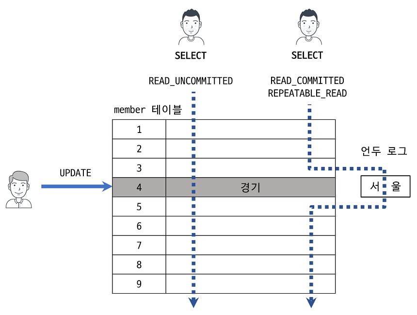

*특정 사용자가 레코드를 변경(Update)하고 커밋을 수행하지 않았다 하더라도 해당 변경 트랜잭션이 다른 사용자의 SELECT 작업을 방해하지 않는다. → Non-Locking Consistent Read*

*READ_UNCOMMITTED 레벨은 InnoDB 버퍼 풀에서 READ_COMMITTED & REPEATABLE 레벨은 언두 로그에서 읽는다.*

## *4.2.5 자동 데드락 감지*

*InnoDB 스토리지 엔진은 잠금이 교착 상태에 빠지지 않았는지 체크하기 위해* ***잠금 대기 목록을***

***그래프 형태로 관리****한다.* 

*InnoDB 스토리지 엔진은* ***데드락 감지 스레드****를 가지고 있고 해당 스레드가 잠금 대기 그래프를 검사해 교착상태에 빠진 트랜잭션을 찾고 그중 하나를 강제 종료한다.* 

***그렇다면 어떤 기준으로 트랜잭션을 강제 종료할까?***

*언두 로그 양을 기준으로 한다. 언두 로그 레코드를 적게 가진 트랜잭션은 롤백을 해도 언두 처리할 내용이 적다. → 트랜잭션 강제 롤백으로 인한 MySQL 서버 부하가 적다.* 

***테이블 잠금(LOCK TABLES)****은 MySQL 엔진에서 관리한다.* 

*그래서 InnoDB 스토리지 엔진은 테이블 잠금을 볼 수 없다. → 데드락 감지가 불확실* 

*`innodb_table_locks`* *시스템 변수를 활성화하면 InnoDB 스토리지 엔진 레코드 잠금뿐만 아니라 테이블 레벨의 잠금까지 감지할 수 있게 된다. → 특별한 이유가 없다면 활성화* 

```sql
SHOW GLOBAL VARIABLES LIKE 'innodb_table_locks';
```

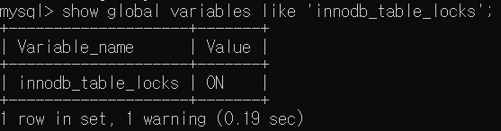

      - *default: activate* 

*일반적인 상황에서는 데드락 감지 스레드가 데드락을 찾아내는 작업은 서버에 부담을 주지 않는다.*

*하지만 동시 처리 스레드가 많아지거나 각 트랜잭션이 가진 잠금이 많아지먄 데드락 감지 스레드가 느려진다.* 

*데드락 감지 스레드가 느려지면 서비스 쿼리를 처리 중인 스레드는 더는 작업을 진행하지 못하고 대기하면서 서비스에 악영향을 미친다.* 

*PK / Secondary Index 기반으로 매우 높은 동시성 처리를 요구하는 서비스가 있다면* 

***`innodb_deadlock_detect`*** *시스템 변수 off 설정을 고려하자* 

```sql
SHOW GLOBAL VARIABLES LIKE 'innodb_deadlock_detect';
```

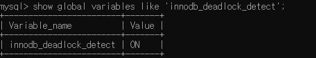

      - *default: ON*

*그럼 데드락 상황에 대한 대처는 어떻게 할 것인가?* 

*→* ***`innodb_lock_wait_timeout`*** *시스템 변수를 통해서 요청 실패를 유도한다* 

*innodb_lock_wait_timeout는 기본값이 50초다 → 훨씬 낮은 시간으로 변경해서 사용하자* 

```sql
SHOW GLOBAL VARIABLES LIKE 'innodb_lock_wait_timeout';
```

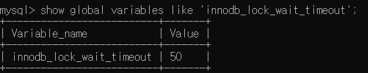

      - *default: 50s*

## *4.2.6 자동화된 장애 복구* 

*InnoDB 스토리지 엔진은 매우 견고해서 데이터 파일이 손상되거나 MySQL 서버가 시작되지 못하는 경우는 거의 발생하지 않는다.* 

*MySQL 서버와 무관하게 디스크나 서버 하드웨어 이슈로 InnoDB 스토리지 엔진이 자동으로 복구를 하지 못 하는 경우가 발생할 수 있다.* 

*기본적으로  MySQL 서버가 시작될 때 InnoDB 데이터 파일은 자동 복구를 수행한다.* 

*만약 복구할 수 없는 손상이 있다면 MySQL 서버는 종료돼 버린다.* 

*이때는* *`innodb_force_recovery`* *시스템 변수를 설정해서 MySQL 서버를 시작해야 한다.* 

*이 설정값은 InnoDB 스토리지 엔진이 데이터 파일이나 로그 파일의 손상 여부 검사 과정을 선별적으로 진행할 수 있게 한다.* 

      - *InnoDB 로그 파일이 손상 → 6으로 설정 재시작* 
      - *InnoDB 데이터 파일이 손상 → 1로 설정 재시작* 
      - *어떤 문제인지 파악 불가능 → 1 ~ 6 차례대로 설정하고 재시작* 

```sql
SHOW GLOBAL VARIABLES LIKE 'innodb_force_recovery';
```

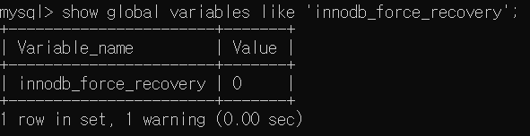

 *시스템 변수의 설정값이 커질수록 데이터 손실 가능성은 커지고 복구 가능성이 작아진다.*

*`innodb_force_recovery`* *시스템 변수가 0이 아닌 (1~6)복구 모드에서는 SELECT 이외에 다른 쿼리는 실행이 불가능*

***만약 MySQL 서버가 기동되고 InnoDB 테이블이 인식된다면?***

***mysqldump(****MySQL 제공 백업 유틸리티****)****를 이용해서 데이터를 백업하고 해당 데이터로 다시 DB와 테이블을 생성하는 것을 추천*

## *4.2.7 InnoDB 버퍼 풀* 

*InnoDB 스토리지 엔진의 핵심* 

*디스크의 데이터 파일 / 인덱스 정보를 메모리에 캐시해 두는 공간* 

*쓰기 작업을 지연시켜 일괄 작업으로 처리할 수 있게 해주는 버퍼 역할도 한다.* 

***쓰기 작업 지연의 효과*** 

*애플리케이션에서 INSERT, UPDATE, DELETE처럼 데이터를 변경하는 쿼리는 데이터 파일의 이곳저곳에 위치한 레코드를 변경하기 때문에 랜덤한 디스크 작업을 발생시킨다.* 

*하지만 버퍼 풀이 이러한 변경된 데이터를 모아서 처리하면 랜덤한 디스크 작업의 횟수를 줄일 수 있다.* 

*→ 디스크 작업은 오래 걸리는 작업 (메모리에 비해 엄청 느리다)*

*→ 디스크에 저장된 레코드들은 배열처럼 물리적으로 연속된 공간에 저장되지 않을 수 있다. (랜덤성)*

*→ 모아서 처리하면 동일 블록 내의 데이터 변경 가능성이 늘어난다. → 작업 횟수가 내려간다.*

### *4.2.7.1 버퍼 풀의 크기 설정* 

*MySQL 서버 내에서 메모리를 필요로 하는 부분은 크게 없지만 특정 경우 레코드 버퍼가 많은 메모리를 사용하기도 한다.* 

***레코드 버퍼****란 각 클라이언트 세션에서 테이블의 레코드를 읽고 쓸 때 버퍼로 사용하는 공간을 말한다. 커넥션이 많고 사용하는 테이블이 많다면 레코드 버퍼 공간이 많이 필요해진다.*

*MySQL 5.7 버전부터는 InnoDB 버퍼 풀의 크기를 동적으로 조절할 수 있게 개선했다.*

*버퍼 풀의 크기를 줄이는 작업은 서비스에 영향도가 크지만 크기를 늘리는 작업은 서비스에 영향이 적기 때문에 크기를 작은 값으로 설정해서 상태를 체크하면서 증가시키는 방법이 최적이다.*

***크기 설정 - 책에서 권장하는 방법***

*운영체제 메모리 공간 8GB 미만 → 50% 정도만 InnoDB 버퍼 풀로 설정* 

*메모리 전체 공간이 8GB 이상 → 50% 설정 이후 조금씩 올려서 최적점 찾기*

*운영체제 메모리 공간 50GB 이상 → 15 ~ 30 GB 다른 응용 프로그램 + 운영체제를 위해 남겨두고 나머지는 InnoDB 버퍼 풀 공간으로 활용* 

***어떻게 크기 변경?***

*`innodb_buffer_pool_size`* *시스템 변수로 크기를 설정할 수 있다.*

*InnoDB 버퍼 풀의 크기는 128MB 청크 단위이다. → 크기를 줄이거나 늘릴 때 128MB 단위로 처리* 

*꼭 메뉴얼을 참고하고 진행하자*

```sql
 SHOW GLOBAL VARIABLES LIKE 'innodb_buffer_pool_size';
```

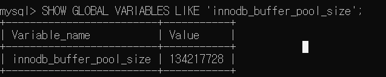

### *4.2.7.2 버퍼 풀의 구조* 

*lnnoDB 스토리지 엔진은 버퍼 풀 공간을 설정된 페이지 크기(**`innodb_page_size`* *시스템 변수)조각으로 쪼개어서 데이터가 필요할 때 해당 데이터 페이지를 읽어서 각 조각에 저장한다.*

*버퍼 풀의 페이지 크기 조각을 관리하기 위해* ***LRU****(Least Recently Used)리스트,* ***플러시****(Flush) 리스트,* ***프리****(Free) 리스트 이렇게 3개의 자료 구조로 관리한다.*

***프리(Free)리스트*** 

*사용자의 쿼리가 새롭게 디스크의 데이터 페이지를 읽어와야 하는 경우 사용* 

***LRU 리스트***


*LRU 리스트는 LRU(Least Recently Used) + MRU(Most Recently Used) 2개의 리스트가 결합된 형태이다. Old Sublist가 LRU, New Sublist가 MRU에 해당한다.* 

***InnoDB 스토리지 엔진에서 데이터를 찾는 과정*** ⭐⭐


***1.*** *필요한 레코드가 저장된 데이터 페이지가 버퍼 풀에 있는지 검사* 

      - *InnoDB 어댑티브 해시 인덱스를 통해 페이지를 검사* 
      - *해당 테이블의 인덱스(B-Tree)를 이용해 버퍼 풀에서 페이지를 검사* 
      - *버퍼 풀에 이미 데이터 페이지가 있었다면 해당 페이지의 포인터를 MRU 방향으로 승급*

***2.*** *디스크에서 필요한 데이터 페이지를 버퍼 풀에 적재하고, 적재된 페이지에 대한 포인트를 LRU 헤더 부분에 추가한다*

***3.*** *버퍼 풀의 LRU 헤더 부분에 적재된 데이터가 실제로 읽히면 MRU 헤더 부분으로 이동한다* 

***4.*** *버퍼 풀에 상주하는 데이터 페이지는 사용자 쿼리가 얼마나 최근에 접근했는지에 따라 나이가 부여되며 버퍼 풀에 상주하는 동안 쿼리에서 오랫동안 사용되지 않으면 데이터 페이지에 부여된 나이가 오래되고 결국 해당 페이지는 버퍼 풀에서 제거된다****(Eviction)*** *버퍼 풀의 데이터 페이지가 쿼리에 의해 사용되면 다시 나이가 젊어지고 MRU의 헤더 부분으로 옮겨진다* 

***5.*** *필요한 데이터가 자주 접근됐다면 해당 페이지의 인덱스 키를 어댑티브 해시 인덱스에 추가*

*버퍼 풀의 공간이 가득 차면 마치 우선순위 큐처럼 나이가 많은 데이터 페이지를 제거한다.*

*간단하게 정리하면 자주 사용하는 데이터 페이지는 MRU 영역에서 계속 살아있고, 반대의 경우 LRU 끝으로 밀려나 결국은 InnoDB 버퍼 풀에서 제거될 것이다.*

***플러쉬(Flush)리스트*** 

*디스크로 아직 동기화되지 않은 데이터를 가진 데이터 페이지(더티 페이지)의 변경 시점 기준의 페이지 목록을 관리한다.*

*디스크에서 읽은 상태에서 전혀 변경이 없다면 플러시 리스트에 관리되지 않지만, 데이터 변경이 가해진 데이터 페이지는 플러시 리스트에 관리되고 특정 시점이 되면 디스크에 기록돼야 한다.* 

*데이터가 변경되면 InnoDB는 변경 내용을 리두 로그에 기록하고 버퍼 풀의 데이터 페이지에도 변경을 반영한다.* 

*리드 로그가 디스크에 기록됐다고 해서 데이터 페이지가 디스크로 기록됐다는 것을 항상 보장하지 않는다. 때로는 그 반대의 경우도 발생할 수 있는데*

*InnoDB 스토리지 엔진은 체크포인트를 발생시켜 디스크의 리두 로그와 데이터 페이지를 동기화 한다.*

*MySQL 서버가 시작될 때 InnoDB 스토리지 엔진은 리두 로그를 어느 부분부터 복구를 실행해야 할지 판단하는 기준점으로 삼는다.*

### *4.2.7.3 버퍼 풀과 리두 로그* 

*InnoDB 버퍼 풀은 DB 성능 향상을 위해서* ***데이터 캐시****와* ***쓰기 버퍼링****이라는 2가지 용도가 있다.*

*버퍼 풀의 메모리 공간을 단순히 늘리는 것은 데이터 캐시 기능만 향상시키는 것이다.* 

*InnobDB 버퍼 풀의 쓰기 버퍼링 기능까지 향상 시키려면 InnoDB 버퍼 풀과 리두 로그와의 관계를 먼저 이해해야 한다.* 


*InnoDB 버퍼 풀은 디스크에서 읽은 상태로 전혀 변경되지 않은 클린 페이지(Clean Page)와* 

*변경된 데이터를 가진 더티 페이지(Dirty Page)를 가지고 있다.* 

*리두 로그 파일의 공간은 계속 순환하면서 재사용 되기 때문에, 기록될 때마다 고유 번호인* ***LSN(Log Sequence Number)****가 증가한다.*

*더티 페이지는 디스크와 데이터 상태가 다르기 때문에 언젠가 동기화가 필요하다.* 

*버퍼 풀의 더티 페이지는 특정 리두 로그 공간과 1:1로 관계를 가지면서 체크포인트 이벤트가 발생하면 체크포인트의 LSN 보다 작은 리두 로그 엔트리와 관련된 더티 페이지는 모두 디스크로 동기화 시킨다.*

*이처럼 메모리에서만 변경 작업이 일어나다가, 체크 포인트 이벤트 발생 시점에 한번에 디스크로 반영되므로* ***쓰기 버퍼링****이라고 한다.*

***리두 로그의 적당한 크기?***

*당연히 버퍼 풀보다는 작은 크기를 가져야 한다. 버퍼 풀은 전체 데이터(캐싱된 데이터)를 갖고* 

*리두 로그는 버퍼 풀의 데이터에서 변경된 데이터(Dirty Page)만 가지기 때문이다.* 

*하지만 리두 로그가 너무 크면 특정 체크포인트에서 많은 Diry Page가 동시에 디스크로 I/O 작업이 일어나기 때문에 적당한 크기로 하는 게 좋다.* 

*책에서는 100GB 이하의 MySQL 서버에서는 리두 로그 파일의 전체 크기를 5 ~ 10 GB 수준으로 선택하고 필요할 때마다 조금씩 늘려가면서 최적값을 찾는 것을 추천한다.*

### *4.2.7.4 버퍼 풀 플러시(Buffer Pool Flush)*

*InnoDB 스토리지 엔진은 아직 디스크로 기록되지 않은 더티 페이지들을 성능상의 악영향 없이 디스크에 동기화하기 위해* ***플러시 리스트 플러시****,* ***LRU 리스트 플러시*** *2개의 플러시 기능을 백그라운드로 실행한다.* 

***플러시 리스트 플러시***

*InnoDB는 리두 로그 공간의 재활용을 위해 리두 공간을 비워야 한다.* 

*이때 반드시 InnoDB 버퍼 풀의 더티 페이지가 먼저 디스크로 동기화돼야 한다.*

*이를 위해 InnoDB는 주기적으로 플러시 리스트의 플러시 함수를 호출해서 변경 순서대로 디스크에 동기화 작업을 수행한다.* 

*이때 얼마나 많은 더티 페이지를 디스크로 I/O 작업을 하냐에 따라 사용자의 쿼리 처리가 달라진다.*

*이를 위해 제공되는 시스템 변수들* 

      - *`innodb_page_cleaners`* 
- *Cleaner 스레드: 더티 페이지를 디스크로 동기화하는 스레드*
        - *해당 변수는 Cleaner 스레드의 개수를 조정한다.* 
        - *하나의 클리너 스레드가 1개의 버퍼 풀 인스턴스를 처리하는게 이상적이다.*
        - *`innodb_page_cleaners`* *=* *`innodb_buffer_pool_instances`* *이렇게 설정하자*
      - *`innodb_max_dirty_pages_pct_lwm`* 
- *`innodb_io_capacity`* *기준에 따라서 더티 페이지 쓰기를 실행하지만 디스크에 기록되는 더티페이지 보다 더 많은 더티 페이지가 발생하면 버버 풀에 적재되는 더티 페이지가 계속 증가한다.* 
        - *그러다가 90%가 넘어가면 스토리지 엔진은 급작스럽게 디스크로 쓰기 작업을 해야한다고 판단한다. 그러다가* *디스크 쓰기 폭팔(Disk IO Burst)* *현상이 일어난다.* 
        - *이를 막기 위해 일정 수준 이상의 더티 페이지가 발생하면 조금씩 더티 페이지를 디스크로 기록하게 하는데 이때 사용하는 변수이다.* 
        - *기본값은 10%지만 디스크 쓰기 횟수를 줄이고 싶다면 조금 더 높이자.*
      - *`innodb_max_dirty_pages_pct`* 
- *버버풀이 가지는 더티 페이지의 비율을 설정* 
        - *일반적으로 버버 풀이 더티 페이지를 많이 가지고 있을수록 디스크 쓰기 작업을 버퍼링함으로써 여러 번의 디스크 쓰기를 한 번으로 줄이는 효과를 극대화가 가능하다.*
        - *그래서 책은 기본값을 추천한다.* 
        - *주의점: 버버 풀에 너무 많은 더티 페이지가 있으면* *디스크 쓰기 폭팔(Disk IO Burst)**현상이 발생할 수 있다.*
      - *`innodb_io_capacity`* 
- *더티 페이지를 디스크에 쓰기를 하는 기준 변수*
      - *`innodb_io_capacity_max`* 
- *디스크가 최대의 성능을 발휘할 때 어느 정도의 디스크의 읽고 쓰기가 가능한지를 설정*
      - *`innodb_flish_neighbors`* 
- *default: false*
        - *더지 페이지를 디스크에 기록할 때 디스크에 근접한 페이지 중에서 더티 페이지가 있다면 묶어서 기록하게 해주는 기능을 활성화 결정* 
        - *하드 디스크(HDD) → ON / 솔리드 스테이트 디스크(SSD) → OFF*
      - *`innodb_adaptive_flushing`* 
- *어댑티프 플러시 기능 on/off 사용 변수* 
        - *default: on*
      - *`innodb_adaptive_flushing_lwm`* 
- *default: 10%*
        - *어댑티브 플러시 알고리즘 활성화 기준점*

***어댑티브 플러시 알고리즘***

*리두 로그의 증가 속도를 분석해서 적절한 수준의 더티 페이지가 버퍼 풀에서 유지될 수 있도록* 

*디스크 쓰기를 실행한다.* 

***LRU 리스트 플러시*** 

*LRU 리스트에서 사용 빈도가 낮은 데이터 페이지를 제거해서 공간을 생성한다.*

*이때 LRU 리스트 플러시 함수를 사용하고* *`innodb_lru_scan_depth`* *시스템 변수에 설정된 개수만큼 페이지를 끝에서부터(가장 오래된) 스캔한다.* 

*더티 페이지는 디스크에 동기화하고 클린 페이지는 프리 리스트로 옮긴다.*

### *4.2.7.5 버퍼 풀 상태 백업 및 복구* 

*쿼리 요청이 빈번한 서버를 셧다운햇다가 다시 시작하면 서비스를 시작하면 쿼리 처리 성능이 매우 떨어진다. → 버퍼 풀에 캐싱된 데이터 페이지가 없기 때문*

*디스크의 데이터가 버퍼 풀에 적재돼 있는 상태를 워밍업(Warming up)이라고 표현한다.* 

***MySQL 5.6 버전 버퍼 풀 덤프 및 적재 기능 탑재 p118,p119***

*서버 점검/기타 작업을 위해 서버를 재시작해야 하는 경우 MySQL 서버를 셧다운하기 전에* *`innodb_buffer_pool_dumb_now`* *시스템 변수를 이용해 현재 InnoDB 버버 풀의 상태를 백업할 수 있다.*

*다시 시작하면* *`innodb_buffer_pool_load_now`* *시스템 변수를 이용해 백업된 버퍼 풀의 상태를 다시 복구할 수 있다.*

*버퍼 풀의 백업은 버퍼 풀의 크기가 커도 빠르게 완료된다.*

*→ LRU 리스트에 적재된 데이터 페이지의 메타 정보만 저장하기 때문* 

*백업된 버퍼 풀의 내용을 다시 버퍼 풀로 복구하는 작업은 버퍼 풀의 크기에 따라 상당한 시간이 소요 → 백업된 메타 정보를 기반으로 디스크 I/O 작업을 하기 때문이다.* 

*버퍼 풀 복구 작업 진행 확인 방법*

```sql
SHOW STATUS LIKE 'Innodb_buffer_pool_dump_status'\G
```

*버퍼 풀 복구 작업 중단 방법*

```sql
SET GOLBAL innodb_buffer_pool_load_abort=ON;
```

*정리*

*MySQL 서버를 재시작하고 버퍼 풀 복구 작업이 끝나고 서비스를 시작하자* 

*디스크의 많은 데이터가 버퍼풀로 저장되면 많은 부하가 일어난다.*

### *4.2.7.6 버퍼 풀의 적재 내용 확인 p119, p120 참고*

***information_schema 데이터베이스에 innodb_cached_indexes 테이블*** 

      - *테이블의 인덱스별로 데이터 페이지가 얼마나 InnoDB 버퍼 풀에 적재돼 있는지 확인할 수 있다.*

## *4.2.8 Double Write Buffer*

***파셜 페이지(Partial-page) 톤 페이지(Torn-page) 현상***

*InnoDB 스토리지 엔진이 더티 페이지를 디스크 파일로 플러시 할 때 하드웨어 오작동이나 시스템 비정상 종료 등의 원인으로 일부만 기록되는 현상*

*InnoDB는 이런 문제를 막기 위해* ***Double Write*** *기법을 이용한다.* 


***시나리오*** 

*버퍼 풀에 있는 A~E 더티 페이지를 디스크로 플러시* 

*실제 데이터 파일에 변경을 기록하기 전에 A~E까지의 더티 페이지를 묶어서 한 번의 디스크 쓰기로* 

*시스템 테이블스페이스의 DoubleWrite 버퍼에 기록한다.* 

*이후 각 더티 페이지를 파일의 적당한 위치에 하나씩 랜덤으로 쓰기를 실행한다.* 

*Double Write 버퍼는 정상적으로 디스크에 기록되면 필요없는 공간이다.* 

*Double Write 버퍼의 내용은 디스크에 쓰기가 중간에 실패할 때만 사용된다.* 

*해당 기능의 활성화는* *`innodb_doublewrite`* *시스템 변수로 제어할 수 있다*. 

*HDD는 어차피 한 번의 순차 디스크 쓰기를 해서 부담이 없지만 SSD 처럼 랜덤 IO나 순차 IO의 비용이 비슷한 저장 시스템에서는 이는 부담스럽다.* 

*만약 데이터 무결성이 중요한 서비스면 활성화를 고려하자* 

*리두 로그 동기화 설정(**`innodb_flush_log_at_trx_commit`**)을 1이 아닌 값이라면 Double wrtie 또한 비활성화 하자* 

*→ 데이터 무결성이 중요하지 않은 서비스를 의미한다.*

***From InnoDB 버퍼 풀 (리두 로그 동기화 설정1, Double write 활성화)***

*Double write → 리두 로그 → 특정 시점 플러시 → 디스크 파일 쓰기*  

## *4.2.9 언두 로그* 

*InnoDB 스토리지 엔진은 트랜잭션과 격리 수준을 보장하기 위해 변경되기 이전 버전의 데이터를 별도로 백업한다.* 

*이렇게 백업된 데이터를* ***언두 로그(Undo Log)****라고 한다.* 

***트랜잭션 보장*** 

      - *트랜잭션이 롤백되면 트랜잭션 도중에 변경된 데이터를 복구해야 하는데, 이때 언두 로그에 백업해둔 데이터를 이용해 복구한다.* 

***격리 수준 보장*** 

      - *특정 커넥션에서 데이터를 변경하는 도중에 다른 커넥션에서 데이터를 조회하면 트랜잭션 격리 수준에 맞게 변경 중인 레코드를 읽지 않고 언두 로그에 백업해둔 데이터를 읽어서 반환하기도 한다. 이는 격리 수준에 따라 다르다.*

### *4.2.9.1 언두 로그 모니터링*

*언두 영역은 DML 쿼리로 인한 데이터 변경되기 전의 데이터를 보관하는 곳이다.* 

*언두 로그의 데이터는 크게 두 가지 용도로 사용된다.* 

      - ***트랜잭션 롤백 대비용*** 
      - ***트랜잭션의 격리 수준을 유지하면서 높은 동시성을 제공***

***언두 로그 모니터링의 중요성***

*만약 애플리케이션 서버에서 트랜잭션을 시작하고 하루 동안 닫지 않았다면?*

*하루 동안 진행된 모든 트랜잭션 데이터(변경된)가 언두 로그에 기록된다.* 

*그렇다면 언두 로그가 차지하는 사용 공간은 무한정 늘어난다.* 

*이는 트랜잭션의 Recoverability 특성 때문에 그렇다.* 

***언두 로그 건수 확인 방법***

```sql
SHOW ENGINE INNODB STATUS \G
```

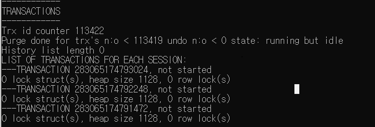

*언두 로그의 급증 여부를 모니터링 하자!*

***주의*** 

*MySQL 서버에서 INSERT 문장으로 인한 언두 로그와 UPDATE, DELETE 문장으로 인한 언두 로그는 별도로 관리된다. UPDATE, DELETE 문장으로 인한 언두 로그는 MVCC, 데이터 복구(롤백)에 모두 사용되지만 INSERT 같은 경우 데이터 복구에만 사용되기 때문이다.* 

*즉, 예제에서 보인 언두 로그의 건수에는 UPDATE, DELETE 문장으로 인한 언두 로그 개수만 표시된다* 

### *4.2.9.2 언두 테이블스페이스 관리*

*언두 테이블 스페이스 → 언두 로그 저장되는 공간* 


*하나의 언두 테이블스페이스는 1 ≤ 롤백 세그먼트 ≤ 128 가진다.* 

*롤백 세그먼트는 1개 이상의 언두 슬롯을 가진다.* 

## ***4.2.10 체인지 버퍼*** 

*RDBMS에서는 레코드가 INSERT / UPDATE 될 때 데이터 파일을 변경하는 작업뿐 아니라* 

*해당 테이블에 포함된 인덱스를 업데이트하는 작업도 필요하다.*

*인덱스를 업데이트하는 작업은 디스크 I/O 작업이 필요하므로 테이블에 인덱스가 많다면 이 작업은 많은 자원을 소비하게 된다.* 

*그래서 InnoDB는 변경해야 할 인덱스 페이지가 버퍼 풀에 있으면 바로 업데이트를 수행하지만 디스크로부터 읽어와서 업데이트해야 한다면* ***임시 공간 체인지 버퍼(Change Buffer)****에 저장해 두고 바로* 

*사용자에게 반환하는 형태로 성능을 향상시킨다.*

*유니크 인덱스 같은 경우 중복 검사가 필요하기 때문에 체인제 버퍼를 사용할 수 없다.* 

*임시 저장된 인덱스 레코드 조각은 백그라운드 스레드인 체인지 버퍼 머지 스레드에 의해 병합된다.*

`innodb_change_buffering` 시스템 변수로 작업의 종류에 따라 체인지 버퍼를 활성화할 수 있다.

      - all: 모든 작업
      - none: 모든 작업 버퍼링 X
      - inserts: 인덱스에 새로운 아이템 추가하는 작업만 버퍼링 
      - deletes: 인덱스에 기존 아이템이 삭제됐다는 마킹 작업만 버퍼링 
      - changes: 인덱스에 추가하고 삭제하는 작업만(inserts + deletes) 버퍼링 
      - purges: 인덱스 아이템을 영구적으로 삭제하는 작업만 버퍼링(백그라운드 작업)

***체인지 버퍼의 크기 설정과 모니터링은 책 p130 참고하자*** 

## ***4.2.11 리두 로그와 로그 버퍼*** 

*리두 로그는 하드웨어나 소프트웨어 등 여러 가지 문제점으로 인해 MySQL 서버가* 

*비정상적으로 종료됐을 때 데이터 파일에 기록되지 못한 데이터를 잃지 않게 해주는 안전장치이다.* 

*보통 DBMS에서의 데이터 파일은 쓰기보다 읽기 성능을 고려한 자료 구조를 가진다.* 

*그래서 데이터 파일의 쓰기는 랜덤 엑세스가 필요하다.*  

*MySQL 서버는 쓰기 비용이 낮은 자료 구조를 가진 리두 로그를 가진다.*

*MySQL 서버가 비정상 종료되는 경우 두 가지 종류의 일관되지 않은 데이터를 가질 수 있다.*

      1. *커밋됐지만 데이터 파일에 기록되지 않은 데이터* 
      1. *롤백됐지만 데이터 파일에 이미 기록된 데이터* 

*1번은 리두 로그에 있는 데이터를 디스크에 복사하기만 하면 된다.*

*2번 같은 경우 언두 로그에 있는 데이터를 가져와서 데이터 파일에 복사하면 된다.* 

*이때 리두 로그는 해당 트랜잭션의 상태를 확인하기 위해 필요하다.*  

*리두 로그의 시스템 변수 설정은 책 페이지 131, 132를 참고하자* 

## ***4.2.12 어댑티브 해시 인덱스*** 

***어댑티브 해시 인덱스(Adaptive Hash Index)****는 MySQL의 InnoDB 스토리지 엔진에서 사용하는 성능 최적화 기능 중 하나로, 자주 참조되는 데이터에 대해 자동으로 해시 인덱스를 생성하여 쿼리 성능을 개선한다.* 

*`innodb_dapative_hasn_index`* *시스템 변수를 통해 활성화/비활성화* 

*해시 인덱스는* ***KEY: 인덱스 키 값****과* ***VALUE: 인덱스 키 값이 저장된 데이터 페이지의 주소****로 구성된다.*

*어댑티브 해시 인덱스는 B Tree에 비해서 디스크의 루프 노드부터 리프 노드까지의 탐색이 없기 때문에 팔망미인처럼 보이지만 의도적으로 비활성화하는 경우도 많다.* 

*어댑티브 해시 인덱스 또한 저장 공간인 메모리를 사용하고 상당히 큰 메모리 공간을 사용할 수 있다. 또한 활성화되면 어댑티브 해시 인덱스에 없는 인덱스여도 있든 없든 검색해봐야 한다는 것이다.* 

*즉, 효율이 떨어져도 InnoDB는 해시 인덱스를 사용한다.* 

*또한 어떤 테이블을 삭제/변경 하려고 하면 이 테이블이 가진 모든 데이터 페이지를 어댑티브 해시 인덱스에서 제거해야 한다.* 

*즉, DDL이 성능에 큰 영향을 준다.* 

*중요한점은  MySQL 서버의 상태를 계속 체크해야 한다는 점이다.*

*해당 내용은 P140 ~ 141 참고하자*

## *4.2.13 InnoDB VS Memory, MyISAM*

*MySQL 서버는 InnoDB 스토리지 엔진에 대한 성능 향상을 꾸준히 해왔으며, 다른 스토리지 엔진은 도태되었다.* 

*메모리 공간을 사용하는 Memory 스토리지 엔진은 강점이 있어 보일듯하지만 테이블 수준의 락만 제공하기 때문에 싱글 스레드 환경에서는 괜찮겠지만 대부분 애플리케이션 서비스가 그렇듯이 멀티 스레딩 환경에서는 InnoDB 스토리지 엔진의 레코드 수준의 락보다 성능이 떨어진다.*

# *개요* 

*이번에는 MySQL의 동시성에 영향을 미치는 잠금과 트랜잭션, 트랜잭션의 격리 수준에 대해서 공부하자*

***트랜잭션?***

*트랜잭션은 작업의 완전성을 보장해 주는 것* 

*논리적인 작업을 모두 완벽하게 처리하지 처리하지 못할 경우에는 원 상태로 복구해서 작업의 일부만 적용되는 현상(Partial Update)이 발생하지 않게 만들어주는 기능이다.*

***잠금과 트랜잭션***

*잠금은 동시성을 제어하기 위한 기능* 

*트랜잭션은 데이터의 정합성을 보장하기 위한 기능* 

*하나의 회원 레코드를 여러 커넥션에서 동시에 변경하려고 하는데 잠금이 없다면 하나의 데이터를 여러 커넥션에서 동시에 변경할 수 있게 된다. → 예측 불가능한 상태* 

*잠금은 여러 커넥션에서 동시에 동일한 자원(레코드 / 테이블)을 요청할 경우 순서대로 한 시점에는 하나의 커넥션만 변경할 수 있게 해주는 역할을 한다.* 

*격리 수준은 하나의 트랜잭션 내에서 또는 여러 트랜잭션 간의 작업 내용을 어떻게 공유하고 차단할 것인지를 결정하는 레벨을 의미한다*

# *정리 목록* 

# *5.1 트랜잭션*

*트랜잭션을 지원하지 않는 MyISAM 스토리지 엔진과 지원하는 InnoDB 스토리지 엔진의 처리 방식 차이를 살펴보자.*

*또한 트랜잭션을 사용할 경우 주의할 사항도 함께 알아보자* 

## *5.1.1 MySQL 트랜잭션*

*트랜잭션은 꼭 여러 개의 변경 작업을 수행하는 쿼리가 조합됐을 때만 의미 있는 개념이 아니다.*

*트랜잭션은 하나의 논리적인 작업에 쿼리의 개수와 상관없이 전체 작업이 100% 적용되거나 아무것도 적용되지 않아야 함을 보장해 주는 것이다.  →* ***ALL or NOTHING***

*간단한 예제로 트랜잭션 관점에서 InnoDB 테이블과 MyISAM 테이블 차이를 살펴보자* 

## ***간단한 예제*** 

***테스트용 DATABASE, 테이블 생성 Query***

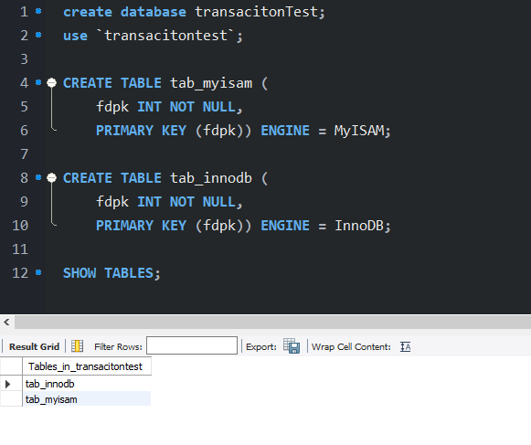

```sql
INSERT INTO tab_myisam VALUES(3);
INSERT INTO tab_innodb VALUES(3);
```

      - *테스트용 테이블에 각각 레코드 1건씩 저장*

***AUTO-COMMIT 활성화 & 쿼리 실행하기*** 

```sql
SET autocommit = on;

INSERT INTO tab_myisam (fdpk) VALUES (1), (2), (3);

INSERT INTO tab_innodb (fdpk) VALUES (1), (2), (3);
```

***result***

*Error Code: 1062. Duplicate entry '3' for key 'tab_myisam.PRIMARY'*

*Error Code: 1062. Duplicate entry '3' for key 'tab_innodb.PRIMARY'*

```sql
SELECT * FROM tab_myisam;
SELECT * FROM tab_innodb;
```

***tab_myisam*** 

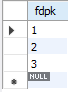

***tab_innodb***

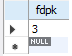

***결과 분석*** 

*두 INSERT 문장 모두 프라이머리 키 중복 오류로 쿼리가 실패했다.* 

*그런데 두 테이블 레코드를 조회해 보면 MyISAM 테이블에는 오류가 발생했음에도 ‘1’, ‘2’는 INSERT 된 상태로 남아 있는 것을 확인할 수 있다.* 

*즉, MyISAM 테이블에 INSERT 문장이 실행되면서 차례대로 ‘1’, ‘2’를 저장하고 그다음 ‘3’을 저장하려는 순간 중복 키 오류(Duplicate Key Error)가 발생한 것이다.*

*하지만 MyISAM 테이블에서 실행된 쿼리는 이미 INSERT된 ‘1’, ‘2’를 그대로 두고 쿼리 실행을 종료해 버린다.*

*MEMORY 스토리지 엔진 또한 동일하게 작동한다.*

*InnoDB는 쿼리 중 일부라도 오류가 발생하면 전체를 원 상태로 만든다는 트랜잭션의 원칙대로 실행하기 전 상태로 복구했다.*

*MyISAM 테이블에서 발생하는 이런 현상을* ***부분 업데이트(Partial Update)****로 표현한다.* 

*이러한 부분 업데이트 현상은 테이블 데이터 정합성을 맞추는데 상당히 어려운 문제를 만들어 낸다.*

## *5.1.2  주의사항*

*트랜잭션 또한 DBMS 커넥션과 동일하게 꼭 필요한 최소의 코드에만 적용하는 것이 좋다.*

***예시***

*사용자가 게시판에 게시물을 작성한 후 저장 버튼 클릭했을 때 서버에서 처리하는 내용* 

```sql
1) 처리 시작
-> 데이터베이스 커넥션 생성 
-> 트랜잭션 시작
2) 사용자의 로그인 여부 확인 
3) 사용자의 글쓰기 내용의 오류 여부 확인
4) 첨부로 업로드된 파일 확인 및 저장 
5) 사용자의 입력 내용을 DBMS에 저장 
6) 첨부 파일 정보를 DBMS에 저장
7) 저장된 내용 또는 기타 정보를 DBMS에서 조회
8) 게시물 등록에 대한 알림 메밀 전송 
9) 알림 메일 발송 이력을 DBMS에 저장 
-> 트랜잭션 종료(COMMIT)
-> 데이터베이스 커넥션 반납
10) 처리 완료 
```

*해당 처리 절차에서 DBMS 트랜잭션 처리에 좋지 않은 영향을 미치는 부분을 나눠서 살펴보자* 

***실제로 DBMS에 데이터를 저장하는 작업(트랜잭션)은 5번부터 시작된다는 것을 알 수 있다.***

*2번,3번,4번 절차가 아무리 빨리 처리된다고 하더라도 DBMS의 트랜잭션에 포함시킬 필요는 없다.*

*데이터베이스 커넥션 개수는 제한적이어서 각 단위 프로그램이 커넥션을 소유하는 시간이 길어질수록 사용 가능한 여유 커넥션의 개수는 줄어들 것이다.* 

***8번 작업 같이 메일 전송이나 FTP 파일 전송 작업 또는 네트워크를 통해 원격 서버와 통신하는 작업은 어떻게 해서든 DBMS 트랜잭션 내에서 제거하는 것이 좋다.*** 
*프로그램 실행되는 동안 메일 서버와 통신할 수 없는 상황이면 웹 서버뿐 아니라 DBMS 서버까지 위험해지는 상황이 발생할 것이다.*

***DBMS 작업이 4개가 있다.  5번, 6번, 7번, 9번***

*사용자가 입력한 정보를 저장하는 5번, 6번 작업은 하나의 트랜잭션으로 묶어야 한다.* 

*7번은 저장된 데이터의 단순 확인 및 조회이므로 트랜잭션에 포함될 필요는 없다.*

*알림 전송 저장 같은 9번은 비즈니스 목적이 아예 다른 성격의 작업이다. 
별도의 트랜잭션으로 분리하는 것이 좋다.*

***재설계***

```sql
1) 처리 시작
2) 사용자의 로그인 여부 확인
3) 사용자의 글쓰기 내용의 오류 발생 여부 확인
4) 첨부된 업로드된 파일 확인 및 저장
-> DB 커넥션 생성(커넥션 풀에서 가져오기)
-> 트랜잭션 시작
5) 사용자의 입력 DBMS에 저장 
6) 첨부 파일 정보 DBMS에 저장 
-> 트랜잭션 종료(COMMIT/ROLLBACK)
7) 저장된 내용 / 기타 정보 DBMS에서 조회
8) 게시글 등록에 대한 알림 메일 전송 
-> 트랜잭션 시작
9) 알림 메일 발송 이력을 DBMS에 저장 
-> 트랜잭션 종료(COMMIT/ROLLBACK)
-> DB 커넥션 종료(커넥션 풀에 반납)
10) 처리 완료 
```

***프로그램 내에서 실행되는 데이터베이스 커넥션의 범위와 트랜잭션 범위를 최소화하자!***

# *5.2 MySQL 엔진의 잠금*

*MySQL에서 사용되는 잠금은 크게 스토리지 엔진 레벨과 MySQL 엔진 레벨로 나눌 수 있다.* 

*MySQL 엔진 레벨에서의 잠금은 모든 스토리지 엔진에 영향이 간다.* 

*하지만 스토리지 엔진의 잠금은 해당 스토리지 엔진에만 영향이 간다.*

*MySQL 엔진에서는 테이블 데이터 동기화를 위한 테이블 락 말고도 테이블의 구조를 잠그는* ***메타데이터 락(Metadata Lock)*** *그리고 사용자의 필요에 맞게 사용할 수 있는* ***네임드 락(Named Lock)*** *기능도 제공한다.* 

# *5.2.1 글로벌 락*

***글로벌 락(Global Lock)****은* *`FLUSH TABLES WITH READ LOCK`* *명령으로 획득이 가능하다.* 

*MySQL에서 제공하는 잠금 가운데 가장 범위가 크다. (MySQL 서버 전체)*

*한 세션에서 글로벌 락을 획득하면 다른 세션에는 SELECT(조회)를 제외한 대부분의 DDL/DML 쿼리가 대기 상태로 남는다.*

 

*여러 데이터베이스에 존재하는 MyISAM, MEMORY 테이블에 대해* *`mysqldump`* *로 일관된 백업을 받아야 할 때 글로벌 락을 사용한다.*

***읽기 잠금 / 쓰기 잠금***

| **특성** | **읽기 잠금 (READ LOCK)** | **쓰기 잠금 (WRITE LOCK)** |
| --- | --- | --- |
| **허용 작업** | SELECT(읽기 작업)<br>데이터 변경이 없는 조회 작업 | 잠금을 획득한 클라이언트의 쓰기 작업만 허용 |
| **차단 작업** | INSERT, UPDATE, DELETE **(DML)**<br>CREATE, DROP, ALTER **(DDL)**<br>SELECT ... FOR UPDATE | 모든 읽기 작업 (SELECT 포함)<br>다른 모든 쓰기 작업 (DML, DDL) |
| **잠금 획득 가능 수** | 여러 클라이언트가 동시에 읽기 잠금을 획득 가능 | 단 하나의 클라이언트/트랜잭션만 쓰기 잠금 획득 가능 |
| **목적** | 데이터 변경을 막고 안정적인 읽기 작업 보장<br>데이터 백업 시 일관성 유지 | 데이터 변경 작업 보호<br>충돌 방지 및 데이터 일관성 보장 |
| **효과** | SELECT는 동시 실행 가능<br>쓰기 작업은 대기 상태로 전환 | 다른 모든 읽기/쓰기 작업이 대기 상태로 전환 |
| **사용 예시** | 데이터 백업<br>안정적인 데이터 조회 | 중요한 데이터 변경 작업 수행<br>경쟁 조건(race condition) 방지 |

*`FLUSH TABLES WITH READ LOCK`* ***주의점***

해당 명령은 MySQL 서버에 존재하는 모든 테이블을 닫고 잠금을 건다. 

*`FLUSH TABLES WITH READ LOCK`* *명령은 모든 테이블에 대하여 읽기 잠금을 걸기 전에 테이블을 플러시(디스크 I/O) 해야 하므로 데이터의 일관성을 위해 실행중인 모든 종류의 쿼리가 완료되어야 한다.* 

*즉, 특정 쿼리가 장시간 진행되고 있다면 장시간 대기한다.*

### ***백업 락*** 

*`FLUSH TABLES WITH READ LOCK`* *명령을 이용한 글로벌 락은 MySQL 서버의 모든 변경 작업을 멈춘다.* 

*하지만 MySQL 서버가 업그레이드 하면서 InnoDB 스토리지 엔진의 사용이 일반화됐다.*

*InnoDB 스토리지 엔진은 트랜잭션을 지원하기 때문에 일관된 데이터 상태를 위해 모든 데이터 변경 작업을 멈출 필요는 없다.*

*그래서 MySQL 8.0 부터는 백업 툴을 위해 더 가벼운 글로벌 락인 백업 락이 도입됐다.*

```sql
LOCK INSTANCE FOR BACKUP;
# 백업 실행 --> 
UNLOCK INSTANCE;
```

*백업 락은 테이블의 스키마, 사용자의 인증 관련 정보를 변경할 수 없게 된다.* 

*일반적인 테이블의 데이터 변경은 가능하다.* 

*일반적인 MySQL 서버의 구성은* ***소스 서버(Source server)****,* ***레플리카 서버(Replica Server)****로 구성되는데, 주로 백업은 레플리카 서버에서 실행된다. (소스 서버의 부하 때문에)*

*레플리카 서버에 백업 락을 걸어서 DDL 명령이 실행되면 복제를 중지하는 역할을 한다.*  

*즉, 백업을 완료하고 백업 락 반납 이후에 복제(DDL 명령을 레플리카 서버에 적용)를 한다*

*기존의 글로벌 락을 사용했다면 레플리카 서버에서 백업을 하다가 DDL 명령이 소스 서버에 적용되고 레플리카 서버에는 백업이 실패하게 된다.* 

# *5.2.2 테이블 락*

*테이블 락(Table Lock)은 개별 테이블 단위로 설정되는 잠금이다.*

*명시적, 묵시적으로 락을 획득할 수 있다.*

***명시적 테이블 락 획득, 반납***

```sql
LOCK TABLES table_name [READ | WRITE]

UNLOCK TABLES
```

*명시적인 테이블 락은 특별한 상황이 아니면 애플리케이션에서 사용할 필요가 거의 없다.*

***묵시적 락***

*MyISAM, MEMORY 스토리지 엔진은 테이블에 데이터를 변경하는 쿼리를 실행하면 MySQL 서버가 데이터가 변경되는 테이블에 잠금을 설정하고 데이터를 변경한 후, 즉시 잠금을 해제하는 형태로 사용된다.*

*InnoDB 스토리지 엔진 같은 경우 레코드 기반의 잠금을 제공하기 때문에 단순 데이터 변경 쿼리로 인해 묵시적인 테이블 락이 설정되지는 않는다. (DDL에서는 영향을 준다.)*

# *5.2.3 네임드 락* 

***네임드 락(Named Lock)****은* *`GET_LOCK`* *함수를 이용해 임의의 문자열에 대해 잠금을 설정할 수 있다.*

*네임드 락은 단순히 사용자가 지정한 문자열(String)에 대해 획득하고 반납하는 잠금이다.*

*자주 사용되지 않는다.*

***example***

*DB 서버 1대에 웹 서버 5대가 접속해서 서비스하는 상황에서 5대의 웹 서버가 어떤 정보를 동기화해야 하는 요건처럼 여러 클라이언트가 상호 동기화를 처리해야 할 때 네임드 락을 이용하면 쉽게 해결할 수 있다.*

```sql
`-- mylock 이라는 문자열에 대해 잠금을 획득 

-- 이미 잠금을 사용 중이라면 2초 동안 대기한다. (2초 이후에 자동 잠금 해제)
SELECT GET_LOCK('mylock', 2);

-- mylock 이라는 문자열에 대해 잠금이 설정돼 있는지 확인 
SELECT IS_FREE_LOCK('mylock');

-- mylock 이라는 문자열에 대해 획득했던 잠금을 반납(해제)한다.
SELECT RELEASE_LOCK('mylock');

-- 3개 함수 모두 정상적으로 락을 획득하거나 반납하면 1, 아니면 null/0 반납
```

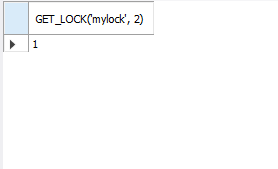

*네임드 락의 경우 복잡한 조건으로 레코드를 한꺼번에 많이 변경할 때 사용한다.*

*MySQL 8.0 부터는 네임드 락을 중첩해서 사용할 수 있다.*

# *5.2.4 메타데이터 락*  

***메타데이터 락(Metadata Lock)****은 데이터베이스 객체(테이블, 뷰)의 이름이나 구조를 변경하는 경우에 획득하는 잠금이다.*

*메타데이터 락은 명시적으로 획득하거나 해제할 수 있는 것이 아니다.*

```sql
RENAME TABLE tab_a TO tab_b
```

*해당 쿼리처럼 테이블의 이름을 변경하는 경우 자동 획득한다.* 

***배치 프로그램 예시*** 

*배치 프로그램에서 별도의 임시 테이블(rank_new)에 서비스용 랭킹 데이터를 생성* 

*랭킹 배치가 완료되면 현재 서비스용 랭킹 테이블(rank)에 rank_backup으로 백업하고 
새로 만들어진 랭킹 테이블(rank_new)을 서비스용으로 대체하고자 하는 경우*

```sql
RENAME TABLE rank TO rank_backup, rank_new TO rank;
```

*하나의 RENAME TABLE 명령문에서 2개의 RENAME 작업을 한꺼번에 실행하면* *`Table not found rank`* *같은 상황을 발생시키지 않고 적용하는 것이 가능하다* 

*이는 원본과 사본 모두 한꺼번에 메타데이터 락을 설정하기 때문이다.*

*반면 아래 쿼리는* *`Table not found rank`* *오류를 발생시킨다.
→ 순간 실행되는 쿼리에 한해서* 

```sql
RENAME TABLE rank TO rank_backup;
RENAME TABLE rank_new TO rank;
```

# ***5.3 InnoDB 스토리지 엔진 잠금***

*InnoDB는 레코드 기반의 잠금 방식 때문에 MyISAM 보다 훨씬 뛰어난 동시성 처리를 제공할 수 있다.*

*이원화된 잠금 처리 탓에 InnoDB 스토리지 엔진에서 사용되는 잠금에 대한 정보는 MySQL 명령을 통해 접근하기가 상당히 까다롭다.*

*but, 최근 버전에서는 InnoDB의 트랜잭션, 잠금, 잠금 대기 트랜잭션 목록을 조회가 가능하다*

*MySQL 서버의* *`informnation_schema`* *데이터베이스에 존재하는* *`INNODB_TRX`* *,* *`INNODB_LOCKS`* *,* *`INNODB_LOCK_WAITS`* *테이블을 조인해서 조회하면 현재 어떤 트랜잭션이 어떤 잠금을 대기하고 있고 해당 잠금을 어느 트랜잭션이 가지고 있는지 확인할 수 있으며, 장시간 잠금을 가지는 클라이언트(커넥션)을 찾아서 종료시킬 수도 있다.*

# ***5.3.1 InnoDB 스토리지 엔진의 잠금***

*InnoDB는 레코드 기반의 잠금 기능을 제공한다.* 

*일반 사용 DBMS와는 다르게 레코드 락뿐 아니라 레코드와 레코드 사이의 간격을 잠그는 갭(GAP) 락이라는 것이 존재한다.* 


# ***5.3.1.1 레코드 락(Record Lock)***

*레코드 자체만을 잠그는 것을* ***레코드 락(Record Lock, Record only Lock)****이라고 한다.* 

*InnoDB 스토리지 엔진은 레코드 자체가 아니라 인덱스의 레코드를 잠근다.* 

*인덱스가 하나도 없는 테이블이라도 내부적으로 자동 생성된 클러스터 인덱스를 이용해 잠금을 설정한다.*

*레코드 자체를 잠그느냐, 인덱스를 잠그느냐는 상당히 크고 중요한 차이를 만들어 낸다.*

*→ 나중에 다시 예제로 정리* 

*보조 인덱스를 이용한 변경 작업은* ***넥스트 키 락(Next key Lock)*** *또는* ***갭 락(Gap Lock)****을 사용하지만*

*프라이머리 키 또는 유니크 인덱스에 대한 변경 작업에서는 레코드 자체에만 락을 건다.*

# ***5.3.1.2 갭 락(Gap Lock)***

*다른 DBMS에는 갭 락이 존재하지 않는다.* 

*갭 락은 레코드 자체가 아니라 레코드와 인접한 레코드 사이의 간격만을 잠그는 것을 의미한다.*

*갭 락의 역할은 레코드와 레코드 사이의 간격에 새로운 레코드 생성(INSERT)되는 것을 제어하는 것이다.*

*갭 락은 그 자체보다는 넥스트 키 락의 일부로 자주 사용된다.*

# 5.3.1.3 넥스트 키 락(Next key Lock)

***넥스크 키 락 = 갭 락 + 레코드 락*** 

[https://mangkyu.tistory.com/298](https://mangkyu.tistory.com/298)

# *5.4 MySQL 격리 수준*

| **격리 수준** | **DIRTY READ** | **NON-REPEATABLE READ** | **PHANTOM READ** |
| --- | --- | --- | --- |
| **READ UNCOMMITTED** | 발생 | 발생 | 발생 |
| **READ COMMITTED** | 발생하지 않음 | 발생 | 발생 |
| **REPEATABLE READ** | 발생하지 않음 | 발생하지 않음 | 발생하지 않음 *(InnoDB에서 방지됨)* |
| **SERIALIZABLE** | 발생하지 않음 | 발생하지 않음 | 발생하지 않음 |

### ***문제 정의***

      1. ***DIRTY READ****:*
- *커밋되지 않은 데이터를 다른 트랜잭션에서 읽는 현상.*
      1. ***NON-REPEATABLE READ****:*
- *같은 트랜잭션 내에서 동일한 쿼리를 실행했을 때 결과가 달라지는 현상. (다른 트랜잭션에서 데이터를 수정/삭제 + 커밋)*
      1. ***PHANTOM READ****:*
- *같은 트랜잭션 내에서 범위 쿼리를 실행했을 때 결과 집합의 레코드 수가 달라지는 현상. (다른 트랜잭션에서 데이터를 삽입)*

---

### *격리 레벨*

      - ***READ UNCOMMITTED****: 가장 낮은 격리 수준으로, 데이터 무결성을 보장하지 않음.*
      - ***READ COMMITTED****: 커밋된 데이터만 읽을 수 있어 Dirty Read는 방지하지만, Non-Repeatable Read와 Phantom Read는 방지하지 못함.*
      - ***REPEATABLE READ****: InnoDB에서는 Gap Lock을 통해 Phantom Read까지 방지하여* ***ANSI 표준보다 강력****한 격리 수준을 제공함. (예외는 있음)*
      - ***SERIALIZABLE****: 가장 높은 격리 수준으로, 모든 트랜잭션을 순차적으로 실행하는 것처럼 동작하며, 모든 문제를 방지.* ***동시성 저하*** *가능성이 높음.*

# *5.4.1* ***READ UNCOMMITTED***

*READ UNCOMMITTED는 커밋하지 않은 데이터 조차도 접근할 수 있는 격리 수준이다. 
READ UNCOMMITTED에서는 다른 트랜잭션의 작업이 커밋 또는 롤백되지 않아도 즉시 보이게 된다.*

*모든 데이터를 Buffer Pool 메모리에서 읽는다.* 

*사용하지 말자..*

# *5.4.2* ***READ COMMITTED***

*Phantom Read + Non-Repeatable Read(반복 읽기 불가능) 문제까지 발생*

***Non-Repeatable Read***

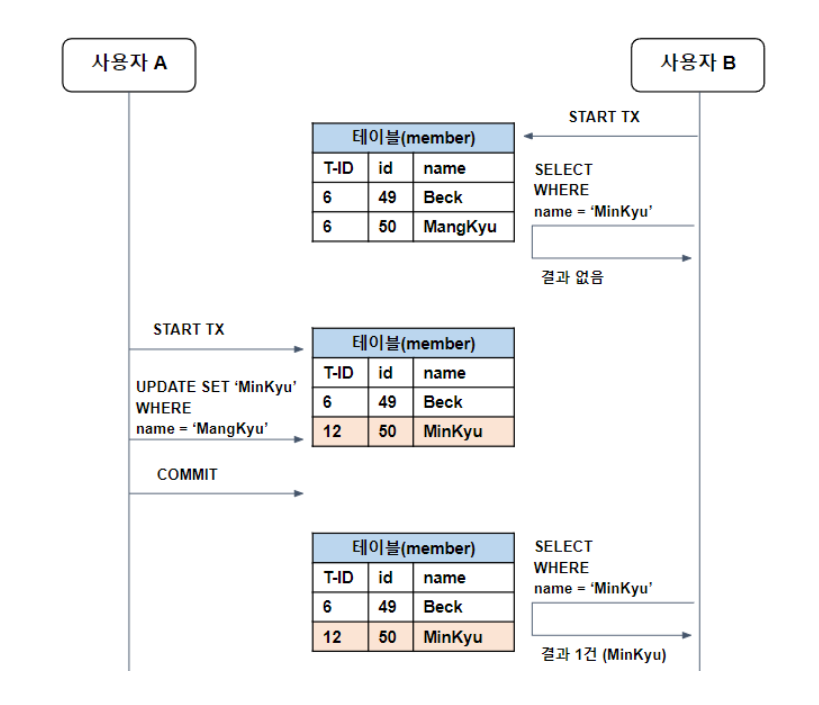

*READ COMMITTED 수준에서는 애초에 커밋된 데이터만 읽을 수 있기 때문에 트랜잭션 내에서 실행되는 SELECT와 트랜잭션 밖에서 실행되는 SELECT의 차이가 별로 없다.*

# *5.4.3* ***REPEATABLE READ (MySQL default)***

      - *잠금 없는 읽기 → MVCC언두 로그(append only)에서 자신의 트랜잭션 번호 보다 낮은 데이터만 읽음* 
      - *잠금 있는 읽기 → 버퍼 풀(메모리)에서 읽음*

| **특징** | **SELECT ... FOR UPDATE** | **SELECT ... FOR SHARE** |
| --- | --- | --- |
| **락 유형** | 넥스트 키 락 (레코드 락 + 갭 락) | 레코드 락만 적용 |
| **락 범위** | 조회된 레코드 및 해당 레코드 주변 갭 | 조회된 레코드만 |
| **동시성** | 다른 트랜잭션의 읽기/수정 모두 차단 | 다른 트랜잭션의 읽기 허용, 수정 차단 |
| **팬텀 리드 방지** | 가능 | 불가능 |
| **사용 목적** | 데이터 수정 작업을 준비하기 위해 사용 | 데이터 읽기 무결성을 보장하기 위해 사용 |

***REPEATABLE READ에서 유일한 PHANTOM READ(팬텀 리드)케이스***


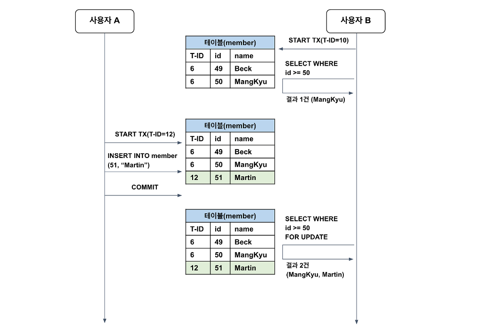

 

***같은 트랜잭션 내에서의 SELECT VS 각각의 트랜잭션(또는 트랜잭션 없이) SELECT*** 

*같은 트랜잭션 내에서의 SELECT는 동일한 읽기를 보장하지만*

*동일한 트랜잭션이 아니거나 각각의 트랜잭션 또는 명시적 트랜잭션 시작 없이 SELECT 하면* 

*READ COMMITED LEVEL 처럼 동작한다.* 

# *5.4.4 SERIALIZABLE*

*SERIALIZABLE은 가장 엄격한 격리 수준으로, 이름 그대로 트랜잭션을 순차적으로 진행시킨다. SERIALIZABLE에서 여러 트랜잭션이 동일한 레코드에 동시 접근할 수 없으므로, 어떠한 데이터 부정합 문제도 발생하지 않는다.* 

*하지만 트랜잭션이 순차적으로 처리되어야 하므로 동시 처리 성능이 매우 떨어진다.*
*MySQL에서 SELECT FOR SHARE/UPDATE는 대상 레코드에 각각 읽기/쓰기 잠금을 거는 것이다*. 


*하지만 SERIALIZABLE 격리 수준에서는 순수한 SELECT 작업에서도 대상 레코드에 넥스트 키 락을 읽기 잠금(공유락, Shared Lock)으로 건다.* 

*따라서 한 트랜잭션에서 넥스트 키 락이 걸린 레코드를 다른 트랜잭션에서는 절대 추가/수정/삭제할 수 없다. SERIALIZABLE은 가장 안전하지만 가장 성능이 떨어지므로, 극단적으로 안전한 작업이 필요한 경우가 아니라면 사용해서는 안된다.*

[https://20240228.tistory.com/406](https://20240228.tistory.com/406)

[https://miintto.github.io/docs/mysql-select-for-update](https://miintto.github.io/docs/mysql-select-for-update)

# *개요*

*인덱스는 데이터베이스의 쿼리의 성능을 언급하면서 빼놓을 수 없는 부분이다.* 

*현재의 MySQL 서버 옵티마이저가 발전하고 성능이 개선됐다고 해도 여전히 관리자(개발자)의 역할은 중요하다.* 

*그래서 인덱스에 대한 기본 지식은 지금도 앞으로도 매우 중요한 부분이며, 쿼리 튜닝의 기본이 될 것이다.*

# *개요*

*먼저* ***랜덤(Random) I/O,*** ***순차(Sequential) I/O*** *같은 디스크 읽기 방식을 알아보고 인덱스를 살펴보자* 

*컴퓨터의 CPU/메모리 같은 장치에 비해서 디스크 같은 기계식 장치의 성능은 제한적으로 발전했다.*

*데이터베이스의 성능 튜닝은 어떻게 디스크 I/O를 줄이느냐가 관건일 때가 상당히 많다.*

# *8.1.1 하드 디스크 드라이브(HDD), 솔리드 스테이트 드라이브(SSD)*

*기계식 하드 디스크 드라이브를 대체하기 위한 전자식 저장 매체인* ***SSD(Solid State Drive)****가 많이 출시되고 있다.*

*SSD 또한 기존 HDD와 같은 인터페이스를 지원해서 내장 디스크나 DAS, SAN에 그대로 사용할 수 있다.*

*SSD는 기존 HDD에서 데이터 저장용 플래터(원판)를 제거하고 그 대신 플래시 메모리를 장착하고 있다.* 

*→ 디스크 원판을 기계적으로 회전시킬 필요가 없어서 데이터를 빠르게 read/write 가능*

*순차I/O에서는 SSD, HDD 차이가 별로 없지만 랜덤I/O에서는 SSD가 훨씬 빠르다.*

*데이터베이스 서버에서 순차 I/O는 랜덤 I/O에 비해서 비중이 크지 않다.* 

*그래서 SSD는 DBMS용 스토리지에 최적이다.* 

# *8.1.2 랜덤 I/O, 순차 I/O*


*순차 I/O는 디스크에 기록하기 위해 1번의 커널에게 시스템 콜을 요청했지만, 랜덤 I/O는 3번의 시스템 콜을 요청했다.*

*즉, 디스크에 기록해야 할 위치를 찾기 위해 순차 I/O는 디스크의 헤드를 1번 움직였고, 랜덤 I/O는 3번 움직였다.*

*디스크에 데이터를 read/write 걸리는 시간은 디스크 헤더를 움직여서 읽고 쓸 위치로 옮기는 단계에서 결정된다.* 

*즉, 그림 8.3의 경우 순차 I/O는 랜덤 I/O보다 거의 3배가 더 빠르다고 볼 수 있다.* 

*디스크의 성능은 헤더의 위치 이동 없이 얼마나 많은 데이터를 한 번에 기록하느냐에 따라 결정된다* 

*그래서 랜덤 I/O 작업이 빈번한 데이터베이스 작업은 많은 버퍼(지연)기능이 내장돼 있다.*

***쿼리 튜닝의 목적***

*쿼리를 튜닝해서 랜덤 I/O를 순차 I/O로 바꿔서 실행할 방법은 그다지 많지 않다.* 

*일반적으로 쿼리를 튜닝하는 것은 랜덤 I/O 자체를 줄여주는 것이 목적이라고 할 수 있다.*

*랜덤 I/O를 줄인다는 것은 쿼리를 처리하는 데 꼭 필요한 데이터만 읽도록 쿼리를 개선하는 것을 의미*

# *개요*

***인덱스란 무엇인가?***

*1권의 책을 비유하면 책의 목차(색인)는 인덱스 책의 내용은 데이터 파일에 해당한다고 볼 수 있다.*

*책의 목차를 통해서 알아낼 수 있는 페이지 번호는 데이터 파일에 저장된 레코드(물리) 주소이다.* 

*DBMS도 데이터베이스에 있는 모든 데이터를 검색해서 원하는 결과를 가져오려면 매우 오랜 시간이 걸린다.*

*그래서 레코드가 저장된 주소를 VALUE 인덱스를 KEY로 구성된 저장 구조를 만들어 두는 것이다.*

***인덱스의 정렬, 데이터 파일의 저장 방식*** 

*DBMS의 인덱스는 주어진 칼럼의 값을 순서로 미리 정렬해서 보관한다.* 

*즉, SortedList 자료 구조를 사용한다. (인덱스의 자료 구조)*

*반대로 데이터 파일은 ArrayList와 같이 저장된 순서대로 별도의 정렬 없이 그대로 저장해 둔다.*

*SortedList 자료 구조는 데이터가 저장될 때마다 항상 값을 정렬해야 하므로 저장(INSERT, DELETE, UPDATE)하는 과정이 복잡하지만 그만큼 SELECT는 매우 빠르게 처리할 수 있다.* 

*결론적으로 DBMS의 인덱스는 데이터 저장 성능을 희생하고 그 대신 데이터의 읽기 속도를 높이는 기능이다.*

*그래서 이런 트레이드오프를 잘 이해하고 SELECT 쿼리 문장의 WHERE 조건절에 사용되는 컬럼이라고 전부 인덱스를 생성하는 등의 역효과를 불러올 행위를 하지 말아야 한다.* 

***인덱스의 분류 Primary Key, Secondary Key***

*프라이머리 키는 칼럼(들) 조합은 레코드를 식별할 수 있는 기준값이 되기 때문에 식별자라고도 부른다. NULL을 허용하지 않으며 중복을 허용하지 않는 것이 특징* 

*프라이머리 키를 제외한 나머지 모든 인덱스를 세컨더리 인덱스로 분류한다.* 

*유니크 인덱스는 프라이머리 키와 성격이 비슷하고 대체해서 사용이 가능할 수도 있다고 해서 대체 키라고 한다.* 

***데이터 저장 방식(알고리즘)으로 인덱스 분류***

*대표적으로 B-Tree 인덱스, Hash 인덱스로 구분할 수 있다.*

*B-Tree 인덱스는 컬럼의 값을 변형하지 않고 원래의 값을 이용해 인덱싱하는 알고리즘* 

*Hash 인덱스는 컬럼의 값으로 해시값을 계산해서 인덱싱하는 알고리즘으로 매우 빠른 검색O(1)을 지원하지만 Prefix 일치 같이 값의 일부만 검색하거나 범위를 검색할 때는 해시 인덱스를 사용할 수 없다. 이런 특징으로 보통 메모리 기반의 데이터베이스(Redis)에서 많이 사용한다.*

***데이터의 중복 허용 여부로 인덱스 분류*** 

*Non Unique, Unique로 구분할 수 있다.*

옵티마이저에게는 상당히 중요한 문제가 된다. 유니크 인덱스에 대해 동등 조건(Equal, =)으로 검색한다는 것은 항상 1건의 레코드만 찾으면 더 찾지 않아도 된다는 것을 알려주는 효과를 낸다.

***인덱스의 기능별로 분류***

*전문 검색용 인덱스, 공간 검색용 인덱스*

# *개요*

[https://20240228.tistory.com/416](https://20240228.tistory.com/416)

*B-Tree는 칼럼의 원래 값을 변형시키지 않고 인덱스 구조체 내에서는 항상 정렬된 상태로 유지한다.*

*대부분의 인덱스는 B-Tree를 사용할 정도로 일반적인 용도에 적합한 알고리즘? 자료구조 이다.*

*B-Tree에는 여러가지 변형된 형태의 알고리즘이 있는데 DBMS에서는 주로 B+-Tree 또는 B*-Tree가 사용된다. 여기서 B는 Binary(이진)이 아닌 Balanced(균형)을 의미한다.*

*사실 B-Tree는 Binary Tree의 advanced balanced tree이다.*

# *8.3.1 구조 및 특성*

*B-Tree 구조는 트리 구조의 최상위에 루트 노드(Root Node)가 존재하고 그 하위에 자식 노드가 붙어 있는 형태* 

*트리 구조의 가장 하위에 있는 노드를 리프 노드(Leaf Node)라 하고 리프 노드도 아니고 루트 노드도 아닌 중간 노드를 브랜치 노드(Branch Node)라고 한다.*

*인덱스의 리프 노드는 항상 실제 데이터 레코드를 찾아가기 위한 주솟값을 가지고 있다.*

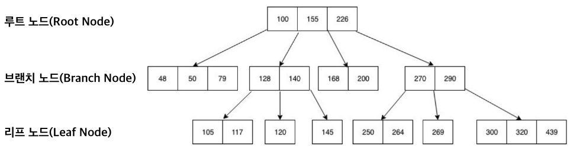


*인덱스의 키 값은 항상 정렬된 상태, 하지만 데이터 파일의 레코드는 정렬돼 있지 않고 임의의 순서로 저장돼 있다.* 

*데이터 파일의 레코드는 INSERT 순서대로 저장되지 않는다. 테이블의 레코드를 전혀 변경(DELETE)하지 않고 INSERT만 수행한다면 맞지만 삭제되어 빈 공간이 생기면 DBMS는 공간을 재활용한다.*

*인덱스는 테이블의 키 컬럼만 가지고 있으므로 나머지 컬럼을 읽으려면 데이터 파일에서 레코드를 찾아야 한다.* 

*인덱스의 리프 노드에는 데이터 파일에 저장된 레코드의 주소를 가진다.*

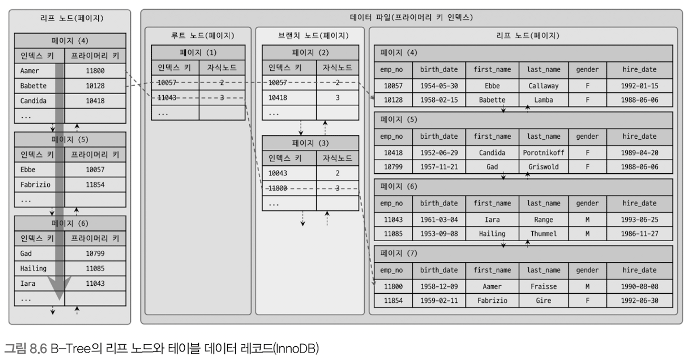

*MyISAM 테이블의 프라이머리 키, 세컨더리 인덱스는 모두 데이터 파일에 저장된 레코드의 ROWID 값을 포인터(물리적인 주소)로 가진다.*

*반면 InnoDB 테이블은 프라이머리키가 ROWID 역할을 한다. 즉, 프라이머리 키가 논리적인 주소를 가진다.*

*그래서 InnoDB 테이블은 인덱스를 통해 레코드를 읽을 때 데이터 파일을 바로 찾아가지 못한다.* 

*인덱스에 저장돼 있는 프라이머리 키 값을 이용해 프라이머리 키 인덱스를 한번 더 검색한 후, 프라이머리 키 인덱스의 리프 페이지에 저장돼 있는 레코드를 읽는다.*

*세컨더리 인덱스를 통한 검색에서 데이터 레코드를 읽기 위해서는 반드시 프라이머리 키를 저장하고 있는 B-Tree를 다시 한번 검색해야 한다.* 

*이런 작업 구조로 인해서 InnoDB 스토리지 엔진을 사용하는 테이블은 성능이 떨어질 것처럼 보이지만 MyISAM 인덱스 구조와 InnoDB 인덱스 구조는 각각의 장단점이 있다.*

# *8.3.2 B-Tree 인덱스 키 추가 및 삭제*

*테이블의 레코드를 저장하거나 변경하는 경우 인덱스 키 추가나 삭제 작업이 발생한다.* 

### *인덱스 키 추가* 

*B-Tree 인덱스를 추가하는 작업은 메모리와 CPU에서 처리하는 시간이 아닌 디스크로부터 인덱스 페이지를 읽고 쓰기를 하는 시간이다. 
또한 균형 트리여서 리프 노드가 꽉 차서 더는 저장할 수 없을 때 리프 노드가 분리돼야 하는데, 이는 상위 브랜치 노드까지 처리의 범위가 넓어진다.*

*이러한 작업 특성 탓에 B-Tree는 쓰기 작업에 비용이 많이 든다.* 

*그래서 InnoDB는 인덱스 키 추가 작업을 지연시켜 나중에 처리할 수 있다. (체인지 버퍼)*

*하지만 PK나 유니크 인덱스 같은 경우 중복 체크가 필요하기 때문에 즉시 B-Tree에 추가하거나 삭제한다.*

### *인덱스 키 삭제*

*해당 키 값이 저장된 B-Tree 리프 노드를 찾아서 삭제 마크만 하면 작업이 끝난다.*

*삭제 마킹된 인덱스 키 공간은 그대로 방치하거나 재활용할 수 있다.*

이 작업 또한 디스크 I/O가 필요한 작업이다. 

*MySQL 5.5 이상 버전에서는 삭제 작업 또한 지연 처리될 수 있다. (체인지 버퍼)*

### *인덱스 키 변경*

*인덱스 키 값은 그 값에 따라 저장될 리프 노드의 위치가 결정되므로 단순히 인덱스상의 키 값만 변경하는 것은 불가능하고 삭제 이후 키를 추가하는 형태로 처리된다.*

*삭제, 추가 작업은 인덱스 키 추가, 삭제 설명과 동일하게 진행되고 이 작업 모두 체인지 버퍼를 활용해 지연 처리 될 수 있다.*

### *인덱스 키 검색*

*INSERT, DELETE, UPDATE 작업을 할 때 인덱스 관리에 대한 추가 비용을 감당하면서 인덱스를 구축하는 이유는 빠른 검색을 위해서다.*

*인덱스를 검색하는 작업은 루트 노드 → 브랜치 노드 → 리프 노드로 이동하면서 비교 작업을 수행하는데 이 과정을 트리 탐색이라고 한다.*

*트리 탐색은 SELECT 뿐만 아니라 UPDATE, DELETE 같은 작업에서 검색해야 할 경우에도 사용된다.*

*인덱스는 결국 키 값으로 정렬되기 때문에 정렬된 효과를 누릴 수 없는 경우라면 인덱스 사용이 불가능하다. → 키 값의 뒷부분만 검색*

*InnoDB 테이블에서 지원하는 레코드 잠금이나 넥스트 키락(갭락)이 검색을 수행한 인덱스를 잠근 후 테이블의 레코드를 잠그는 방식으로 구현돼 있다.*

*따라서 UPDATE, DELETE가 실행될 때 적절한 인덱스가 없으면 불필요하게 많은 레코드를 잠근다.* 

*이는 InnoDB 스토리지 엔진에서 인덱스 설계가 얼마나 중요한지를 나타낸다.* 

# *8.3.3 B-Tree 인덱스 사용에 영향을 미치는 요소*

### ***인덱스 키 값의 크기*** 

*InnoDB에서 디스크에 데이터를 저장하는 기본 단위를 페이지(Page) 또는 블록(Block)이라고 한다.*

*인덱스 또한 페이지 단위로 관리된다.*

*일반적으로 DBMS B-Tree 구조는 자식 노드의 개수가 가변적인 구조다.*

*MySQL B-Tree는 자식 노드의 개수가 인덱스 페이지의 크기와 인덱스 값의 크기에 따라 결정된다.*

*`innodb_page_size`* *시스템 변수를 통해서 4KB ~ 64KB 사이의 값을 선택할 수 있지만 기본은 16KB이다.*

*인덱스의 키가 16바이트면 다음 그림과 같이 인덱스 페이지가 구성된다.*


*인덱스 페이지(16KB)에 몇 개의 키를 저장할 수 있을까?*

*16^1024 /(16 + 12) = 585개* 

*인덱스 키 값이 커지면 어떤 현상이 벌어질까? 키 값의 크기가 두 배인 32바이트로 늘어났다고 가정*

*16^1024/(32 + 12)  = 372개*

*만약 SELECT 쿼리가 레코드 500개를 읽어야 한다면 전자는 인덱스 페이지 한번으로 해결될 수도 있지만 후자는 최소 2번 이상 디스크로부터 읽어야 한다.*

*즉, 디스크 I/O 작업이 늘어난다.*

*또한 인덱스 키 값의 길이가 길어진다는 것은 전체적인 인덱스 크기가 커진다는 것을 의미한다.
즉, 인덱스를 캐시하는 InnoDB 버퍼 풀에 캐시해 둘 수 있는 레코드 수가 줄어든다.*

### *B-Tree 깊이*

*B-Tree 인덱스의 깊이는 중요하지만 직접 제어할 방법은 없다.*

*B-Tree 깊이는 값을 검색할 때 몇 번이나 랜덤하게 디스크를 읽어야 하는지와 직결되는 문제다.*

*인덱스 키 값이 커지면 하나의 인덱스 페이지에 담을 수 있는 인덱스 키 값의 개수가 적어지고, 그 때문에 같은 레코드 컨수라 하더라도 B-Tree의 깊이가 깊어져서 디스크 읽기가 더 많이 필요하게 된다는 것을 의미한다.*

### ***카디날리티(Cardinality, 기수성)***

*카디날리티는 특정 컬럼에 존재하는 데이터의 고유성을 의미한다.*

*카디날리티가 높을수록 중복도는 낮아진다.*

*인덱스는 카디날리티가 높을수록 검색 대상이 줄어들기 때문에 그만큼 빠르게 처리된다.*

*MySQL 서버에서는 인덱스의 통계 정보(유니크한 값의 개수)관리*

***예시 조건*** 

*country 컬럼, city 컬럼이 포함된 tb_test 테이블 존재*

*전체 레코드 건수는 1만, country 컬럼으로만 인덱스가 생성된 상태* 

***케이스 A:*** *country 컬럼의 유니크한 값의 개수 10개* 

***케이스 B:*** *country 컬럼의 유니크한 값의 개수 1,000개*

***Query***

```sql
SELECT *
FROM tb_test
WHERE country = 'KOREA' AND city = 'SEOUL';
```

*해당 쿼리를 실행하면 A 케이스는 평균 1,000건 B 케이스는 평균 10건이 조회될 수 있다는 인덱스의 통계 정보(유니크 값의 개수)로 예측할 수 있다.*

*케이스 A, B를 모두 만족하는 레코드 1건만 있었다면 A 케이스는 쓸모없는 레코드를 999건의 레코드를 더 읽은 것이지만 B 케이스는 9건만 더 읽은 것이다.*

*즉, A 케이스 같은 경우 인덱스가 적합하지 않은 것이라고 볼 수 있다.*

***예시 조건***

```sql
CREATE TABLE tb_city(
		 country VARCHAR(10),
		 city VARCHAR(10),
		 INDEX ix_country (country)
);
```

*tb_city 테이블 전체 레코드 건수 1만, 인덱스는 country만 존재*

*국가, 도시 중복해서 저장 X*

***Query***

```sql
SELECT *
FROM tb_city
WHERE country = 'KOREA' AND city = 'SEOUL';
```

***case: country 컬럼의 유니크 개수 10개***

*국가, 도시 중복해서 저장하지 않고 country 컬럼의 유니크 값이 10개이므로 tb_city 테이블에는 10개의 나라(country)정보가 저장돼 있다.*

*즉, ‘KOREA’ 조건의 인덱스를 검색하면 대략적으로 (10000/10)이 일치한다*

*찾는 레코드는 1건이므로 999건은 불필요하게 읽은 것으로 볼 수 있다.*

***case: country 컬럼의 유니크 개수 1000개***

*유니크한 나라가 1000개니까 tb_city 테이블에는 대략 한 국가당 대략 10개의 도시 정보가 저장돼 있다. 그래서 ‘KOREA’ 조건 인덱스 검색을 하면 (10000/1000)이 일치하고 찾는 레코드는 1건이므로 9건만 불필요하게 읽은 것이다.* 

***정리***

*같은 결과를 받지만 MySQL 서버가 수행한 작업 내용 편차는 매우 크다.* 

*이처럼 인덱스에서 유니크한 값의 개수는 인덱스나 쿼리의 효율성에 큰 영향을 준다.*

### *읽어야 하는 레코드의 건수* 

*인덱스를 통해 테이블의 레코드를 읽는 행위는 인덱스를 거치지 않고 바로 테이블의 레코드를 읽는 것보다 높은 비용이 드는 작업이다.*

*인덱스 (루트 → 브랜치 → 리프) → 프라이머리 인덱스(루프 → 브랜치 → 리프(데이터 파일)* 

*만약 테이블에 100만 건이 저장돼 있는데, 그중에서 50만 건을 읽는 쿼리가 있다고 가정*

*이 작업은 전체 테이블을 모두 읽어서 필요 없는 50만 건을 버리는 것이 효율적인지, 인덱스를 통해 필요한 50만 건만 읽어 오는 것이 효율적일지 판단해야 한다.*

*옵티마이저는 인덱스를 통해 레코드 1건을 읽는 것이 테이블을 통해 직접 읽는 것 보다 4~5배 정도 비용이 더 많이 드는 것으로 예측을 한다.*

*읽어야 할 레코드의 건수가 전체 테이블의 20%~25%를 넘어서면 인덱스를 사용하지 않는 것이 효율적이다. 그래서 이런 케이스에 옵티마이저는 인덱스를 사용하지 않고 테이블을 처음부터 끝까지 읽어서 처리할 것이다.* 

# *8.3.4 B-Tree 인덱스를 통한 데이터 읽기* 

*MySQL이 인덱스를 이용하는 대표적인 3가지 방법을 알아보자*

### *인덱스 레인지 스캔*

*인덱스의 접근 방법 가운데 가장 대표적이고 빠른 방식이다.*

***Query Example***

```sql
SELECT * FROM EMPLOYEES WHERE FIRST_NAME BETWEEN 'Ebbe' AND 'Gad';
```


*인덱스 레인지 스캔은 인덱스의 범위가 결정됐을 때 사용하는 방식이다.*

*루트 노드 → 브랜치 노드 → 리프 노드까지 찾아 들어가야만 레코드의 시작 지점을 찾을 수 있다.*

*시작해야 할 위치를 찾으면 그때부터는 리프 노드의 레코드만 순서대로 읽으면 된다.*

*이렇게 차례대로 쭉 읽는 행위를 스캔이라고 한다.*

*스캔을 하다가 리프 노드의 끝까지 읽으면 리프 노드 간의 링크를 이용해 다음 리프 노드를 찾아서 다시 스캔을 한다.*

*최종적으로 스캔이 끝나면 지금까지 읽은 레코드를 사용자에게 반환하고 쿼리는 종료된다.*

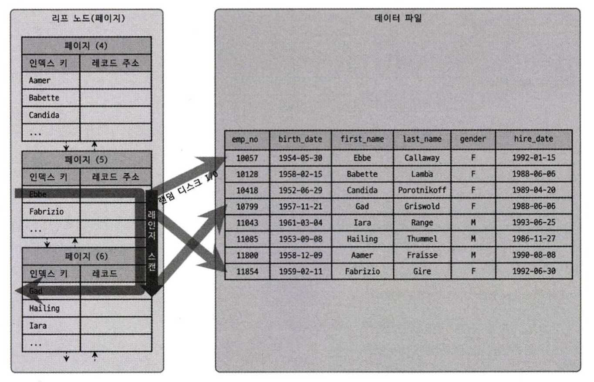

*스캔 시작 위치를 검색하고 해당 지점부터 필요한 방향(내림차순, 오름차순)으로 인덱스를 읽어 나가는 과정이다. 인덱스의 특성상 정렬되어 있기 때문에 스캔 방식과 상관없이 칼럼의 정순 또는 역순으로 정렬된 레코드를 가져온다.*

*인덱스의 리프 노드에서 검색 조건에 일치하는 건들은 데이터 파일에서 레코드를 읽어오는 과정이 필요하다.*

이때 리프 노드에 저장된 레코드 주소(실제 물리 주소)를 바탕으로 읽어오는데, 레코드 한 건 단위로 랜덤 I/O가 발생한다. 

*이런 특성 때문에 인덱스를 통한 데이터 레코드를 읽는 작업은 비용이 많이 드는 작업으로 분류된다.*

***인덱스 레인지 스캔 동작 정리***

      1. ***인덱스 스캔(Index Scan):*** *인덱스 조건을 만족하는 값이 저장된 위치(리프 노드)를 찾는다.*
      1. *인덱스 스캔에서 찾은 위치부터 인덱스를 쭉 차례대로 읽는다. 1번 + 2번을 인덱스 스캔으로 통칭하기도 한다.*
      1. *2번에서 읽어 들인 인덱스 키와 레코드 주소를 이용하여 레코드가 저장된 페이지를 가져오고, 최종적으로 레코드를 읽어온다. 이때 랜덤 I/O가 발생한다.*

***커버링 인덱스 (Covering Index)***

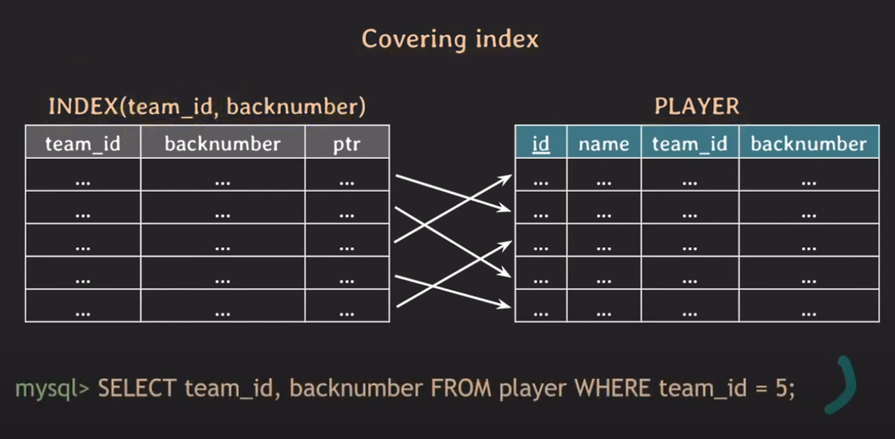

*쿼리가 필요로 하는 데이터에 따라 3번 과정이 필요하지 않을 수 있다.* 

*해당 쿼리는 인덱스로 team_id, back_number가 존재하고 다른 컬럼 데이터는 필요 하지 않는다.*

*커버링 인덱스로 처리되는 쿼리는 디스크의 레코드를 읽지 않아도 되기 때문에 랜덤 I/O가 줄어들고 성능이 그만큼 빨라진다.* 

***MySQL 서버에서의 인덱스 작업 수행 확인 방법***

```sql
SHOW STATUS LIKE 'Handler_%';
```

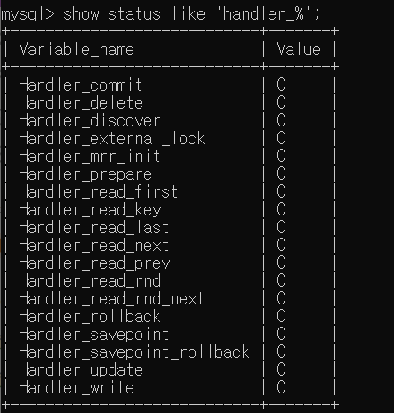

*`Handler_read_key`**: 1번 단계가 실행된 횟수* 

*`Handler_read_next`**,* *`Handler_read_prev`* *: 2번 단계가 실행된 횟수* 

*`Handler_read_last, Handler_read_first`* *: MIN(), MAX() 같이 제일 큰 값 또는 작은 값만 읽는 경우 증가* 

*이 상태 값들은 읽은 인덱스 레코드 건수를 의미하지, 인덱스를 통해 테이블의 레코드를 읽었는지(3번 단계)는 구분하지 않는다.*

*→ 즉, 인덱스를 얼마나 사용했는지 알 수 있는 상태 값이다.*

### *인덱스 풀 스캔*

*인덱스 풀 스캔은 인덱스를 사용하지만 인덱스 레인지 스캔과 다르게 인덱스의 처음부터 끝까지 모두 읽는 방식을 인덱스 풀 스캔이라고 한다.*

*대표적으로 쿼리의 조건절에 사용된 컬럼이 인덱스의 첫 번째 컬럼이 아닌 경우 인덱스 풀 스캔 방식이 적용된다.*

*→ 인덱스 (A, B, C) 순서 쿼리의 조건절은 B, C로 검색하는 경우* 

→ *`SELECT COUNT(*) FROM employee`*

*일반적으로 인덱스의 크기는 테이블 크기보다 작다. 그래서 인덱스만 읽는 것이 효율적이다.* 

*쿼리가 인덱스에 명시된 컬럼만으로 조건(WHERE)을 처리할 수 있는 경우 주로 이 방식이 사용된다.*

*인덱스뿐만 아니라 데이터 레코드까지 모두 읽어야 한다면 절대 이 방식으로 처리되지 않는다.*


*인덱스의 리프 노드의 제일 끝(앞/뒤)로 이동한 후, 인덱스의 리프 노드를 연결하는 링크드 리스트를 따라서 처음부터 끝까지 스캔하는 방식을 인덱스 풀 스캔이라고 한다.* 

*이 방식은 인덱스 레인지 스캔 방식보다는 빠르지 않지만 데이터 풀 스캔보다는 효율적이다.* 

*하지만 인덱스 풀 스캔 방식은 인덱스를 이용하는 것이지만 효율적인 방식이 아니며, 일반적으로 인덱스의 생성 목적이 아니다.* 

### *루스 인덱스 스캔*

*루스 인덱스 스캔은 말 그대로 느슨하게(듬성등섬) 인덱스를 읽는 것을 의미한다.*

인덱스 레인지 스캔과 비슷하게 동작하지만 중간에 필요치 않은 인덱스 키 값은 무시하고 넘어간다.

*일반적으로 GROUP BY 또는 집합 함수 가운데 MAX(), MIN() 함수에 대해 최적화를 하는 경우 사용된다.*

***example***

```sql
SELECT DEPT_NO, MIN(EMP_NO)
FROM   DEPT_EMP
WHERE  DEPT_NO BETWEEN 'd002' AND 'd004'
GROUP BY DEPT_NO;
```

  

*DEPT_EMP 테이블은 DEPT_NO, EMP_NO 두 개의 컬럼으로 컴포짓 인덱스가 생성돼 있다.*

*또한 해당 인덱스는 (DEPT_NO, EMP_NO) 조합으로 오름차순 정렬돼 있다.*

*그래서 DEPT_NO 그룹의 첫 번째 EMP_NO 값만 읽으면 된다.*

*즉, 인덱스의 WHERE 조건을 만족하는 범위 전체를 다 스캔할 필요가 없다는 것을 옵티마이저는 알고 있기 때문에 조건에 맞지 않는 레코드는 넘어간다.* 

### *인덱스 스킵 스캔*

*데이터베이스에서 인덱스 핵심은 값이 정렬돼 있다는 것이다.*

*그래서 인덱스를 구성하는 컬럼의 순서는 매우 중요하다.*

***EMPLOYEES 테이블에 인덱스 추가***

```sql
ALTER TABLE EMPLOYEES
ADD INDEX id_gender_birthdate (gender, birth_date);
```

*해당 인덱스를 사용하려면 WHERE 조건절에 gender 컬럼에 대한 비교 조건이 필수다.*

```sql
// 인덱스 사용하지 못하는 쿼리 
SELECT * FROM EMPLOYEES WHERE birth_date >= '1965-02-01';


// 인덱스를 사용할 수 있는 쿼리 
SELECT * FROM EMPLOYEES WHERE gender='M' AND birth_date >= '1965-02-01';
```

*이전 버전의 MySQL은 인덱스를 사용하지 못하는 첫 번째 쿼리는 birth_date 컬럼부터 시작하는 인덱스를 새로 생성해야만 했다.*

*하지만 MySQL 8.0 버전 부터는 옵티마이저가 gender 칼럼을 건너뛰어서 birth_date 컬럼만으로도 인덱스 검색이 가능하게 해주는 인덱스 스킵 스캔(Index Skip Scan) 최적화 기능이 도입됐다.* 

*이전 버전에서도 루스 인덱스 스캔이라는 기능이 있었지만 해당 기능은 group by 작업을 처리하기 위한 쿼리에만 적용이 가능했다.*

***실행 계획 확인하기*** 

```sql
mysql> SET optimizer_switch='skip_scan=off';
Query OK, 0 rows affected (0.00 sec)

mysql> EXPLAIN SELECT gender, birth_date FROM employees WHERE birth_date>='1965-02-01';
+----+-------------+-----------+------------+-------+---------------+---------------------+---------+------+--------+----------+--------------------------+
| id | select_type | table     | partitions | type  | possible_keys | key                 | key_len | ref  | rows   | filtered | Extra                    |
+----+-------------+-----------+------------+-------+---------------+---------------------+---------+------+--------+----------+--------------------------+
|  1 | SIMPLE      | employees | NULL       | index | NULL          | ix_gender_birthdate | 4       | NULL | 300719 |    33.33 | Using where; Using index |
+----+-------------+-----------+------------+-------+---------------+---------------------+---------+------+--------+----------+--------------------------+
1 row in set, 1 warning (0.00 sec)

mysql> EXPLAIN SELECT gender, birth_date FROM employees WHERE gender='M' AND birth_date>='1965-02-01';
+----+-------------+-----------+------------+-------+---------------------+---------------------+---------+------+------+----------+--------------------------+
| id | select_type | table     | partitions | type  | possible_keys       | key                 | key_len | ref  | rows | filtered | Extra                    |
+----+-------------+-----------+------------+-------+---------------------+---------------------+---------+------+------+----------+--------------------------+
|  1 | SIMPLE      | employees | NULL       | range | ix_gender_birthdate | ix_gender_birthdate | 4       | NULL |   27 |   100.00 | Using where; Using index |
+----+-------------+-----------+------------+-------+---------------------+---------------------+---------+------+------+----------+--------------------------+
1 row in set, 1 warning (0.00 sec)
```

*MySQL 8.0 이전 버전의 동작 방식을 알아보기 위해 인덱스 스킵 스캔 off*

*type: index의 의미는 풀 인덱스 스캔을 의미한다.*

*만약 employees 테이블의 모든 컬럼을 가져와야 했다면 테이블 풀 스캔을 실행했을 것이다.*

```sql
mysql> SET optimizer_switch='skip_scan=on';
Query OK, 0 rows affected (0.00 sec)

mysql> EXPLAIN SELECT gender, birth_date FROM employees WHERE birth_date>='1965-02-01';
+----+-------------+-----------+------------+-------+---------------------+---------------------+---------+------+--------+----------+----------------------------------------+
| id | select_type | table     | partitions | type  | possible_keys       | key                 | key_len | ref  | rows   | filtered | Extra                                  |
+----+-------------+-----------+------------+-------+---------------------+---------------------+---------+------+--------+----------+----------------------------------------+
|  1 | SIMPLE      | employees | NULL       | range | ix_gender_birthdate | ix_gender_birthdate | 4       | NULL | 100229 |   100.00 | Using where; Using index for skip scan |
+----+-------------+-----------+------------+-------+---------------------+---------------------+---------+------+--------+----------+----------------------------------------+
1 row in set, 1 warning (0.00 sec)
```

*인덱스 스킵 스캔 on*

*type: range 인덱스에서 꼭 필요한 부분만 읽었다는 것이다. 인덱스를 잘 활용했다고 평가할 수 있다.*

*Extra 컬럼에  “Using index for skip scan”이라는 문구가 표시됐는데, 이는 ix_gender_birthdate 인덱스에 대해 인덱스 스킵 스캔을 활용해 데이터를 조회했다는 것을 의미한다.*

*MySQL 옵티마이저는 먼저 gender 컬럼에서 유니크한 값을 모두 조회해서 주어진 쿼리에 gender 컬럼 조건을 추가해서 쿼리를 다시 실행하는 형태로 처리한다.*


***인덱스 스캔의 단점***

      - *WHERE 조건절에 조건이 없는 인덱스의 선행 컬럼의 유니크한 값의 개수가 적어야함*
      - *쿼리가 인덱스에 존재하는 컬럼만으로 처리 가능해야 함(커버링 인덱스)*

*유니크한 값의 개수가 많아지면 인덱스에서 스캔해야 할 시작 지점을 검색하는 작업이 많이 필요해진다. 그래서 오히려 쿼리의 처리 성능이 더 느려질 수 있다.*

*커버링 인덱스 제약사항은 옵티마이저가 개선되면 충분히 해결될 수 있는 부분으로 보인다.*

# *8.3.5 다중 컬럼(Multi-Column) 인덱스*

*실제 서비스용 데이터베이스에서는 2개 이상의 컬럼을 포함하는 컴포짓 인덱스가 더 많이 사용된다.*

*2개 이상의 컬럼이 연결됐다고 해서 Concatenated Index 라고도 한다.*

*다중 컬럼 인덱스에서 중요한 점은 컬럼의 순서이다.*

*인덱스 컬럼의 순서에 따라서 정렬되기 때문이다.*

# *8.3.6 B-Tree 인덱스의 정렬 및 스캔 방향* 

*인덱스를 생성할 때 설정한 정렬 규칙(DESC, ASC)에 따라서 인덱스 키 값은 항상 오름차순 또는 내림차순으로 정렬되어 저장된다.*

*하지만 인덱스 생성과 상관없이 읽는 순서는 쿼리에 따라서 달라질 수 있다.’*

### ***인덱스의 정렬*** 

*인덱스를 생성하는 시점에 인덱스를 구성하는 각 컬럼의 정렬을 ASC, DESC 순으로 설정할 수 있다.*

```sql
CREATE INDEX ix_teamname_userscore ON employees (team_name ASC, user_score DESC);
```

### ***인덱스의 스캔 방향*** 

```sql
SELECT *
FROM employees
ORDER BY first_name DESC
LIMIT 1;
```

*만약 first_name 인덱스가 오름차순으로 정렬되어 있다면 옵타마이저는 처음부터 끝까지 읽어 가장 마지막 레코드의 값 하나를 가져올까?*

*그렇지 않다. 옵티마이저는 최솟값부터 읽으면 오름차순으로 값을 가져올 수 있고, 최댓값부터 꺼꾸로 읽으면 내림차순으로 값을 가져올 수 있다는 것을 MySQL 옵티마이저는 이미 알고 있다.*

*즉, 생성 시점에 인덱스의 정렬이 결정되지만 인덱스를 사용하는 시점에 동적으로 인덱스를 읽는 방향에 따라 오름차순 또는 내림차순 정렬 효과를 얻을 수 있다.*

*쿼리의 ORDER BY 처리나 MIN(), MAX() 함수 등의 최적화가 필요한 경우에도 옵티마이저는 읽기 방향을 전환해서 사용하도록 실행 계획을 만들어 낸다.*

### *내림차순 인덱스* 

[https://tech.kakao.com/posts/351](https://tech.kakao.com/posts/351)

      - *인덱스 페이지 간 연결이 single - linked list여서 오름차순 스캔은 빠르지만 
역순 스캔은 현재 페이지가 이전 페이지의 주솟값을 가지지 않기 때문에 느리다. 
데이터 페이지(프라이머리 인덱스의 리프 노드가 가지는 실제 레코드 물리 주소 좌표)는 double - linkedlist 이다.*
      - *데이터 페이지는 double - linkedlist 구조이지만 데이터가 정렬되어 있지 않는 구조이기 때문에 결국 원하는 레코드의 읽기(커버링 인덱스가 아닌 경우)는 랜덤 I/O가 발생한다.*
      - *역순 스캔과 정순 스캔의 차이는 있지만 크지는 않다. 쿼리 튜닝의 효과가 나타나는 곳은 결국 데이터 페이지의 랜덤 I/O 숫자를 줄이는 데 있다.*
      - *그래도 테이블의 역순 스캔이 많이 발생하는 서비스라면 기존 인덱스의 역순 인덱스를 고려할만하다.*

# *8.3.7 B-Tree 인덱스의 가용성과 효율성*

*쿼리의 WHERE 조건이나 GROUP BY, ORDER BY 절이 어떤 경우에 인덱스를 사용할 수 있고 어떤 방식으로 사용할 수 있는지 식별할 수 있어야 한다.* 

*그래야만 쿼리의 조건을 최적화하거나 반대로 인덱스를 최적으로 생성할 수 있다.*

### ***비교 조건의 종류와 효율성*** 

*다중 컬럼 인덱스에서 컬럼의 순서와 그 컬럼에 사용된 조건* *`>`* *,* *`<`* *,* *`=`* *에 따라서 인덱스 컬럼 활용, 효율이 달라진다.*

```sql
SELECT * FROM dept_emp
WHERE dept_no = 'd002' AND emp_no >= 10144;
```

*해당 쿼리를 위해 컬럼의 순서만 다른 인덱스 2개 생성*

      - *케이스 A: INDEX(dept_no, emp_no)*
      - *케이스 B: INDEX(emp_no, dept_no)*

*케이스 A 같은 경우 dept_no = 'd002' AND emp_no ≥ 10144 인 레코드를 찾기 그 이후에는 dept_no가 ‘d002’가 아닌 경우까지 쭉 읽기만 하면 된다*

*조건을 만족하는 레코드가 5건이라고 할 때, 5번의 비교 작업만 구행한 것이므로 효율적으로 인덱스를 이용한 것이다.*

*케이스 B는 emp_no ≥ 10144 인 레코드를 찾고 그 이후에 dept_no가 ‘d002’인지 비교하는 과정을 거친다.*


*케이스 B 같은 경우 emp_no 조건에 맞는 레코드 건수 만큼 비교 작업이 들어가서 매우 비효율적이다. 즉, 단순히 쿼리 조건에 맞는지 검사하는 용도로만 사용됐다.*

### *가용성과 효율성 판단*

*기본적으로 B-Tree 인덱스의 특성상 다음 조건들은 체크 조건으로는 사용 가능하지만 작업 범위 결정 조건으로 사용할 수 없다.*

| **구분** | **예시** | **설명** |
| --- | --- | --- |
| **NOT-EQUAL로 비교된 경우** | `WHERE column <> 'N'` | 특정 값과 다른 경우를 검색 |
|  | `WHERE column NOT IN (10, 11, 12)` | 특정 값 목록에 없는 경우를 검색. |
|  | `WHERE column IS NOT NULL` | NULL이 아닌 값을 검색하며, 일반적으로 인덱스를 제대로 활용하지 못함. |
| **LIKE로 뒷부분 또는 중간 일치** | `WHERE column LIKE '%승환'` | 문자열 끝부분이 특정 패턴과 일치하는 경우. `%`가 앞에 오면 인덱스 사용이 어렵다. |
|  | `WHERE column LIKE '_승환'` | 두 번째 문자부터 특정 패턴과 일치하는 경우. |
|  | `WHERE column LIKE '%승%'` | 문자열 중간에 특정 패턴이 포함된 경우. |
| **인덱스 컬럼이 변형된 경우** | `WHERE SUBSTRING(column, 1, 1) = 'X'` | 인덱스가 적용되지 않으며, 컬럼 값을 변형하는 함수 사용. |
|  | `WHERE DAYOFMONTH(column) = 1` | 날짜 함수로 컬럼을 변형하여 비교하는 경우. |
| **NOT-DETERMINISTIC <br>함수 사용** | `WHERE column = deterministic_function()` | 결과가 매번 달라질 수 있는 함수 사용 시, 인덱스 사용이 제한 |
| **데이터 타입이 다른 비교** | `WHERE char_column = 10` | 문자열과 숫자와 같이 서로 다른 타입을 비교하면 암묵적 형변환이 발생하고 인덱스 사용이 제한 |
| **문자열 콜레이션이 다른 문자열 비교** | `WHERE utf8_bin_char_column = euckr_bin_char_column` | 서로 다른 문자 집합(콜레이션)을 비교하면 불필요한 변환 |

다른 일반적인 DBMS에서는 NULL 값이 인덱스에 저장되지 않지만 MySQL에서는 NULL 값도 인덱스에 저장된다. 다음과 같은 조건도 작업 범위 결정 조건으로 인덱스를 사용한다.

```sql
	... WHERE column IS NULL ..
```

### 다중 컬럼 인덱스의 적용 가능/불가능 조건 - INDEX( col1, col2, col3, … col n)

| **구분** | **설명** | **예시** |
| --- | --- | --- |
| **적용되지 않는 경우** |  |  |
| `col_1`에 대한 조건 없음 | 다중 컬럼 인덱스에서 가장 앞 컬럼(`col_1`)에 대한 조건이 없으면 인덱스가 적용되지 않음. | `WHERE col_2 = 10 AND col_3=20` |
| `col_1` 조건이 인덱스에서 사용 불가 | `col_1` 조건이 NOT-EQUAL (`<>`, `NOT IN`, 등), 패턴 불일치 (`LIKE '%str'`) 등이 포함될 경우. | `WHERE col_1 <> 10 AND col_2 = 20` |
| **적용되는 경우** |  |  |
| `col_1` ~ `col_(i-1)` 동등 비교 | 인덱스 컬럼 중 앞부분(`col_1` ~ `col_(i-1)`)이 동등 비교 조건 (`=`, `IN`)일 때 적용 가능. | `WHERE col_1 = 10 AND col_2 IN (20, 30)` |
| `col_i` 비교 가능 조건 | `col_i`에 동등 비교 (`=`, `IN`), 크고 작음 (`<`, `>`, `<=`, `>=`), 또는 좌측 일치 `LIKE` 조건 사용 가능. | `WHERE col_1 = 10 AND col_2 = 20 AND col_3 > 30`  <br>`WHERE col_1 = 10 AND col_2 LIKE 'jour%'` |
| **작업 범위/체크 조건** |  |  |
| 작업 범위 조건 | `col_1` ~ `col_i`는 작업 범위를 결정하는 조건으로 사용 | `WHERE col_1 = 10 AND col_2 = 20` (인덱스를 통한 데이터 스캔 범위 결정). |
| 체크 조건 | `col_i+1` ~ `col_n`은 작업 범위 내에서 일치 여부를 확인하는 조건으로 사용됨. | `WHERE col_1 = 10 AND col_2 = 20 AND col_3 = 30 AND col_4 = 40` (작업 범위 스캔 후 추가 체크). |

*인덱스는 기본적으로 레코드 1건이 1개의 인덱스 키 값을 가진다. 즉, 1:1 관계를 가진다.*

***멀티 밸류(Multi-Value) 인덱스****는 하나의 데이터 레코드가 여러 개의 키 값을 가질 수 있는 형태의 인덱스다.* 

*일반적인 RDBMS 기준으로 생각하면 이러한 인덱스는 1정규화 대상이다.*

*하지만 최근 RDBMS들이 JSON 데이터 타입을 지원하면서 JSON 배열 타입의 필드에 저장된 원소에 인덱스 요건이 발생한 것이다.*

***멀티 밸류 인덱스 활용 방법***

*일반적인 조건 방식을 사용하면 안 되고 다음 함수들을 이용해서 검색해야 옵티마이저가 인덱스를 활용한 실행 계획을 수립한다.* 

      - MEMBER OF()
      - JSON_CONTAINS()
      - JSON_OVERLAPS()

*클러스터링이란 여러 개를 하나로 묶는다는 의미로 주로 사용된다.*

*MySQL에서 클러스터링 인덱스는 InnoDB 스토리지 엔진에서만 지원한다.*

# *8.8.1 클러스터링 인덱스*

*클러스터링 인덱스는 테이블의 프라이머리 키에 대해서만 적용되는 내용이다.*

*프라이머리 키 값에 의해 레코드의 저장 위치가 결정된다.*

*InnoDB 같이 항상 클러스터링 인덱스로 저장되는 테이블은 프라이머리 키 기반의 검색이 매우 빠르다. 대신 레코드의 저장이나 프라이머리 키 변경이 상대적으로 느리다.*

*→ 검색은 순차 I/O로 하기 때문에 매우 빠르다.*

***일반적인 B-Tree 인덱스 (논클러스터링 인덱스) VS 클러스터링 인덱스***

*모두 인덱스는 B-Tree 구조를 기반으로 생성되지만 클러스터링 인덱스는 테이블의 레코드가 프라이머리 키 값으로 정렬되어 저장된 경우만 해당한다.*


*세컨더리 인덱스 B-Tree 리프 노드와 다르게 리프 노드에 모든 컬럼이 같이 저장돼 있음을 알 수 있다.*

*즉, 클러스터링 테이블은 그자체가 하나의 거대한 인덱스 구조다.*

### ***InnoDB 테이블의 클러스터링 인덱스***

*InnoDB 테이블은 다음 조건으로 무조건 클러스터링 인덱스를 구성한다.*

      1. *프라이머리 키가 있으면 기본적으로 프라이머리 키를 클러스터링 키로 선택* 
      1. *NOT NULL 옵션의 UNIQUE INDEX 중에서 첫 번째 인덱스를 클러스터링 키로 선택*
      1. *자동으로 유니크한 값을 가지도록 증가되는 컬럼을 내부적으로 추가한 후, 클러스터링 키로 선택* 

*3번 방식으로 자동 추가된 컬럼은 사용자에게 노출되지 않으며, 쿼리 문장에 명시적으로 사용할 수 없다. 즉, 우리에게 아무런 혜택을 주지 않는다.*

*클러스터링 인덱스는 테이블당 단 하나만 가질 수 있는 엄청난 혜택이므로 가능하다면 프라이머리 키를 명시적으로 생성하자*

# *8.8.2 세컨더리 인덱스*

*MyISAM, MEMORY 스토리지 엔진은 세컨더리 인덱스, 프라이머리 인덱스 모두 레코드가 저장된 주소(ROWID)를 이용해 가져온다.* 

*그래서 세컨더리 인덱스와 프라이커리 인덱스는 구조적 차이가 없다.*

*InnoDB 테이블(클러스터링 테이블)의 모든 세컨더리 인덱스는 해당 레코드가 저장된 주소가 아니라 프라이머리 키 값을 저장하도록 구현돼 있다.*

# *8.8.3 클러스터링 테이블 사용 시 주의사항* 

***장점***

      - *프라이머리 키로 검색할 때 처리 성능이 매우 빠름, 특히 프라이머리 키를 범위 검색하는 경우*
      - *테이블의 모든 세컨더리 인덱스가 프라이머리 키를 가지고 있기 때문에 인덱스만으로 처리될 수 있는 경우가 많다(커버링 인덱스)*

***단점***

      - *모든 세컨더리 인덱스가 클러스터링 키를 갖기 때문에 클러스터링 키 값의 크기가 클 경우 전체적으로 인덱스 크기가 커진다.*
      - *세컨더리 인덱스를 통해 프라이머리 키로 다시 한번 검색해야 하므로 처리 성능이 느리다*
      - *INSERT를 할 때 프라이머리 키에 의해 레코드 저장 위치가 결정되기 때문에 처리 성능이 느리다*
      - *프라이머리 키를 변경할 때 레코드를 DELETE, INSERT 작업이 필요하기 때문에 처리 성능이 느리다*

*클러스터링 인덱스의 장단점을 요약하면 장점은 빠른 읽기(SELECT) 성능, 단점은 느린 쓰기(DELETE, INSERT, UPDATE) 성능이다.*  

*보통 웹 서비스에서 읽기 쓰기 비율은 9:1 이다. 그래서 조금 느린 쓰기를 감수하고 읽기를 빠르게 유지하는 것은 매우 중요하다*

# *8.8.4 클러스터링 인덱스의 장점과 단점*

***클러스터링 인덱스 키의 크기*** 

*클러스터링 테이블의 경우 모든 세컨더리 인덱스가 프라이머리 키(클러스터링 키) 값을 리프 노드에 포함한다.*

*즉, 프라이머리 키의 크기가 커지면 세컨더리 인덱스도 자동으로 크기가 커진다.*

***프라이머리 키 생성 방식***

*프라이머리 키로 검색하는 경우(특히 많은 범위로 레코드를 검색하는 case) 클러스터링 되지 않은 테이블에 비해 매우 빠르게 처리될 수 있다.*

*책에서는 프라이머리 키 컬럼의 크기가 크더라도 비즈니스적으로 해당 레코드를 대표할 수 있다면 그 컬럼을 프라이머리 키로 설정하는 것을 추천한다.*

*즉, 아무 이유 없이 AUTO_INCREMENT를 사용하지 말자*

      - *회원 테이블의 소셜 아이디 USERNAME 컬럼* 
      - *주문 테이블의 주문 ID → AUTO_INCREMENT, 클러스터링 인덱스*

***프라이머리 키는 반드시 명시할 것***

*InnoDB 테이블에서 프라이머리 키를 정의하지 않으면 내부적으로 일련번호 컬럼을 추가한다.*

*이렇게 자동으로 추가된 컬럼은 사용자에게 보이지 않기 때문에 사용자가 전혀 접근(사용)할 수 가 없다.*

***AUTO-INCREMENT 컬럼을 인조 식별자로 사용할 경우*** 

*여러 개의 컬럼이 복합으로 프라이머리 키가 만들어지는 경우 프라이머리 키의 크기가 길어질 때가 있다. 이때 세컨더리 인덱스도 필요하면 AUTO_INCREMENT 컬럼을 추가하고, 이를 프라이머리 키로 설정하면 된다.*

*이렇게 프라이머리 키를 대체하기 위해 인위적으로 추가된 프라이머리 키를 인조 식별자라고 한다.*

*로그 테이블과 같이 조회보다는 INSERT 위주의 테이블들은 AUTO_INCREMENT를 활용한 인조 식별자를 프라이머리 키로 설정하는 것이 성능 향상에 도움이 된다.*

*유니크는 인덱스보단 제약 조건에 가깝다*

*테이블이나 인덱스에 같은 값이 2개 이상 저장될 수 없음을 의미한다.*

*유니크 인덱스에도 NULL도 저장될 수 있는데, NULL은 특정 값이 아니므로 2개 이상 저장될 수 있다*

*→ NULL은 UNKNOWN 이다. 이는 UNKNOWN ≠ UNKNOWN*

*MySQL에서 프라이머리 키는 기본적으로 NOT NULL, UNIQUE 속성이 자동으로 부여된다.* 

*이는 스토리지 엔진과 상관없이 모두 공통 속성이다.*

# ***8.9.1 유니크 인덱스와 일반 세컨더리 인덱스의 비교*** 

*유니크 인덱스와 유니크하지 않은 일반 세컨더리 인덱스는 인덱스 구조상 아무런 차이점이 없다.*

***인덱스 읽기*** 

*많은 사람들은 유니크 인덱스가 빠르다고 생각한다.* 

*유니크 인덱스에서는 1건만 읽으면 되지만, 유니크하지 않은 세컨더리 인덱스에서는 레코드를 한 건 더 읽어야하므로 느리다고 주장한다. 하지만 이것은 사실이 아니다.*

*유니크하지 않은 세컨더리 인덱스에서 한 번 더 해야 하는 작업은 디스크 읽기가 아니라 CPU에서 컬럼값을 비교하는 작업이기 때문에 성능상 영향이 거의 없다고 볼 수 있다.*

*레코드의 개수를 읽느냐의 차이만 있다는 것을 의미할 뿐, 읽어야 할 레코드 건수가 같다면 성능상는 미미하다.*

***인덱스 쓰기*** 

*새로운 레코드 INSERT 또는 인덱스 컬럼의 값이 변경되는 경우에는 인덱스 쓰기 작업이 필요*

*유니크 인덱스의 값을 쓸 때는 중복된 값이 있는지 체크하는 과정이 한 단계 더 필요하다.*

*그래서 유니크하지 않은 세컨더리 인덱스의 쓰기보다 느리다*

*MySQL 유니크 인덱스에서 중복된 값을 체크할 때는 읽기 잠금을 사용하고, 쓰기를 할 때는 쓰기 잠금을 사용하는데 이 과정에서 데드락이 아주 빈번하게 발생한다.*

또한 InnoDB에서 인덱스 키 저장을 체인지 버퍼를 통해서 하는데 유니크 인덱스는 중복 체크를 해야 하므로 작업 자체를 버퍼링하지 못한다. 

*그래서 유니크 인덱스는 일반 세컨더리 인덱스보다 변경 작업이 더 느리게 동작한다.* 

# ***8.9.2 유니크 인덱스 사용 시 주의사항***

*같은 컬럼에 유니크 인덱스와 일반 인덱스를 각각 중복해서 생성할 필요 없다.* 

*마찬가지로 같은 컬럼에 프라이머리 키와 유닉스 인덱스를 동일하게 생성할 필요 없다.*

*모두 불필요한 중복이다.*

*유일성이 꼭 보장돼야 하는 컬럼에 대해서는 유니크 인덱스를 생성하되, 꼭 필요하지 않다면 유니크 인덱스보다는 유니크하지 않은 세컨더리 인덱스를 생성하는 방법도 고려해 보자*

*MySQL 엔진에서 외래키는 InnoDB 스토리지 엔진만 생성이 가능하다.*

*외래키 제약이 설정되면 자동으로 연관되는 테이블 컬럼에 인덱스까지 생성된다.*

*외래키가 제거되지 않은 상태에서는 자동으로 생성된 인덱스를 삭제할 수 없다.*

***InnoDB 외래키 관리에는 중요한 2가지 특성이 있다.***

      - *테이블의 변경(쓰기 잠금)이 발생하는 경우에만 잠금 경합(잠금 대기)이 발생한다.*
      - *외래키와 연관되지 않은 컬럼의 변경은 최대한 잠금 경합(잠금 대기)을 발생시키지 않는다.*

***example query***

```sql
CREATE TABLE tb_parent (
		id INT NOT NULL,
    fd VARCHAR(100) NOT NULL, 
    PRIMARY KEY(id)
)
ENGINE = InnoDB;


CREATE TABEL tb_child (
		id INT NOT NULL,
    pid INT DEFAULT NULL,
    fd VARCHAR(100) DEFAULT NULL, 
    PRIMARY KEY (id),
    KEY ix_parentid(pid),
    CONSTRAINT child_ibfk_1 FOREIGN KEY (pid) REFERENCES tb_parent (id) ON DELETE CASCADE 
)
ENGINE = InnoDB:


INSERT INTO tb_parent VALUES
(1, 'parent-1'),
(2, 'parent-2');

INSERT INTO tb_child VALUES
(100, 1, 'child-100');
```

# ***8.10.1 자식 테이블의 변경이 대기하는 경우*** 

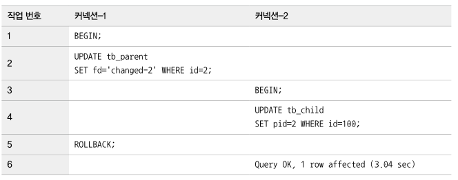

*InnoDB의 외래키 관리의 첫 번째 특징이다.*

*1번 커넥션에서 먼저 트랜잭션을 시작하고 부모 테이블에서 id가 2인 레코드에 UPDATE를 실행한다.*

*이 과정에서 1번 커넥션은 id가 2인 레코드에 대해 쓰기 잠금을 획득한다.*

*2번 커넥션에서는 자식 테이블에서 외래키 컬럼인 pid를 2로 변경하는 쿼리를 실행한다. 이 쿼리(4번 작업)은 부모 테이블의 변경 작업이 완료될 때까지 대기한다.*

*1번 커넥션에서 ROLLBACK, COMMIT으로 트랜잭션을 종료하면 2번 커넥션의 대기 중이던 작업이 즉시 처리된다.*

*즉, 자식 테이블의 외래 키 컬럼 변경은 부모 테이블의 확인이 필요한데, 이 상태에서 부모 테이블의 해당 레코드가 쓰기 잠금이 걸려 있으면 쓰기 잠금이 해제될 때까지 기다리게 된다.*

# ***8.10.2 부모 테이블의 변경 작업이 대기하는 경우*** 

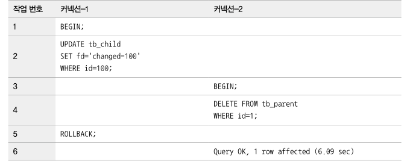

*8.10.1 작업과 동일한데 순서만 변경했다.*

*커넥션1에서 부모 키 1을 참조하는 자식 테이블의 레코드를 변경하면 자식 테이블의 레코드에 쓰기 잠금을 획득한다.*

*이 상태에서 2번 커넥션이 키가 1인 레코드를 삭제하는 경우 쿼리(4번)은 자식 테이블의 레코드에 대한 쓰기 잠금이 해제될 때까지 기다려야 한다. 이는 자식 테이블이 생성될 때 정의한 외래키 특성(ON DELETE CASCADE) 때문에 부모 레코드가 삭제되면 자식 레코드도 동시에 삭제되는 방식으로 작동하기 때문이다.*

*즉, 데이터베이스에서 외래 키를 물리적으로 생성하려면 잠금 경합까지 고려해 모델링을 진행하는 것이 좋다.*

# *개요*

*MySQL 서버로 요청된 쿼리는 결과는 동일하지만 내부적으로 그 결과를 만들어내는 방법은 매우 다양하다.*

*MySQL에서는 쿼리를 최적으로 실행하기 위해 각 테이블의 데이터가 어떤 분포로 저장돼 있는지 통계 정보를 참조하며, 그러한 데이터를 비교해 최적의 실행 계획을 수립하는 작업이 필요하다.*

*대부분의 DBMS는 옵티마이저가 이러한 기능을 담당한다.*

*MySQL에서는 EXPLAIN 이라는 명령으로 쿼리의 실행 계획을 확인할 수 있는데* 

*실행 계획에 표시되는 내용을 제대로 이해하려면 옵티마이저가 실행하는 쿼리 최적화에 대해 어느 정도 지식을 갖추고 있어야 한다.*

*쿼리의 실행 계획을 수립하는 옵티마이저는 가장 복잡한 부분이다.*

*하지만 실행 계획을 이해할 수 있어야만 실행 계획의 불합리한 부분을 찾아내고, 더 최적화된 방법으로 실행 계획을 수립하도록 유도할 수 있다.*

# *9.1.1 쿼리 실행 절차*

*MySQL 서버에서 실행되는 쿼리의 과정은 크게 3단계로 나눌 수 있다.*

      - *사용자로부터 요청된 SQL 문장을 잘게 쪼개서 MySQL 서버가 이해할 수 있는 수준으로 분리한다.*
      - *SQL의 파싱 정보를 확인하면서 어떤 테이블로부터 읽고 어떤 인덱스를 이용해 테이블을 읽을지 선택한다.*
      - *두 번째 단계에서 결정된 테이블의 읽기 순서나 선택된 인덱스를 이용해 스토리지 엔진(핸들러)로부터 데이터를 가져온다.*

***첫 번째 단계***

*첫 번째 단계를 SQL 파싱 이라고 하며, SQL 파서 모듈로 처리한다.*

*SQL 문장이 문법적으로 잘못됐다면 해당 단계에서 걸러진다.*

*또한 해당 단계에서* ***SQL 파스 트리****가 만들어진다.*

*MySQL 서버는 SQL 문장 자체가 아니라 SQL 파스 트리를 이용해 쿼리를 실행한다.*

***두 번째 단계***

*첫 번째 단계에서 만들어진 SQL 파스 트리를 참조하면서 다음 내용을 처리한다.*

      - *불필요한 조건 제거 및 연산의 단순화* 
      - *여러 테이블의 조인이 있는 경우 어떤 순서로 테이블을 읽을지 결정*
      - *각 테이블에 사용된 조건과 인덱스 통계 정보(Cardinality, 레코드 건수)를 이용해 사용할 인덱스를 결정*
      - *가져온 레코드들을 임시 테이블에 넣고 다시 한번 가공해야 하는지 결정*

*두 번째 단계는* ***최적화 및 실행 계획 수립 단계****이며 옵티마이저가 처리한다.*

*두 번째 단계가 완료되면 쿼리의* ***실행 계획****이 만들어진다.* 

*세 번째 단계에서는 수립된 실행 계획을 바탕으로 스토리지 엔진에 레코드를 읽어오도록 요청하고 MySQL 엔진에서는 스토리지 엔진으로부터 받은 레코드를 조인하거나 정렬하는 작업을 수행한다.* 

*즉, 첫 번째 단계와 두 번째 단계는 거의 MySQL 엔진에서 처리하며, 세 번째 단계는 MySQL 엔진과 스토리지 엔진이 동시에 참여해서 처리한다.*

# *9.1.2 옵티마이저 종류* 

*옵티마이저는 현재 대부분의 DBMS가 선택하고 있는* ***비용 기반 최적화(Cost-Based optimizer, CBO)*** *방법과 예전 초기 방식 DBMS에서 사용했던* ***규칙 기반 최적화(Rule-Based optimizer, RBO)****으로 크게 나눌 수 있다.*

***RBO***

*규칙 기반 최적화는 대상 테이블의 레코드 건수나 선택도 등을 고려하지 않고 옵티마이저에 내장된 우선순위를 따라 실행 계획을 수립하는 방식을 의미한다.*

*이 방식에서는 통계 정보(테이블의 레코드 건수, Cardinality)를 조사하지 않고 계획이 수립되기 때문에 같은 쿼리에 대해서는 거의 항상 같은 실행 방법을 만들어 낸다.*

*규칙 기반의 최적화 방식은 이미 오래전부터 많은 DBMS에서 거의 사용되지 않는다.*

***CBO***

*비용 기반 최적화는 쿼리를 처리하기 위한 여러 가지 가능한 방법을 만들고, 각 단위 작업의 비용(부하) 정보와 대상 테이블의 예측된 통계 정보를 이용해 실행 계획별 비용을 산출한다.*

*이렇게 산출된 실행 방법별로 비용이 최소로 소요되는 처리 방식을 선택해 최종적으로 쿼리를 실행한다.*

*현재 대부분의 RDBMS가 비용 기반의 옵티마이저를 채택하고 있으며, MySQL 역시 CBO를 사용한다.*

## 쿼리 실행 단축키

**특정 부분만 실행하는 방법**

  1. 쿼리 선택 
  - 실행하려는 쿼리 부분 마우스로 드래그
  - 키보드를 사용하여 Shift 키와 방향키를 함께 눌러 선택 
  1. 선택한 쿼리 실행 
  - Ctrl + Shift + Enter(Window/Linux)
  - Cmd + Shift + Enter(Mac)

**전체 쿼리 실행하는 방법**

  - Ctrl + Enter(Window/Linux)
  - Cmd + Enter(Mac)

---

[https://ropering.tistory.com/207](https://ropering.tistory.com/207)

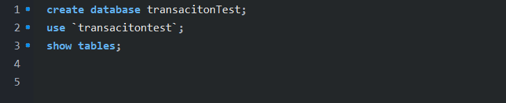

***적용 완료!***
