### 스터디 깃허브

### CPU 스케줄링 

[https://20240228.tistory.com/448](https://20240228.tistory.com/448)

## 알면 좋은 사전 지식 

**CPU Bound(CPU 중심 작업) VS I/O Bound (입출력 중심 작업)**

| 작업 | 유형 | 병목 원인 |
| --- | --- | --- |
| 비디오 인코딩 | CPU Bound | 연산량 |
| DB에서 데이터 읽고 화면에 출력 | I/O Bound | DB 쿼리 및 네트워크 |
| 파일 압축 | CPU Bound | 연산 |
| 로그 파일 분석 (파일이 클 경우) | I/O Bound | 디스크 읽기 속도 |

**핵심: I/O Bound Process는 waiting queue 에서 하드웨어 인터럽트를 기다리며 대기하는 시간이 많다.** 

**왜 I/O Bound Process를 먼저 처리하면 성능이 좋을까?** 

  - I/O 작업을 먼저 시작하면, 외부 장치가 처리되는 동안 CPU는 다른 작업 (ex. CPU Bound 작업)을 처리할 수 있다. 
  - 결과적으로 **자원을 놀리지 않고 계속 활용**하는 구조가 된다. 

## 11.1  MLFQ: 기본 규칙

MLFQ: Multi-Level FeedBack Queue 

여러 개의 큐로 구성, 큐는 각각 다른 우선순위가 배정 

실행 준비가 된 프로세스(ready status) → 이중 하나의 큐에 존재 

큐에는 둘 이상의 작업이 존재할 수 있다. (모두 같은 우선순위)

이 작업들 사이에는 라운드 로빈 스케줄링 알고리즘이 사용 

MLFQ는 각 작업에 고정된 우선순위를 부여하는 것이 아니라 각 작업의 특성에 따라 동적으로 우선순위를 부여한다. 

**작업의 특징으로 우선순위** 

  - 어떤 작업이 키보드 입력을 기다리며 반복적으로 CPU 양보 → I/O Bound Process → 해당 작업은 MLFQ 우선순위 높게 유지 
  - 어떤 작업이 긴 시간 동안 CPU를 집중적으로 사용 → CPU Bound Process → 해당 작업은 MLFQ 우선순위를 낮춘다. 

CPU는 프로세스의 실행 방식을 예측하지 못한다. 즉 쉽게 말해서 미래를 모른다. 

MLFQ는 작업이 진행되는 동안 작업의 정보를 얻고, 이 정보(과거 실행 기록)이용하여 미래 행동을 예측한다. 

✅  **MLFQ의 두 가지 기본 규칙**

```
규칙1: Priority(A) > Priority(B) 이면, A가 실행된다 (B 는 실행되지 않는다).
규칙2: Priority(A) = Priority(B) 이면, A와 B는 RR 방식으로 실행된다.
```

우선순위가 다르다 ⇒ 서로 다른 큐에 존재한다. 

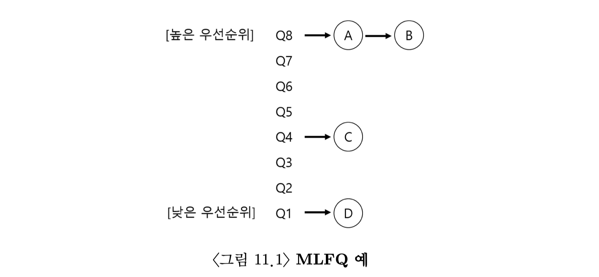

그림 11.1은 임의의 시간에 MLFQ 스냅샷이다. 

현재까지 알고 있는 MLFQ 동작을 고려하면 가장 높은 우선순위 큐의 A, B 작업만 번갈아 실행할 것이다. 

즉 C, D는 실행되지도 않는다. → 기아 현상 

이런 동작 메커니즘은 MLQ라고 부른다. Multi-Level Queue는 작업이 한번 특정 큐에 정해지면 큐 ↔ 큐 사이에 이동하지 않는다. 

## 11.2  시도 1: 우선순위의 변경

작업의 우선순위 변경 = 작업이 존재할 큐를 결정하는 것 

작업의 특성: I/O Bound Process VS CPU Bound Process 

✅  **MLFQ의 규칙3, 4**

```
규칙3: 작업이 시스템에 진입하면, 가장 높은 우선순위, 즉 맨 위의 큐에 놓여진다. 
규칙4a: 주어진 타임 슬라이스를 모두 사용하면 우선순위는 낮아진다. (CPU를 양도하지 않고 끝까지 사용) 즉, 한 단계 아래 큐로 이동 
규칙4b: 타임 슬라이스를 소진하기 전에 CPU를 양도하면 같은 우선순위를 유지
```

### **example 1: 한 개의 긴 실행 시간을 가진 작업**

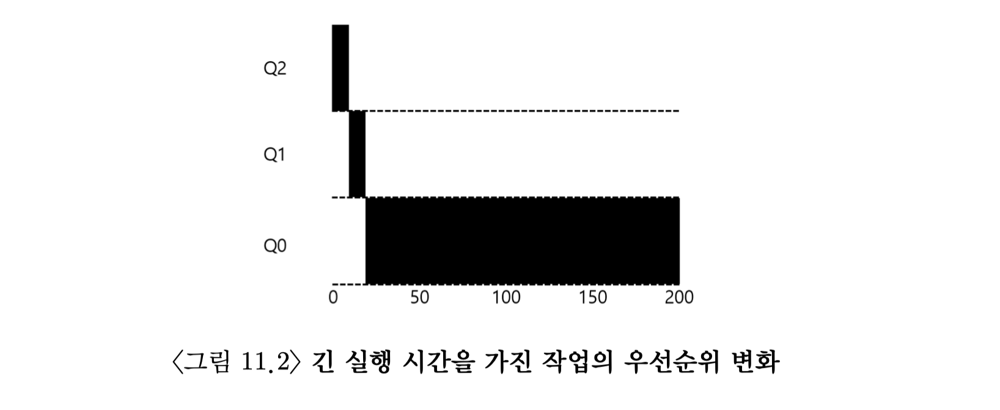

 

그림 11.2 에서 보이는 작업은 단 하나의 작업이다. 

해당 작업은 매우 긴 CPU 실행 시간을 가지는 작업이다.

Q2에서 주어진 타임 슬라이스를 다 사용하고 우선순위가 내려간다. → Q1 이동 

Q1에서 주어진 타임 슬라이스를 다 사용하고 우선순위가 내려간다. → Q0 이동 

이후에는 Q0에서 계속 머무르게 된다. 

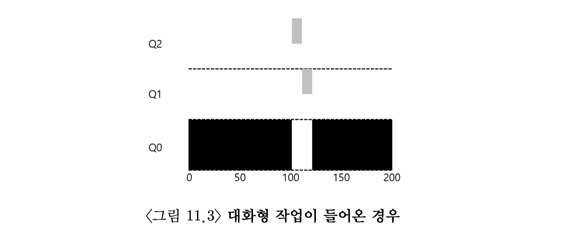

핵심: MLFQ가 어떻게 SJF에 근접할 수 있는지 이해 

검은색 작업: A(CPU Bound) 긴 작업 

회색 작업: B(I/O Bound) 짧은 작업

MLFQ는 SJF와 근사하게 동작해서 B를 선호할 것인가? 

그림 11.3을 보면 B는 2번의 타임 슬라이스를 선호하면 바닥의 큐에 도착하기 전에 종료된다. 

그런 후 A는 낮은 우선순위에서 실행을 재개한다. 

✅  **MLFQ: SJF 근사 방식** 

```
스케줄러는 작업이 짧은 작업인지 긴 작업인지 알 수 없기 때문에 일단 짧은 작업이라고 가정하여 
높은 우선순위를 부여한다. 진짜 짧은 작업이면 빨리 실행되고 바로 종료할 것이다. 
짧은 작업이 아니라면 천천히 아래 큐로 이동하게 되고 스스로 긴 배치형 작업이라는 것을 증명하게 된다. 
이러한 방식으로 MLFQ는 SJF를 근사할 수 있다.
```

### **example 3: 입출력 작업에 대해서는 어떻게?**

**규칙 4b: 프로세스가 타임 슬라이스를 소진하기 전에 프로세서를 양도하면 같은 우선순위를 유지하게 한다**

대화형 작업이 키보드나 마우스로부터 사용자 입력을 대기하며 자주 입출력을 수행하면 타임 슬라이스가 종료되기 전에 CPU 를 양도하게 될 것이다. 그런 경우 동일한 우선순위를 유지하게 하는 것이다.

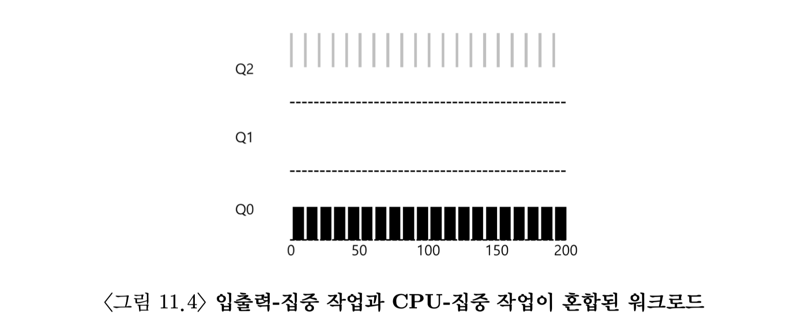

### 현재 MLFQ의 문제점 

  1. **기아 상태(starvation)**

시스템에 너무 많은 대화형 작업이 존재하면 그들이 모든 CPU 시간을 소모하게 될 것이고 따라서 긴 실행 시간 작업은 CPU 시간을 할당받지 못할 것이다 → 굶어 죽는다 ㅠㅠ

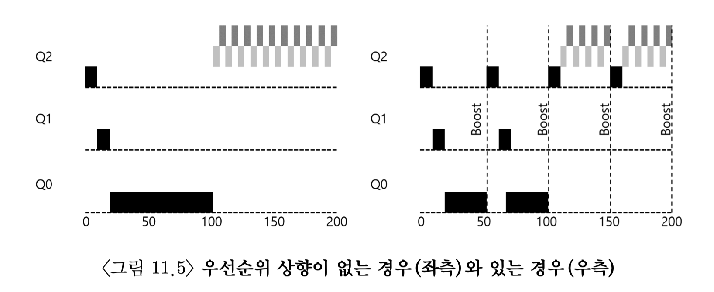

  1. 똑똑한 사용자라면 스케줄러를 자신에게 유리하게 동작하도록 프로그램을 다시 작성할 수 있다.

타임 슬라이스가 끝나기 전에 아무 파일을 대상으로 입출력 요청을 내려 CPU 를 양도한다. 그렇게 하면 같은 높은 우선순위 큐에 머무를 수 있고 따라서 더 높은 퍼센트의 CPU 시간을 얻게 된다.

  1. 프로그램은 시간 흐름에 따라 특성이 변할 수 있다. I/O Bound ↔ CPU Bound

## 11.3  시도 2: 우선순위의 상향 조정 

규칙을 보완하여 기아 문제를 방지할 수 있는지 살펴보자.

✅  **MLFQ의 규칙5 = 에이징?**

```
규칙 5: 일정 기간 S 가 지나면, 시스템의 모든 작업을 최상위 큐로 이동시킨다.
```

이번 규칙은 두 가지 문제를 해결한다. 

  - 기아 현상 해결 (주기적으로 최상위 큐로 이동)
  - CPU Bound 작업 → I/O Bound 작업으로 특성이 변할 경우 우선순위 상향을 통해 변경된 특성에 적합한 스케줄링 방법을 적용 


왼쪽 그래프는 우선순위 상향이 없는 경우이다. 짧은 I/O Bound 작업이 시작하니 CPU Bound 작업에 기아 현상이 발생한다. 

하지만 우선순위 상향을 적용한 오른쪽 그래프는 50 msec 간격으로 상향되고 주기적으로 실행된다. 

**물론 S 값의 결정이 필요하다.**

너무 크면 긴 실행 시간을 가진 작업은 굶을 수 있으며 너무 작으면 대화형 작업이 적절한 양의 CPU 시간을 사용할 수 없어 느린 응답이 된다. 

## 11.4 시도 3: 더 나은 시간 측정

마지막 문제: 스케줄러를 자신에게 유리하게 동작시키는 것을 어떻게 막을 수 있는가? 

이러한 일을 가능하게 만든 주범은 규칙 4a, 4b이다. 

**4a, 4b →  타임 슬라이스를 통한 우선순위 하향 조정 여부 결정** 

**해결책: 각 단계에서 CPU 총 사용 시간을 측정** 

현재 단계에서 프로세스가 소진한 CPU 사용 시간을 저장. 프로세스가 타임 슬라이스에 해당하는 시간을 모두 소진하면 다음 우선순위 큐로 강등 

✅  **MLFQ의 규칙4 재정의 (4a + 4b)**

```
규칙 4: 주어진 단계에서 시간 할당량(CPU 사용 시간)을 소진하면 
(CPU 를 몇 번 양도하였는지 상관없이), 우선순위는 낮아진다 (즉, 아래 단계의 큐로 이동한다).
```

즉, 이전 규칙과 비교하면 CPU를 정해진 타임 슬라이스 안에서 적당히만 사용하면 계속 같은 우선순위 큐에 머무르는 게 가능했지만 이젠 정해진 CPU 사용량을 넘어서면 하향 조정된다. 

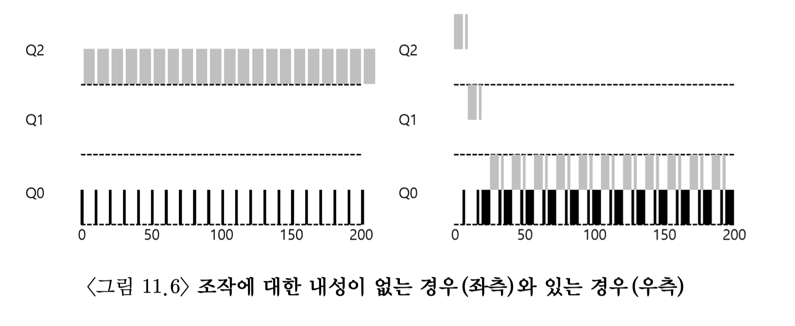

## 11.5 MLFQ 조정과 다른 쟁점들

**몇 개의 큐가 존재해야 하는가?** 

**큐당 타임 슬라이스의 크기는 얼마로 해야 하는가?** 

**기아를 피하고 변화된 행동을 반영하기 위하여 얼마나 자주 우선순위가 상향조정되어야 하는가?** 

이러한 질문들에 대해 쉽게 대답할 수는 없다. 워크로드에 대해 충분히 경험하고 계속 조정해 나가면서 균형점을 찾아야 한다.

대부분의 MLFQ 기법들은 큐 별로 타임 슬라이스를 변경할 수 있다. 

우선순위가 높은 큐는 보통 짧은 타임 슬라이스가 주어진다.

## 11.6 MLFQ: 요약

알고리즘은 멀티 레벨 큐를 가지고 있으며, 지정된 작업의 우선순위를 정하기 위하여 피드백을 사용한다.

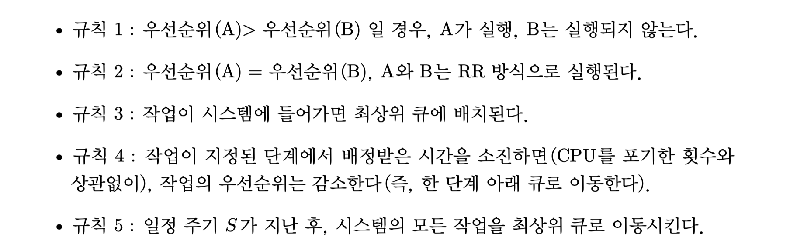

MLFQ는 작업의 특성에 대한 정보 없이, 작업의 실행을 관찰한 후 그에 따라 우선순위를 지정한다.

MLFQ는 반환 시간과 응답 시간을 모두 최적화한다.

짧게 실행되는 대화형 작업에 대해서는 우수한 전반적인 성능을 제공한다(SJF/ STCF와 유사). 
오래 실행되는 CPU-집중 워크로드에 대해서는 공정하게 실행하고 조금이라도 진행되도록 한다.

**이런 이유로 많은 운영체제들이 기본 스케줄러로 MLFQ를 사용한다.** 

## 문제점3 복습 

### ✅ **문제: 고의적인 CPU 양도 (Avoiding Gaming the Scheduler)**

사용자가 자신이 높은 우선순위 큐에 계속 머무르기 위해,

**타임 슬라이스가 끝나기 전에 I/O 요청 등으로 고의적으로 CPU를 반납하는 방식**으로 시스템을 속일 수 있다.

이렇게 되면 해당 프로세스는 계속 높은 우선순위에 유지되어,

전체 시스템의 공정성을 해치고, 다른 프로세스들이 CPU를 받기 어려워질 수 있다.

---

### ✅ **해결책: 총 CPU 사용 시간 기반 하향 조정**

이를 방지하기 위해 MLFQ에서는

  - 각 큐마다 **총 허용 CPU 사용 시간**이 정해져 있으며,
  - 해당 시간 이상을 사용한 프로세스는 **자동으로 낮은 우선순위 큐로 이동**.

이 방식은 **CPU를 얼마나 오래 썼는지에 따라 우선순위를 조정**하기 때문에,
**타임 슬라이스 내에서 CPU를 반납하는 트릭으로 우선순위를 유지하는 것이 불가능**

## 개요 

**비례 배분(Proportional Share)** 스케줄러, **혹은 공정 배분(fair share)**이라고도 하는 유형의 스케줄러 학습 

**비례 배분의 개념** 

  - 반환 시간이나 응답 시간을 최적화 X 
  - **CPU의 일정 비율을 보장하는 것이 목적** 

## 12.1 기본 개념: 추첨권이 당신의 몫을 나타낸다

✅ **추첨권 개념** 

```
추첨권(티켓)이라는 기본적인 개념이 추첨 스케줄링의 근간을 이룬다.
추첨권은 프로세스가 받아야 할 자원의 몫을 나타내는 데 사용된다. 
프로세스가 소유한 티켓의 개수와 전체 티켓에 대한 비율이 자신의 몫을 나타낸다.
예를 살펴보자. A 와 B 두 프로세스가 있다고 가정하자. 
A 는 75 장의 추첨권을, B 는 25 장의 추첨권을 가지고 있다.
A 에게 75% 의 CPU 를, B 에게 남은 25% 를 할당하는 것이 목적이다.
```

추첨권은 0~99 숫자, A: 0~74 B: 75~99 보유 

뽑힌 추첨권 값에 따라 실행할 프로세스가 결정, 스케줄러는 당첨된 프로세스를 실행 

**당첨 추천권** 


**스케줄링 결과**


이 예에서 볼 수 있듯이 무작위성은 원하는 비율은 정확히 보장하지 않는다. 

하지만 두 작업이 장시간 실행될수록, 원하는 비율을 달성할 가능성이 높아진다. 

**→ 대수의 법칙** 

## 12.2  추첨 기법 

✅ **추첨권 화폐(ticket currency)**

  - 사용자 A, B 각각 100장의 전역 통화 가짐 
  - 사용자 A는 자기 통화 1000장 보유, 그걸 A1, A2에 500씩 할당.
  - 사용자 B는 자기 통화 10장, 그걸 B1에 전부 줌
  - 시스템이 이걸 **전역 통화**로 환산
- A1: 50장 
    - A2: 50장
    - B1: 100장
  - 해당 추첨권을 통해 누가 CPU 쓸지 추첨 

✅ **추첨권 양도(ticket transfer)**

  - 클라이언트-서버 구조에서 유용
  - 클라이언트가 서버에게 **자기 티켓을 잠시 넘겨준다** 
  - 서버가 요청을 빠르게 처리하고 나면, 서버는 클라이언트에게 **다시 돌려준다**

✅  **추첨권 팽창 (Ticket Inflation)**

  - **자신의 티켓 수를 늘리거나 줄이는 것**.
  - 서로 신뢰하는 상황에서만 사용가능. (욕심 많은 프로세스가 티켓을 너무 많이 늘리면 불공평해짐)

## 13.1 배경: 멀티프로세서 구조 

단일 CPU 하드웨어와 멀티 CPU 하드웨어의 차이에 대한 이해 

단일 CPU와 멀티 CPU는 프로세서간에 데이터 공유, 하드웨어 캐시의 사용 방식<그림3.1, 3.2>에서 차이가 발생한다. 

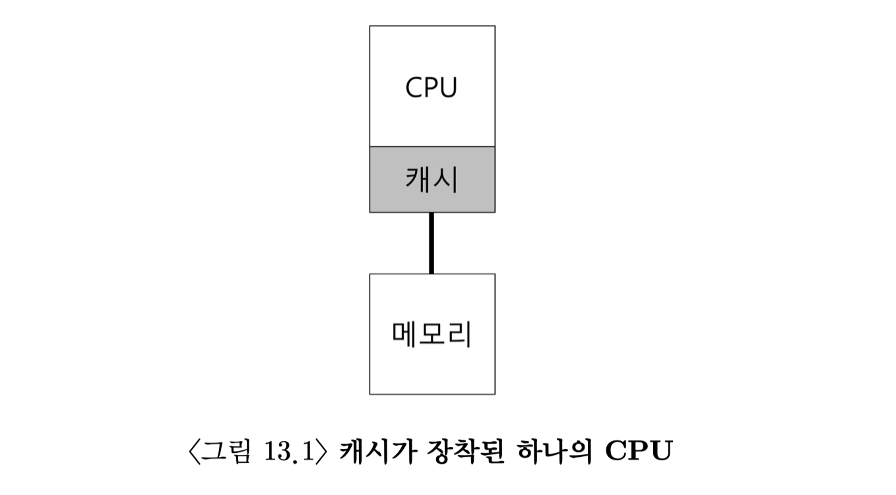

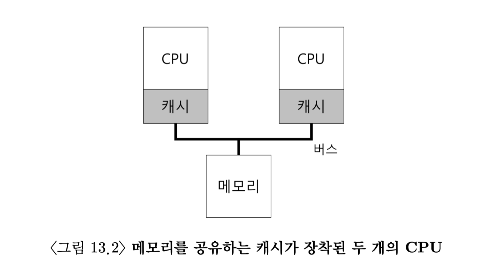

### ✅ **캐시는 지역성(locality)에 기반한다.**

지역성에는 **시간 지역성(temporal locality)**과 **공간 지역성(spatial locality)**의 두 종류가 있다.

시간 지역성의 원리는 데이터가 한 번 접근되면 가까운 미래에 다시 접근되기 쉽다는 것이다. 

→ 반복문에서 여러번 반복해서 접근되는 변수 또는 명령어 자체 

공간 지역성의 기본 아이디어는 프로그램이 주소 x의 데이터를 접근하면 x 주변의 데이터가 접근되기 쉽다는 것이다.

**row major vs column-major (3 x 3 배열 접근 순서 비교)**

**row major: (0, 0) → (0, 1) → (0, 2) → (1, 0) …**

**column-major: (0, 0) → (1, 0) → (2, 0) → (0, 1) …**

**java - spatial locality 활용** 

```java
int[][] arr = new int[1000][1000];

int sum = 0;
// 공간 지역성을 잘 활용 (row-major 방식에 맞는 순회)
for (int i = 0; i < 1000; i++) {
    for (int j = 0; j < 1000; j++) {
        sum += arr[i][j];
    }
}

--------------------------------------------------------
int[][] arr = new int[1000][1000];

int sum = 0;

// 공간 지역성 비효율적 (cache miss 증가 가능)
for (int j = 0; j < 1000; j++) {
    for (int i = 0; i < 1000; i++) {
        sum += arr[i][j];
    }
}
```

그림 13.2에서 보는 바와 같이 하나의 시스템에 여러 프로세서가 존재하고 하나의 공유 메인 메모리가 있을 때 어떤 일이 일어날까? 

멀티프로세서 시스템에서 캐시를 사용하는 것은 훨씬 복잡하다. 

### ✅ **캐시 일관성 문제(cache coherence)**

CPU1에서 실행 중인 프로그램이 주소 A를(D 값)을 읽는다고 가정 

데이터가 CPU1 캐시에 존재하지 않기 때문에 메인 메모리로부터 데이터를 가져오고 값 D를 얻는다. 

그런 후 프로그램은 주소 A의 값을 변경(D → F)한다.

메모리에 데이터를 쓰는 것은 시간이 오래 걸리므로 메인 메모리에 기록하는 것은 보통 나중에 한다.

이때 프로그램이 CPU2를 통해서 주소 A의 값을 다시 읽으면 캐시에 없기 때문에 메모리에서 가져오고 메모리에는 옛날 값인 D를 가져온다. 

### ✅ 기본적인 하드웨어 해결책: 버스 스누핑 (Bus Snooping)

  - **버스를 감시(Snoop)**: 각 캐시는 시스템 버스를 모니터링하면서, 자신이 갖고 있는 캐시 라인과 관련된 쓰기(write) 또는 읽기(read)가 발생하면 반응
  - **Invalidation 방식**: 다른 CPU가 내가 가진 값과 관련된 데이터를 수정(write)하면, 그 값을 **무효화(invalidate)** 해서 더 이상 사용하지 않음
  - **Update 방식**: 변경된 값을 캐시들이 **서로 갱신(update)** 하도록 함.

**example**

  - CPU1이 x = 10 으로 변경하면, CPU2는 자신의 캐시에서 x값을 무효화하거나 새 값으로 갱신함

### ✅ Write-back 캐시와의 관계

```
Write-back 캐시는 CPU가 메모리로 바로 쓰지 않고, 일단 캐시에만 쓰고 나중에 메모리에 반영.
이런 경우 일관성 유지가 더 복잡해진다.
언제 메모리에 반영할지 모름 → 다른 CPU들이 오래된 값을 읽을 수 있음
그래서 스누핑 기법과 일관성 프로토콜 (MESI 등)을 함께 사용해 문제를 해결한다.
```

**버스 스누핑을 통해서 캐시 read/write를 감지하고 MESI 프로토콜에 맞게 캐시 일관성을 유지한다.** 

## 13.2 동기화를 잊지 마시오 

캐시과 일관성을 유지해 준다고 해서 동기화를 하지 않아도 되는 건 아니다. 

병행 환경에서는 동일한 데이터를 동시에 여러 CPU가 접근할 때 문제가 생길 수 있다.

**동기화 기법(예: 락)** 을 사용해야 병행 접근에서 **정합성을 보장**할 수 있다.

그러나 락 기반 동기화는 **성능 저하**의 원인이 될 수 있으므로, 필요에 따라 **락프리 구조**도 고려된다. 

## 13.3 마지막 문제점: 캐시 친화성

멀티프로세서 캐시 스케줄러에서의 마지막 문제점은 **캐시 친화성(cache affinity)**이다. 

프로세스가 한 CPU에서 실행되면, 해당 CPU의 캐시와 TLB에 관련 데이터가 저장된다. 

다음 실행 시 같은 CPU에서 실행되면, 이 데이터를 재활용할 수 있어 성능 향상된다. 

하지만 다른 CPU에서 실행되면 실행할 때마다 필요한 정보를 다시 탑재해야만 하기 때문에 프로세스의 성능은 더 나빠진다. 

그러니 멀티프로세서 스케줄러는 스케줄링 결정을 내릴 때 캐시 친화성 → 가능한 프로세스를 동일한 CPU에서 실행하려고 노력하는 방향으로 결정해야 한다. 

## 13.4 단일 큐 스케줄링 

### **단일 큐 스케줄링 (single queue multiprocessor scheduling, SQMS)**

  - 멀티 코어 환경에서 하나의 공용 실행 큐를 사용하는 방식 
  - 기존의 단일 CPU 스케줄러 로직을 그대로 확장해서 사용 가능하다. 
  - 각 CPU는 공통 큐에서 실행할 작업을 가져온다. 

### 단점1: 확장성(scalability) 문제 

  - 스케줄러가 다수의 CPU에서 제대로 동작하기 위해 동기화(lock)을 삽입한다. 
  - 당연히 락은 성능을 크게 저하시킨다. 특히 CPU 개수가 증가할수록 더욱 그렇다. 
  - 단일 락에 대한 경쟁이 증가할수록 시스템은 락에 점점 더 많은 시간을 소모한다. 

단일 큐 스케줄링 확장성 문제: 시스템의 리로스(CPU)를 늘렸는데 오히려 성능이 떨어진다.  

### 단점2: 캐시 친화성 

**가정: 4개의 프로세서, 5개의 작업** 


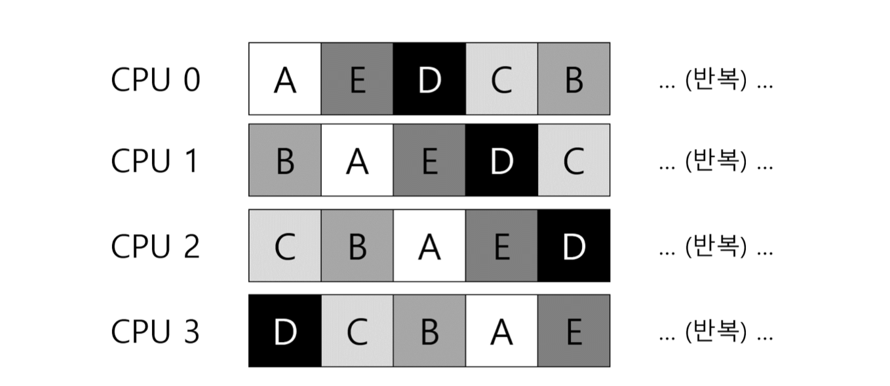

각 CPU는 공유 큐에서 다음 작업을 선택하기 때문에 각 작업은 CPU를 옮겨 다니게 된다. 

→ 캐시 친화성 관점에서 잘못된 선택 

이 문제를 해결하기 위해 대부분의 SQMS 스케줄러는 가능한 프로세스가 동일한 CPU에서 재실행될 수 있도록 시도한다. 특정 작업은 캐시 친화성을 고려하고 다른 작업은 오버헤드를 균등하게 하기 위해 분산시키는 정책을 사용 

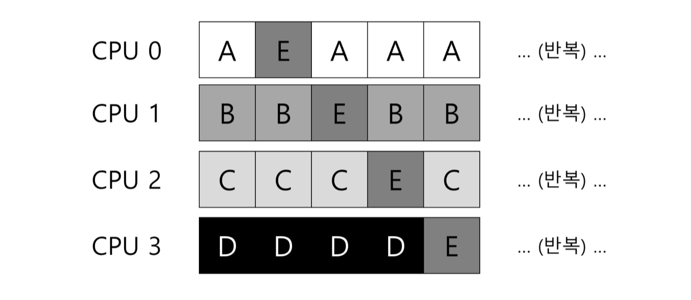

이러한 기법은 구현이 복잡하다. 

## 13.5 멀티 큐 스케줄링 

### 멀티 큐 멀티프로세서 스케줄링(multi-queue multiprocessor scheduling, MQMS)

단일 큐 스케줄러로 인한 문제(락 경쟁, 캐시 친화성) 때문에 일부 시스템은 멀티 큐, 예를 들어, CPU마다 큐를 하나씩 둔다. 

각 큐는 라운드 로빈 같은 특정 스케줄링 규칙을 사용 또는 특정 스케줄링 기법을 사용 가능 

배치될 큐의 결정은 적당한 방법을 따른다. (무작위, 작은 수의 작업이 있는 큐로 배치) 

배치된 이후에는 각각이 CPU에 맞춰 독립적으로 스케줄 되기 때문에 단일 큐 방식에서 보았던 정보 공유 및 동기화 문제를 피할 수 있다. 

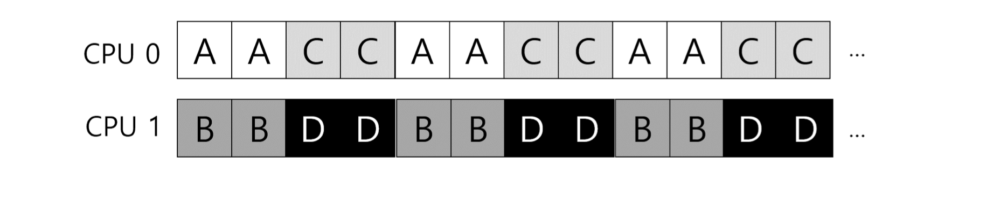

**라운드 로빈 스케줄 example** 

MQMS가 SQMS에 비해 가지는 명확한 이점은 확장성

CPU 개수가 증가할수록, 큐의 개수도 증가하므로 락과 캐시 경합은 더이상 문제가 되지 않는다. 

### **워크로드의 불균형(load imbalance)**

멀티 큐 기반의 근본적인 문제는 **워크로드의 불균형(load imbalance)**이다. 


각 큐에 라운드 로빈 정책을 실행한 경우? 

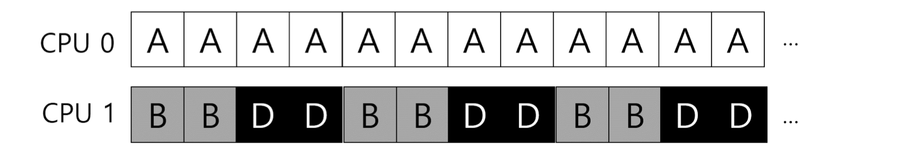

A가 B와 D보다 2배의 CPU를 차지한다. 만약 A,C 모두 종료된다면? 

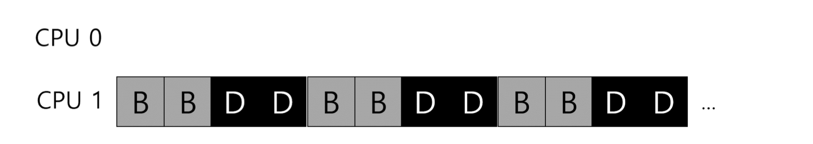

 

**→ 워크로드 불균형** 

### 이주(migration)

워크로드의 불균형을 해결하는 방법: 작업을 CPU1 → CPU2로 이주 

**example1**


운영체제는 B 또는 D 중 하나를 CPU 0으로 이동시킨다. → 워크로드는 균형을 찾는다. 

**example2**


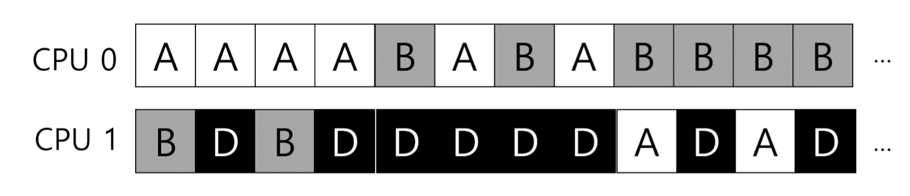

example1에서는 한번의 이주로 문제가 해결되었지만 example2는 그렇지 않다. 

→ 해결하려면? 지속적으로 이주시키는 것 

이주 패턴은 다양하게 존재한다. 

### 작업 훔치기(work stealing)

작업 훔치기에서는 작업의 개수가 낮은 큐가 가끔 다른 큐에 훨씬 많은 수의 작업이 있는지를 검사한다. 

대상 큐가 소스 큐보다 더 가득 차 있다면 워크로드의 균형을 맞추기 위해 소스는 대상에서 하나 이상의 작업을 가져온다. 

물론 이런 방식도 문제가 있다. 큐를 너무 자주 검사하게 되면 높은 오버헤드로 확장성에 문제가 생기게 된다. 

반면 다른 큐를 자주 검사하지 않으면 심각한 워크로드 뷸군형을 초래할 가능성이 있다. 

시스템 정책 설계에 있어 흔히 있는 일로서 적절한 값을 찾아내는 것은 마법의 영역이다. 

이런 설정에 대한 고민은 CPU 스케줄링 MLFQ에서의 에이징에서도 나온다.

  - 얼마나 자주 한번 최하단의 큐에 있는 작업을 우선순위가 가장 높은 큐로 옮겨야 하는지 

## 13.7 요약

```
다양한 방식의 멀티프로세서 스케줄링을 살펴보았다. 
단일 큐 방식(SQMS)은 구현이 용이하고 워크로드의 균형을 맞추기 용이하지만 
많은 개수의 프로세서에 대한 확장성과 캐시 친화성이 좋지 못하다. 

멀티 큐 방식(MQMS)은 확장성이 좋고 캐시 친화성을 잘 처리하지만 
워크로드 불균형에 문제가 있고 구현이 복잡하다.
 
어떤 방식을 택하든지 쉬운 답은 없다. 
CPU 스케줄러는 사소한 코드 수정으로 시스템의 동작이 엄청나게 바뀌기 때문에 
모든 경우에 다 잘 동작하는 범용 스케줄러를 구현하는 것은 매우 어렵다.
```

---

### 메모리 가상화 

## 16.1 초기 시스템 

가상화 개념이 존재하지 않던 초기 메모리 

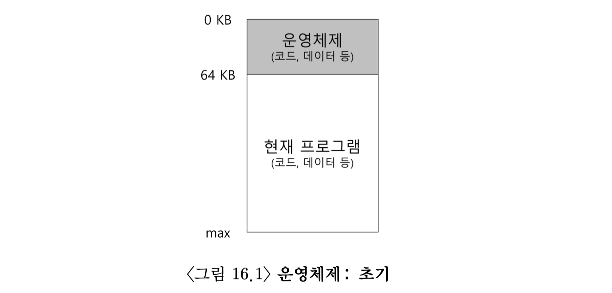

## 16.2 멀티프로그래밍과 시분할 

### 개념 

컴퓨터는 고가 장비 

사람들이 공유 시작 (멀티 프로그래밍) 시대 도래 

**시분할(time-sharing) 시대가 시작** 

많은 사람들이 일괄처리방식(batch computing) 한계를 인식

많은 사용자가 동시에 컴퓨터를 사용하고, 현재 실행 중인 작업으로부터 즉시 응답을 원하기 때문에 **대화식 이용(interactivity)** 개념의 중요성 부각 

### 시분할 초기 구현 

하나의 프로세스를 짧은 시간 동안 실행 & 프로세스에게 모든 메모리를 접근할 권한을 준다. 

그런 후에, 이 프로세스를 중단하고, 중단 시점(컨텍스트 스위칭 시점)모든 상태를 디스크 종류의 장치(모든 물리 메모리를 포함)에 저장하고 다른 프로세스의 상태를 탑재하여 또 다시 짧은 시간을 실행

→ 너무 엉성하다, 너무 느리다 특히 메모리가 커질수록 

레지스터 상태를 저장하고 복원하는 것은 빠르지만 메모리의 내용 전체를 디스크에 저장하는 것은 엄청나게 느리다. 어떻게 하면 프로세스 전환 시 프로세스를 메모리에 그대로 유지하면서, 운영체제가 시분할 시스템을 효율적으로 구현할 수 있을까?

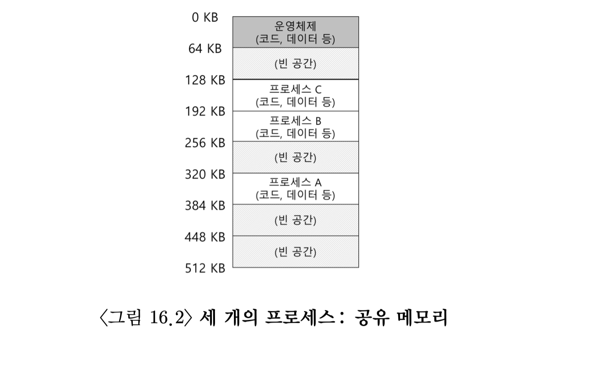

### 보호 

그림에 세 개의 프로세스(A,B,C) 존재 

운영체제는 실행할 한 개의 프로세스를 선택하고 다른 프로세스들은 준비 큐에서 실행을 기다린다. 

여러 프로그램이 메모리에 동시에 존재하려면 **보호(protection)**가 중요한 문제가 된다. 

즉, 한 프로세스가 다른 프로세스의 메모리를 read/write 못하게 막아야 한다. 

## 16.3 주소 공간 

### 주소 공간(address space)

운영체제의 메모리 개념 이해 → 메모리를 어떻게 가상화할지를 이해하는 핵심 

사용하기 쉬운 메모리 개념 = 주소 공간 

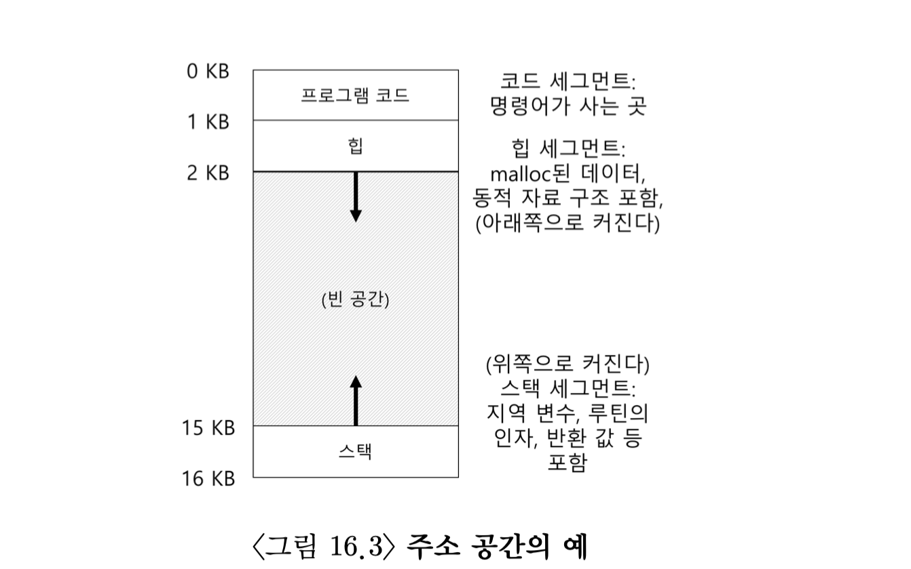

프로세스 메모리 구조(영역) 

  - 코드: 프로그램의 코드(code, 명령어) 
  - 스택: 함수 호출 현재 위치, 지역 변수, 함수 인자(매개 변수), 반환 값 저장 
  - 힙: 동적으로 할당되는 메모리: java new

프로그램 실행과 더불어 확장되거나 축소될 수 있는 두 종류의 주소 공간이 존재 

상단: 힙 / 하단: 스택 

두 메모리 영역은 확장할 수 있어야 하기 때문에 이런 방식으로 배치 

### 가상화 

운영체제는 물리 메모리를 공유하는 다수의 프로세스에게 어떻게 프로세스 전용의 커다란 주소 공간이라는 개념을 제공할 수 있는가?

운영체제가 이 일을 할 때, 우리는 운영체제가 **메모리를** **가상화(virtualizing memory)**한다고 말한다.

왜냐하면 실행중인 프로그램 즉, 프로세스는 자신이 특정 주소의 메모리에 탑재되고 매우 큰 주소 공간을 가지고 있다고 생각하기 때문이다. 현실은 다르다. 

그림 16.2의 프로세스A가 주소 0(가상 주소)로부터 load 연산을 수행할 때, 운영체제는 하드웨어의 지원을 통해 물리 주소 0이 아니라 물리 주소 320 KB를 읽도록 보장한다. 

즉, 운영체제는 하드웨어의 지원을 받아 가상 주소를 물리 주소로 바꿔 접근하도록 한다.

→ 메모리 가상화, 현대 모든 컴퓨터 시스템의 기저 

## 16.4 목표 

### 투명성(transparency)

운영체제는 실행 중인 프로그램이 가상 메모리의 존재를 인지하지 못하도록 가상 메모리 시스템을 구현해야 한다. 

### 효율성(eiciency)

운영체제는 가상화가 시간과 공간 측면에서 효율적이도록 해야 한다. 

시간적으로는 너무 느리게 실행X

공간적으로는 너무 많은 메모리를 사용X

### 보호(protection)

운영체제는 프로세스를 다른 프로세스로부터 보호해야 하고 운영체제 자신도 프로세스로부터 보호해야 한다.

### 여담 

당신이 보는 값은 (좀 큰 변수, 종종 16 진수로 출력되는) 가상 주소(virtual address)이다. 

프로그램 코드가 탑재된 주소가 어디인지 궁금한 적은 있는가? 그 주소를 출력할 수 있다.

그러나 주소를 출력했다면, 그 주소는 가상 주소이다. 

사용자 프로그램(user level program)이 볼 수 있는 주소는 모두 가상 주소이다. 

메모리 가상화의 기술 때문에, 명령어와 데이터가 탑재되어 있는 물리 메모리 주소를 알 수 있는 것은 오직 운영체제뿐이다.

## 17.1 메모리 공간의 종류

C 프로그램이 실행되면, 두 가지 유형의 메모리 공간이 할당된다.

### 스택

**스택(stack) 메모리**라고 불리며 할당과 반환은 프로그래를 위해, 컴파일러에 의해 암묵적으로 이루어진다. 이런 동작 특징 때문에 **자동(automatic)메모리**라고 불린다. 

```c
void func() { 
		int x; // 스택에 int 형을 선언 
}
```

func()가 호출될 때 스택에 공간을 확보한다. 

함수에서 리턴하면 컴파일러는 프로그래머 대신에 메모리를 반환한다. 

### 힙

힙(heap) 메모리라고 불리는 메모리. 모든 할당과 반환이 프로그래머에 의해 명시적으로 처리된다. 

```c
void func() {
		int *x = (int *) malloc(sizeof(int)); 
		...
}
```

컴파일러는 포인터 변수의 선언 (int *x)을 만나면 정수 포인터를 위한 공간을 할당해야 한다는 것을 안다. 

프로그램이 malloc()을 호출하여 정수를 위한 공간을 힙으로부터 요구한다. 

malloc()은 그 정수의 주소를 반환(실패한 경우 null 반환)

이 반환된 주소는 스택에 저장 

## 17.2  malloc() 함수 

**블로그: malloc(), free() 이해를 위한 코드 정리** 

[https://blockdmask.tistory.com/290](https://blockdmask.tistory.com/290)

**malloc() 호출** 

malloc() 호출은 매우 간단하다. 힙에 요청할 공간의 크기를 넘겨 주면, 성공했을 경우 새로 할당된 공간에 대한 포인터를 반환하고 실패했을 경우 null 반환 

**# include <stdlib.h>**

모든 C 프로그램에 디폴트로 링크되는 C 라이브러리는 malloc() 함수를 가지고 있다. 

즉, 헤더 없이도 malloc() 함수 호출이 가능하다. 하지만 헤더를 추가하면 malloc()을 올바르게 호출했는지 컴파일러가 검사할 수 있다.

참고로 링크된다는 말은 소스파일이 컴파일되면 목적 파일로 바뀌고 목적파일이 실행 파일로 바뀌기전에 필요한 라이브러리를 연결(link)한다는 말이다. 

## 17.3 free() 함수 

더 이상 사용되지 않는 힙 메모리를 해제하기 위해 프로그래머는 free()를 호출한다.

```c
int *x = malloc(10 * sizeof(int)); 
...
free(x);
```

한 개의 인자, malloc()에 의해 반환된 포인터를 받는다. 

할당된 영역의 크기는 전달되지 않는다. 

할당된 메모리의 크기는 메모리 할당 라이브러리가 알고 있어야 한다.

## 17.4 흔한오류 

### 자동 메모리 관리 

많은 새로운 언어들이 **자동 메모리 관리(automatic memory management)**를 지원

→ 쓰레기 수집기 (garbage collector)가 실행되어 참조되지 않는 메모리를 찾아 알아서 해제 

하지만 C 프로그램은 자동 메모리 관리를 지원하지 않는다. 

### 메모리 할당 잊어버리기 

**세그멘테이션 폴트(segmentation fault) 발생 코드** 

```c
char *src = “hello”; 
char *dst;                // 메모리 할당 X
strcpy(dst , src);        // segfault -> abort(인터럽트) -> 종료 
```

**정상 코드** 

```c
char *src = “hello”; 
char *dst = malloc(strlen(src) + 1);
strcpy(dst, src);
```

### 메모리 부족하게 할당받기

```c
char *src = “hello”; 
char *dst = malloc(strlen(src)); // 너무 작다!
strcpy(dst, src);               
```

c언어에서는 strlen(src)는 널 문자를 제외한 길이만 반환한다. 즉 5이다. 

하지만 c문자열은 끝에 만드시 `\0` 가 반드시 들어가야 한다. 그래서 6바이트가 필요하다. (ASCII 기준)

그런데 malloc은 5바이트만 할당해서 strcpy는 한 바이트 더 써버리는 **버퍼 오버플로우(buffer over-flow)**를 일으킨다

### 할당받은 메모리 초기화하지 않기

```c
int *arr = malloc(5 * sizeof(int));   // 정수 5개 공간 할당

for (int i = 0; i < 5; i++) {
    printf("%d ", arr[i]);            // 초기화하지 않음 → 쓰레기값 (undefined behavior)
}

free(arr);
```

초기화하지 않는다면, 프로그램은 **초기화 되지 않은 읽기(uninitialized read)**, 즉 힙으로부터 알 수 없는 값을 읽는 일이 발생한다. 

### 메모리 해제하지 않기 

메모리 해제를 잊었을 때 **메모리 누수(memory leak)**이 발생한다. 

장시간 실행되는 응용 프로그램이나 운영체제 자체와 같은 시스템 프로그램에서는 큰 문제이다. 

메모리가 천천히 누수되면 결국 메모리가 부족하게 되고 시스템을 재시작 할 수밖에 없기 때문이다. 

**쓰레기 수집 기능이 있는 언어도 이 문제에는 도움이 되지 않는다.** 

메모리 참조가 존재하면, 어느 쓰레기 수집기도 그 메모리를 해제하지 않을 것이고, 따라서 이런 현대적인 언어에서도 메모리 누수는 여전히 문제가 된다.

```java
HashMap<Object, String> map = new HashMap<>();

Object key = new Object();
map.put(key, "Hello");

key = null; // 참조 끊음

// 이 시점에 GC는 key를 수거하지 못함
// 시도는 하지만 key는 map 안에 여전히 있음
// + 이펙티브 자바를 보면 System.gc()가 바로 동작하는게 아니라는걸 알 수 있음
System.gc(); 

System.out.println(map.size()); // 1
```

**→ WeakHashMap** 

### ETC 

메모리 사용이 끝나기 전에 해제하기 → 댕글링 포인터(Dangling Pointer)

반복적으로 메모리 해제하기 → 이중 해제(Double Free)

free() 잘못 호출

## 17.5 운영체제의 지원 

당연한 얘기지만 malloc(), free()는 시스템 콜이 아니라 라이브러리 함수이다. 

malloc 라이브러리가 프로세스 가상 주소 공간 안의 공간을 관리하지만 라이브러리 자체는 시스템에게 더 많은 메모리를 요구하고 반환하는 시스템 콜(brk, sbrk)을 기반으로 구축된다. 

## 17.6  기타 함수들 

### calloc()

  - calloc()은 메모리를 할당 영역을 0으로 채워서 반환한다. 
  - 이 함수는 초기화하는 것을 잊어버리는 오류를 방지한다
  - 자바는 이런면을 고려하지 않고 초기화하지 않아도 참 좋다 

### realloc()

  - realloc()은 이미 할당된 공간에 대해 (예를 들어, 배열) 추가의 공간이 필요할 때 유용하다. 
  - realloc()은 더 큰 새로운 영역을 확보하고 옛 영역의 내용을 복사한 후에 새 영역에 대한 포인터를 반환한다.
  - 추가로 할당받은 공간도 마찬가지로 초기화되지 않은 읽기를 주의하자

## 18 주소 변환의 원리 개요

CPU 가상화 부분에서, 제한적 직접 실행(LDE) 기법을 공부했다.

대부분의 경우 프로그램은 하드웨어에서 직접 실행된다.

하지만 프로세스가 시스템 콜을 호출하거나 타이머 인터럽트가 발생할 때 등의 특정 순간에는 운영체제가 개입하여 문제가 발생하지 않도록 한다. → 듀얼 모드

운영체제는 중요한 순간에 운영체제가 관여하여 하드웨어를 직접 제어한다 또한 효율성과 제어가 운영체제의 목표

메모리 가상화에서도 마찬가지로 효율성, 제어 모두를 추구한다.

제어란 응용 프로그램이 자기자신의 메모리 이외에는 다른 메모리에 접근하지 못한다는 것을 운영체제가 보장하는 것을 의미.

이런 효율성 측면과 제어 측면 모두를 제공하면서 어떻게 유연하게 메모리를 가상화할까?

이런 문제를 해결하기 위해서 이번장에서 배우는 기법은 **하드웨어-기반 주소 변환(hardware-based address translation)** 짧게 **주소 변환(address translation)**이다.

주소 변환을 통해서 하드웨어는 가상 주소를 정보가 실제 존재하는 물리 주소로 변환한다.

## 18.1 가정

당분간 사용자 주소 공간은 물리 메모리에 연속적으로 배치되어야 한다고 가정한다. 

논의를 단순화하기 위해 주소 공간의 크기가 너무 크지 않다고 가정한다.

또한 각 주소 공간의 크기는 같다고 가정한다.

## 18.2 사례

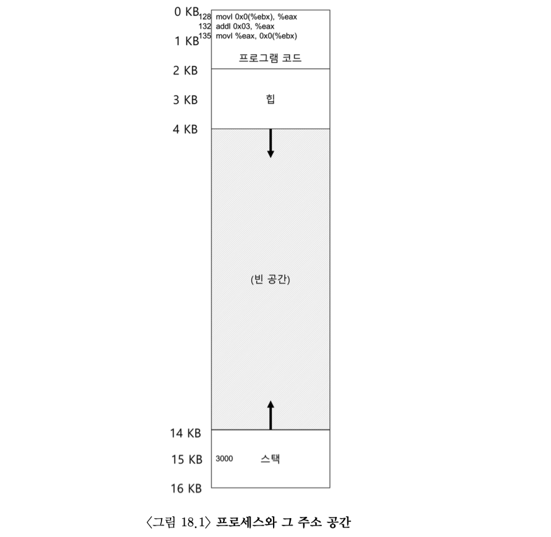

**example**

```c
void func() {
	  int x = 3000;
	  x = x + 3; 
}

x = x + 3 분석!

컴파일러는 x = x + 3 코드를 어셈블리 코드로 변환한다.

128: movl 0x0(\%ebx) , \%eax ; -> 0+ebx를 eax에 저장
132: addl \$0x03 , \%eax ;     -> eax레지스터에 3을 더한다  
135: movl \%eax , 0x0(\%ebx) ; -> eax레지스터를 메모리에 다시 저장 
```

그림 18.1 그림에서 해당 명령어들은 다음과 같은 메모리 접근이 일어난다.

  - 주소 128의 명령어를 반입(fetch)
- 이 명령어 실행(주소 15 KB에서 탑재) → 스택에 할당된 3000을 가져온다.
  - 주소 132의 명령어를 반입(fetch)
- 이 명령어 실행(메모리 참조 없음) → ALU 계산 (3000 + 3) & 레지스터 저장
  - 주소 135의 명령어를 반입(fetch)
  - 이 명령어 실행(15 KB에 저장) → 스택에 3003 저장

프로그램 관점에서 주소 공간은 0부터 시작하여 최대 16KB까지이다. 프로그램이 생성하는 모든 메모리 참조는 이 범위 내에서 있어야 한다.  

## 18.3 동적(하드웨어-기반) 재배치 

### 소프트웨어-기반 재배치 

**소프트웨어 - 기반 재배치 개념** 

하드웨어 지원이 제공되기 전, 일부 시스템은 소프트웨어만 사용해서 재배치를 수행 

→ 정적 재배치(static relocation)

**실행 방식** 

**로더(loader)**라고 불리는 소프트웨어가 실행하고자 하는 실행 파일의 모든 주소를 물리 메모리 오프셋으로 변경한다. 프로그램 주소 공간이 주소 3000부터 탑재되었다면, 로더는 명령어의 모든 주소를 3000씩 이동한 주소로 다시 작성한다. 즉, 기계어에 정적으로 주소 변환 

**소프트웨어 기반 / 정적 재배치 한계**

정적 재배치는 보호 기능이 없다. 잘못된 주소를 생성하여 다른 프로세스나 운영체제의 메모리에 불법적으로 접근할 수 있다. 제대로 보호하기 위해서는 하드웨어의 지원이 필요하다.
또한 한 번 배치되면 추후 주소 공간을 재배치하는 것이 어렵다.

---

### 하드웨어 - 기반 재배치 / 동적 재배치

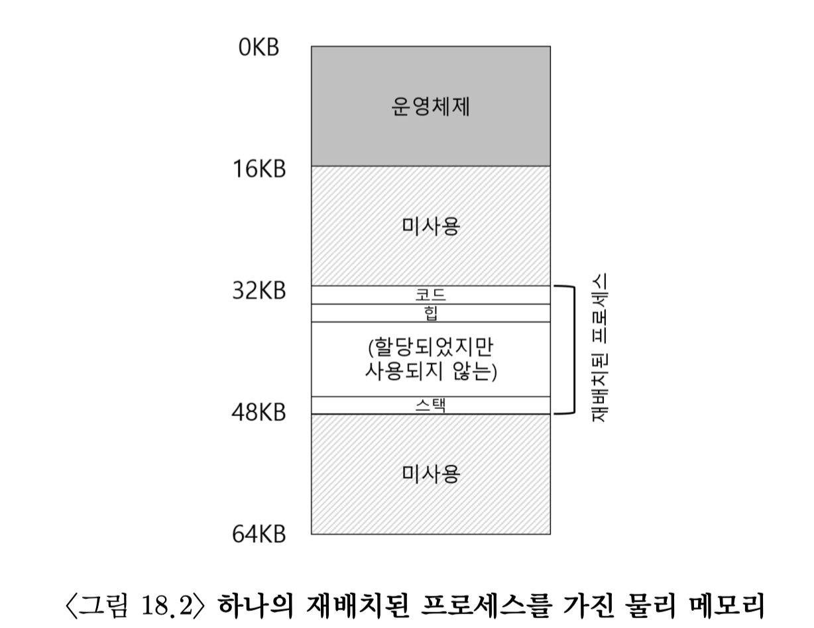

**동적 재배치(dynamic relocation)**

해당 기술은 각 CPU 마다 2개의 하드웨어 레지스터가 필요하다. 

  - 베이스(base) 레지스터
  - 바운드(bound) 레지스터 / 한계(limit) 레지스터

**동작 원리** 

각 프로그램은 주소 0에 탑재되는 것처럼 작성되고 컴파일된다.

프로그램 시작 시, 운영체제가 프로그램이 탑재될 물리 메모리 위치를 결정하고 베이스 레지스터를 그 주소로 지정 한다. → <그림 18.2> 베이스 레지스터 값은 32KB(32768)

프로세스의 의해 생성되는 모든 주소가 다음과 같은 방법으로 프로세서의 의해 변환된다. (주소 변환)

```
physical address = virtual address + base
```

이 주소의 재배치는 실행 시에 일어나고, 프로세스가 실행을 시작한 이후에도 주소 공간을 이동할 수 있기 때문에

**동적 재배치(dynamic relocation)**라고 불린다.

**그렇다면 바운드(한계) 레지스터는 어디에 사용?**

바운드 레지스터는 보호를 지원하기 위해 존재한다. 

그림<18.2> 바운드 레지스터는 16KB로 설정, 이 설정은 프로세스가 할당받는 물리 주소 크기이다.   

프로세스가 바운드보다 큰 가상 주소 또는 음수인 가상 주소를 참조하 CPU는 예외를 발생시키고 종료될것이다. 

즉, 바운드의 요점은 프로세스가 생성한 모든 주소가 합법적이고 프로세스의 범위에 있다는 것을 확인하는 것

**하드웨어 구조 측면** 

베이스 레지스터, 바운드 레지스터는 CPU 칩 상에 존재하는 하드웨어 구조이다. 

주소 변환에 도움을 주는 프로세서의 일부를 **메모리 관리 장치(memory management unit, MMU)**라고 부른다.

베이스 + 바운드 기법말고 더 정교한 메모리 관리 기법을 적용하면 MMU에 더 많은 회로가 추가된다.

**추가 내 정리 (fault → abort)** 

```
책에서는 가상 주소가 너무 크거나 음수일 경우 폴트(fault)가 발생한다고 설명하지만,  
나는 이 상황은 폴트가 아니라 abort가 발생한다고 보는 것이 더 정확하다고 생각한다.  

fault는 복구 가능성이 있는 예외 상황을 의미한다.  
예를 들어, 페이지 폴트(page fault)는 요청한 페이지가 메모리에 없어서 디스크에서 해당 페이지를 불러온 후  
다시 명령어를 재실행할 수 있는 구조이기 때문에 복구 가능한 예외에 해당한다.  

반면, abort는 복구 불가능한 오류를 의미한다.  
예를 들어 OOM(Out of Memory)이나 bound 레지스터를 초과한 메모리 접근처럼  
해당 오류는 운영체제가 해결할 수 없고, 프로세스를 즉시 종료해야 한다.  

따라서 특정 프로세스가 자신에게 할당된 메모리 영역이 아닌 다른 영역을 접근하려 할 경우,  
이는 보호 메커니즘 위반으로 복구 불가능한 오류(abort)이며,  
운영체제는 해당 프로세스를 종료시키는 것이 올바른 동작이다
```

## 전체 동작 설명 

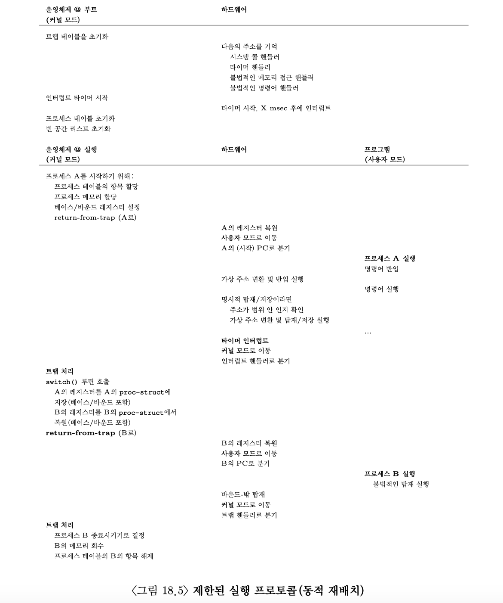

## 정리 (내부 단편화와 세그멘테이션 도입의 필요성)

```
그림 18.2에서 볼 수 있듯이, 재배치된 프로세스는 물리 메모리의 32KB부터 48KB까지를 사용한다.  
하지만 이 프로세스의 스택과 힙이 충분히 크지 않기 때문에, 
이들 사이의 많은 공간이 사용되지 않은 채 낭비되고 있다.

이처럼 할당된 메모리 블록 내부에서 사용되지 않는 공간이 발생하는 현상을 
내부 단편화(internal fragmentation)라고 한다.  
즉, 고정 크기의 슬롯에 주소 공간을 배치하는 현재의 방식에서는  
비록 시스템 전체로는 여유 메모리가 있더라도 각 슬롯 내 낭비로 인해 메모리 사용률이 떨어진다.

이러한 비효율을 줄이고 물리 메모리의 활용률을 높이기 위해서는  
기존의 base-and-bound 기법보다 더 정교한 메모리 관리 방식이 필요하다.

바로 세그멘테이션(segmentation)이며, 이는 다음 장에서 자세히 논의될 것이다.
```

## 19 세그멘테이션 개요

지금까지 프로세스 주소 공간 전체를 메모리에 탑재하는 것을 가정

베이스와 바운드(한계) 레지스터를 사용하면 운영체제는 물리 메모리에 쉽게 재배치가 가능

하지만 그림 19.1에서 볼 수 있듯이 스택과 힙 사이의 공간은 사용되지 않더라도 물리 메모리를 차지하고 

프로세스의 주소 공간이 물리 메모리보다 큰 경우 실행이 어렵다.

즉, 베이스와 바운드 방식은 유연성이 떨어진다.

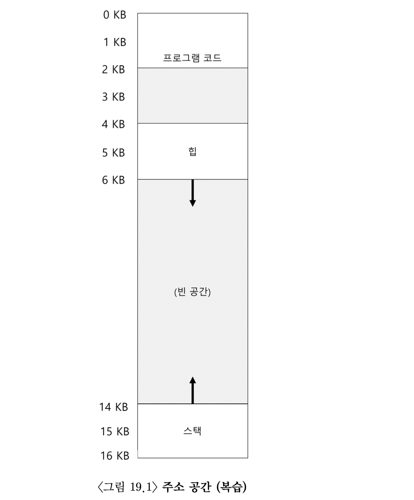

## 19.1 세그멘테이션: 베이스 / 바운드 (base / bound)의 일반화

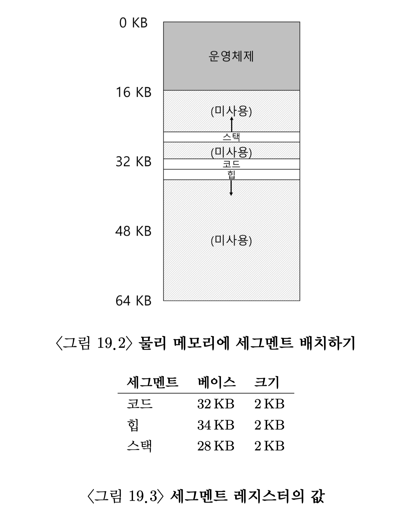

베이스 & 바운드 방식을 해결하기 위한 아이디어 등장 

**→ 세그멘테이션(segmentation)**

### 세그멘트 핵심 원리

MMU 안에 오직 하나의 베이스 & 바운드 쌍이 존재하는것이 아니라 주소 공간의 논리적인 **세그멘트(segment)**마다 베이스와 바운드 쌍이 존재한다.

세그멘트는 특정 길이를 가지는 연속적인 주소 공간이다. 

책에서 기준으로 삼은 주소 공간에는 코드, 스택, 힙 세 종류의 세그멘트가 있다.

즉, 3개의 베이스 & 바운드 쌍이 존재한다.

세그멘테이션을 사용하면 운영체제는 각 세그멘트를 물리 메모리의 각기 다른 위치에 배치할 수 있고, 사용되지 않는 가상 주소 공간이 물리 메모리를 차지하는 것을 방지할 수 있다.

그림 19.2를 보면 그림 19.1의 주소 공간을 각 세그멘트들을 독립적으로 물리 메모리에 배치할 수 있다.

그림에서 볼 수 있듯이, 사용 중인 메모리에만 물리 공간이 할당된다. 

사용되지 않은 영역이 많은 대형 주소 공간을 **sparse address space** 라고 부른다.

세그멘트 지원을 위한 MMU 하드웨어 구조는 그림 19.3을 보면 알 수 있다.

3개의 세그멘트가 있으니 3개의 베이스 & 바운드 레지스터가 존재한다.

---

### 오프셋 계산 공식

offset = 가상 주소 - 세그먼트 시작 가상 주소

  - 코드 세그먼트 offset = 100 - 0 = 100
  - 힙 세그먼트 offset = 4200 - 4096 = 104

---

### 물리 주소 계산 공식

물리 주소 = 베이스 레지스터 + offset

  - 코드: 32768 + 100 = **32868**
  - 힙: 34816 + 104 = **34920**

---

### 코드 세그먼트 가상 주소 변환 예제

  1. 가상 주소 100은 코드 세그먼트에 속함
  1. 세그먼트의 **베이스 주소** = 32KB (32768)
  1. 오프셋 = 100 - 0 = 100
  1. 물리 주소 = 32768 + 100 = **32868**
  1. **범위 검사**: 100 < 2048 (세그먼트 크기: 2KB) → 유효
  1. 최종: 물리 주소 32868에서 메모리 접근 수행

### 힙 세그먼트 가상 주소 변환 예제

  1. 가상 주소 4200은 힙 세그먼트에 속함
  1. 힙 세그먼트의 **가상 시작 주소** = 4096 (4KB)
  1. 오프셋 = 4200 - 4096 = 104
  1. 베이스 주소 = 34KB (34816)
  1. 물리 주소 = 34816 + 104 = **34920**
  1. **범위 검사**: 104 < 4096 (4KB) → 유효
  1. 최종: 물리 주소 34920에서 메모리 접근 수행

---

### 정리

| 세그먼트 | 가상 시작 주소 | 오프셋 계산 방식 | 베이스 레지스터 | 최종 물리 주소 계산 |
| --- | --- | --- | --- | --- |
| 코드 | 0 | offset = 가상 - 0(가상 시작 주소)  | 32768 (32KB) | 32768 + offset = 32868 |
| 힙 | 4096 | offset = 가상 - 4096(가상 시작 주소) | 34816 (34KB) | 34816 + offset = 34920 |

---

### 세그멘트 폴트(segment fault)

만약 힙의 마지막을 벗어난 7KB와 같은 잘못된 주소 공간을 접근하려고 한다면?

하드웨어가 범위를 벗어났다는 것을 감지하고 운영체제에게 트랩을 발생시킨다.

운영체제는 프로세스를 종료시킬 가능성이 크다.

이를 **세그멘트 폴트(segment fault / segment violation)** 이라고 부른다.

---

## 19.2 세그멘트 종류의 파악

책에서 나온 세그멘트의 종류는 3개이다. 즉 주소 공간을 세그멘트로 나누기 위해서는 2비트가 필요하다.


가상 주소 14비트 중에서 최상위 2비트를 사용한다.

최상위 2비트가 00이면 가상 주소가 코드 세그멘트를 가리킨다는 것을 알고, 베이스와 바운드 레지스터를 이용하여 가상 주소를 물리 메모리 주소로 변환한다.

**힙에 해당하는 가상 주소(4200) 변환 example**


  1. 세그멘트(01) → 힙 세그멘트
  1. 오프셋(1101000) → 64 + 32 + 8 = 104 
  1. 물리 메모리 주소로 변환 → 34KB + 104 
  1. 바운드 검사 → 104 < 4KB(4096) 유효  

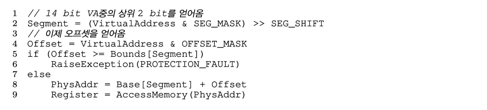

```
SEG_MASK    -> 11000000000000
OFFSET_MASK -> 00111111111111

서브넷 마스크와 같은 개념
```

### 세그먼트 방식에서 MMU의 동작 정리 

  1. **세그먼트 레지스터와 오프셋**
프로그램이 메모리에 접근하려고 할 때, **세그먼트 레지스터**는 현재 참조하고 있는 세그먼트의 **베이스 주소**를 제공, 이 베이스 주소와 메모리 접근 시 제공되는 **오프셋(offset)** 값을 이용하여 물리적 주소를 계산한다.
  1. **베이스 바운드 레지스터**
MMU는 각 세그먼트에 대해 **베이스(Base) 레지스터**와 **바운드(Bound) 레지스터**를 관리

    - **베이스 레지스터**는 세그먼트의 시작 주소를 저장
    - **바운드 레지스터**는 세그먼트의 크기를 제한하는 값으로, 해당 세그먼트가 허용하는 주소 범위를 지정
  1. **가상 주소 변환**
MMU는 **세그먼트 레지스터**에서 세그먼트의 베이스 주소를 얻고, 그 베이스 주소에 오프셋을 더하여 **가상 주소**를 **물리적 주소**로 변환
  1. **세그먼트 폴트(Segmentation Fault)**
만약 오프셋이 **세그먼트의 바운드 레지스터** 값보다 크거나, 가상 주소가 세그먼트 크기를 벗어나면, MMU는 **세그먼트 폴트**를 발생시킨다. 이는 **잘못된 메모리 접근**을 시도했을 때 발생하며, 보통 **오류 처리**를 위해 운영체제가 개입한다.

---

## 19.3  스택

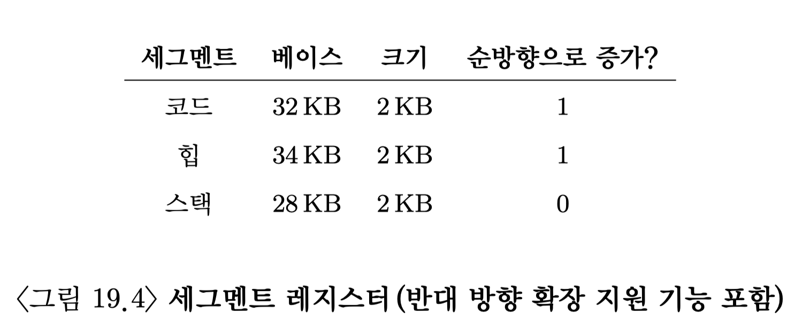

**스택은 힙과 코드와 다르게 반대 방향으로 확장된다.**

그래서 다른 방삭의 변환이 필요하다. 

먼저 간단한 하드웨어 추가가 필요하다. 베이스, 바운드 값뿐 아니라 하드웨어는 세그멘트가 어느 방향으로 확장되는지도 알아야 한다. 

하나의 비트를 사용하여 주소가 커지는 방향으로 확장하면 1, 작아지는 쪽으로 확장하면 0으로 설정할 수 있다.

그림 19.4는 이 사실을 반영하여 하드웨어가 관리해야 하는 정보를 표현하고 있다. 

**MMU가 주소 변환 및 유호성 검사에 사용하는 3가지 레지스터(정보)**

| 레지스터 | 역할 |
| --- | --- |
| Base | 세그먼트 시작 주소 |
| Bound | 세그먼트 크기 |
| Direction (1비트) | 확장 방향 (1: 위, 0: 아래) |

### 스택 세그멘트 가상 주소 물리 주소 매핑 예제

목표: 가상 주소 15KB → 물리 주소 27KB

베이스(28KB) 바운드(4KB)

### **1. 가상 주소 분해** 

가상 주소 15KB → 11 / 1100 0000 0000(14비트 이진수 표현)

상위 2비트 (11) → 세그먼트 번호 3 → 스택 세그멘트

나머지 비트(1100 0000 0000) → 3072 / 1024 → 3KB

### 2. 스택 세그멘트 음수 오프셋 구하기

오프셋 = 현재 위치 (3 KB) - 세그먼트 최대 크기 (4 KB) → -1KB 

### 3. 물리 주소 계산 

물리 주소 = 베이스 + 오프셋(offset) = 28KB + (-1KB) = 27KB

### 4. 바운드 검사

오프셋(-1KB) → 오프셋 절댓값(1KB)

1KB < 4KB → 유효

---

## 19.4 공유 지원 

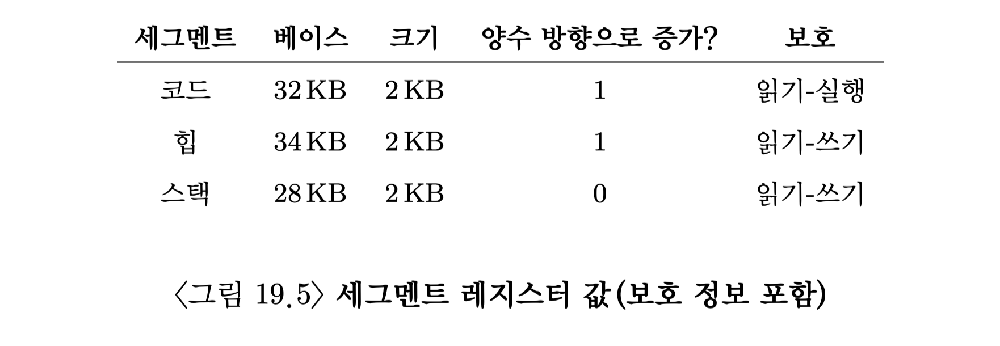

 

메모리를 절약하기 위해 때로는 주소 공간들 간에 특정 메모리 세그멘트를 공유하는 것이 유용하다.

특히, 코드 공유가 일반적이며, 현재 시스템에서도 광범위하게 사용 중이다.

공유를 지원하기 위해, 하드웨어에 protection bit의 추가가 필요하다. 

세그멘트를 읽거나 쓸 수 있는지 혹은 코드를 실행시킬 수 있는지를 나타낸다. 그림 19.5 참고

코드 세그멘트를 읽기 전용으로 설정하면 주소 공간의 독립성을 유지하면서도, 여러 프로세스가 주소 공간의 일부를 공유할 수 있다. 각 프로세스는 여전히 자신의 전용 메모리를 사용하고 있다고 생각하지만 운영체제는 변경이 불가능하도록 설정된 메모리 영역을 비밀리에 공유시켜 그런 환상을 유지한다. 

protection bit를 추가 했으니 하드웨어 알고리즘 또한 수정되어야 한다.

가상 주소가 범위 내에 있는지, 가상 주소를 물리 주소로 변환하는것 이외에 특정 엑세스가 허용되는지를 protection bit를 확인하고 프로세스가 protection bit와 다른 동작을 시도할 때 예외를 발생시켜 운영체제가 프로세스를 처리할 수 있도록 해야한다. 

---

## 19.5 소단위 대 대단위 세그멘테이션

지금까지 소수의 세그멘트(코드, 스택, 힙)만을 지원하는 시스템에 주로 초점을 맞추었다.

이런 세그멘테이션을 **대단위(coarse-grained) 세그멘테이션** 이라고 부른다 주소 공간을 큰 단위의 공간으로 분할하기 때문

주소 공간을 더 작은 단위로 세분화하는 세그멘테이션을 **소단위(fine-grained) 세그멘테이션**이라고 부른다.

많은 세그멘트를 지원하기 위해서는 여러 세그멘트의 정보를 메모리에 저장할 수 있는 세그멘트 테이블 같은 하드웨어가 필요하다. **세그멘트 테이블**을 이용하면 매우 많은 세그멘트를 손쉽게 생성하고 사용할 수 있다.

**대단위 세그멘테이션 vs 소단위 세그멘테이션** 

대단위 세그멘테이션은 단순하지만 융통성이 부족하고, 소단위 세그멘테이션은 복잡하지만 메모리를 더 효율적으로 활용할 수 있다.

---

## 프로세스 전환과 MMU 레지스터 설정 흐름

  1. **각 프로세스는 자신의 세그멘트 테이블을 가짐**
- 이 테이블은 PCB(Process Control Block) 안에 **포인터로 보관**되어 있음
    - 테이블에는 **세그먼트 번호, Base, Limit, 권한, 방향** 등의 정보가 있음
  1. **문맥 전환(Context Switch) 시**
- 운영체제는 새로 실행할 프로세스의 PCB를 참조
    - PCB에 있는 **세그멘트 테이블 포인터**를 이용해 해당 테이블을 가져옴
  1. **CPU는 MMU 레지스터를 세팅함**
- 각 세그먼트(Base, Limit 등)의 정보를 MMU의 **Base Register**, **Limit Register** 등에 로드
    - 이후부터 MMU는 논리 주소 → 물리 주소 변환 시 이 레지스터 값을 사용

 **MMU 레지스터를 매번 메모리에서 읽지는 않음**

  - 성능 문제 때문에, MMU는 보통 **레지스터에 자주 쓰는 세그먼트 정보**만 올려두고 사용
  - 프로세스 전환 시, 운영체제가 이 레지스터들을 새로 세팅해줌 (context switching의 일부)

---

## 19.6 운영체제의 지원

운영체제는 문맥 교환 시 어떤 일을 해야할까?

세그멘트 레지스터의 저장과 복원이다. 운영체제는 프로세스가 다시 실행하기 전에 레지스터들을 올바르게 설정해야 한다. 

미사용 중인 물리 메모리 공간의 관리는 어떻게할까?

프로세스는 많은 세그멘트를 가질 수 있고, 각 세그멘트의 크기가 다를 수 있다.

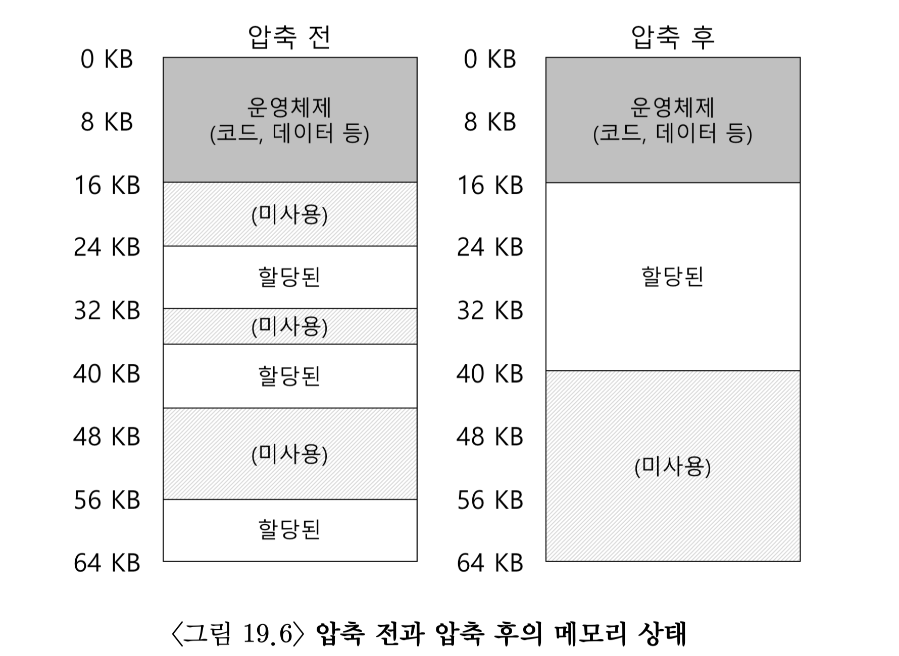

그림 19.6 왼쪽을 보면 세그멘트와 세그멘트 사이에 작은 빈 공간들로 채워진다. 이 작은 빈 공간들은 새로이 생겨나는 세그멘트에 할당하기도 힘들고 기존 세그멘트를 확장하는 데에도 도움이 되지 않는다.

이 문제를 **외부 단편화(external fragmentation)**라고 부른다. 

이 문제의 해결책 중 하나는 기존의 세그멘트를 정리하여 물리 메모리를 압축(compact)하는 것이다.

현재 실행 중인 프로세스를 중단하고 그들의 데이터를 하나의 연속된 공간에 복사하고, 세그멘트 레지스터가 새로운 물리 메모리 위치를 가리키게 하여, 자신의 작업할 큰 빈 공간을 확보할 수 있다. 

하지만 세그멘트 복사는 메모리에 부하가 큰 연산이고 압축은 비용이 많이 든다. → 오버헤드

또는 빈 공간 리스트를 관리하는 알고리즘을 사용한다. 

할당 가능한 메모리 영역을 리스트 형태로 유지하고 최적 적합(best-fit), 최악 적합(worst-fit), 최초 적합(first-fit)같은 알고리즘이 있다.

하지만 이런 알고리즘이 아무리 정교하게 동작한다고 해도 외부 단편화는 여전히 존재한다.

### 빈 공간 리스트 알고리즘

  - **빈 공간 리스트**는 메모리 내에 존재하는 사용되지 않은 연속적인 공간들을 추적하기 위한 자료구조.
  - 각 빈 공간은 시작 주소와 크기를 가지고 있고, 이들을 리스트(연결 리스트 또는 배열 등)로 관리한다.
  - 프로세스가 메모리를 요청하면, 이 리스트를 검색해서 적절한 빈 공간을 찾아주는 게 핵심이다.

### **최초 적합(First-Fit)**

  - 가장 먼저 발견된, 요청한 크기보다 크거나 같은 빈 공간에 할당.
  - 검색은 항상 리스트의 처음부터 시작.
  - 남은 빈 공간이 있다면 분할하여 빈 공간 리스트에 다시 추가.
  - 장단점
- 장점: 빠름 (처음 찾는 게 목표이므로 중간에 멈출 수 있다)
    - 단점: 앞부분에 작은 조각들이 많이 생겨 **외부 단편화**가 심해질 수 있음

### **최적 적합(Best-Fit)**

  - 요청한 크기와 **가장 근접한(작은 차이의)** 빈 공간에 할당.
  - 리스트 전체를 검색해서 가장 **딱 맞는** 빈 공간을 찾음.
  - 장단점
- 장점: 큰 빈 공간의 낭비를 줄일 수 있음
    - 단점
- 리스트 전체를 다 검색해야 하므로 느림
      - 할당하고 남은 빈 공간이 매우 작아서 쓸 수 없는 미세 조각들이 많이 생길 수 있음 
→ 오히려 외부 단편화를 악화

### **최악 적합(Worst-Fit)**

  - 가장 **큰** 빈 공간에 할당.
  - 큰 빈 공간을 쪼개어 사용하면, 남는 공간도 쓸 만한 크기일 가능성이 있음.
  - 장점: 미세 조각이 줄어들 수 있음
  - 단점
- 리스트 전체를 다 검색해야 하므로 느림
    - 큰 공간이 계속 나눠지면 결국 최악의 상황이 되기도 함

---

## 19.7 요약

세그멘테이션은 메모리에 순서대로 할당보다 많은 문제를 해결하며, 메모리 가상화를 효과적으로 실현할 수 있다.

특히 논리 세그멘트 사이의 큰 공간에 대한 낭비를 피함(내부 단편화 해결), 코드 공유의 장점도 부가적으로 발생

하지만 세그멘트의 크기가 일정하지 않기 때문에 외부 단편화가 발생하고 추가적인 메모리 할당 요청을 충족시키는 것이 어렵다. 알고리즘을 사용해 주기적으로 메모리를 압축할 수 있지만 이건 오버헤드가 큰 작업이다.

또한 프로세스의 전체 메모리 크기가 물리 메모리 크기보다 크다면 실행이 불가능하다. 즉, 여전히 모든 메모리가 물리 메모리에 존재해야 한다.

---

## 20 빈 공간 관리 개요

관리하고 있는 공간이 고정 크기의 단위로 나누어져 있는 경우 빈 공간 관리는 쉬울 수 있다. 

그냥 이 고정 크기 단위의 리스트를 유지하고 클라이언트가 그 중 하나를 요청하면 첫 번째 항목을 반환하면 된다. 

공간이 가변-크기 빈 공간들의 집합으로 구성되어 있는 경우 빈 공간 관리가 더 어렵다. 

이 경우 malloc(), free()에서 처럼 사용자-수준 메모리 할당 라이브러리 또는 세그멘테이션으로 물리 메모리를 가변-크기로 관리하는 운영체제에서 발생한다. 어느 경우에도 외부 단편화가 존재한다.

또한 빈 공간들의 전체 크기가 요청된것보다 크더라도 하나의 연속된 영역이 존재하지 않으면 요청은 실패할 수 있다.


빈 공간의 전체 크기는 20바이트이지만 10바이트 크기로 두 조각이 존재한다.

만약 15바이트 요청이 들어오면 실패한다.

---

## 20.1 가정

### **메모리 할당 인터페이스에 대한 가정**

  - 기본 인터페이스는 malloc()과 free()를 따른다.
  - void* malloc(size_t size)는 사용자가 요청한 바이트 수를 인자로 받아, 요청한 크기 이상인 메모리 영역의 포인터를 반환한다.
  - void free(void* ptr)는 포인터만을 인자로 받아 해당 영역을 해제한다.
→ 크기 정보는 사용자가 제공하지 않으며, 라이브러리가 포인터만으로 크기를 파악해야 한다.

### **단편화(Fragmentation)에 대한 가정**

  - 외부 단편화(external fragmentation) 방지를 주로 논의한다.
(내부 단편화도 있을 수 있으나, 본 논의의 초점 X)

### **메모리 이동(재배치)에 대한 가정**

  - 한 번 malloc()으로 할당된 메모리는 다른 위치로 옮겨질 수 없다.
- 프로그램이 malloc()을 통해 받은 포인터는 free()가 호출될 때까지 고정된 메모리 공간을 가리킨다.
    - 따라서 빈 공간의 압축(compaction)은 사용할 수 없다.

---

## 20.2 저수준 기법들

### **학습 목표** 

  1. 분할(splitting) & 병합(coalescing) 기초 
  1. 할당된 영역의 크기를 빠르고 상대적으로 쉽게 파악할 수 있는 방법
  1. 빈 공간과 사용 중인 공간을 추적하기 위한 빈 공간 내에 간단한 리스트를 구현하는 방법

### 분할과 병합

빈 공간 리스트는 힙에 있는 빈 공간들의 집합 (30바이트 힙)


  - 2개의 원소
  - 원소1: 첫 번째 10바이트의 빈 세그멘트(바이트0-9)
  - 원소2: 두 번째 10바이트의 빈 세그멘트(바이트20-29)

**Q: 10바이트를 초과하는 모든 요청은 실패하여 NULL 반환**

→ 요청한 크기에 해당하는 메모리 청크가 없기 때문이다. 

**Q: 10바이트보다 적은 요청은? (메모리를 1바이트만 요청했다고 가정)**

→ 할당기는 분할 작업을 수행 

**분할 작업** 

```
청크 = 메모리 할당 단위 

요청을 만족시킬 수 있는 빈 청크를 찾아 이를 둘로 분할 
첫 번째 청크는 호출자에서 반환, 두 번째 청크는 빈 공간 리스트에 남는다.

즉, 요청이 특정 빈 청크의 크기보다 작은 경우 분할 기법을 사용한다.
```

**2번 원소 분할 예시**  


  - malloc()은 20(1바이트가 할당된 영역의 주소)를 반환

**병합 before**


응용 프로그램이 free(10)을 호출하여 힙의 중간에 존재하는 공간을 반환한다

깊게 생각하지 않고 빈 공간을 다시 리스트에 추가할 경우 다음과 같은 모양

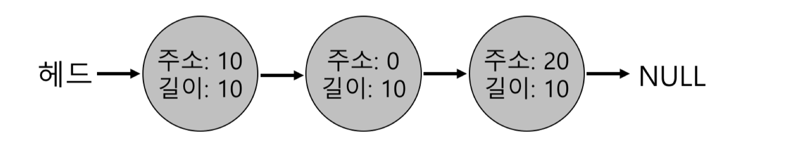

이제 힙 전체가 비어 있지만, 10바이트 길이의 청크 3개로 나누어져 있다. 

사용자가 20바이트를 요청하는 경우 단순한 리스트 탐색은 빈 청크를 발견하지 못하고 실패(NULL)를 반환

할당기는 이 문제를 방지하기 위해 메모리 청크가 반환될 때 빈 공간들을 병합한다.

해제되는 청크의 주소와 인접합 양쪽 빈 청크의 주소를 살펴본다. 

새로 해제된 빈 공간 청크와 바로 인접해 있다면 그들은 하나의 더 큰 빈 청크로 병합한다. 

병합 경우의 수는 4가지(왼쪽 / 왼쪽 오른쪽 모두/ 오른쪽 / X)

**병합 after** 


병합 기법을 사용하여 할당기가 커다란 빈 공간을 응용 프로그램에게 제공할 수 있다는 것을 더 보장할 수 있다.

### 할당된 공간의 크기 파악

free(void *ptr) 인터페이스는 크기를 매개변수로 받지 않는다.

포인터가 인자로 전달되면 **malloc 라이브러리**는 해제되는 메모리 영역의 크기를 신속히 파악하여 그 공간을 빈 공간 리스트에 추가시킬 수 있다. 

이 작업을 위해 대부분의 할당기는 추가 정보를 **헤더(header)블럭**에 저장한다.

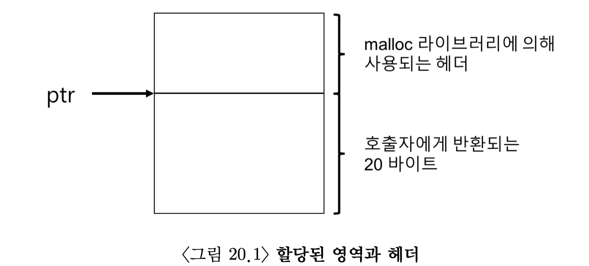

헤더 블럭은 메모리에 유지되며 보통 해제된 청크 바로 직전에 위치한다.

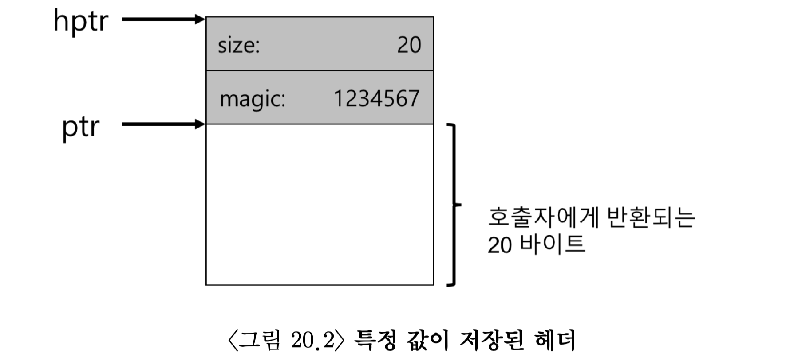

사용자가 malloc()을 호출하고 그 결과를 ptr에 저장했다고 가정

```c
ptr = malloc (20);
```

헤더는 할당된 공간의 크기(size), 해제 속도를 향상시키기 위한 추가적인 포인터, 부가적인 무결성 검사를 위한 매직 넘버, 기타 정보를 저장할 수 있다.

```c
typedef struct __header_t {
	 int size; 
	 int magic; 
} header_t;
```

  - 간단한 헤더 구조 example
  - 할당된 공간 크기와 매직 넘버를 갖는다.

사용자가 free(ptr) 호출

```c
void free(void *ptr) {
		header_t *hptr = (void *)ptr − sizeof(header_t); 
		// 안정성 검사 
		// 해제된 영역의 크기 계산 
```

  1. 라이브러리는 헤더의 시작 위치를 파악하기 위해 포인터 연산을 한다.
  1. 라이브러리는 매직 넘버가 기대하는 값과 일치하는지 비교하여 **안정성 검사(sanity check)**를 실시
  1. 새로 해제된 영역의 크기를 계산
→ 빈 영역의 크기 = 헤더 크기 + 사용자에게 할당된 영역의 크기

→ 사용자가 N 바이트의 메모리 청크를 요청하면 라이브러리는 N + 헤더의 크기인 청크를 탐색한다.

### 빈 공간 리스트 내장 

빈 공간 리스트를 어떻게 구현할 수 있는가?

**가정 정리** 

  - 4096바이트 크기의 메모리 청크 존재 → 힙의 크기는 4KB 가정
  - 힙은 시스템 콜 mmap()을 호출하여 얻어진 영역에 구축된다고 가정

빈 공간 리스트로 관리하기 위해서는 먼저 리스트를 초기화해야 한다.

리스트는 4096(빼기 헤더 크기) 길이의 항목(노드) 하나를 가지고 있다. 

**노드** 

```c
typedef struct __node_t { 
		int size; 
		struct __node_t *next; 
} node_t;
```

**힙을 초기화하고 힙에 빈 공간 리스트의 첫 번째 원소를 넣는 코드** 

```c
// mmap()이 빈 공간의 청크에 대한 포인터를 반환
node_t *head = mmap(NULL , 4096 , PROT_READ|PROT_WRITE, 
											MAP_ANON|MAP_PRIVATE , −1, 0); 
head−>size = 4096 − sizeof(node_t); 
head−>next = NULL;
```

이 코드의 실행 후 리스트는 크기 4088의 항목(노드) 하나만을 가진다.

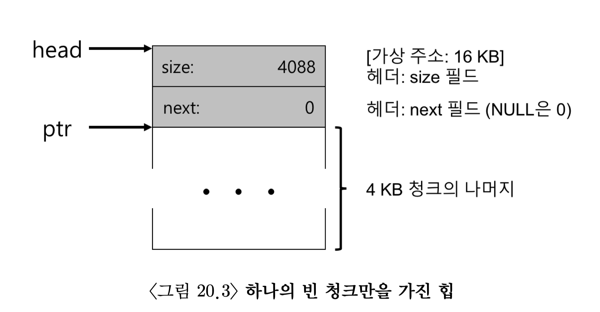

100 바이트 메모리 청크 요청

라이브러리는 먼저 충분한 크기의 청크를 찾는다. → 하나의 빈 청크(크기: 4088)

요청을 처리하기에 충분히 큰 크기 = 빈 영역의 크기(100바이트) + 헤더의 크기(8바이트 가정)

라이브러리는 108바이트 청크, 나머지 빈 청크 2개로 분할 

결과 → 그림 20.4 

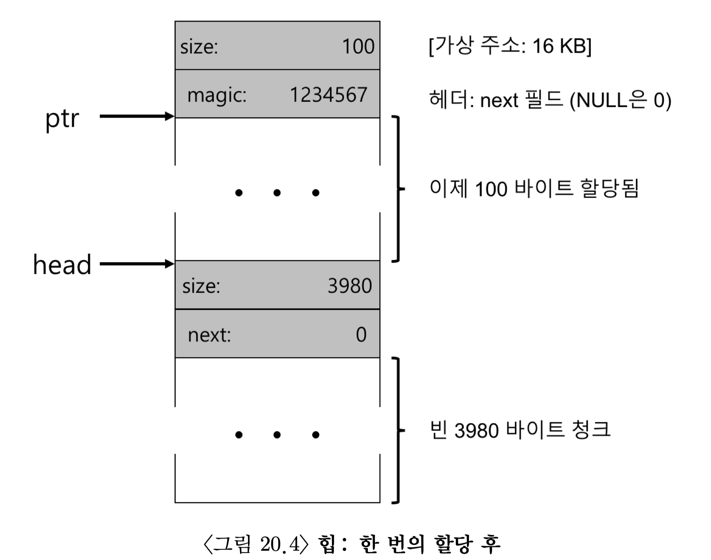

100바이트씩(헤더 포함 108바이트)할당된 3개의 공간이 존재하는 힙 그림 20.5

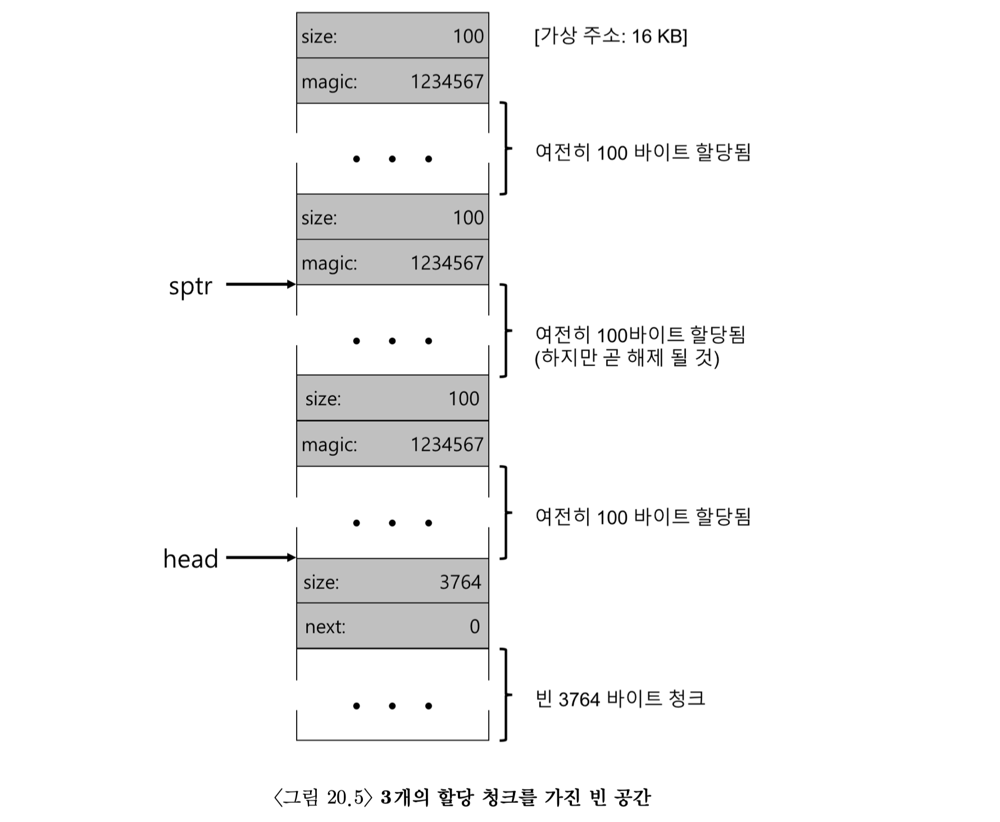

힙의 시작 부분 324바이트(108 * 3)가 현재 할당되어 있다. 

이때 프로그램이 free()를 통해 일부 메모리를 반환하면 어떤 일이 벌어질까?

free(16500) 호출

힙의 시작 주소 = 가상 주소: 16384바이트 

시작 주소(16384) + 이전 메모리 청크 크기(108) + 해제되는 청크의 헤더(8) = 16500 → 그림 20.5 sptr

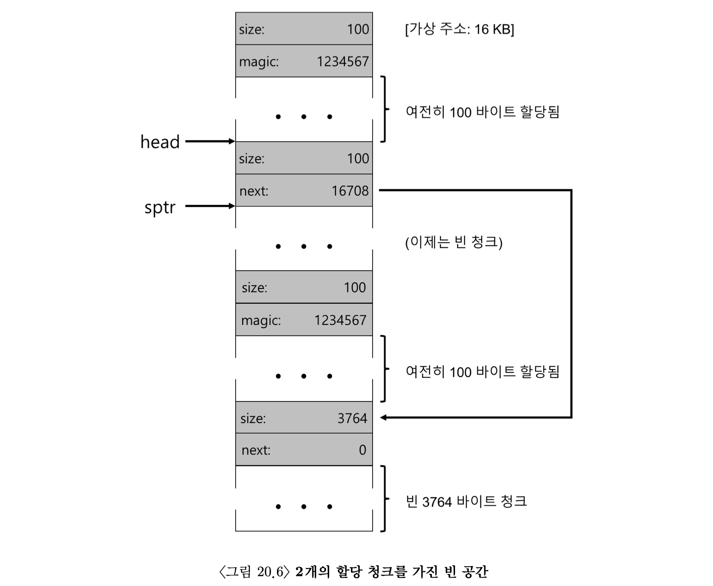

라이브러리는 빈 청크를 빈 공간 리스트에 삽입한다.

이제 빈 공간 리스트의 첫 번째 원소는 작은 빈 청크(100바이트 크기)

두 번째 원소는 큰 청크(3764바이트)이다.

추가적으로 2개의 사용 중인 청크를 해제한다. 

병합이 없다면, 작은 단편으로 이루어진 빈 공간 리스트가 될 것이다

108 → 108 → 108 → 3764 → NULL

해결책은 리스트를 순회하면서 인접한 청크를 병합하면 된다. 

병합이 완료되면 힙은 전체 하나의 큰 청크가 된다.

그림 20.7 병합되지 않은 빈 공간 리스트 

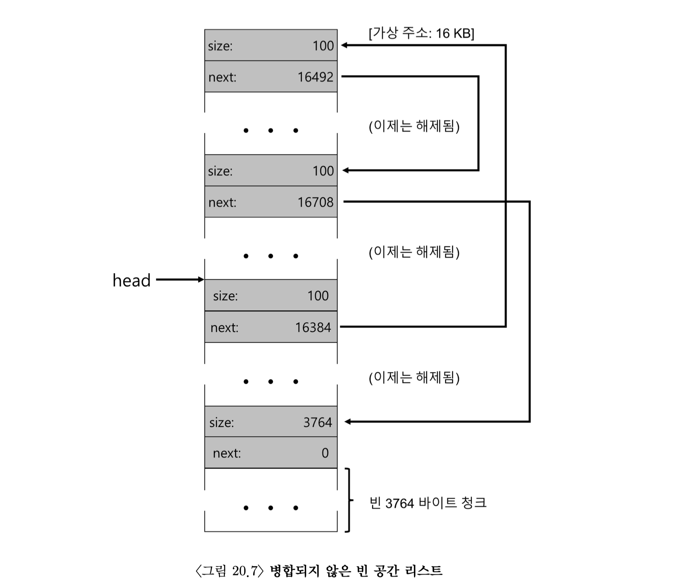

### 힙의 확장

힙 공간이 부족한 경우에 어떻게 할 것인가?

대부분의 전통적인 할당기는 적은 크기의 힙으로 시작하여 모두 소진하면 운영체제로부터 더 많은 메모리를 요청한다. 할당기는 힙을 확정하기 위해 특정 시스템 콜(sbrk)을 호출한다.

그런 후 새로운 청크를 할당한다. sbrk 요청을 수행하기 위해 운영체제는 빈 물리 페이지를 찾아 요청 프로세스의 주소 공간에 매핑한 후, 새로운 힙의 마지막 주소를 반환한다.

---

## 20.3 기본 전략 

이상적인 할당기는 속도가 빠르고 단편화를 최소로 해야 한다. 

불행하게도 할당과 해제 요청 스트림은 결국 프로그래머에게 결정되기 때문에, 어느 특정 전략도 잘 맞지 않는 입력을 만나면 성능이 매우 좋지 않을 수 있다.

몇 가지 기본 정책에 대해 알아보고 장단점을 정리하자.

### 최적 적합(Best Fit)

먼저 빈 공간 리스트를 검색하여 요청한 크기와 같거나 더 큰 빈 메모리 청크(후보자)를 찾는다.

후보자 그룹에서 가장 작은 크기의 청크를 반환한다. 

이 청크는 최적 청크(최소 적합)이라고 불린다.

  - 장점: 큰 빈 공간의 낭비를 줄일 수 있음
  - 단점: 리스트 전체를 다 검색해야 하므로 느림

### **최초 적합(First-Fit)**

  - 가장 먼저 발견된, 요청한 크기보다 크거나 같은 빈 공간에 할당.
  - 검색은 항상 리스트의 처음부터 시작.
  - 남은 빈 공간이 있다면 분할하여 빈 공간 리스트에 다시 추가.
  - 장단점
- 장점: 빠름 (처음 찾는 게 목표이므로 중간에 멈출 수 있다)
    - 단점: 앞부분에 작은 조각들이 많이 생겨 **외부 단편화**가 심해질 수 있음

### **최적 적합(Best-Fit)**

  - 요청한 크기와 **가장 근접한(작은 차이의)** 빈 공간에 할당.
  - 리스트 전체를 검색해서 가장 **딱 맞는** 빈 공간을 찾음.
  - 장단점
- 장점: 큰 빈 공간의 낭비를 줄일 수 있음
    - 단점
- 리스트 전체를 다 검색해야 하므로 느림
      - 할당하고 남은 빈 공간이 매우 작아서 쓸 수 없는 미세 조각들이 많이 생길 수 있음 
→ 오히려 외부 단편화를 악화

### **최악 적합(Worst-Fit)**

  - 가장 **큰** 빈 공간에 할당.
  - 큰 빈 공간을 쪼개어 사용하면, 남는 공간도 쓸 만한 크기일 가능성이 있음.
  - 장점: 미세 조각이 줄어들 수 있음
  - 단점
- 리스트 전체를 다 검색해야 하므로 느림
    - 큰 공간이 계속 나눠지면 결국 최악의 상황이 되기도 함

### 다음 적합(Next Fit)

  - 항상 리스트의 처음부터 탐색하는 대신 마지막으로 찾았던 원소를 가리키는 추가의 포인터를 유지
  - 빈 공간 탐색을 리스트 전체에 더 균등하게 분산시키는 것
  - 장점: 리스트 첫 부분에만 단편이 집중적으로 발생하는 것을 방지
  - 성능: 최적 적합과 비슷 

---

## 가상 메모리의 발전 과정

### 1. **연속적 메모리 할당 (Contiguous Allocation)**

  - **방식**: 프로그램을 메모리에 순서대로(연속적으로) 할당
  - **문제점**:
- **내부 단편화(Internal Fragmentation)**
사용하지 않는 스택, 힙 공간이 낭비됨

예: 프로그램에서 100KB 힙만 쓰는데, 1MB를 예약하면 나머지 900KB가 낭비
    - 프로그램이 메모리 크기를 초과하면 실행 불가

---

### 2. **세그멘테이션(Segmentation)**

  - **방식**: 프로그램을 논리적으로 의미 있는 단위인 세그먼트(예: 코드, 데이터, 스택)로 나누어 메모리에 비연속적으로 저장
  - **장점**: 코드, 데이터, 스택 등을 독립적으로 관리 가능 → 논리적 구조 반영
  - **문제점**:
- **외부 단편화(External Fragmentation)**:
세그먼트들은 크기가 서로 다르므로, 메모리 공간 여기저기 잘게 나뉘어 빈 공간이 생김
    - 단편화를 줄이기 위해 메모리 압축(compaction)을 해야 하는데,
이는 많은 복사와 이동이 필요하여 **오버헤드**가 큼

---

### 3. **페이징(Paging)**

  - **방식**: 가상 메모리와 물리 메모리를 고정 크기의 페이지(Page)와 프레임(Frame)으로 나눔
  - **장점**:
- **외부 단편화 제거**: 모든 페이지가 동일한 크기이므로 남는 공간 없음
    - **내부 단편화는 최소**: 마지막 페이지에서 약간의 낭비만 발생
    - **요구 페이징(Demand Paging)**: 전체 프로그램이 물리 메모리에 올라가지 않아도 실행 가능
→ 디스크의 스왑 영역(Swap Area)을 활용하여 필요한 페이지만 메모리에 적재
  - **결과**:
- 물리 메모리보다 큰 프로그램도 실행 가능
    - 프로세스 간의 메모리 보호, 가상 주소 사용 가능

---

## 21장 페이징 개요

운영체제는 거의 모든 공간 관리 문제를 해결할 때 두 가지 중 하나를 사용한다.

세그멘테이션은 가변 크기의 조각들로 분할하는 것

공간을 다양한 크기의 청크로 분할할 때 공간 자체가 단편화 될 수 있고, 할당은 점점 어려워진다.

두 번째 방법인 **페이징(paging)**은 공간을 동일 크기의 조각으로 분할한다.

프로세스의 주소 공간을 몇개의 가변 크기의 논리 세그멘트(코드, 힙, 스택)로 나누는 것이 아니라 고정 크기의 단위로 나눈다.

이 각각의 고정 크기 단위를 **페이지(page)**라고 부른다. 

똑같이 물리 메모리도 페이지 프레임(page frame)이라는 고정 크기로 분할한다.

이 프레임 각각은 하나의 가상 메모리 페이지를 저정할 수 있다.

---

## 21.1 간단한 예제 및 개요

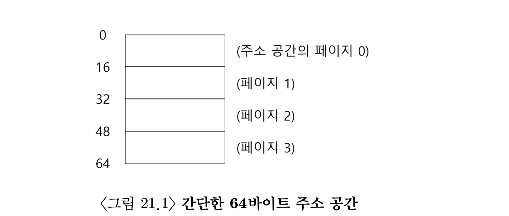

  

그림 21.1은 총 크기가 64바이트, 4개의 16바이트 페이지로 구성

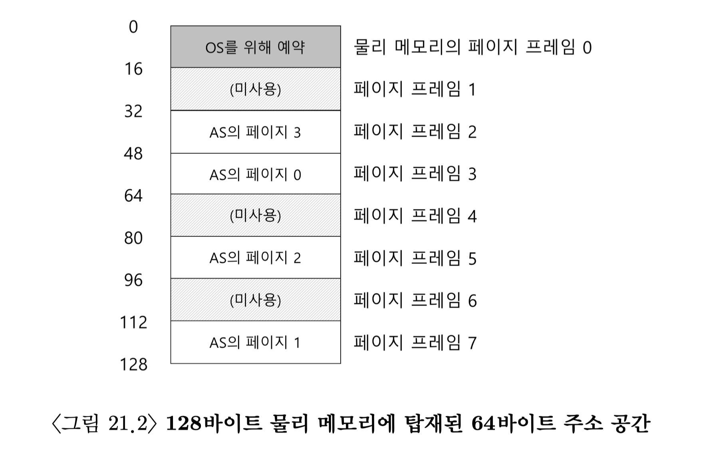

그림 21.2는 물리 메모리를 나타낸 그림이다. 

총 128바이트, 8개의 페이지 프레임이 있다.

그림에서 볼 수 있듯이, 가상 주소 공간의 페이지들은 물리 메모리 전체에 분산 배치되어 있다.

또한 운영체제가 자기자신을 위해서 물리 메모리의 일부를 사용하는 것도 보여준다. 

페이징은 이전 방식에 비해 크게 효율성, 단순함 측면으로 많은 장점을 가진다. 

**효율성** 

페이징을 사용하면 프로세스의 주소 공간 사용 방식과는 상관없이 효율적으로 주소 공간 개념을 지원할 수 있다.

예를 들어, 힙과 스택이 어느 방향으로 커지는가, 어떻게 사용되는가에 대한 고려가 필요없다. 

**단순함** 

운영체제가 프로세스의 메모리 64바이트 주소 공간을 4페이지 물리 메모리에 배치하기를 원한다고 할 때, 운영체제는 비어있는 4개의 페이지만 찾으면 된다. 

이를 위해 운영체제는 모든 비어 있는 페이지의 빈 공간 리스트를 유지하고 첫 4개 페이지를 선택할 것이다. 

주소 공간의 각 가상 페이지에 대한 물리 메모리 위치 기록을 위하여 운영체제는 프로세스 마다 **페이지 테이블(page table)**이라는 자료구조를 유지한다. 

페이지 테이블의 주요 역할은 주소 공간의 가상 페이지 **주소 변환(address translation)**정보를 저장하는 것 

각 페이지가 저장된 물리 메모리의 위치가 어디인지 알려준다. 

그림 21.2 프로세스의 페이지 테이블은 다음과 같은 4개의 항목을 가진다.

가상 페이지 0 → 물리 프레임 3, VP1 → PF7, VP2 → PF5, VP3 → PF2

페이지 테이블은 프로세스마다 존재한다는 사실을 꼭 숙지하자

다른 프로세스를 실행한다면 운영체제는 이 프로세스를 위한 다른 페이지 테이블이 필요하다. 

공유하는 페이지가 없다면 새 프로세스의 가상 페이지는 다른 물리 페이지에 존재하기 때문이다. 

### 주소 변환 이해 

프로세스가 생성한 가상 주소의 변환을 위해 먼저 가상 주소를 **가상 페이지 번호(virtual page number, VPN)**와 페이지 내의 **오프셋** 2개의 구성 요소로 분할한다.

가상 주소 공간의 크기 = 64바이트 

→ 가상 주소는 6비트가 필요하다. (2^6 = 64) 

페이지의 크기는 16바이트 즉, 64바이트 주소 공간에서 4페이지를 선택할 수 있어야한다. 

→ 이는 주소의 최상위 2비트로 표현(2^2 = 4) 


즉, 2비트 가상 페이지 번호(VPN)를 가지게 된다.

나머지 비트는 페이지 내에서 우리가 원하는 바이트의 위치를 나타난다.

→ 오프셋 

프로세스가 가상 주소를 생성하면 운영체제와 하드웨어가 의미있는 물리 주소로 변환한다. 

예를 들어 가상 주소가 21

21 → 010101(2) 


가상 주소 21은 가상 페이지1의 5번째 바이트이다. 

이 가상 페이지 번호를 페이지 테이블의 인덱스로 사용하여 가상 페이지 1이 어느 물리 프레임에 저장되어 있는지 찾을 수 있다.

**페이지 테이블에서 물리 프레임 번호(physical frame number, PFN) 또는 물리 페이지 번호(physical page number, PPN)**는 7이다. 그림 21.2 참고 

VPN을 PFN으로 교체하여 가상 주소를 변환할 수 있다. 그런 후에 물리 메모리에 탑재 명령어를 실행한다. 

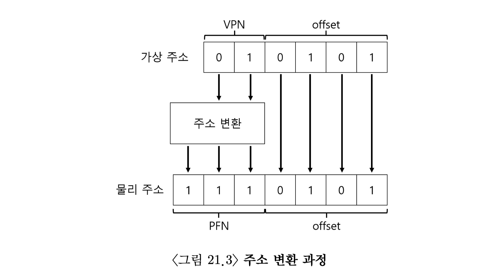

오프셋은 동일하다. 오프셋은 페이지, 페이지 프레임 내에서 우리가 원하는 위치를 알려 주기 때문이다. 

최종적으로 계산된 물리 주소는 1110101(2)이며, 이곳이 탑재할 데이터가 저장된 정확한 위치이다. 

---

## 21.2 페이지 테이블은 어디에 저장되는가?

페이지 테이블은 세그멘트 테이블이나 베이스-바운드 쌍에 비해서 매우 커질 수 있다.

  - 베이스-바운드는 각 프로세스 마다 베이스, 바운드 값만 저장 
  - 세그멘트 테이블은 프로세스 마다 각 세그멘트의 베이스, 바운드 + 기타 정보 저장 

**4KB 크기의 페이지를 가지는 전형적인 32비트 주소 공간** 

4KB = 4 * 1024 = 2^2 * 2^10 = 2^12 → 1페이지당 12비트

즉, 가상 주소는 20비트 VPN과 12비트 오프셋으로 구성된다.

20비트 VPN은 운영체제가 각 프로세스를 위해 관리해야 하는 개수가 2^20을 의미 거의 100만 

물리 주소로의 변환 정보와 다른 필요한 부가 정보를 저장하기 위하여 **페이지 테이블 항목(page table entry, PTE)**마다 4바이트가 필요하다고 가정하면, 각 페이지 테이블을 저장하기 위하여 4MB의 메모리가 필요하게 된다. 이것은 꽤 커다란 크기이다.

총 페이지 테이블 크기 = 페이지 수 × PTE 크기 = 2^20 × 4B = 4MB 

  - PTE 크기 4바이트 
  - PTE 정보
- 물리 프레임 번호 (PFN)
    - Valid bit (유효 여부)
    - Dirty bit (수정 여부)
    - Access permission (읽기/쓰기 권한) 
    - 사용 여부 비트 (사용 빈도 기반 교체 알고리즘용): LRU, LFU 구현 시 사용

프로세스 100개가 실행 중이라고 가정

주소 변환을 위해서 운영체제가 400MB의 메모리를 필요로 하는 것을 의미한다. 

컴퓨터가 Giga byte 단위의 메모리를 가지고 있는 현재라도 변환을 위해서 이렇게 큰 청크를 사용한다는 것은 매우 비정상적이다. 

페이지 테이블은 매우 크기 때문에 현재 실행 중인 프로세스의 페이지 테이블을 저장할 수 있는 회로를 MMU안에 유지하지 않을 것이다. 

대신 각 프로세스의 페이지 테이블을 메모리에 저장한다.

당분간 페이지 테이블은 운영체제가 관리하는 물리 메모리에 상주한다고 가정

나중에 페이지 테이블은 운영체제 가상화될 수 있다는 것을 알게 될 것이다. 

  - 아마 계층적 페이지 테이블과 디스크 스왑을 의미하는듯하다.

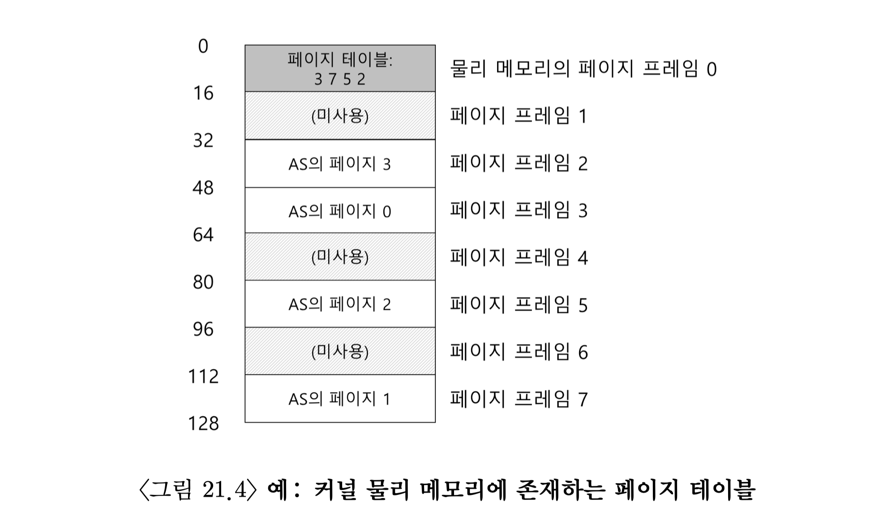

---

## 21.3 페이지 테이블에는 실제 무엇이 있는가

페이지 테이블 구성에 대해 살펴보자. 

페이지 테이블은 가상 주소를 물리 주소로 매핑(mapping)하는 데 사용되는 자료구조이다. 

가장 간단한 형태는 **선형 페이지 테이블(linear page table)**이다. 

운영체제는 원하는 물리 프레임 번호(PEN)를 찾기 위하여 가상 페이지 번호(VPN)로 배열 항목에 접근하고 

그 항목의 페이지 테이블 항목(PTE)을 검색한다.

지금은 이 간단한 선형 구조를 사용한다고 가정

**PTE에는 여러 비트들이 존재한다.**

### Valid bit(유효 비트)

프로그램이 실행을 시작할 때 모든 미사용 공간은 무효(valid)로 표시되고, 프로세스가 그런 메모리를 접근하려고 하면 운영체제에 트랩을 발생시킨다. 운영체제는 그 프로세스를 종료시킬 확률이 높다.

Valid bit는 할당되지 않은 주소 공간을 표현하기 위해 반드시 필요하다. 

| Valid Bit | 의미 |
| --- | --- |
| 1 (Valid) | 해당 페이지는 메모리에 있으며, 접근 가능 |
| 0 (Invalid) | 해당 페이지는 메모리에 없거나 접근 불가 |

  - **초기 페이지 테이블**에서 valid bit는 **0**으로 설정되어 있으며, 이는 해당 페이지가 아직 **사용되지 않음을 나타낸다.**
  - **동적 메모리 할당** 시, 필요한 페이지가 **메모리에 로드되면 valid bit가 1로 설정**되어 해당 페이지가 **사용 가능**한 상태가 된다.
  - 만약 **추가적인 메모리 공간**이 필요하면, 운영체제는 **빈 페이지 테이블 엔트리(valid bit = 0)**를 찾아 할당하고, 그 페이지의 valid bit를 **1로 설정한다**. 만약 빈 엔트리가 없으면, **새로운 페이지 테이블 엔트리**를 추가하여 확장한다.

### Protection Bit(보호 비트)

페이지를 읽을 수 있는지, 쓸 수 있는지, 또는 실행될 수 있는지를 표시하는 비트이다.

Protection Bit가 허용되지 않는 방식으로 페이지에 접근하려고 하면 운영체제가 트랩을 생성한다.

### Present Bit(존재 비트)

이 페이지가 물리 메모리에 있는지 혹은 디스크에 있는지(즉, 스왑 상태)를 가리킨다.

### Dirty Bit(수정 비트)

메모리에 반입된 후 페이지가 변경되었는지 여부를 나타낸다. 

### Reference Bit(accessed bit)

페이지가 접근되었는지를 추적하기 위해 사용된다. 

이 정보는 페이지 교체 알고리즘에 매우 중요하다. 

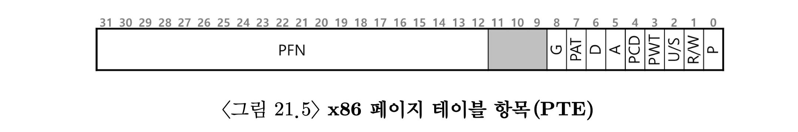

 

  - P: Present bit
  - R/W: 읽기 쓰기 비트 
  - U/S: 사용자/슈퍼바이저 비트
- 사용자 모드 프로세스가 페이지에 엑세스 할 수 있는지를 결정
  - PWT, PCD, PAT, G
- 페이지에 대한 하드웨어 캐시 동작을 결정하는 비트들
  - A: Reference bit
  - D: Dirty bit
  - PFN: 페이지 프레임 번호 

### Valid Bit VS Present Bit

**상황 1: 아직 메모리 할당을 안 받은 영역에 접근**

  - `valid = 0`, `present = x` (의미 없음)
  - → 접근 시 **segmentation fault** 또는 **invalid memory access** 발생

**상황 2: 메모리 할당은 받았지만 스왑 아웃된 경우**

  - `valid = 1`, `present = 0`
  - → 접근 시 **page fault**, 디스크에서 스왑 인

**상황 3: 메모리 할당도 받았고, 현재 물리 메모리에 있음**

  - `valid = 1`, `present = 1`
  - → 정상 접근 가능

**정리** 

  - **Present**: 스왑 인 여부 (물리 메모리에 있냐 없냐)
  - **Valid**: 해당 주소 자체가 접근 가능한 주소인가 (올바른 페이지인가)

| 상황 | Valid | Present | 의미 |
| --- | --- | --- | --- |
| 아직 안 쓴 예약 주소 | 0 | 0 | 접근 불가 (예약만 됨) |
| 초기 물리 메모리 할당됨 | 1 | 1 | 정상 접근 가능 |
| 스왑 아웃됨 | 1 | 0 | 접근 시 예외 (page fault) |
| 해제됨 (free)  | 0 | x | 접근 시 예외 (segmentation fault) 종료 |

---

## 21.4 페이징: 너무 느림 

페이지 테이블의 크기가 메모리 상에서 매우 크게 증가할 수 있다.

페이지 테이블로 인해 처리 속도가 저하될 수 있다.

```c
movl 21, %eax
```

주소 21에 대한 참조만 고려하자

원하는 데이터를 가져오기 위해, 먼저 시스템은 가상 주소(21)을 물리 주소(53)로 변환해야 한다. 

시스템은 프로세스의 페이지 테이블에서 적절한 페이지 테이블 항목을 가져와야 하고, 변환을 수행한 후, 물리 메모리에서 데이터를 탑재한다. 

하드웨어는 현재 실행 중인 프로세스의 페이지 테이블 위치를 알아야한다. 

당분간 하나의 **페이지 테이블 베이스 레지스터(page table base register, PTBR)**가 페이지 테이블의 시작 주소(물리 주소)를 저장한다고 가정한다. 

### 물리 주소 변환 과정 정리 

1️⃣ **가상 주소 → 가상 페이지 번호(VPN)와 오프셋(offset) 분리**

  - 가상 주소: `0b010101` (= 21)
  - `VPN_MASK = 0b110000`
  - `SHIFT = 4` (페이지 크기 = 2⁴ = 16바이트)

**VPN 계산**

```c
VPN = (VirtualAddress & VPN_MASK) >> SHIFT
    = (0b010101 & 0b110000) >> 4
    = (0b010000) >> 4
    = 0b01 = 1
```

→ 즉, **VPN = 1**

2️⃣ **페이지 테이블에서 PFN 얻기**

**PTE 주소 계산**

```c
PTEAddr = PageTableBaseRegister + (VPN * sizeof(PTE))
        = PTBR + (1 * sizeof(PTE))
```

→ 이 주소에서 PFN을 읽어옴.

→ 예시로 **PFN = 3**이라 가정

3️⃣ **오프셋 추출**

  - `OFFSET_MASK = 0b001111`

```c
offset = VirtualAddress & OFFSET_MASK
       = 0b010101 & 0b001111
       = 0b000101 = 5
```

4️⃣ **물리 주소 생성**

```c
PhysAddr = (PFN << SHIFT) | offset
         = (3 << 4) | 5
         = 0b00110000 | 0b00000101
         = 0b00110101
         = 53 (십진수)
```

✅ **최종 결과**

| 항목 | 값 |
| --- | --- |
| 가상 주소 | 21 (0b010101) |
| VPN | 1 |
| offset | 5 |
| PFN (예시) | 3 |
| 물리 주소 | **53** |

📦 **요약**

하드웨어는 가상 주소를 다음 단계로 해석

  1. **VPN 추출 (마스킹 후 시프트)**
  1. **PTE 인덱싱 후 PFN 추출**
  1. **오프셋 추출**
  1. **PFN과 offset을 결합 → 물리 주소 생성**
  1. **메모리 접근 후, 결과 → eax 등에 저장**

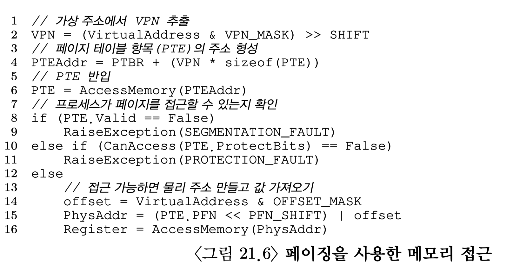

각 메모리 참조 시 일어나는 세부 동작을 살펴보자.

모든 메모리 참조(명령어 fetch, load, store)에 대해 먼저 페이지 테이블에서 변환 정보를 반입해야 하기 때문에 

반드시 한 번의 추가적인 메모리 참조가 필요하다. 

메모리 참조는 비용이 비싸고 프로세스는 2배 이상 느려진다.

즉, 정리하면 하드웨어와 소프트웨어의 신중한 설계 없이는 페이지 테이블로 인해 시스템이 매우 느려질 수 있으며 많은 메모리를 차지한다. 

---

# 22장 개요

페이징은 상당한 성능 저하를 가져올 수 있다.

페이징은 프로세스 주소 공간을 작은 고정 크기(페이지)로 나누고 페이지의 실제 위치(매핑 정보)를 메모리에 저장한다.

매핑 정보를 저장하는 자료 구조를 페이지 테이블이라 한다. 

가상 주소를 물리 주소로 변환을 위해 메모리에 존재한다는 매핑 정보를 매번 읽어야 한다. 

이는 모든 명령이 추가적인 메모리 접근을 해야하는 상황이다. 

이 문제를 해결하기 위해 **TLB(translation-lookaside buffer TLB, address-translation cache)**를 도입한다. 

TLB는 **메모리 관리부(memory-management unit, MMU)**의 일부이다.

TLB는 자주 참조되는 가상 주소 - 실 주소 변환 정보를 저장하는 하드웨어 캐시이다.

---

# 22.1 TLB의 기본 알고리즘

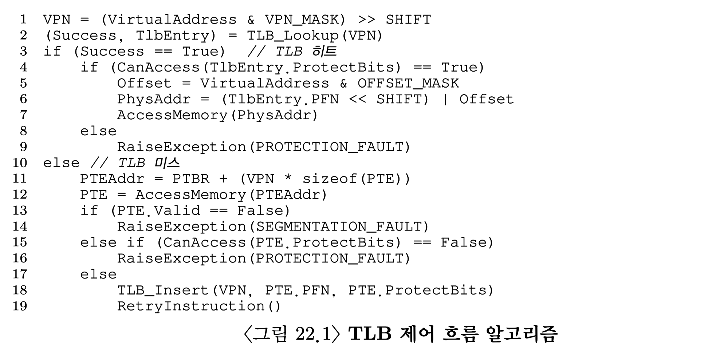

그림 22.1은 가상 주소 변환이 이루어지는 대략적인 과정을 나타낸다.

주소 변환부가 단순한 선형 페이지 테이블 즉, 배열로 이루어진 페이지 테이블과 하드웨어로 관리되는 TLB에 대한 대부분의 책임을 관리한다. 

**먼저 가상 주소에서 가상 페이지 번호인 VPN을 추출하고 해당 VPN의 TLB 존재 여부를 검사한다.**

### TLB Hit

TLB가 변환 정보가 존재한다. 

TLB 항목에서 페이지 프레임 번호인 PFN을 추출할 수 있다.

해당 페이지에 대한 접근 권한 검사를 진행하고 성공하면 원래 가상 주소의 오프셋과 합쳐서 원하는 물리 주소(PA)를 구성하고, 메모리에 접근할 수 있다.

### TLB Miss

TLB에 변환 정보가 존재하지 않는다.

하드웨어가 변환 정보를 찾기 위해서 페이지 테이블에 접근하며, 프로세스가 생성한 가상 메모리 참조가 유효하고 접근 가능하다면, 해당 변환 정보를 TLB로 읽어들인다. 테이블 접근을 위한 메모리 참조 때문에 매우 시간이 많이 소요되는 작업이다.

TLB가 갱신되면 하드웨어는 명령어를 재실행한다. 이후 TLB Hit & 메모리 참조가 빠르게 처리된다. 

### 캐시 철학과 TLB

모든 캐시의 설계 철학처럼, TLB 역시 주소 변환 정보가 대부분의 경우 캐시에 있다.

즉, 캐시에서 히트라는 가정을 전제로 만들어졌다.

TLB는 CPU와 가까운곳에 위치하고 있고, 매우 빠른 하드웨어로 구성되기 때문에 주소 변환 작업은 그다지 부담스러운 작업은 아니다.

하지만 미스가 발생하는 경우 페이지 테이블에 접근하여 변환 정보를 찾아야 한다. 

메모리 접근 연산은 매우 시간이 오래 걸린다. 

---

# 22.2 예제: 배열 접근

가상 주소 트레이스를 대상으로 TLB로 인한 성능 개선을 알아보자.

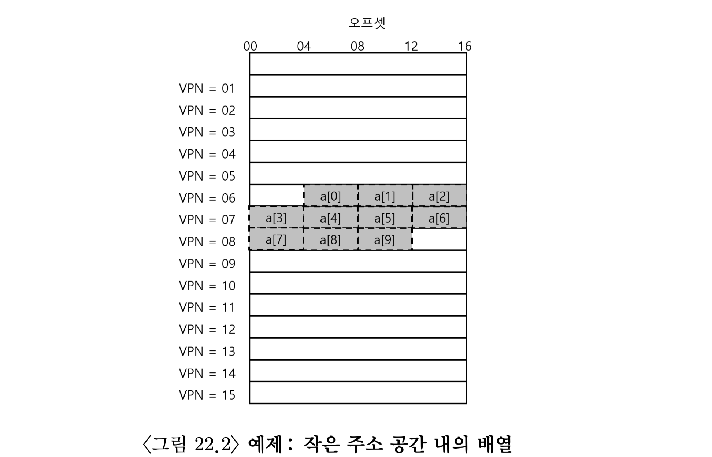

  - 가상 주소 100번지부터 10개의 4바이트 크기의 정수 배열 존재
  - 가상 주소 공간 8비트
  - 페이지 크기는 16바이트 

→ 가상 주소는 4비트의 VPN(16개의 페이지) / 4비트의 오프셋(각 페이지 16바이트)

그림 22.2를 보면 배열의 첫 항목(a[0])은 (VPN=06, 오프셋=04)에서 시작된다. 

### **배열 원소의 합을 구하기** 

```c
int sum = 0; 
for (i = 0; i < 10; i++) {
	 sum += a[i]; 
}
```

변수(i, sum)과 명령어를 위한 메모리 접근은 무시한다.

정수 배열에 대한 메모리 접근만 보자.

TLB는 완전히 초기화 상태에서 시작 

첫 번째 배열의 항목(a[0])이 접근된다. 가상 주소는 100번지 

하드웨어는 VPN을 추출한다. VPN이 06번이다. 하드웨어는 TLB에서 해당 VPN을 검색한다.

TLB 미스가 발생한다. 미스가 발생하면 해당 VPN 06번에 대한 물리 페이지 번호를 찾고 TLB를 갱신한다.

이제 a[1]을 읽는다. TLB 히트가 발생한다. a[1]은 a[0]과 같은 페이지에 존재한다.

이미 해당 페이지를 접근하였기 때문에, 필요한 변환 정보가 이미 TLB에 캐싱되어 있다.

마찬가지로 a[2] 접근도 TLB 히트가 발생한다.

a[3] 접근은 TLB 미스가 발생하고 a[4], a[5], a[6]는 TLB 히트가 발생한다.

a[7] 접근은 TLB 미스가 발생하고 a[8], a[9]는 TLB 히트가 발생한다.

배열 원소를 읽는 TLB 동작을 정리하면 

미스, 히트, 히트

미스, 히트, 히트, 히트

미스, 히트, 히트 

TLB의 **히트 비율(hit ratio)**는 7/10 → 70%가된다.

배열이 처음으로 접근되었지만, TLB는 **공간 지역성(spatial locality)**으로 인해서 성능을 개선할 수가 있다.

배열의 항목들이 페이지 내에서 서로 인접해 있기 때문에, 페이지에서 첫 번째 항목을 접근할 때만 TLB 미스가 발생한다. 

이 예제에서 보는 바와 같이 **페이지의 크기는 TLB의 효율성에 매우 중요한 역할을 한다.**

페이지의 크기가 두 배가 되면 히트 비율은 80%가 된다.

일반적인 페이지의 크기는 4KB이다. 정수 배열을 연속적으로 접근하는 프로그램 같은 경우 TLB 사용은 큰 성능 개선 효과를 가져올 것이다. 페이지 접근 시 한 번의 미스가 발생하기 때문이다. 

**내가 헷갈렸던 부분 정리** 

```
결국 배열의 모든 항목을 접근하려면 배열이 포함된 모든 페이지에 접근해야 하니  
행을 기준이던 열을 기준이던 TLB 히트 비율은 동일하지 않을까? 라는 생각이 문득 들었다.  
하지만 TLB는 모든 페이지의 변환 정보를 캐싱할 수 있는 용량이 제한적이라는 사실을 깨달았다.  
즉, 페이지 접근 순서에 따라 TLB 캐시 효율이 달라질 수 있으며,  
행 우선 순회처럼 지역성이 높은 순서는 TLB hit ratio가 더 높게 유지될 수 있다.
```

만약 예제 프로그램이 루프 종료 후에도 배열을 사용한다면, 성능은 더욱 개선될 것이다. 

모든 주소 변환 정보가 TLB에 탑재되어 있기 때문이다. 

TLB가 모든 주소 변환 정보를 저장할 정도록 크다면 전부 히트를 얻는다. 

이 경우에서는, **시간 지역성(temporal, locality)**으로 인해 TLB의 히트율이 높아진다.

시간 지역성이란 한번 참조된 메모리 영역이 짧은 시간 내에 재참조되는 현상을 일컫는다.

다른 캐시와 마찬가지로 **TLB 성공 여부는 프로그램의 공간 지역성과 시간 지역성 존재 여부**에 달려있다.

---

# 22.3 TLB 미스는 누가 처리할까?

### **TLB 미스를 하드웨어에서 처리하는 구조 (CISC 중심)**

**배경**

  - 과거 **CISC(Complex Instruction Set Computing)** 시스템(대표적으로 x86 아키텍처)에서는 **복잡한 명령어**가 많았고,
  - 하드웨어 엔지니어는 **운영체제 개발자를 신뢰하지 않았기 때문에**,
**TLB miss를 운영체제가 아닌 하드웨어 수준에서 처리**하게 설계되었다.

**전제 조건**

  - 하드웨어가 **페이지 테이블의 구조와 위치**를 알아야 함
  - 이를 위해 **PTBR (Page-Table Base Register)**를 사용
→ 페이지 테이블의 시작 주소를 알려주는 레지스터

**TLB 미스 처리 과정 (하드웨어 방식)**

```

1) PTBR을 통해 페이지 테이블 위치 파악
2) 해당 가상 주소의 페이지 테이블 엔트리(PTE) 찾기
3) PTE에서 물리 주소 등 필요한 정보 추출
4) TLB에 해당 매핑 추가
5) 미스로 실패한 명령어 재실행
```

**실제 사례: Intel x86**

  - **TLB는 하드웨어 관리**
  - **멀티 레벨 페이지 테이블** 구조 사용
→ PTE를 찾기 위해 여러 단계의 테이블을 따라가야 함

### **TLB 미스를 소프트웨어에서 처리하는 구조 (RISC 중심)**

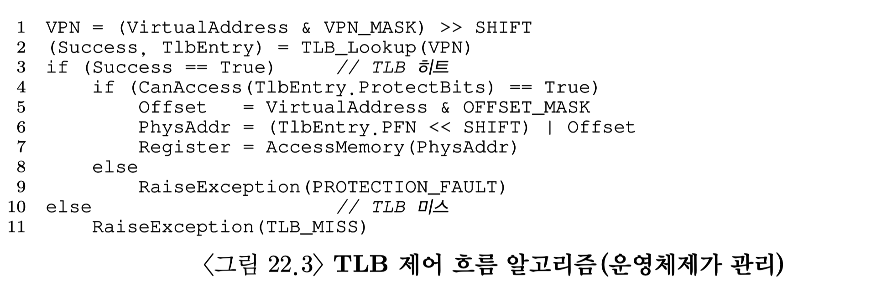

**RISC(Reduced Instruction Set Computing)**는 CISC 보다 최근에 등장한 컴퓨터 구조이다. 

RISC 기반 컴퓨터에서는 소프트웨어 관리 TLB(software-managed TLB)를 사용한다.

**TLB 미스 처리 과정 (소프트웨어 방식)**

```
1) TLB miss 발생 → 하드웨어가 예외(exception) 발생
2) 현재 명령어 실행 중단, 사용자 모드 → 커널 모드 전환
3) 운영체제의 trap handler (인터럽트 서비스 루틴) 호출
4) trap handler가 페이지 테이블을 탐색해 적절한 PTE 검색
5) TLB에 매핑 정보 삽입
6) 커널 모드 종료 → 사용자 모드 복귀
7) TLB miss가 발생했던 명령어를 하드웨어가 재실행
```

### 시스템 콜과 TLB 미스의 트랩 처리 비교

| 구분 | 시스템 콜 | TLB 미스 (또는 페이지 폴트 등) |
| --- | --- | --- |
| 트랩 리턴 후 | **다음 명령어** 실행 | **같은 명령어 재실행** |
| 이유 | 시스템 콜은 명시적으로 OS 기능을 호출 → 이미 명령어는 정상 수행됨 | 명령어 수행 중 필수 조건(TLB hit)이 실패했기 때문에 실제로 **명령어 실행이 끝나지 않음** |
| 예시 | write() 호출 후 → 다음 명령어로 진행 | 메모리 참조(load/store 등) 중 TLB miss → **트랩 핸들러로 TLB 갱신 후, 해당 명령어를 다시 수행** |

  - 시스템 콜은 다음 명령어를 PC(ProgramCounter)에 저장
  - TLB miss or Page Fault 같은 경우 현재 명령어를 PC에 저장

### TLB 미스 핸들러 주소

**무한 TLB 미스가 발생하는 상황**

```
1) CPU가 어떤 명령어를 실행 중
2) TLB에 이 주소가 없어서 → TLB miss
3) TLB 미스 핸들러 실행 (운영체제 코드)
4) 근데 핸들러 코드조차 TLB를 거쳐야만 실행할 수 있음
5) 그런데 핸들러 코드의 주소도 TLB에 없음 → 또 TLB miss 
6) 그래서 또 핸들러 실행하려는데, 그 핸들러의 주소도 변환이 안됨 → 또 miss ...

😱 무한 루프: TLB 미스를 처리하려다가 또 TLB 미스가 나고, 계속 반복
```

**TLB 미스가 무한 반복되지 않도록 하는 2가지 기법** 

  1. TLB 캐시에 영구히 할당 → **Wired Entry 방식(TLB에서 언제나 히트)**
  1. TLB 미스 핸들러의 주소를 물리 주소로 표현하여 표시 → 물리 주소 사용(주소 변환이 필요X)

### 왜 소프트웨어 방식이 인기일까?

> TLB를 소프트웨어로 관리하면, 운영체제가 하드웨어 구조에 구애받지 않고 페이지 테이블을 자유롭게 구성할 수 있기 때문이다.

  - 예전의 하드웨어 TLB 관리 방식은 **페이지 테이블 구조를 하드웨어가 강제** → 유연성 ↓
  - 소프트웨어 방식은 운영체제가 모든 걸 결정 → **구조, 전략, 최적화 다 유연하게 조정 가능**
하드웨어는 단순히 예외만 던짐 

---

# 22.4 TLB의 구성: 무엇이 있나?

TLB는 **PTE**에 저장된 정보들을 포함하고 있으며, **완전 연관 방식**을 사용하여 **모든 항목을 병렬적으로 검색**하면서 가상 주소를 물리 주소로 변환한다. 

이 방식은 특정 가상 페이지 번호(VPN)를 기준으로 검색하는 것이 아니라, TLB에 저장된 모든 항목을 동시에 확인할 수 있게 되어 매우 빠른 주소 변환을 가능하게 한다.

**구성 정보** 

  - VPN(Virtual Page Number)
  - PFN(Physical Frame number)
  - Valid Bit
  - Protection Bit
  - Dirty Bit
  - Address-Space Identifier (ASI)

---

# 22.5 TLB 의 문제: 문맥 교환

TLB를 사용하게 되면 프로세스 간 문맥 교환 시, 새로운 문제가 등장한다.

TLB에 있는 가상 주소와 실제 주소 간의 변환 정보는 그것을 탑재시킨 프로세스에서만 유효하다.

새로운 프로세스에서는 이전에 실행하던 프로세스의 변환 정보를 사용하지 않도록 주의해야 한다.

### 문맥 교환 시 TLB 캐싱 데이터 문제

하나의 프로세스(P1)가 실행 중 

이 프로세스는 TLB가 자신에게 유효한 변환 정보를 캐싱하고 있다고 가정

즉, P1의 페이지 테이블 내용을 갖고 있다고 가정

P1의 10번째 가상 페이지가 물리 프레임 100에 매핑되어 있다고 가정

또 다른 프로세스(P2)가 존재하고 운영체제는 곧 문맥 교환을 수행하기로 결정, 이 프로세스를 실행시키려고 한다

P2의 10번째 가상 페이지는 물리 프레임 170에 매핑되어 있다고 가정

두 프로세스의 항목들이 TLB에 존재한다고 하면 TLB는 VPN 10에 대한 변환 정보가 2개 존재하는 것이다.

10번 VPN이 PFN 100(P1)과 PFN 170(P2)으로 변환될 수 있다.


하지만 어떤 프로세스를 위한 항목인지 알 길이 없다. 

TLB 가 정확하고 효율적으로 멀티 프로세스 간의 가상화를 지원하기 위해서는 추가적 기능이 필요하다. 

### TLB valid bit ≠ PTE valid bit

| 항목 | 페이지 테이블의 valid bit | TLB의 valid bit |
| --- | --- | --- |
| **역할** | 해당 가상 페이지가 실제 물리 메모리에 매핑되어 있는지 표시 | TLB에 캐시된 변환 정보가 유효한지 표시 |
| **위치** | 페이지 테이블 (메모리 상) | TLB (하드웨어 캐시 내부) |
| **무효(invalid) 시 의미** | 해당 가상 주소에 접근할 수 없음 → 세그멘테이션 폴트 발생 | 단순히 변환 정보가 캐시에 없음 (TLB miss 발생 가능) |
| **무효 시 결과** | 잘못된 접근으로 판단되어 **프로세스 종료 가능** | 페이지 테이블을 참조하여 TLB를 갱신함 |
| **초기화 시점** | 프로세스 생성 시 OS가 설정 | 시스템 부팅 시 전체 무효, 문맥 전환 시 무효화 |
| **보안/격리 역할** | 프로세스의 주소 공간 보호 | 문맥 전환 시 TLB 정보 초기화로 다른 프로세스 접근 방지 |

### 문맥 교환 시 TLB 캐싱 데이터 문제 해법

문맥 교환을 수행할 때 다음 프로세스가 실행되기 전에 기존 TLB 내용을 비우기 

즉, 모든 valid bit를 0으로 설정하는 것

문맥 교환할 때마다 TLB를 비우면, 잘못된 변환 정보를 사용하는 상황을 방지할 수 있다. 

이 방식은 새로운 프로세스가 실행될 때, 데이터와 코드 페이지에 대한 접근으로 인한 TLB 미스가 발생하게 된다. 

문맥 교환 자체가 빈번히 발생한다면, 이 또한 성능에 큰 부담을 가져올 수 있다.

이 부담을 개선하기 위해 문맥 교환이 발생하더라도 TLB의 내용을 보존할 수 있는 하드웨어 기능을 추가하였다. 

TLB 내에 **주소 공간 식별자(address space identifier, ASID)**필드를 추가하는 것 

ASID는 **프로세스 식별자(process identifier, PID)**와 대략적으로 유사하다. 

단, ASID는 좀 더 적은 비트를 갖고 있다.(예, ASID = 8비트, PID = 32비트)


ASID를 사용할 경우, 프로세스 별로 TLB 변환 정보를 구분할 수 있다.

올바른 주소 변환을 위해서 하드웨어는 현재 어떤 프로세스가 실행 중인지 파악하고 있어야 한다. 

이를 위해, 문맥 전환 시, 운영체제는 새로운 ASID 값을 정해진 레지스터에 탑재한다. 


이 예제에서는 2개의 다른 VPN을 갖는 2개의 다른 프로세스들의 2항목이 동일한 물리 프레임 번호를 가리킨다. 

이러한 경우에는 2개의 프로세스는 하나의 페이지(예, 코드 페이지)를 공유하고 있을 때 발생할 수 있다. 

이 예제에서는 프로세스1이 물리 페이지 101을 프로세스2와 공유하고 있다.

코드 페이지를 공유하는 것은 사용되는 물리 페이지의 수를 줄일 수 있기 때문에 유용하다.

그리고 공유 페이지를 사용하면 메모리 부하도 줄일 수 있다.

---

# 22.6 이슈: 교체 정책

모든 캐시가 그러하듯이 TLB에서도 **캐시 교체(cache replacement)정책**이 매우 중요하다.

### 최저 사용 빈도(least-recently-used, LRU)

가장 오래 전부터 사용되었던 항목을 교체

LRU는 메모리 참조 패턴에서의 지역성을 최대한 활용하는 것이 목적이다.

사용되지 않은지 오래된 항목일수록, 앞으로도 사용될 가능성이 작으며, 교체 대상으로 적합하다는 가정에 근거

### 랜덤(random) 

랜덤 정책에서는 교체 대상을 무작위로 정한다. 

랜덤 교체 정책은 때때로 잘못된 결정을 내릴 수 있지만 구현이 간단하고 예상치 못한 예외 상황의 발생을 피할 수 있다는 장점이 있다.

### 랜덤 VS LRU 

**시나리오 조건**

  - **TLB 크기**: 3
  - **접근 순서 반복**: 1 → 2 → 3 → 4 → 1 → 2 → 3 → 4 → ...
  - **교체 정책**: LRU vs RANDOM
  - **평가 기준**: 총 접근 횟수 12번 (3번 반복)

**시뮬레이션: LRU 정책**

| 접근한 페이지 | TLB 상태 (최신 → 오래된 순) | 미스 여부 |
| --- | --- | --- |
| 1 | 1 | ✅ 미스 |
| 2 | 2, 1 | ✅ 미스 |
| 3 | 3, 2, 1 | ✅ 미스 |
| 4 | 4, 3, 2 | ✅ 미스 (1 제거됨) |
| 1 | 1, 4, 3 | ✅ 미스 (2 제거됨) |
| 2 | 2, 1, 4 | ✅ 미스 (3 제거됨) |
| 3 | 3, 2, 1 | ✅ 미스 (4 제거됨) |
| 4 | 4, 3, 2 | ✅ 미스 (1 제거됨) |
| 1 | 1, 4, 3 | ✅ 미스 (2 제거됨) |
| 2 | 2, 1, 4 | ✅ 미스 (3 제거됨) |
| 3 | 3, 2, 1 | ✅ 미스 (4 제거됨) |
| 4 | 4, 3, 2 | ✅ 미스 (1 제거됨) |

  - 1**2번 접근 중 12번 미스** → **100% 미스율**

**시뮬레이션: RANDOM 정책 (무작위로 1개 제거)**

  - **RANDOM은 결과가 매번 달라질 수 있지만 예시** 

| 접근 | 랜덤 제거 | TLB 상태 | 미스 여부 |
| --- | --- | --- | --- |
| 1 | - | 1 | ✅ 미스 |
| 2 | - | 2, 1 | ✅ 미스 |
| 3 | - | 3, 2, 1 | ✅ 미스 |
| 4 | 2 제거됨 | 4, 3, 1 | ✅ 미스 |
| 1 | - | 1, 4, 3 | ❌ 히트 |
| 2 | 3 제거됨 | 2, 1, 4 | ✅ 미스 |
| 3 | 4 제거됨 | 3, 2, 1 | ✅ 미스 |
| 4 | 2 제거됨 | 4, 3, 1 | ✅ 미스 |
| 1 | - | 1, 4, 3 | ❌ 히트 |
| 2 | 3 제거됨 | 2, 1, 4 | ✅ 미스 |
| 3 | 1 제거됨 | 3, 2, 4 | ✅ 미스 |
| 4 | - | 4, 3, 2 | ❌ 히트 |

  - **12번 중 9번 미스, 3번 히트** → **75% 미스율**

**✅ 결론**

  - **LRU**: 항상 100% 미스 (최악)
  - **RANDOM**: 경우에 따라 히트 발생 → 더 **낮은 미스율**

---

# 22.7 실제 TLB

MIPS R4000은 소프트웨어로 관리되는 TLB를 사용한다

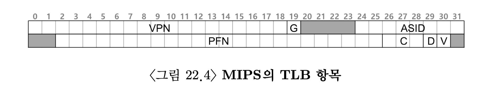

MLPS R4000은 32비트 주소 공간에 4KB 페이지를 지원한다. 

일반적인 가상 주소 공간을 사용하기 때문에 VPN은 20비트 오프셋은 12비트를 갖을 것이라 예측할 수 있지만, 

아니다. 

보는 바와 같이 19비트가 VPN에 할당되어 있다. 전체 주소 공간의 절반은 사용자 주소 공간 나머지 반은 커널이 사용한다.

| 구분 | 비트 수 | 설명 |
| --- | --- | --- |
| MSB 1비트 | 1비트 | 사용자/커널 공간 구분 |
| VPN | 19비트 | 가상 페이지 번호 |
| Offset | 12비트 | 페이지 내 오프셋 (4KB 페이지) |

물리 프레임 번호(PFN)로 24비트가 할당되어 있다. 

2^24pages X 2^12bytes/page = 2^36bytes=64 GB

2^24개의 4KB 페이지를 지원이 가능하다. 

**전역(global, G)비트**는 프로세스들 간에 공유되는 페이지들을 위해 사용된다.

전역 비트가 설정되어 있으면 ASID는 무시된다. 

8비트 길이의 **ASID** 필드가 있다. 운영체제는 이 부분을 보고 주소 공간을 서로 구분한다.

만일 256(2^8)개 이상의 프로세스가 동시에 실행된다면?

3비트 길이의 **일관성(coherence, C)비트**를 볼 수 있다.

이 비트를 보고 페이지가 하드웨어에 어떻게 캐시되어 있는지를 판별한다.

**나머지 비트들** 

| 필드 이름 | 설명 |
| --- | --- |
| **Valid bit (유효 비트)** | 이 항목이 현재 **올바른 매핑 정보를 가지고 있는지**를 나타냄.<br>→ 0이면 페이지 폴트(page fault)가 발생함. |
| **Dirty bit (더티 비트)** | 페이지가 **쓰기(write)** 작업으로 **수정되었는지** 여부를 나타냄.<br>→ 페이지를 디스크에 다시 저장할 필요가 있는지 판단하는 데 사용됨. |
| **Page mask** | 다양한 크기의 페이지(예: 4KB, 16KB, 1MB 등)를 지원할 경우, **해당 항목의 페이지 크기**를 명시함.<br>→ 페이지 크기 단위로 캐시를 하거나 TLB에 등록하기 위해 필요. |
| **64번째 비트 (사용 안 함)** | MIPS 아키텍처에서는 일부 TLB 구조에서 **예약(reserved)** 필드가 존재함.<br>→ 하드웨어/미래 확장 등을 위해 비워둘 수 있음. |

---

# **22.8 TLB (Translation Lookaside Buffer) 요약**

### **TLB의 역할**

  - **주소 변환 속도 향상**을 위한 **작은 전용 캐시**
  - 페이지 테이블 접근 없이 대부분의 주소 변환을 처리 → **가상 메모리의 성능 손실을 줄임**
  - 현대 시스템에서 **페이징 필수 구성 요소**

### **TLB의 한계**

**TLB Coverage (범위) 문제**

  - TLB에 담을 수 있는 **페이지 수보다 많은 페이지**에 짧은 시간 안에 접근하면
→ **TLB miss가 많이 발생** → 성능 저하
  - 이런 상황을 "**TLB 범위를 벗어난다**"라고 표현
  - 해결책 중 하나: **더 큰 페이지 크기** 지원
(예: 4KB → 1MB) → 하나의 TLB 항목으로 더 많은 주소 커버

**대표적인 큰 페이지 사용자**

  - **DBMS 같은 대용량 임의 접근 프로그램**

| 항목 | 4KB 페이지 | 1MB 페이지 |
| --- | --- | --- |
| 하나의 TLB 항목이 커버하는 주소 범위 | 4KB | 1MB |
| 동일한 크기의 데이터에 필요한 TLB 엔트리 수 | 많음 | 적음 |
| TLB miss 가능성 | 높음 | 낮음 |
| 내부 단편화 | 적음 | 많아질 수 있음 |

### **TLB와 캐시의 병목 현상**

**TLB & 캐시 역할 이해** 

| 구분 | TLB | 일반 캐시 (D-cache, I-cache 등) |
| --- | --- | --- |
| 역할 | **가상 주소 → 물리 주소** 변환 | **물리 주소의 데이터** 빠르게 읽기 |
| 무엇을 저장? | 페이지 테이블 항목 (PTE) | 메모리 데이터 (변수, 명령어 등) |
| 접근 시점 | 메모리 접근 전에 필요 | 주소 변환 후에 접근 |
| 예시 | `TLB miss` → 페이지 테이블 접근 | `cache miss` → 메모리 접근 |

**Physically Indexed Cache 문제**

  - 물리 주소로 캐시를 인덱싱하는 구조에서는
→ **TLB를 먼저 접근해야 캐시 접근이 가능**

→ 파이프라인 병목 유발

**Virtually Indexed Cache**

  - **가상 주소로 캐시 접근**
→ 캐시 히트 시에는 주소 변환 생략 가능
  - 하지만, **하드웨어 설계 복잡성 증가**

**병목의 핵심**

  - 물리 주소로 캐시(D-cache)를 인덱싱하려면
→ 먼저 TLB를 거쳐야 함 (가상 → 물리 변환)

→ **시간 지연** 발생

그래서 해결책으로 가상 주소 기반의 **Virtually Indexed Cache**를 쓰자

---

# 23장 개요

페이지 테이블이 크면 많은 메모리 공간을 차지한다.

배열 형태를 가지는 선형 페이지 테이블(linear page table)을 예로 들자

페이지 크기가 4KB(2^12바이트), 페이지 테이블 각 항목은 4바이트인 32비트 주소 공간을 가정해 보자.

주소 공간에는 대략 100만 개(2^32/2^12)의 가상 페이지가 존재할 것이다. 

| 비트 구간 | 의미 |
| --- | --- |
| 상위 20비트 (32-12) | Virtual Page Number (VPN), (PFN) |
| 하위 12비트 | Page Offset (페이지 내 주소) |

여기에 페이지 테이블 항목의 크기를 곱하면 (4바이트 * 백만) = 약 4MB가 된다.

또한 이런 페이지 테이블은 프로세스 마다 존재한다. 즉, 100개의 프로세스가 실행 중이라면 페이지 테이블은 400MB의 메모리가 필요하다.

이는 엄청난 부담이다. **어떻게 페이지 테이블의 크기를 줄일 수 있는가?**

---

# 23.1 간단한 해법: 더 큰 페이지

페이지 테이블의 크기를 간단하게 줄이는 방법은 페이지의 크기를 증가시키는 것

16KB 페이지를 가정하자

그럼 18비트의 VPN과 14비트의 오프셋을 가진다.

PTE 크기가 4바이트로 동일하다면, 페이지 테이블의 총 크기는 1MB가 된다.

기존 테이블 대비 크기가 1/4로 감소된다.

하지만 페이지 크기의 증가는 부작용을 수반한다.

가장 큰 문제는 페이지 내부의 낭비 공간이 증가하는 것이다. 이를 **내부 단편화(internal fragmentation)**라고 부른다

---

# 23.2 하이브리드 접근 방법: 페이징과 세그멘트

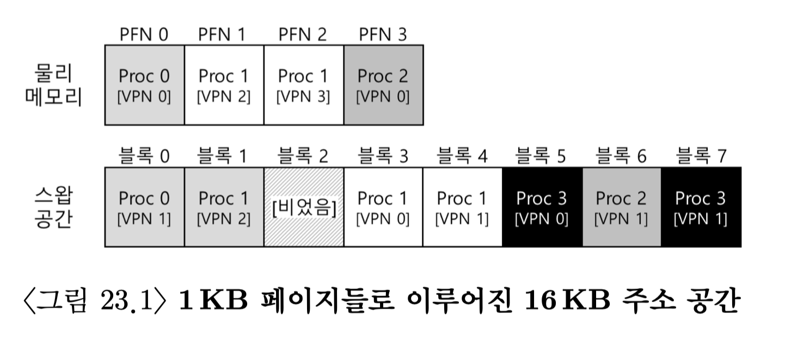

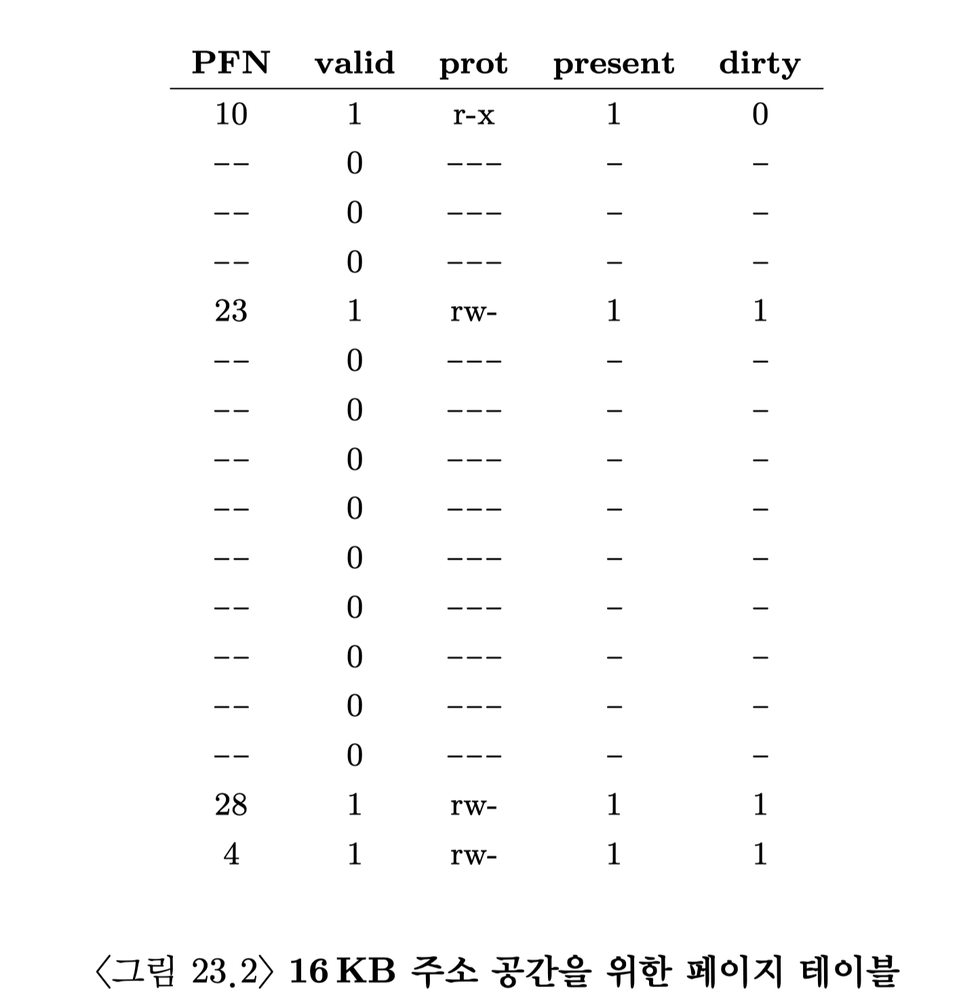

| 비트 구간 | 의미 |
| --- | --- |
| 상위 4비트 (14 - 10) | Virtual Page Number (VPN) |
| 하위 10비트 = 페이지 크기 | Page Offset (페이지 내 오프셋) |

그림에서 보는 바와 같이, 페이지 테이블 대부분이 비어있다. → 엄청난 낭비가 발생한다.

16KB 크기의 아주 작은 주소 공간에서 발생한 상황이다.

프로세스의 전체 주소 공간을 위해 하나의 페이지 테이블을 두는 대신, 논리 세그멘트마다 따로 페이지 테이블을 두면 어떨까?

이 예제에서는 3개의 페이지 테이블이 있을 수 있다. 

코드, 힙, 스택 세그멘트에 대해 테이블을 각각 두는 것이다.

세그멘테이션에서는 세그멘트의 물리 주소 시작 위치를 나타내는 베이스(base) 레지스터, 크기를 나타내는 바운드(bound) 레지스터가 있다.

하이브리드 방식의 MMU에서도 비슷한 구조를 사용한다. 

베이스 레지스터는 세그멘트 시작 주소를 가리키는 것이 아니라 세그멘트의 페이지 테이블 시작 주소를 갖는다.

바운드 레지스터는 페이지 테이블의 끝을 나타내기 위해서 사용한다.

4KB 페이지를 갖는 32비트 가상 주소 공간이 4개의 세그멘트로 나뉘어 있다고 가정하자.

예제에서는 3개의 세그만트만 사용한다.

소속 세그멘트를 나타내기 위해 상위 2비트를 사용한다. 

  - 미사용 세그멘트 00
  - 코드 세그멘트 01
  - 힙 세그멘트 10
  - 스택 세그멘트 11

가상 주소는 다음과 같이 표현될 수 있다. 

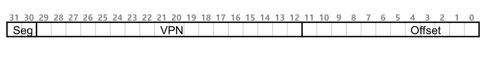

하드웨어에는 3개의 베이스/바운드 레지스터 쌍이 코드와 힙 그리고 스택을 위해서 존재한다고 가정

실행 중인 프로세스에서, 각 세그멘트의 베이스 레지스터는 각 세그멘트 페이지 테이블의 시작 물리 주소를 갖는다.

즉, 이 시스템에서 모든 프로세스는 3개의 페이지 테이블을 갖는다.

문맥 교환 시, 이 레지스터들은 새로 실행되는 프로세스의 페이지 테이블의 위치값으로 변경된다.

TLB 미스가 발생하면, (하드웨어 기반 TLB로 가정) 하드웨어는 세그멘트 비트를 사용하여 어떤 베이스와 레지스터 쌍을 사용할지 결정한다. 하드웨어는 그 세그멘트에 들어 있는 물리 주소를 VPN과 함께 다음과 같은 방식으로 조작하여 페이지 테이블 항목(PTE)의 주소를 얻는다.


이와 같은 방식으로 하이브리드 기법은 선형 페이지 테이블에 비해 메모리 사용을 개선시킬 수 있다.

스택과 힙 사이의 할당되지 않은 페이지들은 페이지 테이블 상에서 더 이상 공간을 차지하지 않는다.

### **선형 페이지 테이블 구조 (Linear Page Table)**

  - **구조**: 프로세스마다 하나의 큰 배열 형태의 페이지 테이블을 가짐
  - **장점**: 구조가 단순하고 구현이 쉬움
  - **문제점**:
- **전체 가상 주소 공간을 커버**해야 하므로,
→ 비어있는 PTE (Page Table Entry)가 많음

→ **공간 낭비(내부 단편화)**

### **이 문제의 해결 시도 – 하이브리드 기법 (Segmentation + Paging)**

  - **구조**:
- 가상 주소를 먼저 **세그먼트로 나누고**,
    - 각 세그먼트 안에서 **별도의 페이지 테이블**을 둠
  - **장점**:
- 전체 주소 공간을 전부 커버하지 않아도 되므로 **낭비 줄일 수 있음(내부 단편화 해결)**
    - 각 세그먼트는 독립적으로 페이징 가능 → 더 유연한 구조
  - **문제점**:
- 세그먼트마다 페이지 테이블이 필요하고,
→ 이 테이블도 **연속된 배열 구조**

→ 결국 **연속된 물리 메모리 공간 필요**
    - 세그먼트마다 **크기가 다 다르기 때문에**,
→ **외부 단편화 발생**

→ 특히 **커널 영역에서 연속 공간 확보가 어려움**

### 내 생각 정리

```
하이브리드 기법은 커널 메모리 영역을 페이지로 나눈 게 의미가 없어지는 방법이다.
물론 여전히 사용자 메모리 영역은 페이징으로 외부 단편화를 없애고 내부 단편화를 최소화하지만 
커널 메모리 영역에서는 세그멘트 기법 특징상 페이지 테이블 정보를 담는 
페이지의 연속 할당되기 때문에 외부 단편화가 발생한다. 
따라서 커널 메모리 영역에서는 여전히 외부 단편화가 발생하고, 
이로 인해 페이지 단위로 나누는 것의 의미가 퇴색된다고 할 수 있다.
```

---

# 23.3 멀티 레벨 페이지 테이블

세그멘테이션을 사용하지 않고 페이지 테이블 크기를 줄이는 방법에 대해서 생각해 보자.

어떻게 하면 사용하지 않는 주소 공간을 페이지 테이블에서 제거할 수 있을까?

→ 멀티 레벨 페이지 테이블

→ 멀티 레벨 페이지 테이블에서는 선형 페이지 테이블을 트리 구조로 표현한다.

**페이지 디렉터리(page directory)** 자료 구조를 사용하여 페이지 테이블 각 페이지의 할당 여부와 위치를 파악한다. 페이지 디렉터리는 페이지 테이블을 구성하는 각 페이지의 존재 여부와 위치 정보를 가지고 있다.

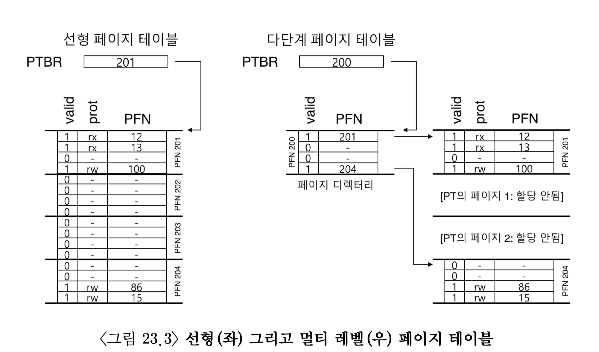

그림 23.3의 왼쪽을 보면 전형적인 선형 페이지 테이블이다. 중앙부를 보면 주소 공간을 사용하지 않고 있다.(내부 단편화). 그리고 페이지 테이블에서 항목들이 할당되어 있다.

우측을 보면 동일한 주소 공간을 다루는 멀티 레벨 페이지 테이블이다. 

페이지 디렉터리에는 두 개의 유효한 페이지가 있다(처음과 마지막). 유효 페이지는 2개는 메모리에 존재한다.

**Depth = 1: 페이지 디렉터리 (Page Directory)**

  - **가상 주소의 상위 비트**를 사용해서 인덱싱
  - 각 엔트리(PDE)는 **다음 단계인 페이지 테이블(PTE 테이블)의 주소**를 가지고 있다.
  - 말하자면, 어떤 페이지 테이블로 가야 할지 알려주는 역할

**Depth = 2: 페이지 테이블 (Page Table)**

  - 디렉터리에서 찾아온 주소에 있는 테이블
  - 여기에는 실제 물리 메모리 프레임의 주소 (Page Frame Address)가 들어 있다
  - **하위 비트로 인덱싱해서 실제 데이터를 찾는 데 사용**

**PTE(Page Table Entry) 유효 비트 VS PDE(Page Directory Entry) 유효 비트(valid bit)**

PDE valid bit = 1의 의미는 그 항목이 가리키는 페이지 내에서 최소한 하나가 유효하다는 것

즉, 최소한 하나의 PTE valid bit = 1

만약 PDE valid bit = 0의 의미는 PDE는 실제 페이지가 할당되지 않은 것이다.

### 멀티 레벨 페이지 테이블의 장점 요약

  1. **주소 공간의 효율적 사용**
- 사용된 주소 공간 크기에 비례하여 페이지 테이블이 생성됨.
    - 사용되지 않는 가상 주소 영역에 대해선 페이지 테이블을 할당하지 않으므로 메모리 절약 가능.
  1. **메모리 관리의 용이성**
- 페이지 테이블도 페이지 단위로 나뉘므로, 필요한 경우에만 메모리 할당 가능.
    - 운영체제가 **free page pool**에서 빈 페이지를 쉽게 할당하거나 회수할 수 있음.
  1. **유연한 페이지 테이블 저장**
- 단일 테이블(선형) 구조는 항상 메모리에 상주해야 하지만,
멀티 레벨 구조는 **페이지 디렉터리**를 통해 페이지 테이블 페이지의 위치를 추적 가능.
    - 페이지 테이블 일부가 디스크에 스왑되어도 위치 추적 가능하므로, 물리 메모리 사용이 유연함.

### 멀티 레벨 페이징 유의사항 및 단점

  - **추가적인 메모리 접근 비용 발생 (TLB 미스 시)**
- TLB(TLB: Translation Lookaside Buffer) 미스가 발생하면,
**페이지 디렉터리 접근 + PTE(Page Table Entry) 접근**,

**총 두 번의 메모리 접근**이 필요함.
    - 반면 선형 페이지 테이블은 **단 한 번의 접근**으로 가능.
    - ⇒ **시간-공간 절충(time-space trade-off)**의 대표적인 예.
공간 절약을 얻었지만, 메모리 접근 시간이 늘어남.
  - **검색(구현) 복잡도 증가**
- 선형 페이지 테이블은 인덱스 한 번으로 바로 PTE에 접근 가능하지만,
멀티 레벨 구조는 각 단계마다 인덱스를 계산하고 따라가야 함.
    - 하드웨어/소프트웨어 구현 방식과 무관하게,
검색 과정 자체가 더 복잡해짐.
  - **성능은 대부분 TLB 히트에 의존**
- 현실적으로 대부분의 주소 변환은 TLB 히트로 처리됨.
    - 그러나 **TLB 미스 발생 시 성능 저하가 뚜렷**하게 나타남.
    - TLB 미스를 줄이기 위한 **TLB 크기 확대**나 **TLB 계층화** 등의 보조 기법이 필요함.

### 멀티 레벨 페이징 예제

조건: 64바이트 페이지를 갖는 16KB 주소 공간

→ 14비트 가상 주소 공간

→ VPN 8비트

→ 페이지 오프셋 6비트 

선형 페이지 테이블

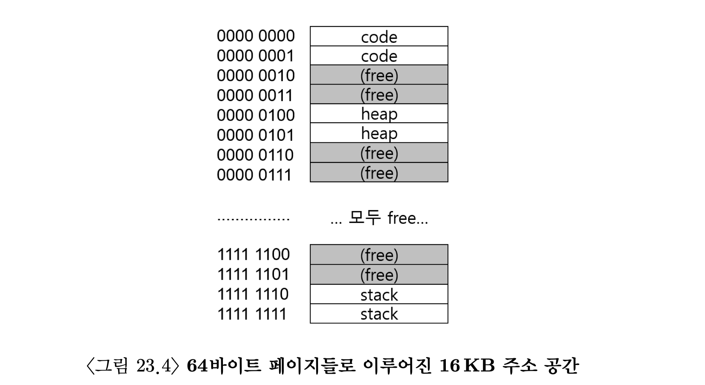

주소에서 작은 부분만 사용된다 하더라도, 선형 페이지 테이블의 크기는 변하지 않는다.

즉, 2^8(256)개 엔트리 고정

**페이지 사용** 

페이지 0,1 → code / 페이지 4,5 → heap / 페이지 254,255 → stack 

이 주소 공간을 2단계 페이지 테이블로 구성해 보자

선형 페이지 테이블을 페이지 단위로 분할한다. 

각 PTE는 4바이트로 가정

전체 페이지 테이블의 크기는 256 * 4바이트 = 1024바이트 = 1KB 

각 페이지가 64바이트니까 1KB 페이지 테이블은 16개의 페이지로 분할된다.

각 페이지에는 16개의 PTE가 있다.

VPN으로부터 페이지 디렉터리 인덱스를 추출한다.


총 256개의 PTE를 1페이지에서 16개의 PTE를 가지니까

페이지 디렉터리는 4비트가 필요하다. = VPN 상위 4비트를 페이지 디렉터리 색인으로 구성

VPN에서 **페이지-디렉터리 인덱스(page-directory index, PDIndex)**를 추출하면 

PDEAddr = PageDirBase + (PDIndex * sizeof(PDE)) 식으로 PDE 주소를 찾을 수 있다 


페이지-디렉터리의 해당 항목이 무효(invalid) 표시되어 있으면, 이 주소 접근은 유효하지 않다.

해당 PDE가 유효하면 추가 작업을 한다.

이 페이지 디렉터리 항목이 가리키고 있는 페이지 테이블의 PTE를 읽기 위해서 VPN의 나머지 4비트를 사용한다.

이 **페이지-테이블 인덱스(page-table index, PTIndex)**는 페이지 테이블 자체 인덱스로 사용된다.

PTEAddr = (PDE.PFN << SHIFT) + (PTIndex * sizeof(PTE))


그림 23.5를 보면 페이지 디렉터리 항목(PDE)는 2개의 유효한 영역이 존재한다.

물리 페이지 100, 101에 가상 주소 공간의 첫 16개 페이지에 대한 물리 주소를 가진다.

선형 페이지의 16개의 페이지들을 모두 할당하는 대신 단지 3개의 페이지만 할당하였다.

페이지 디렉터리를 위해서 한 페이지, 페이지 테이블을 위해 2개의 페이지 할당

많은 공간이 절약되었다.

**가상 주소를 물리 주소로 바꿔보자**

VPN 254를 가지는 스택 페이지는 이진수로 11 1111 1000 0000이다.

  1. VPN 상위 4비트(1111: 페이지 디렉터리의 마지막 엔트리) → 즉, 물리 프레임 주소 101이 저장
  1. VPN 다음 4비트(1110: 페이지 테이블 뒤에서 2번째 항목) → 즉, 물리 프레임 주소 55 저장
  1. 결과 = (PTE.PEN << SHIFT) + offset 
- 55 = 2^5 + 2^4 + 2^2 + 2^1 + 2^0 = 11010 → (<< SHIFT) 11011100
    - 11011100 + offset(000000) = 00 1101 1100 0000

### 2단계 이상 사용하기

가정 

  - 30비트 가상 주소 공간
  - 페이지 크기 : 512바이트 = 9비트 오프셋
  - VPN: 21비트(30(가상 주소 공간) - 9(오프셋))

멀티 레벨 테이블에서 몇 단계를 둘지 정하기 위해 먼저 한 페이지에 몇 개의 페이지 테이블 항목을 저장할 수 있을지 계산하자.

페이지 크기  = 512바이트, PTE 크기 = 4비트  → 1페이지에 128개의 PTE를 넣을 수 있다.

즉, 페이지 테이블의 페이지를 인덱스로 사용하려면 VPN의 하위 7비트가 필요하다. (2^7 = 128)


이제 남은 비트는 21 - 7 = 14비트

만약 2단계 페이지를 사용하면 페이지 디렉터리에 2^14개의 항목이 있게 된다.

1개의 페이지가 128개의 PTE를 가지니까 총 128개의 페이지 분량의 연속된 메모리가 필요하다.

이는 멀티 레벨 페이지 테이블의 근본 취지가 훼손된 셈이다.


페이지 디렉터리 자체를 멀티 페이지들로 나누어서 트리의 단계를 늘린다.

  - 가상 주소 분할
- 최상위 비트: 1단계 페이지 디렉터리 인덱스 (PD Index 0)
    - 그다음 비트들: 2단계 페이지 디렉터리 인덱스 (PD Index 1)
    - 그다음 비트들: 페이지 테이블 인덱스 (PT Index)
    - 마지막 비트들: 페이지 오프셋
  - 주소 변환 단계
1. PD Index 0을 사용해서 최상위 페이지 디렉터리 항목(PDE)을 찾음.
    1. 이 PDE에서 다음 단계 페이지 디렉터리(또는 테이블)의 물리 주소를 얻음.
    1. 이 주소와 PD Index 1을 결합해 2단계 페이지 디렉터리 항목을 가져옴.
    1. 해당 항목이 유효하다면, PTE 페이지의 물리 주소를 얻음.
    1. 이 주소와 PT Index를 결합해 PTE의 실제 물리 주소를 계산.
    1. 이 PTE가 가리키는 실제 페이지 프레임의 물리 주소 + 오프셋 → 최종 물리 주소

# 23.5 페이지 테이블을 디스크로 스와핑하기

이제까지는 페이지 테이블이 커널이 소유하고 있는 물리 메모리 영역에 존재한다고 가정하였다. 

페이지 테이블 크기 축소를 위해 많은 시도를 하더라도, 여전히 모든 페이지 테이블을 메모리에 상주시키기에는 양이 너무 클 수도 있다. 

그래서 페이지 테이블들을 시스템의 메모리가 부족할 경우, 페이지 테이블들을 스왑(swap)하기도 한다.

# 23.6 요약

공간을 많이 차지하는 테이블 구조를 사용할수록 TLB 미스의 처리가 빨라지고, 공간을 적게 차지하는 테이블 구조를 사용하면 상황은 반대가 된다. 주어진 제약 조건을 적절히 고려하여 적합한 자료 구조를 결정해야 한다.

# 24장 개요

지금까지는 모든 페이지들이 물리 메모리에 존재한다는 것을 가정하였다.

하지만 큰 주소 공간을 지원하기 위해서는 운영체제는 주소 공간 중에 현재는 크게 필요하지 않은 일부를 

보관해 둘 공간이 필요하다.

현대 시스템에서는 보통 하드 디스크 드라이브 또는 SSD가 그 역할을 담당한다.

운영체제는 어떻게 그 크고 느린 장치를 사용하면서 마치 커다란 가상 주소 공간이 있는 것처럼 할 수 있을까?

멀티프로그래밍 시스템이 개발되면서 많은 프로세스들의 페이지를 물리 메모리에 전부 저장하는 것이 불가능하게 되었다. 그래서 일부 페이지들을 스왑 아웃/스왑 인하는 기능이 필요하게 되었다. 

이것까지가 현재 가상 메모리의 역할이다. 

---

# 24.1 스왑 공간

디스크에 페이지들을 저장할 수 있는 공간을 **스왑 공간(swap space)**이라고 한다.

메모리 페이지를 읽어서 디스크에 쓰면 swap out, 페이지를 읽어서 메모리에 탑재하면 swap in

운영체제는 스왑 공간에 있는 모든 페이지들의 디스크 주소를 기억해야 한다.


그림 24.1을 보면 물리 메모리에는 4개의 페이지, 스왑 공간에는 8개의 페이지를 위한 공간이 존재한다.

이 에에서는 3개의 프로세스(Proc0, Proc1, Proc2)가 물리 메모리를 공유한다.

몇 개의 유효한 페이지들만 메모리에 올려 놓았으며 나머지 페이지들은 디스크에 스왑 아웃되어 있다.

네 번째 프로세스(Proc 3) 의 모든 페이지들은 디스크로 스왑 아웃되어 있기 때문에 현재 실행 중이 아니다.

```
예제를 통해서, 스왑 공간을 이용하면, 시스템에 실제 물리적으로 존재하는 메모리 공간보다 
더 많은 공간이 존재하는 것처럼 가장할 수 있다는 것을 알 수 있다. 
```

**스왑은 꼭 스왑 공간(swap space)에만 하는 것이 아니다.**

```
운영체제는 메모리가 부족할 때, 물리 메모리(RAM)에서 사용하지 않는 페이지를 내보내는데,
이때 꼭 swap space(디스크의 전용 스왑 파티션 또는 파일)만 사용하는 것이 아니다.

프로그램의 코드 영역 (text segment) 은 실행 파일에 그대로 저장돼 있다.
따라서 이 코드 페이지들이 메모리에 올라왔다가 메모리 부족 시 제거돼도,
디스크에 원본이 있으므로 다시 로드 가능하다.
이런 경우 굳이 swap 공간에 저장할 필요 없이 원본 파일이 있는 파일 시스템이 스왑처럼 작동한다.
```

---

# 24.2 Present Bit

페이지가 디스크로 스왑되는 것을 가능케 하려면, 많은 기법들이 추가되어야 한다.

특히, PTE 에서 해당 페이지가 물리 메모리에 존재하지 않는다는 것을 표현 해야 한다.

Present bit를 사용하여 각 페이지 테이블 항목에 어떤 페이지가 존재하는지를 표현 한다. 
Present 비트가 1 로 설정되어 있다면, 물리 메모리에 해당 페이지가 존재한다는 것. 

만약 그 비트가 0 으로 설정되어 있다면, 메모리에 해당 페이지가 존재하지 않고 디스크 어딘가에 존재한다는 것을 나타낸다.

물리 메모리에 존재하지 않는 페이지를 접근하는 행위를 **페이지 폴트(page fault)**라 한다.

페이지 폴트가 발생하면, 운영체제로 제어권이 넘어가고 **페이지 폴트 핸들러(page-fault handler)**가 실행된다.

### ✅ 페이지 폴트는 인터럽트의 한 종류 (정확히는 **예외 Exception**)

  - CPU가 **존재하지 않는 물리 메모리 주소**에 접근하면 → **페이지 폴트(Page Fault)** 발생
  - 이건 소프트웨어 인터럽트(예외, Exception)로 분류됨
  - 이때 OS는 인터럽트 서비스 루틴(ISR)의 일종인 **페이지 폴트 핸들러**를 호출하여 처리함

### ✅ 인터럽트 서비스 루틴과 디스크립터

  - 인터럽트/예외가 발생하면, CPU는 **인터럽트 벡터(Interrupt Vector)** 혹은
인터럽트 디스크립터 테이블(IDT)를 참조해서,

→ **어떤 루틴(ISR)을 호출할지 결정한다.**

### 예를 들어

| 상황 | IDT 엔트리 | 처리 루틴 |
| --- | --- | --- |
| 페이지 폴트 (예외) | 14번 벡터 | page-fault handler |
| 타이머 인터럽트 | 32번 벡터 | timer ISR |
| 키보드 인터럽트 | 33번 벡터 | keyboard ISR |

  - 이 테이블은 커널이 **부팅 시 설정**하며, 각 번호는 특정 상황에 대응되도록 고정되어 있음
  - x86 아키텍처 기준, 페이지 폴트는 **예외 번호 14번**

### ✅ 구분해 부를 수 있지만, 결국 ISR의 한 종류

  - 엄밀히는 페이지 폴트 핸들러, 타이머 핸들러, 키보드 핸들러 등으로 세부적으로 부르지만
  - 이 모두가 결국 **인터럽트/예외에 반응하는 ISR(Interrupt Service Routine)** 이라고 통칭할 수 있음

---

# 24.3 페이지 폴트

페이지 폴트가 발생하면, 운영체제가 그 처리를 담당한다.

만약 요청된 페이지가 메모리에 없고, 디스크로 스왑되었다면, 운영체제는 해당 페이 지를 메모리로 스왑해 온다.

그렇다면 운영체제는 어떻게 원하는 페이지의 디스크 상 위치를 파악할까?

운영체제는 PFN 과 같은 PTE 비트들을 페이지의 디스크 주소를 나타내는 데 사용할 수 있다. 페이지 폴트 발생 시, 운영체제는 페이지 테이블 항목에서 해당 페이지의 디스크 상 위치를 파악하여, 메모리로 탑재한다.

디스크 I/O 가 완료가 되면 운영체제는 해당 페이지 테이블 항목(PTE)의 PFN 값을 탑재된 페이지의 메모리 위치로 갱신한다. 

이 작업이 완료되면 페이지 폴트를 발생시킨 명령어가 재실행된다. 

재실행으로 인해 TLB 미스가 발생될 수 있다. 이때 TLB 미스 처리 과정에서 TLB 값이 갱신된다.

최종적으로, 마지막 재실행 시에 TLB 에서 주소 변환 정보를 찾게 되고, 이를 이용하여 물리 주소에서 원하는 데이터나 명령어를 가져온다.

I/O 전송 중에는 해당 프로세스가 차단된(blocked) 상태가 된다는 것을 유의해야 한다.

페이지 폴트 처리 시 운영체제는 다른 프로세스들을 실행할 수 있다. I/O 실행은 매우 시간이 많이 소요되기 때문에 한 프로세스의 I/O 작업(페이지 폴트)과 다른 프 로세스의 실행을 중첩(overlap)시키는 것은 멀티 프로그램된 시스템에서 하드웨어를 최대한 효율적으로 사용하는 방법 중 하나다.

---

# 24.4 메모리에 빈 공간이 없다면?

스왑 공간으로부터 페이지를 가져오기 위한 **(page-in)** 여유 메모리가 없다면?

탑재하고자 하는 새로운 페이지(들)를 위해 먼저 페이지 아웃**(page-out)**을 하려고 할 수도 있다.

교체 페이지를 선택하는 것을 **페이지 교체 정책(page-replacement policy)**이라고 한다.

잘못된 선택은 프로그램의 성능에 큰 악영향을 미친다. 

프로그램이 메모리 속도가 아닌 디스크와 비슷한 속도로 동작할 수도 있기 때문이다. 

다음 장에서 각종 정책에 대해서 자세하게 다룬다. 

### **왜 디스크 접근 수준으로 느려질까?**

  - 메모리는 (RAM) 접근 속도가 **수십~수백 나노초(ns)** 단위인 반면,
디스크(I/O)는 **수천 마이크로초(μs) ~ 수 밀리초(ms)** 단위로 엄청 느리다.
  - 그런데 여유 메모리가 없으면, 프로그램이 필요한 페이지를 가져오기 위해 매번 디스크(스왑 공간) 에 접근
이걸 **페이지 폴트(page fault)** 라고 부르는데, 페이지 폴트가 발생할 때마다

    1. 디스크에서 필요한 페이지를 읽어오고 (**page-in)**
    1. 경우에 따라 기존 페이지를 디스크에 쓰고 **(page-out)**

→ 이 두 가지 디스크 I/O 작업이 매우 느리게 발생합니다.
  - 메모리만 사용할 때는 "메모리 읽기"로 충분했지만, 이제는 "디스크 읽기 + 디스크 쓰기"라는 비싼 비용이 계속 발생한다.
  - 그래서 프로그램 전체 수행 속도가 메모리 속도가 아니라, 디스크 속도에 의해 지배당한다.
즉, 수십만 배 느려질 수도 있다.

이 현상을 **"스래싱(thrashing)"**이라고 부르기도 한다.

(메모리 부족 + 과도한 페이지 교체 → CPU가 일은 못하고 디스크 I/O만 열심히 하게 되는 현상)

---

# 24.5 페이지 폴트의 처리


그림 24.2은 하드웨어를 통한 주소 변환을 나타낸다.

그림 24.3은 페이지 폴트 발생 시 운영체제의 동작을 나타낸다.

### **그림 24.2에서 TLB miss 발생 시 여러가지 경우의 수 정리** 

  1. **PTE.Valid == False** → Segmentation fault → 프로세스 종료
  1. **PTE.Valid == True / PTE.ProtecBits == False** → Protection_fault → 프로세스 종료
  1. **PTE.Valid == True / PTE.ProtecBits == True / PTE.Present == False** 
→ PageFault → 디스크 스왑(page-in) → TLB 갱신 → 재실행 → TLB hit
  1. P**TE.Valid == True / PTE.ProtecBits == True / PTE.Present == True**
→ TLB 갱신 → 재실행 → TLB hit

---

# 24.6 교체는 실제 언제 일어나는가

다양한 이유로 인해, **운영체제는 항상 어느 정도의 여유 메모리 공간을 확보하고 있어야 한다.** 

대부분의 운영체제들은 여유 공간에 관련된 **최댓값(high watermark, HW),** **최솟값(low watermark, LW)**

을 설정하여 교체 알고리즘 작동에 활용한다. 

운영체제의 여유 공간 크기가 LW보다 작아지면, 여유 공간 확보를 담당하는 백그라운드 쓰레드가 실행된다.

이 쓰레드는 여유 공간의 크기가 HW에 이를 때까지 페이지를 제거한다.

이 백그라운드 쓰레드는 **스왑 데몬(swap daemon)** 또는 **페이지 데몬(page daemon)**이라고 불린다.

충분한 여유 메모리가 확보되면 이 백그라운드 쓰레드는 슬립 모드로 들어간다.

일시에 여러 개를 교체하면 성능 개선이 가능하다.

많은 시스템들은 다수의 페이지들을 **클러스터(cluster)**나 **그룹(grup)**으로 묶어서 한 번에 스왑 파티션에 저장함으로써 디스크의 효율을 높인다. 

즉, 클러스터링은 디스크의 **탐색(seek)**과 **회전 지연(rotational delay)**에 대한 오버헤드를 경감시켜 성능을 상당히 높일 수 있다.

### **팁: 백그라운드에서 작업을 하자**

```
할 일이 있을 때, 그 작업을 백그라운드로 처리하고,
여러 가지 작업을 묶어 한 번에 처리하는 것이 더 효율적일 수 있다.

운영체제는 실제로 백그라운드에서 많은 작업을 수행한다.
예를 들어, 현대 시스템들은 파일을 쓸 때 데이터를 디스크에 바로 쓰지 않고,
메모리의 버퍼에 먼저 저장한다.

이러한 방식은 여러 가지 이점을 가져온다
- 디스크가 여러 번의 작은 쓰기 요청 대신,
  큰 단위로 한 번에 처리할 수 있어 디스크 스케줄링 효율이 향상된다.    
- 응용 프로그램은 파일 쓰기가 즉시 완료된 것처럼 느끼게 되어,
  사용자 입장에서 지연 시간이 짧아진다.  
- 어떤 경우에는 디스크에 쓰지 않아도 된다.
  (예: 파일이 버퍼에 있는 동안 삭제되는 경우 → 실제 디스크 쓰기 불필요 → 작업량 감소)

또한, 백그라운드 작업은 주로 시스템이 유휴(idle)상태일 때 진행된다.
즉, 놀고 있는 시간을 활용하여 하드웨어 자원을 더 효율적으로 사용할 수 있다.
```

---

# 25장 개요

운영체제는 물리 메모리 공간이 부족할 때 어떻게 메모리에서 내보낼 페이지(들)를 결정할 수 있을까?

이 결정은 교체 정책에 의해서 내려진다. 

---

# 25.1 캐시 관리

시스템의 전체 페이지들 중 일부분만이 메인 메모리에 유지된다는 것을 가정하면, 메인 메모리는 시스템의 가상 메모리 페이지를 가져다 놓기 위한 **캐시**로 생각될 수 있다.

**이 캐시를 위한 교체 정책의 목표는 캐시 미스의 횟수를 최소화 하는것!**

캐시 히트와 미스의 횟수를 안다면 프로그램의 **평균 메모리 접근 시간(average memory access time, AMAT)**을 계산할 수 있다. 


Tm: 메모리 접근 비용 /  Td: 디스크 접근 비용

Phit: 캐시 히트 / Pmiss: 캐시 미스 / Phit + Pmiss = 1.0

현대 시스템에서는 디스크 접근 비용이 너무 크기 때문에 아주 작은 미스가 발생하더라도 전체적인 AMAT에 큰 영향을 주게 된다. 컴퓨터가 디스크 속도 수준으로 느리게 실행되는 것을 방지하기 위해서는 당연히 미스를 최대한 줄여야 한다. 이를 위해서는 좋은 정책을 잘 만드는 것이다. 

---

# 25.2 최적 교체 정책

**최적 교체 정책(The Optimal Replacement Policy)**은 미스를 최소화한다. 

가장 나중에 접근할 페이지를 교체하는 것이 최적이며, 가장 적은 횟수의 미스를 발생시킨다. 

이 정책은 간단하지만 구현하기는 어려운 정책이다.

```
실제 시스템에서는 앞으로 어떤 페이지가 언제 사용될지 알 수 없기 때문에,
이 정책은 실현 불가능하고 이론적인 기준으로만 사용된다.

즉, 실제 페이지 교체 정책의 성능을 판별하기 위한 척도로 사용 
```


프로그램 페이지 접근순서: 0, 1, 2, 0, 1, 3, 0, 3, 1, 2, 1

캐시(물리 메모리): 3개의 페이지 저장 가능

**동작 정리** 

```
처음 세 번의 접근(0,1,2) -> miss
0 -> hit
1 -> hit
3 -> miss -> 교체 정책 실행

어떤 페이지를 교체해야 할까?
페이지 2가 가장 먼 미래에 접근된다. 
그래서 페이지2를 내보내고 결과적으로 캐시에는 0,1,3이 남는다. 

나머지 접근 0,1,3 -> hit 
2 -> miss -> 교체 정책 실행

------------------------------------------------------------------------
캐시 히트율 계산 
Hits / (Hits + Misses) = 54.5%

강제 미스들(해당 페이지가 처음 미스된 경우)을 제외한 히트율 = 85.7%
```

---

# 25.3 간단한 정책: FIFO


**동작 정리** 

```
처음 세 번의 접근(0,1,2) -> miss
0 -> hit
1 -> hit 
3 -> miss -> FIFO 정책 실행 -> 0을 내보낸다. -> 1,2,3
0 -> miss -> FIFO 정책 실행 -> 1을 내보낸다. -> 2,3,0
3 -> hit
1 -> miss -> FIFO 정책 실행 -> 2를 내보낸다. -> 3,0,1
2 -> miss -> FIFO 정책 실행 -> 3을 내보낸다. -> 0,1,2
1 -> hit
------------------------------------------------------------------------
캐시 히트율 계산 
= 36.4%
= 57.1%(강제 미스 제외)
```

FIFO는 최적의 경우와 비교하면 눈에 띄게 성능이 안 좋다. 

FIFO는 블럭들의 중요도를 판단할 수 없다. 

---

# 25.4 또 다른 간단한 정책: 무작위 선택

무작위 선택 방식은 FIFO 와 유사한 성질을 가지고 있다. 

구현하기 쉽지만 내보낼 블럭을 제대로 선택하려는 노력을 하지 않는다. 


무작위 선택 정책은 선택할 때 얼마나 운이 좋은지(또는 운이 나쁜지)에 전적 으로 의존한다. 

위에서 사용한 참조 열에서는 무작위 선택 방식이 FIFO 보다는 약간 더 좋은 성능을 보이며 최적의 방법보다는 약간 나쁜 성능을 보인다.

---

# 25.5 과거 정보의 사용: LRU

FIFO 와 무작위 선택 방식 그리고 그와 유사한 정책들은 최적 기법의 성능을 따라갈 수가 없기 때문에 좀 더 정교한 방식이 필요하다.

**과거 정보를 활용하자** 

페이지 교체 정책이 활용할 수 있는 과거 정보 중 하나는 **빈도수(frequency)**이다. 만약 한 페이지가 여러 차례 접근되었다면, 분명히 어떤 가치가 있기 때문에 교체되면 안될 것이다. 좀 더 자주 사용되는 페이지의 특징은 접근의 **최근성(recency)**이다. 더 최근에 접근된 페이지일수록 가까운 미래에 접근될 확률이 높을 것이다.

이러한 류의 정책은 **지역성의 원칙(principle of locality)**이라고 부르는 특성에 기반을 둔다.

**과거 이력에 기반한 교체 알고리즘** 

**Least-Frequently-Used(LFU) 정책**은 가장 적은 빈도로 사용된 페이지를 교체한다. 

**Least-Recently-Used(LRU) 정책**은 가장 오래 전에 사용하였던 페이지를 교체한다.

**LRU 동작 방식** 


**LRU(Least-Recently-Used) 정책**은 **지역성의 원칙(principle of locality)** 중 **시간 지역성(Temporal locality)특성**에 기반을 둔다.

시간 지역성이란, "최근에 사용된 데이터는 가까운 미래에도 다시 사용될 가능성이 높다"는 특성을 의미한다.

따라서 LRU는 **가장 오래 전에 사용된 페이지를 교체 대상으로 선택**하여, 페이지 부재를 줄이려 한다.

```
처음 세 번의 접근(0,1,2) -> miss
0 -> hit
1 -> hit 
3 -> miss -> LRU 정책 동작 -> 2 swap-out -> (0,1,3)
0 -> hit 
3 -> hit
1 -> hit
2 -> miss -> LRU 정책 동작 -> 0 swap-out -> (3,1,2)
1 -> hit 
```

이 예제에서 LRU가 최적 기법과 같은 정도 수준의 성능을 얻을 수 있는 최고의 결과를 보여주고 있다.

**LFU(Least Frequently Used)**는 **물리 메모리에 남아 있는 가상 페이지들 중에서 사용 빈도수가 가장 낮은 페이지를 교체**하는 정책이다.

**LRU**가 시간 지역성(Temporal Locality)에 기반을 두는 것과 달리, **LFU는 지역성의 원칙에 직접 의존하지 않는다.** 대신, "자주 참조되지 않는 페이지는 앞으로도 참조될 가능성이 낮다"는 가정에 기반하여 동작

---

# 25.6 워크로드에 따른 성능 비교

### 지역성이 존재하지 않는 워크로드

첫 번째 살펴볼 워크로드에서는 지역성(시간 지역성)이 없다. 그 말은 접근되는 페이지들의 집 합에서 페이지가 무작위적으로 참조된다는 것을 의미한다. 


  - x축: 캐시 크기
  - y축: 캐시 히트율

**그림 25.6을 기반으로 얻은 결론** 

```
1. 워크로드에 지역성이 없다면 어느 정책을 사용하든 상관이 없다. 히트율은 캐시 크기와 비례한다.

2. 캐시가 충분히 커서 모든 워크로드를 다 포함할 수 있다면 어느 정책을 사용하든지 상관없다. 

3. 최적 기법이 구현 가능한 기타 정책들보다 눈에 띄게 더 좋은 성능을 보인다. 
```

### 지역성이 존재하는 워크로드

이번에 살펴볼 워크로드는 80대20 워크로드라고 부른다.

20%의 페이지들에서 80%참조가 일어나고 나머지 80%의 페이지들에서 20% 참조가 일어난다. 


FIFO, 랜덤 정책도 상당히 좋은 성능을 보이지만, 인기 있는 페이지들을 캐시에 더 오래두는 경향이 있는 LRU가 더 좋은 성능을 보인다. 인기 있는 페이지들이 과거에 빈번하게 참조되었기 때문에 그 페이지들은 가까운 미래에 다시 참조되는 경향이 있기 때문이다. 최적 기법은 여전히 더 좋은 성능을 보이고 있으며, 이는 LRU 의 과거 정보가 완벽하지는 않다는 것을 보여준다.

### 순차 반복 워크로드

이 워크로드는 50개의 페이지들을 순차적으로 반복해서 참조한다.


LRU와 FIFO 정책에서 가장 안좋은 성능을 보인다. 순차 반복 워크로드에서 이 알고리즘들은 오래된 페이지들을 내보낸다.

워크로드의 반복적인 특성으로 인해서 오래된 페이지들은 정책들이 캐시에 유지하려고 선택한 페이지들보다 먼저 접근된다. 실제로, 캐시의 크기가 49 라고 할지라도 50개의 페이지들을 순차 반복하는 워크로드에서는 캐시 히트율이 0%가 된다.

무작위 선택 정책의 경우 최소한 히트율이 0%는 아니다.

---

# 25.7 과거 이력 기반 알고리즘의 구현

과거 정보에 기반을 둔 정책을 어떻게 구현할 것인가?

LRU를 구현하기 위해서는 많은 작업을 해야 한다.

각 페이지 접근마다 해당 페이지가 리스트에 가장 앞으로 이동하도록 자료구조를 갱신해야 한다.

LRU에서는 어떤 페이지가 가장 최근에 또는 가장 오래 전에 사용되었는지를 관리하기 위해서 모든 메모리 참조 정보를 기록해야 한다. 세심한 주의 없이 정보를 기록하면 성능이 크게 떨어질 수 있다.

이 작업을 효율적으로 하는 방법은 하드웨어 지원을 받는 것이다.

예를 들어 페이지 접근이 있을 때마다 하드웨어가 메모리의 시간 필드를 갱신하도록 할 수 있다.

이렇게 하여 페이지가 접근되면 하드웨어가 시간 필드를 현재 시간으로 설정한다. 

페이지 교체 시에 운영체제는 가장 오래 전에 사용된 페이지를 찾기 위해 시간 필드를 검사한다.

시스템의 페이지 수가 증가하면 페이지들의 시간 정보 배열을 검색하여 오래 전에 사용된 페이지를 찾는 것은 매우 고비용의 연산이 된다.

4GB의 메모리를 가지는 현대의 기기에서 4KB 페이지들로 나눈 것을 상상해 보라.

그런 기계는 백만 개의 페이지들을 가지고 있다. 

**LRU 정책의 교체 대상 페이지를 찾는 데 현대의 CPU 속도라 할지라도 오랜 시간이 걸리게 된다.** 

다음과 같은 질문이 떠오른다. 

**가장 오래된 페이지를 꼭 찾아야만 할까? 대신 비슷하게 오래된 페이지를 찾아도 되지 않을까?**

---

# 25.8 LRU 정책 근사하기

연산량이라는 관점에서 볼 때, LRU를 “근사” 하는 식으로 만들면 구현이 훨씬 쉬워진다. 

실제로 현대의 많은 시스템이 이런 방식을 택하고 있다.

이 개념에는 **use bit(reference bit)**라고 하는 하드웨어 지원이 필요하다.

시스템의 각 페이지마다 하나의 use bit가 있으며, 이 use bit는 메모리 어딘가(페이지 테이블)에 존재한다.

**페이지가 참조될 때마다(즉, 읽히거나 기록되면) 하드웨어에서 use bit가 1로 설정**된다.

**하드웨어는 이 비트를 절대로 지우지 않는다.(즉, 0으로 설정하지 않는다). 0으로 바꾸는 것은 운영체제의 몫**이다

운영체제는 LRU에 가깝게 구현하기 위해서 use bit를 어떻게 활용할까?

**시계 알고리즘(clock algorithm)**을 사용한다.

**시계 바늘(clock hand**)이 특정 페이지를 가리킨다고 해 보자

페이지를 교체해야 할 때 운영체제는 현재 바늘이 가리키고 있는 페이지의 use bit가 1인지 0인지 검사한다.

만약 1이라면 페이지 P는 최근에 사용되었으며 바람직한 교체 대상이 아니라는 것을 뜻한다.

P의 use bit는 0으로 설정되고 시계 바늘은 다음 페이지 P+1로 이동한다.

알고리즘은 use bit 가 0으로 설정되어 있는, 즉 최근에 사용된 적이 없는, 페이지 찾을 때까지 반복된다

최악의 경우에는 모든 페이지들이 사용된 적이 있어서 모든 페이지들을 모두 탐색하면서 use bit 를 전부 0으로 설정해야 할 수도 있다

Cobato의 알고리즘은 주기적으로 use bit를 지우고, 교체 대상 페이지 선택을 위해 use bit가 1과 0인 페이지를 구분할 수 있으면 된다. 


변형된 시계 알고리즘의 동작이 그림 25.9에 나와 있다.

이 시계 알고리즘 변형 방식은 교체할 때 페이지들을 랜덤하게 검사한다. 

reference bit가 1로 설정되어 있는 페이지를 만나게 되면 비트를 지운다(즉, 0으로 설정한다). 

reference bit 가 0으로 설정되어 있는 페이지를 만나면 그 페이지를 교체 대상으로 선정한다. 

완벽한 LRU 만큼 좋은 성능을 보이지는 않지만 과거 정보를 고려하지 않는 다른 기법들에 비해서는 성능이 더 좋다.

---

# 25.9 갱신된 페이지(Dirty Page)의 고려

**더티 비트 (Modified Bit)**

  - 페이지가 메모리에서 수정되었는지 아닌지를 나타내는 비트로, 페이지가 수정되면 이 비트는 1로 설정

**깨끗한 페이지 (Clean Page)**

  - 더티 비트가 0인 페이지로, 수정되지 않은 페이지

**더티 페이지 (Dirty Page)**

  - 더티 비트가 1인 페이지로, 수정된 페이지

어떤 페이지가 변경되어 더티 상태가 되었다면, 그 페이지를 내보내기 위해서는 디스크에 변경 내용을 기록해야 하기 때문에 비싼 I/O 비용을 지불해야 한다. 

만약 변경되지 않았다면, 내보낼 때 추가 비용이 없다.

때문에 더티 페이지 대신 깨끗한 페이지를 내보내는 것이 성능이 더 좋다.

따라서 교체 대상을 선택할 때 reference bit == 0 && modified bit == 0 을 먼저 찾도록 한다. 

이 조건을 만족시키는 페이지를 찾는 데 실패하면 reference bit == 0 && modified bit == 1 페이지를 찾는다.

---

# 25.11 쓰래싱(Thrashing)

메모리 사용 요구가 감당할 수 없을 만큼 많고 실행 중인 프로세스가 요구하는 메모리가 가용 물리 메모리 크기를 초과하는 경우에 운영체제는 어떻게 해야할까? 

이런 경우 시스템은 끈임없이 페이지 교체를 해야하고 이런 상황을 **쓰래싱(thrashing)**이라고 부른다.

**즉, 프로세스가 실행되는 시간보다 페이지 교체에 더 많은 시간을 소요하여 성능(CPU 이용률)이 저해되는 문제** 

원인은 2가지이다. 잘못된 페이지 교체 정책 또는 프로세스가 사용할 메모리 자체가 너무 적은 경우

프로세스가 정상적으로 동작하기에 필요한 **최소 메모리(working set)**를 확보하지 못할 경우.

즉, 프로세스는 항상 필요한 페이지를 메모리에 갖고 있지 못해서, 계속 페이지 폴트(page fault)가 발생

### 스레싱 완화 방법

  1. **Working Set Model 적용**
- 프로세스가 최근 일정 시간 동안 실제로 참조한 페이지 집합(Working Set)만 메모리에 올려두는 전략
    - Working Set 크기를 기준으로 프로세스에 메모리를 할당해서, **진짜 필요한 페이지만 메모리에 유지**하고 불필요한 페이지 교체를 줄인다.
  1. **Page Fault Frequency (PFF) 제어**
- 프로세스의 페이지 폴트 발생 빈도(Page Fault Frequency)를 모니터링한다.
    - 페이지 폴트가 너무 자주 일어나면 → **메모리를 더 할당**해준다.
페이지 폴트가 거의 없으면 → **메모리를 회수**해서 다른 프로세스에 쓴다.
    - 즉, **실시간으로 동적으로 조정**하는 방식.
  1. **프로세스 스케줄링 조정**
- 물리 메모리에 올라갈 수 없을 정도로 메모리 요구량이 큰 프로세스는
일시적으로 중단(suspend)하거나 디스크로 스왑아웃해서 **메모리 압박을 줄이는 방법**.
    - 동시에 실행하는 프로세스 수를 줄여서, 각 프로세스에 충분한 메모리를 보장해주는 방법.
  1. **더 많은 물리 메모리 추가** (가장 단순하지만 비용이 듦)
- 운영체제 레벨에서 아무리 최적화해도 물리 메모리가 부족하면 한계가 있으니, 하드웨어 업그레이드도 현실적인 대안.

---

# 25.12 요약 

  - 다양한 페이지 교체 정책(랜덤, FIFO, LRU 등)을 학습하였다.
  - 미래에 가장 늦게 사용될 페이지를 교체하는 최적 교체 정책은 실제 구현은 불가능하지만,
여러 정책들의 성능을 비교하는 **이론적 척도**로 사용된다.
  - 여러 워크로드(프로세스 패턴)기반으로 실제 정책들의 성능을 비교하였다.
  - LRU(Least Recently Used)는 최근 사용된 기록을 기준으로 교체 대상을 정하는 효과적인 정책이지만,
**모든 페이지를 탐색해야 하는 오버헤드**(특히 100만 개 페이지처럼 큰 경우)가 커서 실용적인 문제가 발생한다.
  - 이를 해결하기 위해, **reference bit**를 이용해 LRU를 근사한 시계 알고리즘(Clock Algorithm)을 공부했다.
  - 추가로, modified bit(더티 비트)를 활용하여, **깨끗한(clean) 페이지를 우선 교체하는 방식**으로 시계 알고리즘의 성능을 더욱 향상시키는 방법도 학습하였다.
  - 또한, **잘못된 페이지 교체 정책**이나 **프로세스의 working set 자체가 물리 메모리보다 지나치게 커서**
지속적으로 page fault가 발생하는 경우, **운영체제가 CPU를 사용하는 시간보다 페이지 교체에 소모하는 시간이 많아져 CPU 이용률이 급격히 떨어지는 스레싱(Thrashing) 현상**이 발생할 수 있음을 이해하였다.

---

---

### 병행성 

# 29장 개요

이번장에서는 쓰레드(thread)를 소개한다.

멀티 쓰레드 프로그램은 하나 이상의 실행 지점(여러 개의 PC)을 가진다.

쓰레드의 상태는 프로세스의 상태와 매우 유사하다.

프로그램 카운터(PC)와 연산들 위한 레지스터들을 가지고 있다.

만약 두 개의 쓰레드가 하나의 프로세서에서 실행 중이라면 실행 중인 쓰레드는 실행하고자 하는 쓰레드로 문맥 교환을 통해서 교체된다.

프로세스가 문맥 교환을 할 때에 프로세스 상태를 PCB에 저장하듯이 프로세스의 쓰레드들의 상태를 저장하기 위해 **쓰레드 제어 블록(thread control block, TCB)**이 필요하다.

가장 큰 차이는 프로세스와 다르게 쓰레드 간의 **문맥 교환에서는 주소 공간을 그대로 사용**한다. 즉, 페이지 테이블을 그대로 사용하면 된다.  


그림 29.1의 왼쪽은 고전적 프로세스 주소 공간(단일 쓰레드 프로세스)에서는 스택이 하나만 존재한다.

반면에 그림 29.2의 오른쪽 멀티 쓰레드 프로세스 같은 경우 각 쓰레드가 독립적으로 실행하기 위해서 하나의 스택이 아닌 쓰레드마다 스택이 존재한다. 

---

# 29.1 예제: 쓰레드 생성


메인 쓰레드는 각각 mythread() 함수를 실행할 2개의 쓰레드(각각 ”A”, “B” 출력)를 생성한다.

2개의 쓰레드를 생성한 후에 메인 쓰레드는 pthread_join()을 호출하여 쓰레드의 동작 종료를 대기한다.


그림 29.3과 29.4가 다르다. 스케줄러가 특정 시점에 실행하는 쓰레드에 따라 다양한 순서가 있을 수 있다.

쓰레드 생성 함수(pthread_create)가 리턴되기 전에 쓰레드가 실행될 수도 있고, 그보다 이후에 실행될 수도 있다. 

---

# 29.2 훨씬 더 어려운 이유: 데이터의 공유 


그림 29.6은 전역 공유 변수(counter)를 갱신하는 두 개의 쓰레드 예제이다.

각 작업자 쓰레드는 반목문 안에서 공유 변수인 counter를 천만 번(1e7) 더한다.

결과적으로 최종적으로 얻으려는 값은 20,000,000이다.


기대한 대로 결과가 출력되지 않는다.

각 실행의 결과가 다르고 기댓값이 아니다. 왜 이런 일이 일어나는걸까?

---

# 29.3 제어 없는 스케줄링

먼저 counter 갱신을 위해서 컴파일러가 생성한 코드의 실행 순서를 이해하자.


counter 변수의 주소는 0x8049a1c

먼저 명시한 메모리 주소의 값을 읽어 eax 레지스터에 저장한다.

그리고 1을 eax 레지스터의 값에 더하는 연산을 한 후에 마지막으로 eax에 저장되어 있는 값을 메모리의 원래의 주소에 다시 저장한다.

**동시성 이슈 설명** 

```
쓰레드1 메모리에서 counter 50 읽음, 레지스터에 저장 
쓰레드1 50 + 1 
컨텍스트 스위칭 
쓰레드2 메모리에서 counter 50 읽음, 레지스터에 저장 
쓰레드2 50 + 1
쓰레드2 레지스터 값 51을 메모리에 저장
컨텍스트 스위칭 
쓰레드1 레지스터 값 51을 메모리에 저장 

즉 각 쓰레드가 2번의 더하기를 했지만 결과적으로 +1 
정확하게 동작하도록 작성된 프로그램이라고 한다면 counter 값은 52가 되어야 한다.
```


예시에서처럼 명령어의 실행 순서에 따라 결과가 달라지는 상황을 **경쟁 조건(race condition)**이라고 부른다.

컴퓨터의 작동에서 일반적으로 발생하는 결정적 결과와 달리 결과가 어떠할지 알지 못하거나 실행할 때마다 결과가 다른 경우를 **비결정적(indeterminate)**인 결과라고 한다.

멀티 쓰레드가 같은 코드를 실행할 때 경쟁 조건이 발생하기 때문에 이러한 코드 부분을 **임계 영역(critical section)**이라고 부른다.

이러한 코드에서 필요한 것은 **상호 배제(mutual exclusion)**이다. 

이 속성은 하나의 쓰레드가 임계 영역 내의 코드를 실행 중일 때는 다른 쓰레드가 실행할 수 없도록 보장해 준다.

---

# 29.4 원자성에 대한 바람

임계 영역 문제에 대한 해결 방법 중 하나로 강력한 명령어 한 개로 의도한 동작을 수행하여, 인터럽트 발생 가능성을 원천적으로 차단하는 것이다.


이 가상 명령어는 메모리 상의 위치에 어떤 값을 더하는 명령어다.

하드웨어가 이 명령어가 원자적으로 실행되는 것을 보장하면 이전 예시에서 값은 결정적으로 바뀐다.


즉, 이 3개의 명령어가 원자적으로 실행된다.

하지만 현실은 그런 명령어는 존재하지 않는다. 

하드웨어적으로 **동기화 함수(synchronization primitives)**구현에 필요한 기본적인 명령어는 몇 개만 필요하다. 즉, 병행 실행이라는 어려운 상황에서 하드웨어 동기화 명령어와 운영체제의 지원을 통해 한 번에 하나의 쓰레드만 임계 구역에서 실행하도록 구성된, 제대로 잘 동작하는 멀티 쓰레드 프로그램을 작성할 수 있다.

---

# 30.1 쓰레드 생성


**pthread_create() 4개의 인자** 

| 인자 | 설명 |
| --- | --- |
| **thread** | 새로 생성된 스레드의 ID를 저장할 포인터. (`pthread_t` 타입)  → 스레드가 성공적으로 생성되면 이 변수에 ID가 채워진다. |
| **attr** | 스레드의 속성을 지정하는 포인터. (`pthread_attr_t *`)  → `NULL`을 넘기면 기본 속성(Default Attributes)으로 생성 |
| **start_routine** | 새 스레드가 시작할 함수의 포인터.  → 함수 포맷은 `void* 함수(void* arg)` 형태 |
| **arg** | `start_routine` 함수에 전달할 인자.  → 만약 여러 값이 필요하면 구조체로 포장해서 넘기곤 한다. |

**attr** 

  - 쓰레드의 속성을 지정하는 데 사용
  - 스택의 크기, 쓰레드의 스케줄링 우선순위 같은 정보를 지정하기 위해 사용될 수 있다.
  - 개별 속성은 **pthread_attr_init() 함수**를 호출하여 초기화한다.
  - default: NULL 전달 / 대부분의 경우 디폴트 값 지정하면 충분 


그림 30.1을 보면 새롭게 생성되는 쓰레드는 mythread() 함수를 실행한다.

이때 두 개의 인자를 전달받는다. (int a, int b) = myarg_t

---

# 30.2 쓰레드 종료

다른 쓰레드가 작업을 완료할 때까지 기다려야 한다면 어떻게 해야 할까?

**→ pthread_join()**


  - **pthread_t 타입 인자**: 어떤 스레드를 기다리려고 하는지 명시
  - **void **value_ptr:** 반환 값에 대한 포인터
- 루틴이 임의의 데이터 타입을 반환할 수 있기 때문에 void에 대한 포인터를 타입으로 정의한다.


그림 30.2를 보면 이전 예제와 마찬가지로 쓰레드를 생성하여 myarg_t 데이터 타입을 통하여 2개의 인자를 전달했다. 반환값으로 myret_t 타입이 사용된다. 

메인 쓰레드는 pthread_join() 루틴 안에서 기다리는 중이다.

쓰레드가 실행을 마치면 종료한 쓰레드의 반환한 값, 즉 myret_t 안에 들어 있는 무슨 값이든 접근할 수 있게 된다.


해당 루틴은 스택에 변수 r이 할당되어 있다. 이 값은 쓰레드가 리턴할 때 자동적으로 해제된다

현재 해제된 변수를 가리키는 포인터를 반환하는 것은 좋지 않은 결과를 가져온다.

반환 받았다고 생각하는 값을 출력하려고 시도하면 세그멘테이션 폴트(segmentation fault)가 발생할 것이다.  

```
사실 join은, 스레드를 생성한 스레드가 해당 스레드가 종료될 때까지 블록(block) 되는 동작이기 때문에,
일반적으로 하나의 스레드를 생성하고 곧바로 join하는 경우는 거의 없다.
이런 경우 굳이 쓰레드를 생성하지 않고 그냥 프로시저 호출(함수 호출)을 통해서도 동일한 작업이 가능하다.

보통은 여러 개의 스레드를 생성하여 병렬로 작업을 수행한 후,
모든 작업이 완료되기를 기다릴 때 join을 사용한다.
(예: 여러 계산을 동시에 처리하고, 모두 끝나야 다음 단계로 넘어가는 경우)

또는 join을 아예 사용하지 않는 경우도 있다.
예를 들어, 어떤 스레드는 요청을 받아서 새로운 자식 스레드에게 작업을 위임하는데,
이런 경우에는 자식 스레드의 완료를 기다리지 않고, 메인 스레드는 계속해서 다음 요청을 처리(받아서 위임)한다.
```

---

# 30.3 락 

경쟁 조건 문제를 해결하는 방법 중 하나인 락(lock)을 통한 임계 영역에 대한 상호 배제 기법을 알아보자

```c
int pthread_mutex_lock(pthread_mutex_t *mutex); 

int pthread_mutex_unlock(pthread_mutex_t *mutex);
```

이 루틴을 이용해 임계 영역을 원하는 방식(결정적 동작)으로 동작하도록 보호할 때 사용할 수 있다.

```c
pthread_mutex_t lock;
int pthread_mutex_lock(pthread_mutex_t *mutex); 
x = x + 1; // critical section
int pthread_mutex_unlock(pthread_mutex_t *mutex);
```

pthread_mutex_lock()이 호출되었을 때 어떤 쓰레드도 락을 가지고 있지 않다면 호출한 쓰레드가 락을 얻어 임계 영역에 진입한다. 만약 다른 쓰레드가 락을 가지고 있다면, 락 획득을 시도하는 쓰레드는 락을 얻을 때까지 리턴하지 않는다. 락을 획득한 쓰레드만이 언락을 호출해야 한다. 

**이 코드는 두 가지 측면에서 올바르게 동작하지 않는다.**

첫 번째, 초기화를 하지 않았다. 올바른 값을 가지고 시작했다는 것을 보장하기 위해 모든 락은 올바르게 초기화되어야 한다. 그래야 락과 언락을 호출하였을 때 의도한 대로 동작할 수 있다.

두 번째 문제는 락과 언락을 호출할 때 에러 코드를 확인하지 않는다는 것 이다.

이 경우 여러 쓰레드가 동시에 임계 영역에 들어갈 수 있다. 최소한 래퍼 함수를 사용하여 해당 루틴이 성공적으로 처리되었는지 확인해야 한다. 락이나 언락이 실패한 경우 그냥 종료하면 안되고 적절한 대응을 해야 한다.

```c
int pthread_mutex_trylock(pthread_mutex_t *mutex); 

int pthread_mutex_timedlock(pthread_mutex_t *mutex, 
						struct timespec *abs_timeout);
```

이 두 함수는 락을 획득하는 데 사용된다. 

trylock은 락이 이미 사용 중이라면 실패 코드를 반환한다. 

timedlock은 타임아웃이 끝나거나 락을 획득한다면 리턴한다. 타임아웃을 0으로 설정하면 trylock과 동일하게 동작한다.

락 획득 루틴에서 무한정 대기하는 상황을 피하기 위해 사용되기도 한다.

---

# 30.4 컨디션 변수

**컨디션 변수(Condition Variable)**는 여러 쓰레드가 **특정 조건이 만족될 때까지 기다리게 하고**, 그 조건이 만족되었을 때 **다른 쓰레드가 이를 깨워주는** 데 사용하는 **동기화 메커니즘(시그널 교환 메커니즘 기반 동기화 메커니즘)**이다.

```c
int pthread_cond_wait(pthread_cond_t *cond , pthread_mutex_t *mutex); 
int pthread_cond_signal(pthread_cond_t *cond);
```

pthread_cond_wait()는 호출 쓰레드를 수면(sleep)상태로 만들고 다른 쓰레드로부터의 시그널을 대기한다.

현재 수면 중인 쓰레드가 관심 있는 무언가가 변경되면 시그널을 보낸다.

**예제** 

```c
pthread_mutex_t lock = PTHREAD_MUTEX_INITIALIZER; 
pthread_cond_t cond = PTHREAD_COND_INITIALIZER;

Pthread_mutex_lock(&lock); 
while (ready == 0) 
		Pthread_cond_wait(&cond , &lock); 
Pthread_mutex_unlock(&lock);
```

연관된 락과 컨디션 변수를 초기화한 후에 쓰레드는 ready 변수가 0인지 검사한다.

ready 변수가 0이라면, 다른 쓰레드가 깨워줄 때까지 잠들기 위해 대기 루틴을 호출한다.

**잠자는 쓰레드를 깨우는 코드**

```c
Pthread_mutex_lock(&lock); 
Pthread_cond_signal(&cond); 
ready = 1; 
Pthread_mutex_unlock(&lock);
```

  - 시그널을 보내고 전역 변수 ready를 수정할 때 반드시 락을 가지고 있어야 한다.
→ 이를 통해 경쟁 조건이 발생하지 않는다는 것을 보장한다.
  - 시그널 내기 함수에서는 락을 두 번째 인자로 받지만, 시그널 보내기 함수에서는 조건만을 인자로 받는다.
→ 이런 차이는 시그널 대기 함수는 호출 쓰레드를 재우는 것 외에 락도 반납(release)해야 하기 때문이다.

락을 반납하지 않으면 어떻게 다른 쓰레드가 락을 얻어 이 쓰레드를 깨우기 위한 시그널을 보낼 수 있겠는가?

pthread_cond_wait()를 실행한 쓰레드들은 항상 락을 획득한 상태로 실행된다는 것을 보장한다.

---

# 31장 개요

병행 프로그램의 근본적인 문제를 락(lock)을 이용하여 해결하자.

프로그래머들은 소스 코드의 임계 영역(critical section)을 락으로 둘러서 그 임계 영역이 마치 하나의 원자 단위 명령어인 것처럼 실행되도록 한다.

---

# 31.1 락: 기본 개념

**임계 영역** 

```c
balance = balance + 1; 
```

**락을 적용**

```c
lock_t mutex; 

lock(&mutex);
balance = balance + 1; 
unlock(&mutex);
```

락도 하나의 변수이기 때문에 락을 사용하기 위해서는 락 변수(mutex)를 먼저 선언해야 한다.

이 락은 사용 가능(해제)상태이거나, 즉 어느 쓰레드도 락을 갖고 있지 않거, 사용 중(획득)상태, 즉 임계 영역에서 정확히 하나의 쓰레드가 락을 획득한 상태이다.

이 락 자료 구조에 락을 보유한 쓰레드에 대한 정보나 락을 대기하는 쓰레드들에 대한 정보를 저장할 수 있다.

**lock(), unlock() 루틴** 

lock() 루틴 호출을 통해 락 획득을 시도한다. 어떤 쓰레드도 락을 갖고 있지 않으면 그 쓰레드는 락을 획득하여 임계 영역 내로 진입한다. 이렇게 진입한 쓰레드를 락 소유자(owner)라고 부른다.

이미 락 소유자가 있는 상태에서 다른 쓰레드가 lock()을 호출하면 사용 중인 동안에는 lock() 함수가 리턴하지 않는다. 이와 같은 방식으로 다른 쓰레드들이 임계 영역 안으로 진입할 수가 없다.

락 소유자가 unlock()을 호출하면 락은 이제 다시 사용 가능한 상태가 된다.

즉, 프로그래머는 락으로 코드를 감싸서 그 코드 내에서 하나의 쓰레드만 동작하도록 보장할 수 있다.

---

# 31.2 Pthread 락

쓰레드 간에 **상호 배제(mutual exclusion)** 기능을 제공하기 때문에 POSIX 라이브러리는 락을 **mutex**라고 부른다.

```c
pthread_mutex_t lock = PTHREAD_MUTEX_INITIALIZER;

Pthread_mutex_lock(&lock); // pthread_mutex_lock()을 위한 래퍼
balance = balance + 1; 
Pthread_mutex_unlock(&lock);
```

해당 코드는 31.1 락 예제에서 추가로 POSIX 라이브러리의 락 호출 래퍼를 사용하여 락과 언락 시에 에러를 확인하도록 하였다. 

POSIX 방식에서는 변수 명을 지정하여 락과 언락 함수에 전달하고 있다.

이러한 방식을 통해 여러 쓰레드가 서로 다른 락으로 보호된 코드 내에 각자가 진입이 가능하다.

---

# 31.3 락 구현

사용 가능한 락을 만들기 위해서는 하드웨어와 운영체제의 도움을 모두 받아야 한다.

---

# 31.4 락의 평가

  1. 상호 배제를 제대로 지원하는가?
  1. **공정성(fairness)**
1. 쓰레드들이 락 획득에 대한 공정한 기회가 주어지는가?
    1. 락을 전혀 얻지 못해 굶주리는**(starve)**경우가 발생하는가?
  1. **성능(performance)**
1. 경쟁이 전혀 없는 경우의 성능
    1. 하나의 쓰레드가 실행 중에 락을 획득하고 해제하는 과정에서 발생하는 부하
    1. 여러 쓰레드가 단일 CPU 상에서 경쟁할 때의 성능
    1. 여러 쓰레드가 멀티 CPU 상에서 경쟁할 때의 성능

---

# 31.5 인터럽트 제어

### **상호 배제 지원: 인터럽트를 비활성화하는 방법** 

초창기 단일 프로세서 시스템에서 상호 배제를 지원하는 방법이다. 

```c
void lock() { 
	DisableInterrupts(); 
}
 
void unlock() {
	EnableInterrupts(); 
}
```

임계 영역에 진입하기 전에 인터럽트를 막는다면 임계 영역 내에 코드에서 인터럽트가 발생할 수 없기 때문에 

원자적으로 실행이 가능하다. → 임계 영역에서 컨텍스트 스위칭이 발생하지 않는다(타이머 인터럽트 포함)

이 방법은 구현이 간단하지만 단점이 많다.

  1. 쓰레드가 인터럽트를 활성/비활성화 하는 특권(priviledged)연산을 실행할 수 있도록 허가해야 함. 
즉, 임계 영역에서의 코드를 신뢰할 수 있어야함
1. 탐욕적(Greedy) 기법을 사용한 프로그램이 시작과 동시에 lock()을 호출하여 CPU를 독점할 수 있다.
    1. 악의적인 코드 무한 반복문 → 시스템의 제어권을 다시 얻지 못한다.
  1. 멀티 프로로세서에서의 적용 불가능하다. 특정 프로세서의 인터럽트 비활성화는 다른 프로세서에서 실행 중인 프로그램에는 전혀 영향을 주지 않는다.
  1. 장시간 동안 인터럽트를 중지시키는 것은 중요한 인터럽트의 시점을 놓칠 수 있다. → 시스템에 큰 문제
1. 임계 영역에 들어간 쓰레드가 CPU가 저장 장치에서 읽기 요청을 마친 사실(하드웨어 인터럽트)을 모르고 지나친다. 그럼 이 쓰레드를 어떻게 깨울 수 있을까? (인터럽트가 비활성화인데)
  1. 최신 CPU에서는 인터럽트 비활성화 명령어는 느리게 실행되는 경향이 있다. → 비효율적 

---

# 여담: Dekker & Peterson 알고리즘

**Peterson 알고리즘이란?**

  - 두 개의 쓰레드가 공유 자원(Critical Section)에 동시에 접근하지 않도록 막기 위한 **소프트웨어 기반 상호 배제(Mutual Exclusion) 알고리즘**이다. 
  - 특별한 락 명령어 없이, 오직 `load`와 `store`만을 사용해서 구현된다. 
  - Dekker 알고리즘에서 발전된 형태로, 더 간단하고 이해하기 쉬운 구조이다. 

```c
int flag[2]; 
int turn;

void init() { 
		flag[0] = flag[1] = 0; // 프로그램 시작 시, 두 쓰레드 모두 진입 의사가 없다.
		turn = 0; //  0번 쓰레드에게 우선권을 준다.
} 
 
void lock() { 
		flag[self] = 1;  // self: 호출한 쓰레드 ID / 나 임계영역 들어갈래
		turn = 1 − self; // 다른 쓰레드의 차례가 되도록 만듦   
		while ((flag[1−self] == 1) && (turn == 1 − self); // 상대가 진입 원하고, turn도 상대라면 대기
} 

void unlock() { 
		flag[self] = 0;  // 나 이제 임계영역 필요없어 
}
```

이 방식은 하드웨어 지원 없이 락을 구현하는 방법이다.

이러한 접근이 하드웨어로부터 약간의 지원을 받으면 훨씬 쉽게 해결할 수 있다는 것을 알게 된 후로 필요가 없게 되었다.

---

# 31.6 Test-And-Set (Atomic Exchange)

멀티프로세서에서는 인터럽트를 중지시키는 것이 의미가 없기 때문에 시스템 설계자들은 락 지원을 위한 하드웨어를 설계하기 시작했다.

하드웨어 기법 중 가장 기본은 **Test-And-Set** 명령어 또는 **원자적 교체(atomic exchange)**라고 불리는 기법이다.

**그림 31.1, 그림 31.2는 하드웨어 지원없이 락을 구현한 예시이다.**

**즉, Test-And-Set 명령어가 사용 X**


간단한 변수(flag)를 사용하여 쓰레드가 락을 획득하였는지를 판단한다.

**이상적인 동작 방식** 

```
init 
-> flag = 0

쓰레드1 lock() 호출 
-> flag test = 0, flag set = 1(락 보유 hold)
-> 임계 영역 진입

쓰레드2 lock() 호출
-> flag test = 1 
-> while 문에서 spint-wait 쓰레드1이 unlock() 호출까지 대기

쓰레드1 unlock() 호출
-> flag set = 0 (락 해제 release)

쓰레드2 
-> flag test = 0, flag set = 1(락 보유 hold)
-> 임계 영역 진입
```

그림 31.1 코드의 2가지 문제점(정확성, 성능)


**정확성**

그림 31.2를 보면 thread1은 while(flag == 1)을 탈출하고 thread2로 컨텍스트 스위칭 된다.

아직, flag = 0 이기 때문에 while(flag == 1)을 통과하고 flag = 1로 set & 다시 thread1으로 컨텍스트 스위칭 된다. thread1은 이미 테스트를 통과했기 때문에 마찬가지로 flag = 1로 set

결과적으로 두 thread 모두 임계 영역에 들어간다.

즉, test & set is not atomic

**성능 (spin-wait)**

플래그의 값을 무한히 검사하는데, 이 방법은 다른 쓰레드가 락을 해제할 때까지 시간을 낭비한다.

즉, 쓰레드가 block(sleep) 상태가 아닌 계속 cpu를 점유하면서 플래그의 값을 계속 검사

이 방법은 단일 프로세서에서 특히 매우 손해가 크다. 락을 소유한 쓰레드마저 실행할 수 없기 때문이다.

---

# 31.7 진짜 돌아가는 스픽 락의 구현

Chapter 31.6에서 다룬 예제는 하드웨어 지원 없이는 동작이 불가능하다.

특정 시스템에서는 이 개념에 근간한 락 구현을 위한 명령어(어셈블리 명령어)를 제공한다.

기본적으로 동일한 일을 수행하며 일반적으로 **Test-And-Set**라고 불린다. 


ptr이 가리키고 있던 예전의 값을 반환하고 동시에 ptr에 새로운 값(new)을 저장한다.

“test and set”라고 불리는 이유가 이전 값을 검사(test)동시에 메모리에 새로운 값을 설정(set)하기 때문이다.


**스핀 락 동작 방식** 

```
init: flag = 0

쓰레드1 lock() 호출 
-> TestAndSet(0, 1) -> return 0 flag = 1
-> 임계 영역 진입

쓰레드2 lock() 호출
-> TestAndSet(1, 1) -> return 1 flag = 1
-> while 문에서 TestAndSet 반복

쓰레드1 unlock() 호출
-> flag set = 0 (락 해제 release)

쓰레드2 
-> TestAndSet(0, 1) -> return 0 flag = 1
-> 임계 영역 진입
```

락의 값을 검사(test)하고 새로운 값으로 설정(set)하는 동작을 원자적 연산으로 만듦으로써 오직 하나의 쓰레드만 락을 획득할 수 있도록 만들었다. 

지금 설명한 방법이 스핀 락으로 불리는 이유를 이제 이해할 수 있을 것이다. 

이것이 가장 기초적인 형태의 락으로서써 락을 획득할 때까지 CPU 사이클을 소모하면서 회전 한다. 

**단일 프로세서에서 이 방식을 제대로 사용하려면 선점형 스케줄러(preemptive scheduler)를 사용하여 한다.** 

선점형 스케줄러는 필요에 따라 다른 쓰레드가 실행될 수 있도록 타이머를 통해 쓰레드에 인터럽트를 발생시킬 수 있다. 선점형이 아니면 단일 CPU 에서 스핀 락의 사용은 불가능하다. 왜냐하면 while 문을 회전하며 대기하는 쓰레드가 CPU 를 영원히 독점하기 때문이다.

---

# 31.8 스핀 락 평가

**정확성**

스핀 락은 임의의 시간에 단 하나의 쓰레드만이 임계 영역에 진입할 수 있도록 한다.

**공정성**

스핀 락은 어떠한 공정성도 보장해 줄 수 없다. while 문을 회전 중인 쓰레드는 경쟁에 밀려서 계속 그 상태에 남아 있을 수 있다. 즉, 공정하지 않으며 쓰레드를 굶주리게 만들 수 있다.

**성능1 - 단일 프로세서**

스핀 락이 갖는 오버헤드는 상당히 클 수 있다.

락을 획득한 쓰레드가 CPU를 받아 임계 영역이 끝나고 락을 해제하기 전까지 다른 쓰레드가 락 획득을 대기하는 경우 CPU 싸이클을 계속 낭비한다. 

→ **Busy Waiting(바쁜 대기) 어떤 자원이 사용 가능해질 때까지 계속해서 루프를 돌며 기다리는 방식**

**성능2- 멀티 프로세서** 

쓰레드의 개수가 CPU의 개수와 비슷하다면 스핀락은 꽤 합리적으로 동작한다.

각각의 CPU를 할당받고 락 대기를 하다보면 곧 획득 가능한 상태가 된다.

**내 생각** 
하지만 이 방식은 폴링 방식이다. 아닌 무한 루프로 계속해서 CPU를 할당받고 검사하는 방식이기 때문에 

애초에 다른 이벤트성 방식(세마포어, 뮤텍스)보다 오버헤드가 크다고 생각한다. 

**즉, 스핀 락은 짧은 대기 시간에는 적절하지만, 긴 대기 시간이나 단일 CPU 환경에서는 낭비가 크다.** 

---

# 31.9 Compare-And-Swap

또 다른 하드웨어 기법은 Compare-And-Swap,  CompareAnd-Exchange가 있다.


Compare-And-Swap 기법의 기본 개념은 ptr이 가리키고 있는 주소의 값이 expected 변수와 일치하는지 검사하는 것이다. 

만약 일치하면 ptr이 가리키는 주소의 값을 새로운 값으로 변경한다.

불일치한다면 아무 것도 하지 않는다.

원래의 메모리 값을 반환하여 락 획득의 성공 여부를 알 수 있도록 한다.


Compare-And-Swap 방법을 사용하면 Test-And-Set 방법과 같은 방식으로 락을 만들 수 있다.

CompareAndSwap 명령어는 TestAndSet 명령어보다 더 강력하다.

대기없는 동기화를 다룰 때 이 루틴이 갖는 능력을 알게 되다.

단순히 스핀 락과 같은 방식으로 만들어 사용하면 스핀 락과 다를 바 없이 동작한다.

---

# Compare-And-Swap VS Test-And-Set

**Compare-And-Swap** 

```
1. 현재 변수의 값을 읽음
2. 그 값이 기대한 값(expected)과 같다면, 변수의 값을 새로운 값으로 바꿈
3. 결과를 true/false로 반환
```

  - Java Atomic*, Concurrent* 에서 사용

**Test-And-Swap**

```
1. 현재 변수의 값을 읽음
2. 변수의 값을 1로 설정 
3. 읽은 값이 0이면 lock 획득 성공, 1이면 실패
```

---

# 31.10 Load-Linked 그리고 Store-Conditional 

어떤 플랫폼은 임계 영역 진입 제어 함수를 제작하기 위한 명령어 쌍을 제공한다.

load-linked와 store-conditional 명령어를 앞뒤로 사용하여 락 이나 기타 병행 연산을 위한 자료 구조를 만들 수 있다.


**load-linked** 명령어는 일반 로드 명령어와 같이 메모리 값을 레지스터에 저장한다.

**store-conditional** 명령어는 동일한 주소에 다른 스토어가 없었던 경우에만 저장을 성공한다. 

저장이 성공하면 **load-linked**가 탑재했던 값을 갱신한다.


여러 쓰레드가 while 문을 돌면서 flag가 0이 되기를 기다린다(락이 해제된 상태)

락이 획득 가능한 상태가 되면 쓰레드는 store-conditional 명령어로 락 획득을 시도하고 만약 성공한다면 

쓰레드는 flag 값을 1로 변경한다.

store-conditional 명령어는 실패할 수 있다.

load-linked를 실행하고 쓰레드가 컨텍스트 스위칭되었을 때 다른 쓰레드가 store-conditional를 실행하여

이미 flag = 1로 변경하였다면 먼저 load-linked를 실행하고 스위칭된 쓰레드는 실패하고 다시 처음부터 시작한다.


Load-Linked & Store-Conditional Boolean 조건물을 통해 lock 코드 간소화 

그림 31.6과 동일하게 동작한다.

---

# 31.11 Fetch-And-Add

마지막 하드웨어 기반의 기법은 **Fetch-And-Add** 명령어로 원자적으로 특정 주소의 예전 값을 반환하면서 값을 증가시킨다.


| 스레드 | 티켓 번호 (myturn) | turn 값 | 행동 |
| --- | --- | --- | --- |
| A | 0 | 0 | 진입 |
| B | 1 | 0 | 대기 |
| C | 2 | 0 | 대기 |
| A unlock 후 |  | 1 | B 진입 |
| B unlock 후 |  | 2 | C 진입 |

모든 쓰레드들이 각자의 순서에 따라 진행된다.

쓰레드가 티켓 값을 할당(myturn)받았다면 미래의 어느 때에 실행되기 위해 스케줄되어 있다는 뜻이다.

이전까지의 해법들에서는 이러한 보장이 없었다. 즉, 공정성이 보장된다. 

---

# 31.12 요약: 과도한 스핀

이제까지 학습한 하드웨어 기반의 락은 간단하고, 제대로 동작한다.

하지만 효율적이지 않은 경우도 있다. 

만약 단일 프로세서에서 N개의 쓰레드가 스핀 락을 획득하여 임계 구역에 진입한다는 가정을 해보자.

```
1번 쓰레드 락 획득 이후 컨텍스트 스위칭

2번 쓰레드 스핀 
3번 쓰레드 스핀
.
.
.
1번 쓰레드 락 해제
```

쓰레드 1개가 임계 구역에 진입하고 컨텍스트 스위칭되면 나머지 N-1개는 본인의 CPU 할당 시간을 모두 소비하면서 계속 락 획득 시도만 한다. 

**어떻게 하면 스핀에 CPU 시간을 낭비하지 않는 락을 만들 수 있을까?**

---

# 31.13 간단한 접근법: 무조건 양보!


락이 해제되기를 기다리며 스핀해야 하는 경우 자신에게 할당된 CPU를 다른 쓰레드에게 양보한다.

이 방법에서는 운영체제에 자신이 할당받은 CPU 시간을 포기하고 다른 쓰레드가 실행될 수 있도록 하는 yield() 기법이 있다고 가정한다.

양보(yield)라는 시스템 콜은 호출 쓰레드 상태를 실행 중(running) 상태에서 준비(ready) 상태로 변환 하여 다른 쓰레드가 실행 중 상태로 전이하도록 한다. 결과적으로 양보 동작은 스케줄 대상에서 자신을 빼는(deschedule)이나 마찬가지이다.

단일 프로세서 시스템에서 두 개의 쓰레드를 실행하는 예를 생각해 보자.

쓰레드가 lock()을 호출했지만 다른 쓰레드가 락을 보유한 상황이라면 이 쓰레드는 CPU 시간을 양보하여

먼저의 쓰레드가 동작하여 임계 영역 밖으로 나올 수 있도록 한다.

간단한 예지만 양보 기법이 제대로 동작한다는 것을 알 수 있다. 

이번에는 100개 정도의 쓰레드들이 락을 획득하기 위해 경쟁하는 경우를 살펴보자.

이때는 나머지 99개의 쓰레드가 각자 lock()을 호출하고 다른 쓰레드가 락을 보유하고 있기에 CPU를 양보한다.

즉, 다시 실행되기까지 99개의 쓰레드가 run-and-yield 패턴으로 동작하게 된다.

99개의 시간 간격을 낭비하게 되는 회전 방식보다는 좀 더 좋기는 하지만 문맥 교환 비용이 상당하며 낭비가 많다.

또한 굶주림 문제는 해결 못하고 있다. 어떤 쓰레드는 무한히 양보만 하고 있는 경우가 발생할 수 있다.

---

# 31.14 큐의 사용: 스핀 대신 잠자기

이전 방법들의 문제는 너무 많은 부분을 운에 맡긴다.

  - 회전을 하면서 대기(CPU 낭비: Busy Waiting)
  - CPU를 즉시 양보(컨텍스트 스위칭 비용)

→ 어느 방식이든 낭비의 여지가 있고, 특정 쓰레드가 굶주리게 되는 상황을 막지 못한다.

즉, 어떤 쓰레드가 다음으로 락을 획득할지를 명시적으로 제어할 수 있어야 한다.

이를 위해서는 운영체제로부터 적절한 지원과 큐를 이용한 대기 쓰레드들의 관리가 필요하다.

### Solaris 방식

**park():** 호출하는 쓰레드를 잠재우는 함수

**unpark(threadID):** threadID로 명시된 특정 쓰레드를 깨우는 함수  

이 두 루틴은 이미 사용 중인 락을 요청하는 프로세스를 재우고 해당 락이 해제되면 깨우도록 하는 하는 락을 제작하는 데 앞뒤로 사용할 수 있다.

**목표**

  1. Test-And-Set + 락 대기자 전용 큐: 더 효율적인(리소스 낭비가 적은) 락 구현
  1. 큐를 사용하여 다음으로 락을 획득할 대상을 제어하여 기아 현상 피하기


guard 변수를 사용하여 flag와 큐의 삽입, 삭제 동작을 스핀 락으로 보호한다.

즉, 회전 대기를 완전히 배제하지는 못했다.

하지만, 회전 대기 시간은 짧다. 사용자가 지정한 임계 영역에 진입하는 것이 아닌 락과 언락 코드 내의 몇개의 명령어만 수행하면 되기 때문이다.

lock()을 호출했을 때, 다른 쓰레드가 이미 락을 보유했기 때문에 자신이 락을 획득할 수 없다면, 현재 실행 중인 쓰레드 ID를 얻고, 락 소유자가 큐에 자기 자신을 추가하고 guard 변수를 0으로 변경한 후에 CPU를 앙보한다.

**만약 park() 호출 전이 아니라 호출 후에 guard 락을 해제하면 어떤 일이 생길까?**

park() 이후 스레드는 잠든다. 그 상태에서 guard 락을 들고 있으면 다른 스레드가 절대 lock/unlock 진행 불가

즉, 다른 스레드가 guard를 잡지 못해 전체 시스템이 멈출 수 있다. → 데드락 발생!

**깨우기/대기 경쟁(wakeup/waiting race)**

```
쓰레드1 
- flag 락 획득 flag: 1
- 임계 영역 (2/3) 진행
- 컨텍스트 스위칭 쓰레드1 -> 쓰레드2 

쓰레드2 
- guard 락 획득
- flag != 0    lock() 프로세스 
- queue.add(2)
- guard 락 해제 
- 컨텍스트 스위칭 쓰레드2 -> 쓰레드1 

쓰레드1
- 임계 영역 나머지 마무리
- guard 락 획득  unlock() 프로세스
- unpark(2)

**이때 문제 발생!!**
쓰레드1은 아직 park() 호출 전이라 unpark() 신호를 못 받는다. 
쓰레드1은 정확히 waiting queue가 아닌 ready queue에 존재
쓰레드1은 자기 차례에 park() 수행하면 깨어날 방법이 없다.
ready queue: cpu 할당 대기 큐 
waiting queue: 하드웨어 자원이나 락 자원 대기 큐 

-> **깨우기/대기 경쟁(wakeup/waiting race)**
```

이 문제를 피하기 위해서는 뭔가 더 필요하다.

Solaris는 이 문제를 세 번째 시스템 콜인 **setpark()**를 추가하여 해결하였다.

이 루틴은 park()를 호출하기 직전이라는 것을 표시한다.


park()가 실제로 호출되기 전에 다른 쓰레드가 unpark()를 먼저 호출한다면, 추후 park() 문은 잠을 자는 대신 바로 리턴이 된다.

**깨우기/대기 경쟁(wakeup/waiting race) 해결** 

```
쓰레드1 
- flag 락 획득 flag: 1
- 임계 영역 (2/3) 진행
- 컨텍스트 스위칭 쓰레드1 -> 쓰레드2 

쓰레드2 
- guard 락 획득
- flag != 0    lock() 프로세스 
- setpark(2)
- queue.add(2)
- guard 락 해제 
- 컨텍스트 스위칭 쓰레드2 -> 쓰레드1 

쓰레드1
- 임계 영역 나머지 마무리
- guard 락 획득  unlock() 프로세스
- unpark(2)
- guard 락 해제 
- 컨텍스트 스위칭 쓰레드1 -> 쓰레드2

쓰레드2
- park() -> 잠을 자는 대신 즉시 리턴 
- 임계 영역 진입
- 생략 
```

**guard 변수의 역할을 커널에서 담당하는 것도 하나의 방법이다.**

그런 경우 커널은 락 해제와 실행 중인 쓰레드를 큐에서 제거하는 동작을 원자적으로 처리하기 위해 주의를 해야한다.

---

# SpinLock VS Mutex (Solaris / Futex)

| 항목 | 스핀 락 (Spinlock) | 뮤텍스 (Solaris / futex 기반) |
| --- | --- | --- |
| CPU 점유 | 계속 점유 | 못 잡으면 잠듦 (CPU 반납) |
| 구현 위치 | 유저 공간 | 유저 + 커널 공간 혼합 |
| 경쟁 적을 때 | 빠름 | 빠름 |
| 경쟁 많을 때 | CPU 낭비 심함 | 효율적 (대기 큐, 커널 sleep) |
| Race condition 대응 | 없음 | 있음 (`setpark` or `futex_wait`) |

Linux Futex 방식은 Mutex Solaris 스타일과 동일하지만 커널 호출을 적게해서 좀 더 효율적이다.

CS 공부에 대한 목적은 정확한 구현 방법을 깊게 파는 것도 중요하지만 대략적인 진행 방식 파악이 더 중요하니

현대 OS, 프로그래밍 언어에서 사용되는 Futex 방식은 나중에 더 깊게 공부하겠다.

기본적인 동작 메커니즘은 비슷하다.

---

# 32장 개요 

자료 구조에 락을 추가하여 쓰레드가 사용할 수 있도록 만들면 그 구조는 **쓰레드 사용에 안전(thread safe)**하다고 할 수 있다.

---

# 32.1 병행 카운터


그림 32.1은 병행이 불가능한 카운터이다.

### 간단하지만 확장성이 없음


그림 32.2는 value를 조작하는 루틴(value++, value—)을 호출할 때 락을 추가하였고, 호출문이 리턴될 때 락이 해제되도록하였다.

이제 제대로 동작하는 병행 자료 구조를 갖게 되었다. 하지만 성능이 문제다.


그림 32.3은 그림 32.2에서 만든 병행 카운터를 테스트하였다.

x축은 쓰레드 개수를 의미한다. (1 ~ 4) y축은 걸린 시간이다. 

카운터는 총 백만 번 증가시켰을 때 총 걸린 시간을 나타내었다.

CPU 개수는 4개

단일 쓰레드로는 0.03초가 걸렸다. → 백만번 갱신

두 개의 쓰레드로는 약 5초 이상이 걸렸다. → 이백만번 갱신

이상적으로는 하나의 쓰레드가 하나의 CPU에서 작업을 끝내는 것처럼 멀티프로세서에서 실행되는 쓰레드들도 빠르게 작업을 처리하고 싶을 것이다.

이와 같이 동작하는 것을 **완벽한 확장성(perfect scaling)**이라 부른다.

더 많은 작업을 처리하더라도 각 작업이 병렬적으로 처리되어 완료 시간이 늘어나지 않는다는 것을 말한다.

### 확장성 있는 카운팅

CPU 코어마다 존재하는 하나의 물리적인 지역 카운터와 하나의 전역카운터로 구성

어떤 기기가 4개의 CPU를 갖고 있다면 그 시스템은 네 개의 지역 카운터와 하나의 전역 카운터를 갖고있다.

이 카운터들 외에 지역 카운터를 위한 락들과 전역 카운터를 위한 락이 존재한다.

쓰레드는 지역 카운터를 증가시킨다. 이 지역 카운터는 지역 락에 의해 보호된다.

각 CPU는 저마다 지역 카운터를 갖고 있기 때문에 CPU들에 분산되어 있는 쓰레드들은 지역 카운터를 경쟁 없이 갱신할 수 있다. → 카운터 갱신에 확정성이 존재한다.

쓰레드가 카운터의 값을 읽을 수 있기 때문에 전역 카운터를 최신으로 갱신해야 한다.

최신 값으로 갱신하기 위해서 지역 카운터의 값은 주기적으로 전역 카운터로 전달되는데, 이때 전역 락을 사용하여

지역 카운터의 값을 전역 카운터의 값에 더하고, 그 지역 카운터의 값은 0으로 초기화한다.

지역에서 전역으로 값을 전달하는 빈도는 정해 놓은 S값에 의해 결정된다.

S의 값이 작을수록 확장성 없는 카운터처럼 동작하며, 커질수록 전역 카운터의 값은 실제 값과 차이가 있게 된다.

정확한 카운터 값을 얻기 위해 모든 지역 락과 전역 락을 획득한 후 계산을 하면 되지만, 오히려 시스템은 복잡해지고 확장성이 없게 된다. 


그림 32.4는 한계치 S를 5로 설정하고 4개의 CPU에 각각의 지역 카운터(L1, L2, L3, L4)를 갱신하는 쓰레드들이 있다. 전역 카운터의 값(G)도 같이 나타내었는데, 만약 지역 카운터가 한계치에 도달하면 지역 값은 전역 카운터에 반영되고 지역 카운터의 값은 초기화된다.


그림 32.3을 보면 sloppy라고 적힌 아래 선이 S값을 1024로 했을 때 엉성한 카운터(지역 카운터 + 전역 카운터)의 성능이다. 네 개의 프로세서에서 카운터의 값을 4백만 번 갱신하는데 걸린 시간이 하나의 프로세서에서 백만 번 갱신하는 시간에 비해 차이가 그리 크지 않다. → 확장성


그림 32.5는 4개의 CPU에서 4개의 쓰레드가 각각 백만 번 카운터의 값을 증가하는 경우에 

S의 설정이 얼마나 중요한지를 보여준다.

S의 값이 낮다면 성능이 낮은 대신에 전역 카운터의 값이 매우 정확해진다.

S의 값이 크다면 성능은 탁월하겠지만 전역 카운터의 값은 최악의 경우 CPU 개수 * (S-1) 만큼 뒤처지게 된다.

엉성한 카운터는 정확도와 성능의 균형을 조절할 수 있다.

---

# 32.2 병행 연결 리스트


그림 32.7을 보면 락을 획득하고 malloc()을 호출한다. 어떤 문제점이 있을까?

List_Insert() 함수는 다음 순서로 실행된다.

  1. 전체 리스트 락을 획득
  1. 노드 할당 (malloc)
  1. 노드 삽입
  1. 락 해제

문제는 malloc()이 실패할 경우 락을 해제하지 않고 리턴하는 버그가 발생할 수 있다는 것이다. 

매우 드문 경우지만, 이런 예외 처리 누락이 실제 커널 버그 중 40%에 이르는 중요한 이슈이다.


malloc()이 실패할 경우 락을 해제하지 않고 리턴하는 버그 해결 방법은 메모리 할당은 malloc()은 락 없이 수행하고 락은 연결 리스트를 갱신(수정)하는 짧은 구간에서만 사용하는 것이다.

그림 32.8을 보면 락 범위를 최소화하여 메모리 할당 부분은 락 없이 수행한다.

락 범위 최소화를 통해 락을 해제하지 않는 버그와 병행성 모두 개선했다.

또한 List_Lookup() 함수 또한 개선했는데

while 문 안에 break를 삽입하여 검색에 성공하면 바로 빠져나오게 하였다.

이렇게 하면 검색 성공이나 실패의 경우 모두 동일한 리턴 코드를 실행한다.

코드에서 락을 획득하고 해제하는 문장 수를 줄일 수 있고, 버그 발생 여지가 줄어 든다.

### 확장성 있는 연결 리스트

병행이 가능한 즉, thread-safe 한 연결 리스트를 구현했지만 확장성이 좋지 않다.

병행성을 개선하는 방법 중 하나로 **hand-over-hand locking(lock coupling)**기법이 있다.

전체 리스트에 하나의 락이 있는 것이 아니라 개별 노드마다 락을 추가하는 것이다.

리스트를 순회할 때 다음 노드의 락을 먼저 획득하고 지금 노드의 락을 해제하도록 한다.

개념적으로는, 병행성이 높아지기 때문에 괜찮은 것처럼 보이지만 실제로는 간단한 락 방법(락을 하나 두는)에 비해 속도 개선을 기대하기 쉽지 않다. 각 노드에 락을 획득하고 해제하는 오버헤드가 매우 크기 때문이다.

---

# 32.3 병행 큐


그림 32.9를 보면 두 개의 락이 존재한다. 

하나는 큐의 헤드에, 다른 하나는 테일에 사용된다.

즉, 이 두 개의 락의 목적은 큐에 삽입과 추출 연산에 병행성을 부여하는 것이다.

일반적으로 삽입 연산이 테일 락을 접근하고 추출 연산이 헤드 락만을 다룬다.

큐는 멀티 쓰레드 프로그램에서 자주 사용된다.

하지만 그림 32.9의 병행 큐는 프로그램에서 사용할 수가 없다.

큐를 소비하는 쓰레드(consumer)는 큐가 비었거나, 큐에 데이터를 넣는 쓰레드(producer)는 큐가 가득 찬 경우, 대기하도록 하는 기능이 필요하다.

이런 큐를 유한 큐(bounded queue)라고 하고 다음 장에서 컨디션 변수(condition variable)과 함께 배운다.

---

# 32.4 병행 해시 테이블

병행 해시 테이블은 병행 리스트를 사용하여 구현하여 잘 동작한다.

전체 자료 구조에 하나의 락을 사용하는 것이 아니라 해시 버켓(리스트)마다 락을 사용하기 때문에 성능이 좋다.

→ 병행성이 좋다.

---

# 33장 개요

지금까지 락의 개념을 학습하면서 하드웨어와 운영체제의 지원을 통해 제대로 동작하는 락을 만드는 법을 학습했다. 하지만 “락”만으로는 병행 프로그램을 제대로 작성할 수 없다. 

쓰레드가 계속 진행하기 전에 어떤 “조건”이 참인지를 검사하는 경우가 많다.


예를 들어 부모 쓰레드가 작업을 시작하기 전에 자식 쓰레드가 작업을 끝냈는지를 검사(join)하기를 원할 수 있다.

그런 대기문은 어떻게 구현해야 할까?

우리는 다음과 같은 (결정적)출력문을 원한다.


이를 위해 그림 33.2에서 처럼 공유 변수(done)을 사용할 수 있다.

이 방법은 제대로 동작하지만 부모 쓰레드가 회전을 하면서 CPU 시간을 낭비하기 떄문에 비효율적이다.

이 방법 대신에 부모 쓰레드가 특정 조건이 참이 될 때까지 잠자면서 기다리는 방법이 더 좋다.

---

# 33.1 정의와 루틴들

### 컨디션 변수?

특정 조건을 기다리기 위해 **컨디션 변수(conditional variable)**를 활용할 수 있다.

컨디션 변수는 큐 자료 구조로서, 어떤 실행의 조건(상태)가 원하는 것과 다를 때 기다리며 쓰레드가 대기할 수 있는 큐이다.

특정 쓰레드가 상태를 변경시켰을 때, 대기 중이던 쓰레드(하나 이상의 쓰레드)를 깨우고(조건에 따라 시그널을 보내어), 계속 진행할 수 있도록 한다.

컨디션 변수에는 **wait()**과 **signal()**이라는 두 개의 연산이 있다.

wait()은 쓰레드가 스스로를 잠재우기 위해 호출

signal()은 쓰레드가 무언가를 변경했기 때문에 조건이 참이 되기를 기다리며 잠자고 있던 쓰레드를 깨울 때 호출한다.

**POSIX 라이브러리** 


wait()을 호출할 때 mutex는 잠겨있다고 가정한다(락을 획득 상태).

wait()의 역할은 락을 해제하고 호출한 쓰레드를 재우는 것이다.

획득한 락을 해제하지 않고 sleep 상태로 바뀌면 다른 쓰레드들이 락을 획득하지 못하여 데드락이 일어나고, 당연히 sleep 상태로 바뀐 쓰레드도 다른 쓰레드가 signal()을 통해 깨우지 않으니 영원히 sleep 상태가 된다.  

어떤 다른 쓰레드가 시그널을 보내어 쓰레드가 깨어나면, wait()에서 리턴하기 전에 락을 재획득해야 한다.


그림 33.3은 아래와 같은 결정적 출력문을 출력하기 위해 작성한 코드이다.


해당 코드는 2가지 케이스가 존재한다.

```
**1번 케이스**

부모 쓰레드가 자식 쓰레드를 생성하고
thr_join()을 호출하고 자식 쓰레드가 기다리는 경우이다.

부모 쓰레드가 락을 획득하고 자식이 끝났는지 검사(done == 1)한 후
자식이 끝나지 않았으므로 wait()를 호출하여 스스로를 재운다 + 락을 해제한다. 

자식 쓰레드가 추후에 실행되어 "child" 메시지를 출력하고 thr_exit()를 호출
계속해서 자식 쓰레드는 락을 획득하고 done = 1로 변경하고
부모 쓰레드에게 시그널을 보내어 깨어나도록 한다.

마지막으로 부모 쓰레드는 호출했던 wait()에서 락을 획득한 채로 리턴하여
부모 쓰레드가 락을 해제하고 parent: end 메시지를 출력한다. 

2**번 케이스**
자식 쓰레드가 생성되면서 즉시 실행되고 done 변수 = 1로 변경(중복 과정 생략)하고 자고 있는
쓰레드를 깨우기위해 시그널을 보낸다.
하지만 자고있는 쓰레드가 없기 때문에 단순 리턴한다.

그 후에 부모 쓰레드가 thr_join()을 호출하고 done == 1 -> true 대기 없이 바로 리턴한다.
```

**부모 쓰레드가 왜 조건을 검사할 때 if가 아니라 while문을 사용할까?** **(뒤에서 설명)**

### thr_exit(), thr_join() 코드 내용의 중요성 이해하기

**done 상태 변수가 없다면? (done 상태 변수 필요성)**


자식 쓰레드가 먼저 thr_exit()를 실행하는 경우 먼지 시그널을 보내고 부모 쓰레드는 thr_join() → wait()에서 멈춰 있는다.

**signal() or wait() 락 없이 한다면? (락 필요성)**


경쟁 조건이 발생한다.

부모 쓰레드가 thr_join()을 실행하고 done == 0 조건까지 확인한 후에 wait()를 호출 직전에

자식 쓰레드로 컨텍스트 스위칭되고 시그널을 보낸다. 

그럼 다시 부모 쓰레드가 실행되면 wait()를 호출하고 잠자게 된다.

마찬가지로 부모 쓰레드는 wait()에서 멈춰 있는다.

### 핵심 정리 

**before wait() or before signal() 락 획득은 경쟁 조건을 피하기 위해 필수고** 

**조건에 따라 쓰레드 실행 순서를 동기화하려면 컨디션 변수가 필요하다.**

---

# 33.2 생산자 / 소비자 (유한 버퍼) 문제

이번에 살펴볼 동기화 문제는 **다익스트라가 제시한 생산자/소비자(producer/consumer) 문제**이다. 

**유한 버퍼(bounded 버퍼)** 문제로도 알려져 있다. 이 문제는 세마포어를 발명하게 된 이유이다.

### 생산자 소비자 문제 이해 

생산자는 데이터를 만들어 버퍼에 넣고, 소비자는 버퍼에 데이터를 꺼내어 사용한다.

**ex) 멀티 쓰레드 웹 서버**

생산자 쓰레드는 HTTP 요청 작업 큐에 넣고, 소비자 쓰레드는 이 큐에서 요청을 꺼내어 처리한다.

**유한 버퍼는 공유 자원이다. 경쟁 조건 발생을 방지하기 위해 동기화가 필요하다.**


그림 33.4의 버퍼는 숫자1개만 저장할 수 있다.

단순하게 put()은 버퍼가 비어 있다면(count == 0) 데이터를 넣고, get()은 버퍼에 데이터가 존재하면(count == 1)이면 데이터를 꺼낸다.


그림 33.5는 생산자 쓰레드와 소비자 쓰레드가 실행할 루틴을 보여준다.

생산자는 loop 횟수 만큼 공유 버퍼에 정수를 넣고, 소비자는 (무한히) 데이터를 공유 버퍼에서 꺼낸다.

당연히 이 코드는 제대로 동작하지 않는다.

**경쟁 조건 예시**

```
buffer = 5, count = 0 시작 
buffer = 5는 이전 소비한 값 즉, invalid value

생산자 쓰레드가 put(3)
count = 1로 변경
이때 컨텍스트 스위칭

소비자 쓰레드는 get()
count = 1 확인하고 
buffer에서 5를 읽고 출력한다.

즉, 3을 소비해야 정상 동작이지만 잘못된 이전의 값 5를 읽는 비결정적 동작을 한다.
-> 임계 영역이 존재하여 경쟁 조건이 발생한다.
```


그림 33.6에서는 컨디션 변수(cond)와 mutex 락을 사용한다.

생산자는 버퍼가 빌때까지 기다리고, 소비자는 버퍼가 차기를 기다린다.

생산자 소비자 쓰레드가 각 하나씩인 경우에 그림 33.6의 코드는 동작한다.

하지만 두 개 이상의 쓰레드가 존재한다면 현재 해법에는 문제가 생긴다.

### 그림 33.6 문제점1:  즉시 실행 X

**문제점 설명** 

```
**가정**
생산자 쓰레드 1개 = P1
소비자 쓰레드 2개 = C1, C2 

C1 mutex 락 획득
현재 count = 0 -> wait(cond, mutex) -> waiting queue, mutex 락 해제

P1 mutex 락 획득
현재 count = 0 -> put(item) count = 1 -> siginal(cond) -> 
C1 쓰레드 waiting queue -> ready queue 이동
P1 mutex 락 해제

C2 mutex 락 획득
현재 count = 1 -> get() 소비 count = 0 -> signal(cond) 
C2 mutex 락 해제 

C1 쓰레드 get() wait() 이후 실행은 mutex 락 얻은 상태
하지만 이미 C2 쓰레드가 소비해서 버퍼는 비어있다.
즉, 이미 버퍼는 비어있어서 C1 쓰레드가 버퍼를 읽는 행위를 막았어야 하지만 실행되었다.
```


문제의 원인은 소비자1이 깨어나서 실행되기까지 사이에 유한 버퍼의 상태가 변경되었다.

시그널은 단순히 쓰레드를 깨우기만 한다. 상태(버퍼에 값이 추가)가 변경되었음을 알리는 일종의 힌트에 불과하다. **즉, 깨어난 쓰레드가 실제 실행되는 시점에도 그 상태가 유지된다는 보장이 없다.** 

이런 방식의 시그널 즉, 깨어난 이후 쓰레드가 즉시 실행되지 않는 방식을 **Mesa semantic**이라 하고, 대비되는 개념으로 **Hoase semantic**은 시그널 이후 쓰레드의 즉시 실행을 보장하는 방식이다. 


그림 33.8은 조건 검사를 if문 → while문으로 변경했다.

이전 문제인 소비자1이 깨어나서 공유 변수의 상태를 다시 확인 안 하고 유한 버퍼에서 소비하는 문제를

while 문으로 다시 확인하도록 바꿔 해결한 것이다.

당연하지만 생산자도 똑같이 변경하였다.

**Mesa semantic의 컨디션 변수에서 가장 기본적인 법칙은 언제나 while 문을 사용이다**

### 그림 33.6 문제점2: 컨디션 변수 1개

현재는 컨디션 변수가 1개이다. 즉, 생산자 쓰레드가 버퍼가 꽉차서 대기하는 컨디션 변수(큐)와 소비자 쓰레드가 버퍼에 아이템이 없어서 대기하는 컨디션 변수(큐)가 동일하다.

그림 33.8에서는 시그널을 보내는 대상이 소비자 → 생산자, 생산자 → 소비자가 아닌 소비자 → 소비자, 생산자 → 생산자 같은 상황이 발생하는 것이다.

**시그널을 보내는 것은 꼭 필요하지만 대상이 명확해야 한다. 소비자는 생산자만 깨워야하고, 반대로 생산자의 경우도 마찬가지다.** 

아래 그림 33.9에서 컨디션 변수가 1개일 때 발생하는 문제를 보여주고 있다.


### 단일 버퍼 생산자 / 소비자 해법

그림 33.9의 문제를 해결하는 방법은 간단하다.

두 개의 컨디션 변수를 사용해서 시스템의 상태가 변경되었을 때 깨워야 하는 쓰레드에게만 시그널을 제대로 전달한다.


생산자 쓰레드는 empty 컨디션 변수에서 대기하고 fill 컨디션 변수에 대해 시그널을 발생한다.

소비자 쓰레드는 fill 컨디션 변수에서 대기하고 empty 컨디션 변수에 대해 시그널을 발생한다.

### 최종적인 생산자 / 소비자 해법

현재까지 구현한 코드는 버퍼의 크기는 1이다. 이제 버퍼 공간을 추가하여 대기 상태에 들어가기 전에 여러 값들이 생산될 수 있도록 하고, 그리고 마찬가지로 여러 개의 값이 대기 상태 전에 소비될 수 있도록 한다.

이는 생산과 소비가 병행이 될 수 있고, 버퍼가 커져서 쓰레드 간의 문맥 교환이 줄어들기 때문에 더 효율적이다.


count = 전체 재고

fill = buffer 생산자 index

use = buffer 소비자 index 


| 단계 | 동작 | fill | use | count | 설명 |
| --- | --- | --- | --- | --- | --- |
| 0 | 초기상태 | 0 | 0 | 0 | 아무것도 없음 |
| 1 | put | 1 | 0 | 1 | buffer[0]에 데이터 저장 |
| 2 | put | 2 | 0 | 2 | buffer[1]에 데이터 저장 |
| 3 | put | 3 | 0 | 3 | buffer[2]에 데이터 저장 |
| 4 | get | 3 | 1 | 2 | buffer[0] 소비됨 |
| 5 | put | 4 | 1 | 3 | buffer[3]에 데이터 저장 |
| 6 | get | 4 | 2 | 2 | buffer[1] 소비됨 |
| 7 | put | 0 | 2 | 3 | buffer[4]에 저장 후 wraparound (`fill = 0`) |
| 8 | put | 1 | 2 | 4 | buffer[0] 재사용 |
| 9 | get | 1 | 3 | 3 | buffer[2] 소비됨 |
| 10 | put | 2 | 3 | 4 | buffer[1] 재사용 |

---

# 33.3 컨디션 변수 사용 시 주의점

그림 33.13은 컨디션 변수 사용 예제이다. 

멀티 쓰레드 기반 메모리 할당 라이브러리 예제


그림 33.13을 보면 메모리 할당 코드(allocate)를 호출하면 공간이 생길 때까지 기다려야할 수 있다.

반대로, 쓰레드가 메모리 반납시 사용 가능한 메모리 공간의 발생을 알리는 시그널을 생성할 수 있다.

그렇다면 어떤 쓰레드가 시그널을 받아야할까?

```
현재 빈 공간 X

T1 allocate(100) -> waiting queue
T2 allocate(10)  -> waiting queue

T3 free(50)      -> size = 50 -> signal to who?
이 호출의 결과로 T2 쓰레드가 깨어나서 공간을 할당받아야 한다. 
T1은 깨어나도 깨어나도 공간이 부족하기 때문에(100 > 50)
하지만 현재 코드는 어떤 쓰레드를 깨워야 할지 모른다.

**Lampson & Redell 누군지 모르겠지만 제시한 방법**  
pthread_cond_signal() 대신 모든 쓰레드를 깨우자
즉, pthread_cond_broadcast()로 사용하면 된다.

단점은 대기 중인 모든 여러 쓰레드가 불필요하게 깨어날 수 있다.
-> 물론 성능에 좋지 않다. 마치 무조건 양보 같이 동작한다. 

깨어난 쓰레드들은 깨어나서 조건을 재검사하고, 즉시 대기 상태로 돌아간다. 

**Lampson & Redell은 이런 경우를 포함 조건(convering condition)이라고 했다.** 
왜냐하면 (보수적으로) 쓰레드가 깨어나야 하는 모든 경우를 다 포함하기 때문이다.
이는 문맥 전환 오버헤드가 크다.


이 방식은 생산자/소비자 문제에서도 사용이 가능하다.
컨디션 변수가 하나일 때 산자/소비자 쓰레드 구분없이 전부 깨우고 
조건에 맞는 쓰레드가 동작하게 하면된다.
하지만 broadcast() 보다 컨디션 변수를 2개 사용하는 방식이 훨씬 효율적이다.

하지만 이런 메모리 할당 문제는 브로드캐스트를 적용하는 것이 가장 자명한 해법이다.
```

| 조건 | 적절한 방법 |
| --- | --- |
| 누가 깨어나야 할지 **알 수 있다** | `signal()` + 여러 `Condition` 변수 → 생산자/소비자 문제 |
| 누가 깨어나야 할지 **모른다(다양한 자원 요청 크기)** | `broadcast()` + covering condition → 메모리 할당 문제 |

---

# 자바 모니터 락

**자바는 모든 객체(인스턴스)에 모니터 락을 하나씩 가진다.**

**이 모니터 락은 1개의 뮤텍스 락과 컨디션 변수를 가진다.**

**메모리 할당 문제 자바 모니터 락으로 해결**

```java
public class MemoryAllocator {
    private final int totalSize;
    private int used = 0;

    public MemoryAllocator(int totalSize) {
        this.totalSize = totalSize;
    }

    public synchronized void allocate(int size) throws InterruptedException {
        while (used + size > totalSize) {
            System.out.println(Thread.currentThread().getName() + " waiting to allocate " + size);
            wait();
        }
        used += size;
        System.out.println(Thread.currentThread().getName() + " allocated " + size + ", used: " + used);
    }

    public synchronized void free(int size) {
        used -= size;
        System.out.println(Thread.currentThread().getName() + " freed " + size + ", used: " + used);
        notifyAll(); // Lampson & Redell 방식: 모두 깨워서 조건 재검사
    }
}

```

생산자/소비자 문제 같은 경우 모니터 락으로 해결이 불가능하다.

물론 norifyAll()로 가능하지만 성능이 떨어진다.

**ReentrantLock + 여러 개의 Condition 사용**

```java
public class BoundedBuffer<T> {
    private final T[] buffer;
    private int putPtr = 0, takePtr = 0, count = 0;

    private final Lock lock = new ReentrantLock();
    private final Condition notFull = lock.newCondition();
    private final Condition notEmpty = lock.newCondition();

    public BoundedBuffer(int capacity) {
        this.buffer = (T[]) new Object[capacity];
    }

    public void put(T item) throws InterruptedException {
        lock.lock();
        try {
            while (count == buffer.length) {
                notFull.await(); // 버퍼가 꽉 찼으면 생산자 대기
            }
            buffer[putPtr] = item;
            putPtr = (putPtr + 1) % buffer.length;
            count++;
            notEmpty.signal(); // 소비자 깨우기
        } finally {
            lock.unlock();
        }
    }

    public T take() throws InterruptedException {
        lock.lock();
        try {
            while (count == 0) {
                notEmpty.await(); // 버퍼가 비었으면 소비자 대기
            }
            T item = buffer[takePtr];
            takePtr = (takePtr + 1) % buffer.length;
            count--;
            notFull.signal(); // 생산자 깨우기
            return item;
        } finally {
            lock.unlock();
        }
    }
}

```

```
while (count == buffer.length) {
    notFull.await(); // 버퍼가 꽉 찼으면 생산자 대기
}

while 문으로 동작하는 이유는 쓰레드가 깨어난 시점에 바로 실행이 되는건 아니기 때문이다.
즉, 상태에 변화가 생겨서 꺠어났지만 꺠어난 쓰레드가 실행하는 시점에도 그 상태가 유지된건 보장하지 못한다.
```

**syncronized(모니터 락) vs ReentrantLock** 

| 기능 | `synchronized` | `ReentrantLock` |
| --- | --- | --- |
| 재진입 가능 (Reentrant) | ✅ | ✅ |
| 락 상태 확인 | ❌ | ✅ (`isLocked()`) |
| 타임아웃 설정 | ❌ | ✅ (`tryLock(timeout)`) |
| 락 중단 가능 (`interrupt`) | ❌ | ✅ |
| 여러 컨디션 변수 사용 가능 | ❌ | ✅ (`newCondition()`) |
| 명시적 락 해제 필요 | ❌ (자동 해제) | ✅ (`unlock()`) |

---

- 자바 모니터 락 + 자바로 유한 버퍼 문제 해결하기 

# 34장 개요

다양한 범주의 병행성 문제 해결을 위해서는 락과 컨디션 변수가 모두 필요하다.

다익스트라는 **세마포어(semaphore)** 동기화 기법을 개발했다.

세마포어는 락과 컨디션 변수를 모두 사용할 수 있다.

---

# 34.1 세마포어: 정의

세마포어는 정수 값을 갖는 객체로서 두 개의 루틴을 조작할 수 있다.

POSIX 표준에서는 이 두 개의 루틴은 **sem_wait(), sem_post()** 이다. 

세마포어는 초기값에 의해 동작이 결정되기 때문에, 사용하기 전 제일 먼저 값을 초기화 해야 한다.


```c
int sem_init(sem_t *sem, int pshared, unsigned int value);
```

**sem_init()의 두 번째 인자(pshared)는 모든 예제에서 0이다.**

  - 0: 스레드 간 공유 (즉, 같은 프로세스 내에서 공유)
  - 1: 프로세스 간 공유 (즉, 다른 프로세스들과 공유, 이 경우 공유 메모리 필요)

**value: 세마포어의 초기값**

그림에서는 3번째 인자로 1을 전달하여 세마포어의 값을 1로 초기화한다.


**sem_wait() 함수**

즉시 리턴(세마포어 ≥ 1) 또는 세마포어 값이 1이상이 될 때까지 호출자를 대기(세마포어 < 0)시킨다.

다수의 쓰레드들이 대기큐에서 존재할 수 있다.

**sem_post() 함수**

sem_post() 함수는 대기하지 않는다. 세마포어 값을 증가시키고 대기 중인 쓰레드 중 하나를 깨운다.

**세마포어 음수**

그 값은 현재 대기 중인 쓰레드 개수와 같다. 일반적으로 세마포어 사용자는 이 값을 알 수 없다.

이 두 개의 함수는 원자적으로 실행된다고 가정한다.

**실제로 sem_wait(), sem_post()는 OS 레벨 세마포어 → 커널 수준에서 원자성을 보장**

세마포어 루틴 내의 레이스 컨디션이 발생할 수 있다는 사실은 락과 컨디션 변수를 통해 나중에 해결한다.

---

# 34.2 이진 세마포어(락)

**세마포어를 락으로 사용하자**


세마포어를 임계 영역 앞뒤로 배치하였다. → 락으로 사용

이때 X의 값은 무엇이 되어야 할까? → 1


그림 34.4는 세마포어를 1로 초기화하여 락으로 사용하는 단일 쓰레드 그림이다.

처음 쓰레드가 sem_wait()를 호출하면 value는 1 → 0으로 바뀌고 sem_wait()에서는 value가 0이상이면 대기하지 않으니 그대로 임계 구역에 진입한다.

임계 구역이 끝나고 sem_post()를 호출하면 value 0 → 1로 바뀌고 대기 중인 쓰레드는 없기 때문에 아무도 깨우지 않는다.


그림 34.5는 2개의 쓰레드가 동작한다.

락은 두 개의 상태(사용 가능, 사용 중)만 존재하므로 **이진 세마포어(binary semaphore)**라고도 불린다.

---

# 34.3 컨디션 변수로서의 세마포어

어떤 조건이 참이 되기를 기다리기 위해 현재 쓰레드를 멈출 때에도 세마포어는 유용하게 사용될 수 있다.

즉, 컨디션 변수처럼 사용할 수 있다.


그림 34.6은 부모 쓰레드가 자식 쓰레드를 생성한 후, 자식 쓰레드의 종료(조건)를 대기하고자 한다.

원하는 결과는 아래와 같다.


부모 프로세스는 자식 프로세스의 생성 후 sem_wait()를 호출하여 자식의 종료를 기다린다.

자식은 sem_post()를 호출하여 종료되었음을 알린다.

**Q: 세마포어 값을 무엇으로 초기화할까?** 

**A: 세마포어의 초기값은 0이다.**


그림 34.7은 부모가 먼저 동작한다.


그림 34.8은 자식이 먼저 동작한다.

자식이 먼저 sem_post()를 실행하여 세마포어 값은 0 → 1로 증가된다.

부모가 실행이되면 sem_wait()을 호출하고 이때 세마포어 값은 1 → 0으로 바뀐다.

sem ≥ 0이기 때문에 대기하지 않고 리턴한다.

**결론은 세마포어를 통한 컨디션 변수(자식 쓰레드 종료후 부모 쓰레드 실행)는 2번의 실행 방식 모두 결정적 결과를 만들어 낸다.**

---

# 34.4 생산자/소비자 (유한 버퍼) 문제 

### 첫 번째 시도

**empty, full 두 개의 세마포어 사용해서 해결하기**


**시나리오** 

```
**가정** 
MAX = 1: 버퍼 크기가 1
생산자/소비자 쓰레드 1개, CPU 1개

**init** 
sem_init(&empty, 0, 1)
sem_init(&full, 0, 0)

소비자 쓰레드 먼저 실행
sem_wait(&full) 
full(0 - 1 = -1) -> 소비자 대기 

생산자 쓰레드 실행
sem_wait(&empty)
empty(1 - 1 = 0) -> 생산자 실행
put(0)
sem_post(&full)
full(-1 + 1 = 0), 소비자 깨우기 -> 소비자 ready queue

... 생략 

이는 다수의 쓰레드들(생산자 + 소비자)가 존재해도 정상 동작한다.
```

만약? MAX = 10, 생산자, 소비자 쓰레드들이 여러 개 있다고 하면 정상적으로 동작할까?

아니다. 경쟁 조건이 발생한다. 어디서 경쟁이 발생할까?

→ put(), get()에서 발생한다.

**경쟁 조건 발생 시나리오** 

```
**가정** 
MAX = 10: 버퍼 크기가 10
생산자 쓰레드 2개, CPU 1개
fill = 0

**init** 
sem_init(&empty, 0, 10)
sem_init(&full, 0, 0)

생산자1 시작
sem_wait(&empty)
empty(10 - 1 = 9) -> 생산자 실행
buffer[0] = 0;

이때 fill 갱신하기 전에 생산자2로 컨텍스트 스위칭

생산자2 시작 
sem_wait(&empty)
empty(9 - 1 = 8) -> 생산자 실행
buffer[0] = 1;

생산자1의 데이터가 lost update 발생
MAX = 1이면 컨디션 변수 크기 때문에 put() 접근 자체가 불가능했지만
MAX = 10은 컨디션 변수 크기가 널널해서 다수의 쓰레드가 put(), get()에 
동시에 접근하여 경쟁 조건이 발생한다.
```

### 해답: 상호 배제 추가

버퍼에 대한 인덱스 증가/감소 연산은 임계 영역이기 때문에 신중하게 처리해야 한다.

지금까지 배운 이진 세마포어와 몇 개의 락을 추가하여 해결해 보자.


이제 put()/get() 코드에 락을 추가했으나 동작하지 않는다.

**교착 상태가 발생한다. 왜 교착 상태가 발생할까?**

### 교착 상태의 방지 

**교착 상태 시나리오** 

```
**가정** 
MAX = 1: 버퍼 크기가 1
생산자/소비자 쓰레드 1개, CPU 1개

**init** 
sem_init(&empty, 0, 1)
sem_init(&full, 0, 0)
sem_init(&mutex, 0, 1);

생산자 쓰레드 시작
sem_wait(&mutex)
mutex(1 - 1 = 0) 통과
sem_wait(&full)
full(0 - 1 = -1) 대기 -> sleep(waiting queue 이동)

이때 mutex(이진 세마포어)를 해제하지 않고 대기 큐로 이동하기 때문에 
모든 생산자 소비자가 멈춘다.
```

소비자는 mutex를 가지고 있으면서 다른 full 시그널을 기다리고 

full 시그널을 발생시켜야 하는 생산자는 mutex에서 대기중이다.

즉, 생산자와 소비자가 서로를 기다린다. 전형적인 교착 상태이다.

### 최종, 제대로 된 해법 

이 문제를 해결하기 위해서는 락의 범위(scope)를 줄여야 한다.


mutex를 획득하고 해제하는 코드는 임계 영역(get(), put())바로 이전과 이후로 이동하였다.

full, empty 같은 컨디션 변수용 코드는 mutex 밖으로 배치하였다.

그 결과 멀티 쓰레드 프로그램에서 사용 가능한 유한 버퍼를 만들었다.

---

# 34.5 Reader-Writer 락

다양한 자료 구조를 접근하는 데 여러 종류의 락 기법이 필요하다. 좀 더 융통성이 존재하는 락!

리스트에 삽입하고 검색을 하는 것과 같은 병행연산이 여러 개 있다고 해 보자.

삽입 연산은 리스트의 상태를 변경하고(임계 영역 보호 방식으로 해결), 검색은 단순히 자료 구조를 읽기만 한다.

삽입 연산이 없다는 보장이 된다면 다수의 검색 작업을 동시에 수행할 수 있다.

이와 같은 경우를 위해 만들어진 락이 **reader-writer 락**


자료 구조를 “갱신”하려면 새로운 동기화 연산 쌍을 사용한다.

**락 획득: rwlock_acquire_writelock()**

**락 해제: rwlock_release_writelock()**

내부적으로는 세마포어를 사용하여 하나의 쓰기 쓰레드만이 락을 획득할 수 있도록 한다.

**읽기 락(reader lock)획득과 해제 분석하기**

```
rwlock_acquire_readlock() 호출
읽기 쓰레드는 먼저 락(lock)을 획득하고
읽기 중인 쓰레드의 개수를 표현하는 readers 변수를 증가시킨다.
읽기 락을 획득시 쓰기 락(writelock)을 획득한다.
획득한 쓰기 락은 읽기 락을 해제할 때 sem_post()로 다시 해제한다.
이런 과정을 통해 읽기 락을 획득하고 난 후,
다른 읽기 쓰레드들이 읽기 락을 획득할 수 있도록 한다. 

다만, 쓰기 락을 획득하려는 쓰기 쓰레드들은 모든 읽기 쓰레드가 끝날 때까지 기다려야 한다.
마지막 읽기 쓰레드가 writelock에 대한 sem_post()를 호출하여 대기중인 쓰기 쓰레드가 락을 획득할 수
있도록 한다.


이 방식은 상대적으로 쓰기 쓰레드가 너무 불리하다. 즉, 공정성에 문제가 있다.
쓰기 쓰레드에게 기아 현상이 쉽게 발생한다. 
읽기 쓰레드가 계속해서 읽기를 시도하면 쓰기 쓰레드는 영원히 쓰기 락을 획득하지 못한다.

```

---

# 34. 6 식사하는 철학자


다섯 명의 “철학자”가 식탁 주위를 둘러앉았다. (P0 ~ P4)

총 5개의 포크가 철학자와 철학자 사이에 하나씩 놓여 있다.

철학자는 식사하는 상태, 생각하는 상태 2가지가 존재하고 생각하는 상태는 포크가 필요없다.

식사하는 상태에서는 자신의 왼쪽, 오른쪽  포크를 모두 들어야 식사를 할 수 있다.

**이 포크를 잡기 위한 경쟁, 그에 따른 동기화 문제가 병행 프로그래밍에서 다루는 철학자 문제이다.**

**철학자의 동작을 나타낸 기본 반복문** 


주요 쟁점은 getforks(), putforks()의 루틴을 작성하되 교착 상태의 발생을 방지해야 하고, 어떤 철학자도 기아상태에 빠지면 안되고 병행성이 높아야 한다.


철학자 p가 자신의 왼쪽에 있는 포크를 잡기 위해서는 left(p)를 호출하고, 철학자 p가 오른쪽에 있는 포크를 잡기 위해서는 right(p)를 호출한다.

이 문제를 해결하기 위해서는 세마포어가 필요하다. semt_fork[5]

### 불완전한 해답


forks 배열에 있는 각 포크에 대한 세마포어를 1로 초기화한다.

이 불완전한 해답의 원리는 간단하다. 

단순히 왼쪽의 포크를 먼저 잡고 그 다음에 오른쪽 포크를 잡는다.

**교착 상태 시나리오** 

```
철학자0 포크0 
철학자1 포크1
철학자2 포크2
철학자3 포크3
철학자4 포크4

모든 철학자가 다른 철학자가 갖고 있는 포크를 기다리면서 대기한다.
-> 교착 상태
```

### 해답: 의존성 제거

이 문제를 해결하기 위한 가장 간단한 방법은 하나의 철학자가 다른 순서로 포크를 집도록 하면 된다.

가장 높은 순번인 철학자 4만 포크를 오른쪽 먼저 획득한다고 가정


마지막 철학자가 오른쪽 포크를 먼저 잡기 때문에 각 철학자가 하나의 포크를 든 채로 다른 포크를 기다리는 대기 상황이 발생하지 않는다. → **환형 대기 상태가 끊어졌다.**

---

# 34.7 세마포어 구현

저수준 동기화 기법인 락과 컨디션 변수로 세마포어 만들기


---

- 식사하는 철학자 문제 

# 35.1 오류의 종류

오류의 종류를 대표적인 오픈소스 프로그램 MySQL, Apache, Mozilla, OpenOffice를 통해 분석하자.


보면 총 105개의 병행성 오류가 있고 교착 상태에 대한 오류는 31개다. 나머지 74개는 전부 비 교착 상태 오류이다. 

---

# 35.2 비 교착 상태 오류

책에서 보여주는 연구 결과에 따르면 비 교착 상태 오류가 병행성 관련 오류의 과반수를 차지한다.

비 교착 상태 오류의 분류 중 대표적인 **원자성 위반(atomicity violation)** 오류와 **순서 위반(order violation)** 오류를 살펴보자.

### 원자성 위반 오류


```
해당 예제는 MySQL이다.
이 예제에서는 thd 자료 구조의 proc_info 필드를 2개의 쓰레드가 접근한다.

첫 번째 쓰레드는 그 값이 NULL인지 검사하고 값을 출력한다.
두 번째 쓰레드는 값을 NULL로 설정한다. 

첫 번째 쓰레드가 NULL check가 끝나고 컨텍스트 스위칭이 발생하여 
두 번째 쓰레드가 proc_info 필드를 NULL로 바꾸고 다시 컨텍스트 스위칭 발생
그럼 첫 번째 쓰레드가 fputs 함수를 실행하면 NULL 포인터 참조를 하여 
프로그램은 크래시된다. 
```

이런 문제가 발생하는 이유는 proc_info 필드의 NULL 값 검사와 fputs() 호출이 원자적으로 실행되지 않아서다.

락을 추가하여 어느 쓰레드든 proc_info 필드 접근 시, “proc_info_lock” 이라는 락 변수를 획득하도록 한다.


### 순서 위반 오류


```
쓰레드2의 코드는 mThread 변수가 이미 초기화(not null)가 된 것을 가정하고 있다.
하지만, 만약 쓰레드1이 먼저 실행되지 않으면 쓰레드2는 NULL 포인터를 사용하기 때문에
크래시될 것이다. 
```

현재 문제는 변수 사용이 변수 초기화보다 먼저 동작해서 그렇다.

즉, A가 항상 B보다 먼저 실행되어야 하지만 실행 중에 그 순서가 지켜지지 않았다.

이러한 오류를 수정하는 방법은 컨디션 변수를 활용하여 순서를 강제하는 것이다.


이렇게 쓰레드 간의 순서가 문제가 된다면 컨디션 변수 또는 세마포어를 사용하여 해결할 수 있다.

```
뮤텍스가 필요한 이유 (뮤텍스가 없다면 아래 같은 상황이 발생 가능)
쓰레드2에서 myInit == 0 검사를 마치고 컨텍스트 스위칭
이후 쓰레드1은 myInit = 1 변경 & 시그널 컨텍스트 스위칭
쓰레드2는 다음 라인 con_wait()하지만 
이미 쓰레드1이 시그널을 보냈기 때문에 영원히 wait
```

---

# 35.3 교착 상태 오류

복잡한 락 프로토콜을 사용하는 다수의 병행 시스템에서 **교착 상태(deadlock)**라는 고전적 문제가 발생한다.


각 쓰레드가 상대방이 소유하고 있는 락을 기다리기 때문에 교착 상태가 발생한다.


그래프를 보면 사이클(cycle)이 존재한다.

### 교착 상태 발생 조건

  - **상호 배제(Mutual Exclusion)****: 쓰레드가 자신이 필요로 하는 자원에 대한 독단적인 제어권을 주장**
  - **점유 및 대기(Hold-and-wait)****: 쓰레드가 자신에게 할당된 자원을 점유한 채로 다른 자원을 대기**
  - **비 선점(No preemption)****: 자원을 점유하고 있는 쓰레드로부터 자원을 강제적으로 빼앗을 수 없다.** 
  - **환형 대기(Circular wait)****: 각 쓰레드는 다음 쓰레드가 요청한 하나 또는 그 이상의 자원 락을 갖고 있는 쓰레드들의 순환 고리가 있다.**

이 네 조건 중에 하나라도 만족시키지 않는다면 교착 상태는 발생하지 않는다.

### 순환 대기(Circular Wait)

가장 실용적이고 자주 사용되는 교착 상태 예방 기법은 순환 대기가 절대 발생하지 않도록 락 코드를 작성하는 것이다. 가장 간단한 방법은 락 획득을 하는 **전체 순서(total ordering)**를 정하는 것이다.

예를 들어 L1, L2라는 두 개의 락만이 시스템에 존재하면 L1을 무조건 L2 전에 획득하도록 하면 교착 상태를 피할 수 있다.

더 복잡한 시스템의 경우, 두 개 이상의 락이 존재할 것이고 전체 락의 요청 순서를 정의하는 것이 어려울 수 있다.

교착 상태를 피하기 위해 **부분 순서(partial ordering)**를 제공하는 것이 락 획득 구조를 만드는 데 유용할 것이다. 

**팁: 락 주소를 사용하여 락 요청 순서 강제하기**

```
주소의 값을 사용하여 락 획득의 순서를 정한다.
오름차순이나 내림차순으로 주소를 정렬하여 락의 획득 순서를 정하면 락의 획득 순서는 변하지 않는다.

if (m1 > m2) {
		pthread_mutex_lock(m1); 
		pthread_mutex_lock(m2); 
		return;
}
pthread_mutex_lock(m2); 
pthread_mutex_lock(m1); 

해당 코드는 락을 주소의 내림차순 기준으로 획득하는 예제이다.
당연히 m1 != m2 즉, 서로 같은 락이 아니다

이 간단한 기법을 사용하면 개발자는 멀티 락 획득 상태에서 간단하고 효율적으로 교착 상태를 방지할 수 있다. 
```

### 점유 및 대기(Hold-and-Wait)

교착 상태가 발생하는 조건인 점유 및 대기는 원자적으로 모든 락을 단번에 획득하도록 하면 예방할 수 있다.


제일 먼저 prevention 락을 획득하여, 락을 획득하는 과정 중에 쓰레드의 문백 교환을 방지한다.

결과적으로, 교착 상태의 발생 가능성을 차단한다.

쓰레드가 락(L1,L2)를 획득하려면 전역 prevention 락을 먼저 획득해야 한다.

쓰레드가 L1과 L2를 다른 순서로 획득하려고 해도 괜찮다. prevention 락을 획득한 후에 나머지 락을 요청하기 때문이다.

하지만 이 방식은 문제가 많다. 먼저 필요한 락들을 정확히 파악해야 하고 그 락들을 미리 획득해야 한다.

또한 락이 실제 필요할 때 요청하는게 아닌 미리 모든 락을 획득하기 때문에 병행성이 저하된다.

### 비선점(No Preemption)

락을 해제하기 전까지는 락을 보유하고 있는 것으로 보기 때문에 여러 락을 획득하는 것에는 문제의 소지가 있다.

많은 쓰레드 라이브러리는 이러한 상황을 피할 수 있도록 유연한 인터페이스 집합을 제공한다


예제의 trylock() 루틴 같은 경우 획득 가능하면 락을 획득하고 점유된 상태면 -1 값을 리턴한다.

L1 락을 보유한 상태에서 L2 락 획득 시도(trylock)에 실패하면 L2를 기다리는 게 아닌 해당 쓰레드로부터 L1락을 선점(빼앗아)하여 해제한다. 그리고 재시도 하도록 한다.

이렇게 락을 선점하여 교착 상태 발생을 막을 수 있다.

하지만 **무한반복(livelock)**이라는 새로운 문제가 생긴다. 여러 쓰레드가 해당 시도를 반복하면서 락 획득에 실패할 수 있다. 교착 상태는 아니지만 실제 진척이 있는 상황도 아니다.

이런 경우 락 획득에 실패하면 지연 시간을 무작위로 주고 특정 쓰레드가 다른 쓰레드보다 짧은 지연 시간을 가져서 

2개의 락을 획득하는 방식으로 해결할 수 있다. 

### 상호 배제 (Mutual Exclusion)

상호 배제 자체를 없애는 방법이다. 

일반적 코드는 모두 임계 영역을 포함하고 있기 때문에 어려운 일이다.

Herlihy는 **대기없는(wait-free)** 자료 구조를 고안했다. 

명시적 락이 필요 없는 하드웨어 명령어를 사용하여 자료 구조를 만들면 된다는 내용이다.


해당 예제는 **Compare-And-Swap** 하드웨어 명령어이다.


어떤 한 값을 원자적으로 임의의 크기만큼 증가하는 예제이다.

별도의 락 없이 단순히 CompareAndSwap 명령어를 통해 갱신하도록 한다. 

물론 무한반복은 여전히 발생 가능하다.


해당 예제는 리스트 헤드에 개체를 삽입하는 코드이다

이 코드가 여러 쓰레드들에 의해 동시에 호출이 되면 경쟁 조건이 발생된다

```
어디서 경쟁 조건이 발생할까?

정답은 헤드이다.
node_t{
	 int value
	 int next 
}
이렇게 구현으로 예상
head는 해당 리스트의 전역 변수(제일 앞 노드를 가리키는 포인터)이다.

그런데 여러 쓰레드가 insert해서 
n->next = head; 코드가 2번 실행된다고 하면 

1번 노드 
        - 기존 노드 - 기존 노드 -
2번 노드 

이렇게되고 2번 노드를 만드는 쓰레드가 더 늦게 실행되었다고 가정하면 
head는 2번 노드를 가리킨다.
그럼 1번 노드는 고립된 노드이고 이는 참조되지 않는 노드이다.
```

이는 삽입문 앞뒤에 락의 획득과 해제 코드를 두어 해결하는 방법이 있다.


이 예제에서는 리스트 삽입의 레이스 컨디션을 전형적인 방식으로 락을 사용하고 있다.

```c
void insert(int value) {
		node_t *n = malloc(sizeof(node_t)); 
		assert(n ! = NULL);
		n−>value = value; 
		do { 
				n−>next = head; 
		} 
		while (CompareAndSwap(&head , n−>next , n) == 0);
}
```

이 코드는 리스트 삽입에 lock-free를 적용한 예제이다.

next 포인터가 현재의 헤드를 가리키도록 갱신하고 새로 생성된 노드는 리스트의 헤드가 되도록 동작하고 있다. 

만약 n→next = nead; 도중에 어떤 쓰레드가 새로운 헤드를 성공적으로 추가하였다면, 이 Compare-And-Swap은 실패한다. 쓰레드는 삽입과정을 재시도한다.

### 스케줄링으로 교착 상태 회피하기 (교착 상태 회피)

어떤 시나리오에서는 교착 상태를 예방하는 대신 회피하는 것이 더 유용할 때가 있다.

회피하기 위해서는 **실행 중인 여러 쓰레드가 어떤 락을 획득하게 될 것인지에 대해 전반적으로 파악**하고 있어야 하며 그것을 바탕으로 스케줄링하여 교착 상태가 발생하지 않도록 그때그때 런타임에 보장한다.


쓰레드 4개, 프로세서 2개에서 스케줄링된다고 해 보자.

T1(L1, L2) T2(L1, L2) T3(L2) T4()각 쓰레드가 필요한 락 

T1, T2가 동시에 실행만 하지 않는다면 교착 상태가 절대로 발생하지 않도록 할 수 있다.


(T3, T1), (T3, T2)는 겹쳐서 실행이 되도 괜찮다. T3는 단 하나의 락만 필요하기 때문이다.


또 다른 예제 


교착 상태가 절대 발생하지 않는 스케줄링이다.

T1, T2, T3 모두 한 프로세서에서 실행되도록 보수적인 방법을 택했기 때문에 전체 작업이 끝나기까지 오랜 시간이 소요된다. 병행이 가능할 수도 있겠지만, 교착 상태가 발생할 수 있기 때문에 그렇게 할 수 없으며, 성능이 떨어진다.

유명한 예로 은행원 알고리즘이 존재한다.

하지만 상당히 제한적인 환경에서만 유용한 방법들이다. CPU 스케줄링에서 학습했지만 CPU에서 미래에 어떤 쓰레드 또는 프로세스가 실행될지는 알 수 없다. 그래서 현대 OS CPU 스케줄링 기법들은 과거 정보를 바탕으로 스케줄링 한다.(LRU, MRU, MLFQ, MLQ)

임베디드 시스템 같은 작업은 동작이 항상 일정하기 때문에 그래도 미래를 예측이 가능하고 사용할 수 있다.

또한 스케줄링 한다고 해서 성능이 좋은 것도 아니다. 병행성이 떨어진다. 

이런 문제점 때문에 교착 상태를 회피하는 것은 보편적으로 사용되는 방법이 아니다

### 발견 및 복구

교착 상태 발생을 허용하고, 교착 상태를 발견하면 복구토록 하는 방법이다.

예를 들어 운영체제가 일 년에 한 번 멈춘다고 가정했을 때 재부팅을 하고 다시 작업을 처리하는 방식이다.

교착 상태가 아주 가끔 발생한다면 이 방법도 꽤 유용하다.

많은 데이터베이스 시스템들이 교착 상태를 발견하고 회복하는 기술을 사용한다.

교착 상태 발견은 주기적으로 실행되며 자원 할당 그래프를 그려서 사이클이 생겼는지를 검사한다.

실제로 MySQL에는 교착 상태 감지용 백그라운드 쓰레드가 존재한다.

---

| 해결 방법 | 설명 | 장점 | 단점 |
| --- | --- | --- | --- |
| 1. 예방 (Prevention) | 교착 상태 4가지 조건 중 하나 이상을 **사전에 불가능하게** 만듦 | 설계 단계에서 간단하게 회피 가능 | 자원 활용도 낮음, 유연성 부족 |
| 2. 회피 (Avoidance) | 자원의 상태와 요청을 분석하여 **안전한 상태일 때만 자원 할당** | 교착 상태 발생 방지 | 알고리즘 복잡 (예: 은행가 알고리즘) |
| 3. 발견 (Detection) | 교착 상태가 발생한 후, **탐지 알고리즘으로 상태 감지** | 시스템 자원 효율적 사용 가능 | 복구 알고리즘 필요, 처리 비용 발생 |
| 4. 회복 (Recovery) | 교착 상태 발생 후, **프로세스 종료 또는 자원 회수로 복구** | 동적 대처 가능 | 작업 손실 가능성, 시스템 불안정 가능성 |

# 36장 개요 

병행 프로그램을 제작하는 도구는 다양하다. 쓰레드만 있는 건 아니다.

GUI 기반 프로그램이나 인터넷 서버에서는 다른 스타일의 병행 프로그래밍이 사용된다.

이런 스타일을 **이벤트 기반의 병행성(event-based concurrency)**이라 한다.

**node.js** 같은 서버 프레임워크에서 사용되지만, 시작점은 C와 유닉스 시스템이다.

**멀티 쓰레드 프로그램 문제점 2가지 복습**

멀티 쓰레드 프로그램에서 이벤트 기반의 병행성을 올바르게 즉, 결정적으로 동작하게 만드는 건 어렵다.

락을 누락(상호 배제 누락)시키거나, 교착 상태 같은 문제들이 발생할 수 있다.

또한 개발자는 쓰레드 스케줄링에 대한 제어권을 갖고 있지 않다.

운영체제가 생성된 쓰레드를 CPU들 간에 합리적으로 스케줄링하기만을 기대할 수밖에 없다.

하지만 모든 종류의 워크로드에 대해서 잘 동작하는 범용 스케줄러는 어렵기 때문에 운영체제는 원치않는 순서로 워크로드를 스케줄링할 수 있다. 

**Q: 멀티 쓰레드 없이 병행 서버를 개발할까?**

---

# 36.1 기본 개념: 이벤트 루프

이벤트 기반의 병행성은 간단하다. 특정 사건(”이벤트”)의 발생을 대기한다. 이벤트가 발생하면 이벤트의 종류를 파악하고, I/O를 요청하거나 추후 처리를 위해 다른 이벤트를 발생시키거나 하는 등의 작업을 한다.

### 고전적인 이벤트 기반의 서버

해당 응용 프로그램은 **이벤트 루프(event loop)**라는 단순한 구조를 기반으로 짜여 있다.


루프내에서 사건 발생을 대기한다. 이벤트가 발생하면 하나씩 처리한다.

이때 각 이벤트를 처리하는 코드를 **이벤트 핸들러(event handler)**라 부른다.

중요한 것은 이벤트의 처리가 시스템의 유일한 작업이기 때문에, 다음에 처리할 이벤트를 결정하는 것이 스케줄링과 동일한 효과를 갖는다. **즉, 스케줄링을 제어할 수 있는 기능이 이벤트 기반의 방법의 큰 장점 중 하나이다.**

---

# 36.2 중요 API: select(), poll()

이벤트를 어떻게 받을까?

대부분의 시스템은 select() 또는 poll() 시스템 콜을 기본 API로서 제공한다.

인터페이스 기능은 간단하다. 도착한 I/O 중 주목할 만한 것이 있는지를 검사한다.

ex) 웹 서버 같은 네트워크 응용 프로그램이 자신이 처리할 패킷의 도착 여부를 검사한다.


**select() 시스템 콜 분석** 

```
**# nfd**
감시할 디스크립터의 최대값 + 1
예: 0번부터 9번까지 감시하려면 nfds는 10
성능에 영향을 줄 수 있으므로 최대값을 넘지 않도록 해야 함

**# readfds**
읽기 가능 상태인지 감시할 FD(File Descriptor)집합
예: 소켓에 읽을 데이터가 있으면 감지됨

**# writefds**
쓰기 가능 상태인지 감시할 FD 집합
예: 소켓 버퍼가 비어 있어 데이터를 보낼 수 있으면 감지됨.

**# errorfds**
예외 상태인지 감시할 FD 집합
예: out-of-band 데이터 등 특수한 예외 감지

**# timeout**
select()가 대기할 시간
NULL: 무한 대기 (blocking)
{0, 0}: 즉시 반환 (non-blocking)
{sec, usec}: 최대 대기 시간

**# 동작 과정**
select()는 각 fd 집합에 있는 FD들을 확인함
각 FD가 감시 중인 조건(읽기/쓰기/예외)에 해당하는지 검사
해당 조건(읽거나 쓰기가 가능하면)을 만족하면 해당 fd를 다시 집합에 남겨두고, 만족하지 않으면 제거
준비된 FD의 총 개수를 반환
예: 읽을 수 있는 FD가 2개라면 2 반환
오류 시 -1 반환, errno 설정
```

**select() 중요 포인트1**

select()는 디스크립터에 대한 **읽기 가능 여부(Read)**, **쓰기 가능 여부(Write)**, **예외(Exception)** 등을 검사할 수 있다.

읽기 가능 (readfds)

→ 수신 버퍼에 데이터가 도착해 있어 read() 호출 시 블로킹되지 않고 바로 읽을 수 있는 상태.

→ 예: TCP 소켓에 수신 패킷이 도착했는지 감시.

쓰기 가능 (writefds)

→ 송신 버퍼(outbound queue)에 여유 공간이 있어 write()가 바로 가능한 상태.

→ 예: 서비스가 응답을 전송할 수 있는 시점.

**select() 중요 포인트2**

| timeout 설정 값 | 의미 | 동작 방식 |
| --- | --- | --- |
| NULL | 무한정 대기 | **Blocking I/O** |
| 0초, 0마이크로초 | 즉시 반환 | **Non-blocking I/O** |
| 특정 시간 | 설정된 시간만큼 대기 후 종료 | **Timed wait** |

---

# 36.3 select()의 사용

select()를 이용해 어떤 네트워크 디스크립터에 메시지가 도착했는지를 파악하자.

**그림 36.1 → 코드로 변경**

```c
#include <stdio.h> 
#include <stdlib.h> 
#include <sys/time.h> 
#include <sys/types.h> 
#include <unistd.h>

int main(void) {
		// 여러 개의 소켓을 열고 설정
		while (1) {
				// fd_set은 select()에서 감시할 파일 디스크립터 집합을 표현하는 구조체
				fd_set readFDs;    
				
				// FD_ZERO는 해당 집합을 초기화 (모든 비트를 0으로 설정)
				FD_ZERO(&readFDs);
				
				// FD_SET을 통해 해당 디스크립터를 감시 대상에 추가
				int fd;
				for (fd = minFD; fd < maxFD; fd++)
						FD_SET(fd, &readFDs);
				
				// select() 호출, 읽기 가능 여부만 확인, blocking
		    int rc = select(maxFD + 1, &readFDs , NULL , NULL , NULL);
		
				int fd; 
				for (fd = minFD; fd < maxFD; fd++)
			  // FD_ISSET(fd, &readFDs)를 통해 해당 파일 디스크립터가 읽을 준비가 되어 있는지 확인
						if (FD_ISSET(fd , &readFDs)) 
				// 준비된 디스크립터는 processFD(fd) 함수를 통해 처리		
								processFD(fd);
		}
}

/*
rc > 0: 감시 대상 중 하나 이상이 준비됨
rc == 0: 타임아웃 발생 (여기선 NULL이라 무한 대기 → 발생하지 않음)
rc == -1: 에러 (예: 잘못된 fd)

즉, 읽기 파일 디스크립터 중에 하나라도 읽기 가능 상태가되면 반환된다. 

readFDs에 파일 디스크립터 3개: fd1, fd2, fd3가 있다고 가정
이 중 fd2만 읽기 가능 상태가 되면

FD_ISSET(fd2, &readFDs) → true
FD_ISSET(fd1, &readFDs) → false
FD_ISSET(fd3, &readFDs) → false
*/
```

---

# 36.4 왜 간단한가? 락이 필요 없음

단일 CPU를 사용하는 싱글 스레드 이벤트 기반의 응용 프로그램에서는 멀티 쓰레드 병행 프로그램을 다룰 때 나타났던 문제가 더 이상 보이지 않는다.

매순간에 단 하나의 이벤트만을 다루기 때문에 락을 획득하거나 해제해야 할 필요가 없다. 그렇기 때문에 멀티 쓰레드 프로그램에서 흔한 병행성 버그는 기본적인 이벤트 기반 접근법에서는 나타나지 않는다.

---

# 36.5 문제: 블로킹 시스템 콜(Blocking System Call)

차단될 수도 있는 시스템 콜을 불러야 하는 이벤트가 있다면 어떻게할까?

예를 들어 디스크에서 데이터를 읽어서 그 내용을 사용자에게 전달하는 요청.

이러한 요청을 처리하려면 이벤트 핸들러가 open() 시스템 콜을 사용하여 파일을 열어서 read() 명령어를 사용하여 파일을 읽어야 한다. 파일을 읽어서 메모리에 탑재한 후에야 서버는 그 결과를 사용자에게 전달할 수 있다.

open(), read() 모두 저장 장치에 I/O 요청을 보내야 하는 상황(메타데이터나 데이터가 메모리에 없는 경우)이라면 이 요청을 처리하기 위해서는 오랜 시간이 필요하다.

멀티 쓰레드 기반의 서버는 한 쓰레드가 I/O를 대기하면 다른 쓰레드가 실행이 되며 서버는 계속 동작할 수 있다.

I/O 처리와 다른 연산이 자연스럽게 **겹쳐지는 현상(overlap)**이 멀티 쓰레드 기반 프로그래밍의 장점이다.

반면에 이벤트 기반의 접근법에서는 이벤트 핸들러가 블로킹 콜을 호출을 하면 서버 전체가 오직 그 일을 처리하기 위해, 명령어가 끝날 때까지 유휴 상태가 된다. 이는 심각한 자원 낭비이다. 

→ **이벤트 기반 시스템의 기본 원칙은 블로킹 호출을 허용하면 안 된다.**

---

# 36.6 해법: 비동기 I/O

**비동기 I/O (asynchronous I/O)** 이 인터페이스는 프로그램이 I/O 요청을 하면 I/O 요청이 끝나기 전에 제어권을 즉시 다시 호출자에게 돌려주는 것을 가능하게 했으며 추가적으로 여러 종류의 I/O들이 완료가 되었는지도 판단할 수 있도록 하였다.

### Mac OS X 제공 비동기 I/O API

해당 비동기 I/O API는 **struct aiocb 즉, AIO 제어 블럭(AIO control block)**이라고 불리는 구조를 사용한다.


파일에 대한 비동기 읽기 요청을 하려면 응용 프로그램은 먼저 이 자료 구조에 읽고자 하는 파일의 파일 디스크립터(aio_fildes), 파일 내에서 위치(aio_offset), 데이터를 저장할 메모리의 위치(aio_buf), 요청의 길이  (aio_nbytes) 같은 관련 정보를 채워 넣어야 한다.

이 자료 구조에 정보가 다 채워지면 응용 프로그램은 읽으려는 파일에 비동기 호출을 보낸다.

MAX OS X에서는 **비동기 읽기(asynchronus read) API**를 사용한다.


이 명령어를 통해 I/O 호출을 성공하면 즉시 리턴을 하며 응용 프로그램은 하던 일을 계속 진행할 수 있다.

그렇다면 I/O 종료는 어떻게 알 수 있을까? 또한 aio_buf가 가리키는 버퍼에 요청했던 데이터가 있다는 것을 어떻게 알 수 있을까?


aio_error() API(시스템 콜)를 통해서 aiocb에 의해 참조된 요청이 완료되었는지를 검사한다.

완료되었다면 성공을 리턴을 하고(0) 실패했다면 EINPROGRESS을 반환한다.

모든 대기 중인 **비동기 I/O는 주기적으로 aio_error() 시스템 콜로 시스템에 폴링(poll)하여 해당 I/O가 완료되었는지 확인**할 수 있다.

만약 어떤 시점에 수백 개의 I/O를 요청하는 프로그램이 있다면, 그 많은 요청을 일일이 다 검사해야 할까?

이 문제를 해결하기 위해서 **어떤 시스템들은 인터럽트 기반의 접근법을 제공한다.**

**시그널(signal)을 사용하여 비동기 I/O가 완료되었다는 것을 응용 프로그램에게 알려주기** 때문에 시스템에 반복적으로 완료 여부를 확인할 필요가 없다.

---

# 36.7 또 다른 문제점: 상태 관리

이벤트 기반 접근법은 전통적인 쓰레드 기반 코드보다 더 작성하기 복잡하다.

이벤트 핸들러가 비동기 I/O를 발생시킬 때, I/O 완료 시 사용할 프로그램 상태를 정리해 놓아야 한다.

이 작업은 쓰레드 기반 프로그램에서는 불필요하다. 이미 쓰레드 스택에 그 정보들이 들어 있기 때문이다.

이것을 **수동 스택 관리(manual stack management)**라고 부르며 이벤트 기반 프로그래밍의 기본이다.

**쓰레드 기반 서버 동작**


해당 예제는 파일 디스크립터(fd)로 명시된 파일에서 데이터를 읽어들여, 해당 데이터들을 네트워크 소켓 디스크립터(sd)로 전송한다.

read()가 리턴되면 전송할 네트워크 소켓에 관한 정보가 같은 스택에 존재하기 때문에 매우 간단한 작업이다.

**이벤트 기반 시스템** 

같은 일을 하려면 AIO 호출들을 사용하여 read()를 비동기로 요청해야 한다. aio_error()를 사용하여 주기적으로 읽기가 종료되었는지를 확인한다고 가정해 보자.

이 호출이 읽기가 종료되었다고 알려주면 이벤트 기반 서버는 다음으로 무슨 일을 해야 할 지 어떻게 알 것인가?

그 해법은 **continuation**을 사용하는 것이다.

이벤트를 종료하는 데에 필요한 자료들을 한곳에 저장해 둔다. 이벤트가 발생하면(디스크 I/O 종료), 저장해 놓은 정보들을 활용하여 이벤트를 처리한다.

```
**# 요청 초기화 시**
클라이언트가 전송 요청 → 서버는 read(fd, ...)를 비동기로 시작 
(aio_read() 혹은 non-blocking + select()/epoll() 사용)

이때 파일 디스크립터(fd)에 관련된 상태 정보
(예: 이 fd가 완료되면 어떤 소켓(sd)에 write할 건지)를 별도의 자료구조(예: 해시 테이블)에 저장

**# I/O 완료 이벤트 발생 시**
I/O 완료 시 해당 fd에 대한 이벤트가 select()/epoll()/aio_callback 등으로 감지됨.
이 fd로부터, 등록된 자료구조를 통해 다음 동작을 파악 (예: write할 대상 소켓 디스크립터(sd))

**# 다음 동작 수행**
이벤트 핸들러가 해당 fd에 등록된 상태를 가져와, 소켓 sd로 데이터를 전송 (write(sd, ...))
이후 필요한 경우 context를 해제하거나 다음 상태로 전이
```

---

# 36.8 이벤트 사용의 어려움

**1. 멀티코어 환경에서의 복잡성 증가**

이벤트 기반 방식은 단일 CPU 환경에서는 단순하고 효율적인 구조를 가질 수 있지만, 멀티코어 환경에서는 그렇지 않다. 다수의 이벤트 핸들러를 병렬로 실행해야 하며, 이로 인해 동기화 문제(경쟁 조건)가 발생한다. 이러한 문제를 해결하기 위해 결국 락(lock)을 사용해야 하며, 이는 이벤트 기반 시스템의 단순성과 효율성을 저하시킨다.

즉, 현대의 멀티코어 시스템에서는 락 없는 이벤트 처리 방식이 사실상 불가능해지고 있다.

**2. 페이징(Paging) 시스템과의 부조화**

이벤트 기반 서버는 일반적으로 non-blocking 설계를 추구하지만, 페이지 폴트와 같은 시스템 내부 요인에 의한 차단(blocking)은 피할 수 없다. 이벤트 핸들러가 동작 중 페이지 폴트가 발생하면 해당 핸들러의 실행이 중단되고, 결과적으로 서버 전체의 진행에도 영향을 줄 수 있다.

**3. 관리의 어려움**

이벤트 기반 시스템은 루틴이 비동기 → 동기 방식으로 변경되는 등 루틴의 동작 방식이 자주 바뀌기 때문에 관리가 어렵다. 루틴이 blocking 방식으로 바뀌면 이를 호출하는 모든 이벤트 핸들러도 함께 수정해야 하며, 이는 다음과 같은 문제로 이어진다

  - 루틴을 non-blocking 버전과 blocking 버전으로 이중 관리해야 한다.
  - 이벤트 기반 서버에서는 blocking 동작이 치명적이기 때문에, 개발자는 사용 API의 비동기/동기 여부에 항상 주의해야 한다.

**4. 비동기 처리의 일관성 문제**

이상적으로는 모든 I/O 작업을 일관된 방식으로 처리하는 것이 좋다. 예를 들어, 모든 입출력에 select()를 사용한다면 일관성이 유지된다. 하지만 실제로는 다음과 같은 비일관적인 처리 방식이 혼용되고 있다:

  - 네트워크 I/O: select() 사용
  - 디스크 I/O: AIO(Asynchronous I/O) 사용

이로 인해 비동기 처리에 대한 코드 복잡성 및 관리 부담이 증가하게 된다.

---

---

### 영속성 

# 39.1 시스템 구조


CPU와 메인 메모리가 **메모리 버스**로 연결되어 있다.

또한 현대의 시스템에서는 **PCI(파생 버스)**를 사용하고, 그래픽이나 다른 고성능 I/O 장치가 여기에 연결될 수 있다. 또한 제일 밑에 디스크와, 마우스 같은 느린 장치들이 연결되는 **주변장치용 버스(I/O 버스)**가 있다.

이러한 하나의 버스는 주소 버스, 제어 버스, 명령어 버스로 구성되어 있다.

이렇게 여러가지 버스 종류로 구성되는 이유는 **버스는 한 번에 하나의 데이터만 전송 가능하기 때문**이다.

만약 하나의 버스로 CPU, 메모리, 주변 장치(I/O 장치)를 연결하면 주변 장치 ↔ 메모리 전송에도 같은 버스가 사용되기 때문에 해당 버스 사용동안 CPU ↔ 메모리는 데이터 전송이 불가능하다.

이런 문제점을 해결하기위해 **여러 버스를 계층적**으로 둔다.

계층적으로 둔다는 의미는 고속 통신용, 중속/저속 장치용으로 버스를 구분한다는 뜻이다.

이를 통해 동시에 다양한 장치 간 통신이 가능하다. → 성능 향상

또한 하드웨어로부터 많은 인터럽트를 제어하기 위해서 **프로그래머블 인터럽트 컨트롤러(PIC)**라는 하드웨어를 사용한다. 

PIC는 여러 장치 컨트롤러에 연결되어 장치 컨트롤러에서 보낸 하드웨어 인터럽트 요청들의 우선순위를 판별한 뒤 CPU에 지금 처리해야 할 하드웨어 인터럽트를 알려준다.

---

# 39.2 표준 장치


**두 개의 중요한 요소 = 하드웨어 인터페이스, 내부 구조**

하드웨어 인터페이스는 시스템의 다른 구성 요소에게 제공한다.

소프트웨어가 인터페이스를 제공하듯이 하드웨어도 인터페이스를 제공하여 시스템 소프트웨어가 동작을 제어할 수 있도록 해야한다.

내부 구조는 시스템에게 제공하는 장치에 대한 추상화를 담당하는 책임을 갖고 있다. 

단순한 장치는 하나 또는 몇 개의 하드웨어 칩을 사용하여 기능을 구현하고, 더 복잡한 장치는 CPU, 범용 메모리, 장치에 특화된 칩들을 사용하여 목적에 맞는 동작을 한다.

최신 RAID 컨트롤러는 수십만 줄에 달하는 펌웨어(firmware) 소프트웨어가 하드웨어 내부의 동작을 정의한다.

## **요약**

  - **하드웨어 인터페이스는 시스템이 장치를 사용할 수 있게 해주는 표준화된 접근 경로**(물리적, 논리적 인터페이스)이다.
  - **내부 구조는 장치의 실제 동작과 기능 구현, 그리고 이를 추상화해 시스템에 제공하는 역할**을 담당한다.
  - 복잡한 장치는 펌웨어 등 소프트웨어적 요소가 하드웨어 내부에서 중요한 비중을 차지하며, 인터페이스와 내부 구조의 역할이 명확히 분리되어 있다.

---

# 39.3 표준 방식 

그림 39.2의 장치 인터페이스는 세 개의 레지스터로 구성되어 있다.

**상태(status)레지스터**는 장치의 현재 상태를 읽을 수 있고, **명령(command)레지스터**는 장치가 특정 동작을 수행하도록 요청할 때, **데이터(data)레지스터**는 장치에 데이터를 보내거나 받거나 할 때 사용한다. 

운영체제는 이 레지스터들을 read/write 하면서 장치의 동작을 제어한다.

운영체제 ↔ 장치 사이의 상호 동작의 과정을 알아보자.


방식은 네 단계로 이루어져 있다.

먼저 **반복적으로(폴링, polling)** 장치의 상태 레지스터를 읽어서 명령의 수신 가능 여부를 확인한다.

두 번째는 데이터 레지스터에 어떤 데이터를 전달한다, 만약 장치가 디스크였다면 디스크 블럭에 해당하는 데이터를 전달할 것이고 여러 번의 쓰기를 수행할 것이다.

데이터 전송에 메인 CPU가 관여하는 경우를 **programmed I/O**라고 부른다.

세 번째로 운영체제가 명령 레지스터에 명령어를 기록한다, 이 레지스터에 명령어가 기록되면 데이터는 이미 준비되었다고 판단하고 명령어를 처리한다.

마지막으로 운영체제는 장치가 처리를 완료했는지를 확인하는 폴링 반복문을 돌면서 기다린다.

이 방식은 간단하고 제대로 동작하지만, 매우 비효율적이다. 이 방식의 첫 번째 문제점은 비효율적인 폴링을 사용하고 있는 점이다. 다른 프로세스에게 CPU를 양도하지 않고, 장치가 동작으로 완료하는 동안 계속 루프를 돌면서 장치상태를 체크하고 있다. 이를 폴링이라고 부른다. 

I/O 장치는 매우 느리다. 그리고 대기하는 중에 특별히 따로 하는 일이 있는 것도 아니다. 

---

# 39.4 인터럽트를 이용한 CPU 오버헤드 개선

운영체제가 장치(디바이스)를 폴링하는 대신 입출력 작업을 요청한 프로세스를 블로킹 시키고 CPU를 다른 프로세스에게 양도한다. 장치가 작업을 끝마치고 나면 하드웨어 인터럽트를 발생시키고 CPU는 운영체제가 미리 정의 해놓은 **인터럽트 서비스 루틴(interrupt service routine(ISR)), 인터럽트 핸들러(interrupt handler)**를 실행한다. 핸들러는 I/O 대기 중인 프로세스를 대기 큐애서 깨우거나, 깨어난 프로세스가 작업을 계속할 수 있도록 한다.


해당 그림은 폴링 방식이다. CPU에서 프로세스1이 일정 시간 동안 실행되다가 디스크를 읽기 위해 I/O 요청을 발생시킨다. 인터럽트가 없으니 시스템은 I/O가 완료될 때까지 반복적으로 장치의 상태를 폴링(p)한다.

디스크 요청의 처리를 완료하면 다시 프로세스1이 동작할 수 있다.


해당 그림은 인터럽트 방식이다. 프로세스1의 디스크 읽기 요청이 디스크에서 처리되는 동안에 운영체제는 프로세스2를 CPU에서 실행시킨다. 디스크 요청이 완료되어 인터럽트가 발생하면 운영체제가 프로세스1을 꺠워 다시 실행시킨다. **인터럽트를 활용하여 CPU 연산과 I/O를 중첩시켜 동작하도록 하였다.** 

하지만 인터럽트가 항상 최적의 해법은 아니란 것에 유의해야 한다. 

예를 들어 대부분의 작업이 한 번의 폴링만으로 끝날 정도로 빠른 장치라고 하면, 이 경우에 인터럽트를 사용하면 시스템이 느려지게 된다. 이는 스핀락 VS 뮤텍스 비교와 똑같은 원리이다.

**컨텍스트 스위칭 비용은 매우 비싼 작업이기 때문에 매우 빠른 장치라면 폴링이 최선이고 느리다면 인터럽트를 사용하여 중첩시키는 것이 최선이다.**

만약 장치의 속도를 모른다거나 빠를 때도 있고 느릴 때도 있는 장치라고 한다면, 짧은 시간 동안만 폴링을 하다가 처리가 완료되지 않으면 인터럽터를 사용하는 하이브리드 방식을 채용하는 것이 최선일 것이다.

이와 같은 두 단계 접근법으로 양쪽의 장점만 취할 수 있다. 

인터럽트를 사용하지 않는 다른 이유를 네트워크 환경에서 찾아볼 수 있다.

인터럽트를 사용하면 대량으로 도착하는 패킷이 있을 때에 각 패킷마다 인터럽트가 발생된다.

이 경우 인터럽트만 처리하다가 운영체제가 사용자 프로세스의 요청을 처리할 수 없도록 만드는 무한반복(livelock)에 빠질 가능성이 있다.

**슬래시닷(Slashdot) 현상**

  - **슬래시닷 현상**이란, 유명 웹사이트에 특정 사이트가 소개되어 갑자기 대량의 트래픽이 몰려 해당 사이트가 일시적으로 마비되거나 느려지는 현상을 말한다.
  - 이 현상은 갑작스러운 사용자 폭주로 인해 서버가 정상적으로 요청을 처리하지 못하고, 네트워크 패킷이 대량으로 유입되면서 시스템 자원이 고갈되는 상황을 의미한다.

예를 들어 **슬레시닷(slashdot)현상**으로 인해 일시적으로 웹 서버에 사용자가 몰리는 현상이 발생했다고 가정하자. 이 경우, 폴링을 사용하면 시스템의 상황을 보다 효율적으로 제어할 수 있다. 웹 서버가 패킷 도착을 주기적으로 검사하면서, 사용자 요청들도 처리할 수 있기 때문이다.

또 다른 인터럽트 기반의 최적화 기법은 **병합(coalescing)**이다. 이 환경에서는 CPU에 인터럽트를 전달하기 전에 잠시 기다렸다가 인터럽트를 발생시킨다. 기다리는 동안에 다른 요청들도 끝나게 되기 때문에 여러 번 인터럽트를 발생시키는 대신 인터럽트를 한번만 CPU에 전달하게 된다.

물론, 너무 오래 기다리게 되면 요청에 대한 응답 지연 시간이 늘어나기 때문에 시스템의 절충 시간을 찾아야한다.

### **현대 OS의 네트워크 인터럽트 처리: 인터럽트 병합(Coalescing)과 PIC**

  - **인터럽트 병합(Coalescing)**
네트워크 카드 등에서는 인터럽트가 발생할 때마다 바로 CPU에 전달하지 않고, 짧은 시간 동안 여러 패킷이 도착할 때까지 기다렸다가 한 번에 인터럽트를 발생시킨다.

이렇게 하면 인터럽트 빈도를 줄이고, CPU가 인터럽트 처리에만 매달리는 것을 방지할 수 있다.

단, 너무 오래 기다리면 응답 지연(latency)이 늘어나므로, 시스템 상황에 맞는 적절한 대기 시간이 필요하다.
  - **PIC(Programmable Interrupt Controller, 프로그래머블 인터럽트 컨트롤러)**
PIC는 여러 장치에서 발생하는 인터럽트를 관리하고, 우선순위에 따라 CPU로 전달하는 하드웨어이다. 

PIC는 동시에 여러 인터럽트가 발생하면 우선순위에 따라 적절히 처리하고, 인터럽트 병합(coalescing) 기능을 지원하는 경우 여러 인터럽트를 하나로 묶어 CPU에 전달할 수도 있다.

현대 OS에서는 I/O를 대부분 인터럽트 기반으로 처리하고 인터럽트 병합으로 버퍼링, PIC를 통해 다중 인터럽트를 처리한다.

---

# 39.5 DMA를 이용한 효율적인 데이터 이동

앞서 설명한 방식에서 고려해야 하는 부분이 하나 더 있다.

많은 양의 데이터를 디스크로 전달하기 위해 **programmed I/O(CPU가 직접 I/O 장치에 데이터 송수신)**를 사용하면 CPU는 또 다시 단순 작업처리에 소모된다. 즉, 다른 프로세스를 처리하기 위해 사용될 수 있는 많은 시간을 허비하게 된다.


그림을 보면 프로세스1이 실행 도중에 어떤 데이터를 디스크에 처리하려고 한다. 그래서 I/O를 발생시켜서 명시적으로 데이터를 메모리에서 디스크로 한 워드씩 복사(그림 c로 표기)한다.

복사가 완료되면 디스크에서 I/O 처리를 시작하고, 마침내 CPU를 다른 작업 처리에 사용할 수 있게 된다.

이 문제에 대한 해법을 **직접 메모리 접근 방식(Direct Memory Access, DMA)**이라고 부른다.

DMA 엔진은 시스템 내에 있는 특수한 장치로서 CPU 간섭없이 메모리와 장치 간에 전송을 담당한다.

DMA의 동작 방식은 다음과 같다. 데이터를 장치로 전송한다고 했을 때 운영체제는 DMA 엔진에 메모리 상의 데이터 위치와 전송할 데이터 크기, 대상 장치를 프로그램 한다. 그 시점에 전송하기 위해 할 일은 끝나기 때문에 운영체제는 다른 일을 진행할 수 있다. DMA 동작이 끝나면 DMA 컨트롤러가 인터럽트를 발생시켜 운영체제가 전송이 완료되었음을 알 수 있도록 한다. 


그림을 보면 데이터 복사는 DMA 컨트롤러가 처리하고 있는 것을 알 수 있다.

CPU는 그 시간 동안 자유롭기 때문에 다른 프로세스를 실행할 수 있다. 

```

CPU <----------> 메모리 <------> |
 |														 |
 |                             | 
 -----------------------> DMA 컨트롤러 <--------> 장치 컨트롤러 <---> 디스크 
 |                             |                장치 컨트롤러 <---> 마우스 
 PIC <-------------------------|
 
 
(인터럽트 신호)
DMA컨트롤러/장치컨트롤러 ─────► PIC ─────► CPU
```

---

# 39.6 디바이스와 상호작용하는 방법

**I/O 요청의 서비스에서 장치와 운영체제가 실제로 어떻게 정보를 서로 교환하는지 알아보자.**

첫 번째는 **I/O 명령을 명시적으로 사용**하는 것이다. 이 명령어들은 운영체제가 특정 장치 레지스터에 데이터를 전송할 수 있는 방법을 제공하며, 앞서 언급한 방식을 구현할 수 있게 한다.

데이터를 장치에 보내야 하는 경우에는 호출자가 데이터가 저장된 레지스터를 지정하고 장치를 지칭하는 포트를 지정한다. 이 명령어들은 대부분 **특권(privileged) 명령어**들이다. 운영체제가 장치를 제어하는 역할을 하며, 운영체제만이 장치들과 직접 통신할 수 있다. 만약 어떤 프로그램이 디스크를 읽고 쓸 수 있다면, 어떤 사용자 프로그램이 그 허점을 이용하여 기계의 제어권을 갖게 된다면 많은 문제점이 발생하게 될 것이다.

두 번째 방법은 **memory mapped I/O**를 사용하는 것이다. 이 접근법에서 하드웨어는 장치의 레지스터들이 마치 메모리 상에 존재하는 것처럼 만든다. 특정 레지스터를 접근하기 위해서 운영체제는 해당 주소에 load/store를 하면된다. 하드웨어는 load/store 명령어가 주 메모리를 향하는 대신에 장치로 연결되도록 한다.

두 방법 모두 대단히 큰 장점이 있는 것은 아니다. 

메모리 맵 방식의 경우 새로운 명령어가 필요 없기 때문에 좋기는 하지만, 두 방법 모두 현재도 쓰이고 있다.

---

# 39.7 운영체제에 연결하기: 디바이스 드라이버

마지막 문제는 서로 다른 인터페이스를 갖는 장치들과 운영체제를 연결시키는 방법을 찾는 것이다.

저장 장치를 예로 들어보자. SCSI 디스크, IDE 디스크, USB 같은 이동식 드라이브 등 여러 기기 위에서 동작하는 파일 시스템을 만들고자 한다. 하지만 **파일 시스템이 각 장치들의 구체적인 입출력 명령어 형식에 종속되지 않도록** 만들고 싶다.

**추상화(abstraction)**를 통하여 이 문제를 해결할 수 있다.

운영체제 최하위 계층의 일부 소프트웨어는 장치의 동작 방식을 반드시 알고 있어야 한다.

이 소프트웨어를 우리는 **디바이스 드라이버(device driver)**라고 부르며 장치와의 상세한 상호작용은 그 안에 캡슐화되어 있다.

**헷갈리는 개념: 디바이스 컨트롤러 VS 다바이스 드라이버** 

장치 컨트롤러는 하드웨어, 디바이스 드라이버는 소프트웨어로, 둘은 CPU와 I/O 장치 사이에서 서로를 이어주는 다리 역할을 한다.

Linux 파일 시스템 소프트웨어 계층을 살펴보면서 이 추상화가 어떻게 운영체제의 디자인과 구현을 지원하는지 알아보자. 


그림 39.3은 대략적인 Linux 소프트웨어 구조에 대한 그림이다. 그림을 보면 파일 시스템(그 위의 응용 프로그램 포함)은 어떤 디스크 종류를 사용하는지 전혀 알지 못한다. 파일 시스템은 **범용 블럭 계층(generic block layer)**

에 블럭 read/write 요청할 뿐이다. 범용 블럭 계층은 적절한 디바이스 드라이버로 받은 요청을 전달하며, 디바이스 드라이버는 특정 요청을 장치에 내리기 위해 필요한 일들을 처리한다. 

즉, 장치에 대한 구체적인 동작이 운영체제로부터 캡슐화 되어있다.

**이러한 캡슐화는 단점도 있다는 것에 유의해야 한다.**

예를 들어 특수 기능을 많이 갖고 있는 어떤 장치가 있다고 했을 때, 커널이 범용적인 인터페이스만을 제공할 수 밖에 없다면 그 많은 특수 기능을 사용할 수 없게 된다.

예를 들어 Linux의 SCSI 장치들은 에러 보고 체계가 아주 잘 되어있는데, 다른 블럭 장치(ATA/IDE)들은 단순한 에러 처리만을 지원하기 때문에 상위의 소프트웨어 계층에서 받을 수 있는 정보로 범용 EIO(generic IO error)에러 코드 이상은 받을 수 없다. 즉, SCSI가 제공하는 추가 정보는 파일 시스템에 전달하지 못하고 사라진다.

어떤 장치를 시스템에 연결하든 디바이스 드라이버가 필요하기 때문에 디바이스 드라이버 코드가 커널 코드의 대부분을 차지하게 되었다. 

---

# 39.10 요약 

운영체제가 장치들과 어떻게 상호작용하는지 이해했을 것이다.

두 가지 기술인 **인터럽트(VS 폴링)**와 **DMA(CPU → DMA → 장치 컨트롤러)**는 장치의 효율을 높이기 위해 도입되었으며 **명시적 I/O 명령(직접 접근)**과 **메모리 맵 I/O(CPU는 마치 메모리 접근하듯이, 하드웨어에서 변환)**를 통해 장치(컨트롤러)의 레지스터에 접근할 수 있다는 것을 알아보았다. 마지막으로 디바이스 드라이버 개념을 소개하면서 하위 계층의 세부적인 내용을 운영체제가 캡술화 할 수 있으며, 운영체제의 나머지를 장치 중립적으로 구현할 수 있다는 것을 알았다.

추가적으로 현재 OS는 CPU에게 오는 다중 인터럽트(from DMA, 장치 컨트롤러)를 PIC를 통해서 제어한다.

물론 각각의 장치 컨트롤러가 갖고있는 버퍼와 인터럽트 병합 기술로 버퍼링해서 PIC에게 전달한다.

---

# 40.1 인터페이스

드라이브는 읽고 쓸 수 있는 **매우 많은 수의 섹터(512 바이트 블럭)들로 이루어져 있다.**

디스크 위의 n개의 섹터들은 0부터 n-1까지의 이름이 붙어 있다.

즉, **디스크를 섹터들의 배열로 볼 수 있으며 0부터 n-1이 드라이브의 주소 공간**이 된다.

멀티 섹터 작업도 가능하다. 보통 파일 시스템은 한 번에 4KB(또는 그 이상)를 읽거나 쓴다.

하지만 드라이브 제조사는 하나의 512 바이트 쓰기만 원자적으로 보장한다.

그러므로 전력 손실이 발생한다면 대량의 쓰기 중에 일부만 완료될 수 있다. 이런 현상을 **찢긴 쓰기(torn write)**라고 부른다.

**하드 디스크 사용자들이 하는 가정(제조사는 명시 X)**

  1. 주소 공간에서 가깝게 배치되어 있는 블럭 두 개의 접근이 멀리 떨어져있는 두 개의 블럭을 접근하는 것보다 빠르다
  1. 랜덤 I/O는 무조건 순차 I/O보다 느리다.

---

# 40.2 기본 구조

디스크는 하나 또는 그 이상의 **플래터(platter)**를 가진다.

플래터들은 **회전축(spindle)**이라는 것으로 고정되어 있는데, 플래터를 일정한 속도로 회전시킨다.

회전의 속도는 **분당 회전 수(rotation per minute, RPM)**로 측정되며 일반적인 값은 7,200 RPM 15,000 RPM 사이에 있다.

플래터 표면에는 중심에서 같은 거리에 있는 동심원 형태의 고리들이 있다. 이때 동심원 하나를 **트랙(track)**이라고 한다. 수많은 트랙들이 서로 촘촘하게 붙어있고, 수백 개의 트랙들이 모여야 사람의 머리카락 두께 정도가 된다.

읽기와 쓰기 동작은 **디스크 헤드(disk head)**를 통해서 할 수 있으며 각 플레터마다 그런 헤드가 하나씩 존재한다.

디스크 헤드는 **디스크 암(disk arm)**에 연결이 되어 있으며 이것을 통해서 헤드가 원하는 트랙 위에 위치하도록 이동시킬 수 있다.

---

# 40.3 간단한 디스크 드라이브


그림 40.1은 하나의 트랙으로만 이루어진 간단한 디스크이다.

이 트랙에는 12개의 섹터가 존재하고 각 섹터는 512 byte 크기를 갖고있다.

주소 영역은 0부터 11까지로 이루어져 있다. 회전축을 중심으로 플래터가 회전한다.


그림 40.2에서 보는 것과 같이 디스크 헤드는 디스크 암의 끝에 붙어 있으며 섹터 6에 위치해 있다.

그리고 표면(플레터)는 시계 반대 방향으로 회전한다.

### 단일 트랙 지연 시간: 회전 지연

그림 40.2에서 현재 디스크 헤드는 블록 6번에 있다. 만약 블럭 0번을 읽는다고 하면 디스크는 이 요청을 어떻게 처리할까? 간단하다. 회전축을 통해 플레터를 회전켜서 디스크 헤드 아래에 원하는 섹터가 위치하기를 가디라면 된다. 디스크 헤드를 원하는 섹터에 위치하도록 회전 시키는 시간을 **회전 지연(rotation delay)**라고 부른다. 이는  I/O 서비스 시간의 매우 중요한 요소이다.

### 멀티 트랙: 탐색 시간

현대의 디스크들은 하나의 플레터에 수백만 개의 트랙을 갖고 있다.


그림 40.3을 보면 트랙을 세 개 가진다. 헤드는 가장 안쪽의 트랙(24 ~ 34)에 위치하고 있고 그 다음 트랙은 12~23번의 섹터 집합을 가진다. 마지막으로 가장 바깥쪽 트랙에는 섹터 0~11번이 존재한다. 

I/O 요청에 대한 디스크 처리를 자세히 알아보기 위해서 그림의 왼쪽처럼 헤드가 섹터 30번에 위치해 있고

섹터11번에 대한 처리를 한다고 가정해 보자. 즉, 섹터 11번 위로 헤드가 움직여야 한다. 

먼저 디스크 암을 올바른 트랙 위에 위치시킨다. 즉, 가장 바깥쪽 트랙에 위치시킨다. 

이 과정을 **탐색(seek)**이라고 한다. 회전과 더불어서 탐색은 가장 비싼 디스크 동작 중 하나이다.

탐색 이후에는 회전축을 통해 플레터를 회전 시켜서 헤드를 섹터 11번 위치로 이동시킨다.

섹터 11번 위에 헤드가 위치하면 이제 마지막 단계인 전송이 이루어져 표면 위에 데이터를 읽거나 쓰게 된다.

탐색 시간(I/O 트랙으로 이동) + 회전 지연(같은 트랙에서 원하는 섹터로 회전) + 전송(데이터 전송)

= 디스크 처리 시간

### 캐시(cache)

디스크 드라이버의 캐시는 **트랙 버퍼(track buffer)**라고도 부른다. 이 캐시는 일반적으로 8 또는 16 MB 정도의 작은 크기의 메모리로 디스크에서 읽거나 쓴 데이터를 보관하는 데 사용된다.

예를 들어, 디스크에서 하나의 섹터를 읽을 때 드라이브가 그 트랙위의 모든 섹터를 다 읽어서 캐시에 저장할 수도 있다. 이렇게 하면 같은 트랙의 섹터에 대한 이후의 요청에 빠르게 응답할 수 있게 된다.

쓰기의 경우 2가지 방식이 존재한다. 

**write-back 방식**은 디스크 캐시에 데이터가 기록된 시점에 쓰기가 완료되었다고 보고

**write-through 방식**은 디스크에 실제로 데이터가 기록되었을 때 완료되었다고 보고

write-back 캐싱을 사용할 경우 드라이브가 더 빠른 것처럼 보이지만 위험할 수 있다. 

특히 프로그램의 정합성을 위해서 특정 순서로 디스크에 기록해야 한다고 할 때 write-back 방식을 사용하면 문제가 될 수 있다.

# 40.4 I/O 시간 계산


I/O 시간 = 탐색 시간 + 회전 지연 + 전송 시간

### 워크로드 유형으로 비교하는  I/O 시간 차이 

  1. 랜덤 워크로드, 디스크에 4KB의 작은 읽기 요청 발생
  1. 순차 워크로드, 헤드의 이동 없이 디스크에 연속되어 있는 여러 개의 섹터를 단순히 읽는 것.

순차 access vs 랜덤 access 성능 차이를 이해하기 위해서 디스크 드라이브에 대한 몇 가지 가정을 하자.


왼쪽은 고성능 드라이브 오른쪽은 용량 위주의 드라이브

결과 


랜덤 워크로드와 순차 워크로드의 드라이브 간 성능 차이가크다.

Cheetah 같은 경우 200배 이상 차이 나고, Barracuda 같은 경우 300배 이상 차이가 난다.

또한 성능 위주의 드라이브와 용량 위주의 드라이브 간의 성능 차이가 크다.

---

# 41장 개요

대용량이면서 빠르고 신뢰할 수 있는 디스크를 어떻게 만들까?

이번 장에서는 Redundant(중복된) Array of Inexpensive Disk 

→ RAID (저렴한 디스크들의 중복 배열) 기술을 공부한다.

이 기술은 여러 개의 디스크를 조화롭게 사용하여 고속이면서 대용량의 신뢰할 수 있는 디스크 시스템을 만든다.

외면적으로 RAID는 하나의 디스크처럼 보인다. 하지만 안을 들여다보면 RAID는 여러 개의 디스크와 메모리, 시스템을 관리하기 위한 하나 또는 그 이상의 프로세서로 이루어진 복잡한 기계이다.

RAID는 단일 디스크에 비해 여러 장점들을 제공한다. 먼저 성능이다. 디스크 여러 개를 병렬적으로 사용하면 I/O 시간이 크게 개선된다. 또 다른 장점은 용량이다. 마지막으로 RAID는 신뢰성을 높일 수 있다. 데이터를 여러 디스크에 분산하여 저장하면(RAID 기술을 사용 X) 디스크 중에 하나가 고장나도 데이터를 잃어버릴 수 있다.

데이터 **중복 기술(redeundancy)**을 사용함으로써 RAID는 디스크 한 개의 고장은 감내할 수 있으며, 마치 고장이 전혀 없던 것처럼 동작할 수 있다.

RAID는 자신을 활용하는 시스템에게 이러한 장점들을 **투명하게(transparently)**제공한다.

호스트 시스템은 RAID를 그저 거대한 디스크로 인식한다. 투명성이 소프트웨어 변경없이 디스크를 RAID로 바꿀 수 있다는 것이다.

---

# 41.1 인터페이스와 RAID의 내부

파일 시스템이 **RAID에 논리적 I/O를 요청**하면 RAID는 내부에서 어떤 디스크(또는 디스크들)를 접근해야 요청을 완료할 수 있는지 **계산한 후에 하나 또는 그 이상의 물리적 I/O를 발생**시킨다. 물리적 I/O에 대한 특성은 RAID 레벨에 따라 다르다.

간단한 예로 각 블럭에 대해서 서로 다른 디스크에 2개의 복사본을 유지하는 RAID를 생각해 보자.

이와 같은 미러링 기반의 RAID 시스템에서 블럭에 쓰는 경우 하나의 논리적 I/O에 대해서 두 개의 물리적 I/O를 실행해야 한다.

RAID 시스템은 보통 별도의 하드웨어 박스 형태로 되어 있으며 호스트와 표준 인터페이스(SCSI, SATA)로 연결된다. 내부적으로는 RAID를 지시하는 펌웨어를 실행하는 마이크로 컨트롤러 그리고 블럭을 읽고 쓸 때 버퍼로 사용할 DRAM 같은 휘발성 메모리가 있다. 또한 어떤 경우에는 패리티 계산을 위한 전용 논리 회로를 갖고 있기도 한다.

즉, RAID는 특수한 컴퓨터 시스템이다. 프로세서와 메모리, 디스크를 갖고 있다. 

일반 컴퓨터 시스템과의 차이는 응용 프로그램을 실행하는 대신 RAID를 동작시키기 위해 설계된 전용 소프트웨어를 실행한다는 것이다.

---

# 41.2 결함 모델

RAID를 이해하고 다른 접근법들과 비교하기 위해서는 결함 모델(fault model)이 있어야 한다.

고장 시 멈춤(fail-stop) 결함 모델, 해당 모델의 디스크의 상태는 “정상 작동” 또는 “멈춤”둘중 하나의 상태로 있다고 가정한다.

---

# 41.3 RAID 평가 방법

**용량에 대한 평가**

B개의 블럭을 가지는 N개의 디스크가 주어졌을 때 RAID의 클라이언트가 사용할 수 있는 유효 용량은 얼마나 되는가? 중복 저장이 없는 경우라면 N * B이다. 반대로 각 블럭에 두 개의 복사본을 갖는 경우라면 유효한 공간은 (N * B)/2가 될 것이다.

**신뢰성에 대한 평가**

몇 개의 디스크 결함을 감내할 수 있는가? 

**성능에 대한 평가**

성능은 워크로드에 따라 크게 달라지기 때문에 평가하기 힘들다. 그래서 먼저 워크로드를 먼저 고려한다.

**평가를 진행할 RAID 레벨** 

RAID 레벨 0(스트라이핑), RAID 레벨 1(미러링), RAID 레벨 4/5(패리티에 기반을 둔 중복 저장)

---

# 41.4 RAID 레벨 0: 스트라이핑

첫 번째 RAID 레벨은 중복 저장을 하지 않기 때문에 RAID 레벨이 아니다.

하지만, **RAID 레벨 0 또는 스트라이핑(striping)** 방식은 성능과 용량에 대한 상한 기준을 나타내기 때문에 이해하고 넘어갈 만하다.


그림 41.1을 보면 네 개의 디스크 배열을 RAID로 사용하고 있다.

스트라이핑이란 그림과 같이 블럭들을 여러 디스크에 거쳐서 줄을 긋는 것처럼 저장한다.

디스크 배열의 블록들을 라운드 로빈 방식으로 디스크를 가로질러 펼치는 것이다.

이 접근법은 **배열의 연속적인 청크(크기가 큰 순차 읽기)에 대해 요청을 받았을 때 병렬성을 가장 잘 활용할 수 있도록 설계**되었다. 같은 행에 있는 블럭들을 **스트라이프(stripe)**라고 부른다.

따라서 블럭 0, 1, 2, 3은 같은 스트라이프에 존재한다.

이 예에서는 단순하게 하나의 블럭(4KB 단위의 크기)만이 다음 디스크로 넘어가기 전에 현재 디스크에 배치된다고 가정한다. 


그림 41.2에서는 청크의 크기가 8KB(2블럭)이다.

각 디스크 마다 두 개의 4KB 블럭을 배치한 후에 다음 디스크로 넘어간다.

### 청크 크기

청크 크기는 RAID의 성능에 큰 영향을 준다.

작은 청크 크기가 의미하는 것은 많은 파일들이 여러 디스크에 걸쳐서 스트라이프된다는 말이며 하나의 파일을 읽고 쓰는 데 병렬성이 증가하게 된다.

하지만 블럭의 위치를 여러 디스크에서 찾아야 하므로 위치 찾기 시간이 늘어난다.

큰 청크 크기의 경우 파일 내의 병렬성은 줄어들고 위치 찾기 시간을 줄어든다. 예를 들어 파일이 작아서 단일 청크에 저장이 된다면, 파일을 읽는데 요구되는 위치 찾기 시간은 한 디스크에서 그 위치를 찾는 시간과 동일하게 된다.

즉, 최적의 청크 크기를 결정하는 것은 디스크 시스템이 처리할 워크로드에 대한 이해를 필요로한다.

### RAID-0 분석으로 돌아가서

**용량**

완벽하다. N개의 디스크에서 스트라이핑은 N * B(1개의 디스크가 가지는 블럭 개수)개의 디스크 용량만큼 유효 용량을 갖는다.

**신뢰성**

최악이다. 하나의 디스크라도 고장나면 전체 데이터가 손실된다.

**성능** 

훌륭하다. 병렬을 최대한 활용해서 사용자 I/O를 처리할 수 있기 때문에 모든 디스크가 활용된다.

### RAID의 성능 평가하기

**순차 워크로드 VS 랜덤 워크로드** 

순차 워크로드에서는 연속된 큰 청크의 형태로 RAID에 요청된다. 

예를 들어 1MB의 데이터를 접근하는 요청(또는 연속적인 요청)이 블럭 B에서 시작하여 블럭 B+1MB에서 끝난다면 순차적이라고 본다.

랜덤 워크로드는 크기가 작은 요청이며 또한 디스크의 여러 불특정 위치를 접근한다고 가정한다.

예를 들면, 논리 주소 10에서 첫 번째 4KB를 접근하고 다음으로 논리 주소 550,000 등의 위치로 이동하여 접근하는 경우다. 

순차와 랜덤 워크로드는 디스크로부터 큰 성능 차이를 만들어 낸다.

순차 접근의 경우 탐색과 회전 지연 시간이 짧아 대부분의 시간을 데이터 전송에 사용한다.

랜덤 접근의 경우는 대부분의 시간을 탐색과 회전을 기다리는 데 사용되고 상대적으로 적은 시간이 데이터 전송에 사용된다.

**예제로 이해하기**

```
분석을 위해 순차 워크로드의 경우 S MB/s, 랜덤 워크로드의 경우 R MB/s 속도로 전송한다고 가정하자.
일반적으로 S가 R보다 매우 크다.

S: 평균적으로 10MB의 크기를 순차적으로 전송하고 
R: 평균적으로 10KB의 크기를 임의의 방식으로 전송한다고 가정

디스크의 특성
평균 탐색 시간 7 ms
평균 회전 시간 3 ms
디스크 전송 속도 50 MB/s

순차 워크로드 계산

탐색 시간 + 회전 시간 = 10 ms
데이터 전송 시간: 10MB / 50 MB/s  = 0.2s = 200ms
총 소요 시간 = 210ms

S = 데이터 크기 / 총 소요 시간 = 10MB/ 0.210초 ≈ 47.62MB/s

랜덤 워크로드 계산 
탐색 시간 + 회전 시간 = 10ms
데이터 전송 시간: 10KB / 50 MB/s = 0.195ms
총 소요 시간 = 10.195ms

R = 데이터 크기 / 총 소요 시간 = 10KB / 0.195초 ≈ 0.981MB/s

S/R은 거의 50이다. 
```

---

# 41.5 RAID 레벨 1: 미러링

미러링을 사용하는 시스템에서는 각 블럭에 대해서 하나 이상의 사본을 둔다.

각 사본은 서로 다른 디스크에 저장되어야 한다. 이를 통해서 디스크 고장에 대처할 수 있게 된다. 

일반적으로 미러링 시스템에서 RAID는 각 논리 블럭에 대해 두 개의 물리적 사본을 둔다고 가정한다. 


그림 41.3을 보면 디스크 0과 디스크1이 동일한 값을 갖고 디스크2와 디스크3이 동일한 값을 갖고 있다.

해당 방식은 RAID-10 또는 RAID 1+0 이라고 불린다.

즉, 스트라이핑 X 미러링을 RAID-1 

RAID-0의 스트라이핑과 RAID-1의 미러링을 같이 사용하는 레벨이 RAID-10이다.

미러링된 배열에서 블럭을 읽을 때 RAID는 원본을 읽을 건지 사본을 읽을건지 선택할 수 있다.

반면에 쓰기는 선택할 수 없다. 신뢰성을 유지하기 위해서 두 벌의 데이터을 모두 갱신해야 한다.

하지만 이런 쓰기 요청은 서로 다른 디스크에 쓰기 작업을 하니까 병렬적으로 처리된다.

예를 들어 논리 블럭 5번에 쓰는 요청은 디스크 2와 3에 동시에 처리될 수 있다.

### RAID-1 분석 

**용량** 

미러링 레벨이 2라면 최대 사용 가능한 용량의 반만 사용할 수 있다.

즉, 용량 측면에서 비용이 많이 드는 RAID 레벨이다.

**신뢰성** 

신뢰성 측면에서 괜찮은 편이다. 디스크 중 어느것에서 고장이 발생하여도 감내할 수 있다.

또한 운이 좋다면 더 많은 고장을 감내할 수 있다.

예를 들어 RAID 미러링 구조가 디스크 0(원본) 디스크 1(사본) 디스크 2(원본) 디스크3 (사본) 이라고 가정하면 

디스크 0, 2 또는 디스크 1,3 모두 고장이 난다고 해도 데이터를 하나도 잃어버리지 않는다.

**성능** 

읽기 요청의 지연 시간은 단일 디스크에서 읽는 경우의 지연 시간과 동일하다. 

하지만 쓰기 요청의 경우 두 개의 디스크로 전달된 쓰기가 모두 종료되어야 한다.

이 두개의 쓰기는 병렬적으로 이루어지기 때문에 하나의 쓰기에 소요되는 시간과 거의 동일할 것이다.

하지만 쓰기는 물리적으로 두개의 쓰기연산이 종료될 때까지 대기해야 하므로, 그 지연시간은 두 개의 요청 중 최악의 탐색과 회전 지연 시간에 의해 결정된다. 

즉, 평균적으로 하나의 디스크에 쓰는 시간보다는 조금 더 길다.

---

# 41.6 RAID 레벨 4: 패리티를 이용한 공간 절약


---

### 나중에 공부 ~ 

---

### 나중에 공부 분산 시스템 ~

