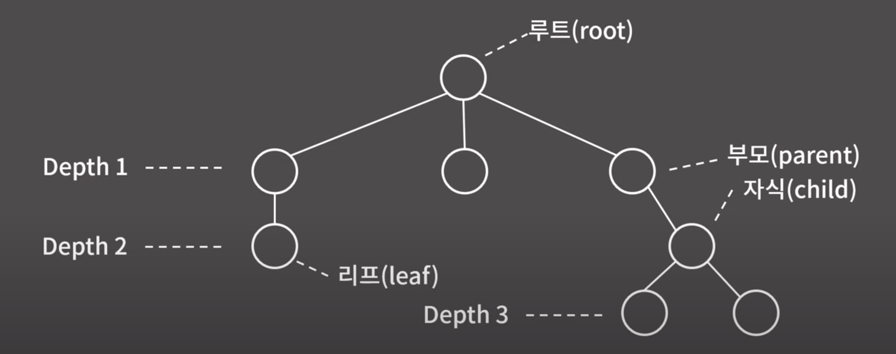
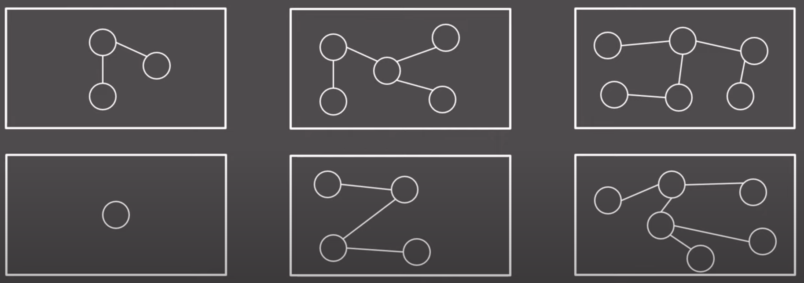
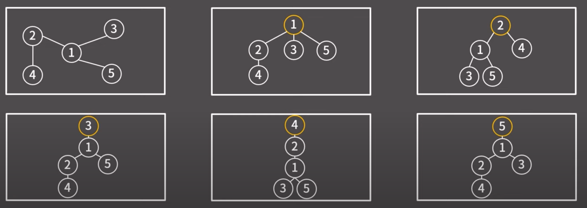
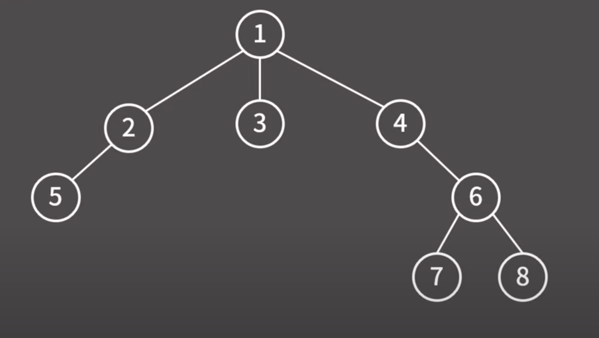
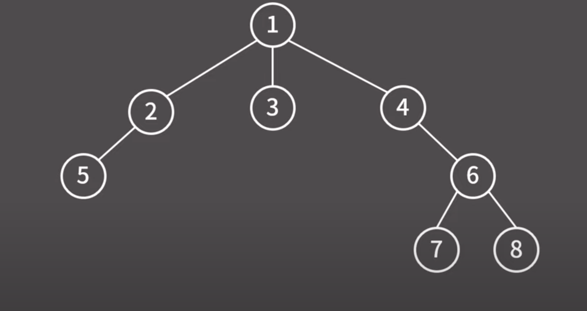
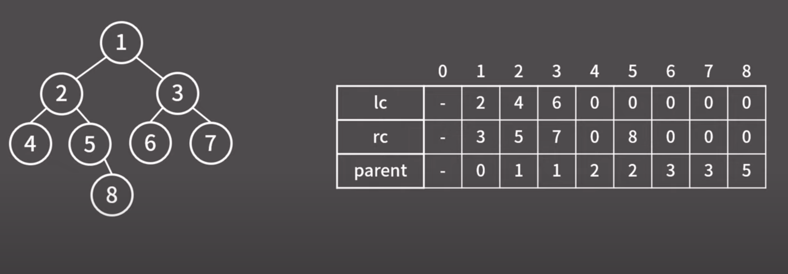

## 트리 정의 



트리 : 무방향이면서 사이클이 없는 연결 그래프(Undirected Acyclic Connected Graph)

---

## 트리 특징 



- 임의의 간선을 제거하면 연결 그래프가 아니게 되는 그래프 
- 임의의 두 점을 연결하는 simple path(정점이 중복해서 나오지 않는 경로)가 유일한 그래프 
- V개의 정점을 가지고 V-1개의 간선을 가지는 연결 그래프 
- 사이클이 없는 연결 그래프이면서 임의의 간선을 추가하면 사이클이 생기는 그래프 

---

## 임의의 정점을 루트로 만들기 



주어진 트리들은 모두 같은 트리이다. 

루트에 따라 트리 모양이 달라지고 각 노드의 부모 또한 달라진다. 

---

## 트리 BFS



트리에서의 BFS는 높이 순서대로 방문을 한다. 

1 → (2 / 3 / 4 ) → (5 / 6 ) → (7/ 8) 

트리에서는 BFS의 과정 속에서 자신의 자식들을 전부 큐에 넣어주기만 하면 된다. 

visited 배열의 필요가 없이 부모가 누구인지만 저장하고 있으면 된다. 

→ 해당 자식 정점으로 왔다면 이미 그 정점의 부모 정점은 방문을 한 상태이다.

---

## 트리 DFS



1 → 2 → 5 → 3 → 4 → 6 → 7 → 8 순서대로 방문 

일단 갈 수 있는 곳 까지 쭉쭉 들어가다가 더 이상 갈 수 없으면 돌아나와 다른 곳으로 간다

---

## 이진 트리의 순회 



- 그림처럼 배열을 통해서 정의하기 
- 구조체를 만들어서 하기 

```java
class Node{
	  int data;
	  Node left;
	  Node right; 
}
```

---

## 레벨 순회(Level-order Traversal)


루트에서 BFS를 돌리면 자연스럽게 레벨 순회가 된다. 

1 → 2 → 3 → 4 → 5 → 6 → 7 → 8

---

## 전위 순회(Preorder Traversal) 


1. 현재 정점을 방문한다.
1. 왼쪽 서브트리를 전위 순회한다. 
1. 오른쪽 서브트리를 전위 순회한다. 

순회 순서 

1 → 2 → 4 → 5 → 8 → 3 → 6 → 7 

전위 순회는 DFS와 방문 순서가 동일하다. 

---

## 중위 순회(Inorder Traversal) 


1. 왼쪽 서브 트리를 중위 순회한다.
1. 현재 정점을 방문한다.
1. 오른쪽 서브 트리를 중위 순회한다. 

순회 순서 

4 → 2 → 5 → 8 → 1 → 6 → 3 → 7

---

## 후위 순회(Postorder Traversal) 


1. 왼쪽 서브 트리를 후위 순회한다. 
1. 오른쪽 서브 트리를 후위 순회한다.
1. 현재 정점을 방문한다.

순회 순서 

4 → 8 → 5 → 2 → 6 → 7 → 3 → 1

---

## 구현 코드

```java
public class Tree {
    static class Node{
        int data;
        Node left;
        Node right;

        public Node(int data){
            this.data  = data;
            this.left  = null;
            this.right = null;
        }
        public void addLeft(Node node){
            this.left = node;
        }
        public void addRight(Node node){
            this.right = node;
        }

        public static void PreOrder(Node node){ // 전위 순회
            if(node == null) return;
            System.out.println(node.data);
            PreOrder(node.left);
            PreOrder(node.right);
        }
        public static void InOrder(Node node){ // 중위 순회
            if(node == null) return;
            InOrder(node.left);
            System.out.println(node.data);
            InOrder(node.right);
        }
        public static void PostOrder(Node node){ // 후위 순회
            if(node == null) return;
            PostOrder(node.left);
            PostOrder(node.right);
            System.out.println(node.data);
        }
    }
    /*
             1
         2       3
       4   5    6  7
             8
     */
    public static void main(String[] args) {
        Node node1 = new Node(1);
        Node node2 = new Node(2);
        Node node3 = new Node(3);
        Node node4 = new Node(4);
        Node node5 = new Node(5);
        Node node6 = new Node(6);
        Node node7 = new Node(7);
        Node node8 = new Node(8);

        node1.addLeft(node2);
        node1.addRight(node3);

        node2.addLeft(node4);
        node2.addRight(node5);

        node5.addRight(node8);

        node3.addLeft(node6);
        node3.addRight(node7);

        Node.PreOrder(node1);
        System.out.println("------");
        Node.InOrder(node1);
        System.out.println("------");
        Node.PostOrder(node1);

    }
}
```

