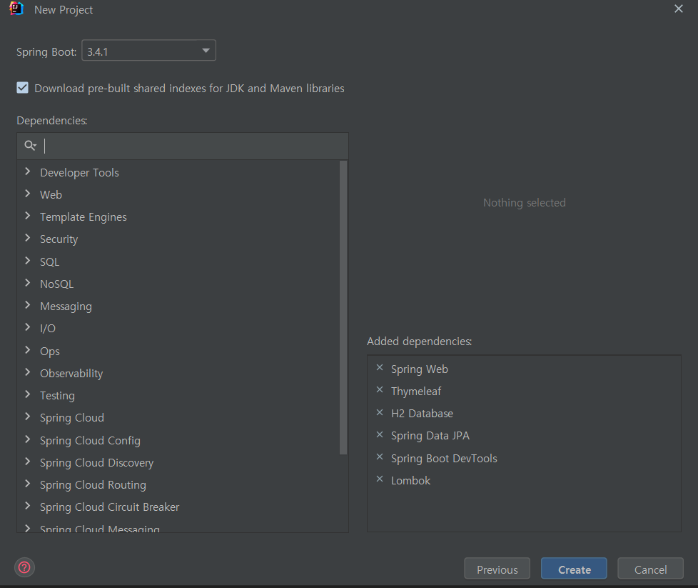
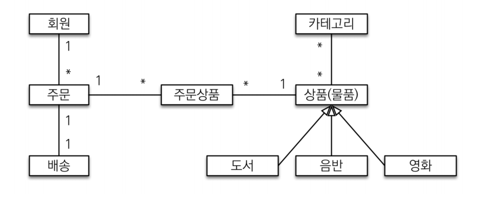
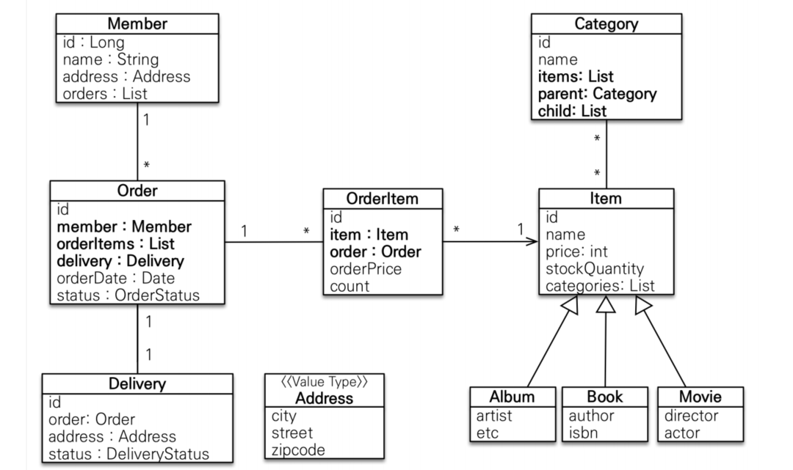
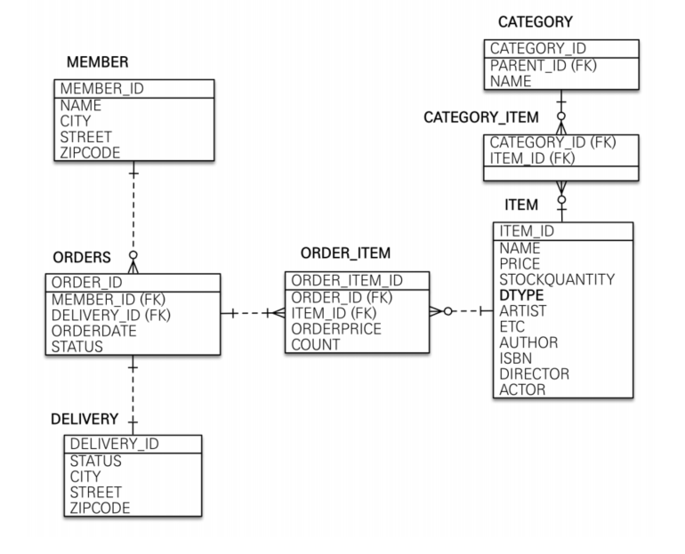
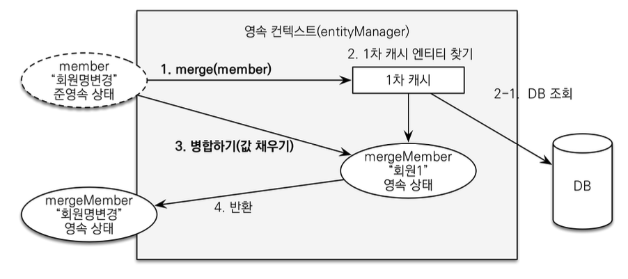

# *프로젝트 생성, 설정*

***Dependency***



***build.gradle***

```groovy
dependencies {
    implementation 'org.springframework.boot:spring-boot-starter-thymeleaf'
    developmentOnly 'org.springframework.boot:spring-boot-devtools'

    implementation 'org.springframework.boot:spring-boot-starter-web'

    implementation 'org.springframework.boot:spring-boot-starter-data-jpa'
    runtimeOnly 'com.h2database:h2'

    testImplementation 'org.springframework.boot:spring-boot-starter-test'
    testRuntimeOnly 'org.junit.platform:junit-platform-launcher'

    annotationProcessor 'org.projectlombok:lombok'
    compileOnly 'org.projectlombok:lombok'
    testImplementation 'org.projectlombok:lombok'
}
```

***application.yaml***

```yaml
spring:
  datasource:
    url: jdbc:h2:tcp://localhost/~/jpashop
    username: sa
    password:
    [REDACTED] org.h2.Driver
  jpa:
    hibernate:
	    ddl-auto: create
    properties:
        hibernate:
          # show_sql: true
          format_sql: true
logging.level:
  org.hibernate.SQL: debug
  org.hibernate.orm.jdbc.bind: trace 
```

  - *org.hibernate.SQL: logger를 통해 하이버네이트 실행 SQL*
  - *show_sql : 옵션은 System.out 에 하이버네이트 실행 SQL*

***쿼리 파라미터 로그 남기기 - 스프링 부트 3.0 build.gradle***

```groovy
implementation 'com.github.gavlyukovskiy:p6spy-spring-boot-starter:1.9.0'
```

  - [https://github.com/gavlyukovskiy/spring-boot-data-source-decorator](https://github.com/gavlyukovskiy/spring-boot-data-source-decorator)
- ***상세한 설정 + 다른 외부 라이브러리***

# *간단한 동작 확인*

```java
@Entity
@Getter @Setter
@NoArgsConstructor(access = AccessLevel.PUBLIC)
public class Member {
    @Id @GeneratedValue(strategy = GenerationType.IDENTITY)
    private Long id;
    private String username;
}

@Repository
public class MemberRepository {
    @PersistenceContext
    private EntityManager em;
    public Long save(Member member){
        em.persist(member);
        return member.getId();
    }
    public Member find(Long id){
        return em.find(Member.class, id);
    }
}

@SpringBootTest
class MemberRepositoryTest {

    @Autowired MemberRepository memberRepository;
    @Test
    @Transactional
    @Commit
    public void test(){
        // given
        Member member = new Member();
        member.setUsername("memberA");

        // when
        Long saveId = memberRepository.save(member);

        // then
        Member findMember = memberRepository.find(saveId);
        assertThat(findMember.getUsername()).isEqualTo(member.getUsername());
        assertThat(findMember).isEqualTo(member);
    }
}
```

- ***스프링 부트3.0 SQL 로그, 쿼리 파라미터 설정*** 

# *요구사항 분석* 

### *기능 정리*

  - ***회원 기능***
- *회원 등록* 
    - *회원 조회*
  - ***상품 기능***
- *상품 등록* 
    - *상품 수정*
    - *상품 조회*
  - ***주문 기능***
- *상품 주문*
    - *주문 내역 취소*
    - *주문 취소*
  - ***기타 요구사항***
- *상품은 재고 관리가 필요*
    - *상품의 종류는 도서, 음반, 영화가 존재*
    - *상품을 카테고리로 구분할 수 있다*
    - *상품 주문시 배송 정보를 입력할 수 있다*

# ***도메인과 테이블 설계***



### ***엔티티 분석*** 



### ***테이블 분석***



# ***엔티티 클래스 작성***

```java
public enum DeliveryStatus {
    READY, COMP
}

public enum OrderStatus {
    ORDER, CANCEL
}

@Entity
@Getter @Setter
@NoArgsConstructor(access = AccessLevel.PUBLIC)
public class Member {

    @Id @GeneratedValue(strategy = GenerationType.IDENTITY)
    @Column(name = "member_id")
    private Long id;

    private String username;

    @Embedded
    private Address address;

    @OneToMany(mappedBy = "member")
    private List<Order> orders = new ArrayList<>();
}

@Entity
@Table(name = "orders")
@Getter @Setter
@NoArgsConstructor(access = AccessLevel.PUBLIC)
public class Order {
    @Id
    @GeneratedValue(strategy = GenerationType.IDENTITY)
    @Column(name = "order_id")
    private Long id;

    @ManyToOne(fetch = FetchType.LAZY)
    @JoinColumn(name = "member_id")
    private Member member;

    @OneToMany(mappedBy = "order")
    private List<OrderItem> orderItems = new ArrayList<>();

    @OneToOne(fetch = FetchType.LAZY)
    @JoinColumn(name = "delivery_id")
    private Delivery delivery;

    private LocalDateTime orderDate;

    @Enumerated(EnumType.STRING)
    private OrderStatus status;
}

@Entity
@Getter @Setter
@NoArgsConstructor(access = AccessLevel.PUBLIC)
public class Delivery {

    @Id @GeneratedValue(strategy = GenerationType.IDENTITY)
    @Column(name = "delivery_id")
    private Long id;

    @OneToOne(fetch = FetchType.LAZY, mappedBy = "delivery")
    private Order order;

    @Embedded
    private Address address;

    @Enumerated(EnumType.STRING)
    private DeliveryStatus status;
}

@Entity
@Getter @Setter
@NoArgsConstructor(access = AccessLevel.PUBLIC)
public class OrderItem {
    @Id @GeneratedValue(strategy = GenerationType.IDENTITY)
    private Long id;

    @ManyToOne(fetch = FetchType.LAZY)
    @JoinColumn(name = "order_id")
    private Order order;

    @ManyToOne(fetch = FetchType.LAZY)
    @JoinColumn(name = "item_id")
    private Item item;

    private int orderPrice;
    private int count;
}

@Entity
@Getter @Setter
@NoArgsConstructor(access = AccessLevel.PUBLIC)
@Inheritance(strategy = InheritanceType.SINGLE_TABLE)
@DiscriminatorColumn(name = "type")
public abstract class Item {

    @Id @GeneratedValue(strategy = GenerationType.IDENTITY)
    @Column(name = "item_id")
    private Long id;

    private String name;

    private int price;

    private int stockQuantity;

    @ManyToMany(mappedBy = "items")
    private List<Category> categories = new ArrayList<>();
}

@Entity
@Getter
public class Movie extends Item {
    private String director;
    private String actor;
}

@Entity
@Getter
public class Album extends Item {
    private String artist;
    private String etc;
}

@Entity
@Getter
public class Book extends Item {
    private String author;
    private String isbn;
}


@Entity
@Getter @Setter
@NoArgsConstructor(access = AccessLevel.PUBLIC)
public class Category {
    @Id
    @GeneratedValue(strategy = GenerationType.IDENTITY)
    @Column(name = "category_id")
    private Long id;

    private String name;

    @ManyToOne(fetch = FetchType.LAZY)
    @JoinColumn(name = "parent_id")
    private Category parent;

    @OneToMany(mappedBy = "parent")
    private List<Category> child = new ArrayList<>();

    @ManyToMany
    @JoinTable(name = "category_item",
        joinColumns = @JoinColumn(name = "category_id"),
        inverseJoinColumns = @JoinColumn(name = "item_id")
    )
    private List<Item> items = new ArrayList<>();
}

```

  - ***Categoty Entity***
- *Category ↔ Item @ManyToMany 사용(실무에서는 사용 금지)*
    - *Category parent, child self Mapping*
  - ***Item Entity***
- *상속 관계 - abstract class, single table 전략 사용*
  - ***Address***
- *값 타입, immutable 객채로 설계*
  - ***Order*** 
- *Order ↔ Delivery @OneToOne Order에서 외래키 관리*
  - ***나머지는 설명 생략***

# ***엔티티 설계시 주의점***

***엔티티에 Setter를 사용하지 말자***

***모든 연관관계를 지연로딩으로 설정하자***

  - *즉시로딩은 예측이 어렵고, 특히 JPQL 사용할 때 N+1 문제가 자주 발생한다.*
  - *연관된 엔티티를 함께 DB에서 조회해야 하면, fetch join 또는 엔티티 그래프 기능을 사용한다.*
  - *OneToOne, ManyToOne 관계는 default가 즉시로딩이므로 직접 지연로딩으로 설정해야 한다.*

***컬렉션은 필드에서 초기화 하자***

  - *null pointer exception 문제에  안전하다.*
  - *하이버네이트는 엔티티를 영속화 할 때, 컬랙션을 감싸서 하이버네이트가 제공하는 내장 컬렉션으로 변경한다.* 
*만약 임의의 메소드에서 컬렉션을 잘못 생성하면 하이버네이트 내부 메커니즘에 문제가 발생할 수 있다.*
  - *필드레벨에서 생성하는 것이 가장 안전하고 코드도 간결하다*

***테이블, 컬럼명 생성 전략***

  - *엔티티(필드) → 테이블(컬럼)*
  - *카멜케이스 → 언더스코어*
- *memberPoint → member_point*

- ***엔티티 설계시 주의점***

### ***도메인 모델 패턴***

*주문 서비스의 주문, 주문 취소 메소드를 보면 비즈니스 로직 대부분이 엔티티에 존재한다.*

*서비스 계층은 단순히 엔티티에 필요한 요청을 위임하는 역할을 한다.*

*이처럼 비즈니스 로직을 가지고 객체 지향의 특성을 적극 활용하는 것을* ***도메인 모델 패턴****이라 한다.*

*반대로 엔티티에 비즈니스 로직이 거의 없고 서비스 계층에서 대부분의 비즈니스 로직을 처리하는 것을* ***트랜잭션 스크립트 패턴****이라 한다.*

# *변경 감지와 병합(merge)* 

***현재 업데이트 코드: controller → service → repository(merge)***

```java
// controller
@PostMapping("/items/{itemId}/edit")
public String update(@ModelAttribute BookForm form) {
    Book book = new Book();
    book.setId(form.getId());
    book.setName(form.getName());
    book.setPrice(form.getPrice());
    book.setStockQuantity(form.getStockQuantity());
    book.setAuthor(form.getAuthor());
    book.setIsbn(form.getIsbn());

    itemService.saveItem(book);

    return "redirect:/items";
}

// service
@Transactional
public void saveItem(Item item){
    itemRepository.save(item);
}

// repository
public void save(Item item){
    if(item.getId() == null){
        em.persist(item);
        return;
    }
    em.merge(item);
}
```

### ***준영속 엔티티?***

*준영속 엔티티란 영속성 컨텍스트가 더는 관리하지 않는 엔티티를 말한다.* 

```java
Book book = new Book();
book.setId(form.getId());
```

*Book 객체는 이미 DB에 한번 저장되어서 식별자가 존재한다.*

*이렇게 임의로 만들어낸 엔티티도 기존 식별자를 가지고 있으면 준영속 엔티티로 볼 수 있다.*

*준영속 엔티티를 수정하는 방법은 2가지 존재한다.*

  - *변경 감지 기능 사용* 
  - *병합(merge) 사용*

### ***변경 감지 기능 사용***

```java
@Transactional
void update(Item itemParam) { 
		Item findItem = em.find(Item.class, itemParam.getId()); 
		findItem.setPrice(itemParam.getPrice()); 
}
```

  - *itemParam: 준영속 엔티티* 
  - *트랜잭션 안에서 엔티티를 다시 조회 준영속 엔티티의 id를 통해 데이터베이스에서 조회한다.* 
  - *데이터의 값을 변경하면 트랜잭션 커밋 시점에* ***변경 감지(Dirty Checking)****이 동작해서 update sql 실행된다.*	

### *병합 사용*

```java
public void save(Item item){
    em.merge(item);
}
```

  - *준영속 상태의 엔티티를 병합*



  1. *merge() 실행*
  1. *파라미터로 넘어온 준영속 엔티티의 식별자 값으로 1차 캐시에서 엔티티를 조회 
1차 캐시에 엔티티가 없으면 데이터베이스에서 엔티티를 조회하고, 1차 캐시에 저장한다.*
  1. *조회한 영속 엔티티에 준영속 엔티티의 값을 채워 넣는다.* 
  1. *영속 상태인(조회한) 엔티티를 반환한다.* 
  1. *트랜잭션 커밋 시점에  update sql 실행*

*이렇게 보면 병합 방식과 변경 감지 방식은 거의 똑같아 보인다.*

*심지어 병합 방식은 단순하게 merge() 호출만 하면 끝나서 더 간단해 보인다.*

*하지만 큰 차이점이 존재하고 이 차이점 때문에 병합 방식(merge)는 사용하지 않는다.*

### *차이점* 

*병합은 모든 필드를 변경해 버린다.*

*즉, 준영속 엔티티의 데이터가 없으면 null로 업데이트 해버린다.*

*병합을 사용하면서 이 문제를 해결하려면, 변경 폼(준영속 엔티티)에서 모든 데이터를 항상 유지해야 한다.*

*실무에서는 보통 제한적으로 변경가능한 데이터만 노출하기 때문에 병합을 사용하는 것이 오히려 번거롭다.* 

### ***가장 좋은 해결 방법***

*엔티티를 변경할 때는 항상 변경 감지를 사용하자* 

*setter를 사용하지 말고 엔티티에 변경 메소드를 만들자*

  - *public setter 허용은 데이터가 정확히 어디서 바뀌는지 파악하기 힘들다.* 
  - *엔티티에 변경 메소드가 존재하면 엔티티만 확인하면 끝난다.*

*어설프게 엔티티를 생성하지 말고, 트랜잭션이 있는 서비스 계층에 식별자(id)와 변경할 데이터를 (파라미터, dto)로 전달하자* 

*서비스 계층에서 엔티티를 조회하고, 엔티티의 데이터를 직접 변경하자* 

***example***

  - *사용자가 변경한 값 받아오는 클래스: UpdateForm(dto) 클라이언트 ↔ 컨트롤러* 
  - *변경할 필드만 존재하는 클래스 UpdateDto(dto) 컨트롤러 ↔ 서비스* 
  - *엔티티 변경 메소드 change(UpdateDto dto)* 
- *내부에서 private setter 사용*

*파라미터 개수가 적으면 별도의 UpdateDto 클래스 없이 파라미터만 넘기는 방식도 괜찮아 보인다.*

- ***매우 중요한 내용, 변경 방법 정리***

