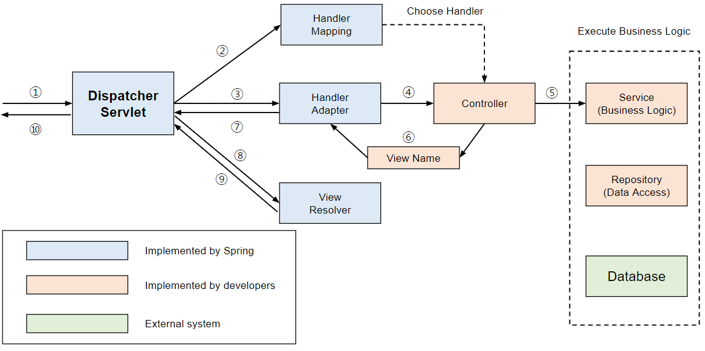
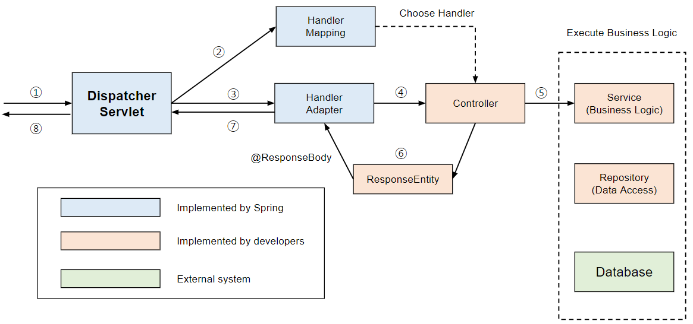



2번 과정과 3번 과정 사이에는 Adapter 탐색 과정이 추가로 존재한다.

HttpMessageConverter 

- StringHttpMessageConverter (String)
- MappingJackson2HttpMessageConverter (Object)
- another converter (another data type)

해당 그림에서 4번(메시지 → 객체 Deserialization) 6번(객체 → 메시지 Serialization) 2번의 과정에서 메시지 컨버터가 사용된다.

[https://mangkyu.tistory.com/49](https://mangkyu.tistory.com/49)

