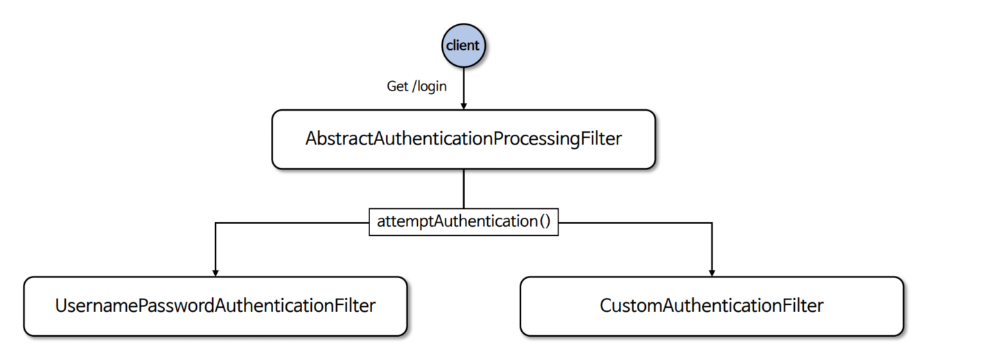
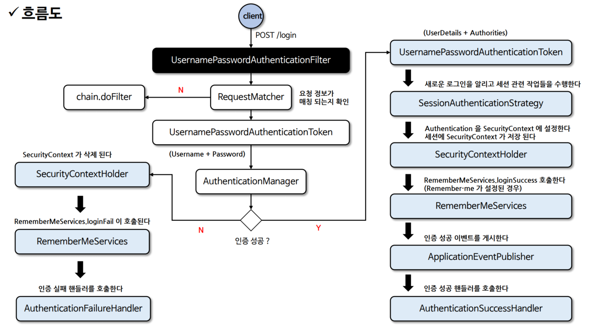

- 스프링 시큐리티는 `AbstractAuthenticationProcessingFilter` 클래스를 사용자의 자격 증명을 인증하는 기본 필터로 사용 한다 
- `UsernamePasswordAuthenticationFilter` 는 `AbstractAuthenticationProcessingFilter` 를 확장한 클래스로서 HttpServletRequest에서 제출된 사용자 이름과 비밀번호로부터 인증을 수행한다 
- 인증 프로세스가 초기화 될 때 로그인 페이지와 로그아웃 페이지 생성을 위한 `DefaultLoginPageGeneratingFilter` 와 `DefaultLogoutPageGeneratingFilter` 가 초기화 된다 

# **구조** 

만약 Custom한 인증 필터를 만들고 싶으면 `AbstractAuthenticationProcessingFilter` or `UsernamePasswordAuthenticationFilter` 클래스를 확장하고 `attemptAuthentication()` 메소드를 재정의(오버라이딩)해야 한다 

또한 해당 필터를 SecurityConfig를 통해 추가해야 한다 

client가 `loginProcessingUrl()에 설정한 url`이거나 `시큐리티가 제공하는 기본 url: login`으로 요청을 하면 `UsernamePasswordAuthenticationFilter`는 인증을 시도하고 아니라면 바로 다음 filter로 넘어간다 

이 요청 URL에 대한 확인은 `RequestMatcher`를 통해서 한다

